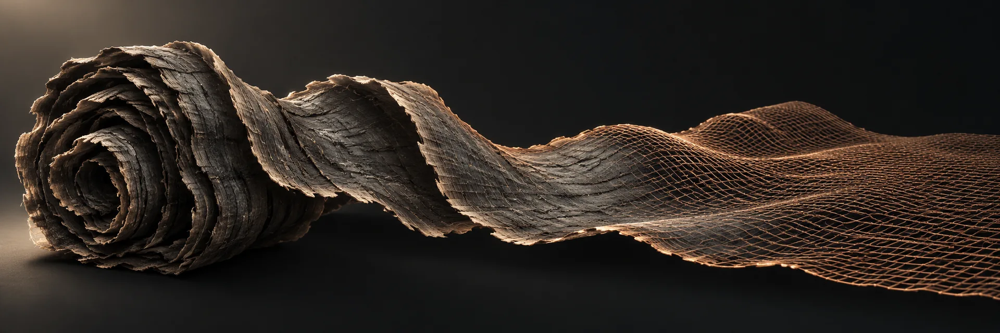

# Scrolls: Vesuvius Challenge workbench

[](LICENSE)
[](#quick-start)
[](https://scrollprize.org/)



*Concept illustration. [Artwork notes](docs/assets/README.md).*

Open tools, public-data benchmarks and research notes for the [Vesuvius Challenge](https://scrollprize.org/): reading the carbonized Herculaneum papyri from X-ray CT scans. The tools plan, check, score and record runs of the official open-source pipeline, [ScrollPrize/villa](https://github.com/ScrollPrize/villa); they do not replace it.

> [!IMPORTANT]
> **This repository does not claim that any letters have been found in any scroll.** An ink map is model output, not a reading.

## Start here

- **New to the challenge?** [Start Here](docs/start-here.md) goes from a browser tour to one small task with the official tools, for macOS, Linux and Windows. You can begin without a GPU or programming experience.
- **Look first:** [Unroll](https://huggingface.co/spaces/SharpMeow/unroll) shows scroll scans in 3D in your browser, and the [picture guide](docs/workbench.md) shows the toolbox with real screenshots.
- **Practice offline:** [Scrolls Starter](docs/start-here.md#2-try-scrolls-starter-on-your-computer) has a synthetic exercise and a setup check.
- **Look up a word:** the [glossary](GLOSSARY.md).

## Released tools

<!-- releases:start (generated from docs/releases.json by python -m kit releases render; edit that list, not this section) -->
Every released tool, one line each; each name opens its guide. Generated from [`docs/releases.json`](docs/releases.json).

### Apps, packages and datasets

| Tool | What it does |
| --- | --- |
| [AutoPipeline](docs/tools/autopipeline.md) | Runs villa's VC3D tools and ink detection on a released scan, from surface checks to ink maps scored with controls (package, 0.1.11). |
| [Unroll (interactive 3D scroll viewer)](docs/tools/unroll.md) | Virtually unrolls scroll scans in 3D in your browser, with ink layers, CT tools and an Ink Bench for comparing ink models (Space). |
| [Ringleader (winding labels for every sheet in a z-slice, in one solve)](docs/tools/ringleader.md) | Labels every m7 sheet pixel of a z-slice with its winding in one solve; hands its surest labels to villa's spiral fit as relative windings (corrected in 1.2.0). |
| [Fiber stop score (two opt-in settings for villa's beam fiber tracer)](docs/tools/fiber-stop-score.md) | Ends a beam fiber trace before it slides onto the next fiber; with the sheet-plane penalty it was tested with. villa draft PRs #2377 and #2265. |
| [Umbilici (center lines of 35 Herculaneum scans)](docs/tools/umbilici.md) | Every public center line (umbilicus) we know of for 35 scans, 91 lines from seven sources, in 3D over the CT, with line ends outside the scroll hidden (Space). |
| [Parting (same layer or next layer where two papyrus layers touch)](docs/tools/parting.md) | Scores whether a point where two papyrus layers touch lies on the same layer or the next, against base dinovol's cosine; code and model file. |
| [Vesuvius Radar (new papers, code and data for the scrolls)](docs/tools/vesuvius-radar.md) | New papers, code, models and data that could help read the scrolls, from public sources around the clock, scored, with an API and MCP (Space). |
| [Crackle Check (is there ink crackle in this patch?)](docs/tools/crackle-check.md) | Asks one ink model whether a small patch of a segment shows ink crackle, with the reversed layer order as its control (Space, API and MCP). |
| [Snapped Labels (published surface labels moved onto the papyrus)](docs/tools/snapped-labels.md) | Every published surface label of PHerc0139, PHerc0814, PHerc0841 and PHerc0172, moved onto the papyrus recto face, as tifxyz meshes with a viewer on live CT. |
| [AFV Fibers (papyrus fiber curves for six whole scans)](docs/tools/afv-fibers.md) | Papyrus fiber curves from Qual's AFV V2 for six whole scans, as .afv files VC3D opens, with a Space to explore any box and a fiber-set catalog. |
| [Ink Atlas (seven ink models on the First Letters surfaces)](docs/tools/ink-atlas.md) | Seven public ink models on the same First Letters surfaces, one 9.6 um canvas: a dataset, a Space with a loupe and compare, and an MCP server. |
| [Lasagnetta (fast preview of villa's lasagna field)](docs/tools/lasagnetta.md) | A fast preview of villa's lasagna field, about 5 times faster than villa predict3d (6.6 times with larger tiles), with a built-in self-check against villa. |
| [Fiber Checker (are papyrus fibers visible on a traced surface?)](docs/tools/fibercheck.md) | A free per-patch fiber map of any traced segment or your own tifxyz, with a self-check on every run, as a Space and a command line tool. |
| [Lasagna Fields](docs/tools/lasagna-fields.md) | Find 56 published fields across 35 scrolls, copy normals URLs, download data and preview the selected acquisition. |
| [Segment Lens (published segment geometry viewer)](docs/tools/segment-lens.md) | Shows published segment meshes with geometry warnings and the Segment Atlas table, with an API and MCP server for agents (Space). |
| [dinovol embeddings of PHerc0841](docs/tools/dinovol-embeddings.md) | Precomputed dinovol embeddings of the whole PHerc0841 scan, to search, cluster or segment by feature similarity without a GPU. |
| [Headless VC3D for agents](docs/tools/vc3d-agent.md) | An MCP server and shell command that let an AI agent run villa's VC3D tools with no display, checks built in (package, 1.1.1). |
| [Ink Lens (control-checked ink on your own VC3D region)](docs/tools/ink-lens.md) | Checks one region of your own VC3D segment for ink in seconds, keeping only ink above its own reversed-depth control (Space). |
| [Scrolls Starter: a beginner path into the tools](docs/tools/starter.md) | A beginner path in your browser: a synthetic practice exercise with a control, a setup checker and a Scroll Text Reader command builder. |
| [Inkfilter: fixed surface-volume filters](docs/tools/inkfilter.md) | Makes model-free maps from a surface-volume window, each with a reversed-depth control; not a trained reader (package). |
| [Scroll Lens (3D DINO, ink and surface models on scan cubes)](docs/tools/scroll-lens.md) | Shows what the organizers' 3D models (dinovol, 3D ink, recto surface) see inside a cube of a public scan (Space). |

### Scrolls kit

Command-line tools, benchmarks and script folders that run from a clone of this repository. [Guide](docs/tools/cli.md). Open an area to see its tools.

<details>
<summary><b>Pipeline and agents</b> (4)</summary>

| Tool | What it does |
| --- | --- |
| [drivers: background jobs that cannot die unnoticed](docs/tools/drivers.md) | Runs background jobs that report themselves lost after a kill or reboot, and revives only the restartable ones. |
| [Scan catalog and batch plans](docs/tools/batch.md) | Lists released scan volumes, makes resumable batch plans and watches for new or changed inputs. |
| [Scroll to ink in one command (experimental)](docs/tools/scroll2ink.md) | Experimental: one command from a public scan and a seed point to an ink map with its reverse-depth control, stopping at a failed check. |
| [Swap any stage by name](docs/tools/stagereg.md) | Lists every option for each stage of reading a scroll, with its maker, license and maturity, so a workflow can swap any stage by name. |

</details>

<details>
<summary><b>Viewers and apps</b> (5)</summary>

| Tool | What it does |
| --- | --- |
| [Offline ink map comparison viewer](docs/tools/view.md) | Builds one offline HTML page to compare ink maps, their differences, labels and the mask. |
| [Terminal look and mouse viewer](docs/tools/termstyle.md) | Gives every kit command and script one styled terminal look, plain for pipes and --json, with a full-screen mouse viewer. |
| [Tool connection instructions](docs/tools/spaceconnect.md) | Writes and checks connection instructions and code examples for the public tools' hosted pages. |
| [Volume on a sheet in Neuroglancer](docs/tools/sheetview.md) | Samples a CT or prediction volume on a tifxyz surface and writes a mesh and Neuroglancer view. |
| [Volume overlay links](docs/tools/volumeview.md) | Creates Neuroglancer overlay links from supplied volume metadata. |

</details>

<details>
<summary><b>Surfaces and tracing</b> (21)</summary>

| Tool | What it does |
| --- | --- |
| [Autocrop: good regions of a spiral fit](docs/tools/autocrop.md) | Keeps the regions of a villa spiral fit most likely on the right winding and writes them as relative windings, with controls. |
| [Bounded surface correction (experimental)](docs/tools/surfacefix.md) | Suggests bounded surface shifts using agreement between maps from two traces and keeps only shifts that pass its controls. |
| [freshmap: where a scroll's papyrus is still untraced](docs/tools/freshmap.md) | Maps a scroll's untraced m7 papyrus by band, angle and radius, ranks targets and checks new meshes against it. |
| [Label snap on a finer registered scan](docs/tools/finesnap.md) | Snaps a label traced on a coarse scan onto the recto face seen in a finer, per-site registered scan of the same scroll. |
| [Label snap onto the recto face](docs/tools/labelsnap.md) | Moves a tifxyz surface label along its normals onto the recto face of its papyrus band, with an abstain mask and VC3D review points. |
| [Mesh and cross-scan audit](docs/tools/meshaudit.md) | Checks cross-scan transforms, mesh canvases and rendering depth against public catalog geometry. |
| [Planted defect generator](docs/tools/planted.md) | Plants sheet switches, holes and other defects into synthetic tifxyz surfaces with a known answer, to test checkers against. |
| [Published segment coverage](docs/tools/coverage.md) | Shows the heights and winding angles covered by published meshes and the gaps between them. |
| [Relative winding consistency check](docs/tools/windconsistency.md) | Passes relative winding counts only when every one is an integer and all of them can hold at once. |
| [Relative windings in a box](docs/tools/windlabel-box.md) | Grows chains of sheet crossings around a point and writes villa's relative_windings.json for a spiral fit, with a VC3D plugin. |
| [Scroll center (umbilicus) finder and coverage polish](docs/tools/umbilicus.md) | Finds a scroll's winding center line (umbilicus) in its CT scan with two small U-Nets and writes umbilicus.json for VC3D. |
| [ScrollSim Hard Cases: exact 3D layouts of the hard parts of papyrus CT](docs/tools/hardcases.md) | Exact 3D layouts of folds, contact, crushing, cracks, edges and spiral centers, with a zone map and a CT render you can fit to a real scan. |
| [ScrollSim v2: a full-scale synthetic scroll](docs/tools/scrollsim2.md) | Renders a synthetic scroll of 100 plus windings block by block, with a CT scan model, optional ink, realism statistics and exact winding and surface truth. |
| [Segment Atlas](docs/tools/atlas.md) | Measures published segment meshes with the same geometry checks and builds a searchable table. |
| [Segment stack check](docs/tools/stackcheck.md) | Checks a stack of consecutive tifxyz segments against the umbilicus from geometry alone: winding order, spacing, gaps and overlaps. |
| [Segments without VC3D](docs/tools/tifxyz.md) | Reads a tifxyz segment, local or from the open-data bucket, and reports its true area, grid, holes and folds, with numpy and tifffile only. |
| [sheethug: fused-sheet blocks and a split score for pressed sheets](docs/tools/sheethug.md) | Synthetic fused-contact sheet stacks and split recall, a score that sees when a model merges two touching sheets. |
| [Surface overlap and map comparison](docs/tools/overlap.md) | Checks whether traced surfaces cover the same sheet and compares their labels or ink maps with controls. |
| [Touching-sheets benchmark](docs/tools/hopbench.md) | Plants sheet hops at real contacts between PHerc0139's hand-traced windings and measures how often a one-sheet check misses them. |
| [UV overlap gate](docs/tools/uvgate.md) | Checks a flattened sheet's UV triangles for any overlap, with exact arithmetic, plus coverage. |
| [Winding direction from the surface prediction](docs/tools/slicechains.md) | Calls a scroll's winding direction (CW or ACW, the spiral fit's spiral_outward_sense) from its m7 surface prediction, with no labels. |

</details>

<details>
<summary><b>Ink maps and models</b> (4)</summary>

| Tool | What it does |
| --- | --- |
| [Checkpoint averaging](docs/tools/soup.md) | Averages compatible model checkpoints from one training run and refuses a mixture of different seeds. |
| [Ink map ensemble](docs/tools/ensemble.md) | Combines ink maps of the same surface by weighted score or pixel rank, keeping only pixels predicted by every input. |
| [Mac ink inference and verification scripts](docs/tools/mac-w045.md) | Runs public ink-model checks on a Mac with reverse-depth controls. |
| [v8in ink model runner](docs/tools/v8in-run.md) | Runs the released v8in ink model on layer images, including an optional reduced-precision Mac GPU mode. |

</details>

<details>
<summary><b>Scoring and controls</b> (14)</summary>

| Tool | What it does |
| --- | --- |
| [Acquisition recipe fidelity against a finer reference scan](docs/tools/sqrecipe.md) | Compares two CT acquisitions of one scroll region by region against a finer reference scan; one frozen PASS on PHerc0332, CT against CT. |
| [Controlled benchmark gate](docs/tools/gate.md) | Checks recorded benchmark scores against the declared pass rules and required controls. |
| [Controlled ink AUC scoring](docs/tools/auc.md) | Scores an ink map against labeled ink and background with a reverse-depth control; kit.aucreport adds curves, AP, tiles and a shifted-label null. |
| [finite: refuse speeds, scores and maps taken from NaN or Inf output](docs/tools/finite.md) | Refuses any speed, score or map taken from model output that holds NaN or Inf, and flags fp16 sums that would overflow. |
| [Ink map agreement check](docs/tools/verify.md) | Checks whether two ink maps of the same input agree while requiring a deliberately different control to fail. |
| [Ink map self-check (neighbor-sheet test)](docs/tools/sheetcheck.md) | Checks without labels whether an ink map reads the traced sheet, comparing it with the same model one and two sheets away. |
| [Ink offset diagnostic (AUC against surface offsets along the normal)](docs/tools/offsetdiag.md) | Measures how much an ink model's AUC changes when a segment's surface moves along its normal, and tests a lasagna sheet-center snap against same-size controls. |
| [Letter-scale ink score](docs/tools/hpscore.md) | Compares an ink map with published labels after removing broad brightness changes, with displaced-label and reverse-depth controls. |
| [Research integrity checks for Vesuvius claims](docs/tools/integrity.md) | Checks a claim before it goes out: controls on the same pixels, held-out status, number sources, preregistration and wording. |
| [Seam-aware winding switches](docs/tools/seamswitch.md) | Counts how often a spiral fit puts touching vertices of one traced sheet on different windings, allowing for the fit's seam. |
| [simcritic: a held-apart judge of how real simulated CT looks](docs/tools/simcritic.md) | Fresh critics try to tell real CT from simulated tiles, with a real-against-real control and views that show what gives the simulation away. |
| [StrokeNet text-likeness score](docs/tools/strokenet.md) | Scores how much a window of an ink map looks like lines of text, with rotation and IAAFT controls, using only NumPy. |
| [Synthetic map controls](docs/tools/phantom.md) | Creates known-answer synthetic inputs for checking ink-map scoring and controls. |
| [Text-row pattern score](docs/tools/rowscore.md) | Measures repeating bands in forward and reverse ink maps as a triage aid, without interpreting text. |

</details>

<details>
<summary><b>Letters and titles</b> (5)</summary>

| Tool | What it does |
| --- | --- |
| [Greek character language model](docs/tools/greeklm.md) | Builds and scores a character language model from public Greek text for the letter reader. |
| [Greek gap restoration benchmark](docs/tools/greekfill.md) | Hides letters in public Greek text and scores hosted text models against a Kneser-Ney letter model under a frozen rule. |
| [Greek letter classifier and line reader for agents](docs/tools/letterclass.md) | Names Greek capital letters in given boxes on papyrus photographs and reads lines of boxes, as a JSON command and an MCP server. |
| [greekpages: synthetic Greek book-hand pages with exact letter labels](docs/tools/greekpages.md) | Synthetic Greek book-hand pages as ink-probability maps with exact letter labels and pluggable styles, for training letter readers. |
| [Scroll Text Reader](docs/tools/letterread.md) | Proposes Greek capital letters with boxes and confidences on ink maps, drawn labels and photographs, on a CPU, with null and orientation controls. |

</details>

<details>
<summary><b>Data and downloads</b> (9)</summary>

| Tool | What it does |
| --- | --- |
| [AFV fiber streaming](docs/tools/fibers.md) | Streams the AFV fibers in one box of a scan without the whole download: the same fibers and .afv bytes as filtering the full file. |
| [False-404 test relay](docs/tools/false404-relay.md) | Replays selected false missing-file responses through a local relay so cache handling can be tested. |
| [Fast public label downloads](docs/tools/hfpull.md) | Downloads a folder of the organizers' public Hugging Face datasets bucket fast, fetching each distinct file once. |
| [Find, center line, cite and villa helpers](docs/tools/find.md) | Lists everything public for one scroll, fetches its best center line, prints credit lines, and checks villa PR timing and text. |
| [Layer extraction and shuffle control](docs/tools/layers.md) | Exports surface-volume layers as images and creates a shuffled-depth control. |
| [Public bucket downloader](docs/tools/fetch.md) | Copies files under a public data bucket prefix to a local folder and skips complete files when resuming. |
| [Published ink labels and model exposure](docs/tools/labels.md) | Lists published ink label sets and the recorded training exposure of public ink models. |
| [VC3D false-404 relay and cache repair](docs/tools/vc3dfix.md) | Runs VC3D through a relay that retries false missing-file responses and checks its empty-chunk cache. |
| [voltransform: move points between scan volumes with the revision 2 transforms](docs/tools/voltransform.md) | Moves points between scan volumes with the organizers' revision 2 transforms and skips superseded data. |

</details>

<details>
<summary><b>Training</b> (3)</summary>

| Tool | What it does |
| --- | --- |
| [Label suggestions from reader disagreement](docs/tools/labelsuggest.md) | Ranks tiles by where readers' ink maps disagree, so a person labels there first; beat random tiles on two scrolls, not shown to beat simple picks. |
| [Segmentation model comparison tools (experimental)](docs/tools/segzoo.md) | Lists segmentation model families and provides training and controlled scoring scripts. |
| [Training-run comparison for label suggestions](docs/tools/altrain.md) | Tests whether fine-tuning on suggested tiles beats random tiles; on three fragments it did not. |

</details>

<details>
<summary><b>Planning and prizes</b> (4)</summary>

| Tool | What it does |
| --- | --- |
| [Local setup checker](docs/tools/doctor.md) | Checks the machine and installed tools before a pipeline run. |
| [Pipeline planning and cost estimates](docs/tools/plan.md) | Prints the official pipeline commands for a scroll without running them. |
| [Public prize snapshot](docs/tools/prizes.md) | Lists public prize requirements from a dated local snapshot. |
| [Submission folder check](docs/tools/submitcheck.md) | Checks a submission folder against published file requirements and lists the remaining checks for a person. |

</details>

<details>
<summary><b>Compute and cost</b> (9)</summary>

| Tool | What it does |
| --- | --- |
| [accelbench: time a faster version only after its output matches](docs/tools/accelbench.md) | Times a faster version of some code only after its output matches the original, with a control. |
| [cpudiag: time a CPU flavor against a container, core by core](docs/tools/cpudiag.md) | Benchmarks a cloud CPU machine against a known one to show why a CPU job runs slower than expected. |
| [hubcall: Hugging Face Hub calls that back off together on a 429](docs/tools/hubcall.md) | Retries Hugging Face Hub calls on 429 and 5xx with one cool-down shared by every process on the machine, and logs who made them. |
| [Hugging Face Jobs ledger importer](docs/tools/hf-rows.md) | Adds finished Hugging Face Jobs to a cost ledger with the cost from Hugging Face's own bill, once per Job, and restricts public ledgers to generic work. |
| [Local run time and cost log](docs/tools/run-local.md) | Runs a local command and records its elapsed time and estimated electricity cost, or adds records of past runs. |
| [Modal ledger row importer](docs/tools/modal-row.md) | Adds a recorded job to a cost ledger once and restricts public ledgers to rows marked generic. |
| [mpsparity: same training result on Apple MPS as on the CPU](docs/tools/mpsparity.md) | Checks that a small torch training gives the same result on Apple's GPU as on the CPU, with controls. |
| [Run time and energy summary](docs/tools/compute.md) | Summarizes machine time from run provenance records, with an optional energy estimate. |
| [runlength cpu: wall time and timeout of a CPU job on a measured flavor](docs/tools/runlength.md) | Estimates how long a CPU job takes on a cloud CPU machine from one task timed in a small container. |

</details>

<details>
<summary><b>Records and provenance</b> (3)</summary>

| Tool | What it does |
| --- | --- |
| [Experiment ledger](docs/tools/run-ledger.md) | Keeps a run record with a fixed readout rule, status, costs, file fingerprints and checks. |
| [freeze: freeze a run by hash, guard what it loads, keep review pins honest](docs/tools/freeze.md) | Freezes a run by the hashes of the files it executes, guards what it loads, and keeps review verdicts tied to the reviewed code. |
| [Run provenance records](docs/tools/provenance.md) | Records run settings and file fingerprints, then checks the record and its files for changes. |

</details>

<details>
<summary><b>Releases and repository</b> (4)</summary>

| Tool | What it does |
| --- | --- |
| [Recurring repository checks](docs/tools/routines.md) | Lists and runs the registered recurring repository checks and records their status locally. |
| [Release list and README generator](docs/tools/releases.md) | Keeps the public release list, compact tool inventory and generated README section in step. |
| [Stale repository reference check](docs/tools/stale.md) | Checks live documentation and registries for outdated references and pending work. |
| [Villa port check for your scripts](docs/tools/villaports.md) | Says which references to villa's Python packages in your scripts break at a villa commit, and what replaces each. |

</details>
<!-- releases:end -->

## Quick start

Python 3.10 or newer. Most `kit` commands need only the standard library; the map tools add numpy and tifffile, and the heavy pipeline (VC3D, PyTorch, ink models) comes from villa. `python -m kit doctor` says what is missing.

```bash
git clone --depth 1 https://github.com/ChaseHendrick/Scrolls.git
cd Scrolls
python3 -m venv .venv
. .venv/bin/activate
python -m pip install -e ".[all]"
# open prizes, deadlines and eligible scrolls, from a dated snapshot
python -m kit prizes
# what this machine has and lacks for a run
python -m kit doctor
# the official commands for one eligible scroll, printed and never run
python -m kit plan PHerc0826
# score an ink map against its labels, with the reverse-depth map as control
python -m kit auc MAP.tif --control MAP_reverse.tif --labels L/inklabels.zarr --mask L/supervision.zarr
# Scroll Text Reader on synthetic letters
scrolls-letterdemo
python -m unittest discover -s tests
```

Every command is in [`docs/tools/cli.md`](docs/tools/cli.md), and every tool has a page in [`docs/tools/`](docs/tools/README.md). Install AutoPipeline in its own environment, since both install `kit`.

## Open prizes

Checked November 26, 2026. Deadlines are at 11:59 pm Pacific. [Official rules, eligible scrolls and submission forms](https://scrollprize.org/prizes)

| Prize | Deadline | What qualifies |
| --- | --- | --- |
| 2027 Grand Prize | June 25, 2027 | Unroll the recto of an eligible scroll and make at least 70% of the preserved characters in each counted column individually legible. The rules specify an exception for small disconnected outer patches. |
| First Letters | June 25, 2027 | Show ten legible letters within one 4 cm² area. The organizers list 17 eligible scrolls and will give awards for up to five more scrolls. |
| Scroll 1 Title | June 25, 2027 | Submit the flattened title-region mesh and a render in which papyrologists can read the title. |
| Progress Prizes | November 30, 2026 is the next cutoff | Monthly awards for open contributions that help read the scrolls. Multiple entries per month are welcome. |

## Novel findings

- **Pressed sheets can fool a tracer.** On synthetic fused contacts, widening the SheetHug network’s field of view failed to improve sheet separation under the predeclared test. Its split-recall metric scored a deliberately merged prediction at 0.44 and a perfect one at 0.996. [SheetHug benchmark and limits](docs/tools/sheethug.md)
- **Surface placement depends on the scroll.** On PHerc0814 and PHerc0841, labelsnap brought surface labels closer to the recto. On a later PHerc0009B check, the estimated gain was 0.24 voxels and its 95% interval included zero. [Finding 22 and the follow-up](docs/FINDINGS.md#tool-results)
- **Two benchmark segments cover the same sheet.** On PHerc0841, w00 and ag896 overlap. A train/test split that treats those segments as independent can put the same papyrus on both sides. [Finding 5 and the overlap measurement](docs/FINDINGS.md#earlier-measurements-and-corrections)

The [full findings record](docs/FINDINGS.md) keeps the original numbering, controls and corrections. The [results ledger](docs/results.json) contains the measurements.

## Documentation

- [`docs/README.md`](docs/README.md): the docs index, one home per topic.
- [`docs/MAP.md`](docs/MAP.md): the repository map, one row per module and script.
- [`docs/engine.md`](docs/engine.md): what villa does, what `kit/` adds, and what this repository does not do.
- [`docs/prizes.md`](docs/prizes.md), [`docs/state-of-play.md`](docs/state-of-play.md), [`docs/pipeline.md`](docs/pipeline.md): the prizes, what has been tried, and how a scan becomes text.
- [`AGENTS.md`](AGENTS.md) and [`docs/AI-AGENTS.md`](docs/AI-AGENTS.md): rules for AI agents and for people; [`docs/QUALITY.md`](docs/QUALITY.md), [`docs/NOVELTY.md`](docs/NOVELTY.md) and [`docs/TESTING.md`](docs/TESTING.md): the bar for claims and tests.
- [`CONTRIBUTING.md`](CONTRIBUTING.md), [`CODE_OF_CONDUCT.md`](CODE_OF_CONDUCT.md), [`SECURITY.md`](SECURITY.md) and [`SUPPORT.md`](SUPPORT.md).

Private plans, candidate outputs and submission material live in [Scrolls-private](https://github.com/ChaseHendrick/Scrolls-private) (access required).

## License

Code and documentation: [Apache-2.0](LICENSE), copyright 2026 Chase Hendrick and Scrolls contributors; see [NOTICE](NOTICE). Cite with [`CITATION.cff`](CITATION.cff).

Third-party software, data, labels, renders and model weights keep their own licenses, which the code license does not cover. Scroll Text Reader's Greek weights are CC BY 4.0 (`letters-v2-ccby`) and CC BY-NC 4.0 (`letters-v2-real`, trained with ICDAR 2023 Greek letters); the Center Finder's weights (`umbilicus-v1`) are CC BY-NC 4.0, because the CT they learned from is. Local OCR language packs keep their source licenses. Check each source's terms, including the [Vesuvius data browser](https://scrollprize.org/data_browser), before use or redistribution.

> [!WARNING]
> Do not commit scroll data, renders or ink maps to this public repository.
