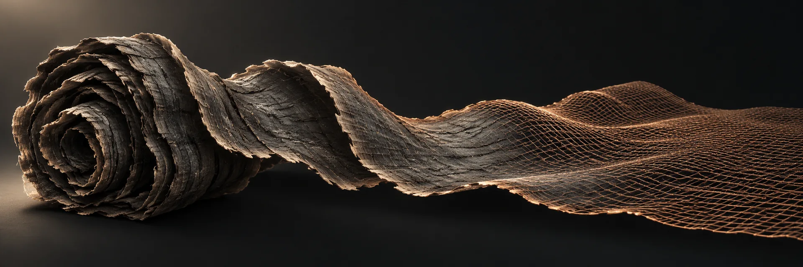
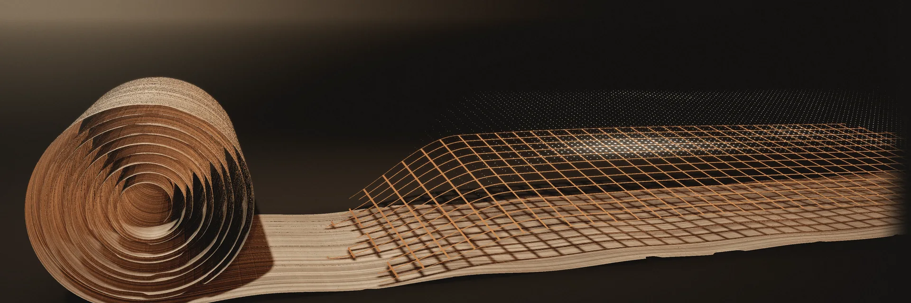
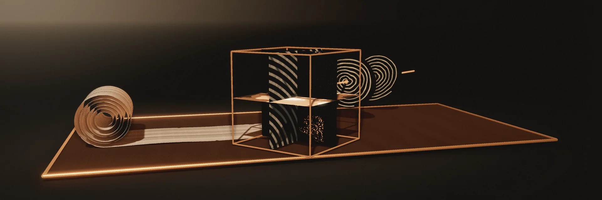
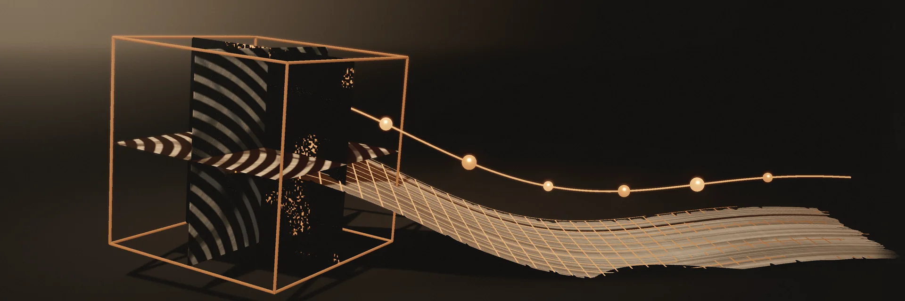
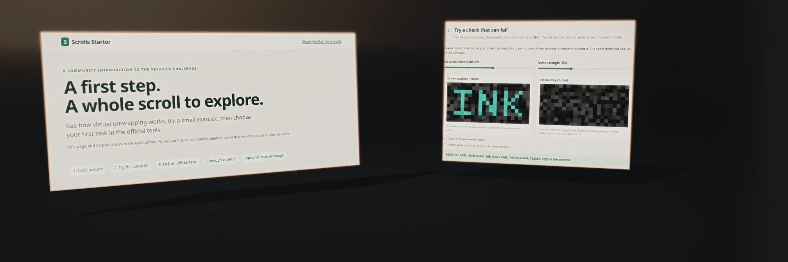
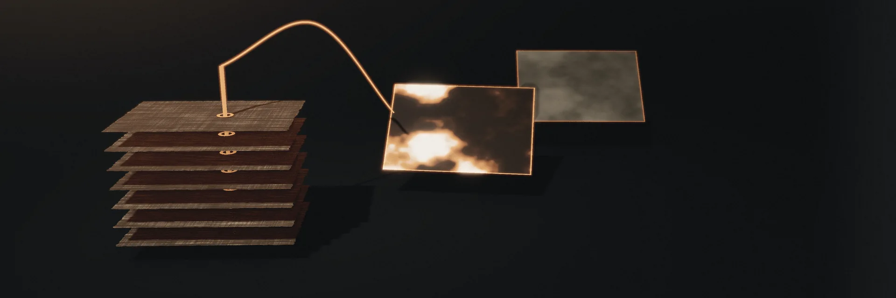
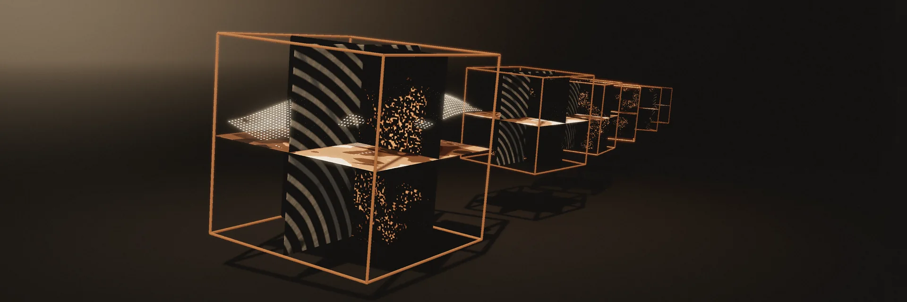

# Scrolls: Vesuvius Challenge workbench

[](LICENSE)
[](#quick-start-kit)
[](https://scrollprize.org/)



*Concept illustration. [Artwork notes](docs/assets/README.md).*

Research notes, a run planner, and an experiment ledger for the [Vesuvius Challenge](https://scrollprize.org/): reading the carbonized Herculaneum papyri from X-ray CT scans.

> [!IMPORTANT]
> **This repository does not claim that any letters have been found in any scroll.**

The `kit/` package plans and records runs of the official open-source pipeline ([ScrollPrize/villa](https://github.com/ScrollPrize/villa)). It does not reimplement that pipeline. Prize amounts, deadlines and eligible scrolls are a dated snapshot (checked 2026-10-11); [scrollprize.org/prizes](https://scrollprize.org/prizes) wins if they disagree.

## Start here

**What is Workbench? [See the picture guide](docs/workbench.md)** for the toolbox, Starter, Scroll Text Reader and AutoPipeline, with real screenshots and what to open first.

**New to the Vesuvius Challenge? [Start Here](docs/start-here.md)** walks from a browser tour to one small task with the official data notebook, VC3D or ink tools. You can begin without a GPU or programming experience.

- **Explore:** open [Unroll](https://huggingface.co/spaces/SharpMeow/unroll), then try the official [ink and tracing exercises](https://scrollprize.org/get_started).
- **Practice locally:** [open Scrolls Starter](docs/start-here.md#2-try-scrolls-starter-on-your-computer) for an offline synthetic exercise and guided next steps. Its optional Python install adds a real setup check.
- **Use real tools:** [pick a first official task](docs/start-here.md#3-move-to-one-small-official-task). AutoPipeline and Scroll Text Reader are optional helpers along that path.

The guide includes macOS, Linux and Windows commands, expected outputs, storage and compute checks, and troubleshooting. [Share its stable link](https://github.com/ChaseHendrick/Scrolls/blob/main/docs/start-here.md) with someone asking where to begin. Terms are explained in the [glossary](GLOSSARY.md).

This repository contains public tools, public-data benchmarks and releasable reports. Private operational plans, candidate outputs and submission material belong in [Scrolls-private](https://github.com/ChaseHendrick/Scrolls-private) (access required).

## Released tools


*Synthetic demo: AutoPipeline's monitor following `scripts/demo_synthetic.py` on a synthetic scroll, each stage held 1.2 s so the run can be watched, then a captioned walk through its panels and console. Stroke shapes were planted in the synthetic CT and a stand-in ink model scores them, so its maps are not ink; the reversed control shows only the synthetic papyrus. [MP4](docs/assets/autopipeline/monitor-walkthrough.mp4) (45 s); more views in [the AutoPipeline reference](docs/autopipeline/README.md#12-live-monitor).*

<!-- releases:start (generated from docs/releases.json by python -m kit releases render; edit that list, not this section) -->
Released tools, AutoPipeline and Unroll (interactive 3D scroll viewer) first and the rest newest first. Each entry comes from [`docs/releases.json`](docs/releases.json).

### AutoPipeline


*Concept illustration: a papyrus surface traced in copper and flattened into a grid. No scan data.*

Released 24 October 2026 as a reviewed package on branch `submission/progress-2026-10-fix7`: [`submissions/progress-2026-10-fix7/` at commit `24572e6`](https://github.com/ChaseHendrick/Scrolls/tree/24572e6203bafa67de1611bcd31b9edebe2c078e/submissions/progress-2026-10-fix7).

AutoPipeline drives villa's VC3D tools and ink detection from a released scan through surface checks, rendering and controlled scoring. Version 0.1.7 draws ink maps in color, from dark umber for a low model score to pale papyrus for a high one, on one scale with the reversed control, cropped to the surface and enlarged smoothly, in the run monitor and the ink Space. The synthetic demo now plants pen strokes in its CT, so the forward map shows them and the reversed control does not. The pinned center lines move to dataset v2.4, which takes the Center Finder's coverage-polished line before the original. 0.1.6 put the monitor on one screen with a console and added opt-in steps (Crackle Check gate, published center lines, region crop, edge extension, trace budgets, z-scored ink ensembles). These are software changes, not a new ink-accuracy or scroll-reading result. The package retains its earlier evidence and limitations.

```bash
git clone --branch submission/progress-2026-10-fix7 --depth 1 https://github.com/ChaseHendrick/Scrolls.git scrolls-autopipeline
cd scrolls-autopipeline/submissions/progress-2026-10-fix7/autopipeline
python3 -m venv .venv && . .venv/bin/activate   # Python 3.11 or newer
python -m pip install -e .
python scripts/demo_synthetic.py
```

Install, monitor and console, opt-in steps, synthetic demo and limitations: [README](https://github.com/ChaseHendrick/Scrolls/blob/submission/progress-2026-10-fix7/submissions/progress-2026-10-fix7/autopipeline/README.md). [Changes since 0.1.6](https://github.com/ChaseHendrick/Scrolls/blob/submission/progress-2026-10-fix7/submissions/progress-2026-10-fix7/CHANGES.md). A plan made by 0.1.6 that names umbilicus.centerlines pins the old dataset revision and is refused: make it again.

### Unroll (interactive 3D scroll viewer)



*Concept illustration: a roll unrolls flat and its layers lift apart, as Unroll stacks X-ray, surface and ink layers. No scan data.*

Released 16 October 2026.

[Unroll](https://huggingface.co/spaces/SharpMeow/unroll) is an interactive 3D viewer that virtually unrolls Herculaneum scroll scans with ink layers, an Ink Bench for comparing ink models, CT tools and an agent API. Status: released. Version: 1.5.0 (the Space's `version.json` and `CHANGELOG.md`). It shows nine scrolls from the Vesuvius Challenge open data, each as its traced segments with an X-ray layer, plus the published ink detection where the open data has it; PHerc. 139 also has an ink_9um (9 µm) layer over all 37 windings. The CT tools (1.2.0 to 1.5.0) add X-ray window and level with auto contrast, a CT volume view that shows a cube of the raw scan around any point of the papyrus, the traced segments drawn into that cube, and streaming from the open data bucket. Licence: Apache 2.0 for all code; the scan data and everything derived from it are CC BY-NC 4.0. It runs in the browser with no install or account, and it can also be installed as an app that works offline. Ink layers show where models detect ink; letters visible here are candidates for expert reading.

Opens at [huggingface.co/spaces/SharpMeow/unroll](https://huggingface.co/spaces/SharpMeow/unroll). Install app: open [sharpmeow-unroll.static.hf.space](https://sharpmeow-unroll.static.hf.space/) and press Install app in the View panel or Settings (or use the browser's install icon); the page and the default scroll then work offline. Layers, controls and credits: [`docs/unroll-space.md`](docs/unroll-space.md).

### Scrolls kit



*Concept illustration: the toolbox's motifs on one tray. No scan data.*

Its tools were released from 14 October 2026 to 25 October 2026; each line gives its tool's date.

Command-line tools that live in this repository and run from a clone of it: thirteen `python -m kit` tools (one of them the terminal look), a planted-defect generator for tests, a Greek gap restoration benchmark, and two script folders released the same way, each with its weights as a GitHub release of this repository: the Center Finder and the Greek letter classifier. Each line gives the tool's release date, its weights where it has them, one command to start with, its tool page and its evidence; each page lists the tool's own needs. Their outputs are model output or geometry measurements for a person to check, not readings.

```bash
git clone --depth 1 https://github.com/ChaseHendrick/Scrolls.git
cd Scrolls
python3 -m venv .venv
. .venv/bin/activate
python -m pip install -e ".[all]"
scrolls-letterdemo
# The Center Finder also needs requests and torch
python -m pip install requests torch
```

- **Segments without VC3D** (released 24 October 2026). Reads one tifxyz segment, local or straight from the open-data bucket, with numpy and tifffile only: its true area in cm2 (checked against the area VC3D writes into meta.json), how isometric its grid is, holes, folds and stretched cells with a picture, an OBJ for Blender, a shaded preview and which way its normals face relative to the scroll's center line. On PHerc0139 w035's 2.4 um mesh: 22.07 cm2, 1.0000 of meta.json's area, no holes or folds, 43 stretched nodes, each command under 5 s on a laptop-class CPU (measured 23 October 2026). Geometry only: a clean check does not mean the trace stays on one sheet. Run `python -m kit tifxyz check SEGMENT --png check.png`; [tool page](docs/tools/tifxyz.md), [how-to with pictures](docs/segments-without-vc3d.md).
- **Find, center line, cite and villa helpers** (released 24 October 2026). `kit find SCROLL` lists everything public for one scroll: volumes with prize eligibility from the dated snapshot, segments per volume, the bucket's surface, lasagna and fiber predictions, center lines and public Hugging Face matches. `kit centerline get SCROLL --into FOLDER` writes the best public center line as umbilicus.json for VC3D after checking its sha256, and never overwrites one. `kit cite SCROLL` prints credit lines from metadata.json. For villa contributors, `kit prclock USER` shows the day villa's time-limit workflow would close each open PR, and `kit prtext BODY.md` checks a PR or issue body against villa's templates before posting. All read-only. Run `python -m kit find PHerc0175A`; [tool page](docs/tools/find.md), [centerline page](docs/tools/centerline.md), [villa helpers page](docs/tools/villapr.md).
- **Greek gap restoration benchmark** (released 22 October 2026). Hides 1 to 8 letters in 190 windows of Philodemus, De Musica (public First1KGreek text) and scores hosted text models against an order-8 Kneser-Ney letter model under a frozen rule, with a memorisation probe and a cost cap; the corpus builder and the letter model come with it, and the frozen files reproduce byte for byte. In the run of 22 October 2026 the letter model restored 0.331 of hidden letters against 0.181, 0.181 and 0.118 for DeepSeek-V3-0324, Kimi-K2-Instruct-0905 and Qwen3-235B-A22B-Instruct-2507, and 0.895 of single letters against 0.447 at best (Model output; one text, one prompt, one run). Public edited text, no scroll data; a fill is not a reading. Run `python -m kit.greekfill score docs/evidence/greek-restoration-20261022 --out work/greekfill-score.json`; [tool page](docs/tools/greekfill.md), [preregistration and result](docs/prereg/2026-10-22-greek-restoration.md), [frozen files, reproduction and the text's CC BY-SA 4.0 licence](docs/evidence/greek-restoration-20261022/README.md).
- **Planted defect generator** (released 21 October 2026). Plants sheet switches, lenses, skips, mergers, holes and bridged holes into synthetic tifxyz surfaces (an Archimedean spiral or parallel planes) and records the winding every vertex truly sits on, so a switch detector, stack check or labeler can be tested against a known answer; `check` recomputes that truth from the coordinates alone. `kit stackcheck` is tested against it: the clean stack passes, a hole is its missing sector and a switch onto the neighbouring winding is a coincident pair. Synthetic data only; a planted surface is not a trace of any scroll. Run `python -m kit.planted make OUT --family switch`; [tool page](docs/tools/planted.md), [tests](tests/test_planted.py).
- **UV overlap gate** (released 21 October 2026). Checks a flattened sheet's UV triangles (JSON or CSV) for any positive-area overlap between two triangles, with exact rational clipping behind a NumPy spatial grid, plus summed-area coverage and, with `--mesh`, one counterclockwise piece; `scripts/bench_uvgate.py` runs the overlap check on an OBJ's texture coordinates. On the released PHerc0139 w039 flattened OBJ (193,772 triangles) it passed in a median 1.0 s of gate time, 1,666 times faster than the exact reference on an 800-face prefix with identical verdicts, and caught a planted duplicate face (measured 13 October 2026). It checks the supplied UV only, not 3D sheet identity, ink or a reading. Run `python -m kit uvgate TRIS.json --source-area AREA --mesh`; [tool page](docs/tools/uvgate.md), [guide](docs/uvgate.md), [speed and parity log](docs/logs/2026-10-13-uvgate-fast.md).
- **Relative winding consistency check** (released 21 October 2026). Reads relative winding steps (point a to point b is k windings outward) and passes only when every count is an integer and all of them can hold at once, around every closed path across all chains, in time linear in the input, with exact integers and the standard library only. Tested on synthetic chains only; a consistent but wrong set passes, so a pass means the counts agree, not that they are right. Run `python -m kit windconsistency CHAINS.json`; [tool page](docs/tools/windconsistency.md), [guide](docs/windconsistency.md).
- **Relative windings in a box** (released 24 October 2026). Grows chains of sheet crossings around a point on a published surface prediction, cuts every step where lasagna's grad_mag sees more than one sheet, and writes villa's relative_windings.json point collections for a spiral fit, with a VC3D plugin that runs it at the focus point. It needs the scroll's umbilicus and computes no prediction itself. Under readouts fixed beforehand it scored 0.9758 step accuracy on 13,969 judged steps of 18 fresh PHerc0139 boxes and, with its split rule v2, 0.9786 on 5,938 judged steps of 20 fresh PHerc1667 boxes, against the published hand windings (Model output, 24 October 2026); split rule v1 missed the PHerc1667 keep floor. It ran inside a VC3D build from the plugin branch, where a fix to keep the windings relative on load is pending. Run `python -m kit windlabel-box --prediction PRED --grad-mag GM --umbilicus UMB.json --point X,Y,Z --out RUN`; [tool page](docs/tools/windlabel-box.md), [PHerc0139 check](docs/evidence/windlabel-box-20261024/README.md), [PHerc1667 check](docs/evidence/windlabel-box-1667-20261024/README.md).
- **Touching-sheets benchmark** (released 24 October 2026). Plants sheet hops at real contacts between PHerc0139's hand-traced windings w023 to w040 and measures how often a one-sheet check reading a surface prediction still joins them, and how large a window it still calls one sheet; run it on m7, recto-090 or your own prediction in m7's frame. Baselines (24 October 2026, CPU): with m7 the check joins 11 of 64 planted hops (17 %, the per-point on-sheet test 26) and keeps a median 3.5 mm square; with recto-090, 13 of 64 and 3.9 mm; neither keeps a 12.5 mm square in any of 18 clean windows. About 40 minutes on 4 CPU cores. Geometry only, never a reading. Run `python -m kit hopbench refs && python -m kit hopbench run --pred m7`; [tool page](docs/tools/hopbench.md), `hopbench_checks` in [results.json](docs/results.json).
- **Scroll Text Reader** (weights `letters-v2-real` and `letters-v2-ccby`, released 17 October 2026). Proposes Greek capital letters, boxes and confidences on ink maps, drawn labels and papyrus photographs with NumPy on a CPU, with null and orientation controls, and has an optional local Tesseract backend for Latin, Greek, Hebrew and other installed languages. On public PHerc. 1667 ink-map groups with line positions and letter height given, free-ends character error was 0.376 for `letters-v2-real` against 0.462 for `letters-v2-ccby` (Model output; 117 letters in 84 groups; those maps may benefit from training-label exposure), and photo accuracy is untested. Its output is a hypothesis for a person to check, not a reading; `--letter-px 86` suits PHerc. 1667's 38 um grid. Run `scrolls-letterread MAP.png --weight-profile permissive --letter-px 86 --overlay MAP-letters.png`; [tool page](docs/tools/letterread.md), [install, profiles and benchmarks](docs/letter-reader.md), [local OCR and session switching](docs/tools/reader-backends.md).
- **Greek letter classifier and line reader for agents** (weights `letterclass-v1`, released 24 October 2026). Names Greek capital letters in given boxes on papyrus photographs and reads lines of boxes with a Greek prose letter model that holds no Homer or verse, giving each letter's confidence and ranked alternatives, as a JSON command line and an MCP server for agents; the classifier is three ConvNeXt runs trained on Hell-Char only. In a preregistered head-to-head on the ICDAR 2023 test answers (8,479 letters, boxes given) its letter error was 0.291 against 0.340 for Hell-Char ConvNeXt-V2, every control passed, and as lines it was level with Hell-Char given the same letter model (Model output; photographs, not ink maps). Runs CC BY 4.0, letter model CC BY-SA 4.0, fetched once and sha256 checked. Run `python scripts/letters/reader_api.py fetch`; [tool page](docs/tools/letterclass.md), [preregistration and result](docs/prereg/2026-10-24-letter-reader-icdar-h2h.md), [frozen score and log](docs/evidence/2026-10-24-letter-icdar-h2h/README.md).
- **StrokeNet text-likeness score** (weights `strokenet-paris4-v1`, released 14 October 2026). Scores how much a 6.1 mm window of an organizers' ink map looks like lines of text, with rotation and IAAFT controls in every result, using only NumPy. On its preregistered held-out test on six PHerc. Paris 4 tracings it passed 7 of 9 bar items and told text from the same text turned 90 degrees far better than any simple score (AUC 0.994 against 0.865); plain ink density matched it at text against blank papyrus. `--two-density` (22 October 2026) adds a score with no network: a window's ink density plus a quarter of the density around it. On its preregistered test it came out ahead of ink density inside segments on PHerc0500P2 with ink_9um (Model output; mean within-segment AUC 0.701 against 0.662, 11 segments), a scroll ink_9um reads weakly. A score is model output, not a reading. Run `python -m kit strokenet MAP.tif --pixel-mm 0.0024 --json`; [tool page](docs/tools/strokenet.md), [model card, held-out results, the tile grid pilot and the two-density score](docs/strokenet.md).
- **Segment stack check** (released 14 October 2026). Checks a stack of consecutive tifxyz segments of one scroll against its umbilicus from geometry alone (no CT, no model): winding order, coincident or oddly spaced neighbors, missing sectors, skipped windings, turn overlaps and stack ends, with a JSON report and per-vertex masks to drop before a spiral fit or a winding count. On PHerc0139 w023 to w040 it measured, for example, that w035 covers a median 258 degrees of its turn (measured from the published segments and umbilicus, 14 October 2026). Geometry alone cannot say which segment left its sheet. Run `python -m kit stackcheck w033=SEGMENT_DIR w034=SEGMENT_DIR w035=SEGMENT_DIR --umbilicus UMBILICUS.json --out work/stackcheck/report.json --flags work/stackcheck/flags.npz`; [tool page](docs/tools/stackcheck.md), [the PHerc0139 note with the full bucket example, the numbers, a CT look and the limits](docs/logs/2026-10-14-pherc0139-segment-defects.md).
- **Scroll center (umbilicus) finder and coverage polish** (weights `umbilicus-v1`; lines `umbilicus-lines-v1`; polish `kit axispolish` rule 1, released 24 October 2026). Finds a scroll's winding center line in its 1.2 m (about 9 um) CT scan with two small U-Nets reading level-3 slices from the open-data bucket, and writes `umbilicus.json` for VC3D and the spiral fit. Against the 13 published center lines, each scroll held out, the median distance over 3,414 slices is 0.73 mm against 3.98 mm for the centroid control (Model output, 13 Oct 2026). `kit axispolish` then moves a line to where villa's traced sheet winds most: on ten fresh scans the polished lines beat villa's vc_gen_umbilicus by +0.084 wraps of coverage, 8 of 10 scans, interval +0.028 to +0.169 (Model output, 22 Oct 2026; [evidence](docs/evidence/2026-10-22-umbilicus-windpolish/README.md)). Run `python scripts/umbilicus/predict.py PHerc0125 --first work/umbilicus/weights/umbilicus-first-all.pt --zoom work/umbilicus/weights/umbilicus-zoom-all.pt --data work/umbilicus/slices --out work/umbilicus/out --vc3d-name`; [tool page](docs/tools/umbilicus.md), [guide with the weight download and SHA-256](scripts/umbilicus/README.md), [evidence](docs/evidence/2026-10-14-umbilicus/README.md), [center lines for 11 scrolls with each end's check status (Model output, no person's check)](docs/evidence/2026-10-21-umbilicus-lines/README.md).
- **Terminal look and mouse viewer** (released 23 October 2026). Gives every kit command, and every script in a Scrolls checkout, one styled look on a terminal: a title line, colour by line rules (headings, key: value, PASS and FAIL, USD amounts, clickable links), wrapping that keeps a line's own spacing, and a closing line with the exit code and time. Pipes, logs, --json and NO_COLOR get the program's own bytes. No install step: the first styled run adds a startup hook to that Python. kit live runs any command in a full-screen view with wheel scrolling, search and clickable links. Run `python -m kit live -- python -m kit prizes`; [tool page](docs/tools/termstyle.md).
- **Research integrity checks for Vesuvius claims** (released 23 October 2026). Checks a claim before it is posted, put in a PR or sent with a prize form: an ink score needs its reverse-depth control on the same pixels, a held-out status from that reader (from the public exposure table), the supervision mask, a number copied from its run, and an interval for any comparison; wording must not call model output a reading or call a training surface held out; a preregistration must be committed before its result and only appended to; arXiv ids and titles must match arXiv. Every command first runs 27 planted faults it must catch. Comes with a guide and the vesuvius-integrity Claude skill, which builds on the Research-Integrity skill. A pass means the record survives these rules, not that the claim is true. Run `python -m kit integrity text DRAFT.md`; [tool page](docs/tools/integrity.md), [guide](docs/integrity.md), [tests](tests/test_integrity.py).
- **Ink map self-check (neighbor-sheet test)** (released 24 October 2026). Checks without labels whether an ink map reads the traced sheet: it compares the map on the sheet with the same model read one and two sheet pitches away along the mesh normals (a map that still looks the same there is smeared across sheets or follows something every sheet shares), and flags ink that follows the mask edge or lights up empty space in the CT. Takes 2D maps read at each shift, or projects a 3D prediction volume on a tifxyz mesh itself. A pass is necessary, not sufficient: a map with no ink signal passes too, so it does not replace a labeled score with its control. Run `python -m kit sheetcheck demo --png sheetcheck-demo.png`; [tool page](docs/tools/sheetcheck.md), [synthetic demo](docs/assets/sheetcheck/sheetcheck-demo.png), [tests](tests/test_sheetcheck.py).
- **Scroll to ink in one command (experimental)** (released 25 October 2026). One command from a public scan and a seed point to an ink map: it grows a surface from the seed with VC3D, checks it for self-crossings and seating, extends it only if the extension passes the same check, flattens and renders it, and runs an ink model with the reverse-depth control, every step a Headless VC3D tool. It stops at a bad seed or a failed check, takes the layer order from the scroll's center line rather than assuming it, and resumes from one run folder, so the VC3D part and the ink part can run on different machines. Demo on PHerc0139 (in the released models' training data, so it shows the pipeline, not new ink): a 4.8 cm2 surface, check ok, about 8 minutes on Hugging Face Jobs for 0.15 USD (25 Oct 2026). Run `python -m kit scroll2ink run --sample PHerc0139 --seed 4121 3935 5477`; [tool page](docs/tools/scroll2ink.md), [replay GIF of the demo run](docs/assets/scroll2ink/scroll2ink-run.gif), [tests](tests/test_scroll2ink.py).

`scrolls-letterdemo` downloads CC BY weights once and checks synthetic letters. Use a separate environment from AutoPipeline: both install `kit`. Every `python -m kit` command: [`docs/tools/cli.md`](docs/tools/cli.md); every tool page: [`docs/tools/`](docs/tools/README.md); a picture guide to the toolbox: [`docs/workbench.md`](docs/workbench.md).

### dinovol embeddings of PHerc0841

Released 24 October 2026.

Precomputed embeddings of the whole PHerc0841 9.366 um scan from the Vesuvius Challenge's self-supervised dinovol model (`scrollprize/dinovol_8um_ps192_102126`, step 640,000), so anyone can search, cluster or segment by feature similarity without a GPU. One zarr in the public bucket [SharpMeow/dinovol-embeddings](https://huggingface.co/buckets/SharpMeow/dinovol-embeddings) holds `tokens_unit` (480 numbers per 8 voxel cube), `dense` (64 per 4 voxel cube) and `ink` (32 per 4 voxel cube), int8 with a scale per vector, 539 GB; read any region by URL. Made on Hugging Face Jobs with villa's `embed_volume.py` at `4ea26d9c`; every slab read back by URL with unit-length vectors that cover exactly the scan's nonzero voxels. Raw model output, not checked by eye. CC BY-NC 4.0, like the scan. Guide and click-to-search demo: [huggingface.co/spaces/SharpMeow/dinovol-embeddings](https://huggingface.co/spaces/SharpMeow/dinovol-embeddings).

```bash
pip install "zarr>=3" fsspec aiohttp
python3 -c "import zarr; g = zarr.open_group(zarr.storage.FsspecStore.from_url('https://huggingface.co/buckets/SharpMeow/dinovol-embeddings/resolve/PHerc0841/20250821151531-dinovol_8um_ps192_102126.zarr', read_only=True), mode='r', zarr_format=2); print(g['tokens_unit'].shape, g['dense'].shape)"
```

The [guide Space](https://huggingface.co/spaces/SharpMeow/dinovol-embeddings) (source `spaces/dinovol-embeddings/`) explains the features, has a click-to-search demo, tested download commands with sizes, and opens a whole-scan color volume (`-rgb.ome.zarr` beside the embeddings, 1.6 GB) in neuroglancer. The model's page states no license; villa's dinovol code is MIT. Credit: the Vesuvius Challenge for the scan, the dinovol authors for the model.

### Headless VC3D for agents



*Concept illustration: a scan cube and a traced surface leaving it as a copper grid, with calls and results passing along a line above. No scan data.*

Released 24 October 2026 as a reviewed package on branch `submission/progress-2026-10-vc3d-agent-1-1-1`: [`submissions/progress-2026-10-vc3d-agent-1-1-1/` at commit `9edcbf1`](https://github.com/ChaseHendrick/Scrolls/tree/9edcbf13c6b06f34cc94c0976320863378f5f18f/submissions/progress-2026-10-vc3d-agent-1-1-1).

An MCP server and shell command that let an AI agent run villa's VC3D tools with no display: find open data, trace, check, render and flatten surfaces, run ink models with their reverse-depth control, drive the VC3D app, and see each result as a PNG. Version 1.1.1 serves 46 tools with JSON schemas, progress, cancellation and images over stdio, MCP protocol versions 2024-11-05 to 2025-11-25, including seven lasagna tools that drive villa's lasagna surface fit headless. The checks are built in: render votes on the surface normal before trusting the layer order, audit finds chunks a render would read as zeros, check_surface says whether a surface sits on a sheet, and target-scroll ink refuses to run without a preregistered readout rule. New in 1.1.1, docs only: the README shows every tool with a real call and its result from sessions recorded on public PHerc0139 data, a captioned replay GIF and stills, setup for Claude Code, Codex and the MCP Python SDK, and the failure modes met. It is the server that shipped inside AutoPipeline, released on its own without AutoPipeline's pipeline tools. Its tests use stand-in VC3D tools; this is software, not an ink-accuracy or scroll-reading result.

```bash
git clone --branch submission/progress-2026-10-vc3d-agent-1-1-1 --depth 1 https://github.com/ChaseHendrick/Scrolls.git scrolls-vc3d-agent
cd scrolls-vc3d-agent/submissions/progress-2026-10-vc3d-agent-1-1-1/vc3d-agent
python3 -m venv .venv && . .venv/bin/activate   # Python 3.11 or newer
python -m pip install -e ".[maps]"
python -m unittest discover -s tests
vc3d-agent vc3d tools
claude mcp add vc3d-agent -e VC_APPIMAGE=/path/to/VC3D.AppImage -- "$PWD/.venv/bin/vc3d-agent" vc3d mcp
```

Every tool with a recorded call and result, client setup and failure modes: [README](https://github.com/ChaseHendrick/Scrolls/blob/submission/progress-2026-10-vc3d-agent-1-1-1/submissions/progress-2026-10-vc3d-agent-1-1-1/vc3d-agent/README.md). The lasagna tools: [docs/lasagna-agents.md](https://github.com/ChaseHendrick/Scrolls/blob/submission/progress-2026-10-vc3d-agent-1-1-1/submissions/progress-2026-10-vc3d-agent-1-1-1/vc3d-agent/docs/lasagna-agents.md).

### Lasagna Fields (villa lasagna fields for ten scans)

Released 24 October 2026.

[Lasagna Fields](https://huggingface.co/spaces/SharpMeow/lasagna-fields) shares villa's lasagna `predict3d` output for ten whole scans that had none in the open data, one dataset each: [PHerc0175A](https://huggingface.co/datasets/SharpMeow/pherc0175a-lasagna), [PHerc0175B](https://huggingface.co/datasets/SharpMeow/pherc0175b-lasagna), [PHerc0306B](https://huggingface.co/datasets/SharpMeow/pherc0306b-lasagna), [PHerc0483A](https://huggingface.co/datasets/SharpMeow/pherc0483a-lasagna), [PHerc0483B](https://huggingface.co/datasets/SharpMeow/pherc0483b-lasagna), [PHerc0490A](https://huggingface.co/datasets/SharpMeow/pherc0490a-lasagna), [PHerc0490B](https://huggingface.co/datasets/SharpMeow/pherc0490b-lasagna), [PHerc0841](https://huggingface.co/datasets/SharpMeow/pherc0841-lasagna), [PHerc0846A](https://huggingface.co/datasets/SharpMeow/pherc0846a-lasagna), [PHerc0846B](https://huggingface.co/datasets/SharpMeow/pherc0846b-lasagna). A lasagna field is what villa's lasagna surface fitting and the spiral fit read, so having it ready saves each person a GPU run. Each dataset is in villa's own layout (a `SCAN.lasagna.json` manifest with cos, grad_mag, nx and ny OME-Zarr channels) with `SHA256SUMS`; the same fields stream by URL from the public bucket SharpMeow/lasagna-fields (each card gives the URL). Made on Hugging Face Jobs with villa's lasagna at `db3dbea2`, seams checked. Raw model output, not checked by eye. CC BY-NC 4.0, like the scans.

```bash
hf download SharpMeow/pherc0175a-lasagna --repo-type dataset --local-dir pherc0175a-lasagna
cd pherc0175a-lasagna && sha256sum -c SHA256SUMS
for f in parts/*.tar; do tar -xf "$f"; done
tar -xf PHerc0175A-lasagna-pyramid-fix.tar
python load_example.py
```

Each dataset card says how to download, stream and load it. The [Space](https://huggingface.co/spaces/SharpMeow/lasagna-fields) adds region downloads, a Neuroglancer link and the methods; the Lasagna tab of [Umbilici](https://huggingface.co/spaces/SharpMeow/umbilici?mode=lasagna&scan=PHerc0175A&z=6400) shows a sample with the center line. For another scan, swap the scan id in the commands. Model and code credit: villa's lasagna authors.

### Ink Lens (control-checked ink on your own VC3D region)

Released 24 October 2026.

[Ink Lens](https://huggingface.co/spaces/SharpMeow/ink-lens) checks one region of your own VC3D segment for ink in seconds. It runs an openly licensed 9 um ink model (d9v2 or `ink_9um`) on the region in three depth windows, each as stored and reversed, and keeps only ink above the region's own reversed-depth control, so a region without text comes back `none`. The result is written back as VC3D's own files: an overlay over the segment canvas, a running mosaic, `ink-detections.json` records and letter-candidate pins as a VC3D point collection. It runs on a ZeroGPU Space with your own Hugging Face token, or on your machine with `--local` (CUDA, MPS or CPU, no account), and the Space is also an API and an MCP server for agents. On the public 640 px PHerc0841 w00 sample (development data) the live Space ran 486 patches in about 1.3 s and called it `ink`, AUC 0.915 as stored against 0.595 reversed (Model output, 24 October 2026). Status: released. Version: 0.1.0. Licence: Apache 2.0 for the code; d9v2 and `ink_9um` MIT; the scans CC BY-NC 4.0. An ink map is model output, not a reading.

Opens at [huggingface.co/spaces/SharpMeow/ink-lens](https://huggingface.co/spaces/SharpMeow/ink-lens). Try it from a clone: `python3 spaces/ink-lens/inklens.py demo 0841-w00 --score --vc3d-out /tmp/inklens-demo` (Space mode needs `HF_TOKEN` and gradio_client; add `--local` to run here). Source: [`spaces/ink-lens/`](spaces/ink-lens/); page with every option, output and failure: [`docs/tools/ink-lens.md`](docs/tools/ink-lens.md).

### Umbilici (center lines of 33 Herculaneum scans)

Released 24 October 2026.

[Umbilici](https://huggingface.co/spaces/SharpMeow/umbilici) shows every public center line (umbilicus) we know of for the 22 scans on the prize page and 11 other public scans, 52 lines from six sources, in 3D over X-ray CT that the browser streams from the Vesuvius Challenge open data, plus villa's lasagna field for PHerc0175A. Status: released. Version: 1.9.0. Each maker has its own color and any maker or single line can be hidden; 16 of the lines are model output from Chase Hendrick's Center Finder and 12 more are their coverage-polished versions, drawn as the newest with the originals faded as superseded, each scan named in a traffic light from its automatic CT end check (green pass, yellow caution or untested, red flag); the others were made by people and are credited to them. A guide covers the basics, how VC3D and villa's spiral fit read these files (cited to villa's source), every statistic and the data's frames and encodings; a Data view has sortable tables with CSV and JSON downloads, and each scan card copies file URLs, the OME-Zarr URL and a line's x, y, z at any slice. Licence: Apache 2.0 for the code; each line keeps its own licence, and the scans and lasagna field are CC BY-NC 4.0. A center line is geometry, not a reading.

Opens at [huggingface.co/spaces/SharpMeow/umbilici](https://huggingface.co/spaces/SharpMeow/umbilici). Source: [`spaces/umbilici/`](spaces/umbilici/); page: [`docs/tools/umbilici.md`](docs/tools/umbilici.md). Lines: [SharpMeow/vesuvius-center-lines](https://huggingface.co/datasets/SharpMeow/vesuvius-center-lines).

### Scrolls Starter: a beginner path into the tools



*Synthetic demo: Scrolls Starter 0.4's introduction and its known-answer practice exercise (made-up pixels, no scan, no model), shown as floating panels.*

Released 17 October 2026.

A local browser introduction with a known-answer synthetic exercise, a control you can compare, a real setup checker and a command builder for Scroll Text Reader. The portable HTML works without installing Python; it explicitly leaves local setup unchecked. The guide connects our released tools and the official browser exercises to the official data notebook, VC3D and ink detection. It does not run models or download scans for you.

Start with [the beginner guide](docs/start-here.md), download [the portable page](https://github.com/ChaseHendrick/Scrolls/releases/download/workbench-v0.4.1/Scrolls-Starter.html), or install [workbench 0.4.1](https://github.com/ChaseHendrick/Scrolls/releases/tag/workbench-v0.4.1) as the guide shows and run `.venv/bin/python -m kit start` (`scrolls-start` once that environment is active). The [tool reference](docs/tools/starter.md) covers setup checks and generated commands.

### Inkfilter: fixed surface-volume filters



*Concept illustration: a surface volume's layers, a fixed filter down through them, its response and the reversed-depth control. Synthetic fields only, no ink.*

Released 17 October 2026 as a reviewed package on branch `submission/progress-2026-10-inkfilter`: [`submissions/progress-2026-10-inkfilter/` at commit `4953f17`](https://github.com/ChaseHendrick/Scrolls/tree/4953f17851aa9b2ffd3c26c86e85ecdabd659ca6/submissions/progress-2026-10-inkfilter).

Makes a model-free map from a surface-volume window and writes a reversed-depth control. On 56 confirmation windows from 28 publicly labelled segments across seven scrolls, face mix scored mean AUC 0.736 versus 0.704 for the selected alpha-compositing baseline and 0.628 for its reversed-depth control (Model output, 17 October 2026). Confirmation used different windows from the same development segments and scrolls. Alpha alone wins on three scrolls; the reverse filter wins on one. This is not a trained-reader comparison.

```bash
git clone --branch submission/progress-2026-10-inkfilter --depth 1 https://github.com/ChaseHendrick/Scrolls.git scrolls-inkfilter
cd scrolls-inkfilter/submissions/progress-2026-10-inkfilter
python3 -m venv .venv
. .venv/bin/activate
python -m pip install .
python demo.py demo-output
```

Local NumPy, TIFF and Zarr input, synthetic tests, scalar score evidence and limitations: [package README](https://github.com/ChaseHendrick/Scrolls/blob/submission/progress-2026-10-inkfilter/submissions/progress-2026-10-inkfilter/README.md). The package needs no GPU or model weights.

### Scroll Lens (3D DINO, ink and surface models on scan cubes)



*Concept illustration: a scan cube cut by three slices, with matched points along a sheet and a gallery of smaller cubes. No scan data.*

Released 17 October 2026.

[Scroll Lens](https://huggingface.co/spaces/SharpMeow/scroll-lens) shows what the Vesuvius Challenge's 3D models see inside a scroll scan. Pick one of 99 ready-made cubes or a point in one of twelve public 2.2 to 2.4 µm scans, and it runs the organizers' 3D DINO embeddings (dinovol), direct 3D ink model and recto surface model on a 128³ or 256³ cube read live from the open data. The three slice views are drawn in your browser, so sliders, dragging, zoom and layers answer at once. Click a patch to light up every patch the DINO model finds alike, the organizers' own few-click recipe; the concept carries across scans and downloads as `concept.npy`. Each cube shows how well the organizers' ink reference agrees with the ink model, beside controls that must fail. A 3D view turns the three views into one rotatable space of the cube, with the slices as moving planes and ink, surface and your matches as points. For AI agents and scripts, seven tools (an API and an MCP server) list the scans and the gallery, inspect and search cubes, and download their outputs. Status: released. Version: 1.1.1. It runs on ZeroGPU and falls back to the CPU when a visitor's GPU time runs out. License: Apache 2.0 for the code; the models are MIT; the scan data and the gallery cubes derived from it are CC BY-NC 4.0. Model output, not a reading: a cube is smaller than one letter.

Opens at [huggingface.co/spaces/SharpMeow/scroll-lens](https://huggingface.co/spaces/SharpMeow/scroll-lens); MCP at `https://sharpmeow-scroll-lens.hf.space/gradio_api/mcp/`. Source and tests: [`spaces/scroll-lens/`](spaces/scroll-lens/). Guide: [`docs/tools/scroll-lens.md`](docs/tools/scroll-lens.md).
<!-- releases:end -->

## Interactive viewer

[Unroll](https://huggingface.co/spaces/SharpMeow/unroll) is a browser page on Hugging Face Spaces that rebuilds 37 traced windings of PHerc. 139 in 3D and unrolls them, with X-ray, Published ink (2.4 µm) and ink_9um (9 µm) layers, a per-winding close-up, an Ink Bench and an agent API. It is released; see its entry under [Released tools](#released-tools). Data: Vesuvius Challenge, CC BY-NC 4.0. Details and credits: [`docs/unroll-space.md`](docs/unroll-space.md).

## Quick start (kit)

Python **3.10+**. The commands below are standard library only, except `verify` and `rowscore`, which read TIFFs with numpy and tifffile (villa's environment has both). Scroll Text Reader needs numpy, Pillow and tifffile, which its `reader` extra installs ([Released tools](#released-tools)). The heavy pipeline (VC3D, PyTorch, ink models) is installed from villa; `doctor` tells you what is missing.

```bash
# from the repository root
# open prizes, deadlines and eligible scrolls, from a dated snapshot
python -m kit prizes
# GPU, disk, uv, docker and git, and the VILLA and VC_BIN paths
python -m kit doctor
# control and target commands for one eligible scroll
python -m kit plan PHerc0826
# an 8.64 um scan: prints the resampling note
python -m kit plan PHerc0800 --batch 1
# Apple Silicon: VC3D.app tools, CPU or MPS inference
python -m kit plan PHerc0826 --mac
python -m kit cost --gpu-hours 6.5 --rate 1.10
python -m kit run init p0826-a --scroll PHerc0826 \
  --question "Does ink_9um show rows on a hand-refined GrowPatch near the outer wraps?" \
  --readout "Rows of 2-4 mm strokes in forward depth, absent in reverse, on both seeds"
python -m kit run cost p0826-a --usd 7.15 --what "A10, 6.5 h"
python -m kit run status p0826-a running
python -m kit run check p0826-a
# needs numpy and tifffile, as in the villa environment
python -m kit verify cpu.tif mps.tif --control cpu_reverse.tif
# mirror a public bucket prefix over HTTPS, resumable
python -m kit fetch w035 data/w035_9um.zarr
# w045 is unseen by v8in, but ink_9um trained on its 2.4 um render
python -m kit fetch w045 data/w045_9um.zarr
# the row triage score
python -m kit rowscore f42.tif f43.tif --reverse r42.tif r43.tif --voxel-um 9.362
# Apple Silicon: CPU against MPS on the control, one command
bash scripts/mac-verify.sh
python -m unittest discover -s tests -v
```

> [!NOTE]
> `plan` prints commands; it never runs them. They are copied from the official [ink detection tutorial](https://scrollprize.org/tutorial5), with each eligible volume's real S3 path resolved from the public bucket. The `run` ledger writes `experiments/<slug>/run.json`, which is gitignored. It hashes your readout rule when the run is created, so a rule edited after you looked is caught by `check`. It refuses to mark a submitted candidate `published` until the prize has been announced: the prize terms forbid going public first.

## The open prizes (snapshot 2026-10-11)

| Prize | Money | Deadline | What wins |
| --- | --- | --- | --- |
| [2027 Grand Prize](https://scrollprize.org/prizes#2027-grand-prize) | $800k / $100k / $50k / $50k | 25 Jun 2027 | Fully unroll one of 13 sealed scrolls; at least 70% of each counted column's preserved characters legible |
| [First Letters](https://scrollprize.org/prizes#first-letters-prizes) | $50k per scroll, 9 more ($450k remaining; one already used) | 25 Jun 2027 | First team to show 10 legible letters in a single 4 cm² area of one of 21 eligible scrolls |
| [PHerc. Paris 4 title](https://scrollprize.org/prizes#first-title-prize) | $50k | 25 Jun 2027 | A papyrologist-readable image of Scroll 1's title |
| [Progress Prizes](https://scrollprize.org/prizes#progress-prizes) | $20k best of month, plus $250 to $20k awards | monthly, several entries a month allowed (next: 31 Oct 2026) | Open-source tools, models, datasets, fixes, reports that help read the scrolls |

> [!IMPORTANT]
> All prizes require open-sourcing your method (permissive license) to accept the money. Details, submission contents and the eligible-scroll lists: [`docs/prizes.md`](docs/prizes.md).

## What this repo does / does not

| ✅ Does | ❌ Does not |
| --- | --- |
| Keep a dated, tested snapshot of open prizes and eligible volumes (`kit/data/`) | Replace the live prize page |
| Print the official control and First Letters commands per eligible scroll, with resolved S3 paths | Run VC3D, render surfaces, or run ink models itself |
| Check a machine against thresholds from published runs (12 GB GPU, 25 GB disk) | Guarantee a run fits; streaming caches grow by gigabytes |
| Record preregistered readout rules, costs and status transitions locally | Decide whether an image shows letters |
| Block publishing a candidate before the prize is announced | Submit anything to the Vesuvius Challenge for you |
| Summarize the pipeline, the state of play, and costs, with sources | Claim a reading, a title, or letters in any scroll |
| Point to villa, community tools, and published nulls | Fork or vendor villa |

## Repository layout

| Path | Role |
| --- | --- |
| [`AGENTS.md`](AGENTS.md), [`CLAUDE.md`](CLAUDE.md), [`llms.txt`](llms.txt) | Entry points for AI agents: rules, map, commands, glossary |
| [`kit/`](kit/) | Planner, doctor, prize snapshot, map scoring (`auc`, `rowscore`, `verify`), `layers`, `provenance`, experiment ledger; CLI `python -m kit` |
| [`scripts/`](scripts/) | One-command Mac GPU runs: `mac-w045.sh` (labeled test), `mac-phase0.sh` (public model comparisons), `mac-verify.sh`; `false404/fault_relay.py` replays S3's false 404 for villa #2058 |
| [`docs/results.json`](docs/results.json) | Every benchmark number with settings and source |
| [`docs/releases.json`](docs/releases.json) | Tools released from private work since the list began on 14 October 2026; the "Released tools" section above is generated from it |
| [`docs/plans/`](docs/plans/), [`docs/prereg/`](docs/prereg/) | Public evaluation methodology and access-required private plan pointers |
| [`kit/data/prizes-2026-10-11.json`](kit/data/prizes-2026-10-11.json) | Current prize snapshot (checked 2026-10-11): amounts, deadlines, 13 Grand Prize and 21 First Letters volumes with S3 names. [`prizes-2026-10-06.json`](kit/data/prizes-2026-10-06.json) is the previous snapshot (22 First Letters volumes, including PHerc0343, maximum 10) |
| [`tests/test_kit.py`](tests/test_kit.py), [`tests/test_verify.py`](tests/test_verify.py), [`tests/test_rowscore.py`](tests/test_rowscore.py) | Snapshot, planner, doctor, ledger and map-comparison tests |
| [`docs/start-here.md`](docs/start-here.md) | Beginner paths, expected results and a bridge to official tools |
| [`docs/prizes.md`](docs/prizes.md) | Every open prize, its submission contents, eligible scrolls |
| [`docs/pipeline.md`](docs/pipeline.md) | Scan, unwrap, ink, papyrologist: what each stage is and where it fails |
| [`docs/letter-reader.md`](docs/letter-reader.md), [`scripts/letters/`](scripts/letters/) | Scroll Text Reader: Greek model, local OCR backends, benchmarks, training and demo |
| [`scripts/umbilicus/`](scripts/umbilicus/README.md) | Scroll center (umbilicus) finder: guide, released weights, held-out results, training, end-point rule and tests |
| [`pyproject.toml`](pyproject.toml) | The installable package `scrolls-workbench`: `python -m pip install "scrolls-workbench[reader] @ git+https://github.com/ChaseHendrick/Scrolls"` gives Scroll Text Reader's commands (`scrolls-letterread`, `scrolls-letterdemo`) and every `python -m kit` command as `scrolls-workbench`; install it in its own virtual environment, apart from AutoPipeline's ([guide](docs/letter-reader.md#install)) |
| [`docs/state-of-play.md`](docs/state-of-play.md) | What has been read, what has been tried, recent winners and published nulls |
| [`docs/compute.md`](docs/compute.md) | Hardware, cloud costs, and what AI agents can and cannot do here |
| [`docs/mac.md`](docs/mac.md) | Apple Silicon: what runs locally, the open MPS PRs, useful Mac contributions |
| [`docs/engine.md`](docs/engine.md) | villa is the engine; how `kit/` sits on top of it |
| [`docs/external.md`](docs/external.md) | ScrollPrize repositories, community tools, datasets, models |
| [`docs/sources.md`](docs/sources.md) | Consolidated URLs |
| [`docs/WORKFLOW.md`](docs/WORKFLOW.md) | From experiment idea to private candidate to submission |
| [`experiments/README.md`](experiments/README.md), [`templates/experiment.json`](templates/experiment.json) | Local experiment records and their format |
| [`docs/AI-AGENTS.md`](docs/AI-AGENTS.md) | Rules for AI (and human) editors |
| [`docs/QUALITY.md`](docs/QUALITY.md) | Citation / testing / honesty bar |
| [`docs/NOVELTY.md`](docs/NOVELTY.md) | Claim labels (sourced / model output / candidate / not a reading) |
| [`docs/TESTING.md`](docs/TESTING.md) | How to run tests; what green means |
| [`docs/UI-UX.md`](docs/UI-UX.md) | CLI and docs presentation |
| [`docs/HANDOFF.md`](docs/HANDOFF.md) | State for the next session |
| [`docs/ERROR-LOG.md`](docs/ERROR-LOG.md), [`docs/logs/errors.md`](docs/logs/errors.md) | Real failures only |
| [`docs/logs/`](docs/logs/) | Dated research notes (not claims) |
| [`CONTRIBUTING.md`](CONTRIBUTING.md) | Contribution ground rules |
| [`LICENSE`](LICENSE) | Apache-2.0 (permissive, so it meets the prizes' open-source condition) |
| [`CITATION.cff`](CITATION.cff) | How to cite this repository (Apache-2.0) and, as separate references, Scroll Text Reader's Greek weights: `letters-v2-ccby` (CC BY 4.0, automatic-layout default) and `letters-v2-real` (CC BY-NC 4.0) |

## Architecture (kit)

| Piece | Role |
| --- | --- |
| `prizes.py` | Load the snapshot, normalize scroll names (`PHerc. 826` = `PHerc0826`), days to deadline |
| `doctor.py` | `nvidia-smi` or Apple Silicon, memory, disk, tools, `VILLA` and `VC_BIN` checks with sourced thresholds |
| `plan.py` | Official command templates filled per scroll; cost arithmetic |
| `ledger.py` | `run.json` records, readout hash, legal status transitions, privacy gate, provenance hashes, attached checks |
| `fetch.py` | Paged anonymous listing and resumable download of a bucket prefix |
| `verify.py` | Compare two ink maps under a tolerance; pass only if a control map is caught (numpy, tifffile) |
| `rowscore.py` | Text-row periodicity triage score, port of Bullo27's (numpy, tifffile; scipy optional) |
| `letterread.py` | Scroll Text Reader's Greek backend: numpy CTC line network, layout, null, control-map and orientation controls with a status code, whole maps block-averaged while loading, turned, mirrored and tilted text, photographs (polarity by a quick read both ways, EXIF orientation), overlay, released weights (numpy; Pillow and tifffile for images, zarr optional) |
| `greeklm.py` | Kneser-Ney letter language model for Greek in scriptio continua, shown beside the ink-only read |
| `letterexport.py` | The letter reader's exports: a CSV of letters and PAGE XML (2019 schema, for eScriptorium), in the image file's pixels |
| `letterlines.py` | Training lines for fine-tuning the letter reader from your own transcribed lines, and character error on lines kept apart |
| `releases.py` | The release list and the README section written from it (`python -m kit releases`) |
| `stackcheck.py` | Geometry checks of consecutive tifxyz segments against the umbilicus (`python -m kit stackcheck`), with per-vertex masks to drop before a winding count (numpy, tifffile, scipy) |
| `cli.py` | `python -m kit` entry point |

## Novel findings

> [!NOTE]
> **Reviewed 23 October 2026.** One line per finding, newest group first. Each keeps its number, so "finding N" elsewhere still points at the right one. The full text of each, with its controls, limits, corrections and links, is in [`docs/FINDINGS.md`](docs/FINDINGS.md); every number with its settings and source is in [`docs/results.json`](docs/results.json). Public labeled data only; an ink map is model output, not a reading.

**Tool results** ([details](docs/FINDINGS.md#tool-results))

15. **Center Finder:** 0.73 mm median from the 13 published lines with each scroll held out, and level with villa's `vc_gen_umbilicus` on two sealed lines (0.56 against 0.81 mm; closer on PHerc0139 only) (13 and 22 October 2026, model output).
18. **StrokeNet's two-density score, with no network, came out ahead of ink density inside segments on PHerc0500P2 with ink_9um** (mean within-segment AUC 0.701 against 0.662, ahead in all 11 segments, both controls passed; 22 October 2026, model output; ink_9um reads this scroll weakly).
16. **StrokeNet tells text from the same text turned 90 degrees far better than any simple score** (AUC 0.994 against 0.865, six held-out PHerc. Paris 4 tracings, 14 October 2026, model output); it passed 7 of the 9 bars of that first test, plain ink density matched it at text against blank papyrus, and part of its sense of orientation may come from the direction of the papyrus rather than the writing.
17. **Inkfilter's face mix** scored mean AUC 0.736 against 0.704 for alpha compositing on 56 confirmation windows, from the segments it was developed on; not a trained-reader comparison (17 October 2026).
19. **Three hosted text models restored hidden Greek letters in Philodemus, De Musica, less often than a Kneser-Ney letter model** (gap letter accuracy 0.181, 0.181 and 0.118 against 0.331, single letters 0.447 at best against 0.895, no recall detected (probe about 0.08); public text, 22 October 2026, model output).
20. **Our letter classifier, trained on Hell-Char only, named Greek letters on fresh papyrus photographs better than Hell-Char ConvNeXt-V2** (error 0.291 against 0.340 on the 8,479 ICDAR 2023 test boxes, boxes given, every control passed; as lines with a no-Homer Greek letter model it was level with Hell-Char given the same model; 24 October 2026, model output; photographs, not ink maps).

**Pipeline and reader checks** ([details](docs/FINDINGS.md#pipeline-and-reader-checks))

12. **A transient S3 404 becomes a permanent hole of zeros in VC3D's renders and traces** ([villa #2058](https://github.com/ScrollPrize/villa/issues/2058), draft fix [villa #2060](https://github.com/ScrollPrize/villa/pull/2060); 8 to 12 October 2026).
13. **villa's tracer does not hold an explicit seed, so a trace can start on the next winding** ([villa #2059](https://github.com/ScrollPrize/villa/issues/2059); one seed on PHerc0139, 11 and 12 October 2026).
14. **A traced surface's render comes out turned, and `ink_9um` reads it much worse until it is turned upright** (one trace, development data, 13 October 2026); Reader v2 did not replicate it cleanly, so `ink.orient` stays opt in.

**Earlier measurements and corrections** ([details](docs/FINDINGS.md#earlier-measurements-and-corrections))

1. **On w045, v8in scores below `ink_9um`, but `ink_9um` trained on that surface,** so the test cannot say which reads an unseen surface better (corrected 8 and 9 October 2026).
2. **Scoring a crop needs an edge margin:** a 64 px edge makes bare-crop and whole-map scores agree.
3. **A threshold taken from a training segment misses about 96 % of real ink on an unseen scroll.**
4. **Averaging depth windows matches the best window chosen with labels on PHerc0841** (related prior work is cited).
5. **Two of PHerc0841's three labeled segments, w00 and ag896, are the same papyrus.**
6. **Raw CT brightness alone carries almost no ink signal on PHerc0841.**
7. **Ink-map agreement between two traces falls with their distance** (model output; the maps are probably in-sample).
8. **PHerc0841 has 3.4 cm² of supervision, so its AUCs need intervals.**
9. **Cross-trace agreement suggests a label-free triage experiment** (untested idea).
10. **Every published surface volume matches a published mesh, but the stored PHerc1667 matrix contradicts its own landmarks** (reported earlier by kadenpool in [villa #1843](https://github.com/ScrollPrize/villa/issues/1843); our CT check agrees with the landmarks).
11. **PHerc1667's 1.129 um renders appear misplaced** (post hoc; the preregistered version failed its control, so it needs a calibrated rerun).

Follow-up tests, partial results, the adaptive-geometry experiment and the CPU speed checks are listed after finding 11 in [`docs/FINDINGS.md`](docs/FINDINGS.md#earlier-measurements-and-corrections).

## Guidelines

- [`docs/AI-AGENTS.md`](docs/AI-AGENTS.md): cite URLs; no claimed letters; candidates stay private; tools need tests.
- [`docs/QUALITY.md`](docs/QUALITY.md): every claim about prizes or results has a dated source.
- [`docs/NOVELTY.md`](docs/NOVELTY.md): an ink map is model output, not a reading.
- [`docs/TESTING.md`](docs/TESTING.md): unittest; what green does and does not mean.
- [`CONTRIBUTING.md`](CONTRIBUTING.md): setup, checks, PR workflow, and attribution.
- [`CODE_OF_CONDUCT.md`](CODE_OF_CONDUCT.md): participation standards and private reporting.
- [`SECURITY.md`](SECURITY.md): supported code and confidential vulnerability reports.
- [`SUPPORT.md`](SUPPORT.md): where to get help.

## License

Original code and documentation are licensed under [Apache-2.0](LICENSE), unless
otherwise noted. Copyright 2026 Chase Hendrick and Scrolls contributors. This
permissive license allows use, modification and redistribution, including
commercial use, subject to its notice requirements and other terms, and includes
an express contributor patent grant. See [NOTICE](NOTICE) for attribution and
the separately licensed Contributor Covenant.

Third-party software, datasets, labels, renders and model weights retain their
own licenses. Scroll Text Reader's Greek weights are CC BY 4.0 for `letters-v2-ccby`
and CC BY-NC 4.0 for `letters-v2-real`, which uses ICDAR 2023 Greek letters in its training data.
Local OCR language packs keep their source licenses. The code license does not grant rights to those materials.
The Center Finder's released weights (release `umbilicus-v1`) are CC BY-NC 4.0, because the CT they learned from is.
Check each source's terms, including the [Vesuvius data browser](https://scrollprize.org/data_browser),
before use or redistribution.

> [!WARNING]
> Do not commit scroll data, renders or ink maps to this public repository.
