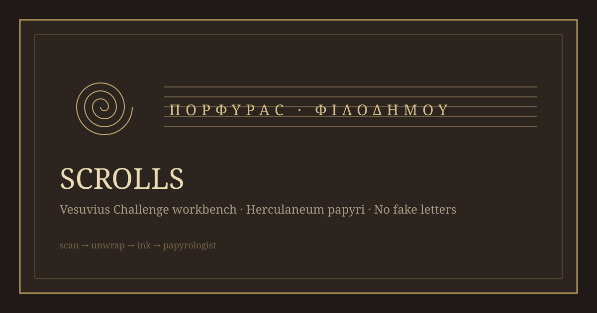
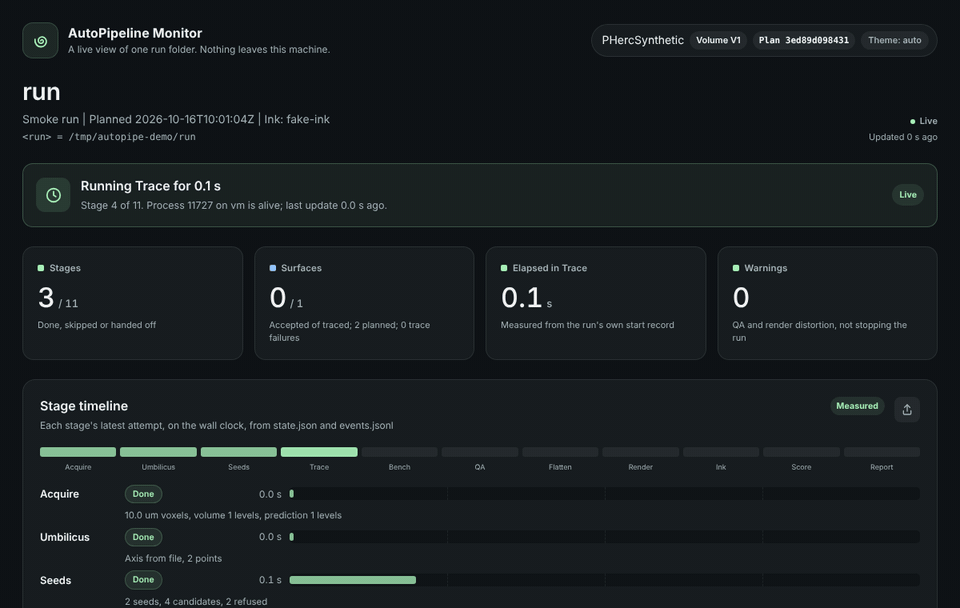

# Scrolls: Vesuvius Challenge workbench

[](LICENSE)
[](#quick-start-kit)
[](https://scrollprize.org/)



Research notes, a run planner, and an experiment ledger for the [Vesuvius Challenge](https://scrollprize.org/): reading the carbonized Herculaneum papyri from X-ray CT scans.

> [!IMPORTANT]
> **This repository does not claim that any letters have been found in any scroll.**

The `kit/` package plans and records runs of the official open-source pipeline ([ScrollPrize/villa](https://github.com/ScrollPrize/villa)). It does not reimplement that pipeline. Prize amounts, deadlines and eligible scrolls are a dated snapshot (checked 2026-10-11); [scrollprize.org/prizes](https://scrollprize.org/prizes) wins if they disagree.

## Start here

**What is Workbench? [See the picture guide](docs/workbench.md)** for the toolbox, Starter, Scroll Text Reader and AutoPipeline, with real screenshots and what to open first.

**New to the Vesuvius Challenge? [Start Here](docs/start-here.md)** walks from a browser tour to one small task with the official data notebook, VC3D or ink tools. You can begin without a GPU or programming experience.

- **Explore:** open [Unroll](https://huggingface.co/spaces/SharpMeow/unroll), then try the official [ink and tracing exercises](https://scrollprize.org/get_started).
- **Practice locally:** [open Scrolls Starter](docs/start-here.md#2-try-scrolls-starter-on-your-computer) for an offline synthetic exercise and guided next steps. Its optional Python install adds a real setup check.
- **Use real tools:** [pick a first official task](docs/start-here.md#3-move-to-one-small-official-task). AutoPipeline and Scroll Text Reader are optional helpers along that path.

The guide includes macOS, Linux and Windows commands, expected outputs, storage and compute checks, and troubleshooting. [Share its stable link](https://github.com/ChaseHendrick/Scrolls/blob/main/docs/start-here.md) with someone asking where to begin. Terms are explained in the [glossary](GLOSSARY.md).

This repository contains public tools, public-data benchmarks and releasable reports. Private operational plans, candidate outputs and submission material belong in [Scrolls-private](https://github.com/ChaseHendrick/Scrolls-private) (access required).

## Released tools



*AutoPipeline 0.1.4's live monitor following `scripts/demo_synthetic.py`, recorded in real time: a synthetic scroll with stand-in VC3D tools and a stand-in ink model, so its maps are not ink. More views in [the AutoPipeline reference](docs/autopipeline/README.md#12-live-monitor).*

<!-- releases:start (generated from docs/releases.json by python -m kit releases render; edit that list, not this section) -->
Released tools, AutoPipeline and Unroll (interactive 3D scroll viewer) first and the rest newest first. Each entry comes from [`docs/releases.json`](docs/releases.json).

### AutoPipeline

Released 16 October 2026 as a reviewed package on branch `submission/progress-2026-10-fix4`: [`submissions/progress-2026-10-fix4/` at commit `603fe14`](https://github.com/ChaseHendrick/Scrolls/tree/603fe14633201d6769776519646dc19cf203009f/submissions/progress-2026-10-fix4).

AutoPipeline runs villa's pipeline from a released scan to a scored ink map, with a rule written down before the run in place of each choice a person usually makes by eye, and a control beside every check. It drives VC3D's command-line tools and villa's ink detection end to end: umbilicus, seed points, tracing with the published normal grids, surface checks, flattening, rendering, ink detection with reversed and shuffled maps, and scoring against published ink labels. Its default reader is now Domenico Russo's Reader v2, a community fine-tune of `ink_9um`: on PHerc0841 w00, from the released scan and the published segment, it scored AUC 0.8752 forward and 0.5659 reversed, against 0.7479 and 0.5012 for `ink_9um` seed 42 on the same render (Model output, development data, 15 October 2026). Traces grown from its own seed points are small patches with no held-out ink score yet. This is version 0.1.4, the fourth fix release: it passes remote volumes to VC3D's renderer in the form villa's builds since 12 October 2026 require (they refuse 0.1.3's), though no full remote render has run with it yet; the earlier releases stay on their own branches. Its last step, ink detection with the reversed-layer control, also runs in a browser with `ink_9um` seed 42: the [AutoPipeline ink Space](https://huggingface.co/spaces/SharpMeow/autopipeline-ink) maps a crop of a released segment, or a small surface volume you upload, and scores the crop where it has published ink labels.

```bash
git clone --branch submission/progress-2026-10-fix4 --depth 1 https://github.com/ChaseHendrick/Scrolls.git scrolls-autopipeline
cd scrolls-autopipeline/submissions/progress-2026-10-fix4/autopipeline
python3 -m venv .venv && . .venv/bin/activate   # Python 3.11 or newer
python -m pip install -e .                      # numpy, tifffile, zarr 3, scipy
python scripts/demo_synthetic.py                # every step on a synthetic scroll; prints DEMO PASS
```

Setup, the run monitor and the limits: the package's [README](https://github.com/ChaseHendrick/Scrolls/blob/submission/progress-2026-10-fix4/submissions/progress-2026-10-fix4/autopipeline/README.md). What changed: [in 0.1.4](https://github.com/ChaseHendrick/Scrolls/blob/submission/progress-2026-10-fix4/submissions/progress-2026-10-fix4/CHANGES.md) and [in 0.1.3](https://github.com/ChaseHendrick/Scrolls/blob/submission/progress-2026-10-fix3/submissions/progress-2026-10-fix3/CHANGES.md).

### Unroll (interactive 3D scroll viewer)

Released 16 October 2026.

[Unroll](https://huggingface.co/spaces/SharpMeow/unroll) is an interactive 3D viewer that virtually unrolls Herculaneum scroll scans with ink layers, an Ink Bench for comparing ink models, CT tools and an agent API. Status: released. Version: 1.5.0 (the Space's `version.json` and `CHANGELOG.md`). It shows nine scrolls from the Vesuvius Challenge open data, each as its traced segments with an X-ray layer, plus the published ink detection where the open data has it; PHerc. 139 also has an ink_9um (9 µm) layer over all 37 windings. The CT tools (1.2.0 to 1.5.0) add X-ray window and level with auto contrast, a CT volume view that shows a cube of the raw scan around any point of the papyrus, the traced segments drawn into that cube, and streaming from the open data bucket. Licence: Apache 2.0 for all code; the scan data and everything derived from it are CC BY-NC 4.0. It runs in the browser with no install or account, and it can also be installed as an app that works offline. Ink layers show where models detect ink; letters visible here are candidates for expert reading.

Opens at [huggingface.co/spaces/SharpMeow/unroll](https://huggingface.co/spaces/SharpMeow/unroll). Install app: open [sharpmeow-unroll.static.hf.space](https://sharpmeow-unroll.static.hf.space/) and press Install app in the View panel or Settings (or use the browser's install icon); the page and the default scroll then work offline. Layers, controls and credits: [`docs/unroll-space.md`](docs/unroll-space.md).

### Scrolls Starter: a beginner path into the tools

Released 17 October 2026.

A local browser introduction with a known-answer synthetic exercise, a control you can compare, a real setup checker and a command builder for Scroll Text Reader. The portable HTML works without installing Python; it explicitly leaves local setup unchecked. The guide connects our released tools and the official browser exercises to the official data notebook, VC3D and ink detection. It does not run models or download scans for you.

Start with [the beginner guide](docs/start-here.md), download [the portable page](https://github.com/ChaseHendrick/Scrolls/releases/download/workbench-v0.4.0/Scrolls-Starter.html), or install [workbench 0.4.0](https://github.com/ChaseHendrick/Scrolls/releases/tag/workbench-v0.4.0) and run `scrolls-start`. The [tool reference](docs/tools/starter.md) covers setup checks and generated commands.

### Inkfilter: fixed surface-volume filters

Released 17 October 2026 as a reviewed package on branch `submission/progress-2026-10-inkfilter`: [`submissions/progress-2026-10-inkfilter/` at commit `4953f17`](https://github.com/ChaseHendrick/Scrolls/tree/4953f17851aa9b2ffd3c26c86e85ecdabd659ca6/submissions/progress-2026-10-inkfilter).

Makes a model-free map from a surface-volume window and writes a reversed-depth control. On 56 confirmation windows from 28 publicly labelled segments across seven scrolls, face mix scored mean AUC 0.736 versus 0.704 for the selected alpha-compositing baseline and 0.628 for its reversed-depth control (Model output, 17 October 2026). Confirmation used different windows from the same development segments and scrolls. Alpha alone wins on three scrolls; the reverse filter wins on one. This is not a trained-reader comparison.

```bash
git clone --branch submission/progress-2026-10-inkfilter --depth 1 https://github.com/ChaseHendrick/Scrolls.git scrolls-inkfilter
cd scrolls-inkfilter/submissions/progress-2026-10-inkfilter
python3 -m venv .venv
. .venv/bin/activate
python -m pip install .
python demo.py demo-output
```

Local NumPy, TIFF and Zarr input, synthetic tests, scalar score evidence and limitations: [package README](https://github.com/ChaseHendrick/Scrolls/blob/submission/progress-2026-10-inkfilter/submissions/progress-2026-10-inkfilter/README.md). The package needs no GPU or model weights.

### Scroll Lens (3D DINO, ink and surface models on scan cubes)

Released 17 October 2026.

[Scroll Lens](https://huggingface.co/spaces/SharpMeow/scroll-lens) shows what the Vesuvius Challenge's 3D models see inside a scroll scan. Pick one of 99 ready-made cubes or a point in one of twelve public 2.2 to 2.4 µm scans, and it runs the organizers' 3D DINO embeddings (dinovol), direct 3D ink model and recto surface model on a 128³ or 256³ cube read live from the open data. The three slice views are drawn in your browser, so sliders, dragging, zoom and layers answer at once. Click a patch to light up every patch the DINO model finds alike, the organizers' own few-click recipe; the concept carries across scans and downloads as `concept.npy`. Each cube shows how well the organizers' ink reference agrees with the ink model, beside controls that must fail. A 3D view turns the three views into one rotatable space of the cube, with the slices as moving planes and ink, surface and your matches as points. For AI agents and scripts, seven tools (an API and an MCP server) list the scans and the gallery, inspect and search cubes, and download their outputs. Status: released. Version: 1.1.0. It runs on ZeroGPU and falls back to the CPU when a visitor's GPU time runs out. License: Apache 2.0 for the code; the models are MIT; the scan data and the gallery cubes derived from it are CC BY-NC 4.0. Model output, not a reading: a cube is smaller than one letter.

Opens at [huggingface.co/spaces/SharpMeow/scroll-lens](https://huggingface.co/spaces/SharpMeow/scroll-lens); MCP at `https://sharpmeow-scroll-lens.hf.space/gradio_api/mcp/`. Source and tests: [`spaces/scroll-lens/`](spaces/scroll-lens/). Guide: [`docs/tools/scroll-lens.md`](docs/tools/scroll-lens.md).

### Scroll Text Reader

Released 17 October 2026.

Scroll Text Reader (formerly Greek Letter Reader). A small learned reader proposes Greek capital letters, boxes and confidences on ink maps, drawn labels and papyrus photographs using NumPy on CPU. Its output is a hypothesis for a person to check, with null and orientation controls, not a reading. The default now follows the task: given line positions select `letters-v2-real` (CC BY-NC 4.0); automatic layout selects `letters-v2-ccby` (CC BY 4.0). Explicit weights or a profile override that choice, and results record the profile, license and weight hash. On public PHerc. 1667 ink-map groups with line positions and letter height given, free-ends character error was 0.376 for real versus 0.462 for ccby; the paired difference interval was +0.017 to +0.155 (Model output; 117 letters in 84 groups). The whole-region comparison was unresolved; photo accuracy is untested. Those maps may benefit from training-label exposure, so this does not establish accuracy on new scrolls. An optional local Tesseract backend supports Latin, Greek, Hebrew and other installed language packs with pack hashes and blank/shuffled controls. Printed-text smoke checks establish that the backend works, not scroll accuracy; controls can fail. `ReaderSession` validates replacements before switching models, profiles, languages or backends and keeps the previous selection on failure. Checkpoint files and release tags are unchanged.

```bash
python3 -m venv .venv
. .venv/bin/activate
python -m pip install "scrolls-workbench[reader] @ git+https://github.com/ChaseHendrick/Scrolls"
scrolls-letterdemo
scrolls-letterread MAP.png --weight-profile permissive --letter-px 86 --overlay MAP-letters.png
```

`scrolls-letterdemo` downloads CC BY weights once and checks synthetic letters. Use a separate environment from AutoPipeline: both install `kit`. `--letter-px 86` is for PHerc. 1667's 38 um grid in [`scripts/letters/demo_p1667.py`](scripts/letters/demo_p1667.py). Install, profiles and benchmarks: [`docs/letter-reader.md`](docs/letter-reader.md). Local OCR and session switching: [`docs/tools/reader-backends.md`](docs/tools/reader-backends.md).

### Segment stack check

Released 14 October 2026.

Checks a stack of consecutive tifxyz segments of one scroll against the scroll's umbilicus, from segment geometry alone (no CT, no model): order on rays from the umbilicus every degree, adjacent segments that coincide or are spaced unlike the pairs near them, missing sectors of one winding or of several adjacent ones, skipped windings, turn overlaps and the ends of the stack. It reads local folders or the open-data bucket, writes a JSON report, and writes per-vertex masks to drop before a spiral fit or a relative winding count. On PHerc0139 w023 to w040 it measured that w035 covers a median 258 degrees of its turn, leaving a gap (followed from z 9,000 to 27,800, a median 98 degrees wide) where w036 lies a median 17 um outside w034, against 242 um where w035 is present, by an amount that swings with height from 96 um inside to 174 um outside; that near their ends w035 and w036 are missing together; that w035 lies inside w034 on 10 % of the rays that cross both (7 % by more than 18.72 um); and that w023 to w034 are each traced a median 28 to 48 degrees per grid line past a full turn (66 for w026), with more than half of each doubly traced end within 18.72 um of the next segment for w023 to w031 but not for w032 to w034 (measured from the published segments and umbilicus, 14 October 2026). Geometry alone cannot say which segment left its sheet; the note adds a look at the CT at 12 places.

```bash
python -m pip install numpy tifffile scipy
B=https://vesuvius-challenge-open-data.s3.us-east-1.amazonaws.com/PHerc0139; S=""
for id in 20260219000000-w033_2026021913 20260303000000-w034_2026030317 20260317000000-w035_2026031718 20260316000000-w036_2026031607 20260310000000-w037_2026031015; do w=${id#*-}; S="$S ${w%%_*}=$B/segments/$id/mesh/${id%%-*}-on-20260102150214-2.399um.tifxyz"; done
python -m kit stackcheck $S --umbilicus $B/representations/umbilicus/20260102150214-umbilicus-20260826112529.json --stride 2 --upsample 1 --plane-z 8600 28800 200 --coincide-um 18.72 --out work/stackcheck/w033-w037.json --flags work/stackcheck/w033-w037-flags.npz
python -m unittest tests.test_stackcheck      # synthetic stacks: a clean spiral passes, each planted defect is flagged
```

Usage, the PHerc0139 numbers, example vertices for VC3D, the CT look and limits: [`docs/logs/2026-10-14-pherc0139-segment-defects.md`](docs/logs/2026-10-14-pherc0139-segment-defects.md); each check is described in [`kit/stackcheck.py`](kit/stackcheck.py).

### StrokeNet text-likeness score

Released 14 October 2026.

A small learned score for how much a 6.1 mm window of an organisers' ink map looks like lines of text, with rotation and IAAFT controls reported with every result. It needs only NumPy to run. Its held-out test on six PHerc. Paris 4 tracings, fixed before the read, is published in full: it misses its preregistered bar on two of nine items (blank papyrus against its own 90 degree turn, and blank windows above the threshold), simple scores such as ink density match it on the other items, and it beats every simple score only at telling text from its 90 degree turn (AUC 0.994 against 0.865). A score is model output, not a reading.

```bash
python -m pip install numpy tifffile
python -m kit strokenet MAP.tif --pixel-mm 0.0024 --json          # weights downloaded once, SHA-256 checked
```

Model card, held-out results and the tile grid pilot: [`docs/strokenet.md`](docs/strokenet.md).

### Scroll centre (umbilicus) finder

Released 14 October 2026.

Finds the winding centre (the umbilicus) of a Herculaneum scroll in X-ray CT and writes it in the format of the published umbilicus files, one control point per height. It reads every 8th level-3 slice of the scroll's 1.2 m (about 9 um) scan from the open-data bucket with range requests; two small U-Nets place the centre, the first on the slice squeezed to 256 pixels and the second on a 12 to 13 mm window round the first answer, and two end trims drop heights where a centre has nothing to sit on. Scored against the 13 published centre lines with each scroll held out of its own models' training, the median distance over all 3,414 scored slices is 0.73 mm (90th percentile 3.37 mm), against 3.98 mm for the papyrus centroid control; over the 3,243 of those slices that the end trims keep, close to what a written line holds (this score's mount and cap trim used level-5 planes), it is 0.69 mm (Model output, two training runs of 13 October 2026). Each reference is one person's line, two people placing the same centre often disagree by a few millimetres, and the settings were chosen while looking at some of the same scrolls. The line is model output: check it on CT slices before you rely on it.

```bash
python -m pip install numpy scipy requests torch
U=https://github.com/ChaseHendrick/Scrolls/releases/download/umbilicus-v1
mkdir -p work/umbilicus/weights
for f in umbilicus-first-all.pt umbilicus-zoom-all.pt; do curl -fL -o work/umbilicus/weights/$f $U/$f; done
(cd work/umbilicus/weights && shasum -a 256 -c) <<'EOF'
c9b50aae2876e00f50b7ade5cf9a6facc84fb0f8ad9667dddf5565e5f06ae854  umbilicus-first-all.pt
0a06fe2e108fbb5f252455f93862336ec4013a535eb922676ae8f846406fb4bb  umbilicus-zoom-all.pt
EOF
python scripts/umbilicus/predict.py PHerc0125 --first work/umbilicus/weights/umbilicus-first-all.pt --zoom work/umbilicus/weights/umbilicus-zoom-all.pt --data work/umbilicus/slices --out work/umbilicus/out
python -m unittest tests.test_umbilicus          # synthetic data, CPU
```

Guide, the 14 weight files with their SHA-256, held-out results with their limits, the end-point rule, training and licences: [`scripts/umbilicus/README.md`](scripts/umbilicus/README.md); evidence: [`docs/evidence/2026-10-14-umbilicus/`](docs/evidence/2026-10-14-umbilicus/README.md).
<!-- releases:end -->

## Interactive viewer

[Unroll](https://huggingface.co/spaces/SharpMeow/unroll) is a browser page on Hugging Face Spaces that rebuilds 37 traced windings of PHerc. 139 in 3D and unrolls them, with X-ray, Published ink (2.4 µm) and ink_9um (9 µm) layers, a per-winding close-up, an Ink Bench and an agent API. It is released; see its entry under [Released tools](#released-tools). Data: Vesuvius Challenge, CC BY-NC 4.0. Details and credits: [`docs/unroll-space.md`](docs/unroll-space.md).

## Quick start (kit)

Python **3.10+**. The commands below are standard library only, except `verify` and `rowscore`, which read TIFFs with numpy and tifffile (villa's environment has both). Scroll Text Reader needs numpy, Pillow and tifffile, which its `reader` extra installs ([Released tools](#released-tools)). The heavy pipeline (VC3D, PyTorch, ink models) is installed from villa; `doctor` tells you what is missing.

```bash
# from the repository root
# open prizes, deadlines and eligible scrolls, from a dated snapshot
python -m kit prizes
# GPU, disk, uv, docker and git, and the VILLA and VC_BIN paths
python -m kit doctor
# control and target commands for one eligible scroll
python -m kit plan PHerc0826
# an 8.64 um scan: prints the resampling note
python -m kit plan PHerc0800 --batch 1
# Apple Silicon: VC3D.app tools, CPU or MPS inference
python -m kit plan PHerc0826 --mac
python -m kit cost --gpu-hours 6.5 --rate 1.10
python -m kit run init p0826-a --scroll PHerc0826 \
  --question "Does ink_9um show rows on a hand-refined GrowPatch near the outer wraps?" \
  --readout "Rows of 2-4 mm strokes in forward depth, absent in reverse, on both seeds"
python -m kit run cost p0826-a --usd 7.15 --what "A10, 6.5 h"
python -m kit run status p0826-a running
python -m kit run check p0826-a
# needs numpy and tifffile, as in the villa environment
python -m kit verify cpu.tif mps.tif --control cpu_reverse.tif
# mirror a public bucket prefix over HTTPS, resumable
python -m kit fetch w035 data/w035_9um.zarr
# w045 is unseen by v8in, but ink_9um trained on its 2.4 um render
python -m kit fetch w045 data/w045_9um.zarr
# the row triage score
python -m kit rowscore f42.tif f43.tif --reverse r42.tif r43.tif --voxel-um 9.362
# Apple Silicon: CPU against MPS on the control, one command
bash scripts/mac-verify.sh
python -m unittest discover -s tests -v
```

> [!NOTE]
> `plan` prints commands; it never runs them. They are copied from the official [ink detection tutorial](https://scrollprize.org/tutorial5), with each eligible volume's real S3 path resolved from the public bucket. The `run` ledger writes `experiments/<slug>/run.json`, which is gitignored. It hashes your readout rule when the run is created, so a rule edited after you looked is caught by `check`. It refuses to mark a submitted candidate `published` until the prize has been announced: the prize terms forbid going public first.

## The open prizes (snapshot 2026-10-11)

| Prize | Money | Deadline | What wins |
| --- | --- | --- | --- |
| [2027 Grand Prize](https://scrollprize.org/prizes#2027-grand-prize) | $800k / $100k / $50k / $50k | 25 Jun 2027 | Fully unroll one of 13 sealed scrolls; at least 70% of each counted column's preserved characters legible |
| [First Letters](https://scrollprize.org/prizes#first-letters-prizes) | $50k per scroll, 9 more ($450k remaining; one already used) | 25 Jun 2027 | First team to show 10 legible letters in a single 4 cm² area of one of 21 eligible scrolls |
| [PHerc. Paris 4 title](https://scrollprize.org/prizes#first-title-prize) | $50k | 25 Jun 2027 | A papyrologist-readable image of Scroll 1's title |
| [Progress Prizes](https://scrollprize.org/prizes#progress-prizes) | $20k best of month, plus $250 to $20k awards | monthly, several entries a month allowed (next: 31 Oct 2026) | Open-source tools, models, datasets, fixes, reports that help read the scrolls |

> [!IMPORTANT]
> All prizes require open-sourcing your method (permissive license) to accept the money. Details, submission contents and the eligible-scroll lists: [`docs/prizes.md`](docs/prizes.md).

## What this repo does / does not

| ✅ Does | ❌ Does not |
| --- | --- |
| Keep a dated, tested snapshot of open prizes and eligible volumes (`kit/data/`) | Replace the live prize page |
| Print the official control and First Letters commands per eligible scroll, with resolved S3 paths | Run VC3D, render surfaces, or run ink models itself |
| Check a machine against thresholds from published runs (12 GB GPU, 25 GB disk) | Guarantee a run fits; streaming caches grow by gigabytes |
| Record preregistered readout rules, costs and status transitions locally | Decide whether an image shows letters |
| Block publishing a candidate before the prize is announced | Submit anything to the Vesuvius Challenge for you |
| Summarize the pipeline, the state of play, and costs, with sources | Claim a reading, a title, or letters in any scroll |
| Point to villa, community tools, and published nulls | Fork or vendor villa |

## Repository layout

| Path | Role |
| --- | --- |
| [`AGENTS.md`](AGENTS.md), [`CLAUDE.md`](CLAUDE.md), [`llms.txt`](llms.txt) | Entry points for AI agents: rules, map, commands, glossary |
| [`kit/`](kit/) | Planner, doctor, prize snapshot, map scoring (`auc`, `rowscore`, `verify`), `layers`, `provenance`, experiment ledger; CLI `python -m kit` |
| [`scripts/`](scripts/) | One-command Mac GPU runs: `mac-w045.sh` (labelled test), `mac-phase0.sh` (public model comparisons), `mac-verify.sh`; `false404/fault_relay.py` replays S3's false 404 for villa #2058 |
| [`docs/results.json`](docs/results.json) | Every benchmark number with settings and source |
| [`docs/releases.json`](docs/releases.json) | Tools released from private work since the list began on 14 October 2026; the "Released tools" section above is generated from it |
| [`docs/plans/`](docs/plans/), [`docs/prereg/`](docs/prereg/) | Public evaluation methodology and access-required private plan pointers |
| [`kit/data/prizes-2026-10-11.json`](kit/data/prizes-2026-10-11.json) | Current prize snapshot (checked 2026-10-11): amounts, deadlines, 13 Grand Prize and 21 First Letters volumes with S3 names. [`prizes-2026-10-06.json`](kit/data/prizes-2026-10-06.json) is the previous snapshot (22 First Letters volumes, including PHerc0343, maximum 10) |
| [`tests/test_kit.py`](tests/test_kit.py), [`tests/test_verify.py`](tests/test_verify.py), [`tests/test_rowscore.py`](tests/test_rowscore.py) | Snapshot, planner, doctor, ledger and map-comparison tests |
| [`docs/start-here.md`](docs/start-here.md) | Beginner paths, expected results and a bridge to official tools |
| [`docs/prizes.md`](docs/prizes.md) | Every open prize, its submission contents, eligible scrolls |
| [`docs/pipeline.md`](docs/pipeline.md) | Scan, unwrap, ink, papyrologist: what each stage is and where it fails |
| [`docs/letter-reader.md`](docs/letter-reader.md), [`scripts/letters/`](scripts/letters/) | Scroll Text Reader: Greek model, local OCR backends, benchmarks, training and demo |
| [`scripts/umbilicus/`](scripts/umbilicus/README.md) | Scroll centre (umbilicus) finder: guide, released weights, held-out results, training, end-point rule and tests |
| [`pyproject.toml`](pyproject.toml) | The installable package `scrolls-workbench`: `python -m pip install "scrolls-workbench[reader] @ git+https://github.com/ChaseHendrick/Scrolls"` gives Scroll Text Reader's commands (`scrolls-letterread`, `scrolls-letterdemo`) and every `python -m kit` command as `scrolls-workbench`; install it in its own virtual environment, apart from AutoPipeline's ([guide](docs/letter-reader.md#install)) |
| [`docs/state-of-play.md`](docs/state-of-play.md) | What has been read, what has been tried, recent winners and published nulls |
| [`docs/compute.md`](docs/compute.md) | Hardware, cloud costs, and what AI agents can and cannot do here |
| [`docs/mac.md`](docs/mac.md) | Apple Silicon: what runs locally, the open MPS PRs, useful Mac contributions |
| [`docs/engine.md`](docs/engine.md) | villa is the engine; how `kit/` sits on top of it |
| [`docs/external.md`](docs/external.md) | ScrollPrize repositories, community tools, datasets, models |
| [`docs/sources.md`](docs/sources.md) | Consolidated URLs |
| [`docs/WORKFLOW.md`](docs/WORKFLOW.md) | From experiment idea to private candidate to submission |
| [`experiments/README.md`](experiments/README.md), [`templates/experiment.json`](templates/experiment.json) | Local experiment records and their format |
| [`docs/AI-AGENTS.md`](docs/AI-AGENTS.md) | Rules for AI (and human) editors |
| [`docs/QUALITY.md`](docs/QUALITY.md) | Citation / testing / honesty bar |
| [`docs/NOVELTY.md`](docs/NOVELTY.md) | Claim labels (sourced / model output / candidate / not a reading) |
| [`docs/TESTING.md`](docs/TESTING.md) | How to run tests; what green means |
| [`docs/UI-UX.md`](docs/UI-UX.md) | CLI and docs presentation |
| [`docs/HANDOFF.md`](docs/HANDOFF.md) | State for the next session |
| [`docs/ERROR-LOG.md`](docs/ERROR-LOG.md), [`docs/logs/errors.md`](docs/logs/errors.md) | Real failures only |
| [`docs/logs/`](docs/logs/) | Dated research notes (not claims) |
| [`CONTRIBUTING.md`](CONTRIBUTING.md) | Contribution ground rules |
| [`LICENSE`](LICENSE) | Apache-2.0 (permissive, so it meets the prizes' open-source condition) |
| [`CITATION.cff`](CITATION.cff) | How to cite this repository (Apache-2.0) and, as separate references, Scroll Text Reader's Greek weights: `letters-v2-ccby` (CC BY 4.0, automatic-layout default) and `letters-v2-real` (CC BY-NC 4.0) |

## Architecture (kit)

| Piece | Role |
| --- | --- |
| `prizes.py` | Load the snapshot, normalize scroll names (`PHerc. 826` = `PHerc0826`), days to deadline |
| `doctor.py` | `nvidia-smi` or Apple Silicon, memory, disk, tools, `VILLA` and `VC_BIN` checks with sourced thresholds |
| `plan.py` | Official command templates filled per scroll; cost arithmetic |
| `ledger.py` | `run.json` records, readout hash, legal status transitions, privacy gate, provenance hashes, attached checks |
| `fetch.py` | Paged anonymous listing and resumable download of a bucket prefix |
| `verify.py` | Compare two ink maps under a tolerance; pass only if a control map is caught (numpy, tifffile) |
| `rowscore.py` | Text-row periodicity triage score, port of Bullo27's (numpy, tifffile; scipy optional) |
| `letterread.py` | Scroll Text Reader's Greek backend: numpy CTC line network, layout, null, control-map and orientation controls with a status code, whole maps block-averaged while loading, turned, mirrored and tilted text, photographs (polarity by a quick read both ways, EXIF orientation), overlay, released weights (numpy; Pillow and tifffile for images, zarr optional) |
| `greeklm.py` | Kneser-Ney letter language model for Greek in scriptio continua, shown beside the ink-only read |
| `letterexport.py` | The letter reader's exports: a CSV of letters and PAGE XML (2019 schema, for eScriptorium), in the image file's pixels |
| `letterlines.py` | Training lines for fine-tuning the letter reader from your own transcribed lines, and character error on lines kept apart |
| `releases.py` | The release list and the README section written from it (`python -m kit releases`) |
| `stackcheck.py` | Geometry checks of consecutive tifxyz segments against the umbilicus (`python -m kit stackcheck`), with per-vertex masks to drop before a winding count (numpy, tifffile, scipy) |
| `cli.py` | `python -m kit` entry point |

## Novel findings

> [!NOTE]
> **Latest evidence review: 16 October 2026.** The newest public results come first. Earlier measurements keep their original dates, corrections and limits. Each finding keeps its number, so a reference elsewhere to "finding N" still points at the right one. Every number with its settings and source is in [`docs/results.json`](docs/results.json).

14. **A traced surface's render comes out turned, and `ink_9um` reads it much worse until it is turned upright** (2026-10-13, model output on development data; the test's rule was fixed before the maps). Published segments are rendered with the scroll's axis down the rows, but a traced surface's render keeps whatever in-plane angle its grid has, and `ink_9um` was trained with right-angle turns only. On PHerc0841's published w00, a 30 degree turn cost `ink_9um` 0.155 AUC [0.077, 0.228], while a 90 degree turn cost 0.027 [-0.020, 0.078]. On one of my own traces of the same papyrus, whose render sat 49 degrees off, `ink_9um` scored 0.618 against 0.798 for the published map on the same 352,860 labelled pixels. Turning the render upright first, by an angle measured from the mesh alone, and the map back after, raised it by 0.256 [0.148, 0.368] to 0.874 (seed 42; seed 43 +0.181), and beat a sham turned 45 degrees past upright by 0.21 for both seeds. The same test with Reader v2 on 15 October did not replicate that cleanly: 0.851 as rendered, 0.911 upright, 0.872 for the sham, so upright minus sham was +0.039 [-0.005, 0.091], not clearly above zero, and the turn raised Reader v2's depth-reversed control from 0.476 to 0.709 (forward minus reversed fell from 0.375 to 0.202); `ink.orient` stays opt in ([fix4 release](https://github.com/ChaseHendrick/Scrolls/blob/submission/progress-2026-10-fix4/submissions/progress-2026-10-fix4/autopipeline/README.md)). One trace on one scroll, on pixels scored before, so not independent confirmation; the held-out test is still to come. AutoPipeline's `ink.orient` setting and `kit canvasorient` do the turn. [Log](docs/logs/2026-10-14-upright-before-ink.md).

<!-- Findings 12 and 13 follow as their own list so each keeps its number. -->

12. **A transient 404 from S3 becomes a permanent hole of zeros in VC3D's renders and traces** (measured 2026-10-08, reported 2026-10-12 as [villa #2058](https://github.com/ScrollPrize/villa/issues/2058), fix in draft [villa #2060](https://github.com/ScrollPrize/villa/pull/2060)). From one machine, the open-data bucket answered `404 NoSuchBucket` for keys it holds on 11 to 32 % of new connections. VC3D caches any 404 as an empty chunk and serves it as zeros in every later run: a PHerc0139 w035 crop rendered with 27.7 % zero samples, exit code 0 and no warning. With the draft fix on villa `main` at `25f3c93`, the same crop with 6 replayed false 404s matches the clean render, where `main` leaves 12 empty markers and 19.18 % zeros that survive a rerender; the new tests pass with the fix and fail 70 checks on `main`, on Linux and macOS. The false 404s in those renders are replayed by a local relay ([`scripts/false404/fault_relay.py`](scripts/false404/fault_relay.py)); the fix is not merged, and markers already in users' caches stay wrong. [Log](docs/logs/2026-10-12-upstream-reports.md), [receipts](docs/evidence/2026-10-12-false-404/README.md).
13. **villa's tracer does not hold an explicit seed, so a trace can start on the next winding** (measured 2026-10-11 and 2026-10-12 on public geometry, no ink; reported 2026-10-12 as [villa #2059](https://github.com/ScrollPrize/villa/issues/2059)). On PHerc0139, a `vc_grow_seg_from_seed` seed 1.1 voxels from published winding w031 ends its first 10 generations with none of 324 vertices on w031 and 265 on w033, while `meta.json` still records the seed. Holding one vertex fixed at the seed kept a 60-generation trace on w031 (dominant share 0.972 within 4 voxels, 4.74 of 4.88 cm²) where the unanchored run from the same seed was dominant on w033 (0.511) with nothing on w031. One seed on one scroll, scored against the published windings; an anchor holds one point, not the sheet, and the anchor change is not public as code. [Log](docs/logs/2026-10-12-upstream-reports.md).

### Earlier measurements and corrections

Measurements from this work, with related prior work and limits where known. Novelty remains provisional within our searches (web and the community repositories we read; GitHub search and Discord were not searchable from here). Public labelled data only, never target scrolls; model output, not readings. Proposed uses are untested ideas rather than findings. Reproductions of others' results are in [`docs/results.json`](docs/results.json) and the [log](docs/logs/2026-10-07-community-scan.md).

1. **On PHerc0139 w045, which v8in never saw but `ink_9um` trained on through its 2.4 um render, v8in scores below `ink_9um`; this test cannot say which reads a surface neither saw better** (2026-10-07, corrected 2026-10-08 and 2026-10-09). On PHerc0139 w045, which v8in never saw, v8in (YoussefMoNader/ink-8um-v8in, released 2026-09-28) reaches pixel AUC 0.738 (0.327 with depth reversed, the control) against 0.907 (0.384 reversed) for `ink_9um` inferred on the same bare 640 px crop. v8in's author reports validation during training on PHerc0009B segment ag132115 and two fragments (Frag3, Frag4), and released predictions on PHerc1447 ([model card](https://huggingface.co/YoussefMoNader/ink-8um-v8in), read 2026-10-09); TAUIL's benchmark and Reader v2's scoreboard do not include it. Correction (2026-10-08): w045 is not held out from `ink_9um`. Its 2.399 um render, pooled to 9.6 um, is one of `ink_9um`'s training segments (named pherc0139-w029 in the [label dataset](https://huggingface.co/buckets/scrollprize/datasets/tree/ink_9um)), and this test scores the native 9.362 um render of the same surface against that segment's human labels. So `ink_9um`'s 0.907 is a cross-scan score on a training surface, the test favours it more than first stated, and it cannot say whether v8in trails `ink_9um` on a surface neither saw. [Log](docs/logs/2026-10-08-w045-not-held-out.md). Correction (2026-10-09): the first version set v8in's bare-crop map against 0.914, the same window cut from `ink_9um`'s whole-segment map, which is the mix finding 2 warns about; both `ink_9um` numbers (bare crop 0.9074, whole-segment window 0.9136) and v8in's 0.7382 are in [`docs/results.json`](docs/results.json).
2. **Scoring a crop needs an edge margin** (2026-10-07). A map inferred on a bare 640 px crop differs from the same window of a whole-segment map by up to 0.03 AUC (PHerc0841 ag405: 0.821 against 0.793); leaving a 64 px edge out makes the two identical to four decimals on all three segments tested. Crop-based comparisons that skip this can rank models wrongly by that much.
3. **A threshold taken from a training segment misses about 96 % of real ink on an unseen scroll** (2026-10-07). The 0.7843 cut-off one published PHerc0826 null used is the median `ink_9um` value on labelled ink of PHerc0139 w035, a training segment. On PHerc0841's three labelled segments only 2.3 to 3.7 % of human-labelled ink reaches it (median 0.39 to 0.44); on w045, a surface `ink_9um` trained on through its 2.4 um render, 9.5 %. The same rule still finds about one candidate per cm² on PHerc0841, a third or fewer on labelled ink. Such nulls say little about faint ink. [Log](docs/logs/2026-10-07-novel-checks.md).
4. **Averaging depth windows matches the best window chosen with labels, on an unseen scroll** (2026-10-07). The best 17-layer window moves by up to 4 layers between PHerc0841 segments and between readers (worth up to +0.085 AUC), and no label-free statistic we tried picks it reliably. The mean of four windows reaches the label-chosen optimum: 0.820 against 0.819 mean AUC over 8 reader-crop cases (0.785 with the default window). [Log](docs/logs/2026-10-07-novel-checks.md) Related prior work, found later: window averaging of Hecate on PHerc0841 ([ArcheyChen](https://github.com/ArcheyChen/vesuvius-eligible-scouting)), a smaller window effect on whole PHerc0841 segments ([villa #1867](https://github.com/ScrollPrize/villa/issues/1867), at most 0.023) and a negative result on training scrolls ([villa #1946](https://github.com/ScrollPrize/villa/pull/1946)); what is ours is the comparison with the label-chosen window at 9 um ([log](docs/logs/2026-10-07-overlap-and-baseline.md)).
5. **Two of PHerc0841's three labelled segments are the same papyrus** (2026-10-07). The published meshes of w00 and ag896 have median nearest-sampled-point distance 8.6 voxels (81 um) on a 47 um sampling grid, within 25 voxels over 98 % of their 12.7 cm², and where both are labelled their human ink labels agree (Dice 0.83, against 0.25 on average and at most 0.69 for 200 displaced matches); ag405 is a different surface (median gap 39 to 48 voxels). So PHerc0841 offers two independent labelled surfaces, not three: three-segment means count one sheet twice, and leave-one-segment-out between w00 and ag896 trains on the test sheet. Community reports had disagreed (different windings, or the same text); this measures it. [Log](docs/logs/2026-10-07-overlap-and-baseline.md).
6. **Raw CT brightness alone carries almost no ink signal on PHerc0841** (2026-10-07). Each of the 28 surface-volume layers, used as an ink map, scores pixel AUC 0.43 to 0.58 on the crops and 0.47 to 0.54 on whole segments, and 0.49 to 0.51 after a 48 um high-pass; depth maximum and standard deviation reach at most 0.57. Readers reach 0.66 to 0.93 on the same crops, outperforming these brightness-only baselines. The 0.56 to 0.61 retained by `ink_9um` on depth-shuffled ag405 is also higher than those baselines. These comparisons do not isolate which features the models use or establish ink identity. Analogues exist on Paris 4 and fragments (at most 0.55 to 0.56); not found for PHerc0841. [Log](docs/logs/2026-10-07-overlap-and-baseline.md).
7. **Ink-map agreement decreases with sampled-point distance between two traces** (2026-10-07, model output). On PHerc0841 w00/ag896, the team's maps correlate 0.86 within 28 um, 0.75 at 28 to 56 um, 0.45 at 56 to 84 um and 0.07 at 112 to 169 um. Thick-slab CT still correlates about 0.4 to 0.5 at the larger distances. These measurements use a 47 um point grid, so distance includes lateral sampling error. They do not isolate normal displacement, distance from the ink layer or a universal tracing tolerance. Whether a bounded correction restores common-label accuracy needs a controlled test. The team's maps are its published `new_canon_autoresearch_recipe` maps, and that recipe's committed trainer lists w00, ag896 and ag405 as training fragments, so these maps are probably in-sample on PHerc0841 (Interpretation; which checkpoint rendered them is not verified; [log](docs/logs/2026-10-09-pherc0841-hecate.md)). [Log](docs/logs/2026-10-07-overlap-and-baseline.md).
8. **PHerc0841 has limited supervision, and reported AUCs need uncertainty** (2026-10-07, measurement). Supervision totals 3.4 cm² across the three segments (1.41, 0.86 and 1.12 cm²; 0.84 cm² of ink summed), covering 7 to 11 % of each. Overlap has not been deduplicated, and w00/ag896 share one sheet. A 1 mm block bootstrap on the team's published maps gives 95 % interval half-widths of 0.008 (w00) to 0.038 (ag405). Those maps come from the `new_canon_autoresearch_recipe`, whose committed trainer ([villa 94602c91](https://github.com/ScrollPrize/villa/blob/94602c91/ink-detection/train_resnet3d_3d_decoder.py), lines 200-207 and 292-293) lists w00, ag896 and ag405 as training fragments, so they are probably in-sample here (Interpretation; [log](docs/logs/2026-10-09-pherc0841-hecate.md)); these intervals describe that scoring setup, not a universal noise floor for model rankings. Reader differences need paired comparisons on common pixels and an independent-surface check. [Log](docs/logs/2026-10-07-overlap-and-baseline.md).
9. **Cross-trace agreement suggests a label-free triage experiment** (2026-10-07, model output and untested idea). On PHerc0841, a spot in the top 20 % of one ink map also lies in the other's top 20 % about 70 % of the time within 28 um, compared with 50 % for letter-scale CT texture and a 20 % independent-match expectation. The margin decreases with trace separation. Using this agreement to flag target surfaces is an untested hypothesis, requiring preregistration and held-out false-positive and sensitivity checks. Disagreement alone does not identify which trace is correctly placed or justify a correction. Related geometry and window studies are cited in the log; no claim of priority for agreement-based filtering is established. The maps compared are the team's, probably in-sample on PHerc0841 (see finding 8), so how far this agreement holds on a surface their model never trained on is untested. [Log](docs/logs/2026-10-07-overlap-and-baseline.md).
10. **Every published surface volume now matches a published mesh, but one stored cross-scan matrix contradicts its own landmarks** (2026-10-07, measurement on public geometry, no ink). All 692 surface volumes in the bucket catalogue reproduce their canvas exactly from a mesh variant naming the rendered volume, closing the gap reported in [villa #1727](https://github.com/ScrollPrize/villa/issues/1727). Of 29 stored transforms, PHerc1667 1.129 um to 2.399 um misses its six landmarks by 42 to 212 um, while a refit of the same landmarks fits them within 4 um. Transforms into the 2023 7.91 um scans imply scales 0.7 to 1.5 % above the nominal voxel ratio (Paris 4, PHerc0332, PHerc1667), which suggests those voxels are about 1 % smaller than stated. Cross meshes are exact affine images of the traced mesh, and where measurable they put the papyrus within a few micrometres of the native render. [Log](docs/logs/2026-10-07-mesh-hypothesis.md), [data](docs/data/mesh-hypothesis/README.md). Related prior work, found later: kadenpool reported the PHerc1667 matrix in [villa #1843](https://github.com/ScrollPrize/villa/issues/1843) (20 September 2026) with a refit. Update 2026-10-12: a check in the CT itself agrees with the landmarks, not the matrix. Cubes around the six landmarks, carried through the published matrix, sit 42 to 216 um from where the 2.399 um scan matches them, within a few micrometres of the landmark residuals, and the landmarks sit 3.3 to 5.7 um from the CT's match; swapped landmark pairs match 0 of 6, and two other stored transforms pass the same check. Posted as a [comment on villa #1843](https://github.com/ScrollPrize/villa/issues/1843#issuecomment-6130119937) ([log](docs/logs/2026-10-12-upstream-reports.md)).
11. **PHerc1667's published 1.129 um renders appear misplaced, and 1.129 um renders on three other scrolls sit about 16 um from their 2.4 um renders** (2026-10-07, measurement; the PHerc1667 result is post hoc). Phase correlation of centre layers on 3 mm tiles: on three control scrolls the 1.129 um renders are offset by a constant (-11.9, -11.0) um from the 2.4 um renders (216 tiles, spread 1.7 um). On five PHerc1667 segments, tiles with clear matches follow the shift predicted if the landmarks are right and the matrix wrong (median miss 7.7 um, slope 0.93), and matches vanish where that predicted displacement is large (median 158 um, up to 475 um). The pre-registered version of this test failed its own control bar, so this needs a calibrated rerun before anyone relies on it. [Log](docs/logs/2026-10-07-mesh-hypothesis.md).

Further controlled tests repaired a continuous-surface matching defect and completed real labelled correction and reconstruction audits, including negative results. See the [follow-up evidence](docs/logs/2026-10-07-followup-tests.md) and [review of villa support masking](docs/logs/2026-10-07-coarse-support-mask.md). These do not establish a new reading or successful real correction.

Partial results: the PHerc1447 fine-tune on w00 is recorded in [PR #7](https://github.com/ChaseHendrick/Scrolls/pull/7), and the two-crop tricks table in [PR #8](https://github.com/ChaseHendrick/Scrolls/pull/8). Matched controls and the complete ag405 independent-surface comparison remain pending. v8in itself on PHerc0841 is published: Bullo27, [v8in-12gb](https://github.com/Bullo27/v8in-12gb) (2026-10-01), AUC 0.837, 0.807 and 0.810 on w00, ag896 and ag405, ahead of `ink_9um` there. The Mac Phase 0 queue (`scripts/mac-phase0.sh`) is meant to reproduce it; no Mac v8in score on PHerc0841 is recorded here yet ([scan status](docs/scan-status.md)).

A [further adaptive-geometry experiment and PR review](docs/logs/2026-10-07-adaptive-resolution.md) preserves a failed primary retention test alongside promising local coarsening results. Frozen evidence and an independent hash audit accompany it.

[Measured CPU optimizations](docs/logs/2026-10-07-production-speed.md) make the complete surface-correction process 2.07x faster on the real PHerc0841 test crop with identical outputs; fresh AUC CLI scoring is 1.25x faster. These measure the named operations, not total scroll-reading throughput.

[Further CPU scaling checks](docs/logs/2026-10-07-production-scaling.md) make full-map row scoring 7.01x faster on the tested public 305-million-pixel map with optional [`--fast-resize`](docs/rowscore.md). Its numerical mode is explicit; dense defaults remain unchanged. Exact geometry batching and label-filter reuse add smaller measured gains.

## Guidelines

- [`docs/AI-AGENTS.md`](docs/AI-AGENTS.md): cite URLs; no claimed letters; candidates stay private; tools need tests.
- [`docs/QUALITY.md`](docs/QUALITY.md): every claim about prizes or results has a dated source.
- [`docs/NOVELTY.md`](docs/NOVELTY.md): an ink map is model output, not a reading.
- [`docs/TESTING.md`](docs/TESTING.md): unittest; what green does and does not mean.
- [`CONTRIBUTING.md`](CONTRIBUTING.md): setup, checks, PR workflow, and attribution.
- [`CODE_OF_CONDUCT.md`](CODE_OF_CONDUCT.md): participation standards and private reporting.
- [`SECURITY.md`](SECURITY.md): supported code and confidential vulnerability reports.
- [`SUPPORT.md`](SUPPORT.md): where to get help.

## License

Original code and documentation are licensed under [Apache-2.0](LICENSE), unless
otherwise noted. Copyright 2026 Chase Hendrick and Scrolls contributors. This
permissive license allows use, modification and redistribution, including
commercial use, subject to its notice requirements and other terms, and includes
an express contributor patent grant. See [NOTICE](NOTICE) for attribution and
the separately licensed Contributor Covenant.

Third-party software, datasets, labels, renders and model weights retain their
own licenses. Scroll Text Reader's Greek weights are CC BY 4.0 for `letters-v2-ccby`
and CC BY-NC 4.0 for `letters-v2-real`, which uses ICDAR 2023 Greek letters in its training data.
Local OCR language packs keep their source licenses. The code license does not grant rights to those materials.
The scroll centre finder's released weights (release `umbilicus-v1`) are CC BY-NC 4.0, because the CT they learned from is.
Check each source's terms, including the [Vesuvius data browser](https://scrollprize.org/data_browser),
before use or redistribution.

> [!WARNING]
> Do not commit scroll data, renders or ink maps to this public repository.
