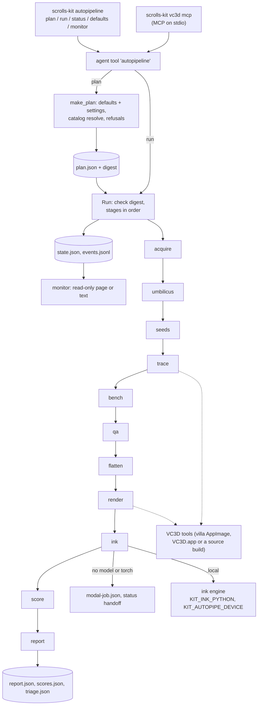
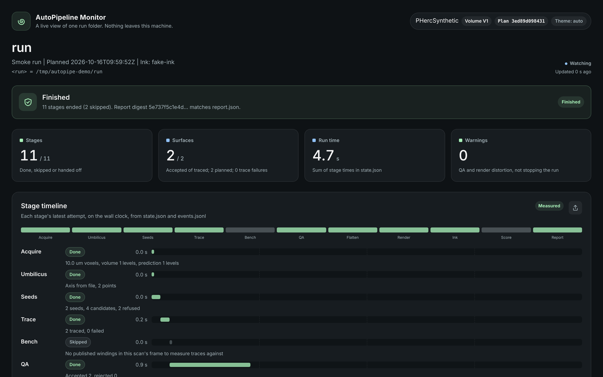
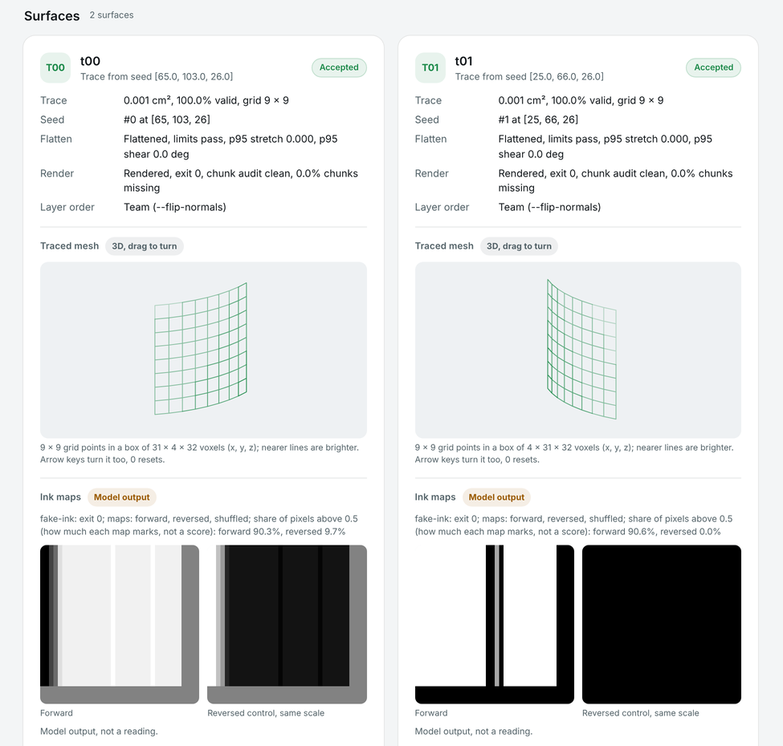
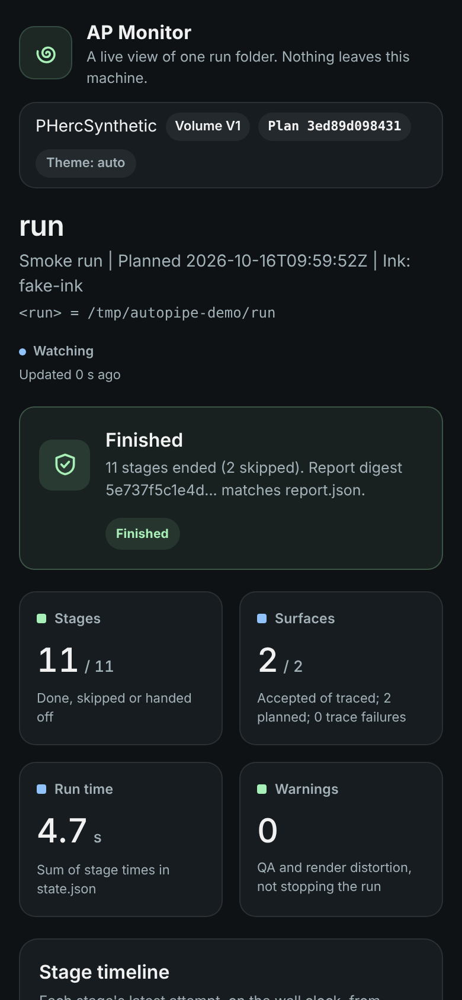

# AutoPipeline reference

AutoPipeline runs villa's VC3D tools and ink detection unattended on one released Vesuvius Challenge scan, from the
scan's headers to checked surfaces, ink maps with controls, and a report. This page is a reference for people and for
agents. It documents the released package, AutoPipeline 0.1.4, as its code reads; every command, flag, setting and
variable below was taken from that code.

| Item | Location |
| --- | --- |
| Package (0.1.4) | [`submissions/progress-2026-10-fix4/autopipeline`](https://github.com/ChaseHendrick/Scrolls/tree/submission/progress-2026-10-fix4/submissions/progress-2026-10-fix4/autopipeline) on branch `submission/progress-2026-10-fix4` |
| Package README | [`autopipeline/README.md`](https://github.com/ChaseHendrick/Scrolls/blob/submission/progress-2026-10-fix4/submissions/progress-2026-10-fix4/autopipeline/README.md) |
| Release notes | [`CHANGES.md`](https://github.com/ChaseHendrick/Scrolls/blob/submission/progress-2026-10-fix4/submissions/progress-2026-10-fix4/CHANGES.md) |
| Main code | [`kit/autopipe.py`](https://github.com/ChaseHendrick/Scrolls/blob/submission/progress-2026-10-fix4/submissions/progress-2026-10-fix4/autopipeline/kit/autopipe.py), [`kit/autopipe_monitor.py`](https://github.com/ChaseHendrick/Scrolls/blob/submission/progress-2026-10-fix4/submissions/progress-2026-10-fix4/autopipeline/kit/autopipe_monitor.py) |
| VC3D tool guides | [`docs/vc3d-agents.md`](https://github.com/ChaseHendrick/Scrolls/blob/submission/progress-2026-10-fix4/submissions/progress-2026-10-fix4/autopipeline/docs/vc3d-agents.md), [`docs/vc3d-headless.md`](https://github.com/ChaseHendrick/Scrolls/blob/submission/progress-2026-10-fix4/submissions/progress-2026-10-fix4/autopipeline/docs/vc3d-headless.md) |
| Agent rules for this page | [`AGENTS.md`](AGENTS.md) |
| Local cost logging on this branch | [`../compute.md`](../compute.md#local-runs-time-and-electricity) |

The package is not on this repository's `main` branch. Its command line is the console script `scrolls-kit` that
`pip install -e .` creates in the package folder (inside that folder, `python -m kit` is the same program). The
commands below use `scrolls-kit`.

Contents: 1 Overview, 2 Architecture, 3 Install and requirements, 4 Quickstart, 5 Command line reference,
6 Settings reference, 7 Environment variables, 8 Inputs, outputs and the run folder, 9 The stages, 10 Examples,
11 Compute backends and cost logging, 12 Live monitor, 13 Troubleshooting, 14 FAQ, 15 Extending, 16 Testing,
17 Changelog, 18 Agent section, 19 Every scan: catalog, batch and watcher.

## 1. Overview

One command, `scrolls-kit autopipeline` (alias `autopipe`), takes a catalog sample id such as `PHerc0841` and runs
11 stages: acquire, umbilicus, seeds, trace, bench, qa, flatten, render, ink, score and report. It finds the scroll
axis, proposes seed points on the scan's surface prediction, grows surfaces from them with VC3D, accepts or rejects
each surface by a fixed rule, flattens accepted surfaces only when the flattening stays inside fixed distortion limits,
renders them, runs ink models with a reversed-depth control, scores the maps where published labels exist, and writes
a report with a SHA-256 digest.

A plan has one of three purposes:

- `benchmark` (default): a run on a published labelled segment or on traces, scored where labels exist.
- `target`: a run on a scroll without published ink. It needs a preregistered ledger experiment and is never scored
  inside the tool.
- `smoke`: a run that only shows the chain works.

Design rules:

1. **Frozen plans.** `plan` writes `plan.json` with every setting and every value resolved from the catalog, under a
   digest. `run` refuses a plan whose content no longer matches its digest. A changed rule is a new plan.
2. **Resumable runs.** `state.json` records each stage and surface. A finished stage is not run again, so running the
   same folder again resumes it.
3. **Failure kinds.** Every failure is `ours` (the rule or chain decided; final) or `infrastructure` (a tool, fetch or
   machine stopped it; retried on the next run of the folder).

Every surface, map and score is model output, not a reading; the report carries that note.

## 2. Architecture



| Module | Role |
| --- | --- |
| `kit/autopipe.py` | Defaults, plan making and checks, the `Run` class (one method `s_<stage>` per stage), the agent tools `autopipeline`, `umbilicus`, `seeds` and `distortion`, and the command line. |
| `kit/autopipe_monitor.py` | Event log (`events.jsonl`), the HTTP monitor, snapshots and the text view. |
| `kit/vc3d_agent.py` | Tool registry and context; the VC3D tools the stages call. |
| `kit/vc3d.py` | Finds and starts VC3D tools; `which`, `selftest`, `mcp`. |
| `kit/vc3d_catalog.py` | Open-data catalog and `KNOWN_MODELS`. |

Constants: `PLAN_VERSION = 2`; readable plan versions `(1, 2)`; `FAILURE_KINDS = (ours, infrastructure)`;
`SURFACE_THRESHOLD = 128`; `MAX_REPEATS = 10`.

## 3. Install and requirements

- Python 3.11 or newer (zarr 3 needs it). Package name `vc-autopipeline`, license Apache-2.0.
- Dependencies: `numpy>=1.25`, `tifffile>=2023.7.10`, `zarr>=3.0`, `scipy>=1.11`. Planning, the catalog, VC3D
  discovery and the agent tools use only the standard library.
- VC3D's five tools for tracing, rendering, flattening and the checks. On Linux x86_64, villa's release AppImage has
  all five; on a Mac, `VC3D.app` in `/Applications`; or a villa source build named by `VC_BIN`.
- For ink on the same machine: a separate Python with villa's `vesuvius` package and `torch`, named by
  `KIT_INK_PYTHON`.

```bash
git clone --depth 1 --branch submission/progress-2026-10-fix4 https://github.com/ChaseHendrick/Scrolls.git ap
cd ap/submissions/progress-2026-10-fix4/autopipeline
python3 -m venv .venv && . .venv/bin/activate
python -m pip install -e .                       # keep -e: scripts/ and docs/ stay beside the code
(cd /tmp && scrolls-kit autopipeline defaults)   # install check from any folder
APPIMAGE="$(python3 scripts/get_vc3d.py)" && export VC_APPIMAGE="$APPIMAGE"
scrolls-kit vc3d which                           # where the tools are and how each starts
scrolls-kit vc3d selftest                        # renders and traces synthetic volumes with no display
```

`scripts/get_vc3d.py` asks GitHub which `*-linux-x86_64.AppImage` villa's `latest` release holds, checks the download
against GitHub's sha256, and keeps a matching file already present. `python3 scripts/get_vc3d.py stable` takes the
`stable` release; `python3 scripts/get_vc3d.py URL --sha256 HEX` takes one pinned file. A `Dockerfile` in the package
runs the tool check, the self-test and the demo (`docker build -t autopipeline . && docker run --rm autopipeline`).

Runs and caches go to `work/` in the package folder, or under `KIT_HOME` when set.

## 4. Quickstart

The demo runs every stage on a synthetic scroll with stand-in VC3D tools, with no download and no GPU:


```bash
python scripts/demo_synthetic.py                 # prints DEMO PASS
python scripts/demo_synthetic.py --out demo-run  # keeps the run folder
```

A benchmark on PHerc0841's published segment w00:

```bash
scrolls-kit autopipeline plan PHerc0841 --settings '{"purpose": "benchmark", "segment": "0841-w00"}'
scrolls-kit autopipeline run work/autopipe/<folder> --monitor
scrolls-kit autopipeline status work/autopipe/<folder>
```

`plan` prints the folder name (`<sample>-<volume>-<first 10 digest characters>`). Without an ink Python with torch,
the run stops at ink with status `handoff` and writes `modal-job.json`; set `KIT_INK_PYTHON` (and
`KIT_AUTOPIPE_DEVICE=cuda` on a GPU machine) and run the same folder again.

## 5. Command line reference

### `plan SAMPLE [--settings JSON|@FILE] [--out FOLDER]`

Freezes a plan. `--settings` is a JSON object over the defaults, or `@path` to read one from a file. `--out` names the
run folder; default `work/autopipe/<sample>-<volume>-<digest[:10]>`. A target run must stay under
`experiments/<experiment>/autopipe/`.

### `run OUT [--until STAGE] [--monitor [PORT]]`

Runs or resumes the plan in `OUT`. `--until` takes one of the 11 stage names. `--monitor` serves the live page for the
length of the run (port 8765 when none is given).

### `status OUT`

Prints the stage running now, each stage's status, time, error and seconds, and each surface's acceptance and render.

### `defaults`

Prints the default settings as JSON.

### `monitor OUT [options]`

| Flag | Default | Meaning |
| --- | --- | --- |
| `--port N` | 8765 | Port; 0 takes any free one. |
| `--host ADDR` | 127.0.0.1 | Listen address; any non-loopback address prints a warning. |
| `--snapshot FILE.html` | none | Write one self-contained page and exit. |
| `--open` | off | Open the page or snapshot in a browser. |
| `--thumbs auto\|on\|off` | auto | Map thumbnails; auto shows them for smoke runs and published labelled segments only. |
| `--stale-minutes M` | 30 | No update for this long marks a running stage as stopped. |
| `--text` | off | Print the run as text, maps in characters, and exit. |
| `--width N` | 40 | With `--text`: map width in characters (at least 8). |
| `--color auto\|on\|off` | auto | With `--text`: grey half blocks; `NO_COLOR` disables auto. |
| `--dither` | off | With `--text` and no colour: ordered dithering. |
| `--watch SECONDS` | none | With `--text`: reprint every SECONDS (at least 1) until Ctrl-C. |

### Exit codes

`plan`, `run`, `status`: 2 when the tool refuses (bad setting, no `plan.json`, digest mismatch, target without its
experiment), 1 when any stage failed, 0 otherwise. `monitor`: 2 for a folder without `plan.json`, a snapshot that
cannot be written or a port that cannot be opened.

### Agent tools

`scrolls-kit vc3d mcp` serves these over MCP on stdio, beside the VC3D tools (`trace`, `render`, `flatten`,
`check_surface`, `audit` and others):

| Tool | Arguments | Purpose |
| --- | --- | --- |
| `autopipeline` | `action` (plan, run, status; required), `sample`, `settings`, `out`, `until` | Same as the command line; runs in the background. |
| `umbilicus` | `sample`, `volume`, `source` (auto, catalog, estimate, compare), `grids`, `voxel_um`, `shape_zyx`, `every`, ... | Scroll axis from the catalog or estimated from normal grids. |
| `seeds` | `prediction`, `ct`, `umbilicus`, `count`, `voxel_um`, `z_range`, `radius_um`, `level`, `min_spacing_um`, `seed`, `max_planes` | Seed points on a surface prediction. |
| `distortion` | `surface` (required), `limits` | Stretch, shear and area ratios of a tifxyz grid. Read only. |

## 6. Settings reference

Settings are merged over the defaults. An unknown key is refused. `trace.params` is passed through as given.

### Defaults

| Setting | Default | Values |
| --- | --- | --- |
| `purpose` | `benchmark` | `benchmark`, `target`, `smoke` |
| `experiment` | null | Ledger slug; required with `target` only |
| `volume` | null | Catalog volume id; null takes the scan nearest 9 um with a prediction |
| `prediction` | null | Catalog prediction model |
| `segment` | null | Benchmark key (`0841-w00`, `0841-ag896`): the published segment replaces seeds and trace |
| `umbilicus` | `source: auto`, `every: 500`, `repeats: 3`, `seed: 1`, `window: 5`, `max_jump_um: null` | `source`: auto, catalog, estimate or a file path |
| `seeds` | `count: 4`, `z_range: null`, `radius_um: [1500, null]`, `level: 4`, `min_spacing_um: 2000`, `seed: 0`, `max_planes: 24`, `ct_check: true`, `points: null` | `points`: `[x, y, z]` seeds in level-0 voxels |
| `trace` | `generations: 60`, `min_area_cm: 0`, `threads: null`, `timeout: 10800`, `normal_grids: auto`, `params: {}` | `normal_grids`: auto, required, off |
| `qa` | `windows: 5`, `min_valid_fraction: 0.5`, `require_seated: all`, `max_selfcross: 0`, `windaudit: auto`, `wind_pitch: null`, `validity: true`, `published: record`, `require_data_term: true` | `require_seated`: all, any, none; `windaudit`: auto, required, off; `published`: record, gate |
| `flatten` | `enabled: true`, `iterations: 10`, `downsample: 1`, `max_p95_stretch: 0.25`, `max_shear_deg_p95: 20`, `min_area_ratio: 0.8`, `max_area_ratio: 1.25` | The last four are the acceptance limits |
| `render` | `preset: 9um`, `audit: true`, `format: zarr`, `max_missing: 0.05` | `preset`: 9um (28 layers), 2um (109), 1um (116), legacy (65) |
| `ink` | `models: ["reader-v2"]`, `variants: f r s`, `where: auto` | `where`: auto, local, modal, skip. Known models: `reader-v2`, `d9v2`, `v8in`, `ink_9um-seed42`, `ink_9um-seed43` |
| `score` | `inner: 64` | Inner margin for scoring |

### Optional settings

Absent unless given, so plans without them keep their digest. `true` takes the defaults; `null` or `false` leaves the
setting out; an object is merged over the defaults.

| Setting | Defaults and limits |
| --- | --- |
| `external_prediction` | `zarr`, `normal_grids`, `box: auto`, `seed_margin: 16` (0 to 256), `axis_slices: 9` (3 to 200). Refused with `segment` or `prediction`; needs `volume` or a `run.json` naming the scan. |
| `render.trim` | `min_area_share: 0.5`, `dilate: 1` (0 to 64), `level: 2` (0 to 8). Trims a surface over missing chunks instead of refusing it; never a published segment. |
| `strict` | `windaudit_unfit: true`, `render_distortion: true`. Turns two warnings into rejections. |
| `score.transfer` | `segments`, `max_gap_vox: 4`, `max_normal_deg: 30`, `min_area_cm2: 0.25`, `displace_mm: 2`, `lattice_px: 4` (1 to 16), `references`, `bootstrap: {draws: 2000 (at least 20), block_px: 107, seed: 20261009}`. Carries published labels onto traces and scores there. |
| `trace.repeats` | 1 (1 to 10 traces per seed). |
| `render.snap` | `source: pred` (or ct), `check` (required, record, off), `check_reference` (snapped, original), `sham: false`, `max_off: 15` (1 to 64), `threshold: 1.0`, `jump: 6.0`, `sigma: 1.0`, `level: 0` (0 to 8). |
| `ink.layers` | `windows: [[6, 23]]`, `combine`: mean or rank. |
| `ink.ensemble` | `method`: mean or rank; at least two models; no model named `ensemble`. |
| `qa.repair` | `method: switchfix`, `min_area_share: 0.5`. Refused with `segment`. |
| `triage` | `method: rowscore`. Needs variants f, r, s; refused with `ink.where: skip`. |
| `ink.orient` | `method: upright`, `min_consistency: 0.9` (above 0, at most 1), `min_vertical: 0.5` (0 to 10), `order: 1` (0 or 1), extra key `fallback: unturned`. Refused with `segment` or `ink.where: skip`. |

Other refusals at plan time: a benchmark or target without ink variants `f` and `r`; an unknown model; a reserved
segment (`0841-ag405` is a report-only surface, and a checkout may list more in `kit/data/autopipe-reserved.json`).

## 7. Environment variables

| Variable | Meaning |
| --- | --- |
| `KIT_HOME` | Home of runs, caches and experiments; default the package folder. |
| `KIT_VC3D_HOME` | Home of the VC3D layer (catalog cache, AppImage unpack); default `work/vc3d`. |
| `KIT_INK_PYTHON` | Python with `vesuvius` and `torch`; default the current interpreter. |
| `KIT_AUTOPIPE_DEVICE` | `cpu` (default; hides CUDA from the engine), `cuda`, `cuda:N`, or `mps` (TorchScript only). |
| `KIT_AUTOPIPE_RUNNER` | `modal` marks a process as the remote runner where a handed-off stage runs. |
| `KIT_SURFBENCH_REFS` | Winding reference folder for the bench stage. |
| `VC_ROOTFS`, `VC_BIN`, `VC_APPIMAGE` | VC3D tool locations, searched in that order, then `PATH`, then `/Applications/VC3D.app`. |
| `VC_THREADS`, `OMP_NUM_THREADS` | OpenMP threads for VC3D tools, in that order, then the CPU quota. |
| `KIT_VC3D_RELAY` | `0` passes the volume URL to VC3D instead of the local relay that guards against false 404s. |
| `KIT_VC3D_PROGRESS_SECONDS` | Seconds between progress lines (default 10). |
| `KIT_VC3D_CACHE_CHECK` | `0` turns off the guard against chunks VC3D cached as empty after a false 404. |
| `KIT_HTTP_REUSE` | `0` turns off kept-alive HTTP connections. |
| `NO_COLOR` | Disables colour in `monitor --text` under `--color auto`. |
| `GITHUB_TOKEN` | Raises GitHub's API limit for `scripts/get_vc3d.py`. Never print it. |
| `VILLA_DIR` | A villa checkout, for villa's own tools. |

## 8. Inputs, outputs and the run folder

Inputs: OME-Zarr volumes and surface predictions, normal grids, published tifxyz segments, and ink label zarrs for
benchmarks. Outputs: tifxyz surfaces, zarr surface volumes, TIFF ink maps and JSON records.

```text
work/autopipe/<sample>-<volume>-<digest10>/     (target runs: experiments/<slug>/autopipe/...)
  plan.json         version, created, settings, resolved, digest
  state.json        stages, surfaces, running, planned_traces, trace_failures
  events.jsonl      progress and stage events; rotated at 256 KiB to events.1.jsonl
  umbilicus.json    axis; umbilicus/ holds an estimate's work
  seeds.json        proposed seeds
  segment/          published segment (benchmarks)
  traces/           one tifxyz per trace
  bench/<sid>.json  winding benchmark per trace
  repaired/<sid>    qa.repair copy and record
  flat/<sid>.tifxyz kept flattening
  audits/<sid>      chunk audit
  trims/<sid>/, snaps/<sid>/   render.trim and render.snap copies
  renders/<sid>     surface volume
  orient/<sid>/transform.json, ink-turned/   ink.orient
  ink/<sid>/<model> maps f, r, s per model
  labels/, published/, report-surfaces/, transfer/, transfer-check/   score.transfer
  modal-job.json    ink handoff job
  scores.json, triage.json, report.json
```

## 9. The stages

A stage returning only a skip reason is `skipped`; a handoff is `handoff`; otherwise `done`. An error marks it
`failed` with its kind and stops the run. Finished stages are not rerun; `report` always runs again.

1. **acquire**: reads the volume and prediction headers at every pyramid level, checks an external prediction, and
   fetches the published segment or transfer meshes and labels.
2. **umbilicus**: the catalog's axis, a given file, or an estimate with `vc_gen_umbilicus` (inside the box for a box
   prediction).
3. **seeds**: skipped for a published segment; given points are taken as they are; otherwise the seeds tool.
4. **trace**: one trace per seed and repeat; failures are recorded per trace; no surface fails the stage.
5. **bench**: only on a scan with published windings; recorded, never a gate.
6. **qa**: valid fraction, seating, orientation, self-intersections, VC3D loader rules and the winding audit. A
   rejection made only of checks that could not run is an infrastructure failure. A published segment is recorded,
   not gated, under `qa.published: record`.
7. **flatten**: kept only when it passes the four limits; otherwise the original surface is measured and, under
   `strict.render_distortion`, refused.
8. **render**: optional snap, chunk audit (refused over `max_missing` unless trimmed), render, and a comparison with
   the published render for a published segment.
9. **ink**: local, handoff or skip by `ink.where`. A later run takes a handoff back when the models and torch are
   present.
10. **score**: AUCs of forward and reversed maps on published labels, or the transfer score; skipped for targets,
    unlabelled scans and while ink is handed off.
11. **report**: `report.json` with its digest and, with `triage`, a reading order of the maps (kept inside the run
    folder for scrolls without published labels).

## 10. Examples

```bash
# Smoke run with no ink
scrolls-kit autopipeline plan PHerc0841 --settings '{"purpose": "smoke", "ink": {"where": "skip"}}'

# Three readers combined by rank on w00
scrolls-kit autopipeline plan PHerc0841 --settings \
  '{"segment": "0841-w00", "ink": {"models": ["reader-v2", "d9v2", "ink_9um-seed42"], "ensemble": {"method": "rank"}}}'

# Settings from a file: two traces per given seed, repair and triage
scrolls-kit autopipeline plan PHerc0841 --settings @settings.json
#   settings.json: {"seeds": {"points": [[3000, 3100, 7000]]}, "trace": {"repeats": 2}, "qa": {"repair": true}, "triage": true}

# Stop after render, then inspect
scrolls-kit autopipeline run work/autopipe/<folder> --until render
scrolls-kit autopipeline monitor work/autopipe/<folder> --text
```

## 11. Compute backends and cost logging

**Where work runs.** Every stage up to render runs on CPU. Ink runs on CPU, a CUDA GPU (`KIT_AUTOPIPE_DEVICE=cuda`)
or Apple's MPS (TorchScript export only). When no model or torch is available, ink writes `modal-job.json` and the
stage is marked `handoff`; a process with `KIT_AUTOPIPE_RUNNER=modal` treats handed-off stages as its own. The Modal
runner used for the measured runs is not part of the release.

**Modal ledger.** Modal spend is recorded in [`docs/compute/modal-ledger.csv`](../compute/modal-ledger.csv) with
columns `date_time_et, purpose, gpu_type, gpu_count, gpu_seconds, cpu_seconds, est_cost_usd,
actual_cost_usd_if_known, cumulative_usd, notes`. On this branch it holds only the header. No runner in this
repository writes it. `kit/modalledger.py` (proposed in
[pull request 90](https://github.com/ChaseHendrick/Scrolls/pull/90), not yet on `main`) adds a row from a JSON file
`{"key": ..., "row": {column: value}, "generic": true}`:

```bash
python -m kit run modal-row row.json --ledger docs/compute/modal-ledger.csv --public-generic
```

A row is written once per key: the key is kept in the notes as `autoledger KEY`, and a key or `app_id` already in the
ledger writes nothing, so a rerun adds no duplicate. Because this ledger is public, a row needs both the explicit
`--public-generic` flag and `"generic": true`, and a row that names non-generic work is refused. Estimates come from
`kit/cloudcost.py` on `main`:

```bash
python3 -m kit.cloudcost defaults
python3 -m kit.cloudcost cost --gpu L4 --hours 0.5
python3 -m kit.cloudcost budget 50 100
```

**Local wall time and electricity.** On `main`, `kit/localcost.py` wraps a command, records start and end (UTC), wall
and CPU seconds, device class and watts, estimated kWh (`watts * seconds / 3.6e6`) and USD, and appends an entry of
kind `local` to an experiment ledger under a file lock. Device classes: `apple-silicon-cpu` 30 W, `apple-silicon-gpu`
40 W, `apple-silicon-idle` 8 W, `x86-cpu` 65 W, `cuda-gpu` 350 W (assumptions, not measurements). The rate comes from
`--rate`, then `SCROLLS_ELECTRICITY_USD_PER_KWH`, then `electricity_usd_per_kwh` in `~/.config/scrolls/local.json` or a
git-ignored `scrolls.local.json` (or the file `SCROLLS_LOCAL_CONFIG` names). The rate stays in local config, never in
git. The release package has no such wrapper, so wrap the run from a `main` checkout:

```bash
python -m kit run init my-slug --scroll PHerc0841 --question "..." --readout "..."
python -m kit run local my-slug -- scrolls-kit autopipeline run /path/to/work/autopipe/<folder>
python -m kit run local my-slug --device cuda-gpu -- scrolls-kit autopipeline run /path/to/work/autopipe/<folder>
python -m kit run backfill my-slug --file durations.json     # entries with "what" and "wall_s"
```

Full rules: [`../compute.md`](../compute.md#local-runs-time-and-electricity).

## 12. Live monitor

`run --monitor` or `monitor OUT` serves a read-only page on 127.0.0.1:8765 showing the current stage, the 11 stages
with times, each surface's checks, a wireframe of each trace, ink maps beside their reversed controls, scores, and the
log tail. Routes: `/`, `/summary.json`, `/favicon.ico`, `/thumb/<sid>/<model>/<f|r>.png`, `/wire/<surface>.json`. The
page polls every 2 seconds and loads nothing from the internet. The server answers GET only, refuses unknown Host
headers and sends a strict content security policy. Limits: stale after 1800 s, 60 log lines, 192 px thumbnails from
at most 256 MiB decoded, 300 surfaces. A snapshot replaces the run folder's, kit home's and home folder's paths with
`<run>`, `<kit>` and `~`, and shows other absolute paths by their last name; it still holds the run's records and
log lines, so a snapshot of a scroll whose ink is not published is not for sharing.

The pictures below are AutoPipeline 0.1.4's monitor on the synthetic demo (`scripts/demo_synthetic.py --out`, then `scrolls-kit autopipeline monitor <folder>/run`), taken on 16 October 2026. The demo's scroll, VC3D tools and ink model are stand-ins, so its ink maps are stripes, not ink.

The top of the page once the run has finished (dark theme):



Each surface's checks, its traced mesh (drag to turn it) and its ink maps beside the reversed control (light theme):



On a phone:



## 13. Troubleshooting

| Symptom | Cause and fix |
| --- | --- |
| `the plan's digest does not match its content` | `plan.json` was edited; make a new plan. |
| `<out> holds a run of another plan` | Use a new folder. |
| `<out> has no plan.json` | Run `plan` first; relative folders are read from the kit home. |
| `unknown plan setting <key>` | Typo or a setting this version lacks; compare with `defaults`. |
| ink stays `handoff` | Set `KIT_INK_PYTHON` to a Python with `vesuvius` and `torch`, then run the folder again. |
| `no trace grew a surface` | Read `trace_failures` in `state.json`. |
| `no surface passed the acceptance rule` | Read `qa.reasons` and `qa.unmeasured`; missing `vc_tifxyz_selfcross` or `vc_gen_umbilicus` leaves checks unmeasured (the `stable` AppImage lacks both). |
| render refused over `max_missing` | Add `render.trim`. |
| VC3D tool exit 139 | A tool from `usr/bin` was started without the AppImage loader; set `VC_APPIMAGE` to the AppImage or its `squashfs-root`. |
| remote renders fail on a 0.1.3 install | Upgrade to 0.1.4 (villa ba2bf75 changed `--volume`). |

## 14. FAQ

**Can a running plan be changed?** No; make a new plan. The digest records the change.

**Why was a stage not rerun?** Done and skipped stages are kept. A new folder reruns everything.

**Does a high score mean ink?** No. Maps and scores are model output; triage is a reading order, not a verdict.

**Is the Modal runner included?** No. The handoff file `modal-job.json` names the plan, run, stage, models and renders
for any runner.

**Where do target outputs go?** Under `experiments/<slug>/autopipe/`, which git ignores.

## 15. Extending

- **Trace method**: a module `kit/autopipe_ext_<name>.py` beside `kit/autopipe.py` that calls
  `register_trace_method(obj)` on import, where `obj` has `name`, `defaults` (dict), `check(settings)`,
  `resolved(settings)` and `trace(run, sid, args)`. Its setting `trace.<name>` is optional. The release ships none.
- **Optional setting**: add it to `OPTIONAL` with checks in `make_plan`, so older plans keep their digest.
- **Model**: register it on the machine, or add it with sha256 sums to `KNOWN_MODELS` in `kit/vc3d_catalog.py`.
- **Stage**: prefer a step inside an existing stage, as triage is inside report.

## 16. Testing

In the package folder:

```bash
python -m unittest discover -s tests               # 966 tests, 30 skipped, OK on 15 October 2026 (Python 3.13)
python -m unittest discover -s tests -p 'test_autopipe*.py'
python scripts/demo_synthetic.py
```

`tests/test_autopipe.py` runs the whole chain on a synthetic scroll with stand-in VC3D tools (`tests/vc3d_fakes.py`).
Run tests through `discover -s tests`; they import each other's helpers. For this repository's own checks:
`python -m unittest tests.test_repo`.

## 17. Changelog

- **0.1.4** (`progress-2026-10-fix4`, 15 October 2026): remote renders pass the URL as `--volume` on villa builds
  since ba2bf75; snapshots keep no piece of the run folder's path; real-path comparison keeps private lists out of
  tracked folders on macOS; four macOS-only test failures fixed.
- **0.1.3** (`progress-2026-10-fix3`, bd7d6cf): Reader v2 the default reader; `ink.orient` fallback and report
  record; faster remote reads; Docker build and AppImage download fixed.
- **0.1.2** (`progress-2026-10-fix2`, 143c54b), **0.1.1** (`progress-2026-10-fix1`, 1534136), **0.1.0**
  (`progress-2026-10`, faada83).
- Plan version 2 added `trace.normal_grids`; version 1 plans still read.
- Not yet released: `python -m kit run modal-row` and `kit/modalledger.py` (pull request 90). The next release cut
  keeps the `run` command, so `run local`, `run backfill` and `run modal-row` would ship with it.
- 16 October 2026, on `main`'s `kit`: section 19, every scan: `python -m kit run catalog`, `run all` (dry run,
  status, approve) and `run watch` (`kit/scancatalog.py`, `kit/autobatch.py`). Launches nothing.

## 18. Agent section

Rules in short form: [`AGENTS.md`](AGENTS.md).

### Commands

| Command | Reads | Writes | Exit |
| --- | --- | --- | --- |
| `scrolls-kit autopipeline defaults` | none | stdout | 0 |
| `scrolls-kit autopipeline plan SAMPLE [--settings JSON\|@F] [--out D]` | catalog | `D/plan.json` | 0, 2 |
| `scrolls-kit autopipeline run D [--until STAGE] [--monitor [PORT]]` | `D/plan.json` | run folder | 0, 1, 2 |
| `scrolls-kit autopipeline status D` | `D/state.json` | stdout | 0, 2 |
| `scrolls-kit autopipeline monitor D [--text\|--snapshot F\|--port N]` | run folder | `F` | 0, 2 |
| `scrolls-kit vc3d mcp` | stdin | stdout | server |

### Settings schema (JSON)

```json
{
  "purpose": {"enum": ["benchmark", "target", "smoke"], "default": "benchmark"},
  "experiment": {"type": ["string", "null"], "default": null, "required_with": "purpose=target"},
  "volume": {"type": ["string", "null"], "default": null},
  "prediction": {"type": ["string", "null"], "default": null},
  "segment": {"type": ["string", "null"], "default": null},
  "umbilicus": {"source": "auto", "every": 500, "repeats": 3, "seed": 1, "window": 5, "max_jump_um": null},
  "seeds": {"count": 4, "z_range": null, "radius_um": [1500, null], "level": 4, "min_spacing_um": 2000,
            "seed": 0, "max_planes": 24, "ct_check": true, "points": null},
  "trace": {"generations": 60, "min_area_cm": 0, "threads": null, "timeout": 10800,
            "normal_grids": {"enum": ["auto", "required", "off"]}, "params": {}, "repeats": "optional, 1..10"},
  "qa": {"windows": 5, "min_valid_fraction": 0.5, "require_seated": {"enum": ["all", "any", "none"]},
         "max_selfcross": 0, "windaudit": {"enum": ["auto", "required", "off"]}, "wind_pitch": null,
         "validity": true, "published": {"enum": ["record", "gate"]}, "require_data_term": true,
         "repair": "optional"},
  "flatten": {"enabled": true, "iterations": 10, "downsample": 1, "max_p95_stretch": 0.25,
              "max_shear_deg_p95": 20, "min_area_ratio": 0.8, "max_area_ratio": 1.25},
  "render": {"preset": {"enum": ["9um", "2um", "1um", "legacy"]}, "audit": true, "format": "zarr",
             "max_missing": 0.05, "trim": "optional", "snap": "optional"},
  "ink": {"models": ["reader-v2"], "variants": ["f", "r", "s"], "where": {"enum": ["auto", "local", "modal", "skip"]},
          "layers": "optional", "ensemble": "optional", "orient": "optional"},
  "score": {"inner": 64, "transfer": "optional"},
  "external_prediction": "optional",
  "strict": "optional",
  "triage": "optional"
}
```

### Invariants and safety rules

1. `plan.json` is never edited; a change is a new plan in a new folder.
2. A target run needs a ledger experiment that is planned or running; its outputs stay in the git-ignored folder.
3. Maps and scores are model output, not readings.
4. The monitor stays on 127.0.0.1; snapshots of unpublished scrolls are not shared.
5. Every Modal job gets a ledger row, written once per key; only a generic run goes into the public ledger, and only
   with `--public-generic`. Electricity rates stay in local config.
6. Reserved segments are never planned.

### Test commands

```bash
python -m unittest discover -s tests                 # in the package folder
python -m unittest tests.test_repo                   # in this repository
```

## 19. Every scan: catalog, batch and watcher

AutoPipeline (AP) runs one scan per plan. `kit/scancatalog.py` and `kit/autobatch.py` (on this branch's `kit`, run from the repository root) run it over every volume the
Vesuvius Challenge open-data bucket holds, past, present and future, under one priced plan that the owner approves.
Nothing in this section launches Modal; a test checks that neither module imports `modal` or starts a process.

### The catalog

`python -m kit run catalog [--out FILE] [--no-live-prizes]` writes one row per volume (default
`work/autobatch/catalog.json`) from three public sources, read over anonymous HTTPS:

- `metadata.json` of the bucket (`https://vesuvius-challenge-open-data.s3.amazonaws.com/metadata.json`): headers,
  voxel size, energy, shape, license, surface predictions, normal grids, umbilicus, segments and their ink maps,
  ink labels and 3D ink predictions.
- The bucket listing (S3 ListObjectsV2 of each `SAMPLE/volumes/`): finds a volume that is in the bucket but not, or not
  yet, in `metadata.json`.
- Prizes: the live page `https://scrollprize.org/prizes` (a volume id named there is prize eligible) and the dated
  snapshot in `kit/data/prizes-*.json` (which prize names it).

The bucket is the only data source. `dl.ash2txt.org` is refused in code (`scancatalog.check_url`, tested). A volume
whose catalog entry points to another host (the 2023 scans) stays in the catalog with `access` `outside-bucket` and is
blocked from the batch, unless the listing finds it in the bucket.

Past, present and future: the bucket keeps no object versions (ListObjectVersions shows `VersionId` null for
`metadata.json`, checked 16 October 2026), so the past is what the bucket still holds. Each row's `era` is `current`,
`superseded` (`superseded_by` is set: an earlier version of a scan, such as a remask) or `listing-only`. Scans with a
catalog record and no volume are listed under `scans_without_volume`. New volumes are found by the watcher below.

Row fields: `sample`, `volume`, `long_id`, `scan_id`, `voxel_um`, `energy_keV`, `shape_zyx`, `size_gb` (uint8 level 0),
`zarr_url`, `in_bucket`, `access`, `in_metadata`, `era`, `superseded_by`, `surface_predictions` (model, level),
`normal_grids`, `umbilicus`, `lasagna`, `volume_ink_3d`, `segments`, `segment_ink_maps`, `ink_labels`, `ink_3d`,
`license`, `prizes_snapshot`, `prize_live`, `prize_eligible`. Read `license` per row: most volumes are CC BY-NC 4.0,
but not all (16 October 2026: 67 CC BY-NC 4.0, 7 EduceLab Data License, 1 none given).

Catalog on 16 October 2026: 75 volumes in 39 samples; 73 current, 1 superseded, 1 listing-only; 68 in the bucket, 7
outside it; 22 prize eligible.

### Per-scan config (automatic)

`autobatch.scan_config` makes each scan's config from its row and its zarr's `.zattrs` (read once, cached under
`work/autobatch/zattrs/`; the shape comes from `0/.zarray` when `metadata.json` gives none):

- `voxel_um`, `levels` (the zarr's level paths), `trace_level` (coarsest level at or under 9.6 um) and `ink_level`
  (coarsest level at or under the reader's resolution).
- Ink readers by voxel size (`READERS`): up to 3.5 um, Hecate 2.4 um (`scrollprize/hecate`, `hecate_2.4um.pth`; best
  on held-out PHerc0139 w043, AUC 0.940 against canonical 2um 0.887, model output on one held-out segment); 3.5 to
  6.5 um, Hecate 2.4 um and Hecate 9.6 um compared; 6.5 to 20 um, ink_9um seed 42 and Hecate 9.6 um (after
  resampling to 9.6 um); coarser than 20 um, blocked (no released reader).
- `autopipe_settings`: the settings `scrolls-kit autopipeline plan` takes: `purpose` `benchmark` when the volume has ink
  labels, else `smoke`; `volume`; ink on Modal with the f, r and s variants (the reverse-depth control stays);
  `ink.models` the readers AP registers (`AUTOPIPE_MODELS`); `trace.normal_grids` `auto` when grids are published,
  else `off`. Readers AP does not register yet (the Hecate pair) are listed in `readers_outside_autopipe`; they run
  through their own runner until they are registered.
- `needs_surface_prediction` when the scan has no published surface prediction (a surface-prediction GPU job first).
- Skips and blocks: superseded volumes are skipped (`--include-superseded` plans them); outside-bucket, listing-only,
  shapeless and too-coarse volumes are blocked, each with its reason.
- Batch output stays in the git-ignored `work/` folder.

### Prices

`autobatch.price` multiplies stage hours (`COST_MODEL`) by Modal list rates (`kit/data/modal-rates.json` through
`kit/cloudcost.py`) on the machines the package's Modal runner asks for: plan (8 cores), normal-grid cache
(4 cores, scaled by level-0 voxels), trace and render per surface (8 cores), ink per surface per reader (one L4, scaled
by the reader's pixels, capped at the GPU step's 1 h work limit), surface prediction when needed (one H100, scaled by
voxels, 0.5 to 8 h) and the driver. Four surfaces per scan. Low, typical and high are 0.5, 1 and 2.5 times typical.
Calibrated on the billed PHerc0841 w00 run (0.27 USD); estimates, not quotes.

### The batch: `python -m kit run all`

```bash
python -m kit run all --dry-run --refresh          # catalog, configs, prices, queue; prints the plan digest
python -m kit run all --dry-run --only PHerc0139   # one sample (or SAMPLE/VOLUME); plan.json is not rewritten
python -m kit run all --status                     # per-scan status and the total still to run
python -m kit run all --approve DIGEST             # record the owner's yes to exactly that plan; launches nothing
```

Everything goes under `--state` (default `work/autobatch/`, git-ignored): `catalog.json`, `plan.json`, `plan.md`,
`batch-ledger.csv` and `scans/SAMPLE/VOLUME/status.json` with `settings.json` next to it. Statuses: `planned`,
`approved`, `running`, `done`, `failed`, `skipped`, `blocked`. Idempotent and resumable: a status is keyed by the
config digest, an unchanged rerun rewrites nothing and adds no ledger row, `done` and `running` scans are never moved
back, an approved scan stays approved, and a changed config returns a scan to `planned`. The plan digest covers every
scan's config and price, so an approval is for one exact priced plan.

Ledger rows are automatic: each dry run adds one row per scan per config and plan digest to `batch-ledger.csv`
(`date_time_et, key, sample, volume, voxel_um, status, ink_readers, est_low_usd, est_typical_usd, est_high_usd,
plan_digest, note`). A Modal launch still writes its own row in the Modal ledger (section 11).

Launch, after approval only: each approved scan's `command` in `plan.json` is
`scrolls-kit autopipeline plan SAMPLE --settings @work/autobatch/scans/SAMPLE/VOLUME/settings.json --out ...`, followed
by the Modal runner with its own budget guards (`ASK_USD` 100, `CAP_USD` 200). The batch total is far above 100 USD,
so the owner approves it in parts. Mark a scan `running`, `done` or `failed` in its `status.json` history as it goes.

### The watcher: `python -m kit run watch`

For a scheduled routine (cron, a CI schedule, an agent routine):

```bash
python -m kit run watch --exit-code     # exit 3 when it queued something, 0 when nothing is new
python -m kit run watch --json          # {"first_run", "queued": [...], "gone": [...], "catalog_volumes"}
```

It rebuilds the catalog (`metadata.json` and the listing), diffs it against the last one seen
(`work/autobatch/catalog.json`), and queues every new volume, and every volume whose row changed (a new surface
prediction, grids, segments, supersession), as `planned`, priced, in dry run, with a ledger row (`plan_digest`
`watch`). It prints one line per queued scan and saves the catalog. It launches nothing; a queued scan joins the next
`run all --dry-run` plan for approval. The first run, with no saved catalog, queues every volume.

### Tests

`python -m unittest tests.test_autobatch` (synthetic catalog, no network, no Modal).
