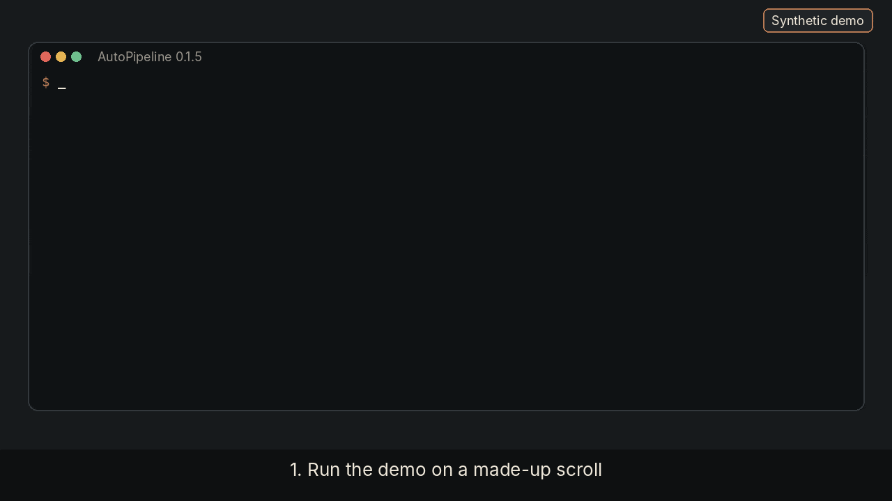
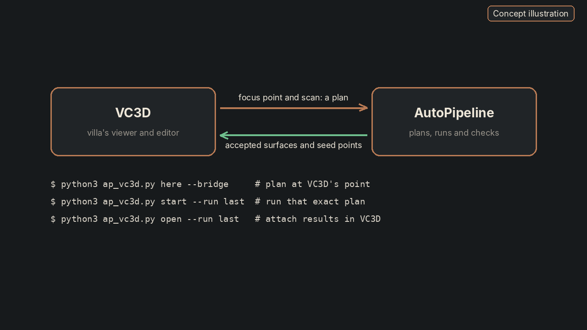

# AutoPipeline: a how-to guide

This page shows you how to install AutoPipeline, run it, and use it in your own work. It is short on purpose. Every setting, flag and error is in the [reference](README.md); this guide links to it instead of copying it.

AutoPipeline (AP) runs villa's pipeline on one released scan: it finds the scroll's center, picks seed points, grows surfaces with VC3D's own tools, checks each surface by a fixed rule, renders it, and runs ink models next to a reversed-depth control. It writes everything into one folder, under a plan you can rerun. It calls villa's tools; it does not replace them.



*Synthetic demo: the first run in a terminal, drawn from output captured on 21 October 2026. Made-up scroll, stand-in VC3D tools and a stand-in ink model, so its maps are not ink. [MP4](../assets/autopipeline/guide/first-run.mp4) (22 s).*

Contents: [1 What you need](#1-what-you-need), [2 What it does for you](#2-what-it-does-for-you), [3 First run](#3-first-run-10-minutes), [4 Use it on your own work](#4-use-it-on-your-own-work), [5 Open the results in VC3D](#5-open-the-results-in-vc3d), [6 Start a run from VC3D](#6-start-a-run-from-vc3d), [7 Troubleshooting](#7-troubleshooting), [8 FAQ](#8-faq), [9 Words used here](#9-words-used-here).

## 1. What you need

- Linux on x86_64, or a Mac. The steps below were tested on Linux. The Mac steps have not been tested yet.
- Python 3.11 or newer (`python3 --version`).
- About 1 GB of disk for the package, VC3D's tools and a small run. Real scans stream from the open-data bucket.
- A GPU only for ink. Without one, a run stops at ink and leaves a job file for a GPU machine.

> **Use a separate environment.** AutoPipeline, the Scrolls workbench and some other tools all install a Python package named `kit`. Installed together they overwrite each other. Give AutoPipeline its own virtual environment, as below.

Set these two names once per shell. Every command below uses them, so a new release changes only this block:

```bash
export AP_VERSION=progress-2026-10-fix5        # AutoPipeline 0.1.5, the current release
export AP_DIR="$HOME/scrolls-autopipeline/submissions/$AP_VERSION/autopipeline"
```

## 2. What it does for you

You give it a scan's name from the open-data catalog, such as `PHerc0841`. It then runs 11 stages:

| Stage | What happens |
| --- | --- |
| acquire | Reads the scan's headers and its published surface prediction |
| umbilicus | Takes the scroll's center line from the catalog, or estimates it with `vc_gen_umbilicus` |
| seeds | Picks seed points on the surface prediction, on papyrus, spaced apart |
| trace | Grows a surface from each seed with `vc_grow_seg_from_seed` |
| bench, qa | Checks each surface: valid grid, no self-crossings, sits on a sheet, faces the right way |
| flatten | Flattens with `vc_flatten`, kept only if the distortion stays inside fixed limits |
| render | Renders the surface volume with `vc_render_tifxyz`, after checking no chunks are missing |
| ink | Runs each ink model forward, on reversed layers and on shuffled layers |
| score, report | Scores the maps where published ink labels exist, then writes a report with a digest |

What it is not: it is not a whole-scroll unwrap. Its traces are small patches. An ink map is model output, not a reading, and a high score is not a found letter.

## 3. First run (10 minutes)

**Install.** This clones the release branch and installs it into its own environment.

```bash
git clone --depth 1 --branch "submission/$AP_VERSION" https://github.com/ChaseHendrick/Scrolls.git ~/scrolls-autopipeline
cd "$AP_DIR"
python3 -m venv .venv && . .venv/bin/activate
python -m pip install -e .
```

Keep the `-e`: the demo and the ink runner live beside the code.

**Run the synthetic demo.** It runs every stage on a made-up scroll with stand-in tools. No download, no GPU.

```bash
python scripts/demo_synthetic.py --out work/demo-run
```

You should see 11 stage lines, two `accepted=True` surfaces and, last, `DEMO PASS` (about 20 s on a small cloud machine). This checks the install and the orchestration, not real VC3D tools or an ink model.

**Look at the run.** Three ways, from the same folder:

```bash
scrolls-kit autopipeline monitor work/demo-run/run --text     # in the terminal
scrolls-kit autopipeline monitor work/demo-run/run --open     # a page in your browser
scrolls-kit autopipeline status work/demo-run/run             # JSON, for scripts and agents
```

You should see every stage `Done`, except `Bench` and `Score`, which are `Skipped` on a made-up scroll. The monitor only reads the folder; it listens on 127.0.0.1 and loads nothing from the internet.

**Get VC3D's tools.** Real runs need villa's five command-line tools. On Linux, villa's release AppImage has them all:

```bash
APPIMAGE="$(python3 scripts/get_vc3d.py)" && export VC_APPIMAGE="$APPIMAGE"
scrolls-kit vc3d which        # lists the five tools and the stage that uses each
scrolls-kit vc3d selftest     # renders and traces synthetic volumes: PASS in about 2 s
```

Export `VC_APPIMAGE` again in each new shell. On a Mac, drag `VC3D.app` from villa's release to Applications instead ([reference](README.md#3-install-and-requirements)).

**Plan a real scan.** A plan freezes every setting and input under a digest. It reads catalog headers and computes nothing.

```bash
scrolls-kit autopipeline plan PHerc0841 --settings '{"purpose": "benchmark", "segment": "0841-w00"}'
```

You should see JSON with `"digest"`, `"out"` (the run folder, such as `work/autopipe/PHerc0841-20250821151531-61435da80f`) and the resolved scan: `"voxel_um": 9.366`, `"license": "CC BY-NC 4.0"`. PHerc0841's segment w00 has published ink labels, so this run can be scored.

**Run it.** Stop after render the first time, then look:

```bash
scrolls-kit autopipeline run work/autopipe/FOLDER --until render
scrolls-kit autopipeline status work/autopipe/FOLDER
```

`FOLDER` is the last part of `"out"` above. Running the same command again resumes where it stopped. Leave out `--until render` to go on to ink and scores.

**Read the scores against their control.** After a full run, `scores.json` in the run folder holds an AUC for each map. Read the forward map next to its reversed control: the reversed map should sit near 0.5. A forward score with no control beside it means nothing. The released numbers for this run are in the [package README](https://github.com/ChaseHendrick/Scrolls/blob/submission/progress-2026-10-fix5/submissions/progress-2026-10-fix5/autopipeline/README.md#results).

**What it costs.** A local run costs only your machine's time; AutoPipeline 0.1.5 prints no price. Without a GPU environment, the run stops at ink with status `handoff` and writes `modal-job.json`; nothing paid starts on its own. To run ink locally, set `KIT_INK_PYTHON` to a Python with villa's `vesuvius` package and torch, and `KIT_AUTOPIPE_DEVICE=cuda` on a GPU machine, then run the same folder again ([reference](README.md#7-environment-variables)).

## 4. Use it on your own work

Every recipe below is a plan setting. Settings are JSON over the defaults; `scrolls-kit autopipeline defaults` prints them all. A plan refuses an unknown setting, so a typo fails at once.

**Your own seed points.** Pick points in VC3D and give them as `[x, y, z]` in full-resolution voxels. VC3D's focus point uses the same frame.

```bash
scrolls-kit autopipeline plan PHerc0841 --settings '{"seeds": {"points": [[3960, 3700, 9500]]}, "trace": {"repeats": 2}}'
```

**Your own surface prediction.** Point `external_prediction` at your OME-Zarr prediction and its normal grids; the scan still comes from the catalog ([settings](README.md#optional-settings)).

**Your own tifxyz segment.** Today this goes through the agent tools, which also run from a shell. With VC3D's tools set up:

```bash
scrolls-kit vc3d call check_surface '{"surface": "PATH/TO/SEGMENT", "volume": "VOLUME_URL"}'
scrolls-kit vc3d call render '{"surface": "PATH/TO/SEGMENT", "volume": "VOLUME_URL"}'
```

`PATH/TO/SEGMENT` is a tifxyz folder (with `meta.json`, `x.tif`, `y.tif`, `z.tif`); `VOLUME_URL` is the scan's OME-Zarr URL from the plan's `"volume_url"`. `check_surface` checks the grid, self-crossings and whether the surface sits on a sheet; `render` makes the surface volume. `scrolls-kit vc3d tools` lists every tool.

**Your own ink model.** Register a checkpoint, then name it in the plan:

```bash
scrolls-kit vc3d call models '{"action": "add", "name": "my-model", "engine": "villa", "checkpoint": "/path/to/model.pth"}'
scrolls-kit autopipeline plan PHerc0841 --settings '{"segment": "0841-w00", "ink": {"models": ["my-model", "reader-v2"]}}'
```

Engines are `villa` (a villa `.pth`), `torchscript` and `v8in`. A model behind any other command runs through the `ink` tool with `"engine": "command"`. Two or more models can be combined with `"ink": {"ensemble": {"method": "rank"}}`. The reversed and shuffled controls always run.

**Community steps.** Optional settings switch on methods from the community: `render.snap` (snap a surface onto the predicted sheet before rendering), `qa.repair` (fix sheet switches), `triage` (rank maps by Bullo27's text-row score, a reading order, not a verdict) and `umbilicus.source` (catalog, estimate or a file). Details: [optional settings](README.md#optional-settings).

**Where each output goes next.** Everything uses the community's formats:

| Output in the run folder | Format | Open it with |
| --- | --- | --- |
| `traces/SID/`, `flat/SID.tifxyz` | tifxyz | VC3D (File > Attach Segments...), `vc_render_tifxyz`, `vc_flatten`, `vc_tifxyz2obj` |
| `renders/SID/` | zarr surface volume | villa's ink inference; `scrolls-kit layers` writes TIFFs for other models |
| `ink/SID/MODEL/` | TIFF maps, forward, reversed, shuffled | Any image viewer; `scrolls-kit auc` scores one |
| `umbilicus.json` | villa's umbilicus format | VC3D (File > Attach Umbilicus...) |
| `plan.json`, `state.json`, `report.json` | JSON | Any script; `status` prints a summary |

**Every scan at once (advanced).** From a clone of Scrolls `main`, `python -m kit run all --dry-run --refresh` prices a batch over every open-data volume and launches nothing ([section 19](README.md#19-every-scan-catalog-batch-and-watcher)). A batch on rented machines costs money: plan it, read the price, and only then decide.

## 5. Open the results in VC3D



*Concept illustration: how a VC3D point becomes an AutoPipeline plan and how a run's accepted surfaces come back to VC3D. No scan data.*

**By hand, with VC3D's menus** (VC3D from villa `main`):

1. File > Attach Remote Zarr... with the plan's `"volume_url"` (File > Attach Volume... for a local copy).
2. File > Attach Segments... with the run folder's `traces/` folder.
3. File > Attach Umbilicus... with `umbilicus.json`, if you want the center line.

Ink maps are TIFFs on the render canvas, not on the segment's grid, so open them in an image viewer for now.

**With one command.** [`integrations/vc3d/ap_vc3d.py`](../../integrations/vc3d/README.md) is one standard-library file. `load` copies only the surfaces the run accepted, plus the seed points as a VC3D point collection. `open` does the menu steps in a running VC3D over its agent bridge:

```bash
mkdir -p ~/ap-vc3d && curl -fsSL -o ~/ap-vc3d/ap_vc3d.py \
  https://raw.githubusercontent.com/ChaseHendrick/Scrolls/main/integrations/vc3d/ap_vc3d.py
python3 ~/ap-vc3d/ap_vc3d.py load --run "$AP_DIR/work/autopipe/FOLDER" --dest ~/ap-for-vc3d
python3 ~/ap-vc3d/ap_vc3d.py open --run "$AP_DIR/work/autopipe/FOLDER"      # VC3D started with --agent-bridge
```

`open` asks VC3D which bridge methods it has and calls only those. Open or create a project in VC3D first.

## 6. Start a run from VC3D

Click on the papyrus in VC3D. Its focus point is a seed for AutoPipeline. With VC3D started as `VC3D --agent-bridge`:

```bash
. "$AP_DIR/.venv/bin/activate"
python3 ~/ap-vc3d/ap_vc3d.py here --bridge            # plans a run seeded at VC3D's point; computes nothing
python3 ~/ap-vc3d/ap_vc3d.py start --run last --digest last
```

`here` reads the point and the open volume, plans the run and prints its folder, digest and the start command. `start` checks that digest, starts that exact plan in the background and returns. Without the bridge, pass the point yourself: `here --point X,Y,Z --volume VOLUME_URL`. The volume must be a catalog scan. When surfaces are accepted, `open --run last` brings them back.

A VC3D Plugins menu for these steps is ready on our side; it needs a VC3D change that is not in villa yet ([what waits](../../integrations/vc3d/README.md#what-works-today-and-what-waits-for-villa)).

## 7. Troubleshooting

| What you see | What to do |
| --- | --- |
| `No module named kit` | Activate the environment: `. "$AP_DIR/.venv/bin/activate"`. Keep AutoPipeline out of other tools' environments |
| `DEMO FAIL` with `got 0` surfaces | `--out` named a folder git would track. Use `--out work/demo-run`, or leave `--out` out |
| `the plan's digest does not match its content` | `plan.json` was edited. Make a new plan |
| `<out> has no plan.json` | Run `plan` first. A relative folder is read from the package folder (or `KIT_HOME`) |
| `unknown plan setting <key>` | A typo, or a setting this version lacks. Compare with `scrolls-kit autopipeline defaults` |
| ink stays `handoff` | No ink Python with torch. Set `KIT_INK_PYTHON`, then run the same folder again |
| `no trace grew a surface` | Read `trace_failures` in `state.json`. Try other seed points |
| `no surface passed the acceptance rule` | Read `qa.reasons` in `state.json`. The `stable` AppImage lacks two checks; use `latest` |
| a VC3D tool exits with 139 | Set `VC_APPIMAGE` to the AppImage or its `squashfs-root`; never start `usr/bin` tools directly |

The full table is in the [reference](README.md#13-troubleshooting).

## 8. FAQ

**Do I need a GPU?** Only for ink. Planning, tracing, checks and rendering run on a CPU.

**Mac or Windows?** Linux is tested. A Mac with `VC3D.app` should work but is untested. On Windows, use WSL.

**Can I run my own or a private scan?** Plans take catalog scans only. Your own surfaces, predictions and models plug in through the settings in section 4.

**How do I resume?** Run the same folder again. Finished stages are kept.

**Where are the files?** In `work/` inside the package folder, or under `KIT_HOME` if you set it.

**Does it read text?** No. It makes ink maps, which are model output. Reading is for papyrologists.

## 9. Words used here

| Word | Meaning |
| --- | --- |
| plan, digest | `plan.json` holds every setting; its SHA-256 digest changes when any setting does |
| run folder | The one folder of a run: plan, state, traces, renders, maps, report |
| seed point | Where a trace starts, as x, y, z in full-resolution voxels |
| tifxyz | villa's surface format: a folder with `meta.json` and `x.tif`, `y.tif`, `z.tif` grids |
| OME-Zarr | The chunked volume format of the open-data scans and predictions |
| VC3D | villa's viewer and editor, and its command-line tools |
| ink map | A model's per-pixel ink probability. Model output, not a reading |
| reverse-depth control | The same model on the layers in reverse order; it should score near 0.5 |

More terms: [`GLOSSARY.md`](../../GLOSSARY.md).

AutoPipeline is built on ScrollPrize's [villa](https://github.com/ScrollPrize/villa) and VC3D, the Vesuvius Challenge open data (CC BY-NC 4.0), the released `ink_9um` model and the community's fine-tunes of it. Code: Apache License 2.0.
