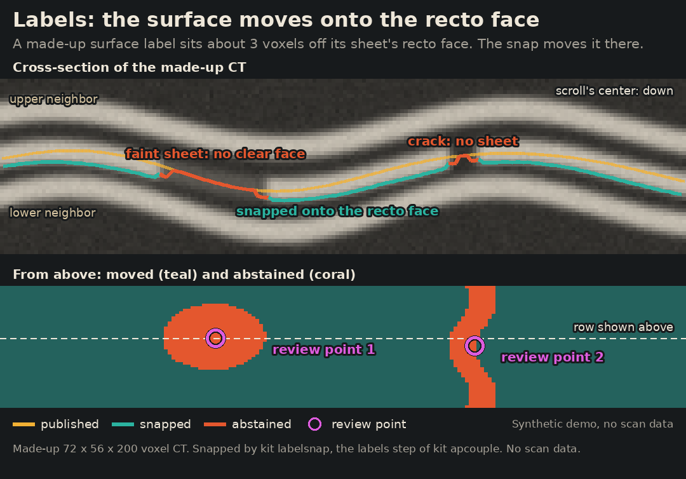
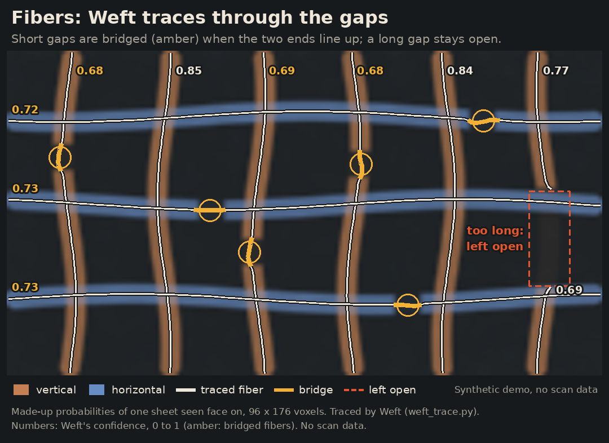
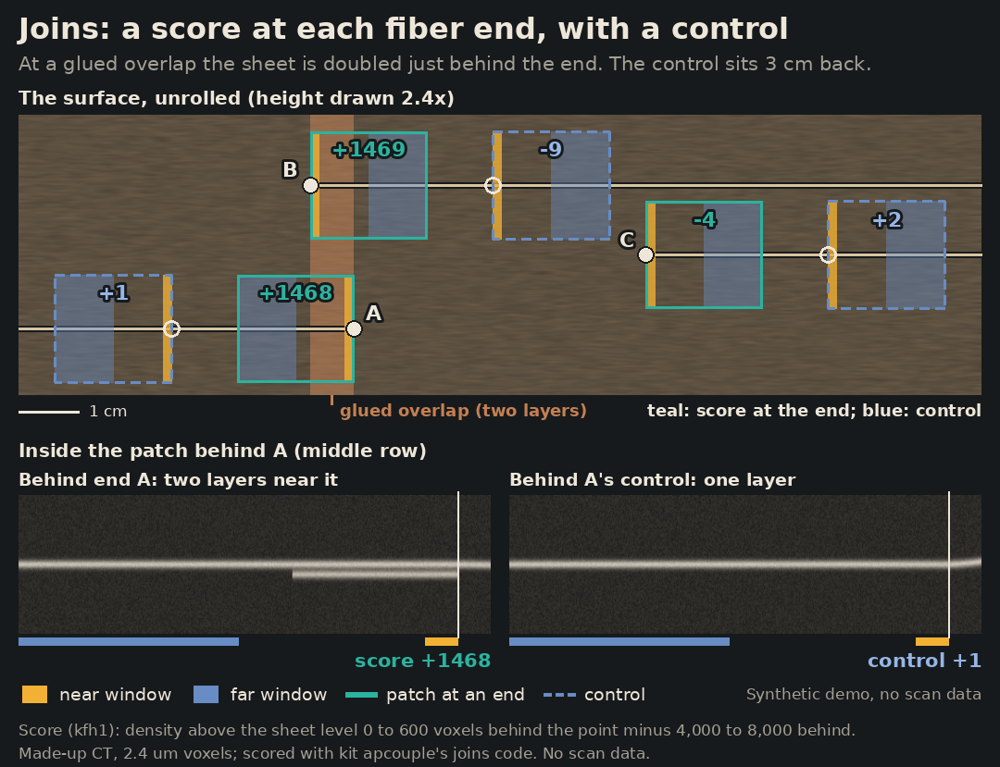

# From a public scan to a surface that stays on its sheet

**DRAFT, not released.** This page is being written on a draft branch. Parts marked *pending* wait for their preregistered test or for their code to be released; nothing on this page is final until the draft note above is gone.

AutoPipeline (AP) runs villa's tools on one released scan, unattended, from the scroll's center line to traced surfaces and ink maps, and gives every check a control that can fail. This entry couples six parts of that run into one pipeline: the center line, tracing with the contact barrier against sheet switches, a voxel-exact surface label, papyrus fibers along the surface, glued sheet joins at the fiber ends, and ink with its reversed-depth control. Each part is an AutoPipeline step that reads the output of the step before it, and each runs headless from one command.


*Concept illustration: a papyrus surface traced in copper and flattened into a grid. No scan data.*

## The problems it works on

The organizers list these bottlenecks on the [2026 Open Problems](https://scrollprize.org/2026_open_problems) page (updated 14 October 2026, read 28 October 2026; Sourced fact):

| Their words | The part here |
| --- | --- |
| Sheet switches: "Smarter surface tracing algorithms that avoid introducing sheet switches" | [Trace with the contact barrier](#2-trace-with-the-contact-barrier) |
| Label quality "is now one of the main unwrapping bottlenecks"; label snapping is requested | [Voxel-exact label](#3-voxel-exact-label) |
| Fibers: "The goal should be reliable connections" | [Fibers along the surface](#4-fibers-along-the-surface) |

The [winding annotations page](https://scrollprize.org/open_problems/winding_annotations) (updated 12 July 2026, read 28 October 2026; Sourced fact) lists the glued joins between sheets under "Things we have not tried": they "could be used as relatively large, full height same-winding constraints". That is the [joins](#5-glued-sheet-joins) step.

## The steps

Each step has a stage name in AutoPipeline's stage registry (`python -m kit stages list`), a contract for what it reads and writes, and an `off` choice so its effect can be measured by swapping it out.

| Step | Stage | What it reads | What it writes | State |
| --- | --- | --- | --- | --- |
| Center line | `umbilicus`, choice `centerlines` | the scan | `umbilicus.json` | released |
| Trace with the contact barrier | `trace`, `qa.repair` method `barrier` | the center line, the surface prediction | traced tifxyz surfaces, each cut back to its seed's sheet | released in AutoPipeline 0.1.9 |
| Voxel-exact label | `labels`, choice `snapped` (baseline `mesh`) | each traced surface, the center line, the scan | the surface moved onto the recto face of its sheet, an abstain mask, an OME-Zarr surface label | experimental, in AutoPipeline 0.1.10 |
| Fibers along the surface | `fibers`, choice `weft` | the labeled surface, public AFV V2 fiber probabilities | fiber curves (`.afv`, opens in VC3D) in a box around the surface | experimental, in AutoPipeline 0.1.10 |
| Glued sheet joins | `joins`, choice `kfh1` | the fibers, the labeled surface, the scan | a score at each fiber end on the surface, with a control point 3 cm back along the surface | experimental, in AutoPipeline 0.1.10 |
| Ink | `ink`, default Reader V3 | the rendered surface | an ink map and its reversed-depth control map | released |

## Run it

### 1. Center line

```bash
python -m kit centerline get PHerc0814 --into FOLDER
```

Writes `FOLDER/umbilicus.json`, checked by sha256. Page: [centerline](tools/centerline.md).

### 2. Trace with the contact barrier

```bash
autopipeline plan SAMPLE    # "qa": {"repair": {"method": "barrier"}} is the default
```

In the AutoPipeline 0.1.9 package folder (branch `submission/progress-2026-10-fix9`). Page: [contact-barrier](tools/contact-barrier.md); guide: [autopipeline](tools/autopipeline.md).

### 3. Voxel-exact label

Steps 3 to 5 run from the AutoPipeline 0.1.10 package, whose install puts its command line on the path as `scrolls-kit`:

```bash
git clone --branch submission/progress-2026-10-fix10 --depth 1 https://github.com/ChaseHendrick/Scrolls.git scrolls-autopipeline
cd scrolls-autopipeline/submissions/progress-2026-10-fix10/autopipeline
python3 -m venv .venv && . .venv/bin/activate && python -m pip install -e '.[couple]'
```

Each step takes a coupled run folder, RUN, made by `scrolls-kit apcouple from-run` from a finished AutoPipeline run or by `scrolls-kit apcouple init` from any surface ([All six in one run](#all-six-in-one-run)).

```bash
scrolls-kit apcouple labels RUN                  # or: --use mesh, the surface as given, the baseline
```

Moves each traced surface onto the recto face of its sheet, writes an abstain mask where it refuses, an OME-Zarr surface label (1 surface, 2 ignore) and a VC3D review queue: the placement code Snapped Labels used on PHerc0172 (labelsnap; [snapped-labels](tools/snapped-labels.md)), now run on any traced surface. The finer-scan snap used for the dataset's other three scrolls, and the dataset's filling of unmeasured vertices, are not part of this step.

### 4. Fibers along the surface

```bash
scrolls-kit apcouple fibers RUN
```

Traces papyrus fibers with Weft, our fiber tracer, in a box around the surface the label step wrote, from the public fiber probabilities of Qual's AFV V2 model for the run's own scan ([afv-fibers](tools/afv-fibers.md)), and writes `.afv` files that open in VC3D.

### 5. Glued sheet joins

```bash
scrolls-kit apcouple joins RUN
```

Scores each horizontal fiber end on the surface for a glued sheet join, following the surface behind the end, and scores a point moved about 3 cm back along the surface beside it as the control. At coarse voxel sizes only ends with long unbroken surface behind them can be scored.

### 6. Ink

Ink detection runs inside AutoPipeline with Reader V3 by default, and always also on the layers reversed, as a control ([autopipeline](tools/autopipeline.md)).

### All six in one run

```bash
scrolls-kit apcouple from-run work/autopipe/<folder>        # the run's accepted traces, scan and center line
scrolls-kit apcouple chain work/autopipe/<folder>/coupled   # labels, fibers, joins in order
scrolls-kit apcouple check work/autopipe/<folder>/coupled   # every record against its step's contract
scrolls-kit apcouple swap work/autopipe/<folder>/coupled labels mesh snapped   # two choices side by side
```

Today the three steps follow a finished AutoPipeline run (`from-run`); as plan settings inside the run they come in a later version. `scrolls-kit apcouple init RUN --surface S --volume URL --voxel-um UM --umbilicus U --sample SCAN` starts from any tifxyz surface, a published segment included. A smoke run of the chain on public PHerc0814 data ran headless on a Hugging Face CPU Job: each step read the one before, and the copied run folder checked clean. That shows the steps run, not that a label, fiber or score is right.

## Pictures

The contact barrier on made-up sheets: a trace runs through a contact onto the neighboring sheet, and the barrier keeps the seed's side.


*Synthetic demo: made-up sheets, the released barrier code. No scan data.*

The three steps after a run, each on made-up data with the released code:







Slow step-by-step versions: [labels](assets/autopipeline-couple/labels-steps.gif), [fibers](assets/autopipeline-couple/fibers-steps.gif), [joins](assets/autopipeline-couple/joins-steps.gif).

*Synthetic demo: made-up CT, probabilities and surfaces, the AutoPipeline 0.1.10 code. No scan data.*

## Evidence

Every number is Model output from a rule fixed before the data was read, unless marked. A traced surface or a label is geometry; a fiber, a join score and an ink map are model output; none of them is a reading.

| Claim | Label | Rule and control | Data | Record |
| --- | --- | --- | --- | --- |
| With the contact barrier, AutoPipeline's trace passed 2 of 5 windings in both repeats, with 0.061 and 0.063 cm² on other windings; villa's `vc_grow_seg_from_seed` in the same harness passed 0 of 5, with 3.983 and 14.382 cm² on other windings | Model output | rule frozen before any sector, seed, trace or score existed; the control is villa's tracer on the same seeds | PHerc0139 (scan 20250728140407), one sector, five published report windings; the barrier's parent rule read scores of report windings in another band, so they are held out in this band but not completely unseen | [contact-barrier](tools/contact-barrier.md); `contact_barrier_checks` in [results.json](results.json) |
| Beside the trace, windlabel-box's relative winding labels, cut at every step lasagna's grad_mag does not back, got 0.9515 of 16,599 judged steps right on PHerc0172 (one-sided 95 % lower bound 0.9408; bar 0.92) and were ahead of winding-phase's certified hops at matched coverage, 0.954 against 0.906 (lower bound of the lead +0.028). On fresh PHerc1667 boxes they got 0.9706 of 7,937 right, ahead of winding-phase (0.978 against 0.942) and of constraint-gauge's E1 on the steps both judged (0.971 against 0.948). On a second, never-scored PHerc0172 band they got 0.955 of 32,411 judged steps right (lower bound 0.9471; bar 0.92), ahead of E1 on the same steps (0.955 against 0.944, lower bound of the lead +0.009) and of winding-phase at matched coverage (0.952 against 0.934, lower bound +0.005) | Model output | rule, bars and comparisons fixed before any box had a prediction; random, skip and shift controls; the other tools on the same boxes and truth, each with its own shuffled control; E1 could not be compared on the first PHerc0172 band, where its units check failed on the input we built for it, and passed on the second; one disclosed change before any chain existed moved one box's lasagna crop 4 voxels past a rounding failure in villa's `predict3d`; the leads on the second band are small | PHerc0172, 27 boxes at z 11,660 to 13,000, held out by scroll, and 20 fresh boxes at z 10,710 to 11,510; PHerc1667, 24 boxes held out by position only, since split rule v2 was chosen partly on earlier PHerc1667 boxes; published hand windings; only 13 to 15 % of steps can be judged | [windlabel-box](tools/windlabel-box.md) |
| Moved onto the papyrus by labelsnap, the published labels sat closer to a finer scan's recto face than before and than with each of seven community snapping methods, on PHerc0814, on PHerc0841 and pooled: pooled, 2.153 voxels closer than the published label (95 % interval 1.821 to 2.507) and 1.892 closer than an exact-parity port of VC3D's `vc_objrefine` refinement (1.480 to 2.349) | Model output (geometry, not a reading) | test frozen before it ran; sham, random sign, planted, moved truth and midline controls, all held | 71 scored sites (32 fresh PHerc0814, 60 PHerc0841); PHerc0814 held out by site, not by scroll; the planted toward-verso control is weak; finesnap beat labelsnap on PHerc0814 by 0.93 voxels; it does not show 1-voxel exactness | [snapped-labels](tools/snapped-labels.md) |
| Fibers along the surface | *pending* | | | |
| Glued sheet joins | *pending* | | | |

## What did not work

- Three of the five windings still failed with the contact barrier, and on an earlier sector with an older repair villa's tracer was ahead ([contact-barrier](tools/contact-barrier.md)).
- *Pending: the other parts' failed checks, each in one line.*

## What it does not do

- The contact barrier cuts a finished trace back to its seed's sheet; it does not stop a tracer while the trace grows, and it does not regrow what it cuts.
- *Pending: the limits of the label, fiber and join steps.*

## Credits

villa and VC3D (ScrollPrize/villa); the Vesuvius Challenge open data scans and published segments; Qual's AFV V2 fiber model and spline generator; Domenico Russo's Reader V3 ink model.
