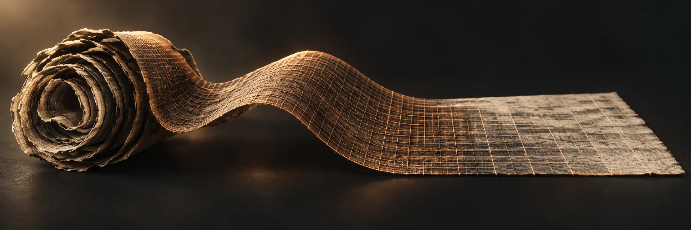
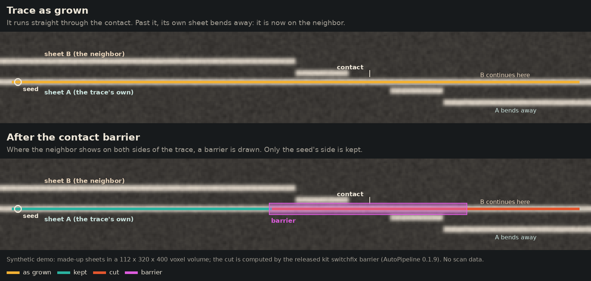
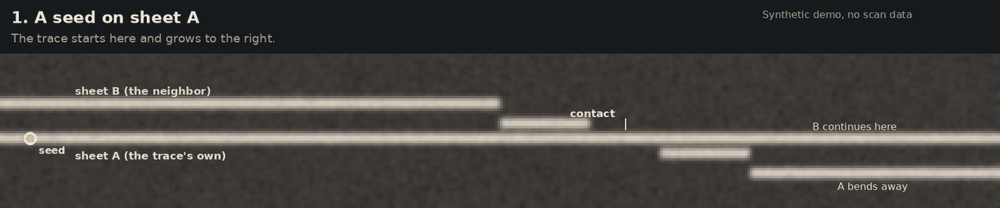

# From a public scan to a surface that stays on its sheet

**DRAFT, not released.** This page is being written on a draft branch. Parts marked *pending* wait for their preregistered test or for their code to be released; nothing on this page is final until the draft note above is gone.

AutoPipeline (AP) runs villa's tools on one released scan, unattended, from the scroll's center line to traced surfaces and ink maps, and gives every check a control that can fail. This entry couples six parts of that run into one pipeline: the center line, tracing with the contact barrier against sheet switches, a voxel-exact surface label, papyrus fibers along the surface, glued sheet joins at the fiber ends, and ink with its reversed-depth control. Each part is an AutoPipeline step that reads the output of the step before it, and each runs headless from one command.



*Concept illustration: a papyrus surface traced in copper and flattened into a grid. No scan data.*

## The problems it works on

The organizers list these bottlenecks on the [2026 Open Problems](https://scrollprize.org/2026_open_problems) page (updated 14 October 2026, read 28 October 2026; Sourced fact):

| Their words | The part here |
| --- | --- |
| Sheet switches: "Smarter surface tracing algorithms that avoid introducing sheet switches" | [Trace with the contact barrier](#2-trace-with-the-contact-barrier) |
| Label quality "is now one of the main unwrapping bottlenecks"; label snapping is requested | [Voxel-exact label](#3-voxel-exact-label) |
| Fibers: "The goal should be reliable connections" | [Fibers along the surface](#4-fibers-along-the-surface) |

The [winding annotations page](https://scrollprize.org/open_problems/winding_annotations) (updated 12 July 2026, read 28 October 2026; Sourced fact) lists the glued joins between sheets under "Things we have not tried": they "could be used as relatively large, full height same-winding constraints". That is the [joins](#5-glued-sheet-joins) step.

## The steps

Each step has a stage name in AutoPipeline's stage registry (`python -m kit stages list`), a contract for what it reads and writes, and an `off` choice so its effect can be measured by swapping it out.

| Step | Stage | What it reads | What it writes | State |
| --- | --- | --- | --- | --- |
| Center line | `umbilicus`, choice `centerlines` | the scan | `umbilicus.json` | released |
| Trace with the contact barrier | `trace`, `qa.repair` method `barrier` | the center line, the surface prediction | traced tifxyz surfaces, each cut back to its seed's sheet | released in AutoPipeline 0.1.9 |
| Voxel-exact label | `labels`, choice `snapped` (baseline `mesh`) | each traced surface, the center line, the scan | the surface moved onto the recto face of its sheet, an abstain mask, an OME-Zarr surface label | *pending*: its test and its code release |
| Fibers along the surface | `fibers` | the labeled surface, public AFV V2 fiber probabilities | fiber curves (`.afv`, opens in VC3D) in a box around the surface | *pending*: its test and its code release |
| Glued sheet joins | `joins` | the fibers, the labeled surface, the scan | a score at each fiber end on the surface, with a control point 3 cm back along the surface | *pending*: its test and its code release |
| Ink | `ink`, default Reader V3 | the rendered surface | an ink map and its reversed-depth control map | released |

## Run it

### 1. Center line

```bash
python -m kit centerline get PHerc0814 --into FOLDER
```

Writes `FOLDER/umbilicus.json`, checked by sha256. Page: [centerline](tools/centerline.md).

### 2. Trace with the contact barrier

```bash
autopipeline plan SAMPLE    # "qa": {"repair": {"method": "barrier"}} is the default
```

In the AutoPipeline 0.1.9 package folder (branch `submission/progress-2026-10-fix9`). Page: [contact-barrier](tools/contact-barrier.md); guide: [autopipeline](tools/autopipeline.md).

### 3. Voxel-exact label

*Pending.* It will run as the AutoPipeline stage `labels`, or alone on one run folder. The published labels moved onto the papyrus are already public as a dataset and a viewer ([snapped-labels](tools/snapped-labels.md)); the step that does the same for any traced surface is not released yet.

### 4. Fibers along the surface

*Pending.* It will run as the AutoPipeline stage `fibers`, or alone on one run folder. The fiber probabilities it reads are public ([afv-fibers](tools/afv-fibers.md), made with Qual's AFV V2 model).

### 5. Glued sheet joins

*Pending.* It will run as the AutoPipeline stage `joins`, or alone on one run folder.

### 6. Ink

Ink detection runs inside AutoPipeline with Reader V3 by default, and always also on the layers reversed, as a control ([autopipeline](tools/autopipeline.md)).

### All six in one run

*Pending.* One command on a small public box, with its expected outputs and run time, goes here when the label, fiber and join steps are released.

## Pictures

The contact barrier on made-up sheets: a trace runs through a contact onto the neighboring sheet, and the barrier keeps the seed's side.





*Synthetic demo: made-up sheets, the released barrier code. No scan data.*

*Pending: one still and one slow GIF per remaining step.*

## Evidence

Every number is Model output from a rule fixed before the data was read, unless marked. A traced surface or a label is geometry; a fiber, a join score and an ink map are model output; none of them is a reading.

| Claim | Label | Rule and control | Data | Record |
| --- | --- | --- | --- | --- |
| With the contact barrier, AutoPipeline's trace passed 2 of 5 windings in both repeats, with 0.061 and 0.063 cm² on other windings; villa's `vc_grow_seg_from_seed` in the same harness passed 0 of 5, with 3.983 and 14.382 cm² on other windings | Model output | rule frozen before any sector, seed, trace or score existed; the control is villa's tracer on the same seeds | PHerc0139 (scan 20250728140407), one sector, five published report windings; the barrier's parent rule read scores of report windings in another band, so they are held out in this band but not completely unseen | [contact-barrier](tools/contact-barrier.md); `contact_barrier_checks` in [results.json](results.json) |
| Voxel-exact label | *pending* | | | |
| Fibers along the surface | *pending* | | | |
| Glued sheet joins | *pending* | | | |

## What did not work

- Three of the five windings still failed with the contact barrier, and on an earlier sector with an older repair villa's tracer was ahead ([contact-barrier](tools/contact-barrier.md)).
- *Pending: the other parts' failed checks, each in one line.*

## What it does not do

- The contact barrier cuts a finished trace back to its seed's sheet; it does not stop a tracer while the trace grows, and it does not regrow what it cuts.
- *Pending: the limits of the label, fiber and join steps.*

## Credits

villa and VC3D (ScrollPrize/villa); the Vesuvius Challenge open data scans and published segments; Qual's AFV V2 fiber model and spline generator; Domenico Russo's Reader V3 ink model.
