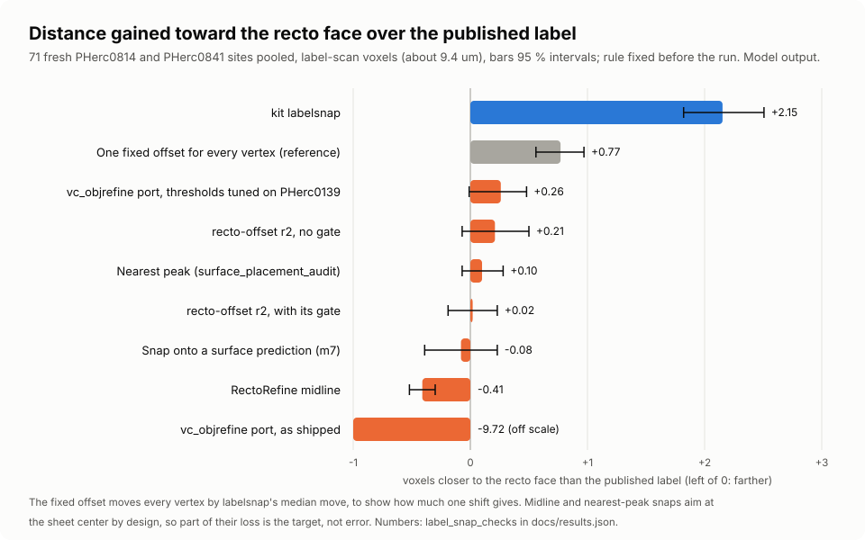
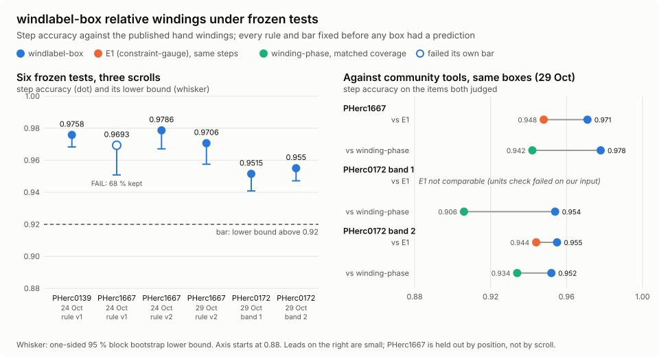

# From a public scan to a traced surface that stays on its sheet

AutoPipeline (AP) runs villa's tools on one released scan, unattended, from the scroll's center line to traced surfaces and ink maps, and gives every check a control that can fail. This entry couples four of its steps into one headless pipeline: the center line, tracing with the contact barrier against sheet switches, the surface label moved onto the papyrus, and ink with its reversed-depth control. Beside it, three tools work on the same bottlenecks and run on their own: winding labels for the spiral fit, a suggester of where to paint ink labels next, and Parting, a feature for touching sheets.


*Concept illustration: a papyrus surface traced in copper and flattened into a grid. No scan data.*

## The problems it works on

The organizers' [2026 Open Problems](https://scrollprize.org/2026_open_problems) page (last updated 14 October 2026, read 30 October 2026; Sourced fact) lists these in its Bottlenecks table and its spiral fit section:

| Their words | The part here |
| --- | --- |
| Sheet switches: "Meshes can jump from one wrap to another"; what would help: "Smarter surface tracing algorithms that avoid introducing sheet switches" | [Trace with the contact barrier](#2-trace-with-the-contact-barrier); [Parting](#touching-sheets-parting) |
| Approximate surface labels: "Human-created meshes are useful but not voxel-exact"; what would help: "Label snapping, active learning, self-supervised approaches" | [Label moved onto the papyrus](#3-label-moved-onto-the-papyrus) (label snapping); [labelsuggest](#where-to-paint-ink-labels-next-labelsuggest) (active learning, for ink labels rather than surface labels); [Parting](#touching-sheets-parting) (on self-supervised dinovol features) |
| Spiral fit: "Most importantly, relative winding number annotations seem to have a great impact on the spiral fit" | [windlabel-box](#winding-labels-windlabel-box) |

The center line is not on that page. The spiral fit and VC3D's winding numbers read it, and the trace and the label step use it to tell outward from inward.

## The pipeline

Each step is a stage of AutoPipeline 0.1.10 (`scrolls-kit stages list` in the package). A stage's choice is picked by name (`plan --use STAGE=NAME`) and recorded under the plan's digest; the repair and label stages also have an `off` choice, so their effect can be measured by swapping them out.

| Step | Stage | What it reads | What it writes | State |
| --- | --- | --- | --- | --- |
| Center line | `umbilicus`, choice `centerlines` | the scan's name | `umbilicus.json`: a published line, people's first, the Center Finder's where nobody made one | released |
| Trace with the contact barrier | `trace`, then `repair` choice `barrier` | the center line, the surface prediction | traced tifxyz surfaces; a trace rejected for a sheet switch is cut back to its seed's sheet | released in AutoPipeline 0.1.9 |
| Label moved onto the papyrus | `labels`, choice `snapped` (baseline `mesh`) | each accepted surface, the center line, the scan | the surface moved onto the recto face of its sheet, an abstain mask, an OME-Zarr surface label | experimental, in AutoPipeline 0.1.10 |
| Ink | `ink`, default Reader V3 | the rendered surface | an ink map with its reversed-depth and depth-shuffled controls | released |

## Run it

The pipeline runs from the AutoPipeline 0.1.10 package, whose install puts its command line on the path as `scrolls-kit`:

```bash
git clone --branch submission/progress-2026-10-fix10 --depth 1 https://github.com/ChaseHendrick/Scrolls.git scrolls-autopipeline
cd scrolls-autopipeline/submissions/progress-2026-10-fix10/autopipeline
python3 -m venv .venv && . .venv/bin/activate && python -m pip install -e '.[couple]'
python scripts/demo_synthetic.py    # every stage on a synthetic scroll with stand-in VC3D tools; prints DEMO PASS
```

Real runs need villa's VC3D tools (`python3 scripts/get_vc3d.py` fetches and checks villa's AppImage) and, for ink, a Python with villa's `vesuvius` package and torch named by `KIT_INK_PYTHON`; without it a run stops at ink and writes the ink job to a file ([autopipeline](tools/autopipeline.md)). Since villa commit e1aa625a6 (29 October 2026 UTC), villa builds no longer include `vc_flatten` or `vc_tifxyz_selfcross`, which AutoPipeline's flatten stage and its qa self-intersection check call; villa's `latest` AppImage is now built after that commit, and its `stable` AppImage predates `vc_tifxyz_selfcross`. AutoPipeline 0.1.11 runs on those builds: its self-intersection check compiles the same census code from villa's source once (`scrolls-kit selfcross build`), and its flatten stage uses villa's `flatboi`. ([package](https://github.com/ChaseHendrick/Scrolls/tree/submission/progress-2026-10-fix11/submissions/progress-2026-10-fix11))

### 1. Center line

```bash
scrolls-kit autopipeline plan PHerc0814 --use umbilicus=centerlines
```

Takes the scan's line from the public center lines dataset at a pinned revision, people's lines first; on PHerc0814, where the dataset has no person's line, it is the Center Finder's polished line (model output; checked on 30 October 2026). Outside AutoPipeline, `python -m kit centerline get PHerc0814 --into FOLDER` (from a clone of this repository) writes the same kind of line as `FOLDER/umbilicus.json` for VC3D, checked by sha256 ([centerline](tools/centerline.md)). Where no line exists, the Center Finder makes one from the scan's CT slices ([umbilicus](tools/umbilicus.md)).

### 2. Trace with the contact barrier

```bash
scrolls-kit autopipeline plan PHerc0814 --settings '{"qa": {"repair": {"method": "barrier"}}}'
scrolls-kit autopipeline run work/autopipe/<folder>
```

Repair is opt in: a plan without `qa.repair` only rejects a trace that switches sheets. With it, a rejected trace is cut at the contact barrier, keeping the part its seed reaches, checked again by the same rule and kept only if it passes and keeps at least half its area ([contact-barrier](tools/contact-barrier.md)).

### 3. Label moved onto the papyrus

```bash
scrolls-kit apcouple from-run work/autopipe/<folder>               # a coupled run folder from the run's accepted traces, scan and center line
scrolls-kit apcouple labels work/autopipe/<folder>/coupled         # or: --use mesh, the surface as given, the baseline
scrolls-kit apcouple check work/autopipe/<folder>/coupled          # every record against its step's contract
```

Moves each traced surface onto the recto face of its sheet, writes an abstain mask where it refuses, an OME-Zarr surface label (1 surface, 2 ignore) and a VC3D review queue: the placement code Snapped Labels used on PHerc0172 (labelsnap; [snapped-labels](tools/snapped-labels.md)), now run on any traced surface. The finer-scan snap used for the dataset's other three scrolls, and the dataset's filling of unmeasured vertices, are not part of this step. `scrolls-kit apcouple init RUN --surface S --volume URL --voxel-um UM --umbilicus U --sample SCAN` starts from any tifxyz surface, a published segment included. A smoke run on public PHerc0814 data ran headless on a Hugging Face CPU Job and the copied run folder checked clean; that shows the step runs, not that a label is right.

### 4. Ink

Ink detection runs inside the same AutoPipeline run, with Reader V3 by default, on the layers as rendered, reversed and shuffled; the reversed map is the control a reader of real ink must lose. Each map is saved as the model's probability map, in the file its engine writes (villa's engine writes uint8, the probability times 255), with no filter or contrast stretch unless a plan asks for one. The monitor (`scrolls-kit autopipeline monitor work/autopipe/<folder>`) stretches each forward map between its 1st and 99th percentile for display only, and draws the reversed control on that same scale so a control is never stretched to look like ink.

### All four in one run

```bash
scrolls-kit autopipeline plan PHerc0814 --use umbilicus=centerlines --settings '{"qa": {"repair": {"method": "barrier"}}}'
scrolls-kit autopipeline run work/autopipe/<folder>               # center line, seeds, trace, qa with the barrier, flatten, render, ink
scrolls-kit apcouple from-run work/autopipe/<folder> && scrolls-kit apcouple labels work/autopipe/<folder>/coupled
```

The run folder holds `plan.json` (every setting and input under one digest), `state.json`, the traces, renders, ink maps (`ink/<surface>/<model>`: forward, reversed and shuffled), `scores.json` and `report.json`. Today the label step follows a finished run (`from-run`); as a plan setting inside the run it comes in a later version.

## Beside the pipeline

These three work on the same bottlenecks but are not AutoPipeline stages: each runs on its own.

### Winding labels: windlabel-box

Relative windings in a box around one point, from published predictions only, with no person in between, as villa's relative-winding point collections for the spiral fit. It cuts each chain at every step lasagna's grad_mag does not back. It is a choice of the `windings` stage in this repository's stage registry (`python -m kit stages list windings`).

```bash
python -m kit windlabel-box --prediction SURFACE_ZARR --grad-mag GRAD_MAG_ZARR --umbilicus UMB.json --point Z,Y,X --out RUN --json
```

Add `--base-affine` when the prediction and the grad_mag are on different scans; the full PHerc0139 example is on its page ([windlabel-box](tools/windlabel-box.md)).

### Where to paint ink labels next: labelsuggest

Ranks a segment's tiles by how much two or more readers' ink maps disagree and writes the top tiles as a mask to label first, beside matched random tiles, the tiles where readers agree most, and a shuffle control. It reads no label.

```bash
python -m kit labelsuggest map OUT MAP_A.tif MAP_B.tif MAP_C.tif
```

From a clone of this repository ([labelsuggest](tools/labelsuggest.md)).

### Touching sheets: Parting

A contact classifier on the Vesuvius Challenge's base dinovol features: given a point on one layer and a candidate point, it scores whether the candidate is on the same layer, where two layers touch, the place where tracers switch sheets. Its code is released under Apache-2.0, and its trained model file is on Hugging Face as [SharpMeow/parting-v1](https://huggingface.co/SharpMeow/parting-v1). The public record of its test is the [Parting log](logs/2026-10-29-parting-fragment-contact.md); this command rebuilds that test's sites from public data without reading any CT (`MODEL.joblib` is not read with `--sites-only`).

```bash
python3 scripts/parting/parting.py frag3 --model MODEL.joblib --out OUT --sites-only
```

From a clone of this repository; the feature, fit and score commands are on its page ([parting](tools/parting.md), released in [#292](https://github.com/ChaseHendrick/Scrolls/pull/292)).

## Pictures

The contact barrier on made-up sheets: a trace runs through a contact onto the neighboring sheet, and the barrier keeps the seed's side.


*Synthetic demo: made-up sheets, the released barrier code. No scan data.*


*Chart: the held-out comparison on PHerc0139, two repeats, 22 October 2026. Model output: traced geometry scored against the published windings, no ink.*

The label step on a made-up CT:


*Synthetic demo: made-up CT and surface, the AutoPipeline 0.1.10 code. No scan data. A slow [step-by-step version](assets/autopipeline-couple/labels-steps.gif).*



*Chart: mean distance gained toward a finer scan's recto face over the published label, 71 fresh sites pooled, with 95 % intervals. Model output; geometry, not a reading.*



*Chart: windlabel-box's step accuracy under frozen tests, and against two community winding tools on the same boxes. Model output against the published hand windings, 24 to 29 October 2026.*

No ink picture here: this repository holds no model output of any scroll ([public media rule](media/README.md)).

## Evidence

Every number is Model output from a rule fixed before the data was read, unless marked. A traced surface, a label and a center line are geometry; winding labels, a contact score and an ink map are model output; none of them is a reading.

| Claim | Label | Rule and control | Data | Record |
| --- | --- | --- | --- | --- |
| On two held-out scrolls the Center Finder's line was a median 0.56 mm from the published center line, against 0.81 mm for villa's `vc_gen_umbilicus` and 2.64 mm for the papyrus centroid control: closer on PHerc0139 (median -0.46 mm, 95 % interval -1.09 to -0.16) and level on PHerc1451 (+0.04 mm, -0.08 to 0.20), so level overall, not a win | Model output | rules fixed on 22 October 2026 before the lines were opened; "better" needed both scrolls; the centroid control and villa's tool on the same heights | PHerc0139 and PHerc1451, their 1.2 m scans, 525 heights; neither published line trained or tuned either tool; one person's line per scroll | [umbilicus](tools/umbilicus.md) |
| With the contact barrier, AutoPipeline's trace passed 2 of 5 windings in both repeats, with 0.061 and 0.063 cm² on other windings; villa's `vc_grow_seg_from_seed` in the same harness passed 0 of 5, with 3.983 and 14.382 cm² on other windings | Model output | rule frozen before any sector, seed, trace or score existed; the control is villa's tracer on the same seeds | PHerc0139 (scan 20250728140407), one sector, five published report windings; the barrier's parent rule read scores of report windings in another band, so they are held out in this band but not completely unseen | [contact-barrier](tools/contact-barrier.md); `contact_barrier_checks` in [results.json](results.json) |
| Moved onto the papyrus by labelsnap, the published labels sat closer to a finer scan's recto face than before and than with each of seven community snapping methods, on PHerc0814, on PHerc0841 and pooled: pooled, 2.153 voxels closer than the published label (95 % interval 1.821 to 2.507) and 1.892 closer than an exact-parity port of VC3D's `vc_objrefine` refinement (1.480 to 2.349) | Model output (geometry, not a reading) | test frozen before it ran; sham, random sign, planted, moved truth and midline controls, all held | 71 scored sites (32 fresh PHerc0814, 60 PHerc0841); PHerc0814 held out by site, not by scroll; the planted toward-verso control is weak; it does not show 1-voxel exactness | [snapped-labels](tools/snapped-labels.md) |
| On one band of PHerc0139, 226 of 238 snapped vertices (95.0 %, one-sided 95 % lower bound 92.0 %, bar 90 %) lay within 1 voxel of the recto face where two finer scans agree; the two scans agreed on 238 of 370 drawn sites (64.3 %, lower bound 60.0 %, bar 40 %) | Model output (geometry, not a reading) | frozen before any site was drawn, scored once; every control held, among them the published label within 1 voxel at 26.1 % (required below 60 %), the verso face at 0 % (below 50 %) and the face moved 3 voxels at 0 % (below 20 %) | PHerc0139, 370 snapped sites in z 5384 to 5869 of the label scan, against the 1.129 µm scan and a 2.403 µm scan; these are the Snapped Labels dataset's meshes, placed on PHerc0139 by finesnap from a finer scan, not by the label step's labelsnap | [snapped-labels](tools/snapped-labels.md) |
| windlabel-box's relative winding labels, cut at every step lasagna's grad_mag does not back, got 0.9515 of 16,599 judged steps right on PHerc0172 (one-sided 95 % lower bound 0.9408; bar 0.92) and were ahead of winding-phase's certified hops at matched coverage, 0.954 against 0.906 (lower bound of the lead +0.028). On fresh PHerc1667 boxes they got 0.9706 of 7,937 right, ahead of winding-phase (0.978 against 0.942) and of constraint-gauge's E1 on the steps both judged (0.971 against 0.948). On a second, never-scored PHerc0172 band they got 0.955 of 32,411 judged steps right (lower bound 0.9471; bar 0.92), ahead of E1 on the same steps (0.955 against 0.944, lower bound of the lead +0.009) and of winding-phase at matched coverage (0.952 against 0.934, lower bound +0.005) | Model output | rule, bars and comparisons fixed before any box had a prediction; random, skip and shift controls; the other tools on the same boxes and truth, each with its own shuffled control; E1 could not be compared on the first PHerc0172 band, where its units check failed on the input we built for it, and passed on the second; one disclosed change before any chain existed moved one box's lasagna crop 4 voxels past a rounding failure in villa's `predict3d`; the leads on the second band are small | PHerc0172, 27 boxes at z 11,660 to 13,000, held out by scroll, and 20 fresh boxes at z 10,710 to 11,510; PHerc1667, 24 boxes held out by position only, since split rule v2 was chosen partly on earlier PHerc1667 boxes; published hand windings; only 13 to 15 % of steps can be judged | [windlabel-box](tools/windlabel-box.md) |
| On the organizers' own two ink label rounds, the 20 tiles labelsuggest picked first held more of a reader committee's errors, judged by the later labels, than the average tile: 3.82 times on PHerc1667 (`vote`, geometric mean of three segments, bar 1.5, p 0.0001 in each segment) and 1.84 times on PHerc0841 ag896 (`edge`, bar 1.5, p 0.0005) | Measurement | each rule, bar and control frozen before its test data was read, each test run once; p against 10,000 random 20-tile picks; pixel shuffle, planted tiles, moved scores and moved labels, all held | PHerc1667, 3 segments, 7 readers each; PHerc0841 ag896, 1 segment, 3 readers, 108 tiles; labels of 7 March and 24 March 2026, the organizers' predictions as the readers; the second test was attempt 2 at a second scroll, and its edge pick was chosen on the first test's segments | [labelsuggest](tools/labelsuggest.md); `label_suggest_checks` in [results.json](results.json) |
| Where two layers lie 3 to 8 voxels apart, Parting told a point on the same layer from a point on the next layer with a touching AUC of 0.895, against 0.839 for base dinovol's token cosine: a gain of +0.056 (2.5 % bootstrap bound +0.037; bar +0.05 with the bound above 0) | Model output | rule frozen before any of the object's 3D CT was read for the test, read once; the comparison is base dinovol's raw token cosine on the same sites; shuffled-label control mean 0.500 over 1,000 permutations; pipeline check 0.944 | PHercParis1Fr34, 150 touching sites over 5 layer pairs of the team's traced layer segments, a fragment Parting never trained on; one pass in three fragments tried | [Parting log](logs/2026-10-29-parting-fragment-contact.md); `parting_checks` in [results.json](results.json); code released under Apache-2.0, model file on Hugging Face as SharpMeow/parting-v1 ([parting](tools/parting.md), [#292](https://github.com/ChaseHendrick/Scrolls/pull/292)) |

## What did not work

- Three of the five windings still failed with the contact barrier, and on an earlier sector with an older repair villa's tracer was ahead ([contact-barrier](tools/contact-barrier.md)).
- The Center Finder was level with villa's `vc_gen_umbilicus` on PHerc1451, so overall it is not better ([umbilicus](tools/umbilicus.md)).
- On PHerc0814, finesnap, which places the dataset's meshes there from a finer scan, beat the label step's labelsnap by 0.93 voxels ([snapped-labels](tools/snapped-labels.md)).
- Against the 1.129 µm scan alone, the same PHerc0139 sites are Not shown (289 of 370 within 1 voxel, lower bound 74.3 %), and an earlier frozen test on 680 sites gave Not shown for every class; it is spent and listed on the Snapped Labels viewer ([snapped-labels](tools/snapped-labels.md)).
- windlabel-box's split rule v1 failed its own frozen test on 18 PHerc1667 boxes: 0.9693 right, but only 68.3 % of steps kept, under the 70 % floor; the cut now used was chosen after that, on spent boxes ([windlabel-box](tools/windlabel-box.md)).
- labelsuggest is not shown to beat simple picks: plain margin lifted at least as much on both scrolls (4.08 and 1.96) ([labelsuggest](tools/labelsuggest.md)).
- Parting missed its bar on PHerc1667Cr1Fr3 (+0.045) and on PHercParis2Fr143 (+0.010), where base dinovol alone already scored 0.965 ([Parting log](logs/2026-10-29-parting-fragment-contact.md)).
- Fibers along the surface are not a step of this pipeline. Weft, our fiber tracer on public fiber probabilities from Qual's AFV V2 model, ships in AutoPipeline 0.1.10 only as an experimental choice of its `fibers` stage, and no preregistered test has shown that its fibers are right.
- Glued sheet joins (kollesis) are not a step of this pipeline either. The kollesis score ships in AutoPipeline 0.1.10 only as an experimental choice of its `joins` stage, and no preregistered test has shown that its scores are right.

## What it does not do

- The contact barrier cuts a finished trace back to its seed's sheet; it does not stop a tracer while the trace grows, and it does not regrow what it cuts.
- AutoPipeline's own traces are small patches with no held-out ink score yet; whole-winding tracing is still open.
- No preregistered test has scored the label step's output on a new AutoPipeline trace; its evidence is the same placement code run on published labels.
- The label step moves a surface along its normals only. It does not fix a trace that follows the wrong wrap, and where two sheets touch without a visible gap the face it finds can belong to the neighbor.
- The two-scan result holds on the share of sites where two scans agree, about 64 % of drawn sites in one band of one scroll; it is never every vertex, and two scans cannot see an error they share.
- windlabel-box needs a published surface prediction, lasagna's grad_mag and the scroll's center line; it does not fit a spiral. Only 13 to 15 % of its steps could be judged against hand windings.
- labelsuggest has not been tested for whether labeling at its tiles saves a person's time.
- This entry claims no new ink model, and no ink map here is a reading.

## Credits

villa and VC3D (ScrollPrize/villa), including `vc_grow_seg_from_seed`, `vc_gen_umbilicus` and the lasagna model; the Vesuvius Challenge open data scans, surface predictions, published segments, center lines, hand-traced windings and ink label rounds, and the base dinovol model; the published center lines of Alexey Drobkov and others; Domenico Russo's Reader V3 ink model; Qual's AFV V2 fiber model; and the community tools compared here: Hendrik Schilling's `vc_objrefine`, TAUIL-Abd-Elilah's recto-offset, Wittmoon's surface_placement_audit, ScrollFiesta's RectoRefine midline, pscamillo's constraint-gauge and millerandmuller's winding-phase.
