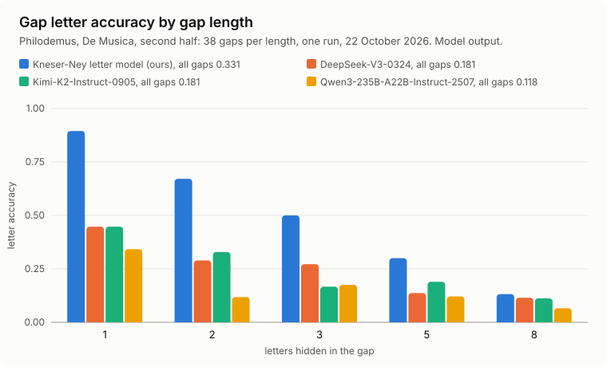

# Greek gap restoration: do hosted text models restore missing letters better than a Kneser-Ney letter model? (22 October 2026)

**Status: Frozen** on 22 October 2026, about 22:22 UTC, after `prep` had written the items and the baseline and before any request was sent. Chase approved the spend the same day at 22:15 UTC, with a cap of 1.20 USD. The test ran once; the Result section was appended after the run. This public copy was made after the result: paths and tool names specific to the original workspace were changed, and the rules, numbers, pins and disclosures are unchanged. Code: [`kit/greekfill.py`](../../kit/greekfill.py) and [`kit/greekkn.py`](../../kit/greekkn.py) ([tool page](../tools/greekfill.md)); frozen files: [`docs/evidence/greek-restoration-20261022/`](../evidence/greek-restoration-20261022/README.md).

## Question

Large hosted text models have read a great deal of Greek. Do they restore missing letters in a Herculaneum author's prose better than a Kneser-Ney letter model trained on public Greek? If one did, it would become a candidate letter prior for letter-reading tools, to be tested on real letter lattices in a later preregistered step. Public text only; no scroll data, ink map or finding is used.

## Data

- Test text: Philodemus, De Musica (Kemke), First1KGreek `tlg1595.tlg221` at commit `03776b39f4047c5cff06f5296fae4b2bae4b08fb`, normalised by the corpus builder (`python -m kit.greekfill corpus`: 24 capitals, lunate sigma, spaces as word boundaries), second half of its symbols, cut at the last space before the middle (34,598 symbols, 29,095 letters).
- **Disclosure.** That half was used once before: on 16 October 2026 it was the test text of an earlier, unpublished letter-model evaluation, which scored its bits per symbol once. Nothing in this test is tuned on it. The KN settings below (order 8, 16 million training symbols, mixture weights) are copied unchanged from that evaluation's frozen choice; its mixture weights were fitted by EM on the first half of De Musica, not on this half. The hosted models may have seen De Musica in training (it is in public corpora); the memorisation probe below checks that.
- Items (`prep`, seed 20261022): the text is cut into 230 non-overlapping windows of 150 symbols. 190 windows get one gap of L letters (L = 1, 2, 3, 5, 8; 38 each) starting 60 to 90 symbols in; spaces inside the gap are hidden too. 40 windows are memorisation probes: the first 100 symbols are shown and the following letters (up to 40) are the truth.

## Arms

- **KN baseline** (fixed before any reply): order-8 interpolated modified Kneser-Ney letter model. Its general component is fitted on whole documents of the general training split, in corpus order, until at least 16 million symbols (documents whose sha256 of the id, mod 100, is 6 to 99; Philodemus left out). The corpus is PerseusDL/canonical-greekLit at `0189b9c8d8d1f148133f2f0af309b4ee90ea4332` and First1KGreek as above: 1,935 documents, 169.5 million letters, sha256 `5c7c4684b7a4515ebd8840b963757b5a7680cfd2c986375a487b3d66bdb594bf`. Its Philodemus component is fitted on Volumina Rhetorica (`tlg1595.tlg370`). The two are mixed 0.728 and 0.272. A gap is filled by beam search (256) over the left context, rescored with the next 24 symbols; a probe is continued greedily. These fills are `baseline.json`. Its gap letter accuracy was printed at prep: **0.331** (Model output), and its probe accuracy is 0.081.
- **Hosted models** through `router.huggingface.co`, temperature 0, at most 48 output tokens, provider pinned in the model name, priced from the router listing read on 22 October 2026 (USD per million input and output tokens):
  - `Qwen/Qwen3-235B-A22B-Instruct-2507:deepinfra` (0.09, 0.55)
  - `moonshotai/Kimi-K2-Instruct-0905:novita` (0.6, 2.5)
  - `deepseek-ai/DeepSeek-V3-0324:deepinfra` (0.24, 0.9)
- Prompts (fixed in the code, `PROMPT_GAP` and `PROMPT_MEMO`): the passage with `[L]` where L letters are missing, asking for only the missing letters; and the probe prefix, asking for the next letters exactly as the original goes on.

## Procedure

1. From a checkout of the frozen code: a smoke run of 2 requests per model (6 requests), then a format pilot of 12 per model (at least 10 of each model's first 12 replies must contain Greek letters, else stop and report; a model failing the pilot is not dropped, it simply fails the parse check), then the full run. 690 requests in the manifest's shuffled order, one at a time. With the public code these are `python -m kit.greekfill run DIR --per-model 2`, `--per-model 12` and `run DIR`.
2. The runner stops before the priced cost could pass **1.20 USD**; a request without reported usage counts at 0.0012 USD. Expected cost about 0.15 USD (Interpretation: about 400 input and 20 output tokens per request).
3. `python -m kit.greekfill score DIR` writes `score.json`.

Scoring: a reply is reduced to Greek capitals (accents stripped, any sigma as lunate sigma, everything else dropped). Letter accuracy counts position-wise matches against the truth's letters, so a reply of the wrong length loses the letters it misplaces. A request counts as parsed when its reply holds at least one Greek letter.

## Readout (fixed; `RULE` and `verdict` in the code)

For each model: it **beats KN** if at least 90 % of its requests parse, its gap letter accuracy is at least 0.05 above KN's, and the one-sided lower bound of the difference (bootstrap over gap items, letter-weighted, 20,000 resamples, seed 0, at the 0.05 / 3 quantile for three models) is above 0. It is **memorised** if its probe letter accuracy is at least 0.50.

- **PASS** if some model beats KN and is not memorised.
- **INCONCLUSIVE** if every model that beats KN is memorised (the win could be recall of De Musica itself).
- **VOID** if no model parses 90 %, a file hash differs from the pins below, or the guard stops before every request is answered.
- **FAIL** otherwise.

Reported, never decisive: accuracy and exact-gap share per gap length for each arm, KN's probe accuracy, cost.

A PASS makes the winning model a candidate prior, next tested on synthetic and real letter lattices under its own preregistration; it is not wired into any tool by this test. A FAIL or INCONCLUSIVE closes the test; no prompt or model variant is tried on these items. The test runs once.

## Limits

One text, one editor's normalisation, edited text rather than papyrus damage patterns, word spaces that real papyri lack, three models and one prompt each; letter accuracy does not reward near misses.

## Pinned at freeze

In [`docs/evidence/greek-restoration-20261022/`](../evidence/greek-restoration-20261022/README.md):

- `manifest.json` sha256 `ed544db8e3faaf0642217589d0dba44bac5466940145a5846747a82f6f401991` (what the runner sends: prompts, no answers);
- `key.json` sha256 `177c43b61f77734da5fe88784a75dc268f3404e43af8dbe6e64f97cb93a35405` (answers; never sent);
- `baseline.json` sha256 `99175529f2e39545c8e321aa3c3aa03904bfa9ed0cdaa0cf0ca3d8c5c63b7e0a` (KN fills and continuations).

The code's sha256 values were recorded at freeze with the original code. The public port, `kit/greekfill.py` and `kit/greekkn.py`, differs from that code only in comments, packaging and the added `check`, `chart`, `--dry-run` and `score --out`; it regenerated all three files above and `score.json` byte for byte on 22 October 2026 (see the evidence README).

## Result (22 October 2026, about 22:40 UTC; appended after the run, nothing above changed)

**FAIL: no hosted model beats the letter model; all three do clearly worse.** Run once with the pins checked: smoke 6, pilot 36 (every model 14 of 14 Greek replies), full run 648; 690 of 690 answered, priced cost 0.066 USD of the 1.20 USD cap. Scored with `score` (Model output; [`score.json`](../evidence/greek-restoration-20261022/score.json), [`replies.jsonl`](../evidence/greek-restoration-20261022/replies.jsonl)).

| Arm | Gap letter accuracy | Difference from KN (one-sided bound) | Parsed | Probe (memorisation) |
| --- | --- | --- | --- | --- |
| **KN** | **0.331** | | | 0.081 |
| DeepSeek-V3-0324 | 0.181 | -0.150 (-0.206) | 1.00 | 0.085 |
| Kimi-K2-Instruct-0905 | 0.181 | -0.150 (-0.207) | 0.92 | 0.079 |
| Qwen3-235B-A22B-Instruct-2507 | 0.118 | -0.213 (-0.275) | 1.00 | 0.078 |

Letter accuracy by gap length 1, 2, 3, 5, 8: KN 0.895, 0.671, 0.500, 0.300, 0.132; DeepSeek 0.447, 0.290, 0.272, 0.137, 0.115; Kimi 0.447, 0.329, 0.167, 0.190, 0.112; Qwen 0.342, 0.118, 0.175, 0.121, 0.066. No model recalls De Musica (probe about 0.08 for every arm, the same as KN's guess rate), so the comparison is not inflated by memorisation.

Interpretation: on this task an order-8 Kneser-Ney letter model trained on 16 million symbols of public Greek, mixed with a component trained on another Philodemus text, restores single missing letters twice as often as the best hosted model (0.895 against 0.447) and stays ahead at every gap length; at 8 letters every arm is low (0.066 to 0.132). The KN arm has advantages the hosted models lack: it always returns exactly L letters, and one of its components has read Philodemus. The result is limited to this text, these three models and this prompt. The test is closed; no prompt or model variant is tried on these items.
