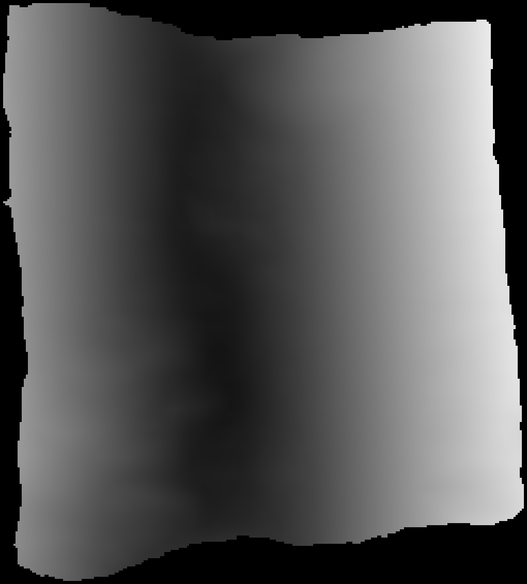
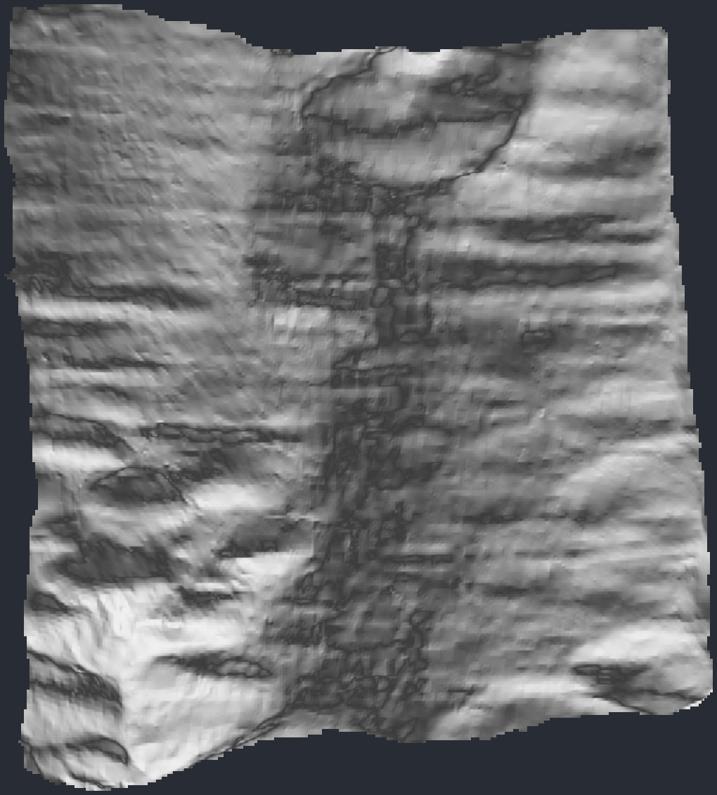
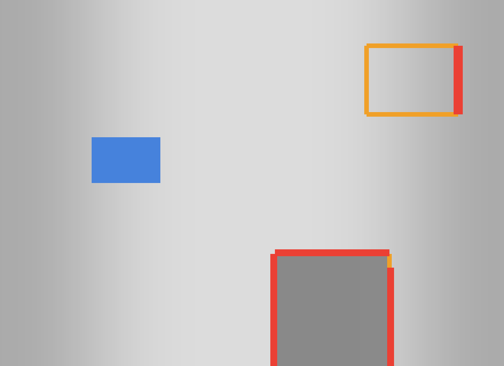

# Segments without VC3D

How to look at, measure and check a traced segment on any laptop, with no VC3D build: its true area, how evenly its grid is spaced, where it has holes or folds, a 3D file for Blender, and which way it faces. Everything here reads the segment's three TIFFs with [`kit tifxyz`](tools/tifxyz.md) (numpy and tifffile only), and the companion commands get its center line and its credit line. Geometry only: nothing here looks at the CT or judges ink.

## What a segment is on disk

villa and VC3D store a traced surface as a **tifxyz** folder: `x.tif`, `y.tif` and `z.tif`, three float32 grids of one shape where each grid node holds a 3D point in voxels of one scan volume, plus a `meta.json` whose `scale` says how many nodes there are per voxel (0.05 means a node every 20 voxels). Missing nodes are -1. The open-data bucket keeps each segment's meshes under `SCROLL/segments/SEGMENT/mesh/`, one folder per volume, named `SEGMENT-on-VOLUME-N.NNNum.tifxyz`.

Opened as a picture, one of those TIFFs says almost nothing about the sheet:



*Before. Real data render: PHerc0139 w035's x.tif as an image viewer shows it, one gray value per grid node. Mesh geometry only, no CT, no ink. Vesuvius Challenge open data, CC BY-NC 4.0.*

`kit tifxyz preview` lights the same grid as a surface, so its ripples, bends and edges show:



*After. Real data render: kit tifxyz preview of PHerc0139 w035, the sheet's 3D shape from its three TIFFs. Mesh geometry only, no CT, no ink. Vesuvius Challenge open data, CC BY-NC 4.0.*

PHerc0139 is a public scan that is on none of the prize lists, so its pictures may be shown here ([the public media rule](media/README.md)).

## 1. Set up

From a clone of this repository:

```bash
python -m pip install numpy tifffile
python -m kit doctor --no-speed     # optional: on a Mac, it also says whether Python runs natively or under Rosetta
```

## 2. Find a scroll's segments

```bash
python -m kit find PHerc0139
```

lists its volumes, how many segments there are on each, the bucket's surface, lasagna and fiber predictions, and its center lines ([find](tools/find.md)). On 23 October 2026 PHerc0139 had 39 segments, all on volume `20260102150214`.

## 3. Measure one

Give the mesh folder, local or straight from the bucket (fetched once into `work/tifxyz/cache`):

```bash
S=s3://vesuvius-challenge-open-data/PHerc0139/segments/20260317000000-w035_2026031718/mesh/20260317000000-on-20260102150214-2.399um.tifxyz
python -m kit tifxyz info "$S"
python -m kit tifxyz stretch "$S"
```

`info` gave w035 an area of **22.07 cm2** (2,207 mm2), with 83.5 % of its 1,132 x 1,020 grid filled, and our area at 1.0000 of the `area_vx2` VC3D wrote into `meta.json`. The 9.362 um mesh of the same segment gives 21.97 cm2. Report the cm2 number from `info`, not a guess from a screenshot.

`stretch` reads how isometric the grid is: every edge's 3D length over the step `meta.json` promises (1.0 is exact), each cell's area over the promised area, and the angle between the grid's two directions, as percentiles. The prize pages ask for a low-distortion parametrization; these numbers are a way to show yours, not an official test.

## 4. Check it before you share it

```bash
python -m kit tifxyz check "$S" --png check.png
```

prints holes inside the sheet, folds (neighboring cells whose normals turn by more than 90 degrees) and over-stretched nodes (an edge over 1.5 times the step, or under 1/1.5), each in nodes and mm2, and exits 1 when anything is flagged. w035 had no holes, no folds and 43 stretched nodes (0.1 mm2). The picture marks each kind in its own color. On a made-up sheet with one of each planted:



*Synthetic demo: kit tifxyz check on a made-up sheet with a planted hole (600 nodes, blue), fold (545 nodes, red) and shifted patch whose border edges stretch (414 nodes, orange). No scan data.*

A clean check means the grid is whole and evenly spaced. It does not mean the trace stays on one sheet of papyrus: for that, look at it on the CT, and for several segments of one scroll use [`kit stackcheck`](tools/stackcheck.md).

## 5. Open it in Blender or MeshLab

```bash
python -m kit tifxyz obj "$S" w035.obj --stride 2
```

writes a Wavefront OBJ with texture coordinates (units: voxels). The full 2.4 um w035 mesh is 134 MB; `--stride 2` keeps every second row and column, about a quarter of that.

## 6. Which way does it face?

```bash
python -m kit centerline get PHerc0139 --out PHerc0139_umbilicus.json
python -m kit tifxyz facing "$S" --umbilicus PHerc0139_umbilicus.json
```

`centerline get` downloads the scroll's published center line ([centerline](tools/centerline.md)); `facing` reports the share of grid normals pointing away from it, and whether the angle about the center grows along the grid's columns. Use it to pick a render direction or to see why two segments look mirrored. The center line must be on the same volume as the mesh; `facing` warns when they differ. To put the line into a VC3D project instead, use `--into FOLDER`.

## 7. Credit it

```bash
python -m kit cite PHerc0139 --volume 20260102150214
```

prints the credit and licence line for the volume from the bucket's `metadata.json`: for PHerc0139, "Vesuvius Challenge open data, CC BY-NC 4.0".

## Times

Measured 23 October 2026 on a 4-core cloud container, each a fresh process, on the 2.4 um w035 mesh: `info` 1.4 s, `stretch` 1.3 s, `check` 1.1 s, `preview` 1.4 s, `facing` 0.9 s, `obj` 4.2 s, under 270 MB of memory. A Mac laptop should be in the same range; it was not measured.

## The pictures

Made with `python scripts/media/tifxyz_stills.py` ([media](tools/media.md)); each has a sidecar JSON in [`assets/tifxyz/`](assets/tifxyz/) with the command, the scripts' digest and the commit.
