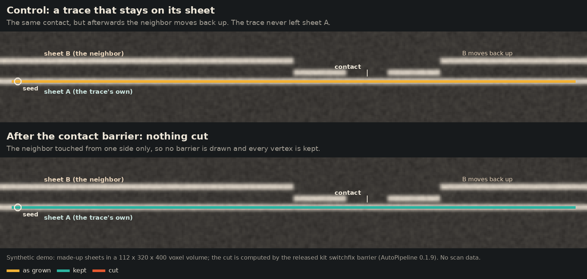
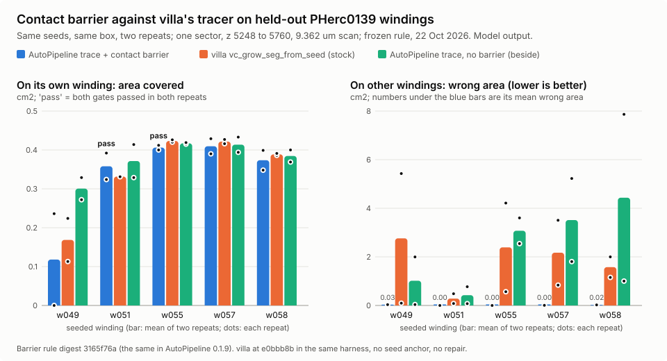

# contact-barrier: cut a traced surface back to its seed's sheet where it ran onto a touching sheet

The contact barrier (`kit switchfix barrier`, AutoPipeline's `qa.repair` method `barrier`) cuts a traced tifxyz back to the part its seed's sheet reaches, drawing a barrier where a touching sheet shows on both sides of the trace.

| Field | Value |
| --- | --- |
| Id | `contact-barrier` |
| Status | Branch only |
| Kind | kit command, package |
| Area | Surfaces and tracing |
| Run | `scrolls-kit switchfix barrier` (in the AutoPipeline package folder), `autopipeline plan SAMPLE` with `"qa": {"repair": {"method": "barrier"}}` (the default) |
| Code | `submissions/progress-2026-10-fix9/autopipeline/kit/switchfix.py` (`barrier`, `barrier_keep`, `BARRIER`), `submissions/progress-2026-10-fix9/autopipeline/kit/sheetgap.py` (`contact_barrier`), `submissions/progress-2026-10-fix9/autopipeline/kit/autopipe.py` (`repair_one`) on the branch |
| Tests | `submissions/progress-2026-10-fix9/autopipeline/tests/test_switchfix.py` on the branch (`test_the_barrier_repairs_from_a_local_prediction`, the barrier inside AutoPipeline's repair step). The barrier's own cases (a hop is cut, a control that stays is kept whole, without the barrier the hop is joined) are not in the 0.1.9 package; `scripts/media/barrier_demo.py` here runs them on the released code and writes no picture if one fails |
| Needs | Python 3.10 or newer, numpy and scipy; a surface prediction as OME-Zarr (the open-data m7 prediction for the scans that have one) |
| Runs on | Any CPU. Not measured as its own step; inside the held-out comparison below it ran on a shared 4-core cloud container as part of each trace's chain |
| Network | The surface prediction's chunks, from the open-data bucket or the URL given, cached on disk |
| Writes | OUT: a copy of the tifxyz with every vertex outside the kept part set to (-1, -1, -1), and a JSON record in OUT's `meta.json` and at `--record` |
| Go-ahead | Not needed |
| Released | Inside AutoPipeline 0.1.9, public branch `submission/progress-2026-10-fix9` (2026-10-25); the default `qa.repair` method of AutoPipeline since 2026-10-22 |
| Branch | `submission/progress-2026-10-fix9` at `2144cdfcac4ecfc33150f7e81317e5ab33f248d6` |
| License | Apache License 2.0, as AutoPipeline ([LICENSE on the branch](https://github.com/ChaseHendrick/Scrolls/blob/2144cdfcac4ecfc33150f7e81317e5ab33f248d6/submissions/progress-2026-10-fix9/autopipeline/LICENSE)) |
| Checked | 2026-10-28 against commit `2144cdf` |

## What it does

Sheet switches are the failure the organizers name first for meshing: "Meshes can jump from one wrap to another", and what would help is "Smarter surface tracing algorithms that avoid introducing sheet switches" ([2026 Open Problems](https://scrollprize.org/2026_open_problems), page updated 14 October 2026, read 28 October 2026; Sourced fact). A tracer that follows a surface prediction usually switches where two sheets press together: the prediction draws them as one thin band, the trace runs through it, and on the far side it is on the neighbor.

The contact barrier looks for exactly that shape. It walks the trace on a dense grid, checks each point against the surface prediction along the trace's normal (kit.sheetgap's one-sheet rule), and where another sheet lies within 8 voxels on both sides of the trace over enough of it, it draws a barrier. Then it keeps only the part of the trace its seed reaches without crossing a barrier, an off-sheet stretch or a sheet jump. Nothing is moved: what it cuts is removed, not mended.

It works on the finished trace. It does not stop a tracer while the trace grows; the tracer runs to the end, and the barrier then cuts the trace back to its seed's sheet. Stopping growth at a contact would be a different method, not tested here.


Synthetic demo: made-up sheets, the released barrier code. The control below passes the same kind of contact but never leaves its sheet, and the barrier keeps all of it, so the barrier is not simply a cut at every contact.




What it does not do: it cannot see two sheets pressed so hard that the prediction shows one band no thicker than a sheet with nothing on either side, and it does not regrow what it cuts. Its output is traced geometry, never a reading.

## Held-out comparison against villa's tracer

On 22 October 2026 a preregistered test compared AutoPipeline's trace with the contact barrier against villa's standard tracer `vc_grow_seg_from_seed` (villa at `e0bbb8b`, the same harness, normal grids, box, generations and threads, with no seed anchor and no repair) on PHerc0139, a public scan that is on no prize list, on published hand-traced report windings that AutoPipeline's trace settings and the barrier were never developed or tested on (with one caveat below), in one sector (z 5248 to 5760, y 2688 to 3712, x 4352 to 5376 of the 9.362 µm scan `20250728140407`), from the same fixed seeds, two repeats. The rule (gated correct area at no worse precision, a margin that grows with run-to-run change, both repeats) was frozen before any sector, seed, trace or score existed. Model output; numbers in [`docs/media/contact-barrier-a15-data.json`](../media/contact-barrier-a15-data.json) and `contact_barrier_checks` in [results.json](../results.json).

The scorer was checked on each of the five published windings before any trace was scored, and the check could fail: the winding itself kept 0.991 to 0.998 of its area, a copy moved half a winding (9.5 voxels) either way kept 0, and a copy moved 1 voxel kept 0.999 or more. All five passed, so none was left out.



Area on other windings is wrong-winding area: lower is better. Gated area and precision: higher is better.

| Repeat | AutoPipeline with the barrier | villa's tracer | AutoPipeline without the barrier (beside) |
| --- | --- | --- | --- |
| rep1 | 2 of 5 windings passing, 0.724 cm² gated, 0.061 cm² on other windings, precision 0.966 | 0 of 5, 3.983 cm² on other windings, precision 0.310 | 0 of 5, 12.328 cm² on other windings, precision 0.129 |
| rep2 | 2 of 5 passing, 0.804 cm² gated, 0.063 cm² on other windings, precision 0.962 | 0 of 5, 14.382 cm² on other windings, precision 0.104 | 0 of 5, 12.600 cm² on other windings, precision 0.134 |

By the frozen rule the barrier arm was AHEAD in both repeats (difference 0.724 and 0.804 cm² against a margin of 0.18). All three arms covered about the same area on the seeded windings (1.6 to 2.0 cm² in all); the difference is where the rest went. AutoPipeline's trace without the barrier switched as badly as villa's, so the gain comes from the barrier, not from the anchored trace (Interpretation). Three of the five windings still failed the switch gate with the barrier (w057 by a hair, 1.567 and 1.504 against 1.5), and in rep2 the barrier kept nothing on w049.

What this does not show: one sector of one scroll, five windings, two repeats, against one community tracer run in AutoPipeline's harness, not villa's newer GPU tracers. On another PHerc0139 sector (z 4352 to 4864, tune windings), with the repair AutoPipeline used before the barrier, villa's tracer was ahead (1.846 against 1.718 cm², both at precision 0.999 or more), so this is one held-out win, not a general one. The caveat: the barrier's settings come from an earlier one-sheet rule (kit.sheetgap, digest `24da24815958`) that was chosen after reading scores of report windings in another z band (z 4352 to 4864), and the records cannot rule out that some of these five were among them. So the windings are held out in this test band, but they are not completely unseen. A second-scroll test on PHerc0500P2, preregistered before any trace, stopped at its own data gate on 28 October 2026 before tracing: its reference wraps are the 13 catalog wrap meshes, which are automatic meshes, not hand traces, and four of its twelve neighboring pairs were not 2 voxels apart on 98 % of samples, which left 4 seeded wraps of the 6 the rule needs. It is VOID, neither a pass nor a fail, a statement about those reference meshes and not about any tracer, and that region is spent. Claim label: Model output, one sector of PHerc0139.

## Where the code is

On public branch `submission/progress-2026-10-fix9` (AutoPipeline 0.1.9), never changed after release, folder `submissions/progress-2026-10-fix9/autopipeline/`: `kit/switchfix.py` (`BARRIER`, `barrier_keep`, `barrier`, the `barrier` action of `kit switchfix`), `kit/sheetgap.py` (the one-sheet rule and `contact_barrier`) and `kit/autopipe.py` (`repair_one`, which runs it on every trace qa rejects for a sheet switch).

```bash
git fetch origin submission/progress-2026-10-fix9
git show origin/submission/progress-2026-10-fix9:submissions/progress-2026-10-fix9/autopipeline/kit/switchfix.py | head -40
```

The barrier's rule has digest `3165f76adf4c1a964acfe67f6d0df892b199e15d4ab7dfa21e2c6aa566ac657c` (`kit.sheetgap` rule digest `24da24815958`); the held-out comparison above recorded the same digests.

## How to run it

```bash
git clone --branch submission/progress-2026-10-fix9 --depth 1 https://github.com/ChaseHendrick/Scrolls.git scrolls-autopipeline
cd scrolls-autopipeline/submissions/progress-2026-10-fix9/autopipeline
pip install -e .
scrolls-kit switchfix barrier TRACE OUT --prediction PREDICTION --seed X Y Z --record OUT.json --json
```

TRACE is a tifxyz folder (`x.tif`, `y.tif`, `z.tif`, `meta.json`), OUT a new folder, PREDICTION the surface prediction the trace was made on (a bucket prefix or URL under the open-data bucket, or an OME-Zarr), X Y Z the seed in voxels (default: the seed in `meta.json`, else the grid's center).

| Option | Default | Meaning |
| --- | --- | --- |
| `surface` | required | The traced tifxyz folder; never modified |
| `out` | required | The new tifxyz folder to write |
| `--prediction PREDICTION` | required | The surface prediction the trace was made on: a bucket prefix or URL (cached), or a local or remote OME-Zarr |
| `--seed X Y Z` | the seed in `meta.json`, else the grid's center | The seed point, in voxels |
| `--record RECORD` | unset | Also write the record here |
| `--overwrite` | off | Replace OUT if it exists |
| `--cache CACHE` | `work/surfbench/cache` | The chunk cache folder |
| `--workers WORKERS` | as the package sets | Parallel chunk reads |
| `--json` | off | Print the record as JSON |

In AutoPipeline it runs by itself: any trace qa rejects for a sheet switch is cut by the barrier into `repaired/SID`, checked again by the same qa rule, and kept only if it passes and keeps at least half its area (`"qa": {"repair": {"method": "barrier", "min_area_share": 0.5}}`, the default; `"method": "switchfix"` picks the older cut).

## Inputs and outputs

Input: a tifxyz trace and the surface prediction it was traced on (uint8, 0 or 255 for m7; the rule's threshold is 128). Output: OUT, the same grid with cut vertices set to (-1, -1, -1); side files (`generations.tif`, `mask.tif`) are not copied. The JSON record holds `kind` (`kit-switchfix-barrier`), `source` and its `source_sha256`, `prediction`, `seed`, `barrier` (the settings), `barrier_digest`, `sheetgap_rule_digest`, `detect` (dense points, barrier points, components, kept vertices) and `kept`. A trace with no certified part is refused with `barrier: no certified part`; in AutoPipeline a refusal leaves the trace rejected.

## Why it is not on the default branch

AutoPipeline is released as a package on its own branch per version and never on `main` (its [page](autopipeline.md)); the barrier is part of that package. `main` holds an older `kit/sheetgap.py` without the contact barrier.

## For agents

- **Revive:** use it from the AutoPipeline 0.1.9 package as above; to bring `kit switchfix` onto `main`, port `kit/switchfix.py` and the newer `kit/sheetgap.py` with their tests in one PR, keeping the rule digests above.
- **Check first:** that the record's `barrier_digest` is `3165f76a...`; that the prediction is the one the trace was made on; and that a cut trace still passes your own switch check: the barrier removes area, it never adds it.
- **Never:** call a cut trace correct because the barrier kept it (3 of 5 held-out windings still failed the switch gate), present the one-sector result as a general win, or call any traced surface a reading.

## History

- 2026-10-28: this page, the synthetic demo media and the held-out chart (`6bf0b4a`); review fixes before publishing: the barrier cuts a finished trace and does not stop growth, PHerc0500P2's reference wraps are automatic catalog meshes, and the parent rule's earlier reads are disclosed.
- 2026-10-25: released inside AutoPipeline 0.1.9 (`2144cdf`).
- 2026-10-22: preregistered held-out comparison on PHerc0139: AHEAD of villa's tracer in both repeats (`2144cdf` carries the same rule).

## Related

- [autopipeline](autopipeline.md): the pipeline whose `qa.repair` step runs the barrier.
- [hopbench](hopbench.md): the planted-hop benchmark for the one-sheet rule the barrier builds on.
- [media](media.md): `barrier_demo.py` and `barrier_chart.py`, which made the pictures here.
- `contact_barrier_checks` in [results.json](../results.json): the comparison's numbers and the second-scroll gate.
