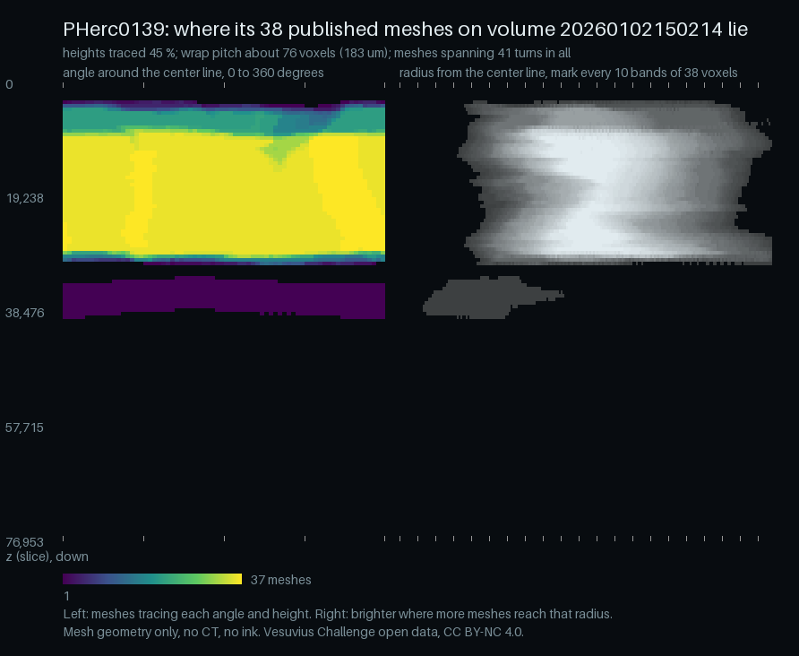

# coverage: see which wraps and heights of a scroll the published segments trace, and where the gaps are

`kit coverage` places every published mesh of one scan volume around its center line and reports the heights and angles traced, how many turns each mesh spans, and, for each pair of meshes, about how many wraps lie untraced between them.

| Field | Value |
| --- | --- |
| Id | `coverage` |
| Status | Current |
| Kind | kit command, kit module, script |
| Area | Surfaces and tracing |
| Run | `python -m kit coverage` |
| Code | `kit/coverage.py`, `scripts/media/coverage_still.py`, `kit/cli.py` (`main`) |
| Tests | `tests/test_coverage.py` |
| Needs | Python 3.9 or newer, numpy, tifffile (imagecodecs for LZW-compressed meshes); Pillow only for `scripts/media/coverage_still.py`. A public center line for the volume, or your own with `--line` |
| Runs on | CPU. PHerc0139's 38 meshes on volume 20260102150214: 37 s and 2.8 GB peak memory with 8 workers (measured 2026-10-24, 4-core cloud container) |
| Network | `vesuvius-challenge-open-data.s3.us-east-1.amazonaws.com` (the bucket listing, `metadata.json`, the meshes and the bucket's center lines) and `huggingface.co` (the center lines dataset `SharpMeow/vesuvius-center-lines`); none with `--line FILE` and local `--mesh` folders, except `metadata.json` for the voxel size and slice count |
| Writes | Nothing by default (prints only); `--png` writes the picture, `--out` the report JSON. Each mesh is fetched into a temporary folder and deleted after it is measured |
| Go-ahead | Not needed: it reads public data and writes local files |
| Released | This repository from the change that adds it (24 Oct 2026) |
| Checked | 2026-10-24 against commit `f901840` plus this change |

## What it does

A scroll is a spiral of papyrus. Segments are traced pieces of that spiral, published as tifxyz meshes (three images x.tif, y.tif and z.tif holding a grid of 3D points in the scan's voxels). Each new segment is usually traced next to the old ones, so the useful question before tracing is: which wraps and heights are already done, and where are the holes?

`kit coverage` takes the top-level meshes of one scan volume from the open-data bucket and the volume's center line (the umbilicus, a published line of points through the middle of the scroll, in the same voxels). Around that line each mesh node gets an angle, a radius and a height. From those it reports:

- the heights with any trace and the ones with none, in slices and millimeters;
- at each traced height, the share of the 360 degrees traced and the largest untraced arc;
- for each mesh, its height range, radii and the turns it spans (angle traveled along its grid rows, over 360);
- the wrap pitch, the radial distance from one wrap to the next, measured on the meshes themselves;
- for each pair of meshes that are neighbors in radius, about how many wraps lie untraced between them, and the pairs that lie on one wrap (overlaps and copies).

It does not look at the CT. It does not count papyrus layers, so "untraced wraps" is an estimate from radius and one pitch for the whole scroll, and "turns" is angle traveled, not a layer count. It says nothing about ink or whether a segment stays on one sheet.

## When to use it

- Before tracing a scan: to see which heights and wraps have no segment.
- To find duplicates: two meshes that lie within half a pitch of each other over most of their shared area.
- To check a new batch of segments against the old ones.

Do not use it:

- To check a single mesh's grid (holes, folds, stretch): use [tifxyz](tifxyz.md) `check`.
- To decide whether a mesh switches sheets: this tool cannot see the CT. Look at the CT in VC3D.
- For pictures of a scroll on a prize list: it refuses `--png` for those (the public media rule), and gives numbers only.

## Quick start

```bash
python -m pip install numpy tifffile imagecodecs
python -m kit coverage PHerc0139 --volume 20260102150214 --png coverage.png --out coverage.json
```

`PHerc0139` is the scroll and `20260102150214` its 2.399 um volume, which has a public center line on the bucket. On 24 Oct 2026 that printed, in part:

```
PHerc0139 on volume 20260102150214: 38 of 38 meshes read, center line from bucket-file (bucket)
heights traced: 45 % of z 0 to 76953 (volume slices); a full turn traced at 39 % of heights
angle traced per traced height: median 100 %, median largest untraced arc 0 degrees
  no trace at z 0 to 3006 (7.21 mm)
  no trace at z 30661 to 32464 (4.33 mm)
  no trace at z 39679 to 76953 (89.42 mm)
wrap pitch 76.2 voxels (182.8 um), the median step one turn along a mesh's own rows (97906 such steps); neighboring meshes one wrap apart in 96 % of the cells they share
  about 29 untraced wrap(s) between PHerc0139/20250108000000-w025_2025010863 and PHerc0139/20260127000000-w057_2026012713 (2305 voxels apart over 543 cells)
  on one wrap: PHerc0139/20260126000000-w045_2026012619 and PHerc0139/20260325000000-w046_20260325 (2 voxels apart over 361949 cells)
```

It worked when every mesh is read and the pitch comes from "a mesh's own rows". The picture, made with `scripts/media/coverage_still.py` from the same run:



Real data render: the 38 published meshes of PHerc0139 on volume 20260102150214 around the published center line. Mesh geometry only, no CT, no ink. Vesuvius Challenge open data, CC BY-NC 4.0.

## Checks and controls

- **Known answers on synthetic spirals.** The tests build sheets on an Archimedean spiral with a pitch of 40 voxels, wraps 0, 1, 2 and 5, a copy of wrap 5 shifted 1 voxel, and one sheet at other heights. The tool must find 1.1 turns per sheet, a pitch of 40, no wraps between 0 and 1 and between 1 and 2, two between 2 and 5, the copy as an overlap, and the height gaps where they were planted. Giving a wrong pitch (`pitch=20`) must change the count (to five): the count follows the pitch, so it can fail.
- **Against the segment names (PHerc0139).** Most PHerc0139 segments are named `wNNN`. If those numbers count wraps (Interpretation: the names suggest it; no published source says so), two neighbors `wA` and `wB` should have `|B - A| - 1` wraps between them. Over the 132 pairs of neighbors on volume 20260102150214, weighted by the cells each pair shares, the tool's count equals that number in 84 % of cells and is within one wrap in 97 % (2026-10-24). Every consecutive pair from w023 to w059 that shares many cells comes out at 0 wraps between, except w046 and w047 (1), and w041 and w042 and w045 and w046, which come out on one wrap (below). The misses are mostly long gaps (up to 31 wraps) counted short by 2 to 7, which fits a pitch that changes across the scroll.
- **Two pairs come out on one wrap**: w045 and w046 (median 2 voxels apart over 361,949 cells) and w041 and w042 (8 voxels over 354,451 cells). Sourced fact, for the measurement; whether one is a retrace of the other is not something this tool can tell.
- **Not covered:** a scroll whose wraps are squashed flat, where radius from one center line is a poor stand-in for the wrap; scans where no mesh spans a full turn (the pitch then comes from neighbors and is less trustworthy, and the report says so).

Claim label: Sourced fact, for the measurements of public meshes; Interpretation, for reading the `wNNN` names as wrap numbers and for any reading of the wrap counts.

## Commands and options

### `python -m kit coverage`

```
usage: python -m kit coverage [-h] [--volume VOLUME] [--line LINE]
                              [--mesh MESH] [--side SIDE] [--z-bins Z_BINS]
                              [--theta-bins THETA_BINS] [--r-step R_STEP]
                              [--pitch PITCH] [--workers WORKERS]
                              [--limit LIMIT] [--png PNG] [--out OUT] [--json]
                              scroll
```

| Option | Default | Meaning |
| --- | --- | --- |
| `scroll` | required | scroll id, such as PHerc0139 |
| `--volume VOLUME` | none | scan volume id (default: the center line's volume) |
| `--line LINE` | none | center line JSON file or URL, or a source name from kit centerline list |
| `--mesh MESH` | none | a tifxyz folder or URL to use instead of the bucket's top-level meshes on the volume (repeat) |
| `--side SIDE` | `256` | nodes kept along a mesh's longer side (default 256) |
| `--z-bins Z_BINS` | `128` | height bins (default 128) |
| `--theta-bins THETA_BINS` | `72` | angle bins (default 72, 5 degrees) |
| `--r-step R_STEP` | none | radius band width in voxels for the picture and the per-height band counts (default: half the wrap pitch, or 50 when it is not known) |
| `--pitch PITCH` | none | wrap pitch in voxels (default: none, estimated from the meshes) |
| `--workers WORKERS` | `8` | meshes fetched at once (default 8) |
| `--limit LIMIT` | none | only the first N meshes by id (default: none, every mesh) |
| `--png PNG` | none | write the coverage picture here (refused for a scroll on a prize list) |
| `--out OUT` | none | write the full report as JSON here |
| `--json` | off | print the report as JSON |

### `python scripts/media/coverage_still.py`

Makes the still on this page: runs `kit coverage` on one scan, adds a title, axis labels and a key, and writes the PNG with its sidecar JSON. It refuses a scroll on a prize list.

| Option | Default | Meaning |
| --- | --- | --- |
| `scroll` | required | the scan, which must be on no prize list |
| `--volume` | required | the volume id |
| `--out-dir` | required | the folder for the PNG and its sidecar, such as `docs/assets/coverage` |
| `--name` | `coverage-pherc0139` | the file name, without `.png` |

### Environment variables

| Variable | Default | Meaning |
| --- | --- | --- |
| `KIT_MAX_TIFF_ELEMENTS` | `1000000000` here | The largest TIFF, in elements, kit reads; set to the atlas's limit when unset, so the largest published meshes load |

## Python API

| Function | Returns | Raises | Notes |
| --- | --- | --- | --- |
| `subsample(seg, side=SIDE)` | `(xyz, valid, k)` | nothing | Keeps 1 in `k` nodes along each side, the longer side at most `side` |
| `polar(xyz, valid, umb)` | `(theta, r, z)` arrays | nothing | Degrees in [0, 360), voxels; NaN where not valid |
| `turns(theta, z, valid, r=None)` | `(turns, axis, own)` | nothing | `own` is a list of (radius midway, step) for each node one turn from another along a row |
| `passes(points, umb, split, cell_z=CELL_Z, cell_deg=CELL_DEG)` | `(cells, radii)` | nothing | One entry per pass a mesh makes through a fine cell |
| `mesh_record(row_id, seg, umb, side=SIDE)` | `(record, samples)` | nothing | `samples` is None when the mesh has no valid node |
| `accumulate(samples, z_lo, z_hi, z_bins=Z_BINS, theta_bins=THETA_BINS, r_step=R_STEP)` | grid dict | nothing | `zt` (z by theta), `zr` (z by radius band), `r_mean` |
| `wraps(samples, ids, pitch=None, min_cells=MIN_CELLS)` | wraps dict | nothing | The `wraps` block under Outputs |
| `gaps(grid, voxel_um=None)` | dict | nothing | Height gaps, angular share and largest untraced arc per height |
| `picture(grid, height=512, left_px=360, right_px=480)` | uint8 RGB array | nothing | The `--png` picture |
| `line_for(scroll, volume=None, source=None, get=_find.http_get)` | `(Umbilicus, line info)` | `VerifyError` when no line fits | |
| `run(scroll, volume=None, line=None, meshes=None, side=SIDE, z_bins=Z_BINS, theta_bins=THETA_BINS, r_step=None, workers=8, limit=None, pitch=None, get=_find.http_get, progress=None)` | report dict | `VerifyError` | The report, with the grids under `grid` |
| `may_draw(scroll, volume)` | list of prize ids | `VerifyError` without a prize snapshot | Empty means a picture may be drawn |
| `format_report(rep)` | text | nothing | What the command prints |
| `build_parser(p)` | nothing | nothing | Adds the options to an argparse parser |
| `cmd_coverage(args)` | exit code | `VerifyError` | The command |
| `main(argv=None)` | exit code | nothing | Prints `kit coverage: ...` and returns 2 on a `VerifyError` |

## Inputs

- **Meshes:** the bucket's top-level tifxyz meshes of the scroll whose folder names the volume (`SEGMENT-on-VOLUME-...tifxyz`), found by the same bucket listing as [atlas](atlas.md), or the folders and URLs given with `--mesh`. Positions are level-0 voxels of that volume; missing nodes are -1, NaN or 0.
- **Center line:** the public line for that volume from [centerline](centerline.md) (`kit centerline list SCROLL` shows them), or `--line FILE_OR_URL`: VC3D umbilicus JSON, `control_points` with `x`, `y`, `z` in the same voxels. A line on another volume gives wrong numbers.
- **Volume size:** the slice count and voxel size from the bucket's `metadata.json`; without them the height range is the meshes' own and lengths stay in voxels.

## Outputs

The command prints the report as text (above) or, with `--json`, as JSON. `--out` writes the same JSON. `--png` writes a picture 512 px high: on the left, angle across (marks every 90 degrees) against height down, colored by how many meshes trace each cell (dark for none); on the right, radius from the center line across (a mark every 10 bands) against height, brighter where more meshes reach that band.

| Field | Type | Meaning |
| --- | --- | --- |
| `scroll`, `volume`, `voxel_um` | string, string, number | What was measured; `voxel_um` from `metadata.json` |
| `line` | object | The center line used: `source`, `kind`, `volume`, `url` |
| `meshes[]` | list | Per mesh: `id`, `nodes` (kept), `step` (1 in k), `z_min`, `z_max`, `r_min`, `r_p50`, `r_max` (voxels), `turns`, `turn_axis`, `own_step_p50` (voxels, null when no row spans a turn), `own_steps`, `error` |
| `summary.heights_traced` | number | Share of height bins with any trace |
| `summary.full_turn_heights`, `summary.full_turn_traced_heights` | number | Share of all height bins, and of traced ones, with all 360 degrees traced |
| `summary.theta_share_median`, `summary.largest_arc_median_deg` | number | Median angular share and largest untraced arc over traced heights |
| `summary.r_traced` | [number, number] | 1st and 99th percentile of the kept nodes' radii, voxels |
| `summary.height_gaps[]` | list | `z0`, `z1` (slices) and `mm` of each run of heights with no trace |
| `summary.turns_total` | number | Turns spanned by all meshes added up |
| `summary.wraps.pitch_vox`, `pitch_um`, `pitch_from` | number, number, string | The wrap pitch and where it came from |
| `summary.wraps.own_steps`, `own_step_p10_p90` | number, list | How many one-turn steps the pitch rests on, and their spread |
| `summary.wraps.adjacent_share` | number | Share of neighbor cells, over all pairs, where the neighbors are one wrap apart |
| `summary.wraps.gaps[]`, `neighbors[]`, `overlaps[]` | list | Pairs of meshes: `inner`, `outer`, `cells` (fine cells where they are neighbors), `step_vox` (median radial step), `r_vox` (median radius), `wraps_missing` (not in `overlaps`); only pairs with at least `min_cells` cells are listed |
| `heights[]` | list | Per height bin: `z0`, `z1`, `theta_share`, `largest_arc_deg`, `meshes_max`, `r_bands` |

| Exit code | Meaning |
| --- | --- |
| `0` | The report was made from at least one mesh |
| `2` | A wrong argument, no center line, no meshes, no mesh readable, or `--png` for a prize-list scroll; nothing written |

## Failure modes

| What you see | Why | What to do |
| --- | --- | --- |
| `usage: ...` then `error: ...` on stderr, exit code 2 | A missing or wrong argument | Check the command against Commands and options |
| `kit coverage: no public center line for SCROLL on volume VOLUME; pass one ...` | Neither the center lines dataset nor the bucket has a line for that volume | `kit centerline list SCROLL`, then use that line's volume, or pass `--line` |
| `kit coverage: no mesh could be read: ...` | Every fetch or read failed | Check the network; LZW meshes need `pip install imagecodecs` |
| `kit coverage needs numpy: python -m pip install numpy tifffile` | numpy is not installed | Install it |
| `the center line does not name its volume; pass --volume` | A `--line` file without `metadata.volume` and no `--volume` | Pass `--volume` |
| `no top-level meshes of...on volume...` | No mesh folder on the bucket names that volume | `kit atlas show SCROLL` or the bucket listing shows the volumes that have meshes |
| `...is on a prize list (...): kit coverage gives its numbers but draws no picture of it (docs/media/README.md); drop --png` | The public media rule | Drop `--png` |
| `volume...is on a prize list: no picture drawn` | The volume, found from the line, is on a prize list | Drop `--png` |
| `...is on a prize list (...): no picture` | `scripts/media/coverage_still.py` on a prize-list scroll | Use a scan on no prize list |
| A mesh row with `error` | That mesh could not be fetched or read; the rest go on | Rerun later, or fetch it with `kit fetch` and pass it with `--mesh` |

## How it works

1. **Meshes and line.** List the bucket's meshes (the atlas survey), keep the top-level ones on the volume, and load the center line; its `x`, `y` at any height are interpolated linearly between its points.
2. **Polar coordinates.** Each mesh is subsampled to at most `SIDE` = 256 nodes per side; each node gets theta = atan2(y - yc(z), x - xc(z)), radius and z.
3. **Turns and pitch.** Along the grid axis on which z changes least, theta is unwrapped in each run of nodes; the span over 360 is the turns (median over rows of at least `MIN_ROW` = 8 nodes). Where a run spans more than a turn, the radius one turn on less the radius here is one wrap step; the median of those over all meshes is the pitch.
4. **Fine cells.** Every grid quad is filled with points, bilinear between its corners, until they are at most half a cell apart (at most `DENSE_MAX` = 8 per side), and each point goes into a cell of `CELL_Z` = 40 slices by `CELL_DEG` = 0.5 degrees. A mesh's radii in a cell are split into passes where they jump by half its own pitch.
5. **Wraps between meshes.** In each cell the passes are sorted by radius; each neighboring pair of meshes gives a step. Per pair, the median step under half the pitch means one wrap (overlap); otherwise round(step / pitch) - 1 wraps are untraced between them. Pairs neighbors in fewer than `MIN_CELLS` = 500 cells are counted but not listed.
6. **Heights and angles.** Coarse grids of `--z-bins` by `--theta-bins` cells give the traced heights, angular share, largest untraced arc and the picture.

## Cost and time

Free: it reads public data. PHerc0139's 38 meshes on volume 20260102150214 took 37 s and 2.8 GB of memory at peak with 8 workers on a 4-core cloud container (2026-10-24). Memory grows with `--workers` and `--side`; with hundreds of meshes on one volume, lower `--workers`. Not measured on a Mac.

## For agents

- **Command:** `python -m kit coverage SCROLL --volume VOLUME --json`.
- **Parse:** `summary.height_gaps`, `summary.wraps.gaps` (pairs with `wraps_missing` above 0, the largest first), `summary.wraps.overlaps`, and `meshes[].error`.
- **Rerun:** safe; it writes only the files named with `--png` and `--out`, and overwrites them.
- **Success:** exit 0, every mesh without `error`, and `summary.wraps.pitch_from` starting "median step one turn".
- **Not a pass:** a pitch from neighbors only (no mesh spans a turn); a pair with few cells; any wrap count read as a layer count from the CT.
- **Go-ahead:** Nothing.
- **Never:** commit or post a picture of a scroll on a prize list; call the wrap counts layers seen in the CT.

## Tests

`python3 -m unittest tests.test_coverage -v`: synthetic spirals with known turns, pitch, gaps and a copy; the effect of a given pitch; height gaps; the largest arc across 0 degrees; a half-turn sheet; the picture; the refusal for a prize-list scroll; the command's registration. Not covered: the bucket listing and fetching, which the live PHerc0139 run above checked.

## History

- 2026-10-24: first version (on top of `f901840`).

## Related

- [atlas](atlas.md): the per-mesh grid numbers, from the same bucket listing.
- [centerline](centerline.md): find and fetch the center line this tool needs.
- [tifxyz](tifxyz.md): check one mesh's grid.
- [windconsistency](windconsistency.md): checks winding numbers on traced points.
