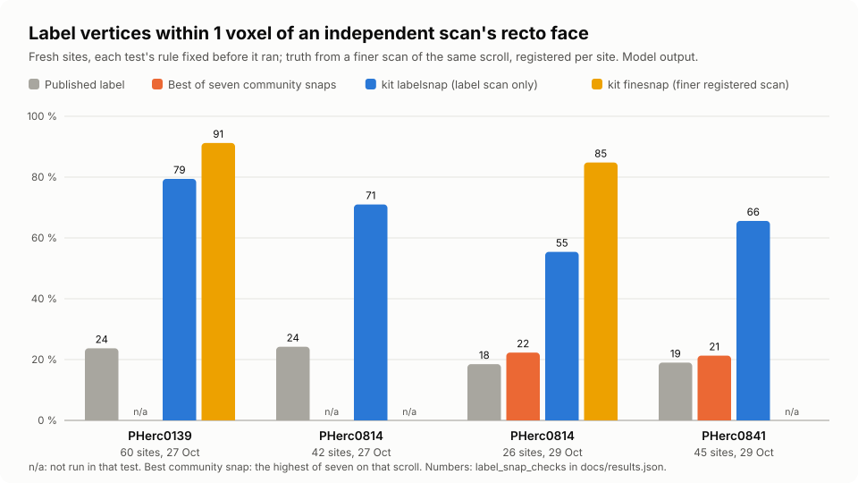

# finesnap: snap a coarse-scan label on a finer registered scan, and resolve abstaining vertices

`python -m kit finesnap` snaps a surface label traced on a coarse scan onto the recto face seen in a finer scan of the same scroll, registered per vertex along the normal; `kit.snapresolve` gives a face to vertices the face snap abstained on.

| Field | Value |
| --- | --- |
| Id | `finesnap` |
| Status | Current |
| Kind | kit command, kit module |
| Area | Surfaces and tracing |
| Run | `python -m kit finesnap snap`, `python -m kit finesnap check`, `from kit import finesnap`, `from kit import snapresolve` |
| Code | `kit/finesnap.py`, `kit/snapresolve.py`, `kit/cli.py` (`build_parser`), `kit/vc3d_landmarks.py` (`as_matrix`, `invert`) |
| Tests | `tests/test_finesnap.py` |
| Needs | Python 3.10 or newer (run here on 3.13), numpy; kit's `labelsnap`, `snap`, `snaptruth`. Data: the label's own scan and a finer scan of the same scroll with a matrix from the label scan's level-0 voxels to the finer scan's, such as the open-data catalog's volume transforms |
| Runs on | CPU. PHerc0139 development crops (13 x 13 vertices, remote chunk reads included): about 54 s per crop on 4 workers for three snap arms with their planted reruns (measured 2026-10-27, 4-core cloud container). The synthetic quick start (720 vertices) took about 3 s (2026-10-29) |
| Network | Whatever the samplers read: anonymous HTTPS chunk reads of the open-data bucket for remote volumes, none for local ones |
| Writes | `python -m kit finesnap snap`: the OUT folder (kit labelsnap's products plus `source.tif`); the functions write nothing |
| Go-ahead | Not needed for local runs on public data |
| Released | Public `main` from the pull request that adds this page (October 2026). The Snapped Labels dataset (snapped-labels) placed PHerc0139, PHerc0814 and PHerc0841 with it |
| Guide | [labelsnap](labelsnap.md) (the products and the coarse snap), [snapped-labels](snapped-labels.md) (the released dataset) |
| Checked | 2026-10-29 against commit `afcc05a` |

## What it does

kit labelsnap snaps a label on the scan it was traced on. Where two sheets look about as near at about 9 um, it abstains or picks the wrong face. Many scrolls of the open data also have a finer scan (2.4 um and finer) and a catalog matrix that carries points between the two. `snap_fine` reads that finer scan for the decision.

Each coarse point goes through the matrix (`MappedSampler`); the matrix's leftover error along the normal is refitted from the coarse and fine profiles of a small window around each registration point (`tile_shifts`, with `kit.snaptruth.register_shift`); the face finder then runs on the fine profiles in coarse units, and the result is mapped back. The default finder, `bands`, takes the recto face of the fine band nearest the label (`kit.snaptruth.sheet_faces`); `labelsnap` runs kit labelsnap's face finder instead. Vertices with no fine face, or that did not register, take the coarse snap. The defaults (`tile` 1, `reg_window` 3, `min_lines` 6, `finder` bands) are the setting tested on PHerc0139 (Checks and controls); build the fine samplers with `finesnap.sampler(vol, level)`, which reads voxel centers. Positions stay in the coarse frame on the label's own grid.

`snapresolve.resolve` revisits vertices a face snap left without a face (ambiguous, off the profile, too far) and gives each a recto face from the bands on its profile: the one nearest the neighbors' plane fit (`consensus`), the one nearest the label (`nearest`), or both in turn. It has not been scored on its own against an independent scan, and its wrong picks land on the next sheet, so it is an option, off by default.

A snapped label is geometry, not a reading; nothing here is about ink.

## When to use it

- A label traced on a coarse scan of a scroll that also has a finer scan with a catalog matrix (PHerc0139, PHerc0814, PHerc0841 and other scrolls with 2.4 um rescans).
- In place of kit labelsnap wherever such a finer scan exists: on 60 fresh PHerc0139 sites it put 91.2 % of vertices within 1 voxel of an independent 1.129 um scan's recto face, against 79.4 % for labelsnap.
- To give abstaining vertices a face for review, with `snapresolve` (`consensus` is the conservative mode).

Do not use it:

- Without a finer scan of the same scroll: use [labelsnap](labelsnap.md).
- With plain `kit.snap.Sampler`s on the fine scan: they read level L at xyz / 2^L, about 0.26 coarse voxels off per axis; use `finesnap.sampler`.
- Where the gap between sheets is too thin even for the fine scan: the bands finder can take the merged band's far face (Failure modes).

## Quick start

From the shell, on the synthetic gap ladder of `tests/test_snap_face.py` used as both scans, read through a matrix with a 1.25 voxel z offset (`TRANSFORM.json` holds `{"transformation_matrix": [[1, 0, 0, 0], [0, 1, 0, 0], [0, 0, 1, 1.25], [0, 0, 0, 1]]}`):

```bash
python -m kit finesnap snap LABEL --volume COARSE --fine FINE --matrix TRANSFORM.json --fine-level 0 --reg-level 0 \
    --axis-point 20 12 -400 --axis-dir 1 0 0 --out OUT --no-label
python -m kit finesnap check OUT
```

- `LABEL`: a tifxyz folder in the coarse scan's level-0 voxels; `COARSE`, `FINE`: the two OME-Zarr scans (folders or URLs); `TRANSFORM.json`: a VC3D transform.json from the coarse scan's level-0 voxels to the fine scan's (`--matrix-inverse` for one published the other way); `OUT`: a new folder. On real data give `--umbilicus UMBILICUS.json` (the scroll axis in kit snap's format) instead of the straight axis.

It printed (2026-10-29):

```
finesnap: 1.000 of vertices registered to the fine scan; 1.000 placed by the fine snap, 0.000 by the coarse snap; 0 of 720 abstained; wrote OUT
finesnap check: ok
```

It worked when `check` says ok and most vertices were placed by the fine snap. On real scans pick the fine snap level near half the coarse voxel and the registration level near the coarse voxel (2.399 um levels 1 and 2 for a 9.362 um label, the defaults). In Python:

```python
from kit import finesnap, snap
xs, ys, zs, valid = snap.load_mesh("SEGMENT.tifxyz")
coarse = snap.Sampler(snap.open_volume(COARSE_URL), level=0)
fine_vol = snap.open_volume(FINE_URL)
res = finesnap.snap_fine(xs, ys, zs, valid, coarse, finesnap.sampler(fine_vol, 1),
                         finesnap.sampler(fine_vol, 2), M, axis=AXIS)    # the defaults: per vertex, bands
print(res["report"])
```

`M` is the 3 x 4 matrix from the coarse scan's level-0 xyz to the fine scan's, `AXIS` a kit snap axis (an umbilicus, or `("line", point, direction)`).

## Checks and controls

**PHerc0139, 60 fresh sites** (27 October 2026, Model output, a test fixed in writing before it ran, run once): scored against the recto face of PHerc0139's 1.129 um scan, registered per site, 476 vertices with truth. Within 1 voxel: published label 23.7 %, labelsnap 79.4 %, finesnap 91.2 %, the 2.399 um scan's own face (a positive control, not a snap) 90.3 %; within 2 voxels finesnap 93.3 %; median distance 2.37 voxels published, 0.37 labelsnap, 0.24 finesnap. Mean gain toward the face over the published label +2.85 voxels (95 % interval +2.43 to +3.28); over labelsnap +0.65 (+0.41 to +0.93), and still above 0 under a steepest-edge truth and both one-sided registrations. Controls: the sham (the move reversed) moved labels away (-3.12), a random sign gave no gain, planted shifts of plus and minus 3 voxels were scored. Misses concentrate where the 1.129 um band is split (33 % against 6 %). The finder shares the truth's face definition, and the truth is chained through the 2.4 um frame; both are disclosed limits. Disclosure: 11 of the 60 sites lie on three segments the Snapped Labels release later held back for evaluation; the test ran before that hold and its per-site rows were not kept.

**PHerc0814, against labelsnap** (29 October 2026, Model output, part of the comparison on [labelsnap](labelsnap.md)): on 26 scored fresh sites against the 1.129 um face, finesnap put 85 % of vertices within 1 voxel against labelsnap's 55 %, and was +0.93 voxels closer (+0.53 to +1.32).



An earlier setting (`finder` labelsnap, `tile` 4, fine scan read about a quarter voxel off) beat the published label on 57 other PHerc0139 sites but not labelsnap; that result set the voxel-center reads and the bands finder. The synthetic tests plant a known misregistration (1.25 voxels along z) and require the registration to recover it within 0.15 voxels and the snap to land on the recto face; with an empty fine scan nothing registers and every vertex takes the coarse snap.

Limits: two scrolls measured, PHerc0139's hand windings and PHerc0814's automatic segments, each with a 2.4 um rescan; the tests show placement closer to an independent face, not exactness at every vertex. Numbers: `label_snap_checks` in [`docs/results.json`](../results.json).

Claim label: Model output, for every placement and gain (a snapped mesh is geometry); Interpretation, for why the fine scan helps.

## Python API

| Function | Returns | Raises | Notes |
| --- | --- | --- | --- |
| `apply(M, p)` | (n, 3) float64 points | none | apply a 3 x 4 matrix to points |
| `MappedSampler(sampler, M)` | a sampler with `trilinear(xyz)` | none | A kit.snap sampler that reads a finer volume at coarse level-0 points: each point goes through M (3 x 4, |
| `tile_shifts(xs, ys, zs, n, ok, coarse, fine_reg, opts=None, batch=S.DEFAULT_BATCH)` | (shift grid, nan where none; list of records) | none | The shift along the normal (coarse voxels) that best aligns the fine scan's profiles with the coarse scan's |
| `band_snap(xa, ya, za, n, ok, sampler, axis, recto_sign, o, batch=S.DEFAULT_BATCH)` | dict: xs, ys, zs, detail.measured | none | the bands finder on registered positions |
| `snap_fine(xs, ys, zs, valid, coarse, fine, fine_reg, M, axis=None, recto_sign=None, target='recto', face_sigma=L.DEFAULTS['face_sigma'], opts=None, batch=S.DEFAULT_BATCH)` | dict: xs, ys, zs, valid, source, abstain, shift, tiles, fine, coarse, report | `SnapError` from the snap underneath | The multi-scale label snap of one mesh. coarse: a kit.snap.Sampler on the label's own scan (level 0 frame); |
| `sampler(vol, level)` | a kit.snap.Sampler reading voxel centres | none | the fine samplers to pass to `snap_fine` |
| `read_matrix(path, inverse=False)` | 3 x 4 list (x, y, z rows) | `SnapError` (`not a usable matrix`) | a VC3D transform.json, `{"matrix": ...}` or a bare list |
| `as_label_result(fr)` | kit labelsnap's result dict | none | `snap_fine`'s result in the shape `kit.labelsnap.write_outputs` takes |
| `run_snap(args)` | the `labelsnap.json` record | `SnapError`, `LabelSnapError` | `kit finesnap snap` |
| `check_outputs(out)` | list of problems | none | kit labelsnap's output check plus `source.tif` |
| `build_parser(p)`, `cmd_finesnap(args)`, `main(argv=None)` | parser; exit code | none | the command line |
| `recto_signs(base, nvx, axis=None, recto_sign=None)` | +1 or -1 per vertex | `SnapError` without an axis or sign | Per vertex +1 when the recto face lies at negative offsets along the normal, -1 at positive ones, as |
| `candidates(t, prof, rs, face_opts=None, reach=DEFAULTS['reach'])` | list of offsets, nearest first | none | Every band's recto face on one profile (t units), nearest the label first; faces off the profile and |
| `predict(K, r, c, o)` | float, nan when too few known | none | The offset at (r, c) predicted from the known offsets K (nan unknown) in the window: a least-squares plane in |
| `resolve(xs, ys, zs, valid, sampler, snapped, axis=None, recto_sign=None, face_opts=None, opts=None, batch=S.DEFAULT_BATCH)` | dict: xs, ys, zs, valid, D, measured, resolved, reason, report | `SnapError` (no axis, unknown mode) | Resolve the vertices a face snap left without a face. `snapped` is the result of kit.snap.snap_face (or |

## Commands and options

### `python -m kit finesnap snap`

`python -m kit finesnap snap SURFACE --volume COARSE --fine FINE --matrix MATRIX --out OUT (--umbilicus U.json | --axis-point X Y Z --axis-dir X Y Z | --recto-sign S)` writes kit labelsnap's products ([labelsnap](labelsnap.md): `snapped.tifxyz`, `abstain.tif`, `reason.tif`, `confidence.tif`, `review.json`, `review.tsv`, `labelsnap.json`, the OME-Zarr `surface_label.zarr` unless `--no-label`) plus `source.tif` (1 the fine snap placed the vertex, 2 the coarse fallback, 0 not moved). `confidence.tif` is the coarse snap's confidence where it measured, else 0. `labelsnap.json` gains `volume.fine` (the fine scan, levels and matrix) and `finesnap` (version and report).

```
usage: python -m kit finesnap snap [-h] --volume VOLUME --fine FINE
                                   --matrix MATRIX [--matrix-inverse]
                                   [--fine-level FINE_LEVEL]
                                   [--reg-level REG_LEVEL] [--opts OPTS]
                                   [--level LEVEL] --out OUT
                                   [--umbilicus UMBILICUS]
                                   [--umbilicus-scale UMBILICUS_SCALE]
                                   [--axis-point X Y Z] [--axis-dir X Y Z]
                                   [--recto-sign {1.0,-1.0}]
                                   [--target {recto}]
                                   [--face-sigma FACE_SIGMA] [--no-label]
                                   [--label-level LABEL_LEVEL]
                                   [--ignore-halo IGNORE_HALO]
                                   [--label-step LABEL_STEP]
                                   [--review-min REVIEW_MIN]
                                   [--review-max REVIEW_MAX] [--json]
                                   surface
```

| Option | Default | Meaning |
| --- | --- | --- |
| `surface` | required | tifxyz folder in the coarse volume's level-0 voxels |
| `--volume VOLUME` | required | the CT the label lives in (coarse): OME-Zarr folder or URL |
| `--fine FINE` | required | the finer scan of the same scroll (OME-Zarr folder or URL) |
| `--matrix MATRIX` | required | coarse level-0 xyz to fine level-0 xyz: a VC3D `transform.json` (`transformation_matrix`), `{"matrix": ...}` or a 3 x 4 list |
| `--matrix-inverse` | off | the file maps fine to coarse: invert it |
| `--fine-level FINE_LEVEL` | `1` | the fine level the faces are read at (near half the coarse voxel; 1 for 2.399 um under 9.362 um) |
| `--reg-level REG_LEVEL` | `2` | the fine level the registration reads (near the coarse voxel) |
| `--opts OPTS` | none | `snap_fine` options as JSON; none keeps `DEFAULTS`, the tested setting |
| `--level LEVEL` | `0` | the coarse level the coarse snap reads |
| `--out OUT` | required | output folder (created; existing products are refused) |
| `--umbilicus UMBILICUS` | none | umbilicus JSON naming the scroll axis (kit snap's format) |
| `--umbilicus-scale UMBILICUS_SCALE` | `1.0` | multiply the umbilicus points by this |
| `--axis-point X Y Z` | none | a point on a straight scroll axis, level-0 voxels |
| `--axis-dir X Y Z` | none | the straight axis's direction |
| `--recto-sign RECTO_SIGN` | none | +1: the recto face lies at negative offsets along the normal; -1: at positive ones |
| `--target TARGET` | `recto` | the recto face, the only target tested |
| `--face-sigma FACE_SIGMA` | `1.0` | smoothing of the coarse snap's band finder, voxels |
| `--no-label` | off | skip the OME-Zarr surface label |
| `--label-level LABEL_LEVEL` | `0` | the image level the label array matches |
| `--ignore-halo IGNORE_HALO` | none | ignore band along the normal, level-0 voxels (default max_move) |
| `--label-step LABEL_STEP` | `0.5` | sample spacing when the label is drawn, voxels of the label level |
| `--review-min REVIEW_MIN` | `4` | an abstaining region needs this many vertices to get a review point |
| `--review-max REVIEW_MAX` | `500` | at most this many review points |
| `--json` | off | print the record (`labelsnap.json`) as JSON instead of the summary line |

| Exit code | Meaning |
| --- | --- |
| `0` | written and its own check passed (`check`: ok) |
| `1` | written but the output check failed (`check`: problems listed) |
| `2` | refused: a bad matrix, a missing axis, a non-empty OUT, an unreadable volume |

### `python -m kit finesnap check`

```
usage: python -m kit finesnap check [-h] [--json] out
```

| Option | Default | Meaning |
| --- | --- | --- |
| `out` | required | an output folder written by `finesnap snap` |
| `--json` | off | print `{out, ok, problems}` as JSON |

It runs kit labelsnap's output check and checks `source.tif` (present, the mesh grid's shape, values 0, 1 and 2). Exit 0 ok, 1 problems listed.

## Inputs

- `xs, ys, zs, valid`: a tifxyz grid in the coarse scan's level-0 voxels (`kit.snap.load_mesh`).
- `coarse`: a `kit.snap.Sampler` on the label's own scan; `fine`, `fine_reg`: Samplers on the finer scan at the snap's and the registration's levels.
- `M`: 3 x 4 float matrix, coarse level-0 (x, y, z, 1) to fine level-0 (x, y, z), such as the catalog's volume transforms.
- `axis` or `recto_sign`: names the recto side, as in kit snap.
- `snapped` (for `resolve`): a `kit.snap.snap_face` or `kit.labelsnap.label_snap` result on the same mesh.

## Outputs

`snap_fine` returns:

| Field | Type | Meaning |
| --- | --- | --- |
| `xs`, `ys`, `zs` | float grids | the snapped label, coarse level-0 voxels |
| `source` | uint8 grid | 1 the fine snap, 2 the coarse fallback, 0 not moved |
| `abstain` | uint8 grid | 0 measured by either snap, 1 neither, 255 invalid |
| `shift` | float grid | the registration along the normal, coarse voxels (fine read at t + shift), nan where none |
| `tiles` | list | per registration point: `at`, `shift`, `peak` (mean NCC), `edge`, `lines`, `used` |
| `report` | dict | `tiles`, `tiles_registered`, `frac_registered`, `frac_fine`, `frac_coarse_fallback`, `frac_abstained`, `fine_resolved`, `median_shift`, `opts` |

`resolve` returns the moved grids, `D` (offset along the normal), `measured` (own or resolved offsets), `resolved` (bool grid), `reason` (the snap's, 10 where resolved) and `report` (`fixable`, `with_candidates`, `resolved`, `by_nearest`, `passes`).

| Exit code | Meaning |
| --- | --- |
| `0` | `snap`: written and its own check passed; `check`: ok |
| `1` | written but the output check failed; `check`: problems listed |
| `2` | refused (see Failure modes) |

## Failure modes

| What you see | Why | What to do |
| --- | --- | --- |
| `resolve needs the scroll axis or a recto sign to name the recto face` | neither `axis` nor `recto_sign` given | pass the umbilicus axis or a sign |
| faces about a quarter voxel off on every axis | fine Samplers at level 1 or more built without `centres=True` read xyz / 2^L, not voxel centres | build them with `finesnap.sampler` |
| a vertex lands a whole sheet off with `finder` bands | a gap too thin for the fine profile merges two bands, and the finder takes the merged band's far face | read a finer level, or keep the labelsnap finder there |
| `report["frac_registered"]` near 0 | the fine scan does not cover the mesh, the matrix is wrong, or the NCC floor 0.8 is not reached | check the matrix and coverage; the result is then the coarse snap |
| `OUT is not empty: write each run to a new folder` | `kit finesnap snap` into a folder that holds files | give each run a new folder |
| `kit finesnap: MATRIX: not a usable matrix (...)` | the matrix file is not 3 rows of 4 numbers, or `the matrix has a non-finite entry` | pass a VC3D transform.json or a 3 x 4 list |
| `--label-level N: the volume has K levels` | a label level the coarse volume lacks | pick an existing level |
| `finesnap finder must be one of labelsnap, bands, not 'NAME'` | an unknown `finder` | use labelsnap or bands |
| `finesnap fine_resolve works with the labelsnap finder only` | `fine_resolve` with `finder` bands | drop one of them |
| `resolve mode must be one of consensus, nearest, both, not 'NAME'` | an unknown `mode` | use consensus, nearest or both |
| `kit finesnap: MATRIX: not a usable matrix (the matrix has a non-finite entry)` | the matrix holds a nan or an infinity | pass a finite matrix |
| `kit finesnap: MATRIX: not a usable matrix (a transform is 3 rows of 4 numbers (x, y, z rows))` | the file's matrix is not 3 or 4 rows of 4 numbers | pass a VC3D transform.json, `{"matrix": ...}` or a 3 x 4 list |
| `kit finesnap: MATRIX: not a usable matrix (the matrix is singular)` | `--matrix-inverse` on a matrix that cannot be inverted | check the file; a catalog transform is never singular |

## How it works

1. Normals of the coarse mesh (kit snap's rule).
2. Registration points every `tile` cells (default 1, every vertex; the earlier setting was 4). At each, the coarse profiles (plus or minus `reg_t` 26 voxels, step 0.25) and the fine profiles of the vertices in a `reg_window` window (default 3) give one shift by `kit.snaptruth.register_shift` (search plus or minus `reg_smax` 4 voxels), kept when its NCC reaches `reg_min_peak` 0.8 and it is not at the search edge. The kept shifts are spread over the grid by normalized convolution (sigma `smooth` 0.5 times `tile`, at least 0.5 cells).
3. The mesh is moved by the shift along its normals. With `finder` `"bands"` (the default since 27 October 2026), each vertex takes the recto face of the band of the fine profile nearest it (`kit.snaptruth.sheet_faces`, over plus or minus `band_t` 16 voxels, smoothing 1.0), the face definition the independent scans were scored with; otherwise kit labelsnap's face finder (no merged-band rule, smoothing `face_sigma` 1.0, `fine_extra` such as `max_move` 8) runs on profiles read through the matrix; the shift is taken back off.
4. Optionally `snapresolve` (`fine_resolve`) on the fine snap's abstaining vertices.
5. Vertices with a fine face take it; the others take kit labelsnap's coarse result (`fallback` True).

`snapresolve`: candidates are the recto faces of every band on the vertex's profile (kit.snaptruth.bands, within `reach` 8 voxels). `consensus` predicts the offset from known neighbors in a `window` of 7 cells (a plane with 6 or more known, the median with 4 or more), accepts the candidate nearest the prediction when within `tol` 1.0 voxel and at least `margin` 0.75 nearer than the next, and repeats up to `passes` 6. `nearest` takes the candidate nearest the label.

## Cost and time

Local CPU; it rents nothing. Measured on PHerc0139 development crops (13 x 13, remote volumes): about 54 s per crop on 4 workers for kit labelsnap, finesnap and finesnap with resolve, each with two planted reruns (27 Oct 2026, 4-core cloud container). Whole segments: not measured; the per-vertex registration (`tile` 1) costs one 161-step NCC search per vertex, so a coarser `tile` is the lever. A batch of whole segments that would run over 10 minutes on a laptop goes to Hugging Face (the where-jobs-run rule, hard rule 11).

## For agents

- **Command:** `python -m kit finesnap snap SURFACE --volume COARSE --fine FINE --matrix MATRIX --umbilicus U.json --out NEW_DIR --json`, then `python -m kit finesnap check NEW_DIR --json`; in Python `finesnap.snap_fine(xs, ys, zs, valid, coarse, finesnap.sampler(fine_vol, 1), finesnap.sampler(fine_vol, 2), M, axis=AXIS)`.
- **Parse:** `finesnap.report.frac_registered`, `frac_fine`, `frac_coarse_fallback` in `labelsnap.json`; the `source.tif` and `abstain.tif` grids per vertex; from `check --json`, `ok` and `problems`.
- **Rerun:** safe; the command refuses a non-empty OUT, so give each run a new folder.
- **Success:** exit 0 from both commands, most points registered and most vertices placed by the fine snap.
- **Not a pass:** a high `frac_fine` alone (it says where the fine snap answered, not that it was right); a run with a matrix you did not check; any gain claimed on a scroll without a test against an independent scan.
- **Go-ahead:** Nothing for public data.
- **Never:** call a snapped label a reading, or claim the measured gain beyond the scrolls and scans it was measured on.

## Tests

`python3 -m unittest tests.test_finesnap` (11 tests, about 10 s here): the command end to end on a synthetic ladder (products, `source.tif`, the recto face, the check catching a missing `source.tif`, a bad matrix refused); the parser built without numpy; the mapped sampler; the defaults equal the tested setting and `sampler` reads voxel centers; the bands finder on the recto face where the gap resolves; a planted 1.25 voxel misregistration recovered and the snap on the recto face; the coarse fallback with an empty fine scan; `snapresolve`'s candidates, plane prediction and median fallback; and that it touches only fixable vertices in every mode and refuses an unknown one. Not covered: real CT, whole segments; the tests against independent scans ran outside this repository's test suite.

## History

- 2026-10-29: on public `main` with kit snap and kit labelsnap (on top of public `main` at `afcc05a`). Vertices the fine snap cannot place keep the coarse snap.
- 2026-10-27: `finder` bands and voxel-center reads became the defaults (VERSION 2) after the PHerc0139 test; first version and `kit finesnap snap` and `check` the same day (`afcc05a`, the base this page was checked against; the code was developed elsewhere and first published here).

## Related

- [labelsnap](labelsnap.md): the coarse snap it extends, its products and the comparison with seven community snaps.
- [snap](snap.md): the band face snap and the samplers underneath.
- [snapped-labels](snapped-labels.md): the released dataset, placed with finesnap where a finer scan exists.
- [`docs/results.json`](../results.json): the `finesnap` rows behind Checks and controls.
