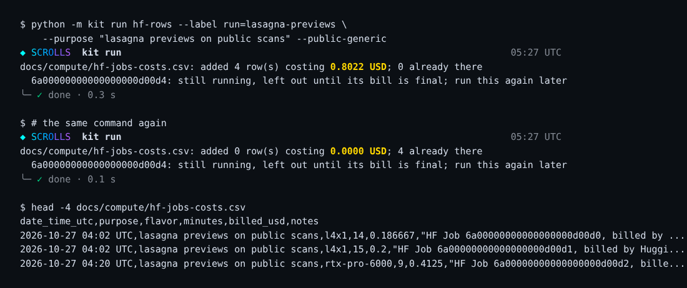

# hf-rows: add Hugging Face Jobs to a cost ledger from Hugging Face's own bill

`python -m kit run hf-rows` reads Hugging Face's bill for the current period and appends one row per finished Job (date, purpose, flavor, billed minutes, billed USD) to a cost ledger CSV, never twice for the same Job.

| Field | Value |
| --- | --- |
| Id | `hf-rows` |
| Status | Current |
| Kind | kit command, kit module |
| Area | Compute and cost |
| Run | `python -m kit run hf-rows` |
| Code | `kit/hfrows.py`, `kit/cli.py` (`cmd_run`) |
| Tests | `tests/test_hfrows.py` |
| Needs | Python 3.10 or newer, standard library only. A Hugging Face token with billing read access ("Billing: read billing usage" on a fine-grained token) in `HF_TOKEN`, and a ledger CSV that already has its header row |
| Runs on | Any machine; about 3 s for 578 labelled Jobs (measured 2026-10-27 in a Claude cloud container, two Hub requests plus one per page of 100 Jobs) |
| Network | huggingface.co: `/api/settings/billing/usage/jobs` (the bill), `/api/whoami-v2` and `/api/jobs/NAMESPACE` (only with `--label`). Read only |
| Writes | The ledger CSV named by `--ledger` (default `docs/compute/hf-jobs-costs.csv`), replaced atomically, through the same writer and lock as [modal-row](modal-row.md); nothing with `--dry-run` |
| Go-ahead | Not needed: it reads a bill and edits a local file. A row becomes public only when the change is merged into public Scrolls |
| Released | Public `main` since 2026-10-27 |
| Checked | 2026-10-27 against commit `bcd1a7f` |

## What it does

Paid GPU work in this project runs on [Hugging Face Jobs](https://huggingface.co/docs/huggingface_hub/guides/jobs) (hard rule 11), and each Job's cost belongs in a ledger. Unlike Modal, where [modal-row](modal-row.md) records numbers the caller brings, Hugging Face publishes its own per-Job bill, so this tool reads the numbers itself: for each Job it takes the flavor, the billed minutes and the billed cost exactly as Hugging Face charged them.

Pick Jobs by id (`--job`, repeatable) or by label (`--label KEY=VALUE`, every Job in your namespace with that label, as set by `hf jobs run --label`). Each finished Job becomes one row under the key `hfjob:JOB_ID`, stored at the end of its notes as `autoledger hfjob:JOB_ID`, so a rerun or a Job already in the ledger writes nothing. A Job still running is left out with a note, since its bill is not final; run the same command again once it ends.

The columns come from the ledger's own header. The public ledger, [`docs/compute/hf-jobs-costs.csv`](../compute/hf-jobs-costs.csv) (`date_time_utc,purpose,flavor,minutes,billed_usd,notes`), takes rows only behind `--public-generic`, and only with a purpose that passes the same word check as the public Modal ledger. The purpose is always the caller's own text: the tool never copies a Job's labels, command or image into a row.

It records what Hugging Face billed; it does not estimate, total or check prices. The bill covers the current billing period only, so record Jobs before the period ends.

## When to use it

- After a batch of generic Hugging Face Jobs on public data, to record their real cost in the public ledger.
- From a script after its Jobs end: the key makes every rerun safe.
- For a private ledger: any CSV with a `lane_branch` column is treated as private and takes rows without the public gate.

Do not use it:

- For Modal jobs: use [modal-row](modal-row.md).
- For local runs on the Mac: use [run-local](run-local.md).
- To price a Job before it runs: use [cloudcost](cloudcost.md) or the flavor's price from `hf jobs hardware`.
- For a target-scroll, preregistered, held-out or other private run: that row belongs in a private ledger, never in the public one (hard rule 1).

## Quick start

```bash
export HF_TOKEN=TOKEN
python -m kit run hf-rows --label run=RUN --purpose "PURPOSE" --dry-run
python -m kit run hf-rows --label run=RUN --purpose "PURPOSE" --public-generic
```

- `TOKEN`: a Hugging Face token with billing read access.
- `RUN`: the label value your Jobs carry (or use `--job ID` once per Job).
- `PURPOSE`: what the Jobs were for, in plain words fit for a public file.

On a scratch copy of the public ledger, for the ten-minute CPU Basic check Jobs of 27 Oct 2026, the first run printed (shortened):

```
demo-ledger.csv: added 503 row(s) costing 0.0840 USD; 0 already there
  6adaf591c191903149a7b00e: not in the current billing period's bill (older, or never billed)
```

and a second, identical run printed `added 0 row(s) costing 0.0000 USD; 503 already there`. A written row reads:

```
2026-10-27 05:10 UTC,"spend guard check (CPU Basic, every 10 minutes)",cpu-basic,1,0.000167,"HF Job 6ae0322c3fb22a235dd25b10, billed by Hugging Face; autoledger hfjob:6ae0322c3fb22a235dd25b10"
```

It worked when the exit code is 0 and the counts match the Jobs you meant.



*Synthetic demo: the same command on a made-up bill (invented Job ids and costs, no network), made by `python scripts/media/hfrows_demo.py`. No scan data.*

## Checks and controls

- **The public gate can refuse.** Without `--public-generic` the public ledger refuses with exit code 2, and with it a purpose naming target, title, held-out, preregistered, experiment or candidate work is refused the same way; `--dry-run` applies the same gate (tested).
- **One row per Job.** A second run writes nothing for Jobs already there (tested, and seen on the live run above).
- **Running and missing Jobs are named, not written.** A Job whose bill shows no end time is listed as still running; an id absent from the bill is listed as not billed this period (tested).
- **What it cannot catch.** The word check reads the purpose only, as text; it cannot recognize private work described in other words. Read the rows before committing them to public Scrolls.

Claim label: Sourced fact (the minutes and USD are Hugging Face's own bill, read from its billing API on the day the row is written).

## Commands and options

### `python -m kit run hf-rows`

```
usage: python -m kit run hf-rows [-h] [--job ID] [--label KEY=VALUE]
                                 --purpose PURPOSE [--ledger LEDGER]
                                 [--public-generic] [--token-env TOKEN_ENV]
                                 [--dry-run] [--json]
```

| Option | Default | Meaning |
| --- | --- | --- |
| `--job ID` | none | a Job id; repeatable |
| `--label KEY=VALUE` | none | every Job in your namespace with this label; repeatable |
| `--purpose PURPOSE` | required | what the Jobs were for, written in each row |
| `--ledger LEDGER` | `docs/compute/hf-jobs-costs.csv` | ledger CSV (default docs/compute/hf-jobs-costs.csv) |
| `--public-generic` | off | write the public ledger: the Jobs are generic work on public data and the purpose names no title, target, preregistered or held-out work |
| `--token-env TOKEN_ENV` | `HF_TOKEN` | environment variable holding the token (default HF_TOKEN) |
| `--dry-run` | off | show what would be added; write nothing |
| `--json` | off | print the report as JSON (fields under Outputs) instead of lines |

## Python API

| Function | Returns | Raises | Notes |
| --- | --- | --- | --- |
| `HFRowsError()` | exception | | An input, token or Hub error; the command line prints it and exits 2 |
| `http_get(url, token, timeout=60)` | `(object, str or None)` | `HFRowsError` | (parsed JSON, next page URL or None) for an authenticated GET. |
| `billed_jobs(token, get=None)` | `dict` | `HFRowsError` | {job id: bill entry} for the current billing period, from /api/settings/billing/usage/jobs. |
| `namespace(token, get=None)` | `str` | `HFRowsError` | The token's user name, from `/api/whoami-v2` |
| `labelled_ids(label, token, ns=None, get=None)` | `list` of str | `HFRowsError` | Ids of the Jobs in a namespace that carry the label KEY=VALUE (the Jobs API filters on the server). |
| `row_for(entry, purpose)` | `dict` | | One ledger row (column: value) for a bill entry. |
| `finished(entry)` | `bool` | | False while the bill's `completedAt` is the 1970 placeholder of a running Job |
| `plan(bill, ids)` | `(list, list, list)` | | (entries to write, ids still running, ids not in this period's bill), in the order given, ids deduplicated. |
| `add(ledger, ids, purpose, token, public=False, dry_run=False, get=None)` | `dict` | `HFRowsError`, `LedgerRowError` | Write one row per finished Job in ids; returns a report dict: added, already, running, missing, usd. |
| `public_refusal_or_flag(row, public)` | `str` or `None` | | Why a dry run on the public ledger would be refused, or None |
| `token_from(env_name='HF_TOKEN')` | `str` | `HFRowsError` | The token from that environment variable |

`get` is any function `(url, token) -> (JSON, next URL)`; the tests pass a fake one.

## Inputs

- Job ids (24 hexadecimal characters on Hugging Face today; 12 to 40 accepted) or `KEY=VALUE` labels.
- The token, from `HF_TOKEN` or the variable named by `--token-env`. It is sent only to huggingface.co.
- A ledger CSV with a header row. Columns the rows fill: `date_time_utc`, `purpose`, `flavor`, `minutes`, `billed_usd`, `notes`; a ledger without one of them refuses the row.

## Outputs

One line per run, `LEDGER: added N row(s) costing X USD; M already there` (`would add` with `--dry-run`), then one line per Job still running or not in the bill. With `--json`:

| Field | Type | Meaning |
| --- | --- | --- |
| `added` | list of str | Job ids written (or that would be, with `--dry-run`) |
| `already` | list of str | Job ids the ledger already held |
| `running` | list of str | Job ids left out because they had not ended |
| `missing` | list of str | Job ids not in the current period's bill |
| `usd` | number | billed USD of the added rows |

| Exit code | Meaning |
| --- | --- |
| `0` | Done: rows added, or nothing new to add |
| `2` | Refused or failed: no token, a bad id or label, a Hub error, or the public gate; nothing written |

## Failure modes

| What you see | Why | What to do |
| --- | --- | --- |
| `usage: ...` then `error: ...` on stderr, exit code 2 | A missing or wrong argument | Check the command against Commands and options |
| `...returned no usage.jobDetails list` | The billing endpoint answered in a shape this version does not know | Check the endpoint by hand; the tool may need an update |
| `whoami-v2 returned no name` | The token does not identify a user | Use a user token |
| `--label takes KEY=VALUE, not...` | The label has no `=` | Give it as `run=NAME` |
| `not a Job id:...` | An id is not hexadecimal | Copy the id from `hf jobs ps -a` |
| `--purpose is required: what the Jobs were for, in words fit for the ledger` | The purpose is empty | Say what the Jobs were for |
| `set...to a Hugging Face token with billing read access` | No token in the variable | Export one, or name another with `--token-env` |
| `GET...: HTTP...` | The Hub refused or failed; 401 or 403 means the token lacks billing read access | Make a fine-grained token with "Billing: read billing usage" |
| `cannot read backfill...:...` | (`kit run backfill`, which shares this command group) | See [run-local](run-local.md) |
| `...is a JSON object with key, row and optionally generic` | (`kit run modal-row`) | See [modal-row](modal-row.md) |
| `cannot read...:...` | (`kit run modal-row`: the row file) | See [modal-row](modal-row.md) |
| `give --job ID or --label KEY=VALUE (no Jobs matched)` | No ids given, or the label matched no Job | Check the label with `hf jobs ps -a --filter label=...` |

## How it works

1. With `--label`, read the token's user name, then page through `/api/jobs/NAMESPACE?label=KEY=VALUE` (the server filters; pages follow the `Link: rel="next"` header).
2. Read `/api/settings/billing/usage/jobs`: per Job `jobId`, `hardwareFlavor`, `totalMinutes`, `totalCostMicroUsd`, `startedAt`, `completedAt` for the current period.
3. Split the ids into finished, still running (`completedAt` starts with `1970-01-01`) and not billed.
4. For each finished Job write `date_time_utc` (start, to the minute), the purpose, the flavor, the billed minutes and `billed_usd` (micro USD over 1,000,000) through `kit.modalledger.append` under the key `hfjob:JOB_ID`, which holds the advisory lock, skips a key already present, applies the public gate and replaces the file atomically.

## Cost and time

About 3 s and no compute bill (measured 2026-10-27, 578 labelled Jobs, Claude cloud container). Reading the bill is free.

## For agents

- **Command:** `python -m kit run hf-rows --label run=RUN --purpose "PURPOSE" --public-generic --json`, from the repository root, with `HF_TOKEN` set.
- **Parse:** the JSON report: `added`, `already`, `running`, `missing`, `usd`.
- **Rerun:** Safe: Jobs already in the ledger are skipped. Rerun after running Jobs end to add them.
- **Success:** Exit code 0 and every Job you meant listed in `added` or `already`.
- **Not a pass:** A run with Jobs in `running` (not recorded yet) or `missing` (another period, or never billed).
- **Go-ahead:** Nothing.
- **Never:** Put a target-scroll, title, preregistered, held-out or other private Job in the public ledger; write a purpose that copies private run names; paste the token into a file or a command line.

## Tests

```bash
python -m unittest tests.test_hfrows -v
```

They cover one row per finished Job, running and missing Jobs left out, a rerun writing nothing, the public gate (flag and word check) in both a write and a dry run, input checks, label paging, the command line's messages and exit codes, and that the public ledger file holds only a header and generic rows. They use a fake Hub, so they do not cover changes in Hugging Face's API.

## History

- 2026-10-27: first version: Hugging Face Jobs from the billing API into a cost ledger, one row per Job, the public ledger only behind `--public-generic`.

## Related

- [modal-row](modal-row.md): the Modal counterpart, and the shared writer.
- [run-local](run-local.md): local runs on the Mac.
- [cloudcost](cloudcost.md): prices before a run.
- [compute.md](../compute.md): the compute guide.
- [hf-jobs-costs.csv](../compute/hf-jobs-costs.csv): the public Hugging Face ledger.
