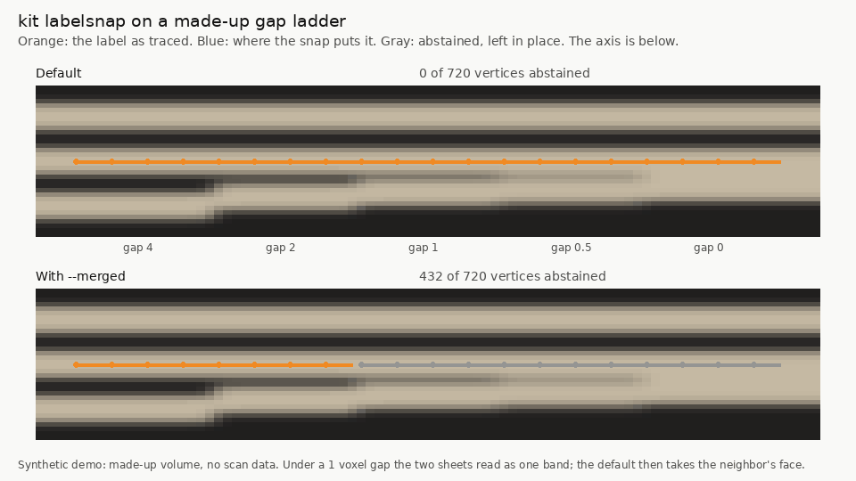

# labelsnap: move a surface label onto the papyrus recto face, with an abstain mask

`python -m kit labelsnap` snaps one tifxyz surface label onto the recto face of the nearest CT band and writes the snapped tifxyz, a per-vertex abstain mask and confidence, an OME-Zarr surface label (1 surface, 2 ignore) and a VC3D review queue of abstaining regions.

| Field | Value |
| --- | --- |
| Id | `labelsnap` |
| Status | Current |
| Kind | kit command, kit module |
| Area | Surfaces and tracing |
| Run | `python -m kit labelsnap snap`, `python -m kit labelsnap check`, `from kit import labelsnap` |
| Code | `kit/labelsnap.py`, `kit/cli.py` (`build_parser`), `kit/villafmt.py` (`vc3d_points`) |
| Tests | `tests/test_labelsnap.py`, and `tests/test_snap_face.py` for the snap underneath |
| Needs | Python 3.10 or newer (run here on 3.13) and numpy; kit's `snap`, `snaptruth`, `vc3d_region`, `vc3d_audit`, `vc3d_io` and `villafmt`. Optional: tifffile (mesh TIFFs; without it kit's own reader), numcodecs (blosc or zstd chunks). No scipy, no zarr package |
| Runs on | Any CPU. The synthetic quick start (720 vertices) took about 3 s with `--self-check` on a shared 4-core cloud container (measured 2026-10-29). On real meshes the snap reads a profile of 97 samples per vertex; about 1 s per 1,000 vertices on a local zarr is expected from kit snap's face mode (Interpretation; not measured on a whole segment) |
| Network | None for a local `--volume`. An `https://` or `s3://` volume is read anonymously over HTTPS, chunk by chunk, with kit's chunk cache in memory; nothing of it is written to disk |
| Writes | `OUT/snapped.tifxyz/` (x, y, z.tif, meta.json), `OUT/abstain.tif`, `OUT/reason.tif`, `OUT/confidence.tif`, `OUT/surface_label.zarr/` (unless `--no-label`), `OUT/review.json`, `OUT/review.tsv`, `OUT/labelsnap.json`. It refuses an `OUT` that is not empty. `check` writes nothing |
| Go-ahead | Not needed for a local run or reads of the public open-data bucket |
| Released | Public `main` from the pull request that adds this page (October 2026); the same code shipped earlier inside AutoPipeline 0.1.10 (branch `submission/progress-2026-10-fix10`, 29 October 2026). The Snapped Labels dataset (snapped-labels) was made with it and with finesnap |
| Guide | [snapped-labels](snapped-labels.md) (the released dataset and its viewer), [snap](snap.md) (the snap underneath), [finesnap](finesnap.md) (the same snap on a finer scan) |
| Checked | 2026-10-29 against commit `afcc05a` |

## What it does

villa's 2026 open problems ask for surface labels "better localized on the papyrus' recto" and for zarr image and label pairs that work better than voxelized meshes (Sourced fact, [2026 open problems](https://scrollprize.org/2026_open_problems), read 21 October 2026; rodriguescarson's [villa #1640](https://github.com/ScrollPrize/villa/issues/1640), 29 August 2026, reports that surface labels sit a median 2.3 to 2.6 voxels off the density maximum, and pmh47 replied that the segmentation ideally is the recto surface, Community report). A published surface label (a tifxyz segment mesh) often sits inside the sheet or beside it rather than on its recto face: on fresh PHerc0139 and PHerc0814 test sites only about a quarter of published label vertices were within 1 voxel of the recto face of an independent finer scan (Checks and controls).

`kit labelsnap snap` moves each vertex along its normal onto the recto face of the bright CT band nearest it, found at sub-voxel precision on a trilinear profile: kit snap's band face snap (`kit.snap.snap_face`) in its per-vertex form (`FACE_SNAP_PER_VERTEX`). The recto face is the face toward the scroll axis, so the axis is required for the recto or verso target (`--umbilicus`, a straight axis, or `--recto-sign`). A vertex **abstains** when its band is ambiguous or runs off the profile, its contrast is too low, the band is more than `max_move` (4 voxels) away, or its normal is nearly tangent to the axis direction. `--merged` adds the merged-band rule: it also abstains where the band is more than 1.8 times the mesh's 25th-percentile band thickness, meant for two sheets merged by the blur. On PHerc0139 and PHerc0814 that rule mostly held back genuinely thick single sheets and cost accuracy, so it is off by default. An abstaining vertex may still move by an offset filled in from measured neighbors, or stays; the abstain mask says that nothing at that vertex vouches for its position.

The products are made for training and review: the **abstain mask** and **reason** grids per vertex; a **confidence** in [0, 1] per vertex (an untested ranking: contrast over the floor, separation from the next band and thickness under the cap, multiplied); an **OME-Zarr surface label** in the CT's voxel frame, 1 where every corner of a grid cell measured its face, 2 (ignore) on cells with an abstaining corner and in a halo of `max_move` voxels along the normal around them, 0 elsewhere (2 is the largest value, as nnU-Net expects of its ignore label; missing chunks read 0); and a **VC3D review queue**, a point collection with one point per region of connected abstaining vertices, largest first, at the label's position, for a person to check in VC3D. `kit labelsnap check` validates a folder for agents.

It does not label the other windings in a crop (the surface label marks only this label's surface), it does not fix a label that follows the wrong wrap (it moves along the normal only), and where two sheets touch with no visible gap the face it finds can belong to the neighbor. A snapped label is geometry, not a reading; nothing here is about ink.



Synthetic demo, made by `scripts/media/labelsnap_demo.py`, which runs the tool on the gap ladder of the quick start (no scan data). A loop of a real snap, on PHerc0139 w033 at z 7600 over its own CT (Model output), is `snap-pherc0139-w033-z7600.gif` on the [Snapped Labels dataset](https://huggingface.co/datasets/SharpMeow/vesuvius-snapped-labels).

## When to use it

- To move a published or traced surface label onto the recto face of its sheet before making training pairs, with the places it could not vouch for marked ignore.
- To get a review queue of the places where the label sits in merged, faint or ambiguous papyrus, for a person in VC3D.
- When the scroll has only the scan the label was traced on. Where a finer scan of the same scroll exists with a catalog matrix, [finesnap](finesnap.md) placed more vertices within 1 voxel on both scrolls it was tested on.

Do not use it:

- When a finer registered scan of the same scroll exists: use [finesnap](finesnap.md).
- To snap onto a surface prediction or RectoRefine's midline: use [snap](snap.md) (`--source pred`, `--source ct --mode midline`).
- To repair sheet switches, or a label on the wrong wrap: a snap moves along the normal only; check the wrap first in VC3D.
- Where two sheets touch without a visible gap: the face found there can belong to the neighbor (`--merged` makes such vertices abstain instead).
- Without the released data: [snapped-labels](snapped-labels.md) already holds every published label of PHerc0139, PHerc0814, PHerc0841 and PHerc0172 snapped.

## Quick start

On a synthetic volume (the gap ladder of `tests/test_snap_face.py`: three blurred 6-voxel sheets, the recto-side neighbor at gaps of 4, 2, 1, 0.5 and 0 voxels; the label 2.9 voxels inside the middle sheet), with a straight axis below the volume:

```bash
python -m kit labelsnap snap LABEL --volume ZARR --out OUT --axis-point 20 12 -400 --axis-dir 1 0 0 --self-check
python -m kit labelsnap check OUT
```

- `LABEL`: a tifxyz folder; `ZARR`: the volume; `OUT`: a new folder.

On the full ladder (720 vertices) it printed (2026-10-29):

```
labelsnap: 720 of 720 vertices measured their recto face and moved onto it, 0 abstained (0.0); 0 review regions; wrote OUT
label: 783 surface and 0 ignore voxels in 1 chunks
self-check: passed; recovered, and both controls caught
labelsnap check: ok
```

On the gap-4 and gap-2 steps the snapped z had a median of 27.80 against the recto face at 27.5, every vertex within 1 voxel. On the steps with gaps of 1 voxel or less the two sheets read as one band and the snap took that band's recto face, the neighbor's, near z 21: the limit named in What it does. With `--merged` those 432 vertices abstain as `too thick` instead (one review region). It worked when both commands exit 0 and `check` prints `ok`.

## Checks and controls

- **Self-check** (`--self-check`, kit snap's check with the face defaults: plant a smooth 2-voxel displacement, snap, require a median within 1 voxel and 80 % of vertices within it; a volume shifted 3 voxels toward the planted side must not also recover; a volume with no sheet must not move the mesh). It can fail, and does on merged bands with `--merged`, where abstaining vertices do not return a planted shift.
- **Output check** (`labelsnap check`): every product present, grids the mesh's shape, abstain and reason agree, confidence in [0, 1] and 0 where abstaining, label values only 0, 1 and 2, review points equal to the record's regions. A tampered mask fails it (test `test_check_catches_a_tampered_mask_and_a_missing_file`).
- **Against an independent scan, PHerc0814** (27 October 2026, Model output): a test fixed in writing before it ran scored the default snap on 60 fresh sites of the 12 automatic segments traced on the 9.362 um scan, against the recto face of the 1.129 um scan registered per site; 42 sites were scored (18 fell below the registration floor), 310 vertices. Within 1 voxel of that face: 24.2 % published, 71.0 % snapped; within 2 voxels 82 % snapped; median distance 2.32 voxels before and 0.45 after. Mean gain toward the face +1.78 voxels (95 % interval +1.40 to +2.21). Controls: the sham (the snap's move reversed) moved labels away (-2.38), a random sign gave no gain, and the 2.399 um scan's own face, a positive control, gained +2.40. The merged-band rule cost 0.52 voxels (0.32 to 0.75), so the default dropped it.
- **Against an independent scan, PHerc0139** (25 October 2026, Model output): the same kind of test on 59 scored sites (444 vertices) against PHerc0139's 1.129 um scan, run with the merged-band rule then the default, gained +1.71 voxels (1.38 to 2.07); without the rule, today's default, +2.37 (2.01 to 2.76). The sham moved labels away and a random sign gave no gain. A later test on 60 other fresh PHerc0139 sites put 79.4 % of labelsnap's vertices within 1 voxel of the 1.129 um face against 23.7 % published, and finesnap's 91.2 % ([finesnap](finesnap.md)). Disclosure: 11 of the 59 sites lie on three segments the Snapped Labels release later held back for evaluation; these tests ran before that hold and their per-site rows were not kept.
- **Against seven community snaps** (29 October 2026, Model output, a test fixed before it ran): on 32 fresh PHerc0814 sites (1.129 um truth) and 60 fresh PHerc0841 sites (2.403 um truth), 71 scored, mean distance along the published normal to the finer scan's recto face, per site, then pooled. labelsnap (default, label scan only) was +2.153 voxels closer than the published label (95 % interval +1.821 to +2.507) and +1.892 closer than an exact-parity port of VC3D's `vc_objrefine` alpha-composition refinement (Hendrik Schilling, villa `382e48d35ae8`) with thresholds tuned on other PHerc0139 sites (+1.480 to +2.349). It was also closer than `vc_objrefine` as shipped, recto-offset r2 by TAUIL-Abd-Elilah (commit `16bc31f`) with and without its gate, Wittmoon's surface_placement_audit ([villa PR #2147](https://github.com/ScrollPrize/villa/pull/2147)), RectoRefine's midline and a snap onto the m7 surface prediction, on each scroll and pooled; every control held. Within 1 voxel: labelsnap 55 % (PHerc0814) and 66 % (PHerc0841), the published label 19 % on both, the best community snap 22 % and 21 %.


Limits, stated plainly: three scrolls, sites drawn from automatic and hand segments of their scans; PHerc0814 is held out by site, not by scroll; the tests show labels moved closer to the recto face, not exactness at every vertex; a label displaced toward the verso was not shown to come back (the planted toward-verso control was weak); the midline and nearest-peak snaps aim at the sheet center by design, so part of their loss is the target, not error; finesnap beat labelsnap on PHerc0814 by +0.93 voxels where a finer scan exists. On PHerc0841 the truth scan is the one the Snapped Labels release's finesnap read, so the released PHerc0841 meshes were not scored. Numbers: `label_snap_checks` in [`docs/results.json`](../results.json).

Claim label: None for the products (geometry and masks, no claim); Model output for the measured placement against independent scans on PHerc0139, PHerc0814 and PHerc0841; Untested idea for the confidence ranking and for other scrolls.

## Commands and options

### `python -m kit labelsnap snap`

```
usage: python -m kit labelsnap snap [-h] --volume VOLUME [--level LEVEL]
                                    --out OUT [--umbilicus UMBILICUS]
                                    [--umbilicus-scale UMBILICUS_SCALE]
                                    [--axis-point X Y Z] [--axis-dir X Y Z]
                                    [--recto-sign {1.0,-1.0}]
                                    [--target {recto,mid,verso}] [--merged]
                                    [--no-merged] [--face-sigma FACE_SIGMA]
                                    [--max-move MAX_MOVE] [--no-label]
                                    [--label-level LABEL_LEVEL]
                                    [--ignore-halo IGNORE_HALO]
                                    [--label-step LABEL_STEP]
                                    [--review-min REVIEW_MIN]
                                    [--review-max REVIEW_MAX] [--self-check]
                                    [--json]
                                    surface
```

| Option | Default | Meaning |
| --- | --- | --- |
| `surface` | required | tifxyz folder (x.tif, y.tif, z.tif, meta.json) in the volume's level-0 voxels |
| `--volume VOLUME` | required | the CT the label lives in: OME-Zarr folder or http(s) URL |
| `--level LEVEL` | `0` | pyramid level the snap reads (coordinates stay level 0) |
| `--out OUT` | required | output folder (created; existing products are refused) |
| `--umbilicus UMBILICUS` | none | umbilicus JSON naming the scroll axis (kit snap's format) |
| `--umbilicus-scale UMBILICUS_SCALE` | `1.0` | multiply the umbilicus points by this |
| `--axis-point X Y Z` | none | a point on the scroll axis, level-0 voxels; with `--axis-dir`, a straight axis instead of an umbilicus |
| `--axis-dir X Y Z` | none | the straight axis's direction |
| `--recto-sign RECTO_SIGN` | none | +1: the recto face lies at negative offsets along the mesh normal; -1: at positive ones |
| `--target TARGET` | `recto` | `recto` (the band face toward the axis), `mid` (the band midline, needs no axis) or `verso` |
| `--merged` | off | add the merged-band rule (`FACE_SNAP_PER_VERTEX_MERGED`; the default until 27 Oct 2026) |
| `--no-merged` | off | the default since 27 Oct 2026 (kept for old commands) |
| `--face-sigma FACE_SIGMA` | `1.0` | smoothing of the band finder along the profile, voxels |
| `--max-move MAX_MOVE` | none | snap_face's max_move (default 4 voxels) |
| `--no-label` | off | skip the OME-Zarr surface label |
| `--label-level LABEL_LEVEL` | `0` | the image level the label array matches |
| `--ignore-halo IGNORE_HALO` | none | ignore band along the normal, level-0 voxels (default max_move) |
| `--label-step LABEL_STEP` | `0.5` | sample spacing on the surface (and along the normal in the ignore halo) when the label is drawn, voxels of the label level |
| `--review-min REVIEW_MIN` | `4` | an abstaining region needs this many vertices to get a review point |
| `--review-max REVIEW_MAX` | `500` | at most this many review points, largest regions first |
| `--self-check` | off | also run kit snap's self-check (plant 2 voxels, recover; shifted and empty controls) |
| `--json` | off | print the record (`labelsnap.json`) as JSON instead of the summary lines |

### `python -m kit labelsnap check`

```
usage: python -m kit labelsnap check [-h] [--json] out
```

| Option | Default | Meaning |
| --- | --- | --- |
| `out` | required | an output folder written by `labelsnap snap` |
| `--json` | off | print `{out, ok, problems}` as JSON |

## Python API

| Function | Returns | Raises | Notes |
| --- | --- | --- | --- |
| `label_snap(xs, ys, zs, valid, sampler, axis=None, recto_sign=None, target='recto', merged=False, face_sigma=1.0, extra_opts=None, batch=...)` | dict: `xs`, `ys`, `zs` (snapped grids), `valid`, `abstain` (uint8 0, 1, 255), `reason` (uint8, `kit.snap.FACE_REASONS`), `confidence` (float32), `apply`, `D3`, `normals`, `ok`, `report`, `record`, `detail`, `opts` | `kit.snap.SnapError` on a bad target | The snap of one mesh on a `kit.snap.Sampler`; what the command and the study's primary arm both call |
| `face_opts(target='recto', merged=False, extra=None)` | dict of `snap_face` options | none | `FACE_SNAP_PER_VERTEX` (or `FACE_SNAP_PER_VERTEX_MERGED` with `merged=True`) with the target and extras |
| `confidence(detail, measured_mask)` | float32 grid in [0, 1] | none | Contrast, separation and thickness factors multiplied; 0 where the vertex did not measure its face |
| `reason_counts(reason, valid)` | dict reason name to count | none | Over valid vertices |
| `components(mask)` | int32 grid, 0 outside, 1..n | none | 4-connected components, numpy and the standard library only |
| `review_regions(xs, ys, zs, abstain, reason, min_size=4, max_points=500)` | list of dicts: `size`, `row`, `col`, `xyz`, `reason`, `bbox_rc` | none | Largest first |
| `review_collection(regions, name='labelsnap review', meta=None)` | VC3D point collection dict | none | One collection; region details under `kit` |
| `write_surface_label(path, xs, ys, zs, valid, abstain, normals, shape_zyx, scale=1.0, halo=4.0, step=0.5, chunk=128, source=None, level=0)` | summary dict (`chunks_written`, `voxels`, `cells_surface`, `cells_ignore`, `samples_outside_volume`) | `LabelSnapError` when `path` exists | Writes by z slabs, only touched chunks |
| `read_label_chunks(path)` | `(shape, {(cz, cy, cx): block})` | `OSError`, `zlib.error` | For checks and tests |
| `write_outputs(out, src, res, volume_desc, label_shape=None, ...)` | the record dict | `LabelSnapError` | Every product of one `label_snap` result |
| `check_outputs(out)` | list of problems (empty when fine) | none | What `labelsnap check` runs |
| `main(argv=None)` | exit code | none | The command line without `python -m kit` |
| `build_parser(p)` | None | none | Adds the `snap` and `check` subcommands to an argparse parser (`kit/cli.py` uses it) |
| `level_scale(vol, level)` | float | `LabelSnapError` when the level's z, y and x factors differ | Level voxels per level-0 voxel (0.5 at level 1), the factor the label array's coordinates are multiplied by |
| `run_snap(args)` | the record dict | `LabelSnapError`, `kit.snap.SnapError` | `snap` on parsed arguments |
| `cmd_labelsnap(args)` | exit code | none | Dispatch for `python -m kit labelsnap` |

`LabelSnapError` (a `ValueError`) is raised for refused inputs; the command turns it, and `kit.snap.SnapError`, into exit code 2.

## Inputs

- `surface`: a tifxyz folder: `x.tif`, `y.tif`, `z.tif` (float32 grids of one shape, level-0 voxel coordinates of the volume, -1 or any negative value where there is no vertex) and `meta.json` (copied into the snapped mesh with a new bbox and a `snap` record).
- `--volume`: an OME-Zarr (zarr v2 or unsharded v3) folder or URL of the CT the label lives in; `--level` picks the pyramid level the snap reads, coordinates stay level 0. The snap's distances (`max_move` 4, the profile's 12 each way) are in voxels of the level it reads, so a mesh on a 2.4 um scan is best snapped at the level whose voxels are near 9 to 10 um (level 2), where the defaults were set (about 9.4 to 9.6 um voxels).
- The axis: `--umbilicus FILE` (kit snap's umbilicus format, `--umbilicus-scale` to bring it to level 0), or `--axis-point` with `--axis-dir`, or `--recto-sign 1|-1` for a mesh whose normals all point the same way relative to the axis.

## Outputs

`labelsnap.json`:

| Field | Type | Meaning |
| --- | --- | --- |
| `opts` | object | the `snap_face` options used (target, `max_thick_ratio`, ...) |
| `report` | object | `snap_face`'s report: `frac_snapped`, `median_abs_off`, `abstained` counts, `ref_band_thick`, `thick_cap` |
| `vertices` | object | `valid`, `measured`, `abstained`, `frac_abstained`, `moved`, `confidence_median_measured` |
| `reasons` | object | vertices per reason (`kit.snap.FACE_REASONS`) |
| `review` | object | `regions`, `vertices_in_regions`, `file` |
| `label` | object | `shape_zyx`, `level`, `chunks_written`, `voxels` (`surface`, `ignore`), `cells_surface`, `cells_ignore`, `samples_outside_volume` |
| `self_check` | object | with `--self-check`: kit snap's check record (`passed`, `recovery`, `control_shifted`, `control_empty`, `why`) |
| `seconds` | object | `snap`, `total` |

`abstain.tif` (uint8: 0 measured, 1 abstained, 255 invalid), `reason.tif` (uint8: 0 measured, 1 missing data, 2 side not named, 3 low contrast, 4 no band, 5 ambiguous or off the profile, 6 too far, 7 too thick, 8 rejected by its neighbors, 9 not a valid vertex), `confidence.tif` (float32). `review.tsv` columns: rank, size, row, col, x, y, z, reason. `surface_label.zarr/`: a zarr v2 group, array `0` of the label level's full shape, chunks 128, zlib, `/` keys; `.zattrs` holds OME-NGFF 0.4 `multiscales` and `image-label` (values 0 background, 1 surface, 2 ignore). At `--label-level N` a level-0 point p sits at p times the level's factor (p / 2**N for a halving pyramid, as kit snap's Sampler reads it) and the OME scale is 2**N on each axis, with no translation.

| Exit code | Meaning |
| --- | --- |
| `0` | `snap`: every product written and its own check passed; `check`: no problem found |
| `1` | `check` found a problem (listed); `snap` wrote its products but they fail the same check (listed on stderr) |
| `2` | refused input (`kit labelsnap: ...` on stderr), or an argument error |

## Failure modes

| What you see | Why | What to do |
| --- | --- | --- |
| `usage: ...` then `error: ...` on stderr, exit code 2 | A missing or wrong argument | Check the command against Commands and options |
| `exists: the label is never written over an old one` | `surface_label.zarr` already exists in the output | Write each run to a new folder |
| `give the scroll axis or --recto-sign, not both` | Both an axis and a sign were given | Give one |
| `the recto face is named by its side toward the scroll axis: give --umbilicus, --axis-point with --axis-dir, or --recto-sign` | A recto or verso target with no way to name the side | Add the umbilicus, or use `--target mid` |
| `is not empty: write each run to a new folder` | `--out` holds files | Pick a new folder |
| `kit labelsnap: cannot open ...` | The volume path or URL cannot be read | Check the path, the URL and the network |
| `--label-level N: the volume has M levels` | The label level is not in the pyramid | Pick a level below M |
| `--label-level N: the level's factors [...] (z, y, x) are not one isotropic scale` | The level is downsampled differently along z, y and x; the label writer takes one factor | Use level 0, or a level halved on every axis |
| `the outputs fail their own check`, exit code 1 | `snap` ran `check` on what it wrote and found a problem (for example no surface voxel inside the label array) | Read the listed problems; do not use the folder |
| Most vertices abstain with `side not named` | Normals nearly along the axis direction (a mesh lying flat in z) or a wrong axis | Check the umbilicus frame and scale |
| Most vertices abstain with `too far` | The mesh is more than 4 voxels off the sheet, or the level is too fine | Read a coarser `--level`, or snap with kit snap first |
| `self-check: FAILED` | Merged or faint bands, or a mesh far from the sheet | Look at the review queue; do not use the snapped label as if it passed |

## How it works

1. Normals by kit snap's rule (central differences on the grid, `cross(d/dcol, d/drow)`).
2. Per vertex, a trilinear profile of the CT along the normal from -12 to 12 voxels in steps of 0.25 (`FACE_SNAP_DEFAULTS` `half`, `step`).
3. `kit.snaptruth.sheet_faces` on that profile (smoothing `--face-sigma` 1.0, level halfway between the 10th and 90th percentiles) gives the band nearest the vertex and its two faces; the recto face is the one toward the axis.
4. Abstain rules (above); with `--merged`, the merged-band cap is 1.8 times the 25th percentile of the mesh's measured band thicknesses, applied when at least 10 bands were measured.
5. Per-vertex form: no jump rejection, holes filled from measured neighbors by normalized convolution (`min_support` 1), offsets clipped to `max_move` plus the profile half-length.
6. The label: each grid cell sampled bilinearly every `--label-step` voxels; an ignore cell also sampled along its normal over the halo; samples rounded to voxels; surface wins over ignore where both touch a voxel; written by z slabs of one chunk, at most 2,000,000 samples in memory at once.
7. The review queue: 4-connected components of abstaining vertices on the grid, each at the vertex nearest its middle.

Constants: `FACE_SNAP_PER_VERTEX_MERGED = {"jump": 1e9, "min_support": 1, "max_thick_ratio": 1.8}`, `LABEL_CHUNK = 128`, `MAX_BATCH_POINTS = 2_000_000`, defaults in `DEFAULTS`.

## Cost and time

Local CPU only; it rents nothing. Measured: the synthetic quick start (above). A whole real segment's label at level 0 of a 9 um scan writes a few thousand 128-cubed chunks (Interpretation from the surface area; not measured); use `--no-label` or `--label-level 1` for a quick look. A batch of whole segments that would run over 10 minutes on a laptop goes to Hugging Face (the where-jobs-run rule, hard rule 11).

## For agents

- **Command:** `python -m kit labelsnap snap SURFACE --volume ZARR_OR_URL --out NEW_DIR --umbilicus UMB.json --json`, then `python -m kit labelsnap check NEW_DIR --json`.
- **Parse:** from `snap --json`: `vertices.frac_abstained`, `reasons`, `review.regions`, `label.voxels`; from `check --json`: `ok` and `problems`.
- **Rerun:** safe into a new folder; it refuses a non-empty one and never overwrites a label.
- **Success:** exit 0 from both, `check` `ok: true`. `snap` runs the same check on what it wrote and exits 1 when it fails.
- **Not a pass:** a run with exit 0 says the products were written, not that the label improved; a failed `self_check`, or a high `frac_abstained`, means most of the label is not vouched for; a label on the wrong wrap stays on the wrong wrap.
- **Go-ahead:** Nothing for local runs on public data.
- **Never:** call a snapped label exact or correct beyond what the tests measured (closer to the recto face of an independent scan on three scrolls); describe an ink map made on it as a reading.

## Tests

`python3 -m unittest tests.test_labelsnap` (18 tests, under 10 s here): the gap ladder (snaps from gaps of 2 and 4 voxels onto the recto face, abstains `too thick` under 1 with `merged=True`), the default without the merged-band rule, the detail grids, the confidence factors, the axis refusal, connected components, review regions and the VC3D document, the surface label (values, halo, surface winning, level scale, refusal to overwrite, read back through kit's volume reader), and the command line end to end with `check` passing on a good folder and failing on a tampered one, `--label-level 1` on a 2-level pyramid (surface voxels at level-1 z 13 to 14, OME scale 2), the anisotropic-level refusal, and `snap` exiting 1 when its own check fails. Not covered: real CT, a whole segment, URLs. The tests against independent scans in Checks and controls ran outside this repository's test suite.

## History

- 2026-10-29: on public `main` with kit snap and kit finesnap (on top of `afcc05a`); the code is the AutoPipeline 0.1.10 copy (`eea2df5`).
- 2026-10-27: the default drops the merged-band rule after the PHerc0814 test (the rule cost 0.52 voxels); `--merged` restores the old behavior (`eea2df5`).
- 2026-10-21: first version: `kit labelsnap snap` and `check`, with `kit.snap.snap_face` returning per-vertex detail grids; `--label-level N` halves coordinates per level and `snap` runs `check` on its own output (`eea2df5`).

## Related

- [snap](snap.md): the snaps underneath (the band face snap, the self-check, the sham).
- [finesnap](finesnap.md): the same products from a finer registered scan of the same scroll; closer where such a scan exists.
- [snapped-labels](snapped-labels.md): the released dataset of snapped labels and its viewer.
- [`docs/results.json`](../results.json): the `labelsnap` rows behind Checks and controls.
