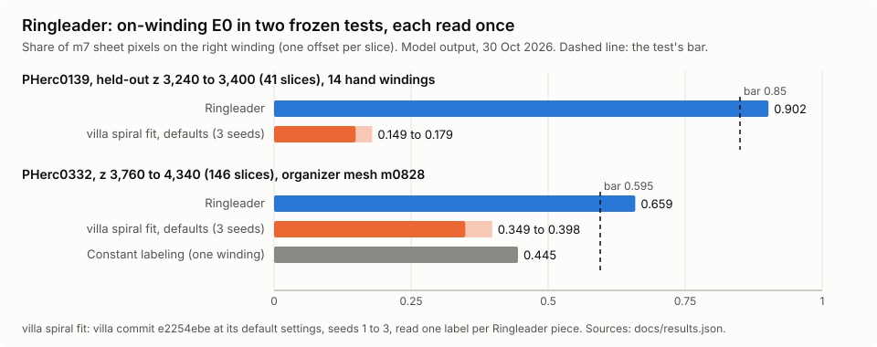

# ringleader: label every sheet in a z-slice with its winding in one solve

Ringleader labels every sheet pixel of a published surface prediction (such as m7) in a z-slice or a stack of slices with its winding, in one convex solve about the umbilicus, and scores the labels against published hand windings.

| Field | Value |
| --- | --- |
| Id | `ringleader` |
| Status | Current |
| Kind | script folder |
| Area | Surfaces and tracing |
| Run | `python3 scripts/ringleader/m7slices.py`, `python3 scripts/ringleader/run_slices.py`, `python3 scripts/ringleader/slab3d.py`, `python3 scripts/ringleader/score.py`, `python3 scripts/ringleader/fitlabel.py convert` |
| Code | `scripts/ringleader/` |
| Tests | `tests/test_ringleader_solve.py`, `tests/test_ringleader_score.py`, `tests/test_ringleader_fitlabel.py` (synthetic data only) |
| Needs | Python 3.10 or newer; numpy, scipy (HiGHS `linprog`, sparse graphs, `cKDTree`), scikit-image (`skeletonize`), OR-tools (the `mcf` solver of the v1 settings), numcodecs (to decode m7's blosc chunks); for `score.py` also tifffile and the public `kit/sheetrefs.py` references (`python -m kit hopbench refs`); for `fitlabel.py` villa's Python with torch and villa's `spiral-fitting` folder (`checkpoint_io`, `flatten_spiral_checkpoint`) |
| Runs on | Any CPU; no GPU. A two-slice PHerc0139 stack: about 16 s to fetch both m7 slices, 2 min 4 s to label them as one stack (mostly skeleton and geometry; the solve itself 4.3 s) and 36 s to score them; 4 min 35 s once for `python -m kit hopbench refs` (measured 2026-10-31, 4-core cloud container) |
| Network | `vesuvius-challenge-open-data.s3.us-east-1.amazonaws.com` over HTTPS: the m7 surface prediction (`m7slices.py`), PHerc0139's umbilicus JSON (`run_slices.py`, `slab3d.py`, `score.py`), the hand-traced windings (`python -m kit hopbench refs`) and, with `--catalog` set to its URL, the catalog `metadata.json`. Nothing else; `fitlabel.py` reads local files only |
| Writes | `m7slices.py`: `DEST/zNNNNN.npy`. `run_slices.py` and `slab3d.py`: `OUT/zNNNNN.npz`, `OUT/params.json`, `OUT/runs.jsonl` (appended), the geometry cache `--geo` (`zNNNNN-HASH.pkl`, `zNNNNN-trackhand.json`) and the umbilicus cache `--cache/json/`. `score.py`: `RUN/score.json` (or `score-clear.json`) and the truth cache `--truth/DIGEST/`. `fitlabel.py convert`: `OUT/zNNNNN.npz`, `OUT/fitlabel.json`, `OUT/pixel/` |
| Go-ahead | Not needed: CPU only, public data, local files |
| Released | Public `main` from the merge of its pull request (prepared 31 Oct 2026), v1.0.0 |
| License | Apache License 2.0 ([`scripts/ringleader/LICENSE`](../../scripts/ringleader/LICENSE)) |
| Checked | 2026-10-31 against commit `0f1b080` |

## What it does

A surface map is only useful if each traced sheet sits on the right winding (turn) of the scroll. Tools that count windings step by step along a chain of sheet crossings carry every step error onward. Ringleader labels every sheet of a whole z-slice at once, so one bad step costs little when the rest of the slice disagrees with it.

It treats labeling as phase unwrapping. In one z-slice of a binary surface prediction (m7: the organizers' published surface model output, a voxel map of where papyrus sheets are), the sheet pixels are thinned to a skeleton and cut into pieces of 40 skeleton pixels. Each piece gets an integer label k, its turn number, so that the unwrapped angle theta' + 2 pi k grows outward from the umbilicus (the scroll's center line); theta' is the angle about the umbilicus in the spiral's own direction, its hand. Local facts become soft constraints: consecutive pieces of one skeleton path keep their label (or step by one where the path crosses the start ray theta' = 0), and the next sheet out along the outward normal is at least one higher, preferably exactly one. All costs are convex and piecewise linear in label differences, so the whole slice is one minimum-cost tension problem whose linear relaxation has an integral optimum, solved exactly. `slab3d.py` solves a stack of slices 4 apart in one problem, tying pieces whose skeletons overlap between neighboring slices.

`score.py` compares labels with a seam-free truth built from published hand-traced windings. Its main number is on-winding E0: the share of matched sheet pixels whose label minus true turn equals the slice's most common offset (labels are relative, so one constant offset per slice is free). It also reports pair and step accuracy, and runs three controls that must score badly. `fitlabel.py` reads a villa spiral fit checkpoint as one label per Ringleader piece, so the community's spiral fit can be scored on the same pixels.

Ringleader labels windings; it does not trace or flatten a surface, and it never looks at ink. Its labels are model output from a model's sheet prediction, not a reading of anything, and they inherit the prediction's errors: a sheet m7 merged with its neighbor or missed is a sheet Ringleader cannot see.

This is v1, the method as frozen for its two tests on 30 October 2026: `slicelab.PARAMS` with `slicelab.V1` (`{"lp_method": "mcf", "hand": "track"}`) and, for stacks, `slab3d.ZPARAMS`. Options the frozen runs left off and that rely on unreleased inputs were removed.

## When to use it

- You want one consistent winding number for every m7 sheet pixel of a slice or a short stack, for example to check a traced surface's winding, to seed winding constraints, or to compare with a spiral fit.
- You have a binary surface prediction and the scroll's umbilicus in the same frame (PHerc0139's m7 and umbilicus are the defaults).
- You want to score any per-pixel winding labeling (yours, Ringleader's or a spiral fit's) against published hand windings with controls that can fail.

Do not use it:

- To trace or flatten a surface: use villa's tracers and VC3D; Ringleader gives labels only.
- Around one point in a small box: [windlabel-box](windlabel-box.md) grows relative windings in a box and writes villa's `relative_windings.json`.
- To check whether a set of winding counts contradicts itself: use [windconsistency](windconsistency.md).
- Without a surface prediction or an umbilicus: make or fetch them first (villa's surface model; the [Center Finder](umbilicus.md) makes an umbilicus).
- As evidence about ink: it is geometry only.

## Quick start

From a checkout of public Scrolls, on the public PHerc0139 scan (two slices 4 apart, solved as one stack):

```bash
pip install numpy scipy scikit-image ortools numcodecs tifffile
python3 scripts/ringleader/m7slices.py work/ringleader/m7 --z 3000 3004
python3 scripts/ringleader/slab3d.py --z 3000 3004 --out work/ringleader/stack3000
python3 -m kit hopbench refs                          # once: the hand windings w023 to w040, about 40 MB
python3 scripts/ringleader/score.py work/ringleader/stack3000
```

Run all four from the repository root (the scripts write under `work/ringleader/`, and `score.py` reads the references from `work/hopbench/refs/PHerc0139-20250728140407`). Swap `slab3d.py` for `run_slices.py` to solve each slice on its own. On 2026-10-31 (4-core cloud container, commit `0f1b080` plus this change) the fetch printed

```
layer 15 (z 2880 to 3071): 427 chunks, 16 s
{"saved": [3000, 3004]}
```

and the stack solve logged, among its lines (abridged)

```
z3000: skeleton 486682 px, 7230 paths, 19 s
z3000: 18072 pieces, 10842 continuity edges, 55214 radial samples, hand 1, 30 s
{"status": 0, "message": "or-tools min cost flow status Status.OPTIMAL", "variables": 29360, ..., "hand": -1, "z_edges": 19061}
```

(`hand 1` is the shape statistic of one slice; the stack used the tracked hand, -1.) `score.py` then wrote `work/ringleader/stack3000/score.json` with one record per slice and a final `pooled {...}` line. Its numbers are not quoted here: z 3000 lies in a band where Ringleader's settings were developed, so they are development numbers, and in this two-slice run the shift control did not drop on either slice, so this E0 would not count as a result anyway.

It worked when `runs.jsonl` shows `"status": 0` and `score.json` holds a record for every slice. A score counts only when every slice's `controls_pass` is all true and the slices were not used to develop the settings.

## Checks and controls

Every score runs three controls on the same pixels, each a labeling that must score badly (the rule that every check must be able to fail):

| Control | What it does to the labels | It passes when |
| --- | --- | --- |
| planted | +1 on the sector theta' < phi holding 25 % of the scored pixels | E0 drops by at least 0.8 x 0.25 x E0 |
| shift | +1 outside the median radius in a 90 degree sector | E0 drops by at least 0.8 x the sector's pixel share x E0 |
| jitter | a random -1, 0 or +1 per piece | E0 is at most 0.4 |

`controls_pass` in `score.json` records the three per slice. A score whose controls did not pass says nothing about the labels. The `naive` arm (sheets crossed on the straight ray from the umbilicus to each pixel) is a baseline beside the labels.

Results of the two frozen tests, each read once, each with an independent rerun of the readout that matched (Model output, 30 October 2026; the tests' harness and data staging are not part of this release):

| Test | Truth | Ringleader E0 | Bar | villa spiral fit, default settings (villa commit `e2254ebe`, seeds 1 to 3), read per piece | Margin over villa |
| --- | --- | --- | --- | --- | --- |
| PHerc0139, held-out z 3,240 to 3,400 (41 slices, every 4th, in two stacks) | 14 published hand windings | 0.902 | 0.85 | 0.149 to 0.179 | 0.72 to 0.75 (bar 0.40) |
| PHerc0332 scan 20251211183505, z 3,760 to 4,340 (146 slices in seven stacks, 142 scored) | organizer mesh m0828 (about 3 turns), placed by the catalog transform alone | 0.659 | 0.595 | 0.349 to 0.398 | 0.26 to 0.31 |

- On PHerc0139 the planted, shift and jitter controls failed on all 41 slices, as they should.
- On PHerc0332 a constant labeling (every sheet one winding) scored 0.445, a margin of 0.21; the bar there was the larger of 0.50 and the constant labeling plus 0.15. Two negative labelings made from Ringleader's (a permutation and a sector swap) failed (0.302 and 0.500), as they should. Every villa seed scored below the constant labeling there, so the margin over the constant labeling carries that claim.
- Two later tries on other scrolls read VOID and would have missed their bars (on PHerc0172, 0.458 against 0.50), so it is claimed on two scrolls, not more.



Limits: E0 is a share of m7 sheet pixels, so pixels m7 does not mark as sheet are not scored and a sheet m7 missed is not counted against anyone. The truth is hand windings on PHerc0139 and one organizer mesh of about 3 turns on PHerc0332. Ringleader labels windings; it does not trace a surface. On PHerc0332, m7 may have trained on that scroll's older scans or meshes, and earlier tests of ours had read the same band, so it is not fully held out there; PHerc0139 is held out by band only, since the settings and bars were set on development stacks of the same scroll. villa's spiral fit is not built to label every sheet of a slice and drifts by several turns, so the margin is over its default fit read this way, not over a tuned winding labeler. The public scorer loads the published windings w023 to w040 by default; the frozen PHerc0139 test used 14 of them, so pass `--windings` to score against a chosen subset; this page makes no claim that the default run reproduces 0.902.

Claim label: Model output (the labels, and the two frozen test results above).

## Commands and options

Every script prints its usage with `--help`. Run them from the repository root.

### `python3 scripts/ringleader/m7slices.py`

```
usage: m7slices.py [-h] --z Z [Z ...] [--workers WORKERS] [--zarr ZARR] [--exclude-z EXCLUDE_Z] dest
```

| Option | Default | Meaning |
| --- | --- | --- |
| `dest` | required | Folder for `zNNNNN.npy` slices; slices already there are skipped |
| `--z` | required | z-slices to fetch |
| `--workers` | `16` | Download threads |
| `--zarr` | PHerc0139's m7 level 0 (`M7`) | Another zarr v2 array (URL or local folder), z y x order, one byte per voxel |
| `--exclude-z` | none | z ranges never to fetch: `lo:hi,lo:hi` (inclusive) or a file of them |

### `python3 scripts/ringleader/run_slices.py`

```
usage: run_slices.py [-h] --z Z [Z ...] --out OUT [--params PARAMS] [--m7 M7] [--cache CACHE] [--geo GEO]
                     [--umbilicus UMBILICUS] [--exclude-z EXCLUDE_Z] [--configs CONFIGS] [--jobs JOBS]
```

| Option | Default | Meaning |
| --- | --- | --- |
| `--z` | required | z-slices to label, each solved on its own |
| `--out` | required | Output folder |
| `--params` | none | JSON overrides of `slicelab.PARAMS`, on top of `slicelab.V1` |
| `--m7` | `work/ringleader/m7` | Folder of `zNNNNN.npy` slices |
| `--cache` | `work/ringleader/cache` | Umbilicus download cache |
| `--geo` | `work/ringleader/geo` | Geometry cache |
| `--umbilicus` | none (PHerc0139's, through the catalog transform) | A villa umbilicus JSON (path or URL) already in the slices' frame |
| `--exclude-z` | none | z ranges never to label |
| `--configs` | none | JSON file `{name: overrides}`; each config's output goes to `OUT/name/` |
| `--jobs` | `3` | Worker processes |

### `python3 scripts/ringleader/slab3d.py`

```
usage: slab3d.py [-h] --z Z [Z ...] --out OUT [--params PARAMS] [--m7 M7] [--cache CACHE] [--geo GEO]
                 [--umbilicus UMBILICUS] [--exclude-z EXCLUDE_Z]
```

| Option | Default | Meaning |
| --- | --- | --- |
| `--z` | required | The stack's slices, solved as one problem (the frozen tests used slices 4 apart) |
| `--out` | required | Output folder |
| `--params` | none | JSON overrides of `slicelab.PARAMS` plus `ZPARAMS` (`z_radius` 2.5, `z_min` 3, `c_z` 10.0), on top of `slicelab.V1` |
| `--m7`, `--cache`, `--geo`, `--umbilicus`, `--exclude-z` | as `run_slices.py` | As `run_slices.py` |

### `python3 scripts/ringleader/score.py`

```
usage: score.py [-h] [--every EVERY] [--refs REFS] [--windings WINDINGS] [--cache CACHE] [--umbilicus UMBILICUS]
                [--truth TRUTH] [--exclude-z EXCLUDE_Z] [--clear]
                run
```

| Option | Default | Meaning |
| --- | --- | --- |
| `run` | required | A folder of `zNNNNN.npz` label files, or a folder of such folders (each scored on its own) |
| `--every` | `3` | Score every Nth skeleton pixel (all radial sample ends are always scored) |
| `--refs` | `work/hopbench/refs/PHerc0139-20250728140407` (`kit.sheetrefs.DEFAULT_REFS`) | Reference folder built by `python -m kit hopbench refs` |
| `--windings` | all in the folder | Comma-separated winding names to use, such as `w023,w024` |
| `--cache` | `work/ringleader/cache` | Umbilicus download cache |
| `--umbilicus` | none (PHerc0139's) | Umbilicus JSON in the slices' frame |
| `--truth` | `work/ringleader/truth` | Truth cache root; each reference set and axis gets its own subfolder |
| `--exclude-z` | none | z ranges never to score |
| `--clear` | off | Leave out pixels where two windings lie within the matching distance (4 voxels); writes `score-clear.json` |

### `python3 scripts/ringleader/fitlabel.py convert`

```
usage: fitlabel.py convert [-h] --ckpt CKPT --umb UMB --geo GEO --out OUT [--villa VILLA] [--matrix MATRIX]
                           [--catalog CATALOG] [--fit-scale FIT_SCALE] [--exclude-z EXCLUDE_Z]
```

| Option | Default | Meaning |
| --- | --- | --- |
| `--ckpt` | required | villa's spiral fit checkpoint (`checkpoint_fitted.ckpt`) |
| `--umb` | required | The `umbilicus.json` the fit used (its dataset folder, fit grid) |
| `--geo` | required | A Ringleader run folder whose `zNNNNN.npz` give the pieces |
| `--out` | required | Output folder |
| `--villa` | none | villa's `spiral-fitting` folder, if not already on `sys.path` |
| `--matrix` | PHerc0139's catalog transform from 20250728140407 to 20260102150214 | JSON `{"matrix": 3 x 4}` from the slices' frame to the fit's scan voxels |
| `--catalog` | `scripts/ringleader/catalog-0139.json` (`rlcommon.CATALOG`) | Catalog `metadata.json` (path or URL) for the default matrix |
| `--fit-scale` | `4.0` | Scan voxels per fit-grid voxel (4 for a fit on the L2 level) |
| `--exclude-z` | none | z ranges never to convert |

### Settings (`slicelab.PARAMS` and `slicelab.V1`)

`--params '{"KEY": VALUE}'` overrides any of these. The v1 settings are the defaults below with `slicelab.V1` on top.

| Key | v1 value | Meaning |
| --- | --- | --- |
| `threshold` | 127 | m7 values above this are sheet |
| `block_fill`, `block_margin` | 0.9, 4 | 64 px tiles at least 90 % full are chunk fill, removed with a 4 px margin |
| `r_min` | 150.0 | Pixels nearer the umbilicus (px) are left out |
| `piece_len`, `min_piece` | 40, 4 | Skeleton pixels per piece; shorter pieces get no radial samples of their own |
| `spur_len`, `spur_rounds` | 8, 2 | Skeleton spurs shorter than 8 px are pruned, twice |
| `radial_every`, `tangent_half` | 8, 5 | One radial sample per 8 skeleton pixels; 5 path pixels each side for the tangent |
| `max_step`, `march_step`, `skel_snap` | 40.0, 0.5, 3.0 | How far (px) to look for the next sheet along the normal, in steps of 0.5 px, snapping within 3 px of its skeleton |
| `c_hi` | 20.0 | Cost per unit a radial label step falls below 1 |
| `c_lo` | 1.0 | Cost per unit a radial label step exceeds 1 (so a sheet the prediction missed costs little) |
| `c_cont` | 10.0 | Cost per unit a continuity edge misses its shift |
| `lp_method` | `mcf` (V1; default `highs`) | `mcf` solves the dual minimum-cost flow with OR-tools; `highs` and `highs-ipm` solve the linear program with scipy; all reach the same optimum |
| `mcf_scale` | 1000.0 | `mcf`: cost slopes are multiplied by this and rounded to integers |
| `hand` | `track` (V1; default None) | `track`: follow thin m7 runs a full turn from the cleaned slice (`track_hand`); None: a shape statistic; +1 or -1: forced; `objective`: solve both and keep the cheaper (unreliable) |
| `rel_len`, `pitch_k`, `bridge`, `rays`, `cont_len`, `c_seam` | off | Variants not used by v1 |
| `z_radius`, `z_min`, `c_z` (`slab3d.ZPARAMS`) | 2.5, 3, 10.0 | Stacks: pieces of neighboring slices whose skeletons lie within 2.5 px at 3 or more pixels are tied, at cost 10 times the smaller share of their pixels that voted |

## Python API

Import the scripts' modules with `scripts/ringleader` on `sys.path` (`sys.path.insert(0, "scripts/ringleader")`).

| Function | Returns | Raises | Notes |
| --- | --- | --- | --- |
| `slicelab.geometry(m7, cx, cy, p=PARAMS, log=print)` | dict: skeleton pixels `ys`, `xs`, piece id `pid`, `pieces`, continuity edges `cont`, radial samples `rows`, `theta_p`, `r`, `hand` and more | Nothing of its own | Everything that does not depend on the costs; `cx`, `cy` is the umbilicus in the slice |
| `slicelab.track_hand(S, cx, cy, p=PARAMS)` | dict `hand`, `outward`, `inward`, `tracks` | Nothing of its own | The spiral's hand from a cleaned slice (`clean_slice`) alone |
| `slicelab.label_geometry(geo, p=PARAMS, log=print)` | dict: `label` per skeleton pixel (NaN where a piece has no edge), `comp`, `info` (solver status, objective), `geo` | `ValueError`, `RuntimeError` (see Failure modes) | With `hand` `track`, set `geo["track_hand"]` first |
| `slicelab.label_slice(m7, cx, cy, p=PARAMS, log=print)` | as `label_geometry`, geometry merged in | as above | `geometry` then `label_geometry` |
| `slicelab.solve(npieces, cont, rad, p=PARAMS, bridges_=())` | labels per piece, component per piece, info | `ValueError` (mcf only) | The convex labeling problem itself |
| `slicelab.objective(labels, cont, rad, p=PARAMS)` | float | Nothing | The exact cost of integer labels |
| `slicelab.naive_counts(S, ys, xs, cx, cy, r_min, step=0.5)` | int array | Nothing | Sheets crossed on the straight ray from `r_min` to each pixel (the baseline) |
| `slab3d.label_stack(geos, p, track=None)` | labels, components, info, piece offsets, geometries | as `solve` | One solve over `[(z, geo)]`; `track(z)` gives a slice's `track_hand` record |
| `wtruth.Truth(refs, axis)` | object with `label(P, amb=False)`, `hand` | `ValueError` on a winding name that is not `wNNN` | `refs` from `kit.sheetrefs.load_refs`; `axis` an `rlcommon.Axis` |
| `wtruth.turns(rank, alpha, theta_p, hand)` | turn per point (NaN unmatched), residual | Nothing | Turn number in slicelab's convention |
| `score.score_labels(L, turn, th, rows_a, rows_b, rng, n_pairs=200000)` | dict `on_winding` (E0), `offset`, `pair`, `step_acc`, `switches` and counts | Nothing | The metrics on any labeling |
| `fitlabel.labels(u, theta_f, theta_p, hand_geo, pid)` | per-piece label, per-pixel turn, hand, theta', phase, spread | `ValueError` (`no finite angles`) | A spiral fit's coordinates to Ringleader labels |
| `rlcommon.load_axis(cache, umbilicus=None, catalog=None)` | `Axis` | `KeyError`, network errors | PHerc0139's umbilicus in the m7 frame by default |

## Inputs

- **Slices** (`m7slices.py`, read by `run_slices.py` and `slab3d.py`): `zNNNNN.npy`, uint8, 0 or 255, shape 6621 by 6621 (y then x) for PHerc0139's m7, read from `PHerc0139/representations/predictions/surfaces/20250728140407-surface-20260413222639-surface-m7-L0-th0.2.zarr/0` on the open-data bucket (frame of volume 20250728140407, 9.362 um voxels). About 44 MB of memory per slice.
- **Umbilicus**: PHerc0139's `PHerc0139/representations/umbilicus/20260102150214-umbilicus-20260826112529.json` (frame of volume 20260102150214), moved into the m7 frame with the inverse of the catalog transform from 20250728140407 to 20260102150214 (`catalog-0139.json`, a one-transform copy of the bucket's `metadata.json`). For another scan, pass `--umbilicus` with villa's umbilicus JSON (`{"control_points": [{"x", "y", "z"}]}` or a list of `[x, y, z]`) already in the slices' frame.
- **References** (`score.py`): a `kit.sheetrefs` folder, built by `python -m kit hopbench refs` from PHerc0139's published hand-traced windings w023 to w040 (tifxyz meshes in the m7 frame). `--windings` picks a subset. Ranks come from the winding numbers, so a left-out number stays a gap.
- **Spiral fit** (`fitlabel.py`): villa's `spiral-fitting` checkpoint and the `umbilicus.json` of its dataset folder. Ringleader does not read lasagna; villa's spiral fit fits on lasagna's published fields (such as grad_mag) for its own scan, which is why the comparator is fitted on the lasagna scan's grid and mapped back with the catalog transform.
- Slice pixel coordinates are stored as `ys`, `xs` in the slice frame; the truth cache keys pixels as `y * 10000 + x`, so slices must be under 10,000 px wide.

## Outputs

**Label files** (`OUT/zNNNNN.npz`, from `run_slices.py` and `slab3d.py`):

| Field | Type | Meaning |
| --- | --- | --- |
| `ys`, `xs` | int arrays | Skeleton pixels (row, column) |
| `label` | float array | Winding label per pixel (NaN where its piece has no edge); one constant offset per connected component is arbitrary |
| `comp`, `pid` | int arrays | Connected component and piece id per pixel |
| `theta_p` | float array | theta' in radians, in the labels' hand |
| `r` | float array | Radius from the umbilicus, px |
| `hand` | int | +1 or -1 |
| `rows` | float (n, 5) | Radial samples: sample pixel, hit pixel, gap px, next-run width px, step px |
| `cont` | int (n, 3) | Continuity edges: piece a, piece b, shift |
| `naive` | float array | Sheets crossed on the straight ray (every 3rd pixel; NaN elsewhere), the baseline |
| `path_len` | float array | Length of each pixel's skeleton path |
| `bridges`, `rad` | arrays | `run_slices.py` only: bridge edges (empty in v1) and the aggregated radial terms |

`OUT/params.json` holds the settings used; `OUT/runs.jsonl` gets one JSON line per slice (or stack) with the geometry hash, axis, hand, solver info (`status` 0 is optimal), piece and edge counts and seconds.

**Scores** (`RUN/score.json`):

| Field | Type | Meaning |
| --- | --- | --- |
| `truth`, `windings` | string, list | How the truth was built, and the windings used |
| `slices.Z.hand`, `truth_hand` | int | The labels' hand and the references' |
| `slices.Z.ambiguous_share`, `contact_share` | float | Matched pixels with two windings within 4 and 8 voxels |
| `slices.Z.turn_resid_p99` | float | 99th percentile of the truth's distance from an integer turn (small is good) |
| `slices.Z.arms.NAME.on_winding` | float | E0 for arm `global` (the labels), `naive`, `planted_control`, `shift_control`, `jitter_control` |
| `slices.Z.arms.NAME.offset`, `off_by` | int, dict | The slice's modal offset, and counts of pixels off by other amounts |
| `slices.Z.arms.NAME.pair`, `step_acc`, `steps`, `switches`, `switches_per_mm` | float, int | Pair accuracy, radial step accuracy and count, label switches along each winding |
| `slices.Z.strata.contact`, `strata.free` | dict | E0 at the global offset where another winding is within 8 voxels, and elsewhere |
| `slices.Z.controls_pass` | dict of bool | `planted_drops`, `shift_drops`, `jitter_low` |
| `slices.Z.sanity_truth_is_1` | bool | The truth scored against itself is perfect |
| `pooled.global`, `pooled.naive` | dict | `on_winding` and `pair` weighted by matched labeled pixels, `step_acc` by steps |

`score.py` also prints one block per slice and a final `pooled {...}` line.

**Spiral fit labels** (`fitlabel.py convert`): `OUT/zNNNNN.npz` with the run's `ys`, `xs`, `pid`, `rows`, `r`, `path_len` unchanged and the fit's `label` (per piece), `theta_p`, `hand`, `u`, `theta_f`, `turn_px`; `OUT/pixel/` the same with per-pixel labels; `OUT/fitlabel.json` with the checkpoint's sha256 and per-slice hand, phase and spread.

| Exit code | Meaning |
| --- | --- |
| `0` | Done: files written as above |
| `1` | A stop with a message (see Failure modes), or an uncaught error |
| `2` | A wrong or missing argument |

## Failure modes

| What you see | Why | What to do |
| --- | --- | --- |
| `usage: ...` then `error: ...` on stderr, exit code 2 | A missing or wrong argument | Check the command against Commands and options |
| `no finite angles` | The fit's angles or the slice's angles are all NaN | Check the checkpoint and that `--geo` holds non-empty label files |
| `no zNNNNN.npz in...` | `--geo` holds no label files | Run `run_slices.py` or `slab3d.py` first |
| `...: no .zarray` | `--zarr` is not a zarr v2 array level | Point it at the level folder, such as `.../m7-L0-th0.2.zarr/0` |
| `...: dtype..., expected one byte per voxel` | The array is not uint8 | Use a binary uint8 prediction |
| `...: only C order without filters is read here` | The zarr uses Fortran order or filters | Convert it, or read it another way |
| `z must lie in 0 to...` | A slice outside the array | Pick z inside the array's first axis |
| `...: no transform...to...in...` | The catalog has no such volume transform | Pass `--catalog` with the bucket's `metadata.json`, or `--matrix` |
| `an axis needs at least two points` | The umbilicus JSON has fewer than two points | Use a full umbilicus |
| `bad z range...` | An `--exclude-z` range with lo above hi | Write `lo:hi` with lo at most hi |
| `z...lies in the excluded range...to...` | A slice falls in your `--exclude-z` list | Drop the slice, or change the list |
| `no references in...` | The reference folder is empty or `--windings` matched nothing | Run `python -m kit hopbench refs`, check `--refs` |
| `windings not in...:...` | A `--windings` name is not in the folder | Use names from the folder's `manifest.json` |
| `slab3d does not use bridge edges; run with bridge 0` | `--params` set `bridge` for a stack | Leave `bridge` off for `slab3d.py` |
| `Bellman-Ford did not converge: negative cycle in the residual graph` | The `mcf` route's labels could not be recovered (should not happen for convex costs) | Rerun with `--params '{"lp_method": "highs"}'` and report it |
| `radial cost...is not lowest inside d = 0..3; use an LP method` | Custom costs that `mcf` cannot express | Use `lp_method` `highs` |
| `...: not a winding name like w023` | A reference whose name is not `wNNN` | The truth ranks windings by number; rename or leave it out with `--windings` |
| `kit hopbench needs numpy and scipy...` and similar import errors | A package is missing | Install the Needs list |
| `ModuleNotFoundError: No module named 'checkpoint_io'` | `fitlabel.py` is not run with villa's spiral fitting on its path | Pass `--villa` or run it in villa's environment |

## How it works

1. **Clean** (`clean_slice`): m7 above `threshold` 127; 64 px tiles at least 90 % full are chunk fill and removed with a 4 px margin.
2. **Skeleton and pieces** (`geometry`): skeletonize (scikit-image), drop pixels within `r_min` 150 px of the umbilicus, prune spurs under 8 px, break at junctions into simple paths, cut paths every 40 px and wherever theta' wraps, and join consecutive pieces with continuity edges (shift +1 or -1 across the start ray).
3. **Radial samples** (`radial_edges`): every 8th skeleton pixel marches outward along its normal (up to 40 px, 0.5 px steps) to the next sheet and snaps to its skeleton within 3 px. Each sample gives a convex cost on the label difference d of its two pieces: 20 per unit below 1, 0 at 1, 1 per unit above 1. The asymmetry lets a step of 2 through a sheet m7 missed cost little when the rest of the slice says it is there.
4. **Hand** (`track_hand`, v1 `hand` `track`): on rays from the umbilicus, thin m7 runs are followed one full turn; a spiral whose radius grows with the angle lands one run out (+1), otherwise one in (-1). A stack takes the pooled vote of its slices.
5. **Solve** (`solve`): integer labels minimizing the sum of costs. With convex piecewise-linear costs and integer breakpoints this is a minimum-cost tension problem, the dual of a minimum-cost flow, so its linear relaxation has an integral optimum. v1 solves the flow with OR-tools (`_solve_mcf`, slopes scaled by 1000) and recovers labels as shortest-path potentials; `highs` solves the linear program directly and reaches the same optimum (the tests check this). Each connected component's first piece is set to 0.
6. **Stacks** (`slab3d.py`): slices 4 apart; a skeleton pixel whose nearest skeleton pixel in the next slice lies within 2.5 px votes for that pair of pieces; pairs with 3 or more votes get a continuity edge costing 10 times the smaller voting share, so a merged sheet tied to two sheets in the next slice ties weakly to each.
7. **Truth and score** (`wtruth.py`, `score.py`): each reference vertex gets its unwrapped angle about the umbilicus, brought to one common branch; a pixel matched within 4 voxels of a winding gets turn = rank + (alpha' - theta') / 360, the turn in slicelab's convention, so label minus turn is constant for a perfect labeling wherever the tracer started. Seam overlaps (a winding traced past a full turn) are masked; the hand comes from the references alone; a match offset over 2 voxels toward a winding number not loaded is left unknown.
8. **Spiral fit** (`fitlabel.py`): pixels go through the catalog transform (divided by 4 for an L2 fit) into the fit's grid and its slice-to-spiral map, giving u (outward position in windings) and the fit's angle; the fit's hand, a phase from the circular mean, and per-pixel turns follow with no truth involved, and each piece takes its most common turn.

Files in `scripts/ringleader/`: `slicelab.py` (the solver), `slab3d.py` (the stack solve), `run_slices.py` (slices one by one), `m7slices.py` (the slice fetcher), `wtruth.py` (the truth), `score.py` (the scorer), `fitlabel.py` (the spiral fit reader), `rlcommon.py` (the axis, the catalog transform, the z exclusion list and the reference geometry), `catalog-0139.json` (one transform copied from the bucket's catalog) and `LICENSE`.

The method is phase unwrapping by minimum-cost flow, applied to sheet pieces and turns. The open-data files it reads are listed under Inputs.

## Cost and time

CPU only; it rents nothing. Measured 2026-10-31 on a 4-core cloud container (the Quick start above): fetching two m7 slices took 16 s; labeling the two-slice stack took 2 min 4 s, most of it skeleton, geometry and hand tracking (the minimum-cost flow solve of about 29,000 pieces took 4.3 s); scoring it took 36 s, most of it building the truth for new pixels (cached for reruns); building the references once took 4 min 35 s. Memory is about 44 MB per m7 slice plus the geometry. Longer stacks scale with the number of pieces; times for the frozen tests' 41 and 146 slices were not recorded for this page: Not measured here. A run over many stacks that would take longer than the compute rule's local limit belongs on a CPU job elsewhere (the paid compute rule, hard rule 11).

## For agents

- **Command:** `python3 scripts/ringleader/m7slices.py work/ringleader/m7 --z Z...`, then `python3 scripts/ringleader/slab3d.py --z Z... --out OUT` (or `run_slices.py` per slice), then `python3 scripts/ringleader/score.py OUT`; the machine-readable results are `OUT/zNNNNN.npz`, `OUT/runs.jsonl` and `OUT/score.json`.
- **Parse:** `score.json` `pooled.global.on_winding` (E0), each slice's `controls_pass` and `arms.jitter_control.on_winding`; `runs.jsonl` `solve.status` (0 is optimal).
- **Rerun:** safe. `zNNNNN.npz`, `params.json` and `score.json` are overwritten; `runs.jsonl` is appended; the geometry, umbilicus and truth caches are reused.
- **Success:** exit 0, `solve.status` 0, every slice's `controls_pass` all true, E0 well above the jitter control.
- **Not a pass:** an E0 whose controls did not pass; an E0 on slices where the settings were developed (PHerc0139 near z 3000, 5000 or 7000) called held out; a score against references the labels were tuned on; a comparison with a spiral fit read at another resolution or on other pixels.
- **Go-ahead:** Nothing.
- **Never:** call the labels a reading or say letters were found; call a score a pass without its controls; claim it works on scrolls beyond the two tested; say it traces a surface.

## Tests

`python3 -m unittest tests.test_ringleader_solve tests.test_ringleader_score tests.test_ringleader_fitlabel` (about 10 s; the solver tests skip without scipy, scikit-image or OR-tools). They cover: the `mcf` route reaching the linear program's optimum on random problems, start-ray shifts and hand flips, the hand tracker on synthetic spirals, whole synthetic spiral slices labeled with one offset in both hands and with a missed sheet and holes, a three-slice stack, the ray-count baseline failing where the solve does not, the truth's hand and seam-free offset on synthetic windings with gaps, a misnamed-winding control that must fail, the scorer's E0 and its planted and jitter controls, and the spiral fit conversion. They do not fetch real data or run villa's spiral fit.

## History

- 2026-10-31: first public release, code only, Apache-2.0 (Ringleader 1.0.0, on top of `0f1b080`): v1 as frozen for its two tests of 30 October 2026 (held-out PHerc0139 E0 0.902; PHerc0332 E0 0.659 against organizer mesh m0828), first written on 15 October 2026; released with a generic `--exclude-z` list, `--umbilicus` and `--zarr` options, and a scorer that reads `kit.sheetrefs` references.

## Related

- [windlabel-box](windlabel-box.md): relative windings in a box around one point, for villa's spiral fit.
- [windconsistency](windconsistency.md): checks whether winding counts contradict themselves.
- [hopbench](hopbench.md): builds the PHerc0139 hand-winding references `score.py` reads.
- [umbilicus](umbilicus.md): the Center Finder, for a scroll without a published umbilicus.
- `docs/results.json` keys `ringleader_test2_20261030` and `ringleader_0332_l4_20261030`: the two frozen tests.
