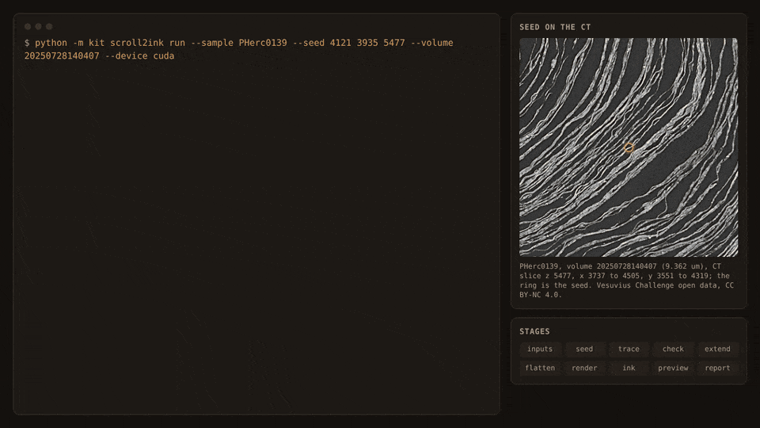

# scroll2ink: from a public scan and a seed point to an ink map, in one command

`kit scroll2ink` grows a surface from one seed point with VC3D, checks it, extends, flattens and renders it, and runs an ink model with the reverse-depth control, by calling Headless VC3D's tools in order and stopping when a check fails.

| Field | Value |
| --- | --- |
| Id | `scroll2ink` |
| Status | Experimental |
| Kind | kit command, kit module |
| Area | Pipeline and agents |
| Run | `python -m kit scroll2ink run`, `python -m kit scroll2ink status`, `from kit import scroll2ink` |
| Code | `kit/scroll2ink.py`, `kit/cli.py` (`cmd_scroll2ink`), `scripts/media/scroll2ink_replay.py` |
| Tests | `tests/test_scroll2ink.py` |
| Needs | Python 3.10 or newer, standard library only, for the command itself. Every step runs in [Headless VC3D](https://github.com/ChaseHendrick/Scrolls/tree/submission/progress-2026-10-vc3d-agent-1-1-1/submissions/progress-2026-10-vc3d-agent-1-1-1/vc3d-agent) 1.1.1 (`vc3d-agent`, Python 3.11 or newer), with villa's VC3D command line tools (`VC_APPIMAGE` or `VC_BIN`) and, for the ink step, a Python with torch and villa's `vesuvius` package (`KIT_INK_PYTHON`). The extend step needs `vc_extend_edge`, which villa's releases do not ship yet (fork branch `vc3d-auto-extend`); without it the step is skipped. The replay script needs numpy |
| Runs on | Linux on Hugging Face Jobs, 25 October 2026: the VC3D part on `cpu-xl` and the ink part on one L4 (`l4x1`), with villa's tools from a cached build of `e0bbb8b` with its grid-cache and growth time-limit patches and `vc_extend_edge` from the fork branch `vc3d-auto-extend`. Not yet run on a Mac or with a villa release |
| Network | Through Headless VC3D: the open-data bucket `vesuvius-challenge-open-data` over HTTPS (catalog, CT chunks, the surface prediction and its normal grids) and Hugging Face for the ink checkpoint the first time (`fetch_model`). The command itself contacts nothing |
| Writes | One run folder, by default `work/scroll2ink/SAMPLE-VOLUME-X_Y_Z/` under the repository (or `KIT_HOME`): `settings.json`, `state.json`, `trace/`, `check-trace/`, `extend/`, `check-extend/`, `flat/`, `render/` (the surface volume, a zarr), `ink/` (maps, `ink.json`), `previews/*.png`, `summary.json`, `report.md`. Headless VC3D's own caches go under its kit home (`work/vc3d/`) |
| Go-ahead | Not needed to run it on your own machine. Renting compute for it, or posting its pictures, needs the user's yes as usual |
| Released | Public `main`, experimental, since 2026-10-24 |
| Checked | 2026-10-25 against commit `a0d1cd0` |

## What it does

villa's pipeline from a CT scan to an ink map is a chain of separate tools: place a seed on the surface prediction, grow a surface from it (`vc_grow_seg_from_seed`), look at it, flatten it (`vc_flatten`), render a stack of layers along it (`vc_render_tifxyz`), then run an ink model on that stack. `scroll2ink` runs that chain from one command line, on any public scan whose surface prediction is in the open-data catalog. It takes a sample (such as `PHerc0139`) and a seed point in the scan's level-0 voxels, and finds the rest: the CT volume, the surface prediction and its normal grids, the voxel size and the render preset.

It does not run any VC3D or ink code of its own. Each stage is one tool of Headless VC3D (the `vc3d-agent` package), which calls villa's command line tools and villa's ink inference and checks what they return: `seed_check`, `trace`, `check_surface`, `extend`, `flatten`, `render`, `ink` and `preview`. What `scroll2ink` adds is the order, the stops and the record. A seed off the prediction or on air stops the run before the trace. A grown surface that crosses itself or does not sit on a sheet (`check_surface` says `look closer`) stops it before anything is rendered. An extension past the trace's edges is kept only when it passes the same check; otherwise the checked trace goes on. The ink step always makes the reverse-depth map beside the forward one.

A run lives in one folder. `settings.json` fixes the scientific settings at the first call, and a later call with other settings is refused, so a result already seen is never mixed with a new one. `state.json` records each stage; a finished stage is never repeated, so an interrupted run resumes, and a run can be split across machines: `--until render` on a CPU machine with VC3D, then the same command where a GPU is, with `--device cuda` (the device and thread count may change between parts).



Real data render: the PHerc0139 demo run, replayed from its logs (CT only; the surface and maps stay numbers). Vesuvius Challenge open data, CC BY-NC 4.0.

Status Experimental: one demo run on PHerc0139 so far (below), no comparison against another tool, and the default settings are not tuned. The trace is a small patch around one seed, not a whole winding. An ink map is model output, not a reading; on PHerc0139 the released ink models were trained on this scroll, so a map there shows that the chain works, not that a model finds ink it has not seen.

## When to use it

- You want an ink map of a new place on a public scan, from a seed you picked in a viewer, without running each tool by hand.
- You want an agent or a script to run the whole chain and read one JSON summary (`--json`) or one run folder.
- You want to split the work between a CPU machine (VC3D) and a GPU machine (ink) without copying settings by hand.

Do not use it:

- To trace a whole scroll or a whole winding: use villa's own tracing workflow or AutoPipeline (`docs/tools/autopipeline.md`), which plans many seeds, budgets and checks.
- To score an ink model: use `kit auc` with the reverse map as the control, on a segment with published labels.
- For ink on a prize-eligible scan without a preregistered experiment: the ink step refuses, as Headless VC3D's `ink` tool does for a target (`--experiment SLUG`, made with `python -m kit run init`).

## Quick start

Install Headless VC3D once (its README has the details), then run the chain on PHerc0139, a public scan on no prize list:

```bash
git clone --branch submission/progress-2026-10-vc3d-agent-1-1-1 --depth 1 https://github.com/ChaseHendrick/Scrolls.git vc3d-agent-src
python3 -m venv .venv && . .venv/bin/activate
pip install -e "vc3d-agent-src/submissions/progress-2026-10-vc3d-agent-1-1-1/vc3d-agent[maps]"
export VC_APPIMAGE="$(python vc3d-agent-src/submissions/progress-2026-10-vc3d-agent-1-1-1/vc3d-agent/scripts/get_vc3d.py)"
export KIT_INK_PYTHON=/path/to/python-with-torch-and-vesuvius     # only for the ink step

python -m kit scroll2ink run --sample PHerc0139 --seed 4121 3935 5477 --until render     # CPU part
python -m kit scroll2ink run --sample PHerc0139 --seed 4121 3935 5477 --device cuda      # ink, previews, report
python -m kit scroll2ink status work/scroll2ink/PHerc0139-auto-4121_3935_5477
```

The seed `4121 3935 5477` (x, y, z) is a point of published segment w035 in volume `20250728140407` (9.362 µm); `seed_check` found it on the m7 surface prediction (value 255) and on papyrus. The first command prints one line per stage, such as:

```
run folder /tmp/s2i/s2i-0139f
[1/10] inputs   done in 1 s: 20250728140407-9.362um-1.2m-113keV-masked.zarr, 9.362 um; umbilicus: 20260102150214's published umbilicus, mapped through the catalog transform
[2/10] seed     done in 1 s
[3/10] trace    done in 136 s: 4.806 cm2
[4/10] check    done in 30 s: ok, 5 of 5 windows seated
[5/10] extend   done in 68 s: the extension failed check_surface (look closer: 12 grid edges are over 4x the median length (spikes or jumps); 734 transverse self-intersections (the trace pas
[6/10] flatten  done in 2 s
[7/10] render   done in 36 s: [28, 2420, 2381]
stopped after render; the same command resumes from the next stage
```

It worked when the last stage prints `report   done` and `summary.json` names a surface, a render and two maps (`f` forward, `r` reversed). `--dry-run` prints the run folder and the settings without running anything.

## Checks and controls

- **Seed:** `seed_check` must find the seed on the surface prediction (at or above 128 within 8 voxels) and the CT around it on papyrus, not air; otherwise the run stops (`--snap-seed` moves it to the nearest point on the prediction).
- **Surface:** `check_surface` over `--check-windows` windows (default 5) must say `ok`: no transverse self-crossings, the normal's sign clear against the umbilicus, and the surface seated on a sheet in every window (the center layer brighter than layers a gap away on both sides). Anything else stops the run before the render; `--force` goes on and records the verdict. One finding does not stop it: `+N points toward the center`, when an umbilicus is known, because the render then votes its layer order from the same normal; it is kept under `notes` in `state.json`. The tests show both outcomes with a stand-in tool.
- **Extension:** the extended surface gets the same check; when it fails, the run goes on with the checked trace and `state.json` says why.
- **Layer order:** the render's `--flip-normals` flag is voted from the surface's own normal against the umbilicus, not assumed (How it works, step 7); `state.json` keeps the vote under `render.orientation`.
- **Ink:** the forward map always comes with the reverse-depth control, and the previews show both on one fixed 0 to 255 scale, so a map that looks the same reversed is visibly not ink. `ink.json` (Headless VC3D's record) keeps each map's statistics and the forward against reverse comparison, which `summary.json` copies.

What the checks cannot catch: a surface that is seated on a sheet but has jumped to a neighboring sheet part way (touching sheets) can pass `check_surface`.

Claim label: Model output, for every surface and map the chain makes (the surface is grown on a model's surface prediction; the maps are an ink model's); Interpretation, for what a check's verdict means.

## Commands and options

### `python -m kit scroll2ink run`

```
usage: python -m kit scroll2ink run [-h] --sample SAMPLE --seed X Y Z
                                    [--volume VOLUME]
                                    [--prediction PREDICTION]
                                    [--normal-grids NORMAL_GRIDS] [--out OUT]
                                    [--until {inputs,seed,trace,check,extend,flatten,render,ink,preview,report}]
                                    [--generations GENERATIONS]
                                    [--trace-minutes TRACE_MINUTES]
                                    [--extend-rounds EXTEND_ROUNDS]
                                    [--extend-cells EXTEND_CELLS]
                                    [--check-windows CHECK_WINDOWS]
                                    [--model MODEL] [--device DEVICE]
                                    [--threads THREADS]
                                    [--umbilicus UMBILICUS] [--snap-seed]
                                    [--force] [--experiment EXPERIMENT]
                                    [--agent AGENT] [--dry-run] [--json]
```

| Option | Default | Meaning |
| --- | --- | --- |
| `--sample SAMPLE` | required | open-data sample, such as PHerc0139 |
| `--seed X Y Z` | required | seed point in level-0 voxels of the volume |
| `--volume VOLUME` | none | volume id (default: the first with a surface prediction and normal grids) |
| `--prediction PREDICTION` | none | surface prediction zarr (folder or URL) in the volume's frame, instead of the catalog's; give its --normal-grids too, or the tracer ignores it |
| `--normal-grids NORMAL_GRIDS` | none | that prediction's normal grids (a vc_gen_normalgrids folder or URL) |
| `--out OUT` | none | run folder (default work/scroll2ink/SAMPLE-VOLUME-X_Y_Z) |
| `--until UNTIL` | none | stop after this stage (resume later with the same command) |
| `--generations GENERATIONS` | `200` | tracer generations (default 200) |
| `--trace-minutes TRACE_MINUTES` | `60` | trace time limit; a stopped trace keeps its last snapshot (default 60) |
| `--extend-rounds EXTEND_ROUNDS` | `4` | vc_extend_edge rounds, 0 to skip (default 4) |
| `--extend-cells EXTEND_CELLS` | `10` | cells per side per round (10) |
| `--check-windows CHECK_WINDOWS` | `5` | check_surface windows spread over the surface (default 5) |
| `--model MODEL` | `reader-v2` | ink model known to vc3d-agent (reader-v2, ink_9um-seed42, ink_9um-seed43, d9v2, v8in) |
| `--device DEVICE` | `cpu` | ink device: cpu (default), cuda or mps (may change on resume) |
| `--threads THREADS` | none | threads for each tool (may change on resume) |
| `--umbilicus UMBILICUS` | none | umbilicus file or URL in this scan's frame, for the layer order (default: the catalog's, else another scan's mapped through the catalog transform) |
| `--snap-seed` | off | move a seed off the prediction to the nearest point on it |
| `--force` | off | go on when check_surface does not say ok |
| `--experiment EXPERIMENT` | none | preregistered experiment slug: required for ink on a prize-eligible scan |
| `--agent AGENT` | none | command that runs Headless VC3D (default $SCROLL2INK_AGENT or vc3d-agent) |
| `--dry-run` | off | print the run folder and settings; run nothing |
| `--json` | off | print the summary as JSON |

The stages, in order: `inputs`, `seed`, `trace`, `check`, `extend`, `flatten`, `render`, `ink`, `preview`, `report`. `--threads` is passed to every tool except the tracer, which keeps Headless VC3D's default of at most 4 (it does not scale past a few). A tracer built without villa's time limit is stopped by the tool's timeout, `--trace-minutes` plus 300 s, and keeps its last snapshot (one every 10 generations).

### `python -m kit scroll2ink status`

```
usage: python -m kit scroll2ink status [-h] [--json] dir
```

| Option | Default | Meaning |
| --- | --- | --- |
| `dir` | required | a run folder |
| `--json` | off | print the run's summary (the same fields as `summary.json`) instead of one line per stage |

### `python scripts/media/scroll2ink_replay.py`

```
usage: scroll2ink_replay.py [-h] [--out-dir OUT_DIR] [--ct-window CT_WINDOW]
                            [--publish SHOTS] [--assets ASSETS] [--meta META]
                            [run_dir]
```

| Option | Default | Meaning |
| --- | --- | --- |
| `run_dir` | none | a run folder, or the folder the HF Jobs runner copied out (its `run/` plus the timed logs `scroll2ink-vc.log` and `scroll2ink-ink.log`); needed unless `--publish` |
| `--out-dir OUT_DIR` | none | where `replay.html`, `ct.png`, `actions.json`, `stills.json` and `facts.json` go (not under `docs/assets/`); needed with `run_dir` |
| `--ct-window CT_WINDOW` | `384` | half width of the CT slice through the seed, in voxels |
| `--publish SHOTS` | none | copy the stills `capture_web.py` took into SHOTS (`scroll2ink-end.png`, `scroll2ink-trace.png`) to `--assets`, each with its sidecar, under the public media rule's guards |
| `--assets ASSETS` | none | where `--publish` puts the stills, such as `docs/assets/scroll2ink` |
| `--meta META` | none | the clip's meta JSON (`scripts/media/captures/scroll2ink-run.meta.json`): label, data, sources and caption for the stills' sidecars |

Then `capture_web.py` takes frames (`actions.json`) and stills (`stills.json`) of the page and `encode.py` makes the GIF and MP4 (see the media tools' page, [`media.md`](media.md)).

### Environment variables

| Variable | Default | Meaning |
| --- | --- | --- |
| `KIT_HOME` | the repository folder | where the default run folder `work/scroll2ink/` goes |
| `SCROLL2INK_AGENT` | unset | the command that runs Headless VC3D, split like a shell line (used when `--agent` is not given), such as `env -C /opt/vc3d-agent python3 -m kit` |

Headless VC3D reads its own: `VC_APPIMAGE` or `VC_BIN` (villa's tools), `KIT_INK_PYTHON` (the Python with torch and `vesuvius`), and the tracer's cache settings (`VC_GRID_CACHE_BYTES` on villa main, `VC_NORMAL_GRID_CACHE` on a patched villa `e0bbb8b`).

## Python API

| Function | Returns | Raises | Notes |
| --- | --- | --- | --- |
| `Scroll2InkError()` | | | A stage could not run or its result failed a check; the message says which and why. |
| `eligible_prizes(sample, snapshot=None)` | list of prize ids | | The prizes whose eligible list holds `sample` in the dated snapshot (`kit/data/prizes-*.json`); a scroll named without its A or B part counts when either part is listed |
| `agent_command(given=None, env=None)` | argv list | `Scroll2InkError` when nothing is found | `--agent`, else `$SCROLL2INK_AGENT`, else `vc3d-agent` on PATH |
| `call(agent, tool, args, log=None)` | `(exit, result dict)` | `Scroll2InkError` when the program cannot start | One `vc3d-agent vc3d call TOOL JSON`; exit 0 success, 1 a tool that ran and failed, 2 bad arguments or a refusal |
| `pick_volume(volumes, wanted=None)` | `(volume, prediction_url, normal_grids_url)` | `Scroll2InkError` | From a `catalog volumes` result; pure |
| `given_prediction(pred, grids, settings)` | `(prediction, normal_grids, source)` | | `--prediction` (with only `--normal-grids` as its grids) or `--normal-grids` over the catalog's pick; pure |
| `preset_for(voxel_um)` | `"9um"`, `"2um"` or `"1um"` | | Headless VC3D's render preset for a voxel size; pure |
| `run_dir(root, sample, volume, seed)` | `Path` | | The default run folder name |
| `Run(folder, settings=None, runtime=None)` | a run | `Scroll2InkError` on changed settings or a folder that is not a run | `settings.json`, `state.json`, `record()`, `done()` |
| `stage_inputs`, `stage_seed`, `stage_trace`, `stage_check`, `stage_extend`, `stage_flatten`, `stage_render`, `stage_ink`, `stage_preview` | the stage's record (a dict) | `Scroll2InkError` | One stage each; `stage_extend` returns `(status, record)` |
| `find_umbilicus(run, agent, log, volumes, vol)` | `{"umbilicus", "umbilicus_from", ...}` | | The umbilicus the layer order is voted against, as the inputs stage records it; writes `umbilicus.json` when it maps another scan's |
| `parse_umbilicus(text)` | `[(x, y, z, score)]` | `ValueError` | villa's umbilicus JSON (`control_points` or `points`, objects or `[z, y, x]`) or text lines `z, y, x`; pure |
| `invert_affine(m)`, `apply_affine(m, x, y, z)` | 3x4 matrix, `(x, y, z)` | `ValueError` for a singular matrix | The catalog's `matrix_xyz` transforms; pure |
| `map_umbilicus(rows, transforms, target)` | `(volume, url, matrix)` or `None` | | Another volume's umbilicus that the catalog's transforms carry into `target`'s frame; pure |
| `read_text(src, timeout=60)` | text | `OSError` | A local file or an HTTP(S) URL |
| `check(agent, log, surface, inp, windows, out)` | `{"verdict", "findings", "seated_windows", "seating", "selfcross"}` | `Scroll2InkError` | `check_surface` on the scan's CT |
| `summary(run)`, `report_md(sm)` | dict, Markdown text | | What `summary.json` and `report.md` hold |
| `execute(run, agent, until=None, say=print, log=None)` | the summary dict | `Scroll2InkError` at the first failed stage (recorded as failed) | Every stage not yet done, up to and including `until` |
| `settings_from(args)` | `(settings, runtime)` | | The fixed settings and the runtime options of parsed arguments; pure |
| `add_arguments(p)`, `run_cli(args, root=None)` | | | The command line |

## Inputs

- **Sample:** an open-data sample id as the catalog names it (`PHerc0139`, `PHerc0172`, `PHerc1667`, ...). It must have a volume with a surface prediction in the catalog; the default volume is the first whose prediction also has normal grids (on PHerc0139, `20250728140407`, 9.362 µm, with the m7 prediction `20260413222639`).
- **Seed:** x, y, z in level-0 voxels of that volume, the order VC3D and villa's tracer use. Pick it on the surface prediction in VC3D or Headless VC3D's `seed_check`, or take a vertex of a published segment in the same frame (`fetch_segment`).
- **Agent:** Headless VC3D 1.1.1 or newer, with villa's tools. A villa build from before 15 October 2026 (`e0bbb8b` and older) has a 512-grid normal cache that makes wide traces about ten times slower; villa's current releases do not (villa PR #2007).

## Outputs

It prints one line per stage, `[N/10] STAGE  STATUS in S s: DETAIL`, then the area, the check and the report path (or, with `--until`, that it stopped). With `--json`, progress goes to stderr and stdout is the summary:

| Field | Type | Meaning |
| --- | --- | --- |
| `sample`, `volume`, `voxel_um`, `seed` | string, string, number (µm), [x, y, z] | What ran |
| `surface`, `area_cm2` | path, number (cm²) | The surface that was flattened and rendered: the extension when it was kept, else the trace |
| `extension_kept` | bool or null | Whether the extension passed its check |
| `check` | string | `check_surface`'s verdict on the trace (`ok` or `look closer`) |
| `render` | path | The surface volume (zarr) |
| `ink_maps` | `{"f": path, "r": path}` | Forward map and reverse-depth control |
| `ink_comparison` | dict | Headless VC3D's forward against reverse comparison, from `ink.json` |
| `previews` | dict of PNG paths | `layers_max`, `layer_mid`, `ink_forward`, `ink_reverse` |
| `seconds`, `stages` | dicts by stage | Wall seconds and status of each stage |

`state.json` holds every stage's full record (each tool's paths, verdicts, findings, stop reasons and errors).

| Exit code | Meaning |
| --- | --- |
| `0` | Every stage asked for is done (or skipped by rule), or `status` read the folder |
| `1` | A stage failed or a check stopped the run; the message and `state.json` say which and why |
| `2` | Bad arguments, or `status` on a folder that is not a run |

## Failure modes

| What you see | Why | What to do |
| --- | --- | --- |
| `usage: ...` then `error: ...` on stderr, exit code 2 | A missing or wrong argument | Check the command against Commands and options |
| `Headless VC3D (vc3d-agent) not found:...` | No `--agent`, no `$SCROLL2INK_AGENT` and no `vc3d-agent` on PATH | Install it as the message says, or pass `--agent` |
| `no volume of...has a surface prediction with normal grids; name one with --volume` | The catalog lists no prediction with normal grids for this sample | Pass `--volume` for a volume with a prediction; the trace then runs without grids, which `trace` warns makes it read only the prediction |
| `volume...is not in the catalog of...` | A `--volume` the catalog does not list | Use an id from `vc3d-agent vc3d call catalog '{"action": "volumes", "sample": "S"}'` |
| `volume...has no surface prediction in the catalog` | That volume has no prediction to trace on | Use another volume |
| `seed_check:...` | The check could not read the prediction or the CT (a missing package such as numcodecs, or the network) | Fix what the message names |
| `the seed is not on the surface prediction or not on papyrus (nearest point on it:...,...voxels away; CT says...). Move it, or pass --snap-seed` | The seed is off the predicted surface, or on air | Move it to the nearest point printed, or pass `--snap-seed` |
| `trace:...(log...)` | The tracer wrote no surface (no seed found, an area under its minimum, or a crash) | Read the log it names; try another seed |
| `check_surface:...` | The check could not run (a missing tool or file) | Fix what the message names |
| `check_surface says...:.... The surface may have left its sheet, so it is not rendered; try another seed, or --force to go on` | The trace crossed itself or is not seated on a sheet in every window | Try another seed; `--force` only to look at a failed surface |
| `...is prize-eligible (...): ink on it needs a preregistered experiment, --experiment SLUG (python -m kit run init)` | Ink on a prize-eligible scan needs its readout fixed first | Preregister with `python -m kit run init` and pass `--experiment` |
| `fetch_model...:...` | The ink checkpoint did not download | Check the network, or register a checkpoint with Headless VC3D's `models` tool |
| `ink:...` | The ink run failed (out of memory, no torch, no `vesuvius`) | Read the log tail it prints; set `KIT_INK_PYTHON` |
| `...was started with other settings (...); use a new --out folder, so a result already seen is never mixed with new ones` | Same folder, different scientific settings | Use a new `--out` |
| `...is not a scroll2ink run folder (no settings.json)` | `status` on another folder | Pass a run folder |
| `could not start...:.......` | The agent command does not exist | Fix `--agent` |
| `scroll2ink:...` | Any of the above, as the run command's last line | Read the message; `status` shows the stage |
| `give RUN_DIR and --out-dir (or --publish SHOTS --assets DIR --meta META)` or `--publish needs --assets and --meta` (replay script), exit code 2 | A missing argument | Give what the message names |
| `: expected an uncompressed uint8 zarr, got` (replay script) | The CT volume's level 0 is compressed or not uint8, which the slice reader does not decode | Use a volume stored as raw uint8 chunks, as PHerc0139's 9.362 µm volume is |
| `render:...team order needs one clear normal sign...` | The flat surface's normal points both ways against the umbilicus (a surface that folds over, or a wrong umbilicus) | Try another seed, or check the umbilicus; Headless VC3D's `orientation` tool shows the vote |
| Render warning `team order taken from VC3D's usual flag, not checked against an umbilicus` | No umbilicus for this scan or any scan the catalog's transforms reach | Pass `--umbilicus`; otherwise check the forward map against its reverse control before trusting the order |
| `umbilicus` is `none:...umbilicus has no points` in `state.json`, or `umbilicus entry...is neither [z, y, x] nor an object with x, y, z`, or `...the transform is singular` | The other scan's umbilicus file could not be read, or the catalog transform cannot be inverted; the run goes on without an umbilicus | Pass `--umbilicus` with a file in this scan's frame |
| `extend` skipped, `this VC3D build has no vc_extend_edge` | villa's releases do not ship `vc_extend_edge` yet | Nothing; the trace goes on unextended |

## How it works

1. `inputs`: Headless VC3D's `catalog volumes` lists the sample's volumes; `pick_volume` takes `--volume` or the first with a prediction whose normal grids are listed, and keeps the CT URL, the prediction, the grids and the voxel size; `--prediction` replaces the prediction (with only `--normal-grids` as its grids, never the catalog model's) and `--normal-grids` alone replaces the grids. The sample is looked up in the dated prize snapshot. Then the umbilicus (the scroll's central axis) for the layer order: `--umbilicus`, else the catalog's for this volume, else the first other volume of the sample with a published umbilicus that `catalog transforms` links to this one; its control points go through that affine (inverted when the catalog lists it only the other way) into `umbilicus.json` in the run folder. With none, the render falls back to VC3D's usual flag and warns.
2. `seed`: `seed_check` with the CT and the growth-horizon triage (`horizon`, report only).
3. `trace`: `trace` in seed mode with the normal grids, `--generations` (200), a snapshot every 10 generations, villa's time limit at `--trace-minutes` (60) and the tool's timeout 300 s later.
4. `check`: `check_surface` on the CT, `--check-windows` windows, with the umbilicus.
5. `extend`: `extend` (`vc_extend_edge`) on the checked trace, normals from the same surface prediction, `--extend-rounds` (4) of `--extend-cells` (10) on all four sides, then `check_surface` again.
6. `flatten`: `flatten` (`vc_flatten`, ABF++, Headless VC3D's default 10 iterations).
7. `render`: `render` with the preset for the voxel size (`9um`: 28 layers one voxel apart in Headless VC3D 1.1.1, as the published 9.362 µm renders), cropped to the surface, in the team's layer order. With an umbilicus, Headless VC3D decides the `--flip-normals` flag from an area-weighted vote of the flat surface's normal against it, and refuses a surface with no clear sign; without one it uses VC3D's usual flag, which assumes the normal points away from the center as on villa's published segments. A surface grown from a seed need not: the first PHerc0139 demo run had its normal pointing inward on all of its area, so the usual flag reversed its layers and the forward map came out as the control.
8. `ink`: `fetch_model` the first time, then `ink` with variants `f` and `r` (purpose `benchmark` on a scan on no prize list, `target` with `--experiment` on an eligible one).
9. `preview`: `preview` of the layers' maximum and middle layer, and of both maps on 0 to 255.
10. `report`: `summary.json` and `report.md`.

## Cost and time

Measured on the PHerc0139 demo (seed `4121 3935 5477`, `--generations 60`, everything else default), 25 October 2026, Hugging Face Jobs:

| Stage | Seconds | Where |
| --- | --- | --- |
| inputs, seed | 1, 1 | `cpu-xl` |
| trace (60 generations, 4.8 cm2) | 136 to 165 over four runs | `cpu-xl`, villa `e0bbb8b` with its normal grid cache raised (`VC_NORMAL_GRID_CACHE=8192`) |
| check (5 windows) | 30 | `cpu-xl` |
| extend (4 rounds, then its check) | 68 to 70 | `cpu-xl`; the extension failed its check in both runs that had `vc_extend_edge`, so the trace went on |
| flatten | 2 | `cpu-xl` |
| render (28 x 2420 x 2381) | 36 to 39 | `cpu-xl` |
| ink, `reader-v2`, forward and reverse | 38 | one L4 |
| preview, report | 18, 0 | one L4 |

The two Jobs, start-up included, ran 306 s (`cpu-xl`) and 202 s (`l4x1`) and cost 0.10 and 0.05 USD by Hugging Face's billing. The whole development of the command, six CPU runs and two GPU runs with their smoke tests, cost 1.09 USD.

The trace is the slow part and grows with the generations: 200 generations made 56.1 cm2 in 1,873 s on the same machine, and `check_surface` stopped that one (101,936 transverse self-crossings, 4 of 5 windows seated), which is why the demo grows 60. On villa `e0bbb8b` without the larger normal grid cache the tracer took about 30 s a generation; villa's releases since 15 October do not need the patch (villa PR #2007).

What the demo's ink step reported (Model output; `ink.json`): above the threshold, 43.5 % of the forward map against 6.3 % of the reverse control; means 0.490 and 0.364. The first runs, before the umbilicus vote, had these the other way round (8.1 % against 44.6 %), the sign of a reversed layer order. PHerc0139 is in the released 9 µm models' training data, so this shows the chain and its control working, not a model finding ink it has not seen; the maps were not scored against labels.

## For agents

- **Command:** `python -m kit scroll2ink run --sample SAMPLE --seed X Y Z --json` (add `--until render` for a CPU-only part, `--device cuda` for the ink part); `python -m kit scroll2ink status DIR --json`.
- **Parse:** stdout of `--json` is the summary: `stages` (status by stage), `check`, `area_cm2`, `render`, `ink_maps.f`, `ink_maps.r`, `previews`. `state.json` in the run folder has each stage's full record, with `error` on a failed one.
- **Rerun:** safe: finished stages are skipped and nothing is overwritten; a failed stage runs again. Changing a scientific setting needs a new `--out`.
- **Success:** exit 0 and `stages.report == "done"`, with `check == "ok"` and both maps present.
- **Not a pass:** a run with `--force` after `look closer`; a map on a segment or scroll the model trained on (PHerc0139 for the released 9 µm models) read as evidence that the model finds ink; a forward map that looks like its reverse control.
- **Go-ahead:** Nothing to run it; renting compute and posting pictures follow the repository's rules (AGENTS.md hard rules 8 and 11).
- **Never:** call an ink map a reading; run the ink step on a prize-eligible scan without a preregistered experiment; put its maps or surfaces in public Git (public media rule).

## Tests

`python -m unittest tests.test_scroll2ink -v`: the whole chain against a stand-in Headless VC3D that records every call (the order of tools, the prediction with normal grids chosen over the first listed, the extension's normals, the preset, both ink variants), a split run that resumes at the ink step with a new device, a refused settings change, another scan's umbilicus carried into this scan's frame through an inverted catalog transform and passed to `check_surface` and `render`, `--umbilicus` winning over the catalog, a bad seed stopping before the trace, a failed check stopping before the render, a failed extension dropped for the trace, a build without `vc_extend_edge`, a failed ink run recorded, the prize-eligible refusal, `status`, `--dry-run`, and the pure helpers. They do not run VC3D or an ink model; the demo run below does.

## History

- 2026-10-24: First version (`28edf55`); a tracer without villa's time limit is stopped at the tool's timeout (`9bf01e2`).
- 2026-10-25: The layer order is voted against the scroll's umbilicus, carried from another scan through the catalog transform when the scan has none of its own; the demo's first ink maps had come out reversed (`a0d1cd0`). The demo run on PHerc0139, and the replay GIF, MP4 and stills in `docs/assets/scroll2ink/`.
- 2026-10-25: `--prediction` and `--normal-grids` trace on a surface prediction the catalog does not list, such as a binarized copy of a second model with grids made by `vc_gen_normalgrids`, for the crowd-trace merger's mixed-method crowd (`17c842b`).

## Related

- Headless VC3D 1.1.1, the tools every stage calls: its README on branch `submission/progress-2026-10-vc3d-agent-1-1-1`.
- [`autopipeline.md`](autopipeline.md): the whole-scan pipeline, with seeds, budgets and scoring.
- [`plan.md`](plan.md): `kit plan` prints the tutorial's commands for one scroll without running them.
- [`../media/README.md`](../media/README.md): why the replay GIF shows CT and numbers only.
