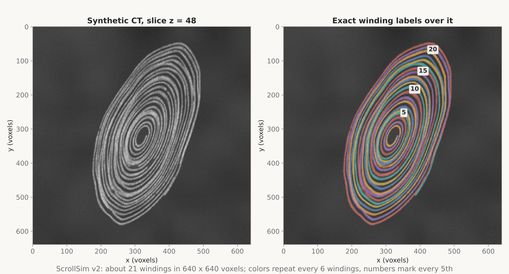
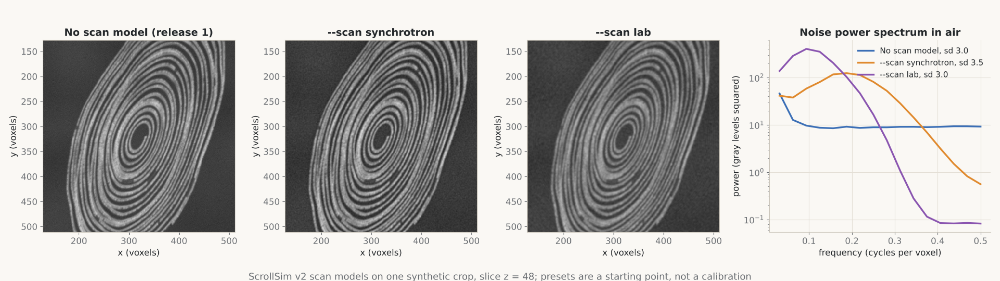
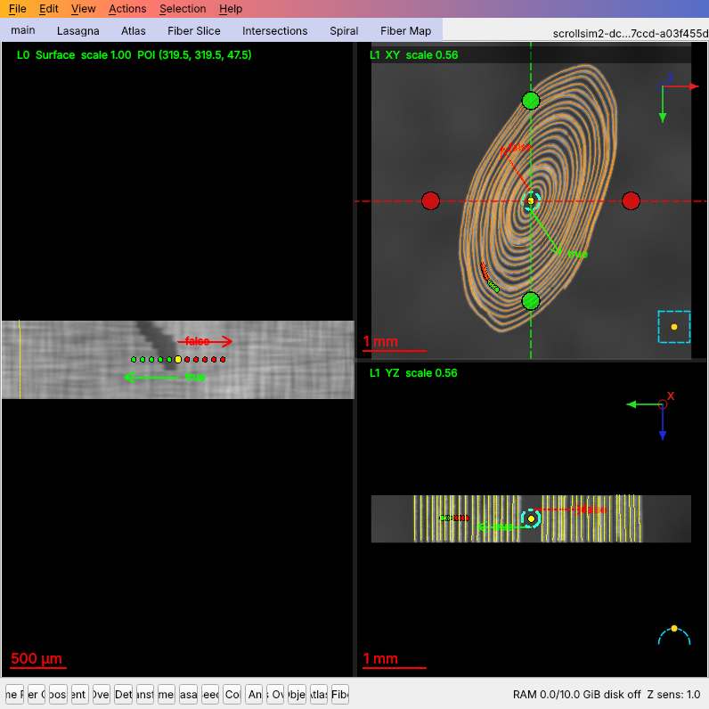

# scrollsim2: a full-scale synthetic scroll with exact truth

ScrollSim v2 renders a synthetic rolled, pressed and crushed papyrus scroll at full scale (100 plus windings), block by block and in parallel, as an OME-Zarr pyramid with an exact winding label volume and optional tifxyz surfaces.

| Field | Value |
| --- | --- |
| Id | `scrollsim2` |
| Status | Experimental |
| Kind | kit module |
| Area | Surfaces and tracing |
| Run | `python -m kit.scrollsim2 make`, `estimate`, `pyramid`, `verify`, `publish`, `vc3d`, `nps`, `info`; library `from kit import scrollsim2` |
| Code | `kit/scrollsim2.py` |
| Tests | `tests/test_scrollsim2.py` |
| Needs | Python 3.10 or newer, numpy, scipy (ndimage), zarr 3 for `make` (it writes zarr format 2); all in `pip install -e ".[maps]"`. No scroll data |
| Runs on | CPU, any core count (forked workers, at most 16 by default). Smoke scroll (64 x 208 x 208, 4.8 turns): 7.2 s wall on 4 workers, 98 MB peak per process (measured 2026-11-18, 4-core cloud container) |
| Network | None |
| Writes | `make OUT`: `OUT/ct.zarr`, `OUT/truth/labels.zarr`, `OUT/truth.json`, `OUT/truth/make-key.json`, `OUT/truth/done.txt`, and with `--surfaces` `OUT/truth/surfaces/spiral-center/` and `spiral-recto/`. `publish SRC DST`: a copy in `DST`. `pyramid OUT`: rewrites CT levels 1 and up. `vc3d SIM OUT`: `OUT/scrollsim2.volpkg.json`, `OUT/volumes/` (links, or copies with `--copy`), `OUT/paths/` |
| Go-ahead | Not needed on a local CPU. A rented run follows hard rule 11 |
| Released | Public `main` since 2026-11-18 |
| Checked | 2026-11-18 against commit `424fb42` |

## What it does

Tracers and winding tools are hard to score on real scrolls: the true winding of every voxel is unknown. ScrollSim v2 makes a synthetic scroll where it is known exactly. It rolls one sheet into a spiral around the z axis, presses neighboring windings together in smooth contact zones, crushes the roll along one axis and bends it with a smooth displacement field, then renders a CT-like volume: two fiber plies per winding, holes, delamination, blur, a slow brightness drift, optional rings and noise, 8 bits. An optional CT scan model adds the effects of a real scan: phase contrast with Paganin retrieval, a noise spectrum shaped like filtered back-projection's (or measured from real CT), beam-hardening cupping, rings about the rotation axis and acquisition slabs.

What works today:

- **Full-scale geometry.** A whole cross-section of about 125 windings (the `pilot` preset, 1,024 x 1,728 x 3,264 voxels). The turn just inside each voxel is found by binary search, so a voxel costs about log2(turns) lookups instead of one per turn; a test holds it equal to the slow all-turns lookup. Fiber textures come from small periodic tiles, so a sheet millions of voxels long fits in memory. A fixed crush axis (`alpha` 0) lets the box be about half as tall as wide.
- **Block-by-block rendering.** Every block renders with a halo that covers each filter, and noise is a hash of the voxel's position, so any block size gives the same volume bit for bit (test). Blocks that hold no sheet are detected and skipped. Workers write chunk-aligned blocks in parallel, each write is checked on disk, and a stopped run resumes where it left off.
- **Exact truth.** `truth/labels.zarr` holds every sheet voxel's winding number (plus 1; 0 is air), numbered from the center line with one step across a fixed half-plane. `--surfaces` writes the whole sheet's center and recto surfaces as tifxyz, each with `winding.npy`, the winding number of every vertex. `truth.json` records the parameters, turns, center line and render timings, and the same parameters always rebuild the same scroll.

- **CT scan model** (version 2 of the output, 2026-11-18). All off by default, so a release-1 render is unchanged bit for bit. `--scan synchrotron` and `--scan lab` switch on a starting set; `--set` tunes each part:
  - *Partial volume*: `supersample` averages sub-samples into each voxel.
  - *Phase contrast and Paganin retrieval* (`phase_mm`, `energy_kev`, `db_object`, `db_recon`, `voxel_um`): propagation adds edge contrast and the retrieval removes it with an assumed delta over beta. When the sheet's true value is higher than the assumed one, a bright rim stays at sheet edges; lower, and the edges blur. Without retrieval (`db_recon` 0) the raw fringes stay.
  - *Noise spectrum* (`nps`): noise summed from seven frequency bands, so it can be white, smooth, or ramp-shaped like filtered back-projection noise. `python -m kit.scrollsim2 nps CT.npy` measures a real crop's spectrum without labels and prints the matching `--set nps=[...]`.
  - *Beam hardening* (`cupping`): sheets lose contrast where the mean path through the roll is longest, so the middle of the roll is darker, as in lab scans.
  - *Rings and slabs* (`rings`, `axis_yx`, `slab_z`, `slab_gain`): rings centered on the rotation axis, and a scan taken in slabs of `slab_z` slices, each with its own gain step and ring pattern.
  - *Physical units*: `voxel_um` sets the OME-Zarr scale in micrometers (levels `voxel_um` x 2^level) and the VC3D export's voxel size.

- **Sheet physics** (stage S3, 2026-11-18). All off by default, so the CT and labels are unchanged bit for bit; each part has its own `--set` keys (Inputs). Labels stay the exact winding truth: a voxel is labeled when a winding's ply band holds it, as before.
  - *Short-scale waviness* (`wave_amp`, `wave_len`): each winding ripples radially with a peak wavelength of a few thicknesses, along z and along the sheet. The ripple is added to the radius grid when the scroll is built, so voxels, labels, surfaces and the center line read one geometry and stay exact.
  - *Kolleseis* (`kolle_every`, `kolle_len`, `kolle_jitter`, `kolle_thick`): glued joins between sheets, at jittered spacings along the sheet, where the sheet is about twice as thick over the overlap and its label band widens with it.
  - *Gap debris* (`debris`, `strands`, `dust`): small bright inclusions, loose fiber strands and fine dust in the gaps between windings, hashed by position. They are not sheet: their voxels keep label 0.
  - *Cracks* (`cracks`, `crack_len`, `crack_w`, `crack_depth`): thin breaks through the sheet that remove density along short lines on its face. A cracked voxel keeps its label, as a hole does, because the winding still passes there.
  - *Carbonization bubbles* (`bubbles`, `bubble_r`): small voids inside the sheet. Labels kept.
  - *Density variation between plies* (`ply_var`, `ply_var_len`): the recto and verso plies each get their own smooth density gain.

Ink is off in this release: the volume holds no ink and the label volume carries windings only.



*Synthetic demo: one slice of a 96 x 640 x 640 ScrollSim v2 scroll and its exact winding labels. No scan data.*


*Synthetic demo: the same seed without contacts, with contact zones (`contact_share` 0.45), and crushed and bent (`squash` 0.5, `warp` 5). The color step on the right of each spiral is where winding numbers go up by one, across the half-plane on the +x side of the center line. No scan data.*


*Synthetic demo: the center surface `make --surfaces` writes as tifxyz, colored by its exact winding number. No scan data.*


*Synthetic demo: a pass through z of the same scroll. No scan data.*



*Synthetic demo: one crop of the same scroll with no scan model, `--scan synchrotron` and `--scan lab`, and each one's noise power spectrum measured in air by `measure_nps`. The presets are a starting point, not a calibration. No scan data. All five are made by `python scripts/media/scrollsim2_demo.py --work WORK --out-dir docs/assets/scrollsim2`.*

What it is not: a calibrated stand-in for a real scroll. A score on its volumes is model output on synthetic data and says nothing about a real scroll. Never call an ink map made on it a reading.

## Realism: in progress

The volumes do not yet look or score like real CT. The CT scan model above gives the scan's side of realism the right kinds of effects, but its preset numbers are chosen by eye and from one published setup, not measured. The next steps, with no date promised:

- **Measured scan settings.** Measure the noise spectrum, point spread and edges of real open-data scans with `nps` and the label-free statistics, and set the scan model from them.
- **S2, real texture.** Copy real CT texture from Vesuvius Challenge open-data scans into the synthetic sheets and the gaps between them.
- **S3, more physics.** Add more physical detail, such as compression and delamination that behave the way they do in carbonized scrolls. A first group is in ("Sheet physics" above: waviness, joins, gap debris, cracks, bubbles, ply variation); its amplitudes and rates are guesses, not yet measured on real CT.
- **Goal: calibration.** Tune and check the simulator so that real ink readers and tracers score on it as they do on real scrolls. Until that check passes, a ranking of methods on ScrollSim v2 volumes is not evidence about their ranking on real scrolls.

## When to use it

- To test a tracer, a winding tool or a surface pipeline end to end on a volume whose windings and surfaces are known exactly.
- To check that a pipeline handles a full-scale volume (OME-Zarr levels, chunking, 100 plus windings) before it meets real data.
- To estimate a full render's time and memory before you start it (`estimate`).

Do not use it:

- To claim anything about a real scroll, or to rank methods for real scrolls: use published labels and the scorers in [auc](auc.md).
- To train a model meant for real CT: it is not calibrated yet (see above).
- For ink: ink is off in this release.

## Quick start

```bash
python -m kit.scrollsim2 make SIM --preset smoke --workers 4 --block 64 --chunk 64 --levels 2 --surfaces
python -m kit.scrollsim2 info SIM
```

- `SIM`: a new empty folder.

On 2026-11-18 in a 4-core container `make` printed one line of JSON with `"complete": true`, `turns` 4.77, `pressed_share` 0.2898, `surface_residual_vox` 2.8e-14 and `render` blocks 16, air blocks 2, seconds 6.8. It worked when it exits 0, `SIM/ct.zarr/0` has shape 64 x 208 x 208 and `SIM/truth/labels.zarr/0` holds several winding ids.

## Tutorials

Every command below was run on 2026-11-18 in a 4-core Linux container with Python 3.13, from a fresh clone of `main`; the printed numbers are from that run.

### Make your first synthetic scroll in 2 minutes

```bash
git clone --depth 1 https://github.com/ChaseHendrick/Scrolls.git
cd Scrolls
python3 -m venv .venv
. .venv/bin/activate
python -m pip install -e ".[maps]"
python -m kit.scrollsim2 make sim --preset smoke --workers 4 --block 64 --chunk 64 --levels 2 --surfaces
python -m kit.scrollsim2 info sim
```

`make` took about 6 s and printed `PROGRESS 16/16 blocks` on stderr; `info` prints `truth.json` without the center line. Then look inside with numpy, zarr and tifffile (all in `.[maps]`):

```bash
python - <<'EOF'
import numpy as np, tifffile, zarr
ct = zarr.open_group("sim/ct.zarr", mode="r")
labels = zarr.open_group("sim/truth/labels.zarr", mode="r")["0"]
print([ct[k].shape for k in sorted(ct.array_keys())])
print("windings in slice 32:", np.unique(labels[32])[1:].tolist())
tifffile.imwrite("slice-32.tif", ct["0"][32])
tifffile.imwrite("labels-32.tif", labels[32])
EOF
```

It printed `[(64, 208, 208), (32, 104, 104), (16, 52, 52)]` and `windings in slice 32: [1, 2, 3, 4, 5, 6]`. Labels are winding number plus 1 (0 is air). Open the two TIFFs in any image viewer, or `sim/ct.zarr` in an OME-Zarr viewer such as napari or Neuroglancer (viewers not tested here).

### Test a tracer against exact truth

The truth is the label volume, `sim/truth/labels.zarr/0`, and with `--surfaces` the whole sheet as tifxyz in `sim/truth/surfaces/spiral-center/` and `spiral-recto/`, each with `winding.npy` (the winding number of every vertex). Check a surface with the [tifxyz](tifxyz.md) tool:

```bash
python -m kit tifxyz check sim/truth/surfaces/spiral-center
```

It reports 0 holes and 0 folds, and flags about 36 percent of nodes as stretched: the grid is regular on the rolled sheet, and the crush stretches it in the volume. That is expected here, not an error.

To score a tracer, compare its winding numbers with the labels. Winding agreement below is the share of random voxel pairs, both on a sheet in the tracer's output and in the truth, whose predicted winding difference equals the true difference, so a tracer's own numbering offset does not matter. The shuffled control must score far lower. Save this toy tracer as `toy_tracer.py`; it sees only the CT and numbers each sheet voxel by how many sheets a straight ray from the center line crosses to reach it:

```python
"""A toy tracer and its winding agreement against ScrollSim v2's exact labels, on one z slice."""
import json
import sys

import numpy as np
import zarr
from scipy import ndimage

sim, z = sys.argv[1], int(sys.argv[2])
ct = np.asarray(zarr.open_group(f"{sim}/ct.zarr", mode="r")["0"][z]).astype(float)
truth = np.asarray(zarr.open_group(f"{sim}/truth/labels.zarr", mode="r")["0"][z]).astype(int) - 1   # -1 is air
cl = np.array(json.load(open(f"{sim}/truth.json"))["center_line"])
cx, cy = np.interp(z, cl[:, 2], cl[:, 0]), np.interp(z, cl[:, 2], cl[:, 1])

# The toy tracer sees only the CT: smooth, threshold halfway between the median and the bright sheets, then number each sheet voxel
# by how many sheets a straight ray from the center line crosses to reach it.
img = ndimage.gaussian_filter(ct, 1.0)
lo, hi = np.percentile(img, [50, 98])
sheet = img > (lo + hi) / 2
ys, xs = np.nonzero(sheet)
t = np.linspace(0, 1, 400)[:, None]
py = np.clip(np.rint(cy + t * (ys - cy)).astype(int), 0, sheet.shape[0] - 1)
px = np.clip(np.rint(cx + t * (xs - cx)).astype(int), 0, sheet.shape[1] - 1)
on = sheet[py, px]
pred = (on[1:] & ~on[:-1]).sum(0)                 # rising edges along the ray: sheets entered on the way out

# Winding agreement: for random pairs of voxels that both tools call sheet, how often the predicted winding
# difference equals the true one. Offsets do not matter, only relative windings. The control shuffles the
# predictions and must score far lower.
ok = truth[ys, xs] >= 0
p, w = pred[ok], truth[ys, xs][ok]
rng = np.random.default_rng(0)
i, j = rng.integers(0, len(p), (2, 200000))
i, j = i[i != j], j[i != j]                     # a voxel paired with itself would always agree
agree = float(np.mean((p[i] - p[j]) == (w[i] - w[j])))
q = rng.permutation(p)
control = float(np.mean((q[i] - q[j]) == (w[i] - w[j])))
print(json.dumps({"z": z, "sheet_voxels": int(len(p)), "winding_agreement": round(agree, 3),
                  "shuffled_control": round(control, 3)}))
```

```bash
python toy_tracer.py sim 32
python -m kit.scrollsim2 make sim-apart --preset smoke --set contact_share=0 --workers 4 --block 64 --chunk 64 --levels 1
python toy_tracer.py sim-apart 32
```

| Scroll | Winding agreement | Shuffled control |
| --- | --- | --- |
| `sim` (contact zones on, the default) | 0.466 | 0.160 |
| `sim-apart` (`contact_share` 0) | 0.792 | 0.169 |

Where windings touch, the toy tracer sees one sheet instead of two and loses count, so it scores much lower with contacts on. Put your own tracer's winding numbers in place of `pred` to score it the same way. These are scores on synthetic data (Model output about the simulator), not evidence about any real scroll.

### Render at full scale on many CPUs

Estimate first, then render with as many workers as you have cores (at most 16 by default; more rarely helps, since rendering is bound by memory bandwidth). `--block` must be a multiple of `--chunk`.

```bash
python -m kit.scrollsim2 estimate --set 'shape=[128,768,768]' --workers 4 --sample 2
python -m kit.scrollsim2 make big --set 'shape=[128,768,768]' --workers 4 --block 128 --chunk 64 --levels 3 --max-blocks 8
echo $?
KIT_JOB_DEADLINE=$(( $(date +%s) + 15 )) KIT_JOB_SPARE_S=5 \
  python -m kit.scrollsim2 make big --resume --set 'shape=[128,768,768]' --workers 4 --block 128 --chunk 64 --levels 3
python -m kit.scrollsim2 make big --resume --set 'shape=[128,768,768]' --workers 4 --block 128 --chunk 64 --levels 3
python -m kit.scrollsim2 verify big
```

- `estimate` printed 27.76 turns, 36 blocks, 28 with sheet, 5.8 s per sheet block and `wall_seconds_at_workers` 42.
- `--max-blocks 8` stopped after 8 of 36 blocks with `"stopped": "max_blocks"` and exit code 75: stopped early, resume it.
- With a deadline 15 s away and 5 s kept spare, the resumed run stopped by itself at 16 blocks with `"stopped": "deadline"` and exit 75. In a batch job, set `KIT_JOB_DEADLINE` to the epoch second the job's timeout ends, so the run stops cleanly and the next job resumes.
- The last resume rendered the rest, built the pyramid and printed `"complete": true` with `verified.ok` true; `verify` printed `"ok": true`. `--resume` needs the same parameters, block, chunk and levels: anything else is refused.

The `pilot` preset (1,024 x 1,728 x 3,264, about 125 windings) is a full cross-section; estimate it before you start it (see Cost and time).

### Publish a scroll to a bucket or Hugging Face dataset

Render to a local disk, then copy with `publish`. It copies with plain file writes, removes any `.partial` file a network mount left behind, and verifies every chunk at the destination:

```bash
python -m kit.scrollsim2 publish sim mounted-bucket/scrollsim2/sim
cp -r sim/truth/surfaces mounted-bucket/scrollsim2/sim/truth/
```

`publish` printed `"ok": true` and copied `ct.zarr`, `truth/labels.zarr` and `truth.json`; it does not copy the surfaces, hence the `cp`. `mounted-bucket/` stands for any mounted bucket path; here it was a local folder. If a copy through a mount loses chunks, `publish SRC DST --levels 1 2` copies just those levels again.

To put it in a Hugging Face dataset, upload the published folder with the `hf` command line (`pip install huggingface_hub`, then `hf auth login`):

```bash
hf upload USER/DATASET mounted-bucket/scrollsim2/sim sim --repo-type dataset
```

- `USER/DATASET`: your dataset repository.

The upload itself was not run here (it publishes, and needs your account); `hf upload --help` confirms the arguments. Say in the dataset card that the volumes are synthetic, made by ScrollSim v2, and are not real CT.

### Open a synthetic scroll in VC3D

`vc3d` turns a finished `make` into a folder that VC3D (villa's volume-cartographer) opens: the CT and the winding labels as two zarr volumes, each with the `meta.json` VC3D's volume loader reads (`type`, `uuid`, `width`, `height`, `slices`, and `voxelsize`), the truth surfaces as tifxyz segments, and a project file. Make the scroll with `--surfaces` to get the segments.

```bash
python -m kit.scrollsim2 vc3d sim sim-vc3d
cat sim-vc3d/scrollsim2.volpkg.json
```

It printed `"project_check": {"ok": true, "warnings": []}` and wrote:

```text
sim-vc3d/
  scrollsim2.volpkg.json                         the VC3D project (volumes and the segments folder)
  volumes/scrollsim2-dc047ccd-aaead708-ct/       CT levels (links into sim/ct.zarr), .zattrs, meta.json
  volumes/scrollsim2-dc047ccd-aaead708-labels/   winding labels (uint16, winding + 1, 0 air), meta.json
  paths/spiral-center/, paths/spiral-recto/      tifxyz segments with winding.npy
```

The level arrays are links into `sim`, so keep `sim` beside it or pass `--copy` for a standalone folder. `--voxel-um` (default 8) sets the voxel size VC3D uses for its scale bar and areas: the volume is synthetic and has no voxel size of its own.

In VC3D, open `sim-vc3d/scrollsim2.volpkg.json` (File, open a project). The CT and the label volume appear as two volumes, and the two surfaces as segments. Here VC3D was driven through its agent bridge rather than by hand, with the same calls the File menu and the segment list make (`volume.open`, `segments.attach`, `segments.activate`). It loaded both volumes, attached both segments and drew the center surface on every winding:



*Synthetic demo: a ScrollSim v2 scroll (96 x 640 x 640) exported with `kit.scrollsim2 vc3d` and opened in VC3D. No scan data.*

VC3D's command-line tools read the same folder. Rendering the label volume along the center surface with VC3D's own renderer, then comparing with the surface's `winding.npy`, checks that VC3D reads the volumes, the surface and their axis order the way they were written:

```bash
mkdir -p render-labels
./VC3D-7154682-2026-10-28-linux-x86_64.AppImage vc_render_tifxyz -v sim-vc3d/volumes/*-labels \
  -s sim-vc3d/paths/spiral-center --scale 1 -g 0 --cache-gb 2 --tif-output render-labels
python - <<'EOF'
import numpy as np, tifffile
r = tifffile.imread("render-labels/00.tif")
w = np.load("sim-vc3d/paths/spiral-center/winding.npy")
H, W = w.shape
s = r[np.ix_(np.rint(np.arange(H) * r.shape[0] / H).astype(int), np.rint(np.arange(W) * r.shape[1] / W).astype(int))]
ok = np.isfinite(w) & (s > 0)
print("vertices on a labeled voxel:", int(ok.sum()), "of", int(np.isfinite(w).sum()))
print("label read by VC3D == the vertex's winding + 1:", round(float(np.mean(s[ok] == w[ok] + 1)), 4))
EOF
```

It printed 5,540 of 6,392 vertices on a labeled voxel and 0.9973 agreement. Reading the TIFF needs `imagecodecs` (VC3D writes LZW). The renderer was run from the extracted AppImage (`squashfs-root/AppRun vc_render_tifxyz ...`), which dispatches to the same tool.

Which VC3D: this was tested with villa's VC3D build `7154682` of 28 October 2026, which opens `*.volpkg.json` projects. Villa's main branch since moved to `.vcproj` projects whose segments live in a `.vcobj` object store (villa `volume-cartographer/core/src/ProjectDocument.cpp`, read on 18 November 2026 at commit `8e21d01`). With such a build, create a project in VC3D, attach the two volume folders, and import `sim-vc3d/paths` with its Import from Folder dialog, or with villa's `vc_object_ingest --db STORE.vcobj --author NAME --surface sim-vc3d/paths`. The segments' `meta.json` `uuid` is already a canonical UUID, so no `--derive-uuids` namespace is needed. That newer route was not tested here.

## Checks and controls

The tests are the controls; each can fail:

- The binary-search turn lookup equals the reference all-turns lookup: same labels, density and angles to 1e-9 on three full slices.
- Rendering whole versus in eight blocks gives identical CT and labels, with noise, rings, correlated noise and the edge filter on.
- An air block skipped as air equals the same block rendered in full.
- Two `make` runs with different block sizes and worker counts give identical pyramids; a run stopped after 7 blocks, then stopped by a deadline, then resumed, equals one uninterrupted run.
- A chunk file that never lands on disk is caught by `verify` and by the write check, and `pyramid` repairs a lost pyramid chunk.
- Surface vertices map back onto the rolled sheet with a residual under 1e-6 voxels.
- Sheet physics, each against the same scroll with the feature off: the ripple raises the radius's short-scale power (second differences) over 20 times along z and over 5 times along the sheet, the turn search still equals the all-turns lookup, and the center surface round-trips under 1e-6 voxels with 99.9 percent of its vertices labeled with their own winding; inside a join's overlap a radial line crosses over 1.6 times as many labeled voxels, and outside it the same number; debris raises the gaps' 95th percentile gray level by 5 or more and their mean by over 3, leaves labels and sheet voxels unchanged, and adds nothing outside the gaps; on a crack line the sheet's density drops below a fifth with its label kept, and away from cracks it is unchanged; bubbles remove density only inside the sheet; the two plies' gains have the set sd and are uncorrelated; with every feature on, any block split gives the same CT and labels bit for bit.
- Defaults unchanged: before this commit, the CT and labels of several blocks (the test scroll, `smoke`, `--scan synchrotron`, `--scan lab` with `alpha` 0) and the center surface were compared with the previous code and matched bit for bit (a manual check, not a unit test).

Scope: these are correctness checks on the simulator's own truth, geometry and storage. No realism or calibration check has run, so nothing here says how close a volume is to real CT.

Claim label: None (a simulator; its output is synthetic data, and scores on it are Model output about the simulator only).

## Commands and options

### `python -m kit.scrollsim2 make`

```text
usage: python -m kit.scrollsim2 make [-h] [--levels LEVELS] [--chunk CHUNK]
                                     [--surfaces] [--resume]
                                     [--max-blocks MAX_BLOCKS]
                                     [--order {zyx,middle}]
                                     [--preset {pilot,smoke}] [--set SET]
                                     [--seed SEED] [--workers WORKERS]
                                     [--block BLOCK]
                                     out
```

| Option | Meaning |
| --- | --- |
| `out` | a new empty folder (or one to resume) |
| `--levels L` | CT pyramid levels above 0 (default 5, 0 to 8) |
| `--chunk C` | zarr chunk edge, voxels (default 128) |
| `--surfaces` | also write the center and recto surfaces as tifxyz |
| `--resume` | finish a stopped run with the same settings |
| `--max-blocks N` | stop after N new blocks (a timing probe; exit 75) |
| `--order zyx|middle` | block order: index order, or blocks nearest the center first |
| `--preset NAME` | `smoke` or `pilot` |
| `--set KEY=VALUE` | override one parameter (repeatable; VALUE is JSON) |
| `--seed N` | the seed, same as `--set seed=N` |
| `--workers N` | forked worker processes (default: CPU count, at most 16) |
| `--block B` | block edge, voxels, a multiple of `--chunk` (default 128) |

### `python -m kit.scrollsim2 estimate`

```text
usage: python -m kit.scrollsim2 estimate [-h] [--sample SAMPLE]
                                         [--preset {pilot,smoke}] [--set SET]
                                         [--seed SEED] [--workers WORKERS]
                                         [--block BLOCK]
```

| Option | Meaning |
| --- | --- |
| `--sample K` | sheet blocks to time (default 4) |
| `--preset NAME` | as make |
| `--set KEY=VALUE` | as make |
| `--seed N` | as make |
| `--workers N` | workers the wall time is scaled to |
| `--block B` | block edge, as make |

### `python -m kit.scrollsim2 pyramid`

```text
usage: python -m kit.scrollsim2 pyramid [-h] [--workers WORKERS] sim
```

| Option | Meaning |
| --- | --- |
| `sim` | a complete make folder |
| `--workers N` | forked workers |

### `python -m kit.scrollsim2 verify`

```text
usage: python -m kit.scrollsim2 verify [-h] sim
```

| Option | Meaning |
| --- | --- |
| `sim` | a make folder |

### `python -m kit.scrollsim2 publish`

```text
usage: python -m kit.scrollsim2 publish [-h] [--levels LEVELS [LEVELS ...]]
                                        [--no-labels]
                                        src dst
```

| Option | Meaning |
| --- | --- |
| `src` | a finished local make folder |
| `dst` | where to copy it, for example a mounted bucket |
| `--levels L ...` | copy only these CT levels (a pyramid repair) |
| `--no-labels` | skip the label volume |

### `python -m kit.scrollsim2 vc3d`

```text
usage: python -m kit.scrollsim2 vc3d [-h] [--voxel-um VOXEL_UM] [--copy]
                                     sim out
```

| Option | Meaning |
| --- | --- |
| `sim` | a complete make folder (with `--surfaces` for the segments) |
| `out` | a new or empty folder for the VC3D project |
| `--voxel-um V` | voxel size written to each volume's `meta.json` (default 8; synthetic, nominal) |
| `--copy` | copy the level arrays instead of linking them |

### `python -m kit.scrollsim2 info`

```text
usage: python -m kit.scrollsim2 info [-h] sim
```

| Option | Meaning |
| --- | --- |
| `sim` | a make folder; prints truth.json without its center line |

## Python API

| Function | Returns | Raises | Notes |
| --- | --- | --- | --- |
| `SimError()` | | | The error every refusal raises (a `ValueError`) |
| `params(over=None, preset=None)` | dict of every parameter | `SimError` on an unknown key or preset or a value out of range | DEFAULTS, then the preset, then OVER |
| `hashed_normal(seed, z0, z1, y0, y1, x0, x1, salt=HASH_SALT['noise'])` | float32 array (z, y, x) | | Standard normal noise on the box, a function of each voxel's position and the seed only |
| `Roll(p)` | object | `SimError` when the box holds less than two windings | The sheet geometry: radius, thickness, contacts, delamination, holes and displacement fields; `voxels_all_turns(out)` is the slow reference lookup |
| `Scroll2(p)` | object | `SimError` as `params`, or when the box is too short in y for a fixed crush | Full-scale lookups and rendering: `voxels(out)`, `scan_block(z0, z1, y0, y1, x0, x1)` returns (CT uint8, labels uint16, air flag), `surface(step, which)` |
| `make(out, over=None, preset=None, workers=1, block=128, levels=5, chunk=128, surfaces=False, progress=print, resume=False, max_blocks=None, environ=None, order='zyx')` | dict (as `truth.json`) | `SimError` on a non-empty OUT without `resume`, a block that is not a multiple of the chunk, other parameters on resume, or missing chunks | Renders one scroll; see Outputs |
| `estimate(over=None, preset=None, workers=1, block=128, sample=4, seed=0, progress=print)` | dict | `SimError` as `params` | Times SAMPLE sheet blocks on one core and scales by the sheet block count over WORKERS |
| `verify(out)` | dict with `ok` | | Every CT chunk of every level on disk, no `.partial` file |
| `pyramid(out, workers=1)` | dict as `verify`, plus `seconds` | `SimError` when level 0 is incomplete | Rebuilds CT levels 1 and up from level 0 |
| `publish(src, dst, levels=None, labels=True)` | dict as `verify`, plus `copied_files` | `SimError` when SRC has no `ct.zarr` | Plain file copy (no write-then-rename), clears `.partial` files, then verifies DST |
| `write_surface(folder, surf, name)` | the folder | | One tifxyz surface and its `winding.npy` |
| `export_vc3d(sim, out, voxel_um=8.0, copy=False)` | dict: project, volumes, surfaces, project_check | `SimError` on an incomplete make, a non-empty OUT, a voxel size of 0 or less, or a failed project check | A folder VC3D opens; see the tutorial |
| `code_sha256()` | hex string | | sha256 of `kit/scrollsim2.py`; `make` refuses to resume a folder made by other code |
| `default_workers()` | int | | The CPU count, at most `MAX_WORKERS` (16) |
| `single_thread_blas(environ=None)` | None | | Sets `OMP_NUM_THREADS`, `OPENBLAS_NUM_THREADS` and `MKL_NUM_THREADS` to 1 where unset; `main` calls it first |
| `main(argv=None)` | exit code | `SystemExit` with `scrollsim2: MESSAGE` on a `SimError` | The command line |

## Inputs

None from disk. Parameters come from `--preset` (`smoke`, 64 x 208 x 208; `pilot`, 1,024 x 1,728 x 3,264 with `alpha` 0), then `--set KEY=VALUE` (values parsed as JSON), then `--seed`. Lengths are output voxels. The main keys:

| Key | Default | Meaning |
| --- | --- | --- |
| `shape` | `[256, 512, 512]` | z, y, x of the volume |
| `pitch`, `pitch_sd` | 14, 0.12 | winding spacing where windings lie apart, and its relative smooth variation |
| `thick`, `thick_sd` | 7, 0.15 | winding thickness (two plies) and its variation |
| `contact_share`, `zone`, `touch` | 0.45, 150, 0.85 | share of interfaces pressed together, the contact field's correlation length, spacing at full contact as a share of thickness |
| `delam`, `holes` | 1.5, 0.02 | largest ply separation, share of the sheet missing |
| `squash`, `alpha` | 0.5, -1 | minor over major axis of the crush, and its angle (below 0: drawn from the seed) |
| `warp`, `warp_corr` | 5, 96 | rms and correlation length of the smooth bend |
| `blur`, `psf_z`, `psf_xy` | 0.9, 0, 0 | point spread (sigmas, combined in quadrature) |
| `noise`, `noise_corr`, `edge`, `edge_sigma`, `rings`, `bias` | 3, 0, 0, 1.5, 0, 0.08 | noise sd (gray levels), its correlation, phase-edge gain, rings, slow drift |
| `air`, `bright` | 60, 150 | gray level of air and of a ply's peak |
| `supersample` | 1 | sub-samples per axis averaged into each voxel |
| `seed` | 0 | every random field comes from it |
| `wave_amp`, `wave_len` | 0, 40 | rms radial ripple of each winding (voxels, 0 off, at most `thick`) and its peak wavelength along z and along the sheet (32 voxels or more) |
| `kolle_every`, `kolle_len`, `kolle_jitter`, `kolle_thick` | 0, 1875, 0.38, 2 | mean spacing of the sheet joins along the sheet (voxels, 0 off), overlap length (1.5 cm at 8 um), uniform relative jitter of both, thickness factor in the overlap (1 to 3) |
| `debris`, `debris_r`, `debris_amp` | 0, 1, 1.2 | share of 8^3 cells holding a bright inclusion (0 off), its radius (sigma, voxels) and peak density (a ply's peak is about 1) |
| `strands`, `strand_len`, `strand_amp` | 0, 24, 0.5 | share of 16^3 cells holding a loose fiber strand (0 off), its length and peak density |
| `dust` | 0 | mean density of fine dust in the gaps (0 off) |
| `cracks`, `crack_len`, `crack_w`, `crack_depth` | 0, 24, 0.6, 0.95 | cracks per 10,000 square voxels of sheet face (0 off), length, half width (sigma) and the share of density removed on the line |
| `bubbles`, `bubble_r` | 0, 1.2 | share of 6^3 cells holding a void in the sheet (0 off) and its radius (sigma) |
| `ply_var`, `ply_var_len` | 0, 120 | sd of each ply's smooth density gain (0 off, at most 0.9) and its correlation length |

The defaults are set for about 8 um per voxel; they are not a calibration.

## Outputs

`make` prints one line of JSON (the `truth.json` document without its center line) and writes:

- `OUT/ct.zarr`: OME-Zarr 0.4 multiscales, zarr format 2, uint8, levels 0 to `--levels`, each half the last.
- `OUT/truth/labels.zarr/0`: uint16, winding number plus 1 per voxel, 0 for air.
- `OUT/truth/surfaces/spiral-center/` and `spiral-recto/` (with `--surfaces`): tifxyz (`x.tif`, `y.tif`, `z.tif`, `meta.json`) and `winding.npy`.
- `OUT/truth/make-key.json` and `OUT/truth/done.txt`: what `--resume` checks and the blocks already written.

| Field | Type | Meaning |
| --- | --- | --- |
| `complete` | bool | every block written, pyramid built and verified |
| `turns` | float | turns of the sheet |
| `pressed_share` | float | share of the sheet past its first turn that is pressed to a neighbor |
| `sheet_length_vox` | float | length of the sheet, voxels |
| `params` | object | every parameter used |
| `center_line` | list | (x, y, z) points of the roll's axis in the output frame (in `truth.json` only) |
| `render` | object | blocks, blocks done, air blocks, `stopped` (`deadline`, `max_blocks` or null), seconds per phase, `peak_rss_mb`, `verified` |
| `surface_residual_vox` | float | worst surface round-trip error (with `--surfaces`) |

| Exit code | Meaning |
| --- | --- |
| `0` | Success: `make` completed, or `verify`, `pyramid` or `publish` found every chunk |
| `1` | `verify`, `pyramid` or `publish` found a missing chunk or a `.partial` file |
| `75` | `make` stopped early (deadline or `--max-blocks`); rerun with `--resume` |

## Failure modes

| What you see | Why | What to do |
| --- | --- | --- |
| `...: chunk(s)...did not land after...writes` | a chunk file never appeared on disk (for example through a network mount) | render to a local disk, then `publish` |
| `supersample is 1 or more` | `supersample` below 1 | set 1 or more |
| `tex_z and tex_s are 16 or more` | texture tile too small | set 16 or more |
| `shape is three sizes of 16 voxels or more` | bad `shape` | give three sizes of at least 16 |
| `squash lies in 0.2 to 1` | crush out of range | set 0.2 to 1 |
| `contact_share lies in 0 to 1` | out of range | set 0 to below 1 |
| `pitch must exceed thick` | windings would overlap | raise `pitch` or lower `thick` |
| `...is not a scrollsim2 folder (no ct.zarr)` | `publish` source is not a make folder | point it at a finished `make OUT` |
| `...: level 0 is not complete; resume make first` | `pyramid` on a stopped run | `make OUT --resume` with the same settings |
| `...exists and is not empty` | `make` never overwrites | pick a new folder or add `--resume` |
| `--block must be a positive multiple of --chunk, so parallel writes never share a chunk` | blocks would share a chunk | make `--block` a multiple of `--chunk` |
| `--levels lies in 0 to 8` | too many levels | set 0 to 8 |
| `--order is zyx or middle` | unknown order | use one of the two |
| `unknown preset...; known:...` | unknown `--preset` | use `smoke` or `pilot` |
| `unknown parameter...` | unknown `--set` key | see Inputs |
| `...is 0 or more` | a negative scan-model or sheet-physics value | set 0 or more |
| `wave_amp lies in 0 to thick` | a ripple larger than the sheet | lower `wave_amp` |
| `wave_len is 32 voxels or more (four steps of the z grid)` | a ripple shorter than the radius grid can hold | set 32 or more |
| `kolle_len must stay below the join spacing:...` | overlaps that could touch the next join | lower `kolle_len` or `kolle_jitter`, or raise `kolle_every` |
| `kolle_jitter lies in 0 to below 1`, `kolle_thick lies in 1 to 3`, `kolle_len is 8 voxels or more` | a join value out of range | set it in range |
| `debris lies in 0 to 1`, `strands lies in 0 to 1`, `bubbles lies in 0 to 1` | a share out of range | set 0 to 1 |
| `debris_r lies in 0.3 to 4`, `bubble_r lies in 0.3 to 4`, `strand_len lies in 2 to 64` | an object size out of range | set it in range |
| `crack_len lies in 4 to 256`, `crack_w lies above 0 and at most crack_len / 8`, `crack_depth lies in 0 to 1` | a crack value out of range | set it in range |
| `cracks is at most 10000 / (2 crack_len)^2 ...` | more cracks than cells of twice their length | lower `cracks` or `crack_len` |
| `ply_var lies in 0 to 0.9`, `ply_var_len is 16 voxels or more` | a ply variation out of range | set it in range |
| `the box holds less than two windings; raise shape or lower pitch` | box too small for the spiral | raise `shape` or lower `pitch` |
| `...was made with other parameters, block, chunk, levels or code; resume needs the same` | `--resume` with other settings or code | resume with the same settings, or start a new folder |
| `...: chunks missing after the pyramid:...` | a pyramid write was lost | run `pyramid OUT` |
| `--set is KEY=VALUE` | malformed `--set` | write `KEY=VALUE` |
| `scrollsim2:...` | any refusal above, from the command line | read the message |
| `which is center or recto` | bad `surface()` argument | use `center` or `recto` |
| `the box is...voxels in y; this crush needs...` | fixed crush axis and a box too short in y | raise y to the size named |
| `...is not a scrollsim2 folder to resume (no truth/make-key.json)` | `--resume` on another folder | use a folder `make` started |
| `...: the make is not complete; resume it first` | `vc3d` on a stopped make | `make --resume`, then `vc3d` |
| `--voxel-um is above 0` | a voxel size of 0 or less | give a positive size |
| `...: the project check failed:...` | kit.villafmt found the project would not load in VC3D | read the errors; report it, since `vc3d` should never write such a folder |

## How it works

1. **Sheet.** `Roll` lays the sheet on an unwrapped angle (`ANG` = 1,024 samples per turn) and a z grid (`GZ` = 8 voxels). Each turn's radius is the last turn's plus a gap: the free spacing `pitch` (with smooth variation) where windings lie apart, `touch` times the thickness inside contact zones (a thresholded smooth field covering `contact_share` of interfaces). Thickness, delamination and holes are smooth random fields along the sheet.
2. **Frames.** Output points map back to the rolled frame through a smooth displacement field (grid `WG` = 16 voxels) and the inverse crush. The center line and surfaces map forward by fixed-point iteration.
3. **Lookup.** For each voxel `Scroll2.voxels` finds the turn just inside it by binary search over turns, then sums two Gaussian plies (sigma `ply_sigma` times a quarter thickness) for that turn and its neighbors, with periodic fiber tiles (recto along the sheet, verso along z). The label is the nearest winding whose ply band holds the voxel.
4. **Scan model.** Density maps to gray between `air` and `bright`, then blur and point spread, the phase-edge filter, slow drift, rings and noise (hashed by position, optionally correlated), then rounding to uint8.
5. **Blocks.** `make` splits the volume into blocks (`--block`, a multiple of `--chunk`), renders each with a halo of about four filter widths, skips blocks no sheet can reach, writes level 0 in parallel and checks each chunk file landed, appends the block to `done.txt`, then builds the pyramid by 2 x 2 x 2 means and verifies it. A deadline in `KIT_JOB_DEADLINE` (epoch seconds) stops new blocks once less than `KIT_JOB_SPARE_S` (default 180 s) is left.
6. **Sheet physics (stage S3).** Built once per scroll in `Scroll2._physics_build`, before any lookup, from the seed's own streams (`[seed, 41]` ripple, `[seed, 42]` joins, `[seed, 43]` ply gains) or from position hashes with their own salts (`PHYS_SALT`), so no earlier field moves.
   - *Ripple.* A random field on (along sheet, z) filtered by a difference of Gaussians, G(s) minus G(2 s) with s = 0.153 `wave_len`, so its spectrum peaks at `wave_len`; scaled to rms `wave_amp` and added to the radius grid. The z grid's step is 8 voxels, which is why `wave_len` is at least 32. Each turn is then kept outside the turn before by 0.75 of the contact spacing for the two windings' thicknesses (the base model's floor), so the binary turn search stays exact. Arc length `s` stays that of the unrippled sheet, so textures do not move.
   - *Kolleseis.* Join positions along the sheet start at a random offset and step by `kolle_every` times 1 plus a uniform jitter; each overlap is `kolle_len` long, jittered the same way. The thickness grid is multiplied by `kolle_thick` inside overlaps, for the whole height of the roll, so plies spread apart and widen, the label band widens with them, and the recto surface follows. The joins run parallel to the roll's axis.
   - *Gap debris.* Space is cut into fixed cells (8 voxels for inclusions, 16 for strands). Each cell holds one object with probability `debris` or `strands`, at a hashed position, size and brightness (inclusions: Gaussian blobs; strands: straight segments of radius 0.6 voxels in a hashed direction). Each object adds only to its own fixed box, in the global order of its cell, so a voxel's sum never depends on the block. Dust is hashed uniforms on a 2-voxel lattice, interpolated. All three add density only where no ply band holds the voxel and a winding center lies within 0.75 `pitch`: the gaps, plus a thin shell inside the innermost and outside the outermost winding. They are not supersampled.
   - *Cracks.* The sheet's face, in (along sheet, rolled z), is cut into cells of twice `crack_len`. Each cell holds one crack with probability `cracks` times the cell area over 10,000, at a hashed position and angle and wholly inside its cell, so a point reads only its own cell. Both plies' density is multiplied by 1 minus `crack_depth` times a Gaussian of the distance to the crack line (sigma `crack_w`). The label rule is unchanged, so a cracked voxel keeps its winding.
   - *Bubbles.* Hashed voids on 6-voxel cells multiply density by 1 minus their summed profile (clipped to 0 to 1), only where a ply band holds the voxel.
   - *Ply variation.* Two smooth unit fields on (along sheet, z), correlation length `ply_var_len`, multiply the recto and the verso ply by 1 plus `ply_var` times the field (at least 0.2).

   Where these come from (claim labels as in [NOVELTY.md](../NOVELTY.md)):
   - Kolleseis: Sourced fact as reported in the repository's [Vesuvius bible](../vesuvius-bible/bible.md) (chapter on papyrus), which gives overlaps of 1 to 2 cm, citing UCL's [Papyrus rolls](https://www.ucl.ac.uk/museums-static/digitalegypt/writing/papyrusrolls.html), and sheet widths of 11.7 to 27.5 cm in Egyptian rolls, citing Johnson's [Bookrolls: physical features](https://ancientbooks.papyrology.org/bookrolls-physical-features/). Those pages were not reread for this page. The plan's figure of a join every 8 to 18 cm is not sourced here, so `kolle_every` has no realistic default: set it from the sheet width in voxels (16,250 for 13 cm at 8 um).
   - Bubbles: Interpretation, resting on a report in the same bible that carbonization makes sheets bubble and delaminate, citing Parsons and colleagues 2023 ([arXiv 2304.02084](https://arxiv.org/abs/2304.02084)), not reread for this page. Their size and number here are guesses.
   - Density variation between plies: Interpretation. The two plies are separate layers of strips laid at right angles (the bible, chapter on papyrus), so their density need not match; no measurement of it in CT was read.
   - Waviness, gap debris and cracks: Interpretation, following the S3 plan's realism notes (real sheets wave on a shorter scale than the smooth fields, debris and loose fibers lift the gray level in gaps, sheets crack). Every amplitude, size and rate here is a guess until measured on real CT.

## Cost and time

- Smoke preset, 4 workers, 4-core cloud container: 7.2 s wall, 98 MB peak per process (2026-11-18).
- Pilot preset (1,024 x 1,728 x 3,264, 125 turns), `estimate --sample 2 --workers 4` in the same container: 5.0 s per 128^3 sheet block, 2,458 sheet blocks of 2,912, about 12,300 core-seconds (about 52 minutes on 4 workers), 5.3 GB peak for the geometry, which forked workers share (2026-11-18). An estimate, not a measured full run.
- Larger runs: run `estimate` first; it times a few sheet blocks on one core and prints `wall_seconds_at_workers`. Rendering is bound by memory bandwidth, so more than about 16 workers rarely helps; `default_workers()` caps at 16 and `main` sets single-thread BLAS so forked workers do not oversubscribe cores.
- It rents nothing. A rented run follows hard rule 11.

## For agents

- **Command:** `python -m kit.scrollsim2 make OUT --preset smoke --workers 4 --block 64 --chunk 64 --levels 2 --surfaces`; preflight with `python -m kit.scrollsim2 estimate --preset NAME --sample 3 --workers N`.
- **Parse:** the one JSON line on stdout: `complete`, `turns`, `render.blocks_done`, `render.stopped`, `render.verified.ok`, `surface_residual_vox`. Progress lines `PROGRESS n/N blocks` go to stderr.
- **Rerun:** `make` never overwrites; rerun with `--resume` and the same settings to finish a stopped run. `verify` is read-only. `pyramid` rewrites levels 1 and up.
- **Success:** exit 0 and `complete` true with `render.verified.ok` true. Exit 75 means stopped early: resume it.
- **Not a pass:** a tracer or ink score on a ScrollSim v2 volume is not evidence about any real scroll, and a method ranking on it is not a real ranking until the calibration in "Realism: in progress" passes.
- **Go-ahead:** nothing for a local CPU run; a rented run follows hard rule 11.
- **Never:** call its output real CT, mix its volumes into real training or test data unlabeled, or describe an ink map on it as a reading.

Stage registry: no stage option. The registry's stages read a real scroll; ScrollSim v2 makes test inputs for them rather than running as one.

## Tests

`python -m unittest tests.test_scrollsim2 -v` (about 2 minutes on 4 cores; skips without numpy and scipy, and the make tests skip without zarr). Covered: lookup equality, determinism, parameter refusals, the narrow fixed-axis box, position-hashed noise, block independence, air skipping, make and its pyramid, stop and resume, deadline stop, lost-chunk detection and repair, publish, estimate, the worker cap and BLAS threads, and the sheet physics (`ScrollSim2PhysicsTest`: defaults off and refusals, the ripple's short-scale power with exact lookup and surfaces, thicker joins, gap debris without labels, cracks, bubbles and ply variation, block independence with every feature on; about 50 s on 4 cores). Not covered: the `pilot` preset at full size, and any realism of the volumes.

## History

- 2026-11-18: sheet physics (stage S3), all off by default: short-scale waviness, kolleseis, gap debris (inclusions, strands, dust), cracks, carbonization bubbles and density variation between plies.
- 2026-11-18: `vc3d`, a folder VC3D opens, tested with VC3D build 7154682 (`9195926`).
- 2026-11-18: pictures and four tutorials, every command run on a fresh clone (`49eb2a5`).
- 2026-11-18: first public release (version 1): full-scale geometry, block rendering and exact winding and surface truth; ink off (`49d26fe`).

## Related

- [tifxyz](tifxyz.md): reads and checks the surfaces it writes.
- [auc](auc.md): scoring on real published labels, where real claims come from.
