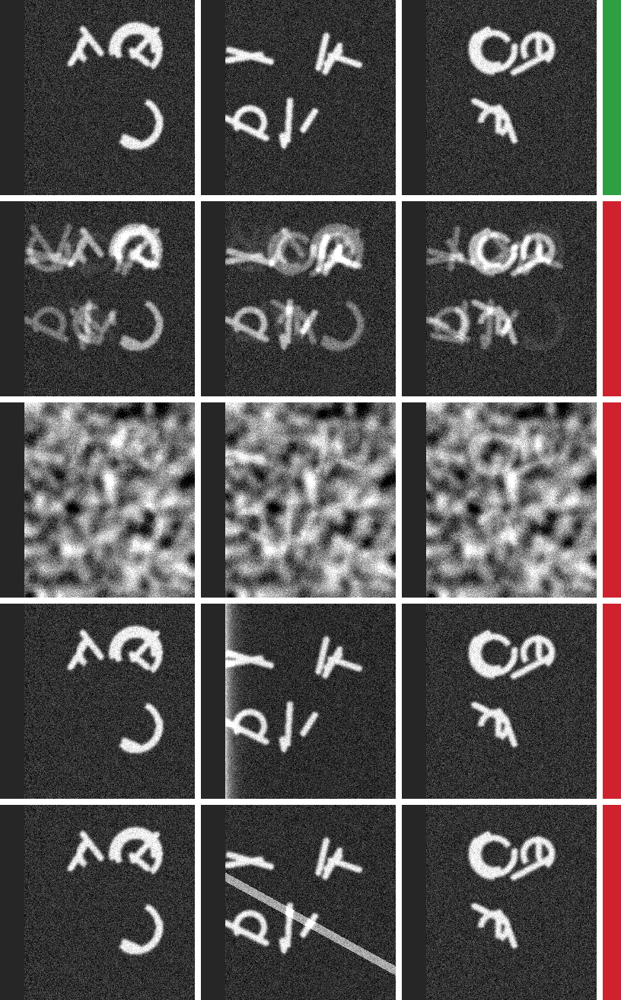

# sheetcheck: a label-free self-check that an ink map sits on the traced sheet

Checks without labels whether an ink map reads the traced sheet: it compares the map with the same model read one and two sheets away along the mesh normals, and flags ink that follows the mask edge or lights up empty space.

| Field | Value |
| --- | --- |
| Id | `sheetcheck` |
| Status | Current |
| Kind | kit command,kit module |
| Area | Scoring and controls |
| Run | `python -m kit sheetcheck` |
| Code | `kit/sheetcheck.py`, `kit/cli.py` (`cmd_sheetcheck`) |
| Tests | `tests/test_sheetcheck.py` |
| Needs | Python 3.10 or newer with numpy and tifffile (`pip install -e ".[maps]"`); zarr for `volume` with a zarr volume. For a real check: the maps of one window read at shifts of whole sheet pitches (`maps`), or a 3D prediction volume, its tifxyz mesh and the sheet pitch (`volume`) |
| Runs on | Any CPU. 4-core cloud container, 24 Oct 2026: `maps` on a 640 x 640 window with five shifts and CT, 0.5 s; `volume` projecting a 256 x 256 mesh at five shifts from an 80 x 256 x 256 volume, 1.1 s; `demo`, under 10 s |
| Network | None, except `volume` with an open-data mesh URL, which `kit tifxyz` fetches once into its cache |
| Writes | Nothing, except `demo --png PATH` (one PNG) and `volume --save-maps DIR` (one TIFF per shift, `k+0.tif` and so on) |
| Go-ahead | Not needed |
| Released | Public `main` from the change that adds it (24 Oct 2026) |
| Checked | 2026-10-24 against commit `c41f1ac` plus this tool |

## What it does

An ink map is read from one traced sheet, the mesh. Neighboring wraps of a scroll carry different text, so a map that really reads the traced sheet should look different when the same model is read one sheet pitch further in or out along the mesh normals. If the map one sheet away looks nearly the same, the map is not about this sheet: the model has smeared its prediction across sheets, or it is following something every sheet shares (slow shading, the mesh's shape, CT texture). Such a map can still score well against labels on the traced sheet, which is why a labeled score needs controls; this check needs no labels at all, so it can run on any scroll before any test.

For one window it takes the map at k = 0 (on the sheet) and maps at other shifts k, in sheet pitches (the wrap pitch: the distance from one wrap to the next). It removes slow shading with a high-pass, then gives the correlation r(k) of each shifted map with the map on the sheet. The window FAILs when the map one pitch away (the larger of k = -1 and k = +1), or two pitches away when given, correlates at 0.5 or more, so that it explains a quarter or more of the map's variance. A failing map is labeled "smeared" when the likeness falls off from one pitch to two, and "shared" when it does not.

Two more checks need only the map on the sheet. With a mask (or NaN in the map), it compares the share of the map's top 10 % of pixels that lie within 16 pixels of the mask edge with the share of all valid pixels there; three times as many or more means the ink follows the edge. With the CT on the traced sheet (`--ct`, same grid), it does the same for pixels darker than half the window's median CT value, where there is no papyrus under the mesh; three times as many or more means the map lights up empty space.

What it does not do: a PASS is a necessary condition, not proof. A map can be sheet-specific and still carry no ink signal, and a map with no signal at all passes the neighbor-sheet test easily (noise does not correlate across sheets). It does not replace a labeled score with its reverse-depth control (`kit auc --control`). An ink map is model output, never a reading, and a PASS says nothing about letters.

`volume` makes the shifted maps itself for a 3D model: it projects the prediction volume on the mesh moved k pitches along its normals (the maximum of trilinear samples within 3 voxels of the moved sheet) and checks the result. A 2.5D model, which reads a flattened surface volume, has to be run on surface volumes rendered at each shift; give its maps to `maps`.

## When to use it

- Before trusting a new ink model's maps on a scroll with no labels: run it on six or more windows, on more than one scroll if you can, and combine them with `summary`.
- While training a 3D ink model, on development windows after each saved checkpoint: a smeared model fails long before a held-out test would show it.
- On any 2D ink map with its mask and the CT on the sheet, to catch ink at the mask edge or in cracks (`maps` with only `--map 0=...`).

Do not use it:

- As evidence that a map shows ink: score it against labels with `kit auc` and its reverse-depth control.
- To compare two models: it is a pass or fail gate; compare models with `kit auc` and `kit leaderboard`.
- To check that a mesh stays on one sheet where sheets touch: use the one-sheet check (`kit.sheetgap`) and `kit hopbench`.

## Quick start

```bash
python -m kit sheetcheck demo --png sheetcheck-demo.png
python -m kit sheetcheck maps --map 0=ON.tif --map -1=IN1.tif --map 1=OUT1.tif --map -2=IN2.tif --map 2=OUT2.tif \
    --mask MASK.tif --ct CT.tif --name WINDOW --json > WINDOW.json
python -m kit sheetcheck summary W1.json W2.json W3.json W4.json W5.json W6.json
```

ON.tif is the map on the traced sheet, IN1 and OUT1 the maps one pitch in and out, IN2 and OUT2 two pitches; MASK.tif marks valid pixels and CT.tif is the CT sampled on the traced sheet, all on one grid. The demo printed (24 Oct 2026, last lines of each kind):

```
sharp  PASS
smeared  note: falls off with distance: smeared along the normal
smeared  FAIL (the map 1 pitch away correlates 0.642 with the map on the sheet (bar 0.5))
shared  FAIL (the map 1 pitch away correlates 0.756 with the map on the sheet (bar 0.5); the map 2 pitches away correlates 0.758 with the map on the sheet (bar 0.5))
edge  FAIL (ink follows the mask edge (4.97x as many top pixels within 16 px of it))
void  FAIL (ink lights up empty space (8.24x as many top pixels where the CT is under 0.5 of its median))
```

Each window's last line is its verdict; `demo` exits 0 when the sharp map passes and the other four fail.



Synthetic demo (`python -m kit sheetcheck demo --png`): each row shows a made-up map read one pitch in (left), on the sheet (middle) and one pitch out (right), with the verdict bar (green PASS, red FAIL). Rows from the top: sharp (each sheet has its own strokes), smeared across sheets, an artifact every sheet shares, ink along the mask edge (the dark strip on the left is outside the mask), and ink in a crack. Random lines and arcs, not letters of any script.

## Checks and controls

The check can fail, and the demo shows it: on synthetic sheets with known truth, the sharp map passes and four kinds of false ink fail, for every seed the tests try (`tests/test_sheetcheck.py`, seeds 0 to 3; seeds 0 to 7 checked by hand on 24 Oct 2026). On a synthetic prediction volume, `volume` passes flat sheets that each hold their own ink and fails the same sheets smeared along z by a Gaussian of 6 voxels (pitch 8). Slow shading shared by every sheet fails without the high-pass (`--sigma 0`) and passes with it, which is what the high-pass is for.

On real data (Model output): villa's released 3D ink model `scrollprize/ink_paris4_3d_4.8um_gambiarra` (revision `4c7119858d43`), projected on PHerc0841 segments w00 and ag896 at k = -2 to +2, gives r1 0.31 and 0.39 and passes both windows; two windows are under the six that `summary` needs. Bars were set from synthetic maps and the r squared reading of 0.5 (a quarter of the variance), not tuned on labels.

Known gaps: no fair comparison with a community tool has been run, and none doing this check was found in what we searched; a PASS on real data has only been compared with labels on a few windows, so treat it as necessary, not sufficient. The void check uses a fixed brightness rule (half the median), which assumes CT where papyrus is brighter than air.

Claim label: Model output (the correlations and enrichments describe maps); the verdict is a gate, not a held-out result.

## Commands and options

### `python -m kit sheetcheck maps`

```
usage: python -m kit sheetcheck maps [-h] --map K=PATH [--mask MASK] [--ct CT]
                                     [--name NAME] [--sigma SIGMA] [--bar BAR]
                                     [--top TOP] [--edge-px EDGE_PX]
                                     [--enrich ENRICH] [--json]
```

| Option | Default | Meaning |
| --- | --- | --- |
| `--map K=PATH` | required | map read k sheet pitches along the normal (TIFF or .npy); k = 0 is required |
| `--mask MASK` | none | valid pixels (nonzero), same grid |
| `--ct CT` | none | CT on the traced sheet, same grid: adds the empty-space check |
| `--name NAME` | `window` | window name in the output (default: window) |
| `--sigma SIGMA` | `32.0` | high-pass blur in map pixels (default 32) |
| `--bar BAR` | `0.5` | largest r at one or two pitches (default 0.5) |
| `--top TOP` | `0.1` | share of pixels counted as ink (default 0.1) |
| `--edge-px EDGE_PX` | `16` | mask edge width (default 16) |
| `--enrich ENRICH` | `3.0` | enrichment that flags (default 3.0) |
| `--json` | off | print the result as JSON |

### `python -m kit sheetcheck volume`

```
usage: python -m kit sheetcheck volume [-h] --pitch PITCH [--k K]
                                       [--scale SCALE] [--level LEVEL]
                                       [--half HALF] [--flip] [--rows R0 R1]
                                       [--cols C0 C1] [--ct CT]
                                       [--save-maps SAVE_MAPS] [--name NAME]
                                       [--sigma SIGMA] [--bar BAR] [--top TOP]
                                       [--edge-px EDGE_PX] [--enrich ENRICH]
                                       [--json]
                                       volume mesh
```

| Option | Default | Meaning |
| --- | --- | --- |
| `volume` | required | prediction volume: local zarr (z y x) or TIFF stack |
| `mesh` | required | tifxyz folder (local or open-data URL) |
| `--pitch PITCH` | required | sheet pitch in the volume's voxels |
| `--k K` | none | shifts in pitches (default -2 -1 0 1 2) |
| `--scale SCALE` | `1.0` | mesh coordinates to volume grid (0.5: level 1) |
| `--level LEVEL` | `0` | zarr group level (default 0) |
| `--half HALF` | `3` | voxels either side of the sheet (default 3) |
| `--flip` | off | reverse the mesh normals |
| `--rows R0 R1` | none | mesh rows to use |
| `--cols C0 C1` | none | mesh columns to use |
| `--ct CT` | none | CT volume (zarr or TIFF stack, same grid as the prediction) for the void check |
| `--save-maps SAVE_MAPS` | none | folder to write the projected maps (k+0.tif and so on) |
| `--name NAME` | `window` | window name in the output (default: window) |
| `--sigma SIGMA` | `32.0` | high-pass blur in map pixels (default 32) |
| `--bar BAR` | `0.5` | largest r at one or two pitches (default 0.5) |
| `--top TOP` | `0.1` | share of pixels counted as ink (default 0.1) |
| `--edge-px EDGE_PX` | `16` | mask edge width (default 16) |
| `--enrich ENRICH` | `3.0` | enrichment that flags (default 3.0) |
| `--json` | off | print the result as JSON |

### `python -m kit sheetcheck demo`

```
usage: python -m kit sheetcheck demo [-h] [--seed SEED] [--png PNG] [--json]
```

| Option | Default | Meaning |
| --- | --- | --- |
| `--seed SEED` | `0` | random seed of the synthetic sheets (default 0) |
| `--png PNG` | none | write a picture of the demo |
| `--json` | off | print the results as JSON |

### `python -m kit sheetcheck summary`

```
usage: python -m kit sheetcheck summary [-h] [--min-windows MIN_WINDOWS]
                                        [--bar BAR] [--max-failed MAX_FAILED]
                                        [--json]
                                        results [results ...]
```

| Option | Default | Meaning |
| --- | --- | --- |
| `results` | required | JSON files, each one window result or {name: result} |
| `--min-windows MIN_WINDOWS` | `6` | windows needed (default 6) |
| `--bar BAR` | `0.5` | mean r1 must stay under this (default 0.5) |
| `--max-failed MAX_FAILED` | `0.2` | largest share of windows that may FAIL (default 0.2) |
| `--json` | off | print the summary and every window as JSON |

## Python API

| Function | Returns | Raises | Notes |
| --- | --- | --- | --- |
| `SheetCheckError()` | An exception | Nothing | Raised for unusable maps, masks, volumes or meshes; a `VerifyError` |
| `highpass(m, valid, sigma=SIGMA)` | 2D float64 array | Nothing | The map minus its NaN-aware Gaussian blur; invalid pixels become 0. sigma 0 or None: unchanged. |
| `parse_k(text)` | float | SheetCheckError | A shift in sheet pitches from text, as a finite float. |
| `profile(maps, valid=None, sigma=SIGMA)` | ({k: r}, valid mask) | SheetCheckError | {k: r} for every k != 0 in maps ({k: 2D array}, k = 0 required), on pixels valid in every map. |
| `enrichment(m, valid, zone, top=TOP)` | (float or None, float) | Nothing | (share of the top pixels in zone) / (share of valid pixels in zone), and the zone's share; None if empty. |
| `check(maps, mask=None, ct=None, sigma=SIGMA, bar=BAR, top=TOP, edge_px=EDGE_PX, enrich=ENRICH, void_fraction=VOID_FRACTION, min_share=MIN_SHARE)` | dict: verdict, why, notes, r, r1, r2, kind, edge, void, pixels | SheetCheckError | One window's verdict: PASS, FAIL, or NO-SHIFTS (only the map on the sheet: edge and void checks only). |
| `summary(results, min_windows=MIN_WINDOWS, bar=BAR, max_failed=MAX_FAILED)` | dict: verdict, why, windows, ran, failed, mean_r1 | Nothing | One verdict for a model from {name: window result}: windows, mean r1 under bar, few enough FAILs. |
| `mesh_normals(xyz, valid)` | (H, W, 3) array | Nothing | Unit normals (H, W, 3) of a tifxyz grid: column step cross row step, central differences. |
| `trilinear(vol, pts, origin)` | (N,) array | Nothing | Sample vol (a numpy block whose index 0 is origin, z y x) at pts (N, 3) x y z; NaN outside the block. |
| `project(volume, xyz, normals, shift=0.0, half=HALF, rows=64)` | (H, W) float32 | Nothing | A 2D map (H, W) projected from a 3D volume on a mesh moved shift voxels along its normals. |
| `open_volume(path, level=0)` | array-like (z, y, x) | SheetCheckError | A z y x array from a local zarr (array, or group with arrays named by level) or a TIFF stack. |
| `volume_maps(volume, mesh, pitch, ks=(-2.0, -1.0, 0.0, 1.0, 2.0), scale=1.0, half=HALF, flip=False, rows=None, cols=None)` | {k: (H, W) map} | SheetCheckError, VerifyError | {k: map} projected from a prediction volume on a tifxyz mesh at each shift k (in pitches). |
| `demo_maps(kind, shape=(256, 256), seed=0, sheets=5)` | (maps, mask, ct) | Nothing | Synthetic maps at k = -2..2 for one kind: sharp, smeared, shared, edge or void. Returns (maps, mask, ct). |
| `demo(seed=0, shape=(256, 256))` | {kind: window result} | Nothing | {kind: window result} for the five synthetic kinds; only "sharp" should PASS. |
| `demo_png(path, seed=0, shape=(256, 256))` | {kind: window result} | OSError | A picture of the demo: one row per kind, the map at k = -1, 0, +1, and the verdict as a colored bar. |
| `format_result(name, r)` | str | Nothing | Plain lines for one window result: the correlations, the edge and void enrichments, notes and verdict. |
| `build_parser(p)` | None | Nothing | Adds maps, volume, demo and summary to an argparse parser. |
| `run(a)` | dict | SheetCheckError, OSError, ValueError | The result for parsed arguments: {name: window result}, or {"summary", "windows"} for summary. |
| `cmd_sheetcheck(a)` | exit code 0, 1 or 2 | Nothing | Runs and prints; exit 0 on PASS (or NO-SHIFTS, or a demo that behaved), 1 on FAIL, 2 on unusable input. |
| `main(argv=None)` | exit code | Nothing | Command line entry: python -m kit sheetcheck. |

## Inputs

- `maps`: one 2D map per `--map K=PATH`, TIFF or `.npy`, any numeric dtype, all of one shape. K is the shift in sheet pitches along the mesh normal (k = 0 required; whole pitches -2, -1, +1, +2 are the ones judged; other shifts such as 0.5 are reported). NaN marks invalid pixels. `--mask` is nonzero where valid; `--ct` is the CT sampled on the traced sheet (for example the middle layer of the surface volume) on the same grid. The high-pass `--sigma` is in map pixels: 32 pixels is about 0.3 mm on a 9.6 um map; scale it with the map's pixel size.
- `volume`: a prediction volume (local zarr array or group, or a TIFF stack, axes z y x) and a tifxyz folder (x.tif, y.tif, z.tif and meta.json; local or an open-data URL). `--scale` maps mesh coordinates to the volume's grid (0.5 for a level-1 volume and a level-0 mesh); `--pitch` is the sheet pitch in the volume's voxels (measure it with `kit coverage`, or from the CT along the normal). `--flip` reverses the normals; the sign does not change the verdict when both -k and +k are given. `--rows` and `--cols` cut the mesh to one window.
- `summary`: JSON files written by `maps --json` or `volume --json` (each `{name: result}`), or single results.

## Outputs

Per window: one line with r(k) for every shift, the mask-edge and empty-space enrichments when they ran, notes, and a verdict line `NAME  PASS`, `NAME  FAIL (reasons)` or `NAME  NO-SHIFTS`. `summary` prints one line per window and a last line with the model verdict. With `--json`:

| Field | Type | Meaning |
| --- | --- | --- |
| `NAME.verdict` | str | PASS, FAIL or NO-SHIFTS |
| `NAME.why` | list of str | Reasons for a FAIL |
| `NAME.notes` | list of str | Smeared or shared, or that no shifted maps were given |
| `NAME.r` | {str: float} | Correlation of the high-passed map at each shift with the map at k = 0 |
| `NAME.r1`, `NAME.r2` | float or null | The larger of r(-1) and r(+1); of r(-2) and r(+2) |
| `NAME.kind` | str or null | `smeared` or `shared`, for a window over the bar at one pitch |
| `NAME.edge.enrichment`, `NAME.edge.zone_share` | float | Top-pixel enrichment near the mask edge, and the edge zone's share of valid pixels |
| `NAME.void.enrichment`, `NAME.void.zone_share`, `NAME.void.threshold`, `NAME.void.r_ct` | float | The same for dark CT, the CT value used, and the correlation of the high-passed map with the high-passed CT |
| `NAME.pixels`, `NAME.sigma`, `NAME.bar` | int, float | Valid pixels and the settings used |
| `summary.verdict`, `summary.why`, `summary.windows`, `summary.ran`, `summary.failed`, `summary.mean_r1` | | The model verdict: PASS needs 6 windows with shifts, mean r1 under 0.5, and at most a fifth of windows FAIL |

| Exit code | Meaning |
| --- | --- |
| `0` | Every window PASSed or had no shifts (NO-SHIFTS, with no edge or void flag); `summary` PASS; `demo` behaved as designed |
| `1` | A window FAILed, the summary FAILed, or the demo did not fail its four false kinds |
| `2` | Unusable input: a missing or unreadable file, shapes that differ, no map at k = 0 |

## Failure modes

| What you see | Why | What to do |
| --- | --- | --- |
| `usage: ...` then `error: ...` on stderr, exit code 2 | A missing or wrong argument | Check the command against Commands and options |
| `shift...is not finite` | A shift such as `inf` or `nan` | Give shifts as numbers of sheet pitches |
| `the map at k = 0 (on the traced sheet) is required` | No `--map 0=...` | Add the map on the traced sheet |
| `maps of different shapes:...` | Maps from different crops or levels | Read every shift on the same mesh window and grid |
| `only...pixels are valid in every map` | NaN or the mask leaves under 100 pixels | Use a larger window or check the mask |
| `...: expected 3 axes (z y x), got...` | The zarr array is not a 3D volume | Point at the 3D array or pick its level with `--level` |
| `...: no valid vertices in the chosen rows and columns` | `--rows` or `--cols` outside the mesh, or a hole there | Pick rows and columns inside the mesh |
| `--map...: expected K=PATH, such as 0=on.tif or -1=in.tif` | `--map` without `K=` | Write each map as K=PATH |
| `kit sheetcheck:...` | Any refusal above, or a file that cannot be read | Read the rest of the line |
| `shift...is not a number of sheet pitches` | A shift that is not a number | Give shifts such as -1 or 2 |
| `mask shape...is not the map's...` | The mask is on another grid | Cut the mask to the map's window |
| `CT shape...is not the map's...` | The CT is on another grid | Sample the CT on the same mesh window as the map |
| `...: a TIFF volume needs 3 axes, got...` | A 2D TIFF given as a volume | Give a TIFF stack, or use `maps` for 2D maps |
| `reading a zarr volume needs zarr: pip install zarr` | zarr is not installed | `pip install zarr` |
| `...: no array...(use --level)` | A zarr group without that level | Pass the level that exists |
| `...: expected a 2D map, got shape...` | A map with more than two axes | Give one 2D map per shift |
| `two maps for k =...` | The same shift twice | Give each shift once |
| `window...appears twice` | Two result files with one window name | Name windows uniquely with `--name` |
| A window PASSes but its labeled score is near 0.5 | The map is sheet-specific but has no ink signal | Expected: a PASS is necessary, not sufficient; score with `kit auc` and its control |

## How it works

1. Valid pixels are those finite in every map and nonzero in the mask.
2. Each map is high-passed: minus its Gaussian blur of `SIGMA` = 32 map pixels, computed with the valid pixels only, so slow shading that every sheet shares does not count as likeness.
3. r(k) is the Pearson correlation, over valid pixels, of the high-passed map at k with the high-passed map at 0. r1 is the larger of r(-1) and r(+1), r2 of r(-2) and r(+2). A window fails when r1 or r2 is at least `BAR` = 0.5. A failing window is "shared" when r2 is at least `SHARED` = 0.8 of r1, otherwise "smeared".
4. Edge: the zone is valid pixels whose blurred invalid share (Gaussian of `EDGE_PX` / 2 = 8 pixels) exceeds 0.02, about 16 pixels from the edge; the image border is not an edge, since windows are crops. The top `TOP` = 10 % of the map's values are its ink. Enrichment is the zone's share of the top pixels over its share of valid pixels; a zone under `MIN_SHARE` = 1 % is not judged; `ENRICH` = 3 or more fails.
5. Void: the zone is valid pixels with CT under `VOID_FRACTION` = 0.5 of the median CT of the window; same enrichment rule.
6. `volume`: normals are the column step crossed with the row step of the tifxyz grid (central differences). For each vertex and shift, the volume is sampled trilinearly at vertex + (k x pitch + t) x normal for t from -`HALF` to +`HALF` (3) voxels and the maximum is kept, as a projection of a 3D ink prediction on a sheet usually is. The volume is read one block per strip of 64 mesh rows.
7. `summary`: PASS needs `MIN_WINDOWS` = 6 windows that ran the neighbor-sheet test, their mean r1 under the bar, and at most `MAX_FAILED` = 20 % of all windows FAIL.

The idea follows the moved-sheet control used in preregistered ink tests: score the map on the mesh moved one or two sheet pitches, and expect it to drop. Here the labels are replaced by the map on the sheet itself.

## Cost and time

Seconds on any CPU (see Runs on); memory is a few copies of one map, plus one block of the volume per strip of mesh rows for `volume`. Nothing is rented.

## For agents

- **Command:** `python -m kit sheetcheck maps --map 0=ON.tif --map -1=IN.tif --map 1=OUT.tif [--map -2=... --map 2=...] [--mask M.tif] [--ct CT.tif] --name W --json`; for a 3D prediction `python -m kit sheetcheck volume PRED.zarr MESH --pitch P [--scale 0.5] --name W --json`; then `python -m kit sheetcheck summary W*.json --json`.
- **Parse:** per window `verdict`, `why`, `r1`, `r2`, `kind`; for a model `summary.verdict`, `summary.mean_r1`, `summary.failed`.
- **Rerun:** Safe; it prints only, except `--png` and `--save-maps`, which overwrite their files.
- **Success:** exit 0 and `verdict` PASS (window) or `summary.verdict` PASS (model).
- **Not a pass:** NO-SHIFTS (the neighbor-sheet test did not run); a summary with fewer than six windows; a PASS read as evidence of ink (it is a necessary condition only).
- **Go-ahead:** Nothing.
- **Never:** call a PASS a reading or evidence of letters; post maps of a prize-eligible scroll with its result.

## Tests

`python -m unittest tests.test_sheetcheck -v` (about 8 s): the demo's five kinds over four seeds, identical and independent maps, shading removed by the high-pass, NO-SHIFTS, refusals, the summary rule, `volume` on synthetic sharp and smeared sheets through a flat tifxyz mesh, trilinear sampling against a linear field, and the command line's exit codes. Not covered: zarr volumes (the test uses numpy arrays), meshes fetched from the open-data bucket, and real maps.

## History

- 2026-10-24: First release: `maps`, `volume`, `demo` and `summary` (`b82839c`).

## Related

- [`auc.md`](auc.md): the labeled score and its reverse-depth control, which a PASS here does not replace.
- [`hopbench.md`](hopbench.md): the one-sheet check (`kit.sheetgap`) and its benchmark, whether a mesh stays on one sheet where sheets touch, a different question from whether a map reads it.
- [`tifxyz.md`](tifxyz.md): reads the meshes `volume` projects on.
- [`coverage.md`](coverage.md): measures the wrap pitch that the shifts are counted in.
- [`phantom.md`](phantom.md): the synthetic strokes the demo uses.
