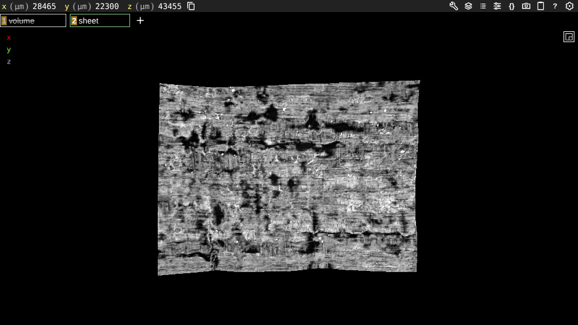

# sheetview: show a volume on a sheet's surface in Neuroglancer

Turn a tifxyz segment into a Neuroglancer mesh whose vertices carry a volume's value (3D ink, CT), so the volume reads as a picture on the curved sheet in the hosted viewer, with no install.

| Field | Value |
| --- | --- |
| Id | `sheetview` |
| Status | Current |
| Kind | kit command, kit module, kit entry point |
| Area | Viewers and apps |
| Run | `python -m kit sheetview build`, `python -m kit sheetview serve` |
| Code | `kit/sheetview.py`, `scripts/media/sheetview_media.py`, `kit/cli.py` (`cmd_sheetview`) |
| Tests | `tests/test_sheetview.py` |
| Needs | Python 3.10 or newer with numpy, tifffile and zarr 3 (zarr reads v2 and v3 volumes, blosc and zstd); a web browser with WebGL 2 to view. The media script also needs the playwright package, ffmpeg and gifsicle |
| Runs on | Any CPU. 15 s for a 119,301 vertex PHerc0139 crop at level 1 and 55 s for a 452,608 vertex crop of a 3D ink volume at level 2 (measured 2026-10-24, 4-core cloud container, fresh chunk cache) |
| Network | `vesuvius-challenge-open-data.s3.us-east-1.amazonaws.com` for a bucket segment or volume (only the chunks the samples need, fetched once). Viewing loads the hosted Neuroglancer from `neuroglancer-demo.appspot.com`, which reads `sheet.vtk` from your own `serve` and the hidden volume layer from the bucket |
| Writes | `OUT/sheet.vtk`, `OUT/state.json`, `OUT/link.txt`, `OUT/receipt.json` (replaced on a rerun); volume chunks under `--cache` (default `work/sheetview/cache`); the tifxyz under `--seg-cache` (default `work/tifxyz/cache`) |
| Go-ahead | Not needed to build or view locally. Hosting a mesh where others can open it (a Space, a public bucket) is an upload and needs Chase's yes |
| Released | Public `main` from this change, in the Scrolls kit; not a separate release |
| Checked | 2026-10-24 against commit `c41f1ac` |

## What it does

Neuroglancer shows volumes as slices and meshes as shaded surfaces, but it has no way to draw a volume on a surface. That is what you need to see a 3D ink prediction as characters on a real, curved sheet. Neuroglancer's single-mesh layer can, however, draw a VTK mesh with one value per vertex through a shader. This tool writes that mesh.

`build` crops and optionally thins or refines a tifxyz grid, works out each node's normal, samples the volume at the node and at every level voxel out to plus or minus `--depth` along the normal, and keeps the max (or the mean), as VC3D's composite does. It writes the grid as triangles with that value per vertex (`sheet.vtk`) and a Neuroglancer state that looks at the sheet face on, oriented as the flattened grid reads (grid columns to the right, rows down). A bucket volume is added as a hidden image layer, so you can switch on its slices. `serve` serves the folder with CORS on 127.0.0.1 and prints the link.

It does not register anything: the volume must be in the segment's own voxels (the segment folder names its volume, `-on-VOLUMEID-`). It does not render letters better than the volume holds; the picture is the volume's values at the mesh's vertex spacing, blended across each triangle. An ink prediction drawn this way is model output, not a reading.

VC3D already shows a volume on a segment (load it as an overlay with composite on). Use sheetview when you want it in a browser with nothing installed, or to share a view as a link.

## When to use it

- To look at a 3D ink prediction on the sheet it was predicted on, turning it in 3D.
- To check by eye that a segment sits on the papyrus: with the CT on it, the surface shows fibers; off the sheet it shows noise.
- To give someone a no-install view of a segment and its CT.

Do not use it:

- To score ink or compare models: use [auc](auc.md) with its reverse-depth control.
- For a flat render of a whole segment at full resolution: use villa's render or VC3D; this mesh caps at `--max-vertices` (4,000,000).
- For volumes alone: use [volumeview](volumeview.md) or the [official Data Browser](https://scrollprize.org/data_browser).

## Quick start

A 7 by 10 mm piece of PHerc0139 segment w045 with its CT on it (public data, off the prize lists):

```bash
python -m kit sheetview build \
  s3://vesuvius-challenge-open-data/PHerc0139/segments/20260126000000-w045_2026012619/mesh/20260126000000-on-20260102150214-2.399um.tifxyz \
  --volume s3://vesuvius-challenge-open-data/PHerc0139/volumes/20260102150214-2.399um-0.2m-78keV-masked.zarr \
  --level 1 --crop 500 650 700 900 --upsample 2 --depth 4 --reduce mean --palette gray --out work/sheetview/w045
python -m kit sheetview serve work/sheetview/w045
```

Observed on 2026-10-24:

```text
wrote work/sheetview/w045/sheet.vtk: 119301 vertices, 237208 triangles (8.5 MB)
  volume   https://vesuvius-challenge-open-data.s3.us-east-1.amazonaws.com/PHerc0139/volumes/20260102150214-2.399um-0.2m-78keV-masked.zarr level 1, 5 samples per vertex (mean over +-4 voxels), 282 chunks
  values   p1 30.6  p50 107.2  p99.5 176.5
  outside  0 vertices outside the volume
```

`serve` prints a `https://neuroglancer-demo.appspot.com/#!...` link; open it in the same machine's browser while `serve` runs. It worked when the sheet appears face on with gray fibers and `outside` is 0 or small.

For a 3D ink volume, give it as `--volume` with the matching segment, use the default `--palette ink` and `--reduce max`, and a depth that spans the ink's thickness, such as `--level 2 --depth 24`. The organizers' published 3D ink predictions are under `representations/predictions/ink-3d/` on the bucket; on 2026-10-24 only PHercParis4 had one.



Real data render: PHerc0139 segment w045, CT and mesh geometry, no labels, no ink. Vesuvius Challenge open data, CC BY-NC 4.0.

## Checks and controls

The tests plant a bright slab 6 voxels behind a flat sheet: at `--depth 0` every vertex reads 0, at `--depth 5` still 0, and at `--depth 8` every vertex reads 200 with max and 200/17 with mean (one of 17 samples hits). So the depth search can fail and stops where asked. A volume whose value is its own x index must come back exactly at every vertex, which catches any axis swap or off-by-one in the sampling.

On real data the check is by eye against a flat render. On 2026-10-24 the values sampled from a published 3D ink volume (level 2, max over plus or minus 24 voxels) were laid out on the tifxyz grid and matched the organizers' own published flat projection of the same volume on the same segment; that comparison stays private because the scroll is prize-eligible.

Claim label: None (a viewer; it computes no score). Pictures it makes of ink predictions are Model output.

## Commands and options

### `python -m kit sheetview build`

```
usage: python -m kit sheetview build [-h] --volume VOLUME --out OUT
                                     [--level LEVEL] [--crop R0 R1 C0 C1]
                                     [--stride STRIDE] [--upsample UPSAMPLE]
                                     [--depth DEPTH] [--reduce {max,mean}]
                                     [--name NAME] [--palette {gray,ink}]
                                     [--base-url BASE_URL]
                                     [--voxel-um VOXEL_UM] [--cache CACHE]
                                     [--seg-cache SEG_CACHE]
                                     [--max-vertices MAX_VERTICES] [--json]
                                     segment
```

| Option | Default | Meaning |
| --- | --- | --- |
| `segment` | required | tifxyz folder, local or on the open-data bucket (https:// or s3://) |
| `--volume VOLUME` | required | zarr or OME-Zarr volume in the segment's voxels, local or bucket |
| `--out OUT` | required | output folder |
| `--level LEVEL` | `0` | pyramid level to sample (default 0) |
| `--crop R0 R1 C0 C1` | none | grid rows R0:R1 and columns C0:C1 of the tifxyz (default: all) |
| `--stride STRIDE` | `1` | keep every Nth grid node (default 1) |
| `--upsample UPSAMPLE` | `1` | refine the grid N times bilinearly (default 1) |
| `--depth DEPTH` | `0.0` | sample plus or minus this many level-0 voxels along the normal (default 0) |
| `--reduce REDUCE` | `max` | how depth samples combine (default max) |
| `--name NAME` | `value` | the per-vertex attribute's name in the shader (default value) |
| `--palette PALETTE` | `ink` | ink: warm on dark papyrus; gray: black to white (default ink) |
| `--base-url BASE_URL` | none | where sheet.vtk will be served (default http://127.0.0.1:8000/) |
| `--voxel-um VOXEL_UM` | none | voxel size when the segment folder name lacks -NNum |
| `--cache CACHE` | `work/sheetview/cache` | volume chunk cache (default work/sheetview/cache) |
| `--seg-cache SEG_CACHE` | `work/tifxyz/cache` | tifxyz download cache |
| `--max-vertices MAX_VERTICES` | `4000000` | refuse a mesh above this many vertices (default 4000000) |
| `--json` | off | print the receipt as JSON |

### `python -m kit sheetview serve`

```
usage: python -m kit sheetview serve [-h] [--port PORT] folder
```

| Option | Default | Meaning |
| --- | --- | --- |
| `folder` | required | a folder `build` wrote; must hold `sheet.vtk` |
| `--port PORT` | `8000` | the port on 127.0.0.1; the printed link points the mesh layer at it |

### `python scripts/media/sheetview_media.py`

Makes this page's still and orbit clip; the full recipe is in the script's docstring.

```
usage: sheetview_media.py actions [-h] --out-dir OUT_DIR [--frames FRAMES] [--swing SWING] [--port PORT] state
usage: sheetview_media.py publish [-h] --assets ASSETS --meta META shots
```

| Option | Default | Meaning |
| --- | --- | --- |
| `actions state` | required | `state.json` from `kit sheetview build` |
| `--out-dir OUT_DIR` | required | where `url.txt`, `orbit.json` and `stills.json` (capture_web.py steps) go |
| `--frames FRAMES` | `48` | frames in the orbit |
| `--swing SWING` | `35.0` | degrees to each side of face on |
| `--port PORT` | `8000` | where `kit sheetview serve` runs |
| `publish shots` | required | the folder capture_web.py wrote the two stills into |
| `--assets ASSETS` | required | the `docs/assets/` folder to copy them into, with sidecars |
| `--meta META` | required | the clip's meta JSON, with `still_alts` and `still_caption` |

## Python API

| Function | Returns | Raises | Notes |
| --- | --- | --- | --- |
| `crop_grid(seg, crop=None, stride=1)` | `(xyz, valid)` arrays | `VerifyError` | (xyz, valid) of the segment's grid rows r0:r1 and columns c0:c1, every stride-th node. |
| `upsample(xyz, valid, factor)` | `(xyz, valid)` arrays | `VerifyError` | Bilinear refinement of the grid by an integer factor; a new node is valid when its cell's 4 corners are. |
| `normals(xyz, valid)` | `(H, W, 3)` float array | None | Unit normals (column step cross row step, as kit tifxyz facing), NaN where a neighbor is missing. |
| `triangles(valid)` | `(index, (T, 3) int array)` | None | (vertex index of each grid node or -1, (T, 3) triangles): two per cell whose 4 corners are valid. |
| `Volume(root, level=0, cache=DEFAULT_CACHE)` | a `Volume` | `VerifyError` | One level of a local or bucket zarr volume, read chunk by chunk with a small in-memory cache. |
| `sample_sheet(xyz, valid, volume, depth=0.0, reduce='max', row_block=ROW_BLOCK)` | `(values, chunks, samples per vertex)` | `VerifyError` | (H, W) float32 values of the volume on the sheet: the max or mean along each node's normal over plus or minus depth level-0 voxels; NaN where every sample is outside. |
| `write_vtk(path, pts, tris, values, name='value', title='kit sheetview')` | the `Path` written | `OSError` | ASCII VTK polydata with one SCALARS point attribute: the format Neuroglancer's vtk:// source reads. |
| `shader(name, lo, hi, vmin, vmax, palette='ink')` | shader text | `KeyError` for an unknown palette | Two sliders (black and white points) and two colors. |
| `face_on(du, dv)` | quaternion `[x, y, z, w]` | None | The view orientation that shows the sheet as its flattened grid reads: grid columns to the right, rows down, looking along column step cross row step. |
| `build_state(mesh_url, voxel_um, pts, orientation, name, lo, hi, vmin, vmax, palette='ink', volume_url=None)` | state dict | None | A Neuroglancer state: the sheet as a single-mesh layer on a micrometer grid, looked at face on, and the volume as a hidden image layer when given. |
| `link(state)` | URL string | None | The hosted viewer's link with the state percent-encoded. |
| `build(segment, volume, out, level=0, crop=None, stride=1, factor=1, depth=0.0, reduce='max', name='value', palette='ink', base_url=None, cache=DEFAULT_CACHE, voxel_um=None, seg_cache=tifxyz.DEFAULT_CACHE, max_vertices=MAX_VERTICES)` | receipt dict | `VerifyError`, `OSError` | Write sheet.vtk, state.json, link.txt and receipt.json into out; return the receipt. |
| `serve(folder, port=DEFAULT_PORT, host='127.0.0.1')` | `0` when stopped | `VerifyError` | Serves until Ctrl-C; prints the link with the mesh at this port. |
| `format_receipt(r, out)` | text | None | The summary `build` prints. |
| `add_arguments(p)` | None | None | Adds `build` and `serve` to an argparse parser. |
| `run(args)` | exit code | `VerifyError`, `OSError` | Runs one parsed command. |
| `cmd_sheetview(args)` | `0` or `2` | None | python -m kit sheetview build\|serve: exit 0 when done, 2 on bad input. |
| `main(argv=None)` | exit code | `SystemExit` on bad arguments | `python -m kit.sheetview`. |

## Inputs

- **Segment:** a tifxyz folder (`x.tif`, `y.tif`, `z.tif`, float32 grids of one shape in voxels of one volume; `meta.json` with `scale`). The voxel size comes from the folder name (`-2.399um.tifxyz`) or `--voxel-um`. Nodes at -1 (or not finite) are holes.
- **Volume:** a zarr v2 or v3 array or OME-Zarr pyramid, axes z, y, x, whose level 0 is in the segment's voxels. Any dtype; integer volumes get shader sliders over the dtype's range. Sharded v3 volumes are fetched shard by shard, which can be large.
- **Grid units:** `--crop`, `--stride` and `--upsample` count tifxyz grid nodes; `--depth` counts level-0 voxels; the sample step along the normal is one voxel of `--level`.

## Outputs

`build` prints the summary shown under Quick start, or the receipt with `--json`. Files in `--out`:

| File | What it holds |
| --- | --- |
| `sheet.vtk` | ASCII VTK polydata: `POINTS` in level-0 voxels (x, y, z), `POLYGONS` (triangles), `POINT_DATA` with one `SCALARS NAME float` value per point |
| `state.json` | The Neuroglancer state: `dimensions` in micrometers, the mesh layer `sheet` (source `vtk://BASE/sheet.vtk` with a transform from voxels to micrometers, the shader), a hidden image layer `volume` for a bucket volume (`zarr2://` or `zarr3://`), a face-on `projectionOrientation`, `layout` 3d, `showSlices` false |
| `link.txt` | The hosted viewer's link to that state |
| `receipt.json` | The fields below |

| Field | Type | Meaning |
| --- | --- | --- |
| `segment`, `segment_grid`, `crop`, `stride`, `upsample`, `voxel_um` | as given | What was drawn |
| `volume`, `level`, `level_factor_zyx`, `depth_vox`, `samples_per_vertex`, `reduce`, `attribute` | as given | How it was sampled |
| `vertices`, `triangles` | int | Mesh size |
| `vertices_outside_volume` | int | Vertices where every sample fell outside the volume (drawn at the lowest value) |
| `chunks_read`, `fetched` | int, object | Chunks the samples touched; chunks and bytes downloaded this run and chunks absent from the bucket (fill value) |
| `value_p1_p50_p99_5`, `shader_range` | numbers | Value percentiles; the shader's default black and white points (p1, p99.5) |
| `mesh_url` | string | Where the state expects `sheet.vtk` |
| `files` | object | `sheet.vtk` bytes and sha256 |
| `seconds`, `made` | number, string | Wall time and UTC time |

| Exit code | Meaning |
| --- | --- |
| `0` | The mesh, state, link and receipt were written (`build`), or the server stopped (`serve`) |
| `2` | Bad input or a file that could not be read or written; nothing is half-written (`sheet.vtk` is written to a `.part` file and renamed) |

## Failure modes

| What you see | Why | What to do |
| --- | --- | --- |
| `usage: ...` then `error: ...` on stderr, exit code 2 | A missing or wrong argument | Check the command against Commands and options |
| `--stride must be 1 or more (got...)` | Stride 0 or below | Give 1 or more |
| `--crop...is outside the grid of...rows and...columns` | The crop runs past the grid or is empty | Give rows and columns inside the grid; `kit tifxyz info` prints its size |
| `the crop holds fewer than 4 valid nodes: nothing to draw` | The crop is all holes | Move the crop onto the sheet |
| `--upsample must be 1 or more (got...)` | Factor 0 or below | Give 1 or more |
| `--upsample needs a crop of at least 2 rows and 2 columns` | A one-row or one-column crop | Widen the crop |
| `--depth must be 0 or more voxels (got...)` | Negative or not a number | Give 0 or more |
| `--reduce must be max or mean (got...)` | Called from Python with another value | Use max or mean |
| `--palette must be one of...(got...)` | Called from Python with another value | Use ink or gray |
| `--name must be a plain identifier for the shader (got...)` | A name with spaces or symbols | Use letters, digits and underscores |
| `...vertices is above --max-vertices...: crop smaller or raise --stride` | The mesh would be too big for a browser to parse | Crop, raise `--stride`, or lower `--upsample` |
| `the voxel size is unknown: give --voxel-um (the segment's folder name has no -NNum)` | A renamed segment folder | Give `--voxel-um` |
| `no sheet.vtk in...: run kit sheetview build first` | `serve` on a folder `build` did not write | Run `build` first |
| `kit sheetview:...` | Another refused input, such as a volume that is not 3D or a level that does not exist | Read the message |
| `kit sheetview could not read or write a file:...` | Disk full, a folder that cannot be written, or a dropped download | Free space or fix the path, then rerun (fetched chunks are kept) |
| `kit sheetview needs zarr to read the volume: pip install zarr` | zarr is not installed | `pip install zarr` |
| `cannot open the volume level at...:...` | The cached or local folder is not a zarr array zarr can open | Check `--volume` and `--level`; delete a damaged cache folder |
| The viewer shows nothing, or "Error parsing" on the layer | `serve` is not running, or runs on another port | Run `serve` on the folder and use the link it prints |
| The sheet looks torn into strips | A crop so curved that it wraps, so parts face away | Crop a smaller piece |

## How it works

1. Load the tifxyz with `kit.tifxyz.load` (cached download for a bucket URL), crop and stride it, and refine it bilinearly by `--upsample`.
2. Normals are the cross product of the grid's column and row steps (`numpy.gradient`), as `kit tifxyz facing` uses.
3. Offsets along the normal are 0 and every level voxel out to plus or minus `--depth` (`floor(depth / factor)` steps each way). Each sample point is divided by the level's scale factor and rounded to the nearest voxel.
4. The chunks those samples touch are listed first and fetched once into `--cache` with `kit.tifxyz.fetch_chunks`, then read with zarr. Sampling runs `ROW_BLOCK = 64` grid rows at a time with up to `CHUNK_CACHE_BYTES = 1 GiB` of decoded chunks in memory.
5. Two triangles are written per grid cell whose 4 corners are valid. Values are written as ASCII VTK because Neuroglancer's VTK reader takes only ASCII polydata (checked in Neuroglancer 2.41.2, `datasource/vtk/parse.js`).
6. The state maps level-0 voxels to micrometers with the layer transform (Neuroglancer's mesh model space is in nanometers by default). The camera is the rotation whose x axis is the mean grid column step and whose z axis is the sheet normal, so the sheet reads as its flattened grid. `showSlices` is off: the default opaque cross-section planes in the 3D view would hide parts of the sheet.

Sourced fact, checked 2026-10-24: Neuroglancer's single-mesh layer reads `vtk://` ASCII polydata with `SCALARS` point data and exposes each attribute to the layer shader by name (Neuroglancer 2.41.2, Apache-2.0, `layer/single_mesh` and `datasource/vtk`).

## Cost and time

Measured on 2026-10-24 in a 4-core cloud container with a fresh cache: PHerc0139 w045, a 150 by 200 node crop refined twice (119,301 vertices), level 1 CT, 5 samples per vertex: 15.0 s wall, 282 chunks, 565 MB downloaded, `sheet.vtk` 8.5 MB. A 544 by 832 node crop of a 3D ink volume (452,608 vertices), level 2, 13 samples per vertex: 55 s, 289 chunks, about 1.0 GB downloaded, `sheet.vtk` 33 MB. A rerun on the same cache took 50 s, almost all sampling and writing. The hosted viewer parsed and drew the 33 MB mesh in under 30 s with software WebGL; a GPU is faster. No paid compute.

## For agents

- **Command:** `python -m kit sheetview build SEGMENT --volume VOLUME --out DIR --crop R0 R1 C0 C1 [--level L --depth D --reduce max|mean] --json`.
- **Parse:** the receipt: `vertices`, `vertices_outside_volume`, `value_p1_p50_p99_5`, `files.sheet.vtk.sha256`; `DIR/link.txt` is the viewer link.
- **Rerun:** safe; it replaces the four files in `--out` and reuses fetched chunks.
- **Success:** exit 0 with `vertices_outside_volume` near 0 and a value spread (p1 below p99.5).
- **Not a pass:** values that are all one number (the volume is not in the segment's voxels, or the sheet misses it); a picture is not a score.
- **Go-ahead:** hosting the mesh anywhere public, posting a link or pictures.
- **Never:** publish pictures of a prize-eligible scroll or of any ink prediction (the public media rule), or call an ink picture a reading.

## Tests

```bash
python -m unittest tests.test_sheetview -v
```

Nine tests on synthetic sheets and zarr volumes built in a temporary folder: exact values on an x-index volume, the slab depth control (0, 5 and 8 voxels; max and mean), holes, crop and stride counts, upsampling, the state's mesh layer and face-on orientation for a flat and a tilted sheet, coarse-level indexing, the CLI summary and exit code 2 for bad inputs. They do not download data or open a browser; the hosted viewer was checked by screenshots (below).

The media under `docs/assets/sheetview/` were made with `scripts/media/sheetview_media.py` and `scripts/media/capture_web.py --webgl` (headless Chromium with SwiftShader, through `$HTTPS_PROXY` when set).

## History

- 2026-10-24: First version: build and serve, with the PHerc0139 w045 stills and orbit GIF (`96a5d74`).

## Related

- [tifxyz](tifxyz.md): reads the segment and fetches only the chunks it touches.
- [volumeview](volumeview.md): Neuroglancer links for volumes alone.
- [Official Data Browser](https://scrollprize.org/data_browser): the organizers' own viewer.
- [Neuroglancer](https://github.com/google/neuroglancer): the viewer this targets.
