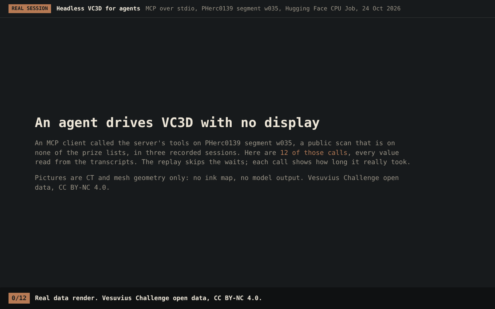
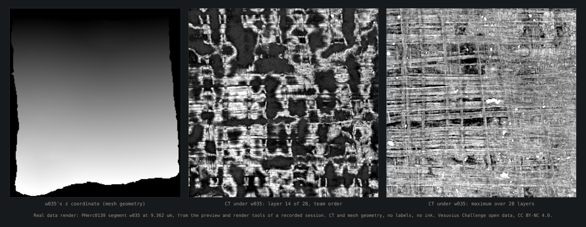
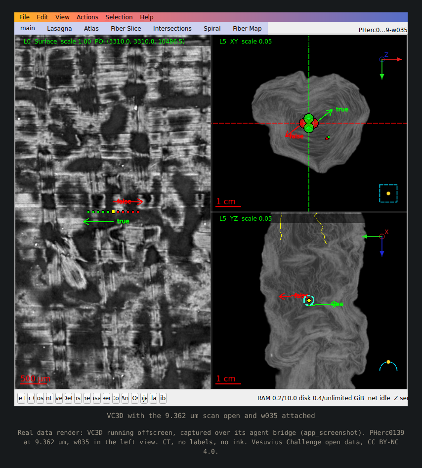

# vc3d-agent: villa's VC3D tools as checked MCP tools for AI agents, with no display

Headless VC3D for agents 1.1.1 serves 46 tools over MCP (stdio) and a shell command, so an agent can trace, check, render and flatten surfaces, run ink models with controls and fit lasagna surfaces; its code is on public branch `submission/progress-2026-10-vc3d-agent-1-1-1`, not on `main`.

| Field | Value |
| --- | --- |
| Id | `vc3d-agent` |
| Status | Branch only |
| Kind | package |
| Area | Pipeline and agents |
| Run | `vc3d-agent vc3d mcp` (the MCP server), `vc3d-agent vc3d tools`, `vc3d-agent vc3d call TOOL '{...}'`, `vc3d-agent lasagna COMMAND` (the lasagna tools with `--key value` flags) after `pip install -e .` in the package folder |
| Code | `submissions/progress-2026-10-vc3d-agent-1-1-1/vc3d-agent/` on its branch: mainly `kit/vc3d_mcp.py` (the server), `kit/vc3d_agent.py` (the tools), `kit/vc3d.py`, `kit/vc3d_catalog.py`, `kit/vc3d_audit.py`, `kit/vc3d_bridge.py`, `kit/lasagna.py` (the lasagna tools, loaded through `kit/vc3d_ext_lasagna.py`), `kit/cli.py`, `scripts/lasagna/fit_cpu_shim.py`, `scripts/vc3d/ink.py`, `scripts/get_vc3d.py` |
| Tests | `submissions/progress-2026-10-vc3d-agent-1-1-1/vc3d-agent/tests/` on its branch: 17 `test_*.py` files, among them `test_vc3d_mcp.py` (the protocol, and the official MCP Python SDK's client when it is installed) and `test_vc3d_agent.py` (every tool against stand-in VC3D tools from `vc3d_fakes.py`) |
| Needs | Python 3.11 or newer; the server and most tools use only the standard library. Scoring and the layer tools need the `maps` extra (numpy, tifffile, zarr 3, scipy). Real runs need villa's VC3D tools (`VC_APPIMAGE`, `VC_BIN` or `PATH`); ink models and the detectability probe need a Python with numpy and torch named by `KIT_INK_PYTHON`. The lasagna tools need a villa checkout (`VILLA_DIR` or `LASAGNA_DIR`) and a Python with torch, numpy, zarr, tifffile and tensorstore (`LASAGNA_PYTHON`); CPU torch is enough for the self-test and small fits, real-size fits need CUDA |
| Runs on | Linux or macOS, any CPU for the server. Version 1.1.0's 438 tests (the same in 1.1.1, whose code is 1.1.0's) took 149 s with Python 3.13 in a 4-core cloud container (24 Oct 2026; 1.0.0's 355 took 126 s with Python 3.11 and the `maps` extra); the lasagna self-test took 9 s on CPU there with villa main `6f202456`; the server answered initialize, tools/list and status in a venv with no packages at all |
| Network | None for the server itself (stdio). The tools download anonymously from the Vesuvius Challenge open-data bucket (`vesuvius-challenge-open-data`), Hugging Face and GitHub releases (`fetch_model`), and `api.github.com` and GitHub's release host for `scripts/get_vc3d.py` |
| Writes | Under the kit home (the package folder, or `KIT_HOME`): `work/vc3d/` (outputs, jobs, caches, the model list; `KIT_VC3D_HOME` moves it), `experiments/` (the ledger and target ink) and `checkpoints/` (downloaded models), all kept out of git by the package's `.gitignore` |
| Go-ahead | Not needed to serve or for local runs. Needed: the `modal` tool, which rents compute, refuses unless the user starts the server with `KIT_ALLOW_MODAL=1`, and its runner is not in the package; publishing any target-scroll map or verdict (the no-disclosure rule, hard rule 1) |
| Released | Public branch `submission/progress-2026-10-vc3d-agent-1-1-1` at `9edcbf13c6b06f34cc94c0976320863378f5f18f` (a commit with no parent), tag `vc3d-agent-v1.1.1`, with its README entry in [`releases.json`](../releases.json); 1.1.0 is tag `vc3d-agent-v1.1.0` at `6c157716e08ef816eac936be22c40cb85682e642` and 1.0.0 is tag `vc3d-agent-v1.0.0` at `9c507bdf538bfe3733f71a72fa46fdf1ba3d7f3c`. The same server shipped earlier inside each AutoPipeline release |
| License | Code: Apache License 2.0 ([LICENSE on the branch](https://github.com/ChaseHendrick/Scrolls/blob/9edcbf13c6b06f34cc94c0976320863378f5f18f/submissions/progress-2026-10-vc3d-agent-1-1-1/vc3d-agent/LICENSE)); data and model weights keep their own licenses and are not included |
| Guide | [Package README](https://github.com/ChaseHendrick/Scrolls/blob/9edcbf13c6b06f34cc94c0976320863378f5f18f/submissions/progress-2026-10-vc3d-agent-1-1-1/vc3d-agent/README.md), [AGENTS.md](https://github.com/ChaseHendrick/Scrolls/blob/9edcbf13c6b06f34cc94c0976320863378f5f18f/submissions/progress-2026-10-vc3d-agent-1-1-1/vc3d-agent/AGENTS.md) and the agent guide [docs/vc3d-agents.md](https://github.com/ChaseHendrick/Scrolls/blob/9edcbf13c6b06f34cc94c0976320863378f5f18f/submissions/progress-2026-10-vc3d-agent-1-1-1/vc3d-agent/docs/vc3d-agents.md) |
| Branch | `submission/progress-2026-10-vc3d-agent-1-1-1` at `9edcbf13c6b06f34cc94c0976320863378f5f18f` |
| Checked | 2026-10-24 against commit `9edcbf13c6b06f34cc94c0976320863378f5f18f` |

## What it does

VC3D is villa's surface tracing and rendering software for the Herculaneum scroll scans. Its command line tools need no display, but an agent driving them by hand trips over conventions that fail silently: which way the rendered layers stack, which scan's frame a segment is in, and whether a blank render means a missing chunk. This package wraps the tools as typed tools with those checks built in, and serves them to MCP clients (Claude Code, Claude Desktop, the official MCP Python SDK, others) as newline-delimited JSON-RPC 2.0 on stdio, protocol versions 2024-11-05 to 2025-11-25, with progress, cancellation, preview images and the guides as resources. A shell route (`vc3d-agent vc3d call`) runs the same tools with JSON in and out.

The tools group as setup (`status`, `selftest`, `list_tools`, `tool_help`, `guide`), open data (`catalog`, `fetch_segment`, `landmarks`, `models`, `fetch_model`), VC3D runs (`run`, `trace`, `extend`, `render`, `flatten`, `trim`, `merge_patch`, `merge_surfaces`, `volume_meta`), checks (`inspect`, `check_surface`, `orientation`, `frame`, `audit`, `cache_check`, `seed_check`, `phantoms`), ink (`ink`, which always makes the reverse-depth control, and `detectability`), `preview`, the VC3D app through its agent bridge (`app_start`, `app_open`, `app_methods`, `app_call`, `app_screenshot`, `app_stop`), `jobs`, `kit` and `modal`, and since 1.1.0 lasagna (`lasagna_status`, `lasagna_configs`, `lasagna_manifest`, `lasagna_fit`, `lasagna_export`, `lasagna_selftest`, `lasagna_service`): villa's lasagna surface fitter run headless, from a published lasagna run (or a mirrored box of it) to a fitted, exported tifxyz, with a self-test whose check can fail and a client for villa's fit service; the package's `docs/lasagna-agents.md` is its guide. The tools refuse output paths git would track, refuse target-scroll ink without a preregistered ledger experiment, and say that an ink map is model output, not a reading.

It is the server that AutoPipeline's releases carried, cut out on its own: AutoPipeline's four pipeline tools (`umbilicus`, `seeds`, `distortion`, `autopipeline`) are not in it, and `kit/vc3d_agent.py` loads them only when `kit/autopipe.py` is present.

## What it looks like



Real data render: a replay of MCP tool calls an agent client made to the server on Hugging Face CPU Jobs, 24 Oct 2026, on PHerc0139 segment w035 at 9.362 um; every value is read from the session transcripts and the waits are skipped. CT and mesh geometry, no labels, no ink. Vesuvius Challenge open data, CC BY-NC 4.0. [MP4](../assets/vc3d-agent/vc3d-agent-session.mp4).

The recorded sessions ran the 1.0.0 MCP server over stdio from the package folder against villa's VC3D tools built at `e0bbb8b` (6 Oct 2026), with no display, on a `cpu-upgrade` Hugging Face Job. Among the real results the clip shows: `selftest` passed 8 of 8 checks on synthetic volumes in 4.8 s; `audit` found all 4,776 chunks under w035 and its margin present after 4,793 requests in 241 s; `check_surface` found w035 seated (contrast 41.2) with no transverse self-crossings; a new 82 x 82 trace grown by `trace` in 28 s came back "unclear" (contrast 3.4, under the seated bar of 10), so the check can fail; and `render` streamed a 28 x 640 x 640 window in 12 s with 0 false 404s.



Real data render: PHerc0139 segment w035 at 9.362 um, from the `preview` and `render` tools of the recorded session. CT and mesh geometry, no labels, no ink. Vesuvius Challenge open data, CC BY-NC 4.0.



Real data render: VC3D running offscreen, captured over its agent bridge (`app_start` with a project file naming the remote scan, `app_open`, then `app_screenshot`). PHerc0139 at 9.362 um, w035 in the left view. CT, no labels, no ink. Vesuvius Challenge open data, CC BY-NC 4.0.

`scripts/media/vc3d_agent_session.py` makes the clip and both stills from the session transcripts ([media tools](media.md)). The [package README](https://github.com/ChaseHendrick/Scrolls/blob/9edcbf13c6b06f34cc94c0976320863378f5f18f/submissions/progress-2026-10-vc3d-agent-1-1-1/vc3d-agent/README.md) walks through the same session and shows every tool with a recorded call and its result.

## Where the code is

The package is at `submissions/progress-2026-10-vc3d-agent-1-1-1/vc3d-agent/` on public branch `submission/progress-2026-10-vc3d-agent-1-1-1`, commit `9edcbf13c6b06f34cc94c0976320863378f5f18f`. Its Python package is `kit`, a narrowed copy of the source repository's, separate from this repository's `kit`.

```bash
git clone --branch submission/progress-2026-10-vc3d-agent-1-1-1 --depth 1 https://github.com/ChaseHendrick/Scrolls.git scrolls-vc3d-agent
cd scrolls-vc3d-agent/submissions/progress-2026-10-vc3d-agent-1-1-1/vc3d-agent
```

## How to run it

```bash
python3 -m venv .venv && . .venv/bin/activate   # Python 3.11 or newer
python -m pip install -e ".[maps]"
export VC_APPIMAGE="$(python scripts/get_vc3d.py)"
vc3d-agent vc3d call status
vc3d-agent vc3d call selftest
claude mcp add vc3d-agent -e VC_APPIMAGE="$VC_APPIMAGE" -- "$PWD/.venv/bin/vc3d-agent" vc3d mcp
```

Install it editable (`-e`): the `guide` tool and the MCP resources read `docs/` from the package folder, and a plain wheel install says so instead of serving them. `python -m unittest discover -s tests` runs the package's tests against stand-in VC3D tools, with no VC3D, GPU or scan data.

## Inputs and outputs

Inputs are each tool's JSON arguments, checked against the schema `vc3d-agent vc3d tools --json` prints; over MCP, `tools/list` gives the same schemas. Data comes from the open-data bucket by URL or from local zarr volumes and tifxyz surfaces. Each result is one JSON object (over MCP, a text block plus `structuredContent`, and an image block per preview PNG); `vc3d-agent vc3d call` exits 0 when the tool succeeded, 1 when it ran and failed and 2 on bad arguments. Traces, renders, ink maps and receipts go under `work/vc3d/` of the kit home, target ink under `experiments/<slug>/`.

## Why it is not on the default branch

Its `kit` package is a different, narrowed copy of the source repository's kit, and it would collide with this repository's own `kit` on `main`. Like AutoPipeline it ships as its own package on a branch with no parent.

## For agents

- **Revive:** clone the branch as under "Where the code is", then `python -m pip install -e ".[maps]"` and `python -m unittest discover -s tests` in the package folder.
- **Check first:** `vc3d-agent vc3d call status` (where VC3D is, what this build supports) and `selftest` on a new VC3D build; read `AGENTS.md` before any ink work.
- **Never:** call an ink map a reading; publish target-scroll maps, previews or verdicts; serve it over a network; set `KIT_ALLOW_MODAL=1` for a user.

## History

- 2026-10-24: a GIF, an MP4 and two stills of recorded sessions on PHerc0139 w035 (Hugging Face CPU Jobs), under "What it looks like" ([#201](https://github.com/ChaseHendrick/Scrolls/pull/201)).
- 2026-10-24: 1.1.1 at `9edcbf13c6b06f34cc94c0976320863378f5f18f` (tag `vc3d-agent-v1.1.1`, not Latest), docs only: the package README shows every tool with a recorded call and its result, client setup for Claude Code, Codex and the MCP Python SDK, the recorded session with this page's clip and stills, and the failure modes met; the code is 1.1.0's.
- 2026-10-24: 1.1.0 at `6c157716e08ef816eac936be22c40cb85682e642`: the seven `lasagna_*` tools (villa's lasagna surface fit, headless) and the `lasagna` command; 46 tools.
- 2026-10-24: 1.0.0, the first standalone release, at `9c507bdf538bfe3733f71a72fa46fdf1ba3d7f3c`: the VC3D agent tools and MCP server without AutoPipeline.

## Related

- [autopipeline](autopipeline.md): the pipeline that ships the same server with its four pipeline tools.
- [vc3d-audit](vc3d-audit.md), [vc3d-cache](vc3d-cache.md), [vc3d-io](vc3d-io.md): this repository's copies of three modules the package also ships, behind its `audit`, `cache_check` and image tools.
- [releases](releases.md): how the README's "Released tools" entry is written.
