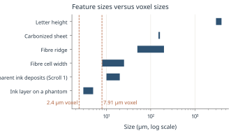
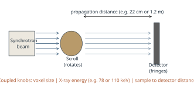
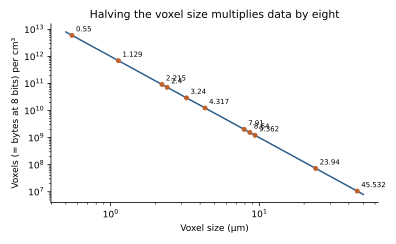
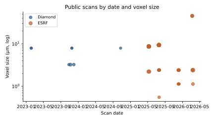
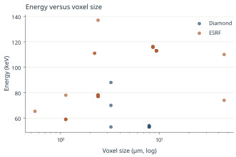
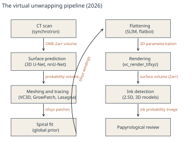
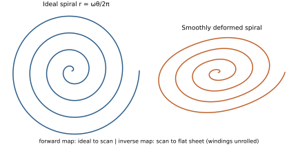
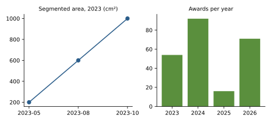

<!-- The Vesuvius Challenge Bible. Edition of 15 October 2026. One file per chapter is in md/. -->

<a id="ch-preface"></a>

# About This Book {#ch-preface}

*The Vesuvius Challenge Bible* is a reference for anyone working on reading the Herculaneum scrolls: the history of the rolls, the physics of imaging them, the record of the Vesuvius Challenge from 2023 to October 2026, every scroll and fragment in the public catalog, the full virtual unwrapping pipeline, the tools and formats, and the open problems. It is written for two kinds of reader: people, who will mostly read it as a PDF, and AI agents, which can read the same text as Markdown with machine-readable data alongside.

Edition date: 15 October 2026.

## How the book is sourced

- **Every fact carries a citation key** in square brackets, such as [VC-OpenProblems2026] or [Tack2016]. Keys resolve in Appendix G, which gives the title and URL. Pages on scrollprize.org and the challenge newsletter were read on 15 October 2026.
- **Quotations are exact** and in quotation marks. Where the source used a dash, the quotation may replace it with a comma or colon; no words are changed.
- **Unverified statements are in italics** and marked as unverified. They include numbers known only from a summary or abstract, and the editors' own arithmetic.
- **No readings are claimed.** Greek text quoted from the scrolls is quoted as published by the challenge and its papyrologists.
- **Numbers in charts** come from the CSV and JSON files in `data/`, each with its source.

## Images

Photographs come from Wikimedia Commons and other sources whose licenses allow reuse; each caption gives the source and license, and Appendix F lists them all. **The book reproduces no CT scan data, renders or ink predictions** from the Vesuvius Challenge or EduceLab datasets, out of respect for the data terms ([Chapter 28](#ch-ethics)). Scans are described with numbers and with charts and diagrams drawn by the editors.

## How to read it

| If you want to | Start with |
|---|---|
| understand why the scrolls matter | Chapters 1 to 3 |
| learn the material and the physics | Chapters 4 to 8 |
| know the history of the challenge and its prizes | Chapters 9 to 14 |
| find data about a particular scroll | Chapter 15 and Appendix C |
| understand or improve the pipeline | Chapters 16 to 23 |
| start contributing | Chapters 26 and 27 |
| look something up | Appendix A (glossary), the index, and Chapter 30 (FAQ) |

## For AI agents

The Markdown edition has one file per chapter in `md/`, the whole book in one file as `bible.md`, a map in `llms.txt`, and every chart's data in `data/`. Chapter anchors have the form `#ch-name`; citation keys are stable across editions. The bibliography is also available as `data/bibliography.json`.

## Status

This is an independent compilation. It is not published or endorsed by the Vesuvius Challenge, Scroll Prize, Inc., EduceLab, or any library or facility named in it. Corrections are welcome; the sources cited are authoritative where they differ from this book.


<a id="ch-eruption"></a>

# The Eruption of 79 CE {#ch-eruption}

> **Chapter summary.** Mount Vesuvius buried the towns around the Bay of Naples in a two-phase eruption in 79 CE. Herculaneum, upwind of the first ash fall, was overwhelmed by pyroclastic surges that carbonized organic material, including a library of papyrus rolls, and sealed it under roughly 20 meters of volcanic deposit. This chapter summarizes what is known about the eruption, its date, and why Herculaneum preserved organic objects that Pompeii did not.

## The volcano and the bay

Vesuvius is a stratovolcano on the eastern shore of the Bay of Naples in Campania, southern Italy. In antiquity the bay was ringed by towns and luxury villas: Neapolis (Naples), Herculaneum, Pompeii, Stabiae, Oplontis and the naval base of Misenum at the northern tip of the bay [WP-Eruption79]. The Roman elite treated the coast as a resort, and Herculaneum in particular was a wealthy seaside town of roughly 5,000 inhabitants, smaller and richer than Pompeii, with a high density of houses clad in colored marble [WP-Herculaneum].

> **Photograph (not stored in git; see the caption for source and license):** Mount Vesuvius seen from the A56 motorway in Naples, 2010. The volcano rises above the modern city that now covers much of the ancient bay shore.
*Figure 1.1. Vesuvius from the A56 motorway, Naples, 2010. Photo: DimiTalen, via Wikimedia Commons. License: CC0 (public domain dedication). <https://commons.wikimedia.org/wiki/File:View_of_the_Vesuvius_from_the_Autostrada_A56_in_Naples,_2010.jpg>*

The region was seismically active long before the eruption. A major earthquake damaged Pompeii and other towns on 5 February 62 CE, and some of that damage had still not been repaired seventeen years later. A smaller earthquake in 64 CE is recorded by Suetonius and Tacitus. Minor tremors in the days before the eruption went unheeded; Pliny the Younger remarked that tremors "were not particularly alarming because they are frequent in Campania" [WP-Eruption79].

> **Photograph (not stored in git; see the caption for source and license):** Engraved map of the region around Vesuvius, published as Plate VI in a 1770 letter by William Hamilton, showing the volcano, the bay and the surrounding towns.
*Figure 1.2. Map of the region surrounding Vesuvius, Plate VI from a letter by William Hamilton (1770). Unknown engraver. Via Wikimedia Commons. License: public domain. <https://commons.wikimedia.org/wiki/File:Map_around_Vesuvius_1770_plate6_from_William_Hamilton.jpg>*

## The course of the eruption

Modern reconstructions differ in detail but agree on the overall shape [WP-Eruption79]:

1. **Plinian phase (first day).** Around midday or early afternoon, Vesuvius sent a column of pumice, ash and gas to a height usually given as 15 to 33 km. Pliny the Younger compared its spreading top to an umbrella pine. Prevailing winds carried the fall to the south and southeast, burying Pompeii under about 2.8 m of pumice and ash and collapsing roofs. Herculaneum, to the west, received only a few centimeters of ash at this stage, which nevertheless prompted many inhabitants to flee [WP-Herculaneum].
2. **Pelean phase (night and second morning).** When the eruption column collapsed, pyroclastic density currents (surges and flows of hot gas and debris) raced down the flanks. The first surge reached Herculaneum around 1 am on the second day, moving at an estimated 160 km/h. A succession of six flows and surges buried the town to a depth of about 20 m [WP-Herculaneum]. Later surges destroyed Pompeii.
3. **Waning phase.** By the evening of the second day the eruption had ceased to affect Misenum, leaving only haze [WP-Eruption79].

The stratigraphic study by Sigurdsson, Cashdollar and Sparks (1982) identified alternating Vesuvian (Plinian) and Pelean phases, and a later study by Zanella and colleagues (2006) estimated deposit temperatures from the magnetism of lithic, tile and plaster fragments: 180 to 260 C for surges at Pompeii, with higher values outside the town [WP-Eruption79]. Research on victims has concluded that intense heat, not suffocation, killed people within about 10 km, with exposures of at least 250 C [WP-Herculaneum].

> **Photograph (not stored in git; see the caption for source and license):** Karl Bryullov's painting The Last Day of Pompeii (1830 to 1833), a Romantic depiction of the eruption.
*Figure 1.3. Karl Bryullov, The Last Day of Pompeii (1830 to 1833). A nineteenth-century imaginative depiction, not a historical record. Via Wikimedia Commons (Google Art Project). License: public domain. <https://commons.wikimedia.org/wiki/File:Karl_Brullov_-_The_Last_Day_of_Pompeii_-_Google_Art_Project.jpg>*

## The eyewitness: Pliny the Younger

The only surviving eyewitness account is a pair of letters written by Pliny the Younger to the historian Tacitus about 25 years after the event. Pliny, then 17, watched from Misenum, about 29 km from the volcano across the bay. His uncle Pliny the Elder, commander of the fleet and author of the *Natural History*, set out with ships to rescue friends and died on the shore near Stabiae [WP-Eruption79] [WP-PlinyYounger]. The first letter reconstructs the uncle's last day from witnesses; the second describes the nephew's own experience of tremors, a receding sea and a black cloud that shut out the daylight.

Pliny the Elder matters to this book twice over. Besides dying in the eruption, he left the most detailed ancient description of how papyrus was made and graded (*Natural History* 13.68 to 89), which is discussed in [Chapter 4](#ch-papyrus).

> **Photograph (not stored in git; see the caption for source and license):** Statue of Pliny the Elder on the Loggia del Consiglio, Verona.
*Figure 1.4. Statue of Pliny the Elder, Loggia del Consiglio, Piazza dei Signori, Verona. Photo: Dimitris Kamaras, via Wikimedia Commons. License: CC BY 2.0. <https://commons.wikimedia.org/wiki/File:Pliny_the_Elder,_Loggia_del_Consiglio,_Piazza_dei_Signori,_Verona_(37520060770)_(cropped).jpg>*

> **Photograph (not stored in git; see the caption for source and license):** The Younger Pliny Reproved, an eighteenth-century print showing Pliny and his mother at Misenum during the eruption.
*Figure 1.5. The Younger Pliny Reproved, color print by Thomas Burke after Angelica Kauffmann (eighteenth century). Via Wikimedia Commons. License: public domain. <https://commons.wikimedia.org/wiki/File:The_Younger_Pliny_Reproved.jpg>*

## When did it happen? The date controversy

For centuries the eruption was dated to 24 August 79 CE, the date found in most medieval manuscripts of Pliny's letter. Because Roman dates were written relative to the Kalends, Nones and Ides, scribal corruption could produce several readings; manuscript specialists list 24 August, 30 October, 1 November and 23 November as candidates [WP-Eruption79]. Evidence for an autumn date includes:

- autumn fruits (such as pomegranates) and braziers found in the excavations, noted as early as 1797 by Carlo Rosini;
- victims wearing heavy clothing;
- sealed wine fermentation jars, consistent with a date after the vintage;
- wind patterns: the southeasterly fall pattern fits autumn winds better than summer ones (a 2007 study);
- a coin of Titus with a fifteenth imperatorial acclamation that, on one reading, could not have been minted before the second week of September;
- a charcoal graffito found at Pompeii in 2018 that reads "the 16th day before the Kalends of November", that is 17 October [WP-Eruption79] [WP-Herculaneum].

None of these is conclusive on its own. The graffito has no year, and charcoal inscriptions have been shown to survive more than a year at the site; a 2022 analysis of the manuscript tradition argues that only 24 August is supported by Pliny's text [WP-Eruption79]. Current scholarship leans toward an autumn date (on or after 17 October), but **this book treats the exact date as unresolved** and writes "79 CE" without a day.

## Why Herculaneum preserved papyrus

Pompeii was buried mainly by falling pumice and ash, about 4 m deep; Herculaneum was buried by about 20 m of pyroclastic surge and flow deposits that later consolidated into tuff [WP-Herculaneum]. The hot, oxygen-poor surges did not burn organic material so much as carbonize it: wooden roofs, beds, doors, food and papyrus survive at Herculaneum in charred form. Papyrus rolls exposed to the surges were converted almost instantly into compact, fragile, blackened cylinders and then sealed against air and water for nearly 1,700 years [WP-HercPapyri].

The temperature the rolls experienced is itself a research question. Estimates of the deposit temperature at Herculaneum range from about 240 to 370 C in one study and average values near 270 and 350 C in others; laboratory and modeling work on papyrus suggests that a short exposure of the order of 320 C is enough to produce the observed carbonization (see [Chapter 4](#ch-papyrus) and [Caricchi2014] [Giordano2018]). The short duration of heating matters: it left the layered structure of the roll intact enough to be imaged, which is the physical precondition for everything else in this book.

## Herculaneum after the eruption

The town lay hidden until the early eighteenth century. According to the traditional account, it was rediscovered by chance in 1709 when a well was dug; the Prince d'Elbeuf tunneled from the well bottom into what later proved to be the theater, and removed sculptures [WP-Herculaneum]. Systematic but destructive excavation by tunnel began in 1738 under Charles of Bourbon, King of Naples (later Charles III of Spain), with the military engineers Roque Joaquin de Alcubierre and, from 1749, Karl Jakob Weber. Pompeii, buried under a much thinner layer, was found in 1748, identified in 1763, and soon drew attention away from Herculaneum [WP-Herculaneum]. Open-air excavation at Herculaneum resumed in 1828, continued intermittently through the nineteenth century, and was greatly extended by Amedeo Maiuri between 1927 and 1942. In 1980 and 1981 excavations at the ancient shoreline found the skeletons of hundreds of people who had sheltered in the vaulted "boat houses" [WP-Herculaneum]. More than 75 percent of the town remains buried under modern Ercolano and Portici.

> **Photograph (not stored in git; see the caption for source and license):** The excavated area of ancient Herculaneum below the modern town of Ercolano, 2001.
*Figure 1.6. The excavations at Herculaneum (Ercolano), March 2001. The modern town sits on top of about 20 m of volcanic deposit. Photo: Lalupa, via Wikimedia Commons. License: CC BY-SA 3.0. <https://commons.wikimedia.org/wiki/File:010319_25_Ercolano_scavi.JPG>*

## Key facts

| Item | Value | Source |
|---|---|---|
| Year | 79 CE (day disputed; 24 August traditional, autumn favored by much recent work) | [WP-Eruption79] |
| Column height | 15 to 33 km (estimates vary) | [WP-Eruption79] [WP-Herculaneum] |
| Burial depth at Herculaneum | about 20 m (up to 30 m at the Villa of the Papyri) | [WP-Herculaneum] [WP-Villa] |
| Burial depth at Pompeii | about 4 m | [WP-Herculaneum] |
| First surge speed at Herculaneum | about 160 km/h | [WP-Herculaneum] |
| Eyewitness | Pliny the Younger, two letters to Tacitus (Epistulae 6.16 and 6.20) | [WP-PlinyYounger] |
| Herculaneum rediscovered | 1709 (well dig), systematic tunneling from 1738 | [WP-Herculaneum] |


<a id="ch-villa"></a>

# The Villa of the Papyri and its Library {#ch-villa}

> **Chapter summary.** The Villa of the Papyri, on the coast just outside Herculaneum, held the only library from the Graeco-Roman world that survives as a physical collection. Tunnelers working for the Bourbon kings of Naples found its carbonized rolls between 1752 and 1754. The library is dominated by Epicurean philosophy, above all by the works of Philodemus of Gadara. This chapter covers the villa, its probable owner, the discovery of the papyri, the inventory numbers and what the library contains.

## The building

The villa (Italian *Villa dei Papiri*, also called *Villa dei Pisoni*, and *Villa Suburbana* in early excavation records) was one of the most luxurious houses of Herculaneum and of the Roman world. Before 79 CE it stretched for more than 250 m along the shore of the Bay of Naples, with four terraced levels below the main floor, which stood about 16 m above ancient sea level [WP-Villa]. Its plan follows an expanded Campanian *villa suburbana*: an entrance, an atrium, a first peristyle with ten columns on each side, and a large second peristyle with a long pool, gardens and walkways. At least 80 sculptures of high quality were recovered there, including the bronze Seated Hermes found in 1758, a bronze herm after the Doryphoros of Polykleitos and five bronze "dancers" in Doric peplos. It is the largest collection of Greek and Roman sculpture ever found in a single context [WP-Villa].

> **Photograph (not stored in git; see the caption for source and license):** Ethel Ross Barker's 1908 reconstruction drawing of the Villa of the Papyri, showing colonnades around a long garden pool.
*Figure 2.1. The Villa of the Papyri "restored", from Ethel Ross Barker, Buried Herculaneum (1908). Via Wikimedia Commons. License: public domain. <https://commons.wikimedia.org/wiki/File:Villa-of-the-Papyri-restored-1.jpg>*

The volcanic fill over the villa is up to 30 m thick [WP-Villa]. Most of the building remains underground. Karl Weber's plan, drawn while the villa was explored room by room through tunnels and holes punched through frescoed walls, is still the basis of what is known of its layout [WP-Weber]. That plan was the model for the Getty Villa museum in Malibu, California, which is a reproduction of the villa [WP-Villa].

> **Photograph (not stored in git; see the caption for source and license):** The outer peristyle garden of the Getty Villa in California, a modern reconstruction based on the plan of the Villa of the Papyri.
*Figure 2.2. The outer peristyle garden of the Getty Villa, Pacific Palisades, Los Angeles: a modern reconstruction based on Weber's plan of the Villa of the Papyri. Photo: Dale Cruse, via Wikimedia Commons. License: CC BY 4.0. <https://commons.wikimedia.org/wiki/File:Getty_Villa_-_Outer_Peristyle_Garden_-_Pacific_Palisades.jpg>*

## The owner

The owner is not known with certainty. The usual candidate is Lucius Calpurnius Piso Caesoninus, father-in-law of Julius Caesar. Piso was the patron of the Epicurean philosopher and poet Philodemus of Gadara, whose works dominate the library [WP-Villa] [WP-Philodemus]. In 1908 Ethel Ross Barker suggested that Philodemus himself owned the library; most scholars now think it more likely that Piso or his family did, and that Philodemus's books formed a working philosophical collection within it [WP-Philodemus].

## Discovery, 1750 to 1765

Sources disagree slightly on the dates. The Wikipedia article on the villa says that farmers digging a well found it in 1750 and that the first papyri came out in 1752 [WP-Villa]. The article on the papyri says that workmen found the villa in 1752 [WP-HercPapyri]. Barker's account, quoted there, gives four find spots and dates [WP-HercPapyri]:

| Date | Find spot | Number (excluding fragments) |
|---|---|---|
| Autumn 1752 | in and near the tablinum, in two wooden cases | about 21 volumes and fragments |
| Spring 1753 | a room just south of the tablinum | 11 |
| Summer 1753 | a room to the north | 250 |
| Spring and summer 1754 | the library room | 337 Greek and 18 Latin papyri |

The library room had wooden shelving around the walls and a central free-standing set of shelves, and some rolls lay in portable wooden cases (*capsae*). A common interpretation is that part of the collection had been packed to be moved when the surges arrived [WP-Villa].

At first the rolls looked like lumps of charcoal or burnt branches, and some were thrown away or burned. Only when traces of letters were noticed on a blackened mass did the excavators realize what they had [WP-HercPapyri]. On the advice of the minister Bernardo Tanucci, the king set up a commission to study them [WP-Villa].

Work in the villa tunnels was carried out first by Roque Joaquin de Alcubierre and then by Karl Jakob Weber (1712 to 1764), a Swiss military engineer who joined the excavations in late 1749. Weber worked room by room with an interest in context that has made him a forerunner of scientific archaeology [WP-Weber]. Tunneling stopped in 1765 after complaints from residents above, and the exact position of the villa was lost for two centuries. It was relocated in the 1980s from eighteenth-century records, reached through an ancient well in 1986, and partly exposed in open excavation in the 1990s, when two previously unknown lower floors with frescoes in place were found [WP-Villa]. As of 2012 about 2,800 m2 of the villa remained to be excavated, and Italian authorities have favored conservation over further digging [WP-Villa].

> **Photograph (not stored in git; see the caption for source and license):** The excavated portion of the Villa of the Papyri, photographed in May 2000.
*Figure 2.3. Ruins of the Villa of the Papyri at the archaeological site of Herculaneum, May 2000. Photo: Erik Anderson, via Wikimedia Commons. License: CC BY-SA 3.0. <https://commons.wikimedia.org/wiki/File:Villaofthepapyri.jpg>*

## How many papyri?

Counts depend on what is counted, because one roll can be broken into several inventory numbers and one number can cover several fragments. Commonly quoted figures:

| Count | What it measures | Source |
|---|---|---|
| more than 1,800 | carbonized papyri in general accounts | [WP-Villa] [Bukreeva2016] |
| 1,756 | manuscripts cataloged up to 1855 | Barker, via [WP-HercPapyri] |
| 1,806 | total after later finds (Barker, 1908), of which 341 almost entire, 500 charred fragments and 965 intermediate | via [WP-HercPapyri] |
| 1,814 | the "official list" of rolls and fragments | [WP-HercPapyri] |
| 1,826 | inventory reported in the 1990s; also Cavallo's catalog base | [WP-HercPapyri] [Cavallo1983] |
| more than 800 | inventoried items still rolled (2026) | [Angelotti2026b] |

Most of the collection is kept in the *Officina dei Papiri Ercolanesi* of the National Library in Naples [WP-HercPapyri] [WP-Philodemus]. Smaller groups left Naples as diplomatic gifts: in 1802 King Ferdinand IV offered six rolls to Napoleon Bonaparte, and they went to the Institut de France in Paris; in 1810 eighteen unrolled papyri went to the Prince of Wales (later George IV), who gave four to the Bodleian Library in Oxford; most of the rest are in the British Library [WP-HercPapyri]. The rolls in Paris carry the inventory label "PHerc. Paris" with a number. Scroll 1 of the Vesuvius Challenge is PHerc. Paris 4, one of these [Parsons2023].

## What the library contains

The library is philosophical, mostly Greek, and mostly Epicurean. Philodemus is by far the best represented author, followed by Epicurus himself, whose great work *On Nature* survives in Herculaneum copies [WP-Epicureanism] [WP-Philodemus]. Different sources give different numbers of Philodemean works: "as many as 44" in one account [WP-HercPapyri], "thirty-six treatises" in another [WP-Philodemus]. Subjects include music, rhetoric, poetics, ethics, signs and inference, theology, virtues and vices, the good king, and the history of the philosophical schools [WP-Philodemus]. The finds also include a small group of Latin rolls (18 are counted among the 1754 finds) [WP-HercPapyri], and the Vesuvius Challenge has recovered a Stoic text from PHerc. 1667 [VC-FirstScroll].

Because the scrolls were written and collected before 79 CE, they preserve texts that were never copied in the medieval manuscript tradition. None of Philodemus's prose was known before the Herculaneum finds [WP-Villa]. That is the reason for the effort described in this book: every newly read roll is likely to contain text that has not been seen for nearly two thousand years.

The Vesuvius Challenge has itself added to this list. Its published results include passages from PHerc. Paris 4 on pleasure (the 2023 Grand Prize), the title *Philodemus, On Vices* from PHerc. 172, with the book number read as "Book 1(?)" (May 2025), a complete reading of PHerc. 1667 as a Stoic ethical text naming the philosopher Aristocreon (June 2026), and the title *Philodemus, On Gods, Book 8* from PHerc. 139 (June 2026) [VC-FirstScroll] [VC-FirstTitle]. These are reported in [Chapter 10](#ch-2023) to [Chapter 13](#ch-2026).

> **Photograph (not stored in git; see the caption for source and license):** Herm-style portrait head of Epicurus, a Roman copy of a Greek original, Palazzo Massimo alle Terme, Rome.
*Figure 2.4. Portrait of Epicurus (born 342 or 341 BCE), a Roman copy of a Greek original, Palazzo Massimo alle Terme, Rome (inv. 197306). Via Wikimedia Commons. License: public domain. <https://commons.wikimedia.org/wiki/File:Epicurus_Massimo_Inv197306.jpg>*

## Epicureanism in brief

Epicureanism was founded by Epicurus (born 342 or 341 BCE on Samos), who set up his school, the Garden, in Athens in 307 BCE [WP-Epicureanism]. Its main doctrines:

- **Physics.** The world is made of atoms moving in the void, following Democritus. Gods exist but do not intervene in the world.
- **Ethics.** The goal of life is pleasure, understood as *ataraxia* (freedom from mental disturbance) and *aponia* (absence of bodily pain), reached through knowledge of nature and by limiting desires. Epicureans generally withdrew from political life.
- **Canon.** Sense perception and feelings are the criteria of truth; inference from the observed to the unobserved is governed by method, a topic Philodemus treats in *On Methods of Inference* [WP-Philodemus].

The school's main opponents were Platonists and later Stoics. It flourished in the late Hellenistic and Roman periods, with communities at Antioch, Alexandria, Rhodes and Herculaneum, and had largely died out by the late third century CE [WP-Epicureanism]. The Roman poet Lucretius set out Epicurean physics in the Latin poem *De rerum natura*; Philodemus and his teacher Zeno of Sidon are the main Epicurean prose authors known from Herculaneum [WP-Epicureanism].

## Philodemus of Gadara

Philodemus (about 110 to about 40 or 35 BCE) was born at Gadara in Coele-Syria, in present-day Jordan. He studied in Athens under Zeno of Sidon, head of the Epicurean school, settled in Rome around 80 BCE and later lived in the Bay of Naples under Piso's patronage. Cicero criticized Piso's lifestyle but praised Philodemus's philosophy and the elegance of his poems; 34 of his epigrams survive in the Greek Anthology [WP-Philodemus]. He influenced Horace, and he taught a circle of young Romans in Herculaneum and Naples [WP-Villa]. Modern editions of his works, notably the Philodemus Project's *On Poems* volumes, rely on Herculaneum papyri, 18th and 19th century drawings, and multispectral photographs [WP-Philodemus].

## Could there be more?

A recurring question is whether more papyri lie in the unexcavated lower levels of the villa, possibly including a Latin library. Authors of the 2015 phase-contrast study wrote that their method opens prospects for papyri "not yet discovered, perhaps including a second library of Latin papyri at a lower, as yet unexcavated level of the Villa" [WP-Villa]. In a 2016 open letter, academics urged Italian authorities to resume excavation [WP-HercPapyri]. **This is speculation.** No source consulted for this book reports evidence that such a second library exists.

## Key facts

| Item | Value | Source |
|---|---|---|
| Villa frontage | more than 250 m of ancient coastline | [WP-Villa] |
| Main floor height | about 16 m above ancient sea level | [WP-Villa] |
| Probable owner | L. Calpurnius Piso Caesoninus (not certain) | [WP-Villa] |
| Papyri found | 1752 to 1754, in four find spots | [WP-HercPapyri] |
| Excavator | Karl Jakob Weber, under Alcubierre, 1749 to 1764 | [WP-Weber] |
| Tunneling ended | 1765 | [WP-Villa] |
| Rediscovered | 1980s; reached in 1986 | [WP-Villa] |
| Main holding | Officina dei Papiri, National Library, Naples | [WP-HercPapyri] |
| Other holdings | Institut de France (Paris), Bodleian Library (Oxford), British Library (London) | [WP-HercPapyri] |


<a id="ch-unrolling"></a>

# Two and a Half Centuries of Unrolling {#ch-unrolling}

> **Chapter summary.** From 1752 to the end of the twentieth century every attempt to read a Herculaneum roll involved opening it physically, and every method destroyed part of what it revealed. Slicing, Antonio Piaggio's thread machine (1756), chemical treatments, the Oslo peeling method and multispectral photography each recovered texts at a cost. From the 2000s, X-ray tomography offered a non-destructive route, culminating in the research program of Brent Seales and the EduceLab team that the Vesuvius Challenge built on in 2023.

## Slicing and scraping (1750s)

The first attempts to read the rolls were destructive in the most direct way. Camillo Paderni, keeper of the royal museum at Portici, cut rolls in half lengthwise and copied what was legible on each exposed layer before scraping it away to reach the next. Hundreds of rolls were treated this way and destroyed in the process [WP-HercPapyri]. Other experiments, according to accounts collected by Antonio de Simone and Richard Janko, included rose water, mercury, "vegetable gas", sulfur compounds, papyrus juice, and a mixture of ethanol, glycerin and warm water [WP-HercPapyri].

The opened outer layers of a roll are called *scorze* (shells). The habit of removing and discarding the innermost turns when a scorza was cut open is one reason why the ends of many opened rolls do not survive [Capasso-Titoli].

## Piaggio's machine (1756)

Antonio Piaggio (1713 to about 1796), a priest and curator of manuscripts at the Vatican Library, was brought to Naples and in 1756 built a machine that unrolled carbonized papyrus by attaching silk threads to the edge of the outermost layer and drawing it slowly upward on a frame while the roll turned below [WP-Piaggio]. The first roll took about four years, advancing millimeters per day [WP-HercPapyri]. The method damaged the beginning of every roll it opened, and as text was exposed it often faded, so draftsmen copied each column as it appeared. Those copies, the *disegni*, are now primary witnesses for texts whose originals have since decayed [WP-HercPapyri].

Piaggio later spent 1779 to 1795 keeping a diary of the activity of Vesuvius for the British envoy Sir William Hamilton; the diaries are in the archives of the Royal Society [WP-Piaggio].

> **Photograph (not stored in git; see the caption for source and license):** Engraving of Abbot Piaggio's machine for unrolling papyri (1756), showing the frame, threads and roll.
*Figure 3.1. Abbot Antonio Piaggio's device for unrolling papyri (1756), engraving by Giacomo Castrucci. Via Wikimedia Commons. License: public domain. <https://commons.wikimedia.org/wiki/File:Abbot_Piaggios_machine_Device-to-unroll-papyri_1756_Vatican.jpg>*

> **Photograph (not stored in git; see the caption for source and license):** A plate from Ethel Ross Barker's Buried Herculaneum (1908) showing Piaggio's unrolling machines in use.
*Figure 3.2. Abbot Piaggio's machine to unfold Herculaneum papyri, plate from Ethel Ross Barker, Buried Herculaneum (1908). Via Wikimedia Commons. License: public domain. <https://commons.wikimedia.org/wiki/File:Abbot-Piaggio-machine-Herculaneum-papyri.jpg>*

## The Officina dei Papiri

The unrolling and copying workshop in Naples, the *Officina dei Papiri Ercolanesi*, continued Piaggio's method for more than a century. In 1858 the Naples press of Fibreno published *Tesoro letterario di Ercolano, ossia la reale officina dei papiri ercolanesi*, an illustrated description of the workshop with engravings by Giacomo Castrucci [WP-HercPapyri]. Several of its plates are reproduced here because they show how the rolls, the machines and the published facsimiles looked in the nineteenth century.

> **Photograph (not stored in git; see the caption for source and license):** Frontispiece emblem from Tesoro letterario di Ercolano (1858), showing a papyrus roll in an unrolling frame inside a laurel wreath with the motto "In primum Herculanensium voluminum".
*Figure 3.3. Emblem from Tesoro letterario di Ercolano, ossia la reale officina dei papiri ercolanesi (Naples, 1858), engraving by Giacomo Castrucci. Via Wikimedia Commons. License: public domain. <https://commons.wikimedia.org/wiki/File:Tesoro_letterario_di_Ercolano_p05.jpg>*

> **Photograph (not stored in git; see the caption for source and license):** Engraved bust of Epicurus from Tesoro letterario di Ercolano (1858).
*Figure 3.4. Bust of Epicurus, plate from Tesoro letterario di Ercolano (1858), Giacomo Castrucci. Via Wikimedia Commons. License: public domain. <https://commons.wikimedia.org/wiki/File:Tesoro_letterario_di_Ercolano_p37.jpg>*

> **Photograph (not stored in git; see the caption for source and license):** Engraved facsimile of a column of Greek text from a Herculaneum papyrus, from Tesoro letterario di Ercolano (1858).
*Figure 3.5. Engraved facsimile of a column of Greek text, from Tesoro letterario di Ercolano (1858), Giacomo Castrucci. Via Wikimedia Commons. License: public domain. <https://commons.wikimedia.org/wiki/File:Tesoro_letterario_di_Ercolano_p60a.jpg>*

> **Photograph (not stored in git; see the caption for source and license):** Engraved plan from Tesoro letterario di Ercolano (1858).
*Figure 3.6. Engraved plan, from Tesoro letterario di Ercolano (1858), Giacomo Castrucci. Via Wikimedia Commons. License: public domain. The Commons description does not identify the subject of this plate; it is reproduced as an example of the volume's illustrations. <https://commons.wikimedia.org/wiki/File:Tesoro_letterario_di_Ercolano_p91.jpg>*

## Hayter, the Oxford facsimiles and Davy (1800 to 1820)

In 1802 King Ferdinand IV appointed the Reverend John Hayter to assist. Between 1802 and 1806 Hayter unrolled and partly deciphered some 200 papyri; his team's drawings are kept in the Bodleian Library as the "Oxford Facsimiles of the Herculaneum Papyri" [WP-HercPapyri]. In 1816 Pierre-Claude Molard and Raoul Rochette in Paris tried a replica of Piaggio's machine on one of the French rolls and destroyed it without recovering any text [WP-HercPapyri]. In 1819 and 1820 the chemist Humphry Davy, commissioned by the Prince Regent, tried chemical methods including chlorine and partially unrolled 23 manuscripts, with limited success [WP-HercPapyri]. In 1877 an attempt at the Louvre with a "small mill" destroyed most of another roll [WP-HercPapyri].

By the middle of the twentieth century only 585 rolls or fragments had been completely unrolled and 209 partly unrolled. Of the unrolled papyri, about 200 had been deciphered and published and about 150 deciphered only [WP-HercPapyri].

> **Photograph (not stored in git; see the caption for source and license):** Pencil drawing of a column of Philodemus, On Poems 5, from PHerc. 1425, drawn by Giuseppe Casanova around 1807.
*Figure 3.7. Disegno (copy drawing) of PHerc. 1425, Philodemus, On Poems 5, column 24, drawn by Giuseppe Casanova around 1807. Drawings like this are often the only record of text that later decayed. Via Wikimedia Commons. License: public domain. <https://commons.wikimedia.org/wiki/File:Herculaneum_papyrus_1425.png>*

> **Photograph (not stored in git; see the caption for source and license):** Lithographed copy of Herculaneum papyrus columns 157 to 152 published by Walter Scott.
*Figure 3.8. Printed copy of a Herculaneum papyrus (labeled "Papyrus 157 to 152"), from the Oxford facsimile tradition as published by Walter Scott (1855 to 1925). Via Wikimedia Commons. License: public domain. <https://commons.wikimedia.org/wiki/File:Herculanean_Rolls_-_Papyrus_157-152.png>*

> **Photograph (not stored in git; see the caption for source and license):** A framed, opened Herculaneum papyrus fragment, PHerc. 1521, in the British Library: a dark sheet with faint columns of Greek text.
*Figure 3.9. Herculaneum Papyrus 1521, British Library, one of the opened papyri that left Naples in the early nineteenth century. Via Wikimedia Commons. License: public domain. <https://commons.wikimedia.org/wiki/File:Heruclaneum_Papyrus_1521_f001r,_British_Library_01.jpg>*

## The Oslo method and CISPE (1969 onward)

In 1969 Marcello Gigante founded the International Centre for the Study of the Herculaneum Papyri (CISPE) in Naples, with two aims: to renew the study of the texts and to work toward the resumption of excavation at the villa. CISPE later used the "Oslo method", a peeling technique that separates individual layers of a roll. It recovered text but could fragment a roll badly; one roll is reported to have broken into some 300 pieces [WP-HercPapyri].

## Seeing ink in the infrared (1999 to 2019)

Carbon ink on carbonized papyrus is black on black to the eye, but in the near infrared the two reflect differently. From 1999 a team from Brigham Young University photographed the opened Herculaneum papyri at a wavelength of about 950 nm, and in June 2011 announced that 1,600 papyri had been digitized this way [WP-HercPapyri]. In 2019 a European team reported that shortwave-infrared hyperspectral imaging (1,000 to 2,500 nm) detects ink on opened papyri better than the 950 nm images [WP-HercPapyri]. Infrared photographs of opened fragments later became the ground-truth labels for machine-learning ink detection in CT ([Chapter 21](#ch-ink)).

## The turn to X-ray tomography (2007 to 2022)

The modern program rests on one idea: scan the closed roll, reconstruct it in three dimensions, and unwrap it in software. Its key steps, as summarized in the published literature [WP-HercPapyri] [Parsons2023]:

- **2007 onward.** A team from the University of Kentucky led by computer scientist W. Brent Seales, working with the Institut de Papyrologie in Paris, studied Herculaneum material with X-ray and other methods [WP-HercPapyri].
- **2009.** The Institut de France and the French CNRS imaged two intact rolls (including PHerc. Paris 4, the future Scroll 1) by laboratory micro-CT. The internal structure was visible but the carbon ink was not, and the windings were too compact for the automatic methods of the time. The roll lengths were estimated at 11 to 15 m [WP-HercPapyri]. The 2009 laboratory volume of PHerc. Paris 4 has a voxel size of 23.94 µm [Parsons2023].
- **2015.** Mocella and colleagues reported letters in a rolled Herculaneum papyrus using X-ray phase-contrast tomography at a synchrotron, interpreting the ink as a relief on the surface [Mocella2015].
- **2015 to 2016.** Seales's group virtually unwrapped the En-Gedi scroll, a charred Hebrew parchment from Israel, and recovered its Hebrew text; the reading was published in September 2016 [WP-HercPapyri] [VC-Tutorial]. En-Gedi's ink contains metal and shows clearly in CT, which made it an ideal first case.
- **2016.** Bukreeva and colleagues applied phase-contrast tomography at 47 µm pixels to further rolls [Bukreeva2016]. Brun and colleagues and Tack and colleagues found lead in the ink of some Herculaneum papyri, overturning the assumption that all Herculaneum ink is pure carbon [Brun2016] [Tack2016].
- **2019.** Parker, Parsons and colleagues (Seales's group) showed with machine learning on fragments and a phantom that carbon ink could be recovered from X-ray data even when invisible to the eye, and estimated that a voxel size of a few micrometers was needed [Parker2019]. PHerc. Paris 4 was scanned at the Diamond Light Source synchrotron near Oxford at 7.91 µm and 54 keV [Parsons2023].
- **2021.** Stabile and colleagues described a virtual unfolding pipeline (segmentation, meshing, flattening) for opened fragments PHerc. 110 and 1103 [Stabile2021].
- **2023.** Parsons and colleagues published *EduceLab-Scrolls*, an open dataset of scroll and fragment CT with aligned infrared photographs and ink labels, and reported fragment ink detection with a Dice score of 0.48 [Parsons2023]. That dataset became the starting data of the Vesuvius Challenge.

> **Photograph (not stored in git; see the caption for source and license):** Photographs of Herculaneum papyrus fragments PHerc. 1103 and PHerc. 110, one shown mounted in a sample holder, from Stabile et al. (2021).
*Figure 3.10. Photographs of fragments PHerc. 1103 (a) and PHerc. 110 (b, c), contrast enhanced, from Stabile, Palermo, Bukreeva et al., "A computational platform for the virtual unfolding of Herculaneum Papyri", Scientific Reports 11 (2021). These are visible-light photographs, not CT data. Via Wikimedia Commons. License: CC BY 4.0. <https://commons.wikimedia.org/wiki/File:Herculaneum_papyri.jpg>*

## Why the problem stayed unsolved

Three obstacles kept the closed rolls closed until 2023 [Parsons2023] [VC-MasterPlan]:

1. **Geometry.** A roll 10 to 20 cm high and up to 15 m long was crushed and distorted in the eruption. Following one sheet through hundreds of tightly packed, warped and sometimes fused turns is much harder than in a cleanly wound modern roll.
2. **Contrast.** Most Herculaneum ink is carbon-based, chemically close to the carbonized papyrus, so it barely changes X-ray attenuation.
3. **Scale.** A full-resolution scan of one roll occupies terabytes. Processing it requires software and compute that did not exist as open tools.

The Vesuvius Challenge, founded in March 2023, attacked all three with prizes, open data and a large online community. The next chapters turn first to the material (papyrus, ink and writing) and the imaging physics, and then to the challenge itself.

## Key dates

| Year | Event | Source |
|---|---|---|
| 1752 to 1754 | Rolls found in the Villa of the Papyri | [WP-HercPapyri] |
| 1750s | Paderni slices rolls to copy layers | [WP-HercPapyri] |
| 1756 | Piaggio's unrolling machine | [WP-Piaggio] |
| 1802 to 1806 | Hayter unrolls about 200 papyri; Oxford facsimiles | [WP-HercPapyri] |
| 1816 | Paris attempt destroys a roll | [WP-HercPapyri] |
| 1819 to 1820 | Davy's chemical attempts (23 partly unrolled) | [WP-HercPapyri] |
| 1858 | *Tesoro letterario di Ercolano* published | Commons file description |
| 1969 | CISPE founded by Marcello Gigante | [WP-HercPapyri] |
| 1999 to 2011 | BYU infrared imaging of 1,600 papyri | [WP-HercPapyri] |
| 2009 | Micro-CT of two intact rolls in Paris | [WP-HercPapyri] [Parsons2023] |
| 2015 | Phase-contrast letters (Mocella et al.) | [Mocella2015] |
| 2016 | En-Gedi reading published; lead found in Herculaneum ink | [WP-HercPapyri] [Brun2016] [Tack2016] |
| 2019 | ML ink recovery shown on fragments; Paris 4 scanned at Diamond (date per [Parsons2023]) | [Parker2019] [Parsons2023] |
| 2023 | EduceLab-Scrolls dataset; Vesuvius Challenge launched | [Parsons2023] [VC-Launch] |


<a id="ch-papyrus"></a>

# Papyrus: from Plant to Roll {#ch-papyrus}

> **Chapter summary.** Papyrus is made from the pith of the sedge *Cyperus papyrus*, cut into strips, laid in two layers at right angles, pressed and dried. Sheets were glued edge to edge into rolls. Carbonization at Herculaneum shrank each sheet to about 0.15 mm, and the fiber structure that survives is the main thing that CT sees. This chapter collects the measured facts about the plant, its manufacture and the physical structure of a carbonized roll, with the voxel arithmetic that links them to scanning.

Throughout this chapter, numbers are labeled with their condition: **fresh** (living plant), **replica** (modern experimental papyrus), **ancient** (surviving ancient papyri) or **carbonized** (Herculaneum material). They should not be mixed without care.

## The plant

*Cyperus papyrus* L. is a sedge (family Cyperaceae), native to central and tropical Africa including Madagascar. It was cultivated in Egypt from ancient times and is sometimes naturalized around the Mediterranean; it has almost disappeared from the lower Nile [Vaughan2011]. It grows from sea level to about 2,500 m and uses C4 photosynthesis [Vaughan2011]. Pliny the Elder places it in the marshes of Egypt or in still Nile water no deeper than two cubits [Pliny-NH13, 13.71]. The best-known European stands are in Sicily, where modern papyrus making at Siracusa underlies a widely used replica method; whether the Sicilian plants are native or introduced is **unverified** in the sources consulted [Waly2001].

> **Photograph (not stored in git; see the caption for source and license):** Cyperus papyrus plants with tall green stems and umbrella-like flower heads.
*Figure 4.1. Cyperus papyrus. Photo: Krzysztof Ziarnek (Kenraiz), via Wikimedia Commons. License: CC BY-SA 4.0. <https://commons.wikimedia.org/wiki/File:Cyperus_papyrus_kz07.jpg>*

| Quantity | Value | Condition | Source |
|---|---|---|---|
| Culm (stem) height | up to 5 m, exceptionally 9 m | fresh | [Vaughan2011] |
| Culm cross-section | three-sided (trigonous) | fresh | [Vaughan2011] [Pliny-NH13] |
| Stem length according to Pliny | at most 10 cubits | ancient text | [Pliny-NH13] |
| Rhizome thickness | 2 to 6 cm | fresh | [Vaughan2011] |
| Fiber cell length | 1.8 mm (range 1 to 4) | fresh | [Vaughan2011] |
| Fiber cell width | 12 µm (range 8 to 25) | fresh | [Vaughan2011] |
| Vascular bundle spacing | 1.2 mm mean (0.6 to 2.0) | fresh | [Scora1991] |

### The pith

The writing material is made from the pith: a soft tissue of parenchyma surrounding air channels (aerenchyma), crossed lengthwise by stiff fibrovascular bundles. Held up to the light, a finished sheet shows these bundles as dark lines [Vaughan2011]. Lignin sits mainly in the sclerenchyma of the bundles, which are the densest parts of the pith [Bausch2022].

| Component | Value | Source | Note |
|---|---|---|---|
| Lignin in pith | about 16 percent | [Bausch2022] | older values of 47 percent called incorrect |
| Lignin in pith | 15.7 percent of dry mass | [Rosado2021] | |
| Lignin in rind | 27.0 percent of dry mass | [Rosado2021] | |
| Lignin in pith (older handbook) | 24 to 32 percent | [Vaughan2011] | conflicts with the two values above |
| Cellulose in pith | 54 to 68 percent | [Vaughan2011] | |
| Lignin in modern commercial sheets | under 5 percent | [Bausch2022] | removed by alkali and bleach |
| pH of Pliny-type replica sheets | 5.5 to 6.0 | [Bausch2022] | |
| pH of commercial sheets | 7.9 to 9.8 | [Bausch2022] | |

Bausch and colleagues found that ancient papyri dated from 200 BCE to 800 CE contain two to three times more lignin than commercial sheets, some close to fresh pith [Bausch2022]. This matters for scanning: lignified bundles are the stiffest part of the pith, and they are the likeliest to survive carbonization as the long oriented features that CT shows as the papyrus "grid".

## Making a sheet: Pliny's account

Pliny's *Natural History* 13.68 to 89 is the only detailed ancient description of papyrus manufacture [Pliny-NH13]. The key steps, paraphrased from the Latin:

1. **Splitting (13.74).** The stem is split with a point into very thin but as wide as possible strips (*philyrae*); the best come from the center.
2. **Weaving (13.77).** All papyrus is "woven" on a board wetted with Nile water. A lengthwise layer is laid first and trimmed, then a cross layer on top.
3. **Pressing and drying (13.77).** The sheets are pressed and dried in the sun, then joined into a roll, in descending order of quality, never more than twenty to a *scapus*.
4. **Grading (13.78).** Quality is judged by thinness, density, whiteness and smoothness.
5. **Finishing (13.81 to 82).** Roughness is smoothed with ivory or a shell, though then the letters may flake; a polished sheet absorbs less. Common paste is made from fine flour, boiling water and a little vinegar, or from leavened bread; the sheet is beaten thin with a mallet, coated with paste and beaten again.

### Pliny's grades

| Grade | Width in Pliny | Converted (18.5 mm per digit) |
|---|---|---|
| Augusta (best) | 13 digits | about 24.1 cm |
| hieratica | 11 digits | about 20.4 cm |
| Fanniana | 10 digits | about 18.5 cm |
| amphitheatrica | 9 digits | about 16.7 cm |
| Saitica | fewer | not given |
| emporitica | at most 6 digits | at most about 11.1 cm |
| Claudia (after reform) | 1 foot | about 29.6 cm |
| macrocollum | 1 cubit | not converted |

Source: [Pliny-NH13], conversion using the standard Roman digit [WP-RomanUnits]. **Caution:** whether these widths refer to the strip, the finished sheet or the roll height, and what exactly a *scapus* is, are long-standing debates in the specialist literature (Lewis 1974; Hendriks 1980), which were not consulted directly for this book. The converted centimeters are arithmetic, not measurements.

> **Photograph (not stored in git; see the caption for source and license):** A modern demonstration of papyrus making: strips laid in two layers on a board.
*Figure 4.2. Making papyrus: strips laid in crossed layers before pressing (modern demonstration). Photo: FrogUnderALilyPad, via Wikimedia Commons. License: CC BY-SA 4.0. <https://commons.wikimedia.org/wiki/File:Making_papyrus.jpg>*

## Modern reconstructions

Experimental papyrus making has tested Pliny's account:

- **Scora and Scora (1991)** cut slices about 2 mm thick from the lowest 30 cm of the stem, overlapped adjacent strips by 1 to 2 mm, and found that pressing raised the density of fibrovascular bundles more than sixfold. The plant's own juices bonded the two layers; paste was needed only to join sheets, with about 1 cm of overlap [Scora1991].
- **Ragab (1980)** argued that strips bond by physical interlocking of cells under pressure; Scora and Scora saw no such interlocking [Scora1991].
- **Wallert (1989)** compared strips cut across the stem with a continuous peeling method and showed the two leave different surface textures [Wallert1989].
- **Basile and Di Natale** (Siracusa) developed a replica method; sheets made by it reached 0.50 mm thick [Waly2001].
- **Bausch and colleagues (2022)** made "Pliny-type" sheets from stalks 2 to 3 cm thick, cut into slices 2 to 4 mm thick, soaked for 10 minutes and pressed for two days, and compared them with alkali-cooked commercial sheets [Bausch2022].

### What holds the layers together?

| Position | Source |
|---|---|
| Muddy Nile water acts as glue; flour or bread paste for joining | [Pliny-NH13] 13.77, 13.82 |
| The plant's natural starch acts as paste | [Mocella2015] |
| No starch detected; natural mucilage bonds the layers; paste only at sheet joins | [Scora1991] |
| Physical interlocking of cells | Ragab 1980, via [Scora1991] |

This disagreement is unresolved. For CT the question matters because a paste layer at a sheet join could add a thin interface of different density.

## Recto, verso and the roll

A sheet consists of two layers of strips at right angles [Bonnerot-CSMC] [Scora1991] [Parsons2023]. The side with fibers running horizontally (parallel to the length of the roll) is the **recto**. It was written first and rolled inward; the **verso** shows vertical fibers [VC-OpenProblems2026] [Bonnerot-CSMC]. Text runs in columns along the horizontal fibers [Bukreeva2016].

Sheets were joined into a roll by overlapping and gluing their edges:

- a **kollema** (plural kollemata) is one sheet within a roll; the **kollesis** is the glued join;
- the **protokollon** is the first sheet, often turned so its fibers run vertically on the inside, protecting the start of the roll;
- the **eschatokollion** is the last sheet;
- an **agraphon** is an unwritten stretch, used for the blank spaces at the start and end of a roll [Romano2023].

Overlaps at a kollesis are 1 to 2 cm. Joins run in the same direction through a roll, and a standard commercial roll had 20 sheets [UCL-Rolls] [Pliny-NH13]. Fibers are often disturbed at a join, and a vertical crack 1 to 1.5 cm before it is often mistaken for the join itself [Janko-HowTo].

| Roll (Egypt) | Kollema widths | Roll height | Source |
|---|---|---|---|
| P.Lit.Lond. 132 (Hyperides) | 21.1 to 27.5 cm (13 sheets) | 30.5 to 31.0 cm | [Johnson-Bookrolls] |
| P.Berol. 16985 (Iliad 21 to 22) | 20.4 to 21.8 cm | 23.6 cm | [Johnson-Bookrolls] |
| P.Berol. 9875 (Timotheus) | 21.2 to 21.9 cm | | [Johnson-Bookrolls] |
| P.Oxy. 223 (Iliad 5) | 21.2 to 24.1 cm | 25.6 cm | [Johnson-Bookrolls] |
| P.Vindob. G 257 (Xenophon) | 22.9 to 25.0 cm | | [Johnson-Bookrolls] |
| P.Lit.Lond. 27 (Iliad 23 to 24) | 11.7 to 25.0 cm | | [Johnson-Bookrolls] |

Johnson's dataset of Greek literary rolls from Egypt gives heights of about 20 to 33 cm and estimated lengths of about 1.2 to 33 m [Johnson-Bookrolls].

## Herculaneum roll formats

| Quantity | Typical value | Source |
|---|---|---|
| Roll height | 19 to 24 cm, mostly 21 to 22 cm | [Papyrology-Compiled] |
| Roll length | about 8 to 16 m; "15 m or more" | [Papyrology-Compiled] [Mocella2015] |
| Lines per column | 20 to 45 | [Papyrology-Compiled] |
| Letters per line | 16 to 40 | [Papyrology-Compiled] |
| Common column width | 5 to 6 cm | Cavallo, via [Capasso-Titoli] |
| Letter height | about 3 mm; 3 to 4 mm | [Mocella2015] [Ceccarelli2025] |
| Heights of unrolled fragments studied by thermography | 14.6 to 20.6 cm | [Ceccarelli2025] |
| Column slant (Maas's law) | up to about 5 degrees, leaning left | [Romano2023] [Ceccarelli2025] |
| PHerc. 1667 (read in 2026) | preserved height about 8 cm; 31 wraps; 22 columns | [Angelotti2026a] |

Here [Papyrology-Compiled] marks values compiled from the published papyrological literature (Cavallo 1983; Capasso; Del Mastro 2014; Janko) that were not re-verified against each primary text for this book. Rows sourced only to it should be checked against those primaries before reuse.

Romano and colleagues found lead-drawn ruling lines by macro X-ray fluorescence in six rolls, in three systems of increasing elaboration: frame lines and a left column edge; lines on both sides of each column and intercolumn; and that system plus a baseline for every line of text [Romano2023]. Guide dots appear in some rolls. Lead along the ruling lines is at most about 8 ng per 250 µm pixel against about 1 ng background [Romano2023].

## Thickness, density and the carbonized sheet

| Quantity | Value | Condition | Source |
|---|---|---|---|
| Single unrolled sheet, PHerc. 164 | about 0.15 mm | carbonized | [Romano2023] |
| Fragments studied by thermography | about 0.15 mm | carbonized | [Ceccarelli2025] |
| Paris fragments "made of different sheets" | about 0.3 mm average | carbonized | [Tack2016] |
| Thickness assumed for ink-detection neighborhoods | 150 µm ("varies considerably") | carbonized | [Parsons2023] |
| Replica sheets (Siracusa method) | up to 0.50 mm | replica | [Waly2001] |
| Pith slices before pressing | 2 to 4 mm; about 2 mm | replica | [Bausch2022] [Scora1991] |
| Bulk density of a whole carbonized roll (5 cm diameter, 20 cm, 141 g) | 0.36 g/cm3 | carbonized | [Tack2016] |
| Fiber ridge width on sheet surface (SEM) | 50 to 200 µm | replica | [Parker2019] |
| Rounded cells between ridges | about 50 to 100 µm | replica | [Parker2019] |

Two to four millimeters of wet pith become a sheet a few tenths of a millimeter thick, consistent with the more than sixfold increase in bundle density on pressing [Scora1991]. A carbonized sheet of about 0.15 mm is thinner than replica sheets of up to 0.5 mm; no source consulted separates shrinkage due to carbonization from original thinness. Carbonization also makes sheets bubble and delaminate, so they can appear to have more layers than they do [Parsons2023], and rolls are crushed, with layers hardest to separate in the innermost windings [Mocella2015].

The 0.36 g/cm3 figure is a whole-roll bulk density that includes the gaps between wraps [Tack2016]. Ink and carbonized papyrus have "almost the same density" [VC-Tutorial5], so absorption contrast between them is very low and phase effects dominate [Angelotti2026a].

> **Photograph (not stored in git; see the caption for source and license):** Scanning electron micrograph of the surface of a papyrus sheet at 100 times magnification, showing crossing fiber bundles.
*Figure 4.3. Scanning electron image of the surface of a (modern) papyrus sheet, 100x. The ridged fiber structure is what CT resolves as the papyrus grid in carbonized rolls. Image: Ckazilek, via Wikimedia Commons. License: CC BY-SA 4.0. <https://commons.wikimedia.org/wiki/File:Scanning_electron_image_of_surface_of_a_papyrus_sheet_-_100x.jpg>*

> **Photograph (not stored in git; see the caption for source and license):** Scanning electron micrograph of a papyrus sheet surface at 1,000 times magnification, showing individual fiber cells.
*Figure 4.4. The same kind of surface at 1,000x, showing individual fiber cells. Image: Ckazilek, via Wikimedia Commons. License: CC BY-SA 4.0. <https://commons.wikimedia.org/wiki/File:Scanning_electron_image_of_surface_of_a_papyrus_sheet_-_1,000x.jpg>*

## Carbonization

Estimates of the thermal history of the papyri differ by method:

| Estimate | Value | Method | Source |
|---|---|---|---|
| Pyroclastic flow at the papyri | about 320 C, "for a few seconds" | cited from earlier work | [Mocella2015] [Ceccarelli2025] |
| Wood charred in place at the villa | 240 to 370 C | charcoal reflectance | [Caricchi2014] |
| Mixed deposits | average about 270 C (190 to 300) | thermal remanent magnetization | [Giordano2018] |
| Unmixed deposits | average 350 C (300 to 440) | same | [Giordano2018] |

Giordano and colleagues also report that the deposits stayed out of thermal equilibrium for more than 24 hours [Giordano2018]. The "few seconds" figure and a deposit that stayed hot for a day do not fit easily together; one reading is that rolls inside rooms or cases saw less heat than open deposits, so local histories varied. No source measures the temperature history of any particular roll.

Bukreeva and colleagues distinguish the amorphous carbon of ink from the ordered carbon fibers of the substrate [Bukreeva2016]. That structural difference, rather than density, is a plausible physical basis for texture contrast between ink and papyrus. Very high resolution scans (0.55 µm) of carbonized fragments show fibers as cell walls around hollow lumens; these graphite-like structures act as tiny refractive lenses and degrade phase contrast, a phenomenon the Vesuvius Challenge calls "compressed-region haze" [VC-OpenProblems2026] [Angelotti2026a] (see [Chapter 7](#ch-xray)).

## Voxel arithmetic

The table below converts physical sizes into voxels for the two voxel sizes most used in the challenge (2.4 µm, ESRF BM18; 7.91 µm, Diamond 2019 scans of Scroll 1). It is arithmetic on the sourced sizes.

| Feature | Physical size | At 2.4 µm | At 7.91 µm | Source of size |
|---|---|---|---|---|
| Ink layer on a phantom | 3 to 5 µm | 1.25 to 2.1 voxels | 0.38 to 0.63 voxels | [Parker2019] |
| Apparent ink deposits (Scroll 1 at 2.4 µm) | 10 to 20 µm | 4.2 to 8.3 voxels | 1.3 to 2.5 voxels | [Angelotti2026a] |
| Fiber cell width | 8 to 25 µm | 3.3 to 10.4 voxels | 1.0 to 3.2 voxels | [Vaughan2011] |
| Fiber ridge | 50 to 200 µm | 21 to 83 voxels | 6.3 to 25 voxels | [Parker2019] |
| Carbonized sheet | 150 µm | 62.5 voxels | 19 voxels | [Romano2023] |
| Letter height | 3 to 4 mm | 1,250 to 1,667 voxels | 379 to 506 voxels | [Ceccarelli2025] |


*Figure 4.5. Physical feature sizes of papyrus and ink compared with common voxel sizes (log scale). Chart by the editors from the sources in the table above. Data: data/feature_scales.csv. License: CC BY 4.0 (this book).*

The practical lesson: at 7.91 µm a single fiber cell is one to three voxels and the thinnest ink layers are below one voxel, so ink detection at that resolution relies on texture and context rather than resolving the ink itself. At 2.4 µm fibers and apparent ink deposits span several voxels. Chapter 7 returns to the trade-off between resolution, field of view and data volume.


<a id="ch-inks"></a>

# Inks and Writing {#ch-inks}

> **Chapter summary.** Herculaneum scribes wrote with a reed pen in a carbon-based ink that is chemically almost identical to carbonized papyrus, which is why the ink is so hard to see in X-ray CT. Some Herculaneum ink contains lead, at tens of micrograms per square centimeter. Published estimates of ink thickness range from a few micrometers to more than 100 µm. This chapter sets out what is measured, what is disputed and why it matters for ink detection.

## Composition

### Carbon ink

Herculaneum ink is generally treated as a carbon black (lamp black) of almost pure carbon [Parsons2023]. Ancient recipes name soot and gum as the ingredients of writing ink; Thompson's handbook collects the passages, including Pliny's remarks on soot-based ink in *Natural History* 35 [Thompson1906]. No binder has been identified in Herculaneum ink in the sources consulted for this book. Tack and colleagues cite earlier work that found lipids in eight of nine black powders from Pompeii [Tack2016].

Iron gall ink, made from oak galls and iron salts, became widespread in late antiquity and the Middle Ages, but before 2016 metal-containing inks were thought to begin only around the fourth or fifth century CE, and iron gall ink around 420 CE [Brun2016] [WP-IronGall].

### Lead in the ink

In 2016 two studies reported lead in the writing of Herculaneum fragments held in Paris:

- **Brun and colleagues** found lead in the ink of fragments and argued it was present in the ink rather than being contamination [Brun2016].
- **Tack and colleagues** quantified it at 16 ± 5 µg/cm2 in a smaller fragment and 84 ± 5 µg/cm2 in a larger one [Tack2016]. Lead, phosphorus and chlorine were distributed together at the microscale; aluminum matched at the macroscale but not the microscale; copper did not match, which argues against a bronze inkpot as the source. The lead L3-edge spectrum resembled lead(II) acetate. They put forward two hypotheses: a pigment, or a drier such as litharge (lead oxide); lead acetate could also form later from lead oxide reacting with acetic acid given off by wooden cabinets [Tack2016].

An Egyptian comparison: Christiansen and colleagues found lead in most red inks and some black inks from the Tebtunis temple library, as phosphates, sulfates, chlorides and carboxylates, with no typical lead pigments; they propose a drier [Christiansen2020]. Earlier XRF of 38 Herculaneum fragments found phosphorus correlated with ink in 5, iron in 3, copper in 3 and lead in 2 [Parsons2023]. Seales and Delattre found calcium in ink and trace lead and strontium by PIXE [Parsons2023].

**Interpretation.** Lead at 16 to 84 µg/cm2 corresponds to a pure lead film only about 14 to 74 nm thick (dividing by the density of lead, 11.34 g/cm3). The lead is dispersed in the ink, so its effect on X-ray absorption is a weak areal change, not a resolvable layer. Lead-rich ink can still make some scrolls unusually legible in CT. The Vesuvius Challenge reported in February 2025 that in PHerc. 172 (Scroll 5), "unlike most Herculaneum scrolls scanned to date, the ink in this scroll is evidently more dense, appearing sometimes by eye in the scan" [VC-Scroll5News]. What makes it denser has not been established; a metal component is one hypothesis.

The K absorption edge of lead lies at 88.0045 keV. Just below the edge the mass attenuation coefficient is 1.910 cm2/g; just above it, 7.683 cm2/g [NIST-Pb]. Scanning just above and just below the edge, a technique known as K-edge subtraction, could in principle map lead. This book has found no published K-edge study of a closed Herculaneum roll.

> **Photograph (not stored in git; see the caption for source and license):** A reed pen (calamus) cut from a dried reed, shown on a white background.
*Figure 5.1. A reed pen (calamus), the writing tool of Greek and Roman scribes. Modern example. Photo: Enrique Íñiguez Rodríguez (Qoan), via Wikimedia Commons. License: CC BY-SA 4.0. <https://commons.wikimedia.org/wiki/File:Reed_pen_DSC_8590.jpg>*

## How thick is the ink?

Published estimates disagree by more than an order of magnitude:

| Claim | Value | Basis | Source |
|---|---|---|---|
| Letters rise above the fibers | "at least one hundred microns" | phase-contrast tomography of rolled papyri | [Mocella2015] |
| Ink layer assumed for a calculation | 50 µm, "may be thinner" | assumption | [Tack2016] |
| Ink layer on a fresh papyrus phantom | 3 to 5 µm, plus 4 to 12 µm of absorption into the substrate (3 to 17 µm total) | SEM cross-sections | [Parker2019] |
| Herculaneum ink thickness "on the order of" | 5 to 10 µm | summary | [Parsons2023] |
| Apparent ink deposits in PHerc. Paris 4 | about 10 to 20 µm | 2.4 µm phase-retrieved CT | [Angelotti2026a] |

**Interpretation.** The 100 µm figure is an outlier against direct SEM of a phantom and against 2.4 µm CT. Apparent thickness in CT includes blur from the point spread function and phase retrieval; the calculated resolution of the 2.4 µm configuration is 2.72 µm [Angelotti2026a], so an apparent 10 to 20 µm deposit may contain a thinner physical layer. No direct measurement of physical ink thickness on a carbonized Herculaneum roll has been published.


*Figure 5.2. Published estimates of ink thickness (ranges shown as bars; log scale). Chart by the editors. Data: data/ink_thickness.csv, sources as in the table above. License: CC BY 4.0 (this book).*

## Relief, texture and "crackle"

Ink is detectable in CT less because of its density than because of its shape and texture:

- **Morphological contrast.** Parker and colleagues showed that ink changes the shape of the surface: on inked papyrus the rounded cells between fiber ridges are hidden and the ridges stay visible but muted. In a 300 µm region "a dozen or more morphological features" distinguish inked from uninked surface [Parker2019].
- **Topography.** Angelotti and colleagues measured fragment surfaces by confocal profilometry and found that the topographic ink signal is surface roughness plus deformation from pen pressure; inked regions are smoother. The height map is dominated by inclination, curvature and the "lattice of fibers" [Angelotti2026b].
- **Crackle.** In 2023, contestants saw a texture "like cracked mud, raised slightly above" the papyrus surface in segmented regions of Scroll 1. This "crackle" was the first ink signal identified directly in scroll CT, and it guided the first hand labels ([Chapter 10](#ch-2023)) [VC-Tutorial5] [VC-FirstLetters].
- **Penetration.** On the phantom, carbon ink soaked 4 to 12 µm into the substrate [Parker2019]; Mocella and colleagues report that ink sat on top of the fibers [Mocella2015]. Pliny notes that polished sheets absorb less [Pliny-NH13, 13.81]. A polished, less absorbent surface would keep ink as a surface film, consistent with crackle and with surface-associated deposits at 2.4 µm.

### Resolution and topography

Angelotti and colleagues trained ink detectors on fragment topography at a series of resolutions [Angelotti2026b]. Median Dice scores:

| Resolution (µm) | 0.34 | 0.68 | 1.02 | 1.36 | 2.04 | 2.72 | 3.40 | 5.44 | 10.88 |
|---|---|---|---|---|---|---|---|---|---|
| Median Dice | 0.890 | 0.817 | 0.754 | 0.586 | 0.516 | 0.478 | 0.483 | 0.475 | 0.467 |

Only 1.02 µm or finer exceeds Dice 0.70; at about 2 µm and coarser the results cannot be told apart. A model trained at 0.34 µm and applied to degraded data falls to about zero by 3.40 µm [Angelotti2026b]. Topography alone therefore stops being informative at the voxel sizes of most scroll scans, and Angelotti and colleagues describe ink detection in Scroll 1 at 2.4 µm as a "mixed-signal regime rather than reading topography alone" [Angelotti2026a].


*Figure 5.3. Ink detection from surface topography: median Dice versus resolution (log scale). Chart by the editors from Angelotti, Nicolardi, Henderson and Seales (2026). Data: data/topography_dice.csv. License: CC BY 4.0 (this book).*

## Why carbon ink is hard to see

Bringing these facts together [VC-Tutorial5] [Angelotti2026a] [Mocella2015] [Tack2016]:

1. Carbon ink and carbonized papyrus have almost the same density, so absorption contrast is very low.
2. Most contrast comes from phase effects at edges and surfaces, but the papyrus fibers themselves produce a strong phase signal that hides parts of letters.
3. Fibers crossing the text in both directions interfere with reading.
4. The ink layer is thin, often only a few voxels at 2.4 µm and below one voxel at 7.91 µm.
5. Ink properties vary between scrolls: some contain lead, some show crackle, and some show neither. The Vesuvius Challenge's 2025 plan notes that ink-detection models trained on the two most readable scrolls "do not appear to generalize to the entire collection", and that the signal in those scrolls appears to correspond either to large morphological cracks or to brighter spots indicating metals [VC-MasterPlan].

## Pen and hand

Greek and Roman scribes wrote on papyrus with a reed pen (Greek *kalamos*, Latin *calamus*). Pliny writes "Chartisque serviunt calami" (reeds serve for paper), and Martial names reeds from Memphis [Thompson1906]. Egyptian scribes used rush brushes [Scora1991].

Text runs in columns along the horizontal fibers of the recto [Bukreeva2016]. Lines read left to right. Columns often lean left deliberately, by up to about 5 degrees (Maas's law) [Romano2023] [Ceccarelli2025]. Body letters are about 3 to 4 mm high [Mocella2015] [Ceccarelli2025]. The letters are Greek capitals, written without word division and with few accents or punctuation marks ([Chapter 6](#ch-greek)).

## Key facts

| Item | Value | Source |
|---|---|---|
| Ink type | carbon based (soot and gum in ancient recipes) | [Parsons2023] [Thompson1906] |
| Lead in some Herculaneum ink | 16 ± 5 and 84 ± 5 µg/cm2 | [Tack2016] |
| Lead K edge | 88.0045 keV | [NIST-Pb] |
| Ink layer on phantom | 3 to 5 µm (plus 4 to 12 µm absorbed) | [Parker2019] |
| Apparent ink at 2.4 µm CT | 10 to 20 µm | [Angelotti2026a] |
| Topography Dice at 2.72 µm | 0.478 | [Angelotti2026b] |
| Fragment benchmark (EduceLab) | Dice 0.48; character recall 0.42 | [Parsons2023] |


<a id="ch-greek"></a>

# Greek and Papyrology Basics {#ch-greek}

> **Chapter summary.** The Herculaneum papyri are mostly written in Greek capitals in narrow columns, without word division. This chapter gives the minimum that a technical contributor needs to recognize what an ink model is showing: the alphabet and its letterforms on papyrus, the layout of a roll, numerals, the conventions of end titles and line counts (stichometry), and the editorial signs used in published transcriptions. It is an orientation, not a substitute for a papyrologist; under the Vesuvius Challenge rules, readings are made and published by the papyrological team.

## The alphabet

Classical Greek has 24 letters. On Herculaneum papyri they are written as capitals (majuscules). Lower-case (minuscule) letters developed much later and are used today only in modern printed editions. The table gives the modern capital and small forms, the name, a rough transliteration and the value of each letter as a numeral (see below) [WP-GreekAlphabet] [WP-GreekNumerals].

| Capital | Small | Name | Latin | Numeral |
|---|---|---|---|---|
| Α | α | alpha | a | 1 |
| Β | β | beta | b | 2 |
| Γ | γ | gamma | g | 3 |
| Δ | δ | delta | d | 4 |
| Ε | ε | epsilon | e | 5 |
| (Ϝ, Ϛ) | (ϛ) | digamma, later stigma | (w) | 6 |
| Ζ | ζ | zeta | z | 7 |
| Η | η | eta | ē | 8 |
| Θ | θ | theta | th | 9 |
| Ι | ι | iota | i | 10 |
| Κ | κ | kappa | k | 20 |
| Λ | λ | lambda | l | 30 |
| Μ | μ | mu | m | 40 |
| Ν | ν | nu | n | 50 |
| Ξ | ξ | xi | x | 60 |
| Ο | ο | omicron | o | 70 |
| Π | π | pi | p | 80 |
| (Ϙ) | (ϙ) | koppa | (q) | 90 |
| Ρ | ρ | rho | r | 100 |
| Σ (Ϲ) | σ, ς (ϲ) | sigma | s | 200 |
| Τ | τ | tau | t | 300 |
| Υ | υ | upsilon | u, y | 400 |
| Φ | φ | phi | ph | 500 |
| Χ | χ | chi | kh | 600 |
| Ψ | ψ | psi | ps | 700 |
| Ω | ω | omega | ō | 800 |
| (Ϡ) | (ϡ) | sampi | | 900 |

Digamma, koppa and sampi had dropped out of the Athenian alphabet but were kept as numerals [WP-GreekNumerals].

### Letterforms on papyrus

Letters on papyrus differ from modern printed capitals in ways that matter when looking at ink predictions:

- **Lunate sigma.** In handwriting of the Hellenistic period (fourth to third centuries BCE) the angular Σ was simplified into a crescent shape, Ϲ, which became the standard form in late antiquity [WP-LunateSigma]. Herculaneum texts use the lunate form. Ink models therefore show sigma as a "C".
- **Rounded epsilon and omega.** Book hands commonly write epsilon as a rounded Є and omega as a rounded form close to ω, which can look quite different from the printed Ε and Ω.
- **Letters that break the line.** In many hands rho, phi and psi extend below the baseline, and phi above the cap line, while omicron is often written small. These "out of line" letters are useful landmarks in a noisy ink image.
- **No word division.** Text is written *scriptio continua*: no spaces between words, and few accents or punctuation marks. A line may end in the middle of a word.
- **Majuscule book hands.** The broad term "uncial" is used for majuscule book scripts of the fourth to eighth centuries CE written on parchment [WP-Uncial]. Herculaneum hands are earlier (first century BCE and first century CE) and are classified by papyrologists into script groups; Guglielmo Cavallo distinguished 17 principal groups plus isolated hands, 34 anonymous scribes in all [Cavallo1983].

The bullet points on epsilon, omega and out-of-line letters are general paleographic observations made by the editors; they are offered as practical guidance, not as a description of any particular hand.

> **Photograph (not stored in git; see the caption for source and license):** Columns of Greek majuscule text from Codex Sinaiticus, a fourth-century parchment codex, showing a regular book hand in narrow columns.
*Figure 6.1. A later Greek majuscule book hand: Codex Sinaiticus, Matthew 6:4 to 32 (fourth century CE, parchment), British Library. Shown for letterforms and column layout; it is not a Herculaneum papyrus. Via Wikimedia Commons. License: public domain. <https://commons.wikimedia.org/wiki/File:Codex_Sinaiticus_Matthew_6,4-32.JPG>*

> **Photograph (not stored in git; see the caption for source and license):** Papyrus fragment of Menander's Polemon from Oxyrhynchus, with Greek capitals on light brown papyrus.
*Figure 6.2. P.Oxy. 2653, Menander, Polemon: an uncarbonized Greek literary papyrus from Egypt, showing how ink and fibers look on papyrus that did not burn. Via Wikimedia Commons. License: public domain. <https://commons.wikimedia.org/wiki/File:Papyrus_Oxyrhynchus_2653_-_Menander,_Polemon.jpg>*

## Numerals

Two Greek number systems were in use in antiquity [WP-GreekNumerals]:

- **Acrophonic (Attic) numerals**, based on the initial letters of number words (Ι = 1, Π = 5, Δ = 10, Η = 100, Χ = 1,000, Μ = 10,000). Attested from 454 BCE to 95 BCE.
- **Alphabetic (Milesian) numerals**, using the 24 letters plus digamma, koppa and sampi in three sets of nine for units, tens and hundreds (table above). Values add: 241 is ΣΜΑ (200 + 40 + 1). In manuscripts numerals were distinguished from letters with an overbar.

Book numbers in Herculaneum titles are written as overlined alphabetic numerals; the number of lines in a subscription may use either system. Some medieval subscriptions preserve line totals in the older acrophonic numerals, which suggests they descend from early editions [WP-Stichometry].

## The layout of a roll

A literary roll is written in columns (Greek *selides*) parallel to the short side of the roll, on the recto, across the horizontal fibers ([Chapter 4](#ch-papyrus)). The reader holds the roll horizontally, unrolls with the right hand and rolls up with the left, so the text advances column by column from left to right. Terms in common use:

| Term | Meaning |
|---|---|
| column (selis) | one block of text lines |
| intercolumn | the blank space between columns |
| upper and lower margin | blank space above and below the columns |
| kollema, kollesis | sheet and sheet join ([Chapter 4](#ch-papyrus)) |
| agraphon | unwritten stretch at the start or end of a roll [Romano2023] |
| initial title | a title at the start of a roll |
| end title, subscription (subscriptio) | the title block written at the end of the text |
| coronis | a decorative sign marking the end of a section or work |
| paragraphos | a short horizontal stroke under the start of a line, marking a change of section |
| stichometry | counting lines ([below](#stichometry)) |

Herculaneum columns are narrow, often 5 to 6 cm, with 20 to 45 lines of 16 to 40 letters ([Chapter 4](#ch-papyrus)). Columns often slant to the left (Maas's law) [Romano2023].

<a id="end-titles"></a>

## End titles {#end-titles}

Many Herculaneum rolls end with a title block. The Vesuvius Challenge's public description of the convention, based on opened rolls, is [VC-TitlePrize2024]:

- The title often follows the end of the main text, in a subsequent column that can otherwise be blank; when the last column is short, it may appear below it.
- It often starts with the **author's name** on a line of its own, in the genitive ("of Philodemus").
- The **title** follows, sometimes over several lines.
- If the work has several books, the next line may give the **book number**.
- Sometimes the **number of lines or columns** in the book follows.
- Decorative strokes sometimes appear around the title.

When the PHerc. 172 title was announced in 2025, the Vesuvius Challenge noted that "typically, the author's name, the title, and the number are each center justified on new lines", and that PHerc. 172 was the first of its titles to put the book number on the same line as the title [VC-FirstTitle].

Because a roll was normally stored rewound to its beginning, the end of the text, and with it the end title, lies at the center of a closed roll, in its innermost, tightest windings [Capasso-Titoli]. Those are also the windings most damaged by crushing and most often destroyed when rolls were opened by hand.

> **Photograph (not stored in git; see the caption for source and license):** An Oxford engraved transcription of the final subscription of Philodemus' On Rhetoric from a Herculaneum papyrus: the author's name, the title and a line count.
*Figure 6.3. The end title (subscription) of a book of Philodemus, On Rhetoric, from a Herculaneum papyrus, in an engraved Oxford transcription (Whittock, Herculanensium Voluminum, Oxford, 1824), digitally enhanced. The Commons description reads the lines as "of Philodemus", "On Rhetoric" and a count of 4,200 lines; dots mark illegible letters. Via Wikimedia Commons. License: public domain. <https://commons.wikimedia.org/wiki/File:Philedemus_Herculaneum_subscription_enhance.jpg>*

> **Photograph (not stored in git; see the caption for source and license):** Fragment of a Sappho papyrus from Oxyrhynchus showing the end of the first book of her poems, with the closing lines and the book title below.
*Figure 6.4. P.Oxy. X 1231 fr. 56, a second-century CE Sappho papyrus showing the end of the first book of her collected poems, from Grenfell and Hunt, The Oxyrhynchus Papyri, Part X (1914). An example of an end title from Egypt, not Herculaneum. Via Wikimedia Commons. License: public domain. <https://commons.wikimedia.org/wiki/File:P.Oxy._X_1231_fr._56.jpg>*

Specialist catalogs of Herculaneum titles exist. Del Mastro (2014) catalogs titles and bibliological annotations of 118 Greek papyri from Herculaneum, including initial, intermediate and final titles, stichometry and kollema counts [DelMastro2014]. Capasso has published a series of studies of titles in Herculaneum papyri [Capasso-Titoli]. For non-Herculaneum rolls, Schironi (2010) studied book-ends and layout in papyri of hexameter poetry and reports that end titles are normally written larger than the text [Schironi2010].

<a id="stichometry"></a>

## Stichometry {#stichometry}

Ancient Greeks and Romans measured books in lines, as modern books are measured in pages [WP-Stichometry]. The standard line was as long as an epic hexameter, about 15 to 16 syllables or about 35 Greek letters. Line counts served several purposes: scribes were paid by the line, book buyers checked that a copy was complete, library catalogs listed totals, and authors cited passages by approximate line number [WP-Stichometry]. There are two kinds:

- **total stichometry**, the total number of lines in a work, often given in the subscription;
- **partial stichometry**, numerals in the margin, usually marking every hundredth line.

The standard study is Kurt Ohly, *Stichometrische Untersuchungen* (1928) [WP-Stichometry]. Diogenes Laertius, probably drawing on the catalog of the Library of Alexandria, reports totals such as 445,270 lines for Aristotle and 232,808 for Theophrastus [WP-Stichometry].

## Reading conventions in published transcriptions

Papyrologists use the Leiden conventions to mark the state of a text. The most common signs:

| Sign | Meaning |
|---|---|
| ạ (dot under a letter) | letter uncertain; traces consistent with it |
| [ ] | lost text; letters inside are restored by the editor |
| [ . . . ] | lost text, with dots giving the approximate number of missing letters |
| ⟨ ⟩ | letters added by the editor (omitted by the scribe) |
| { } | letters deleted by the editor (written in error) |
| ⟦ ⟧ | letters deleted by the scribe |
| ` ´ | letters added by the scribe above the line |

These are general papyrological conventions supplied by the editors; consult a papyrological handbook for the full system. The PHerc. 343 First Letters result, for instance, was published as πᾶν τὸ γινόμε[νον, where the open bracket marks letters restored after a break [VC-Winners].

## What contributors should and should not do

The Vesuvius Challenge's papyrological team, led in recent years by Federica Nicolardi, reads and publishes the texts [VC-FirstTitle]. Technical contributors produce images; the data agreement requires approval before anyone publishes hidden text from the scrolls ([Chapter 28](#ch-ethics)). Some practical guidance follows from the material in this chapter:

1. **Do not read letters into noise.** Ink predictions are probabilistic; fiber crossings, cracks and sheet boundaries can look like strokes. The prize rules warn that large model windows can "hallucinate" letterforms and limit window sizes accordingly ([Chapter 21](#ch-ink)).
2. **Report geometry and provenance, not readings.** A useful submission states the scroll, scan, segment, coordinates, model and settings, so that experts can check the image.
3. **Expect lunate sigma, scriptio continua and leaning columns.** An image that shows them is more likely to be real text than one that shows printed-looking capitals in tidy words.


<a id="ch-xray"></a>

# X-ray Tomography for Carbonized Papyrus {#ch-xray}

> **Chapter summary.** A CT scan does not deliver sheets or text; it delivers a three-dimensional grid of voxels, each holding an intensity. For carbonized papyrus with carbon ink, absorption contrast is weak, so the method depends on phase contrast, on resolution and on careful choice of three coupled parameters: voxel size, X-ray energy and the distance from sample to detector. This chapter explains the physics at the level needed to understand scan metadata and the trade-offs in the data.

## From projections to voxels

X-ray computed tomography (CT) records hundreds to thousands of X-ray projection images of an object from different angles, usually by rotating the object through 360 degrees between a fixed source and a fixed detector, and then combines them with a reconstruction algorithm into a three-dimensional volume [VC-Tutorial] [WP-MicroCT]. The volume is a grid of **voxels** (volume pixels). The voxel size is the physical edge length of each cube; the value stored is the local intensity of the reconstruction (often loosely called "radiodensity") [VC-Tutorial].

> **Photograph (not stored in git; see the caption for source and license):** Schematic of tomography: an object containing several shapes is projected from different directions onto detector planes, and the projections are combined to reconstruct the object.
*Figure 7.1. The basic principle of tomography: projections of an object from different directions (S1, S2) are combined to reconstruct its interior. Illustration: Dtrx, via Wikimedia Commons. License: CC BY-SA 3.0 DE. <https://commons.wikimedia.org/wiki/File:TomographyPrinciple_Illustration.png>*

When the voxel size is in the micrometer range the technique is called **micro-CT**. The first X-ray microtomography system was built by James C. Elliott in the early 1980s; its first published images had pixels of about 50 µm [WP-MicroCT]. Scroll scans in this book range from 45.5 µm (overview scans) to 0.55 µm (a small region of interest) ([Chapter 8](#ch-scans)).

A scan is often delivered as a **TIFF stack**: one image per horizontal slice, typically from the bottom of the scroll upward. At 10 µm voxel size, 100 slices cover 1 mm of the object [VC-Tutorial]. Modern distributions use chunked, multiresolution **OME-Zarr** instead ([Chapter 23](#ch-formats)).

The Vesuvius Challenge's 2026 overview emphasizes what the scan does *not* contain: "We do not get sheets. We do not get a mesh, a graph, or a map of which layer connects to which. We get a 3D grid of voxels" [VC-OpenProblems2026]. Everything downstream, from surface prediction to ink detection, is an attempt to infer structure that the scan only implies.

## Attenuation contrast

As X-rays pass through matter they are absorbed and scattered. Materials that absorb more appear brighter in a reconstructed CT slice. This **attenuation contrast** separates papyrus from air very well. It separates carbon ink from carbonized papyrus very poorly, because both are mostly carbon of similar density [VC-OpenProblems2026] [VC-Tutorial5]. Exceptions are inks that contain heavier elements such as lead ([Chapter 5](#ch-inks)): heavier elements absorb much more strongly, which is why some scrolls show ink "by eye" [VC-Scroll5News].

Absorption depends on energy. Lower energies increase absorption contrast but penetrate less; higher energies penetrate thick objects but flatten contrast. Absorption also jumps at element-specific edges: lead's K edge at 88.0045 keV is where its mass attenuation coefficient rises from 1.910 to 7.683 cm2/g [NIST-Pb].

## Phase contrast

X-rays are waves. Passing through matter also shifts their phase, by an amount that depends on the refractive index of the material. As the wavefront travels from the sample to the detector it interferes with itself, producing fringes at interfaces between materials. These fringes act as natural edge enhancement: **propagation-based phase contrast** [VC-OpenProblems2026].

Phase contrast is especially valuable for objects with weak attenuation contrast, like carbonized scrolls. A computational step called **phase retrieval** converts the fringes into a higher-contrast reconstruction; the Paganin algorithm is a common choice. Phase retrieval trades a little effective resolution for more contrast, which seems to help segmentation; its effect on ink detection was still being studied in 2025 [VC-OpenProblems2026] [VC-CompressedRegions]. The 2.4 µm Scroll 1 data were reconstructed with Paganin phase retrieval with a delta-to-beta ratio of 1000 [Angelotti2026a].


*Figure 7.2. Schematic of propagation-based phase-contrast CT and the three coupled scan parameters. Diagram by the editors after the description in [VC-OpenProblems2026]. License: CC BY 4.0 (this book).*

## Three coupled parameters

The 2026 open-problems overview identifies three parameters that matter most [VC-OpenProblems2026]:

| Parameter | Meaning | Why it matters |
|---|---|---|
| Voxel size | physical size represented by each voxel | smaller voxels preserve finer structure but increase scan time, reconstruction difficulty and data size |
| X-ray energy | energy of the incident photons | affects penetration, contrast and phase behavior |
| Sample to detector distance | propagation distance after the sample | controls how phase fringes develop before detection |

More phase contrast is not always better. Pushing the propagation distance too far blurs the volume. The balance, in the words of the overview, is "enough phase contribution to reveal useful structure; not so much that the scan becomes dominated by haze ...; enough X-ray energy to penetrate the object and separate layers; not so much that useful absorption contrast disappears; and voxels small enough to resolve the structures that matter, without shrinking so far that scanning a full scroll stops being practical" [VC-OpenProblems2026].

### Working regimes

| Regime | Voxel | Distance | Energy | Status | Source |
|---|---|---|---|---|---|
| Recent full-scroll scans (ESRF BM18) | about 2.4 µm | 22 cm | about 78 keV | current practical recipe | [VC-OpenProblems2026] |
| Earlier "optimal" low-resolution regime | about 9 µm | 1.2 m | about 110 keV | widely used in 2025 | [VC-OpenProblems2026] |
| Best small-pixel result for a fragment ROI (ESRF ID11) | 0.55 µm | 7 cm | 65 keV | region of interest only | [VC-CompressedRegions] |
| Best 2.4 µm fragment result | 2.4 µm | 22 cm | 77 keV | | [VC-CompressedRegions] |
| Original Diamond scans of Scrolls 1 and 2 | 7.91 µm | not recorded in catalog | 53 to 54 keV | 2023 Grand Prize data | [Parsons2023] [VC-Catalog] |

Angelotti and colleagues give rough guides: about 0.5 m at 4.6 µm and 2 m at 8 µm are acceptable distances, with a "sweet spot" near 8 µm at 100 to 120 keV and about 3 m [Angelotti2026a]. The August 2025 recipe was: pixel size as small as feasible; distance short enough to enhance phase contrast without letting scattering dominate (generally under 1 m and less than half the near-field limit); energy as low as possible to boost absorption, within the constraints of the other two [VC-CompressedRegions].

**On energy, sources differ.** Parsons and colleagues report anecdotal evidence that lower energy works better for carbon ink [Parsons2023]; Angelotti and colleagues favor higher energy and shorter distance to fight decoherence [Angelotti2026a]. These need not conflict: the first concerns absorption contrast, the second phase decoherence.

## Compressed regions and haze

For years, some regions of scroll scans looked worse than their nominal resolution: blurred, "foggy" or "mushy", with adjacent sheets hard to separate. Scans of a fragment region at 0.55 µm on ESRF beamline ID11 in July 2025 gave an explanation [VC-CompressedRegions] [VC-OpenProblems2026]:

- Carbonized papyrus fibers contain small internal cavities: each fiber is surrounded by a thick wall of cells with hollow lumens.
- Carbonized fibers are probably close to graphite, a strong decoherer that scrambles the X-ray wavefront.
- Where many fibers are densely packed, as in closely spaced sheets, these periodic micro-structures scatter the beam slightly, and the longer the beam travels through them before reaching the detector, the stronger the effect.
- The result is a local haze that degrades exactly the most compressed parts of a scroll.

The practical remedies are smaller voxels (ideally below the periodicity, under 1 µm, which is impractical for whole scrolls), shorter propagation distances, and an energy balanced between penetration and absorption [VC-CompressedRegions]. Scan quality is therefore **local**: "A scan can hold excellent regions and nearly-impossible-to-unwrap ones in the very same volume" [VC-OpenProblems2026].

## The curse of dimensionality

Halving the voxel size multiplies the number of voxels for the same physical volume by eight. Going from 8 µm to 2 µm multiplies it by 64; from 8 µm to 0.55 µm by about 4,096 [VC-OpenProblems2026] [VC-CompressedRegions]. Small regions can be scanned at very high resolution; "full scrolls cannot yet be scanned everywhere at sub-micron resolution in a practical production workflow" [VC-OpenProblems2026].


*Figure 7.3. Voxels per cubic centimeter (and bytes at 8 bits per voxel) as a function of voxel size, with the voxel sizes of Herculaneum scans marked. Chart by the editors; the scaling law is from [VC-OpenProblems2026]. Data: data/voxel_scaling.csv. License: CC BY 4.0 (this book).*

| Voxel size (µm) | Voxels per cm3 | Relative to 7.91 µm | Bytes per cm3 at 8 bits |
|---|---|---|---|
| 45.532 | 10.6 million | 0.005x | 10.6 MB |
| 9.362 | 1.22 billion | 0.60x | 1.2 GB |
| 7.91 | 2.02 billion | 1x | 2.0 GB |
| 3.24 | 29.4 billion | 14.6x | 29 GB |
| 2.4 | 72.3 billion | 35.8x | 72 GB |
| 1.129 | 695 billion | 344x | 695 GB |
| 0.55 | 6.01 trillion | 2,975x | 6.0 TB |

This is arithmetic (voxels per cm3 = (10,000 / voxel size in µm) cubed). The November 2023 announcement of the 3.24 µm data noted that it has "about 15 times more pixels per cm3 than 7.91 µm", consistent with the 14.6x in the table [VC-NewScans2023].

## What resolution buys

Smaller voxels help in several ways: they preserve finer papyrus structure; they are less affected by haze; they reduce ambiguity between adjacent layers; they may preserve more of the ink morphology; and they give cleaner absorption and phase contrast [VC-OpenProblems2026]. Early analyses by contestants in 2023 showed a large effect of 3.24 versus 7.91 µm on fragment-trained ink detection [VC-NewScans2023]. Scans of Scroll 1 at 1.129 µm showed cleaner ink than at 2.4 µm [VC-OpenProblems2026].

Resolution is not the whole story. The open-problems overview stresses that a failure to recover ink "doesn't necessarily mean the signal isn't there. It may be absent, or it may be present but not yet exploitable by the current surface placement, labels, model architecture, or training data" [VC-OpenProblems2026].

## Other non-destructive methods

| Method | What it gives | Limitation | Source |
|---|---|---|---|
| Laboratory micro-CT | internal structure | ink invisible for carbon ink; 23.94 µm for Scroll 1 in 2009 | [WP-HercPapyri] [Parsons2023] |
| Infrared photography (about 950 nm) | ink on exposed surfaces | surface only | [WP-HercPapyri] |
| Shortwave-infrared hyperspectral imaging (1,000 to 2,500 nm) | better ink contrast on opened papyri | surface only | [WP-HercPapyri] |
| X-ray fluorescence (XRF), macro XRF | element maps (lead in ink, lead ruling lines) | surface or near surface | [Brun2016] [Tack2016] [Romano2023] |
| Pulsed thermography | sheet joins (kolleseis) and overlaps in opened fragments | fragments | [Ceccarelli2025] |
| Confocal profilometry | surface topography | fragments; resolution dependent | [Angelotti2026b] |
| Structured-light 3D scanning (Artec Space Spider) | surface shape of PHerc. 118, 2018 | surface | [WP-HercPapyri] |


<a id="ch-scans"></a>

# Synchrotrons and Scan Campaigns {#ch-scans}

> **Chapter summary.** The Herculaneum scrolls have been scanned at two synchrotrons: the Diamond Light Source in Oxfordshire (beamline I12, from 2019 to 2025) and the European Synchrotron (ESRF) in Grenoble (beamlines BM18 and ID11, from 2025). The public open-data catalog lists 67 scans of 45 samples. This chapter describes the facilities, the logistics of a scan session, and every campaign represented in the public data, with voxel sizes, energies and distances.

## What a synchrotron is

A synchrotron is a particle accelerator that keeps electrons circulating at nearly the speed of light in a storage ring. When magnets bend their path, the electrons emit **synchrotron radiation**: intense, highly collimated light from the infrared to hard X-rays [WP-SynchrotronRadiation]. Experimental stations called **beamlines** branch off the ring. For tomography of scrolls the key properties are high flux (short scans at fine resolution), a choice of monochromatic energies, and, at fourth-generation sources, high spatial coherence, which strengthens propagation-based phase contrast ([Chapter 7](#ch-xray)) [VC-SummerHaze].

## Diamond Light Source

Diamond is the United Kingdom's national synchrotron, at the Harwell Science and Innovation Campus in Oxfordshire. It is a 3 GeV medium-energy machine with 32 beamlines; it produced its first user beam in January 2007 and was formally opened in October 2007. Construction cost £260 million, covering the synchrotron building, accelerators, the first seven beamlines and the adjacent office block, Diamond House [WP-Diamond]. Herculaneum scans there were made on beamline **I12**, whose optical modules 2 and 3 give pixel sizes of 7.91 µm and 3.24 µm [VC-NewScans2023].

> **Photograph (not stored in git; see the caption for source and license):** A panoramic view inside the Diamond synchrotron building, showing the curved experimental hall and beamline hutches.
*Figure 8.1. Inside the Diamond Light Source synchrotron building (2018). Photo: Prosthetic Head, via Wikimedia Commons. License: CC BY-SA 4.0. <https://commons.wikimedia.org/wiki/File:Diamond_Inside_Panorama.jpg>*

> **Photograph (not stored in git; see the caption for source and license):** Diamond House, a modern office building with glass and gray panels at the Diamond Light Source site.
*Figure 8.2. Diamond House, the office building of the Diamond Light Source synchrotron. Photo: Sintakso, via Wikimedia Commons. License: CC BY-SA 4.0. <https://commons.wikimedia.org/wiki/File:Diamond-House.jpg>*

## The European Synchrotron (ESRF)

The ESRF in Grenoble, France, is a joint facility supported by 19 countries. Inaugurated in 1994 as the world's first third-generation synchrotron, it has an 844 m storage ring operating at 6 GeV and 46 beamlines. Its Extremely Brilliant Source (EBS) upgrade, built from 2018 to 2020, made it the first fourth-generation high-energy synchrotron, with X-ray intensity improved by a factor of 100; it reopened to users on 25 August 2020 [WP-ESRF]. **BM18** is a beamline "specifically designed to harness the coherence of a 4th generation synchrotron for phase-contrast X-ray tomography" of large objects [VC-SummerHaze]. **ID11** was used for the 0.55 µm region-of-interest scan of a fragment in July 2025 [VC-CompressedRegions].

> **Photograph (not stored in git; see the caption for source and license):** The Grenoble valley seen from the Moucherotte, with the ESRF ring at the confluence of the rivers in the center and the Chartreuse massif behind.
*Figure 8.3. The Grenoble valley with the European Synchrotron in the center and the Massif de la Chartreuse in the background (December 2020). Photo: Marco Cammarata, via Wikimedia Commons. License: CC BY-SA 4.0. <https://commons.wikimedia.org/wiki/File:Esrf_chartreuse_01.jpg>*

## Preparing a scroll for the beam

Scanning a Herculaneum scroll is a logistics project. The steps described by the Vesuvius Challenge and EduceLab [VC-NewScans2023] [VC-ScanningAtScale]:

1. **Selection and photogrammetry.** In Naples, conservators and scientists select scrolls and photograph each one on a rotating platform with a known scale, producing an accurate 3D model of its exterior.
2. **Case design.** From the model, a form-fitting case is designed and 3D printed (in 2023, Nylon 12 by HP Multi Jet Fusion). The scroll is wrapped in PTFE (Teflon) relic wrap inside it and stays in the case for transport and scanning.
3. **Transport.** Cases travel in foam-lined hard cases. In September 2023 storms grounded commercial flights from Naples; Nat Friedman chartered a private plane so the scrolls reached Diamond in time for the scan slot [VC-NewScans2023].
4. **Mounting and settling.** At the facility the case is mounted vertically and allowed to settle before imaging, because shifting during a multi-hour scan would blur the data.
5. **Grid scanning.** Large scrolls exceed the field of view, so they are scanned in overlapping grids ("double-double" scans): centered, rotated 180 degrees, offset, lowered and rotated again, with the parts stitched into full projections. Scrolls taller than the stage travel are scanned in parts using a manual lab jack [VC-ScanningAtScale]. Scrolls 1 and 2 were each scanned in two overlapping halves for this reason [VC-NewData2024].
6. **Reconstruction.** Projections are reconstructed into slices by filtered back-projection. In 2023 a reproducible reconstruction pipeline, run right after each scan, replaced the 2019 workflow in which the team waited days or weeks to see the first slices [VC-NewScans2023].

## Campaigns

The table summarizes the campaigns visible in the public record. Facility and beamline for scans in the open-data catalog are taken from the catalog metadata; counts are numbers of catalog scans, not physical scrolls.

| Period | Facility, beamline | Samples | Voxel sizes | Energies | Notes | Source |
|---|---|---|---|---|---|---|
| 2009 | laboratory micro-CT (Paris) | PHerc. Paris 4 and another roll | 23.94 µm (Paris 4) | 70 kV | no ink visible | [Parsons2023] [WP-HercPapyri] |
| 2019 | Diamond, I12 | Scrolls 1 and 2 (PHerc. Paris 4, Paris 3), fragments | 7.91 µm (scrolls); 3.24 µm (fragments) | 54 keV (and 88 keV for fragments) | data of the 2023 challenge; catalog timestamps for these volumes are dated February 2023 | [Parsons2023] [VC-NewScans2023] [VC-Catalog] |
| Sept to Oct 2023 | Diamond, I12 | PHerc. 332, PHerc. 1667, two fragments, carbon phantom | 7.91 and 3.24 µm | 53, 70, 88, 105 keV | eight volumes per main sample | [VC-NewScans2023] |
| Oct 2024 | Diamond | PHerc. 172 (Scroll 5, Bodleian) | 7.91 µm | 53 keV | visible ink; First Title | [VC-Catalog] |
| Apr 2025 | Diamond | 20 scrolls in one session | not stated in post | | test of "productionized" scanning | [VC-ScanningAtScale] |
| May 2025 | ESRF, BM18 | 18 catalog scans (scrolls and fragments PHerc. 9B, 343P, 500P2) | 8.64 µm; 2.215 µm; 4.317 µm | 111 to 116 keV | first BM18 batch | [VC-SummerHaze] [VC-Catalog] |
| Jul 2025 | ESRF, BM18 | 21 catalog scans | 9.362 µm; 2.403 µm | 113 keV; 77 keV | 9 µm survey and 2.4 µm scans | [VC-Catalog] |
| Jul 2025 | ESRF, ID11 | PHerc. 500P2 region | 0.55 µm | 65 keV | explains compressed-region haze | [VC-CompressedRegions] [VC-Catalog] |
| Dec 2025 | ESRF, BM18 | 13 catalog scans | 2.399 µm; 1.129 µm | 78 keV; 59 keV | includes PHerc. 1667, 139, 814 | [VC-Catalog] |
| Mar 2026 | ESRF, BM18 | PHerc. Paris 3 and Paris 4 | 2.4 µm; 1.129 µm; 45.532 µm overview | 78, 137 keV; 74, 110 keV | the Scroll 1 rescan | [VC-Catalog] [Angelotti2026a] |

**Unverified.** The April 2025 Diamond session is reported in the Vesuvius Challenge newsletter but its scans do not appear, under that date, in the open-data catalog consulted on 15 October 2026. Whether they were released under different dates or are still being processed is not known to the editors.


*Figure 8.4. Every scan in the public open-data catalog by date and voxel size, colored by facility. Chart by the editors. Data: data/catalog_scans.csv (from the Vesuvius Challenge open-data catalog, metadata.json, retrieved 15 October 2026). License: CC BY 4.0 (this book).*


*Figure 8.5. Energy versus voxel size for every public scan. The clusters correspond to the regimes in Chapter 7. Chart by the editors. Data: data/catalog_scans.csv. License: CC BY 4.0 (this book).*

## Throughput

The 2025 plan reported that by "pioneering cutting-edge X-ray scanning techniques, such as tetra-, hexa-, and octa-helical acquisitions on the BM18 beamline at ESRF, we can now scan a large scroll at 9.2 µm pixel size in under two hours. This more than halves the scan time compared to our previous sessions, while also improving effective resolution. More than thirty scrolls have been scanned under varied setups" [VC-MasterPlan]. The stated long-term aim is to scan the roughly 300 extant scrolls, mostly in Naples, and the plan estimates that scanning and reading the remainder could take two to three years once unwrapping and ink detection generalize [VC-MasterPlan].

## Sizes of the largest volumes

The open-data catalog records the array shape of each volume. The largest public volumes are the 2026 BM18 scans at 2.4 µm. Their bounding arrays, at one byte per voxel, are on the order of 10 to 120 TB before compression and masking:

| Sample | Volume | Voxel | Array shape (z, y, x) | Uncompressed size at 8 bits |
|---|---|---|---|---|
| PHerc. Paris 3 | 2026 BM18 | 2.400 µm | 68,417 x 42,403 x 42,403 | about 123 TB |
| PHerc. Paris 4 | 2026 BM18 | 2.400 µm | 75,784 x 32,693 x 32,693 | about 81 TB |
| PHerc. Paris 4 | 2026 BM18 | 1.129 µm | 59,969 x 36,006 x 32,354 | about 70 TB |
| PHerc. 139 | 2025 BM18 | 2.399 µm | 76,953 x 26,511 x 26,511 | about 54 TB |
| PHerc. MAN B | 2025 BM18 | 2.399 µm | 72,681 x 26,723 x 26,723 | about 52 TB |
| PHerc. 814 | 2025 BM18 | 2.399 µm | 74,568 x 23,891 x 23,891 | about 43 TB |

Source: [VC-Catalog] (shape field); sizes are the product of the shape, not the stored size. Volumes are distributed as masked, compressed OME-Zarr, so the stored size is much smaller; the bounding box also includes empty space around the scroll. See [Chapter 25](#ch-compute) for storage and compute.

## Licenses of the scan data

Scan volumes in the open-data catalog carry one of two licenses: **CC BY-NC 4.0** (67 volumes, including all ESRF data) or the **EduceLab Data License** (7 volumes, the older Diamond data) [VC-Catalog]. Publication of hidden text derived from the data is additionally governed by the Vesuvius Challenge data agreement ([Chapter 28](#ch-ethics)). This book reproduces no images derived from the scan data.


<a id="ch-founding"></a>

# Founding the Vesuvius Challenge {#ch-founding}

> **Chapter summary.** The Vesuvius Challenge was launched on 15 March 2023 by Nat Friedman, Daniel Gross and Brent Seales, with CT data from EduceLab, a Kaggle ink-detection competition and a grand prize for reading text inside a closed scroll. A week after launch the prize pool reached one million dollars. The challenge is run by Scroll Prize, Inc., a 501(c)(3) non-profit. This chapter describes its origins, organization, data agreement, prize philosophy and the teams behind it.

## Origins

The scientific groundwork was laid at the University of Kentucky. In 2019 Professor Brent Seales's EduceLab imaged Herculaneum scrolls at a particle accelerator, producing CT scans "at resolutions as high as 4 µm", and also scanned and photographed detached fragments with visible ink to provide ground truth [VC-FirstLetters]. Seales's graduate student Stephen Parsons showed that machine-learning models could detect ink in the CT of those fragments. "That success caught the eye of tech entrepreneurs Nat Friedman and Daniel Gross, who started Vesuvius Challenge to accelerate this progress" [VC-FirstLetters].

The software lineage is equally long. Seth Parker of EduceLab started the Volume Cartographer project in 2013 to work on the 2009 Herculaneum scans; its first success was the virtual unwrapping of the En-Gedi scroll, published in *Science Advances* in 2016 [VC-NewScans2023]. Volume Cartographer, EduceLab's *ink-id* code (Parsons), *Quick Segment*, and Parsons's dissertation *Hard-Hearted Scrolls* are acknowledged by the challenge as the foundation the community built on; EduceLab members are not eligible for prizes [VC-Winners].

## Launch, 15 March 2023

The challenge launched on 15 March 2023 [VC-GrandPrize]. Its first public assets were [VC-Launch] [VC-PrizesOverview2023]:

- CT scans of two complete scrolls from the Institut de France, PHerc. Paris 3 (Scroll 2) and PHerc. Paris 4 (Scroll 1), made at the Diamond Light Source at 7.91 µm, and of detached fragments with infrared photographs and ink labels;
- a **Kaggle competition** for ink detection on fragments;
- **open-source prizes** for tools;
- a **Grand Prize** for reading text inside a closed scroll by 31 December 2023.

Within a week, more than 400 people had joined the Discord server and more than 300 had registered for the data. Two donors offered $50,000 each; when this was announced, more than a dozen others followed, and "by the time the dust had settled, the grand prize had grown from $150,000 to $700,000, and the overall prize pool stood at ONE MILLION DOLLARS" [VC-Launch]. The sponsors named in that announcement were Joseph Jacks, John Collison, Patrick Collison, Tobi Lütke, Guillermo Rauch, Arthur Breitman, Matt Huang, Julia DeWahl, Dan Romero, an anonymous donor, Bastian Lehmann, Aaron Levie, Ivan Zhao, Stephanie Sher, Amjad Masad and Conor White-Sullivan [VC-Launch]. Almost 100 contestants had submitted on Kaggle by then, and François Chollet published a Keras starter notebook [VC-Launch].

The Kaggle ink-detection prizes were raised to $100,000 the next day: $25,000, $20,000, $15,000 and $10,000 for the top four places and $5,000 each for fifth to tenth [VC-KaggleIncrease]. By 30 March the plan was: open-source prizes due 11 April 2023; the Kaggle Ink Detection Progress Prize due 14 June 2023; the $700,000 Grand Prize due 31 December 2023 [VC-PrizesOverview2023].

## Organization

- **Legal entity.** Prizes are awarded at the sole discretion of Scroll Prize, Inc., subject to review by the Technical Team, Annotation Team and Papyrological Team [VC-Prizes]. The FAQ describes Scroll Prize, Inc. as "a 501c3 non-profit organization that was formed solely to solve the puzzle of the Herculaneum Papyri" [VC-FAQ].
- **Founders.** Nat Friedman, Daniel Gross and Brent Seales [VC-GrandPrize]. Nat Friedman is described in 2026 as the "co-founder, instigator and main sponsor" [VC-GP2027].
- **Funding.** Many individual donors, and a donation of $2,084,000 from the Musk Foundation toward Stage Two [VC-MasterPlan]; the dataset is hosted for two years through the AWS Open Data Program [VC-WeAreCooking]. By October 2023 the challenge had spent "about $500,000 in prizes and operational costs" [VC-RaceIsOn].
- **Teams.** A technical team (review and, from 2025, an in-house research team that is ineligible for prizes), an annotation (segmentation) team, and a papyrology team led in recent years by Prof. Federica Nicolardi [VC-Hiring2025] [VC-FirstTitle] [VC-HardParts].
- **Partners.** EduceLab (University of Kentucky); the Biblioteca Nazionale di Napoli and its Officina dei Papiri Ercolanesi; the Institut de France; the Bodleian Libraries, Oxford; Diamond Light Source; the ESRF [VC-NewScans2023] [VC-Scroll5] [VC-FirstScroll].

## The data agreement

Access to the scan data originally required agreeing to a data license. The FAQ summarizes its central publication rule: researchers may generally publish results, provided that "you won't publish any revelation of hidden text (or associated code) without the written approval of Vesuvius Challenge" [VC-FAQ]. Prize rules add that winners must not make a discovery public until the prize is officially announced [VC-Prizes]. Scan volumes now carry the CC BY-NC 4.0 license or the EduceLab Data License ([Chapter 8](#ch-scans)). [Chapter 28](#ch-ethics) discusses what these terms mean for contributors and for this book.

## Prize philosophy

The organizers stated from the start that they are "big believers in open source and incremental progress" [VC-KaggleIncrease]. Three principles recur in the prize design:

1. **Open sourcing as a condition of winning.** Milestone prizes require code and results to be released under a permissive license on acceptance [VC-Prizes].
2. **Many small prizes alongside a few large ones.** Monthly progress prizes (from $250 to $20,000) reward tools that "actually get used", early release and documentation [VC-Prizes].
3. **Independent review.** A technical team reproduces methods; an independent papyrology team judges readings, often blind and with multiple reviewers [VC-GrandPrize] [VC-Prizes].

The prizes also adapted to the state of the problem: Kaggle competitions where a well-posed benchmark existed (ink in 2023, surface detection in 2025 and 2026), milestone prizes for first letters and titles, and from 2024 monthly progress prizes [VC-NewPrizes2024].

## The stages

The master plan (as updated in July 2025) describes the work in stages [VC-MasterPlan]:

| Stage | Content as described | Cost estimate |
|---|---|---|
| Two | the 2023 breakthrough ("more than four passages of never-before-seen text"), words from a second scroll in 2024, and in 2025 optimization of scanning toward "the 300 extant scrolls"; two remaining problems, unwrapping at scale and ink identification | $5 to 6 million, "partially funded" by many individual donors and $2,084,000 from the Musk Foundation |
| Three | once unwrapping is automated and ink identification generalizes, systematize and staff scanning, segmenting and reading; "all the remaining 300 scrolls" in 2 to 3 years | $4 to 8 million with an efficient beamline protocol, otherwise $15 million or more |
| Four | inspire continued excavation of the Villa dei Papiri: "It is a near-certainty that there are more scrolls waiting for us in the dirt" | "largely a political effort" |

The plan states that "full scrolls are 10cm-20cm wide and up to 15 meters long", that "with current techniques, it could cost $1-5 million to unwrap an entire scroll", which for 300 scrolls is "clearly impractical", and that "we believe it's possible to bring the cost of unwrapping an entire scroll to $5000 or below. It might even be possible to fully automate it" [VC-MasterPlan]. [Chapter 25](#ch-compute) returns to these numbers.


<a id="ch-2023"></a>

# The 2023 Season: First Letters and the Grand Prize {#ch-2023}

> **Chapter summary.** In 2023 the community built segmentation tools, won a $100,000 Kaggle ink-detection competition on fragments, discovered the "crackle" texture of ink in the scrolls, read the first word (ΠΟΡΦΥΡΑϹ, "purple") in October, and in December produced more than 15 columns of Epicurean philosophy from Scroll 1. The $700,000 Grand Prize went to Youssef Nader, Luke Farritor and Julian Schilliger.

## Spring: tools and segments

The first open-source prizes, awarded on 14 April 2023, went to four contributors at $2,500 each: Luke Farritor (a fast browser-based Scroll Viewer), Ryosuke Tanaka (a 2.5D segmentation baseline for the Kaggle task), Moshe Levy (VolumeAnnotate) and Brett Olsen (community contributions) [VC-FirstPrizes2023] [VC-Winners]. A "segmentation party" followed, in which volunteers annotated papyrus sheets in Scroll 1.

On 21 April the challenge announced $35,000 of **Segmentation Tools Prizes**, later raised to $45,000, to make segmentation "super fast" [VC-SegTools2023]. Segments of Scroll 2 were published, and the challenge hired contractors to segment [VC-PublicSegments2023]. The first Segmentation Tooling round (June 2023, $45,000) paid Julian Schilliger (optical-flow segmentation) and Chuck (Khartes) $10,000 each, and $5,000 each to James (masked data), Yao Hsiao (Volume Viewer), Moshe Levy (VolumeAnnotate), Luke Farritor (Scroll Viewer) and Santiago Pelufo (vesuvius-build and vesuvius-blender) [VC-Winners]. The **segmentation team** traced papyrus surfaces by hand in Volume Cartographer; by mid-May almost 200 cm2 had been segmented [VC-SignsOfProgress], by July "hundreds of cm2" [VC-FirstLetters], and by early October more than 1,000 cm2 [VC-SegTooling2Winners].

On 5 May the **First Letters Prize** was announced: $40,000 for the first team to find 10 letters within a single 4 cm2 area of Scroll 1 or 2, and $10,000 for the second [VC-FirstLettersPrize]. Later in May the papyrology team held a public Q&A. Richard Janko observed that many Herculaneum rolls were rolled on themselves without a central stick (umbilicus), "in fact, this was more frequent than them having a stick in the middle", and that Scroll 1 might have had a short length folded back to make a firmer center [VC-PapyrologyQA].

## Summer: Kaggle and crackle

The **Kaggle Ink Detection** competition closed on 14 June 2023 and paid $100,000 to ten teams [VC-Winners]:

| Place | Team | Prize |
|---|---|---|
| 1 | ryches | $25,000 |
| 2 | RTX23090 | $20,000 |
| 3 | wuyu | $15,000 |
| 4 | POSCO DX (Heeyoung Ahn) | $10,000 |
| 5 | Aksell | $5,000 |
| 6 | chumajin | $5,000 |
| 7 | OverthINKingSegmenter | $5,000 |
| 8 | Luck is all you need | $5,000 |
| 9 | still 1 fold, 2 net | $5,000 |
| 10 | Feng Qilong | $5,000 |

The task was to detect ink in the CT of detached fragments, using infrared photographs as labels. Ten open-source solutions resulted. A $12,000 **Ink Detection Followup Prize** (deadline 28 August) rewarded applying them to the scrolls; it found that resolution differences between fragments (about 4 µm) and scrolls (about 8 µm) mattered substantially [VC-InkFollowup] [VC-InkFollowupWinners].

In early August **Casey Handmer** reported a "crackle pattern" in segmented regions of Scroll 1, found "by staring at the segmented CT scans for hours on end": a texture like cracked mud, raised slightly above the papyrus. Stephen Parsons had seen direct evidence of ink in fragments, but not yet in the scrolls; Handmer was "the first person in 2,000 years to find ink, and a letter, inside an unopened scroll" [VC-FirstLetters].

## October: the first word

**Luke Farritor**, then a college student and summer intern, trained a model on Handmer's crackle, labeled the new crackle it found, and retrained in a loop until letters emerged. His First Letters submission showed the word ΠΟΡΦΥΡΑϹ (*porphyras*, "purple"). Papyrologists independently and unanimously annotated 13 letters. **Youssef Nader**, a graduate student in Berlin, independently found the same word in the same area using a different method: unsupervised pretraining on scroll data, then fine-tuning of Kaggle-winning models using crackle labels, which produced even clearer images [VC-FirstLetters].

The prize was announced on 12 October 2023: $40,000 to Farritor, $10,000 to Nader for second place, and a $10,000 **First Ink** prize to Handmer [VC-FirstLetters] [VC-Winners]. A papyrologist noted the possible readings πορφύρας (noun, purple dye or purple cloth) or πορφυρᾶς (adjective) and that "due to the lack of context it is not possible to exclude" alternatives [VC-FirstLetters].

The **Segmentation Tooling 2** prizes ($45,000) were awarded on 3 October to the VA Sheet Tracer team, Julian Schilliger (extremely fast segmentation), Chuck (Khartes), Ahron Wayne (CT scanning of "campfire" test scrolls), Yao Hsiao and Dalufishe (Segment Viewer) and Santiago Pelufo (Ilastik integration) [VC-Winners].

## November: new scans

In November 2023 the challenge and EduceLab released new Diamond scans of two more scrolls (PHerc. 332 and PHerc. 1667), two fragments and a carbon phantom, each at 7.91 µm and 3.24 µm and at four energies (53, 70, 88 and 105 keV) ([Chapter 8](#ch-scans)) [VC-NewScans2023]. A $25,000 open-source round in November and a $12,000 round in December (announced in January 2024) rewarded tools including a next-generation Volume Cartographer (Philip Allgaier), the Segment Browser (Johannes Rudolph), ink-detection masks (Anton Repushko), Vesuvius Kintsugi (Giorgio Angelotti), segment maps (Yao Hsiao, Youssef Nader), large segments and a Colab notebook (Sean Johnson) and Crackle Viewer (Julian Schilliger) [VC-Winners].

## The Grand Prize

The criteria set in March 2023 were four passages of 140 characters each, with at least 85 percent of characters recoverable [VC-GrandPrize]. Several submissions arrived in the final minutes before the deadline at midnight on 1 January 2024. Papyrologists reviewed 15 columns of text in anonymized submissions while the technical team reproduced the code [VC-GrandPrize].

The winning submission, by **Youssef Nader, Luke Farritor and Julian Schilliger**, "stood out clearly from the rest": "each member of our team of papyrologists recovered more text from this submission than any other". It met the original criteria. It combined three model architectures, with the strongest images often from a **TimeSformer**-based model, and used several measures against hallucination: agreement between architectures, a study of input and output window sizes, label smoothing and varied validation folds. It also contained Schilliger's **ThaumatoAnakalyptor** autosegmentation, which produced large segments, including new writing on the outermost wrap [VC-GrandPrize].

| Award | Recipients | Amount |
|---|---|---|
| Grand Prize | Youssef Nader, Luke Farritor, Julian Schilliger | $700,000 |
| Runner up | Shao-Qian (SQ) Mah | $50,000 |
| Runner up | Elian Rafael Dal Prá, Sean Johnson, Leonardo Scabini, Raí Fernando Dal Prá, João Vitor Brentigani Torezan, Daniel Baldin Franceschini, Bruno Pereira Kellm, Marcelo Soccol Gris, Odemir Martinez Bruno | $50,000 |
| Runner up | Louis Schlessinger and Arefeh Sherafati | $50,000 |

Source: [VC-Winners] [VC-GrandPrize]. Total: $850,000. The results were announced on 5 February 2024 and celebrated at the Getty Villa in Los Angeles on 16 March 2024 [VC-GrandPrize] [VC-FirstProgress2024].

### What the text says

About 5 percent of Scroll 1 had been unwrapped and read. The papyrologists reported that "the general subject of the text is pleasure, which, properly understood, is the highest good in Epicurean philosophy", and that the author asks whether scarce goods give more pleasure than abundant ones. Their preliminary translations include [VC-GrandPrize]:

> "as too in the case of food, we do not right away believe things that are scarce to be absolutely more pleasant than those which are abundant."

> "Such questions will be considered frequently."

> "... for we do [not] refrain from questioning some things, but understanding/remembering others. And may it be evident to us to say true things, as they might have often appeared evident!"

A certain Xenophantus is mentioned, perhaps the musician known from Philodemus's *On Music*. Richard Janko asked whether the author is Philodemus ("It seems very likely") and whether the text belongs to his treatise on music ("Quite possibly") [VC-GrandPrize]. These attributions were presented as questions, not conclusions.

### Why the images were trusted

The organizers gave three reasons for confidence that the text was not a machine-learning artifact [VC-GrandPrize]:

1. **Technical reproduction.** The review team reproduced the winning submissions independently.
2. **Convergence.** Different teams, using different models and labels on the same released segments, produced "extremely similar results".
3. **Small windows.** The models detect tiny spots of ink in small input windows, not letters; text appears only when those spots are aggregated, so it is not "the imagined output of a machine learning model".

These principles became permanent features of the prize rules ([Chapter 21](#ch-ink)).

## Key numbers for 2023

| Item | Value | Source |
|---|---|---|
| Launch | 15 March 2023 | [VC-GrandPrize] |
| Prize pool after first week | $1,000,000 (Grand Prize $700,000) | [VC-Launch] |
| Discord members after first week | more than 400 | [VC-Launch] |
| Segmented area by October | more than 1,000 cm2 | [VC-SegTooling2Winners] |
| Prizes awarded in 2023 rounds | $1,159,000 | [VC-Winners], data/prize_rounds.csv |
| Fraction of Scroll 1 read | about 5 percent | [VC-GrandPrize] |


<a id="ch-2024"></a>

# 2024: From Five Percent to Autosegmentation {#ch-2024}

> **Chapter summary.** In 2024 the challenge set a goal of reading 90 percent of four scrolls, launched more than $500,000 in prizes including monthly progress prizes, released the second halves of Scrolls 1 and 2 and a new scroll (PHerc. 172), and pushed segmentation from manual tracing toward automation. The Grand Prize and the first-letters prizes for Scrolls 2 to 4 went unclaimed; two automated segmentation submissions shared $60,000; and PHerc. 172 showed ink visible directly in the CT.

## The 2024 prize program

On 27 February 2024 the challenge announced "over $500,000 in new prizes" and the community goal "to go from 5% of one scroll to 90% of four scrolls" [VC-NewPrizes2024]:

| Prize | Amount (as first announced) | Later change | Outcome |
|---|---|---|---|
| 2024 Grand Prize: read 90% of 4 scrolls from Scrolls 1 to 5 | $100,000 | doubled to $200,000 (7 June) [VC-GP2024Doubled] | unclaimed [VC-FASP] |
| First Automated Segmentation Prize (FASP) | $50,000 | doubled to $100,000 (3 April) [VC-SegDoubled] | two partial awards of $30,000 [VC-FASP] |
| First Letters, Scrolls 2, 3 and 4 | 3 x $30,000 | doubled (July) [VC-JuneProgress2024]; listed as $60,000 each by December [VC-ThreeWeeks2024] | unclaimed [VC-FASP] |
| First Title, Scroll 1 | $30,000 (5 June) [VC-TitlePrize2024] | listed at $60,000 by December [VC-ThreeWeeks2024] | unclaimed in 2024 |
| Monthly Progress Prizes | estimated $350,000 for the year | | awarded monthly |

The 2024 Grand Prize rubric required segmenting 90 percent of the total papyrus of the submitted scrolls and that 90 percent of complete lines be judged "maybe" or "readable". As a baseline, the 2023 banner would have scored 137 passing lines out of 206 complete lines, "67% (needs to be 90%)" [VC-Prizes2024]. Ink-detection windows larger than 0.5 x 0.5 mm (64 x 64 pixels at 8 µm) were "strongly discouraged" as a hallucination risk [VC-GPSubmissions2024].

Monthly progress prizes were named after Roman coins [VC-Prizes2024]:

| Tier | Amount | Expected number per year |
|---|---|---|
| Gold Aureus | $20,000 | 4 to 8 |
| Denarius | $10,000 | 10 to 15 |
| Sestertius | $2,500 | about 25 |

Smaller amounts ($1,000, $500 and others) were also awarded ([Chapter 14](#ch-ledger)).

## Notable progress prizes

The largest 2024 progress awards in the winners list [VC-Winners] were:

| Month | Contributor | Contribution | Amount |
|---|---|---|---|
| Mar 2024 | Giorgio Angelotti | rendering improvements, flattening experiments (slim-flatboi), tutorials | $20,000 |
| Mar 2024 | Chuck (khartes) | multiresolution chunked volumes in Khartes | $10,000 |
| Apr 2024 | Ryan Chesler | 3D ink detection | $20,000 |
| May 2024 | Philip Allgaier | Volume Cartographer improvements (memory-mapped slices, Zarr support) | $10,000 |
| May 2024 | Chuck | Khartes improvements | $10,000 |
| Aug 2024 | Johannes Rudolph | Segment Browser | $10,000 |
| Aug 2024 | James Darby | volumetric instance labeling | $10,000 |
| Aug 2024 | Chuck | Khartes3D | $10,000 |
| Sep 2024 | Sean Johnson | fiber following | $20,000 |
| Sep 2024 | Youssef Nader | Inkalyzer | $10,000 |
| Nov 2024 | Hendrik Schilling | segment patch generation | $10,000 |
| Nov 2024 | Forrest McDonald | vesuvius-c library | $10,000 |

## Data in 2024

- **Scrolls 1B and 2B (June 2024).** Scrolls 1 and 2 are taller than the vertical travel of the Diamond stage, so each was scanned in two overlapping halves. The second halves were released on 4 June 2024 [VC-NewData2024].
- **PHerc. 172 (November 2024).** Held at the Bodleian Libraries, Oxford; one of six scrolls given in 1802 or 1803 by Ferdinand IV of Naples to the future George IV ("allegedly in exchange for some kangaroos"). It was scanned at Diamond at 7.91 µm and 53 keV in two halves merged into one volume [VC-Scroll5].
- **Easier access (August 2024).** Scroll volumes became browsable in the web viewer Neuroglancer as multiresolution chunked data, and the `vesuvius` Python library (credited to Giorgio Angelotti) allowed access in one or two lines; a C library, `vesuvius-c`, followed [VC-EasierToLook].

## Ink visible in PHerc. 172

While preparing the release, the segmentation team saw ink "directly in the data": "the first time the ink of a Herculaneum scroll has presented with such clear contrast in X-ray CT. This suggests a higher density ink, but we don't yet know its exact composition" [VC-Scroll5]. Papyrologists confirmed Greek text and produced preliminary transcriptions "very close to recovering complete words". Open questions included why ink appeared more clearly in the outer wraps, and why in places it was clear only on every other line [VC-Scroll5]. [Chapter 5](#ch-inks) discusses the ink.

## Autosegmentation

The year's central technical story was segmentation. In June 2024 the segmentation team reported that it was again "running into a wall with what can be manually segmented" [VC-StateOfSeg2024]. Three directions emerged:

1. **Volumetric surface prediction.** Machine-learning models that label papyrus surfaces in 3D, trained on hand-labeled cubes (James Darby, Tim Skinner and others) [VC-JuneProgress2024] [VC-Winners].
2. **Fiber following.** Sean Johnson proposed tracking papyrus fibers to form sheets [VC-Acceleration2024].
3. **Patch-based tracing.** Hendrik Schilling's segment patch generation [VC-Winners].

### The First Automated Segmentation Prize

The FASP asked for a reproduction of the 2023 Grand Prize segmentation with at most 4 hours of human input and 48 hours of compute, a single continuous manifold mesh without self-intersections covering 95 percent of the 2023 banner, and comparable ink legibility [VC-Prizes2024]. Two submissions were received. "An anonymized and independent papyrological review found that neither submission quite recovers a comparable amount of text as the 2023 result", but each received a **Gold Aureus Prize++ of $30,000** [VC-FASP]:

- **Hendrik Schilling and Sean Johnson** (four hours of human input): volumetric segmentation models produce structured surface predictions; surface patches (each about 4 cm2) are seeded and grown; a consensus surface is traced by stitching patches with human approval or editing; traces are fused, inpainted and rendered. "Where it performs well, the segmentation precision exceeds what we're used to" [VC-FASP].
- **Paul Henderson** (near zero human input): starting from the same surface predictions, an Archimedean spiral is deformed "globally, across the entire scroll, all at once". The deformation is a diffeomorphism from the flat sheet to the scroll, with losses that keep horizontal fibers at constant z and vertical fibers at constant θ in canonical space, and regularizers against stretching and against pulling the umbilicus out of place. It was "the first serious segmentation result from a global optimization over the entire scroll" [VC-FASP].

These two approaches, bottom-up tracing and top-down spiral fitting, define the pipeline described in [Chapters 17 to 19](#ch-tracing).

### Outcome of the year

"Despite multiple legitimate submissions for the First Letters and First Title prizes, we still have not been able to conclusively recover text from Scrolls 2, 3, or 4 - those prizes went unclaimed in 2024", and "the 2024 Grand Prize also went unclaimed" [VC-FASP]. Prize rounds dated 2024 in the winners list total $340,500, with the FASP awards dated December 2024 although announced in January 2025 ([Chapter 14](#ch-ledger)).


<a id="ch-2025"></a>

# 2025: Titles, Scanning at Scale and Better Scans {#ch-2025}

> **Chapter summary.** 2025 brought the first title recovered from a still-rolled Herculaneum scroll (PHerc. 172, *Philodemus, On Vices, Book 1(?)*), a production scanning session of twenty scrolls, the move to phase-contrast tomography at the ESRF, an explanation of the "compressed region" haze, a column of PHerc. 172 quoting Theophrastus, letters in several new scrolls from a generalist ink model, a $100,000 Kaggle surface-detection competition (later doubled), and finally letters in Scroll 4. The challenge also built an in-house research team.

## New prize structure

In January 2025 the challenge advertised positions for a Computer Vision and Geometry Applied Research team and a Platform Engineering team. Team members "forfeit the ability to apply for Vesuvius Challenge prizes" [VC-Hiring2025]. On 27 February it announced "more frequent, targeted awards" [VC-NewPrizes2025]:

- **Read an Entire Scroll Prize ($200,000)**, with ink criteria relaxed because "the spirit of this prize is achieving accurate automatic segmentation", ink serving as "an instant sanity and quality check for segmentation quality".
- **First Letters and First Title Prizes ($60,000)** for PHerc. Paris 3 (Scroll 2), PHerc. 332 (Scroll 3) and PHerc. 1667 (Scroll 4), and for titles in any scan.
- **Progress Prizes** with a wish list.

The same post reported that, on an 800 cm2 crop of Scroll 5, sheet jumps fell from about 11 to 0 in just over two weeks of iterative improvement of automated segmentation [VC-NewPrizes2025]. In October 2025 the Read an Entire Scroll prize was redesigned as the **Unwrapping at Scale Prize**: $200,000 to the first team to unwrap at least 70 percent of two different scrolls [VC-MultipleScrolls].

## The first title from a closed scroll

On 5 May 2025 the challenge announced that the title of PHerc. 172 had been recovered: "This is the first time the title of a still-rolled Herculaneum scroll has ever been recovered noninvasively" [VC-FirstTitle]:

> *Philodemus, On Vices, Book 1(?)*

The finding was made independently by Sean Johnson of the research team and by contestants **Marcel Roth and Micha Nowak**, who also improved ink detection to refine the text; Roth and Nowak received the first **First Title Prize of $60,000**. The papyrology team "unanimously read the author's name as Philodemus and the title of the work as *On Vices*. The book number is likely written as Book 1, though this is less certain (for now)." The full title known from other works is "Περὶ κακιῶν καὶ τῶν ἀντικειμένων ἀρετῶν καὶ τῶν ἐν οἷϲ εἰϲι καὶ περὶ ἅ", *On Vices and Their Opposite Virtues and In Whom They Are and About What* [VC-FirstTitle].

## Scanning at scale

Before April 2025 five intact scrolls had been scanned and released; in one week of April 2025 the challenge and its partners scanned twenty at Diamond, testing the "productionization" of scanning, with the stated mission "to scan all 300 known scrolls" [VC-ScanningAtScale]. Preparation is described in [Chapter 8](#ch-scans): photogrammetry, a 3D-printed form-fitting case, PTFE wrap, and transport in foam-lined cases. That session is not separately listed in the open-data catalog used for this book (see [Chapter 8](#ch-scans)).

From May 2025 the challenge scanned at the ESRF's **BM18** beamline, "specifically designed to harness the coherence of a 4th generation synchrotron for phase-contrast X-ray tomography" [VC-SummerHaze]. The catalog lists 18 BM18 scans in May 2025, 21 in July and 13 in December ([Chapter 8](#ch-scans)).

## Fragments as a laboratory

The July 2025 post framed the central question: "why can we read ink on Scroll 1 (PHerc. Paris 4) and Scroll 5 (PHerc. 172) and not on Scrolls 2-4?" The proposed route was to use fragments with visible ink, **PHerc. 9B, PHerc. 343P and PHerc. 500P2**, as ground truth, scanning them at varying resolution, energy and propagation distance. Machine-learning models recovered strokes at 2.2 µm, for example a π and an η in PHerc. 500P2 and an ε and a μ in PHerc. 343P, a fragment "from the still-unopened scroll PHerc. 343" [VC-SummerHaze]. The same post announced a new policy: "We'll drop new data more often, good enough to fulfill curiosity, even if not always complete" [VC-SummerHaze].

## The compressed-region haze

In July 2025 a small region of PHerc. 500P2 was scanned on ESRF beamline **ID11** at 0.55 µm. The resulting images showed every fiber surrounded by a wall of cells with an internal cavity (lumen). The challenge hypothesized that these periodic micrometer-scale structures scatter X-rays and cause the "fog" that had made compressed regions so hard to segment, and concluded that "ideally, one should scan with a pixel size lower than the wavelength of the periodicity (< 1 µm)"; since that is impractical for whole scrolls, a recipe balancing the parameters was developed instead [VC-CompressedRegions]. [Chapter 7](#ch-xray) gives the physics.

## A column of PHerc. 172

In September 2025 the VC3D pipeline was applied end to end to PHerc. 172 to recover a coherent paragraph: the upper part of the final column before the end title. The papyrologists found κουρεῖον (barbershop) and μυροπώλιον (perfume shop), first identified by Maria Chiara Robustelli; μεθύϲκεϲθαι (to get drunk), read by Daniel Delattre; and Federica Nicolardi identified a quotation from Theophrastus's *Characters*, the end of the sketch of the βδέλυροϲ, the "repulsive man" (XI). The passage concerns rumor-mongering and the meddling of those who stir up legal disputes, against which Epicurean ethics recommends *lathe biosas*, "living quietly" [VC-Column172].

## A generalist ink model

In October 2025 the team reported a generalist ink-detection model, an "ink hound" in Youssef Nader's phrase, trained across many volumes, together with roughly 2 µm scans. The curriculum was [VC-MultipleScrolls]:

1. train on exposed fragment surfaces where ink can be checked against infrared photographs;
2. infer on hidden fragment layers and label iteratively;
3. generalize to closed scrolls.

The models worked "on all tested fragments (including hidden layers in PHerc. 9B)" and generalized to the 2 µm scans of closed scrolls. Faint letterforms appeared in **PHerc. 814**, some Greek letters in **PHerc. 841**, and stronger signal in **PHerc. 139**, where quick iterative labeling improved predictions [VC-MultipleScrolls].

## Kaggle surface detection

On 13 November 2025 the challenge launched a Kaggle competition to "detect the papyrus surface inside 3D CT scans", scored with "a topology-aware linear blend rewarding both voxel accuracy and surface connectivity (no gaps, holes, sheet-switches or mergers)", with a $100,000 pool [VC-KaggleSurface]. In December the pool was doubled to $200,000 [VC-Scroll4Letters]. Results are in [Chapter 13](#ch-2026).

## Letters in Scroll 4

PHerc. 1667 (Scroll 4) had shown "zero evidence of letters" after almost two years at 8 µm. In early December 2025 it was rescanned at BM18 at 2.4 µm, 78 keV mean energy and 22 cm propagation distance. The new volume was registered to the old one, so regions already unwrapped could be re-rendered at higher resolution, and the generalist model trained on PHerc. 500P2, 343P and 9B made "5-6 mm sized letters start to jump off the screen", with "no iterative, scroll-specific labeling". The First Letters and First Title prizes for Scroll 4 were retired so that the team could focus on extracting its text [VC-Scroll4Letters].

## Key numbers for 2025

| Item | Value | Source |
|---|---|---|
| Scrolls scanned in one April 2025 week | 20 | [VC-ScanningAtScale] |
| BM18 scans in the catalog, 2025 | 52 | [VC-Catalog] |
| Smallest pixel size | 0.55 µm (ID11, PHerc. 500P2 region) | [VC-CompressedRegions] |
| Scroll 4 rescan | 2.4 µm, 78 keV, 22 cm | [VC-Scroll4Letters] |
| Prize rounds dated 2025 in the winners list | $88,000 | [VC-Winners] |


<a id="ch-2026"></a>

# 2026: A Scroll Read in Full {#ch-2026}

> **Chapter summary.** In 2026 the challenge unwrapped about 70 percent of PHerc. 172, ran agent-driven "autoresearch" and a 3D foundation model, closed the $200,000 Kaggle surface-detection competition, and on 25 June 2026 announced the first complete virtual unwrapping and reading of a Herculaneum scroll, PHerc. 1667, a Stoic ethical treatise. On the same day PHerc. 139 was identified as Philodemus, *On Gods*, Book 8, and about 140 columns of PHerc. Paris 4 were unwrapped from a 2.4 µm rescan. A new $1 million Grand Prize, part of a pool of more than $2 million, runs to 25 June 2027. Monthly progress prizes resumed, and in October 2026 the first letters were read in PHerc. 343.

## January: 70 percent of PHerc. 172

On 13 January 2026 the team reported that the lower roughly 70 percent of PHerc. 172 had been digitally unwrapped, "focusing on the ink-bearing region". The surface extracted was about 7 meters long and 14 cm high, semi-continuous toward the outside where the papyrus is broken; the upper 30 percent was "too mangled" for current methods. The VC3D pipeline extracted surfaces "more than 10x faster" than the fully manual workflow of 2023; the main remaining manual work was fixing sheet switches. Legibility was uneven: fragments of columns in the outer wraps, mostly margins and faint rows deeper inside. The post identified the 7.9 µm scan resolution as a likely ceiling [VC-PHerc172Seventy].

## March: agents, foundation models and Kaggle

The March 2026 update reported [VC-WeAreCooking]:

- **Autoresearch.** Youssef Nader set up "a swarm of automated agents that perform research on ink detection model architectures and training", four running continuously; one agent working on cross-scroll generalization "managed to almost double the validation Dice score on PHerc. 1667 (Scroll 4) while training only on PHerc. 139 data".
- **A scroll foundation model.** Sean Johnson adapted Meta's DINO to full volumetric images ("DINO 3D").
- **3D ink.** Building on Ryan Chesler's 2024 work, an ink model working directly on the unflattened volume of PHerc. 172 was "on-par with the 2.5D (surface volume based) ink detection".
- **Kaggle results.** The $200,000 surface-detection competition ended. "Almost all of the top 10 submissions used large ensembles of our baseline, a ResEncUNet trained with the nn-UNet framework", with recipes such as training for more than 4,000 epochs and post-processing against holes.
- **VC3D.** Remote streaming (Forrest McDonald), a **Neural Tracer** widget that outputs mesh directly from the image (Paul Henderson and Sean Johnson found its training "scales well with the size of the dataset"), and the experimental **Lasagna** optimization of adjacent wraps by Hendrik Schilling, expected to make annotation "at least 3x faster".
- **Data hosting.** The dataset is hosted on the AWS Open Data Program for two years, with a new Data Browser by Johannes Rudolph.

The Kaggle prize ladder was [VC-Scroll4Letters] [VC-Winners]:

| Place | Team | Prize |
|---|---|---|
| 1 | Vesuvius Team | $60,000 |
| 2 | risk of overfitting | $40,000 |
| 3 | W & A | $30,000 |
| 4 | Starry | $20,000 |
| 5 | Dieter | $15,000 |
| 6 | #hui | $10,000 |
| 7 | DECEM | $10,000 |
| 8 | lingyundev | $5,000 |
| 9 | 阿對對對對隊 | $5,000 |
| 10 | Vibes & Scrolls Trade-off | $5,000 |

## June: the hard parts

In June the team reported being "close to saturating the performance of models trained on the approximate surface labels our annotators can produce". Densely packed, twisted or broken regions "still defeat fully (and partial) automated approaches", and Neural Tracing "soon drifts off the intended surface" and is slow. Lasagna gained semi-automated fiber tracing ("2 cm / minute") and inpainting; Paul Henderson and Sean Johnson extended the diffeomorphic spiral fit to conform to patches, skeletons and points [VC-HardParts]. Federica Nicolardi organized a conference on Herculaneum papyrology in Naples from 22 to 26 June [VC-HardParts].

## 25 June 2026: PHerc. 1667 read in full

At the National Library of Naples the team announced "the first end-to-end complete virtual unwrapping and reading of a carbonized scroll from Herculaneum" [VC-GP2027] [VC-FirstScroll]:

- **PHerc. 1667 (Scroll 4).** About 1.4 meters of papyrus and around 22 columns. Earlier attempts at manual opening "in the nineteenth century, and again in 1969 and the 1980s" left only the inner core, "about 8 cm of an original height of 19-24 cm". The text is "a philosophical treatise on ethics", and "the evidence points to a Stoic work": its final preserved column names **Aristocreon**, nephew and disciple of Chrysippus, which "places it in a Stoic context and dates it to the 2nd century BC" [VC-FirstScroll]. One translated passage reads: "...we will inquire into something, but we will not grasp it, if in some way we depart from ourselves and from our own nature..." [VC-FirstScroll].
- **PHerc. Paris 4 (Scroll 1).** In the 2.4 µm BM18 rescan ink is "directly visible inside the scroll itself, in the three-dimensional X-ray data, for the first time"; segmented in 3D and projected onto the unwrapped page, it matches the 2023 Grand Prize reading "one-to-one" [VC-FirstScroll]. The night before the event the team unwrapped "approximately 140 columns of text" from the rescan [VC-GP2027].
- **PHerc. 139.** Its title and author attribution identify it as **Philodemus, *On Gods*, Book 8** [VC-FirstScroll].
- **PHerc. 172.** A banner of the bottom 70 percent was shown [VC-GP2027].

The work is described in the preprint *Complete virtual unwrapping and reading of a rolled Herculaneum papyrus* (arXiv 2606.29085) [Angelotti2026a]. Data were released under a Creative Commons license and archived at the ESRF, with code on GitHub [VC-FirstScroll].

## The 2027 Grand Prize

Nat Friedman announced a new **$1 million Grand Prize**, deadline **25 June 2027**, "in a revamped pool of open prizes amounting to $2M+" [VC-GP2027]. The prizes page lists an open pool of $2,140,000 [VC-Prizes]:

| Prize | Amount | Key conditions |
|---|---|---|
| 2027 Grand Prize | $800,000 first, $100,000 second, $50,000 third, $50,000 fourth | fully unroll and make readable one of 13 eligible scrolls; 100% of recto surface; at least 70% of each counted column's preserved characters legible; at most 8 documented hours of human input; integrated with VC3D; tifxyz meshes, one per column |
| First Letters | $50,000 per scroll, for at most 9 more scrolls (up to $450,000) | 10 legible letters in 4 cm2 in one of 21 eligible volumes |
| PHerc. Paris 4 title | $50,000 | title of Scroll 1 from any of its scans |
| Best Submission of the Month | $20,000, guaranteed monthly | open-source contribution; other awards typically $250 to $20,000 |

The 13 Grand Prize volumes are PHerc. 125, 191, 211, 257, 268, 358, 800, 813, 826, 1203, 1218, 1447 and 1545 [VC-Prizes]. Rules require that datasets used to train models be published under CC BY-NC 4.0, that random seeds be fixed and reported, that experiment-tracking runs be public, and that no training region overlap a prediction region; they warn that "the larger your model's window size, the easier it is for it to invent plausible letterforms instead of recovering real ink" [VC-Prizes]. [Chapter 26](#ch-open-problems) lists the open problems these prizes target.

## Monthly progress prizes, May to September 2026

| Month (round date) | Total | Best submission | Number of awards | Source |
|---|---|---|---|---|
| May 2026 | $12,000 | ScrollFiesta, Ben Kyles ($10,000) | 2 | [VC-Winners] |
| June 2026 | $3,000 | 3D augmentations and ScrollFiesta speed-ups, Paulo Sergio Camillo ($2,000) | 2 | [VC-GP2027] |
| July 2026 | $33,500 | ScrollFiesta, Ben Kyles and collaborators ($20,000) | 13 from 58 submissions | [VC-July2026] |
| August 2026 | $31,000 | patch-based unwrapping, William Stevens ($20,000) | 15 | [VC-Winners] |
| September 2026 | $40,500 | automated fiber extraction, Samir Lerognon ($20,000) | 27 | [VC-Winners] |

The July round focused on "alternative virtual-unwrapping pipelines" integrated with VC3D; ScrollFiesta was rewarded for "per-cube meshing, welding, surface parameterisation, and snapping of meshes based on raw CT intensity", ingesting zarr volumes and producing tifxyz patches [VC-July2026]. In September, $5,000 went to Domenico Russo's **reader-v2** ink model and $5,000 to the ScrollFiesta pipeline [VC-Winners]. In August a $1,000 award was made for "First Letters on PHerc. 0826" (Lutfiya Miller and Chris Müller) [VC-Winners]. In August the challenge also published a step-by-step First Letters workflow: choose an eligible scroll, inspect it in VC3D, recover a surface with the spiral fitter, flatten and render, run ink detection, and iterate [VC-Workflow2026]. [Chapter 27](#ch-howto) follows it.

## October: first letters in PHerc. 343

On 8 October 2026 the challenge awarded a **$50,000 First Letters Prize to Erwin Nieuwlaar** for PHerc. 343 (Biblioteca Nazionale di Napoli), "the first ever text to be read in this carbonised, still-rolled scroll since it was buried in AD 79" [VC-PHerc343]. The post also notes that ink had been found in PHerc. 1447. The third of four lines read πα̣ντ̣ογιν̣ομ̣, which "according to most of our papyrologists" belongs to the expression **πᾶ̣ν τ̣ὸ γιν̣όμ̣ε̣[νον**, "everything that happens/is generated" [VC-PHerc343].

The method, as published [VC-PHerc343]:

- surface from the open-source spiral fitter (Paul Henderson and Sean Johnson), adapted to the **8.64 µm** scan of PHerc. 343 with his own estimate of the umbilicus, plus a new method to snap segments to the papyrus surface;
- letters on windings w047 and w048, joined across θ = 0 into one segment;
- the average of four 9 µm ink models, none trained on PHerc. 343: **ink_9um** (seeds 42 and 43, originally trained by Elian Rafael), **Hecate** (Giorgio Angelotti) and **dense_native** (his own fine-tune on PHerc. 139).

Nieuwlaar describes starting "small by fixing bugs", which led to his first progress prize in July 2026 [VC-PHerc343] [VC-Winners].

## Status at 15 October 2026

| Scroll | Status | Source |
|---|---|---|
| PHerc. 1667 (Scroll 4) | read in full (preserved core) | [VC-FirstScroll] |
| PHerc. 172 (Scroll 5) | about 70% unwrapped; title read; a column identified with Theophrastus | [VC-PHerc172Seventy] [VC-FirstTitle] [VC-Column172] |
| PHerc. Paris 4 (Scroll 1) | about 140 columns unwrapped from the 2.4 µm rescan; title not yet found (open $50,000 prize) | [VC-GP2027] [VC-Prizes] |
| PHerc. 139 | title and author read | [VC-FirstScroll] |
| PHerc. 343 | first letters | [VC-PHerc343] |
| PHerc. 814, 841 | letterforms reported from generalist model | [VC-MultipleScrolls] |
| PHerc. 1447 | ink found | [VC-PHerc343] |
| PHerc. Paris 3, PHerc. 332 | no letters reported in sources consulted | [VC-NewPrizes2025] |

Activity in the week before publication included a September progress prize post (12 October), commits to the `villa` repository on photogrammetry, fiber neural tracing in VC3D, spiral-fitting tutorials and tifxyz fixes, and a new alphaXiv listing for the June preprint [Recent-2026-10-15].


<a id="ch-ledger"></a>

# The Prize Ledger {#ch-ledger}

> **Chapter summary.** The public winners list records 233 individual awards totaling **$1,958,500** in 34 rounds from April 2023 to October 2026. The 2023 Grand Prize ($850,000 including runners-up) accounts for 43 percent of the money; 202 progress and open-source awards account for $578,500. This chapter tabulates the rounds, years, categories and award sizes, and explains how the ledger was compiled. The full award-by-award ledger is in Appendix B.

## How the ledger was compiled

The ledger was parsed from the challenge's winners page (scrollprize.org/winners, retrieved 15 October 2026), which lists each award with an amount, a title, the recipients and usually a link [VC-Winners]. Three August 2026 awards without links were added by hand from the same page: $1,000 to Domenico Russo, $1,000 to Mihajlo Nestorović and $250 to Armando Gaona de Stefani. The parsed August total then matched the $31,000 stated for that round. Each award is dated by the month of the round heading on the winners page, which is usually the month of the work, not of the announcement. For example, the 2023 Grand Prize is dated December 2023 though announced on 5 February 2024, and the First Automated Segmentation awards are dated December 2024 though announced in January 2025 [VC-GrandPrize] [VC-FASP].

Limitations:

- Prizes that were announced but **never awarded** are not in the ledger: the 2024 Grand Prize ($200,000), the 2024 first-letters prizes for Scrolls 2 to 4, the Read an Entire Scroll Prize and the Unwrapping at Scale Prize [VC-FASP] [VC-MultipleScrolls].
- **Confidential** prizes, such as the 10 x $250 private prizes of April 2023 and the 5 x $200 Private Progress Pics Prize of December 2023, are not published as winners and are excluded [VC-PrivatePrizes2023] [VC-ProgressPics].
- Team awards are recorded once per team, not divided among members.
- Amounts are nominal US dollars, not adjusted for inflation.

Data: data/prize_awards.csv (one row per award) and data/prize_rounds.csv (one row per round).

## By year

| Year | Awards | Total |
|---|---|---|
| 2023 | 54 | $1,159,000 |
| 2024 | 92 | $340,500 |
| 2025 | 16 | $88,000 |
| 2026 | 71 | $371,000 |

*Table 14.1. Awards by year of round. Source: [VC-Winners].*

## By category

| Category | Awards | Total | Share |
|---|---|---|---|
| Grand Prize (2023 winner and three runners-up) | 4 | $850,000 | 43.4% |
| Progress and open-source prizes | 202 | $578,500 | 29.5% |
| Kaggle competitions (ink 2023, surface 2026) | 20 | $300,000 | 15.3% |
| Milestones (first letters, first ink, first title, autosegmentation) | 7 | $230,000 | 11.7% |

*Table 14.2. Awards by category. Shares are of $1,958,500. Source: [VC-Winners].*


*Figure 14.1. Prize money by category, April 2023 to October 2026. Chart by the editors. Data: data/prize_awards.csv from [VC-Winners]. License: CC BY 4.0 (this book).*

## By round

| Round month | Round | Total |
|---|---|---|
| 2023-04 | Open Source | $10,000 |
| 2023-06 | Segmentation Tooling | $45,000 |
| 2023-07 | Kaggle Ink Detection | $100,000 |
| 2023-09 | Ink Detection Followup | $12,000 |
| 2023-10 | First Letters & Ink | $60,000 |
| 2023-10 | Segmentation Tooling 2 | $45,000 |
| 2023-11 | Open Source | $25,000 |
| 2023-12 | Grand Prize 2023 | $850,000 |
| 2023-12 | Open Source | $12,000 |
| 2024-03 | Open Source | $42,500 |
| 2024-04 | Open Source | $35,000 |
| 2024-05 | Open Source | $29,000 |
| 2024-06 | Open Source | $12,500 |
| 2024-07 | Open Source | $11,000 |
| 2024-08 | Open Source | $41,000 |
| 2024-09 | Open Source | $48,500 |
| 2024-10 | Open Source | $18,500 |
| 2024-11 | Open Source | $29,000 |
| 2024-12 | First Automated Segmentation | $60,000 |
| 2024-12 | Open Source | $13,500 |
| 2025-02 | Open Source | $10,500 |
| 2025-04 | Open Source | $7,000 |
| 2025-05 | Open Source | $7,000 |
| 2025-05 | First Title Prize | $60,000 |
| 2025-06 | Open Source | $2,500 |
| 2025-07 | Open Source | $1,000 |
| 2026-03 | Kaggle Surface Detection | $200,000 |
| 2026-03 | Open Source | $1,000 |
| 2026-05 | Progress Prizes | $12,000 |
| 2026-06 | Progress Prizes | $3,000 |
| 2026-07 | Progress Prizes | $33,500 |
| 2026-08 | Progress Prizes | $31,000 |
| 2026-09 | Progress Prizes | $40,500 |
| 2026-10 | First Letters: PHerc. 343 | $50,000 |

*Table 14.3. Every round in the winners list. Source: [VC-Winners].*


*Figure 14.2. Prize money per round (bars, log scale) and cumulative total (line). Chart by the editors. Data: data/prize_rounds.csv from [VC-Winners]. License: CC BY 4.0 (this book).*

## Award sizes

| Amount | Number of awards |
|---|---|
| $250 | 16 |
| $500 | 12 |
| $1,000 | 80 |
| $1,500 | 4 |
| $2,000 | 2 |
| $2,500 | 47 |
| $3,000 | 6 |
| $5,000 | 22 |
| $8,000 | 1 |
| $10,000 | 20 |
| $15,000 | 2 |
| $20,000 | 8 |
| $25,000 | 1 |
| $30,000 | 3 |
| $40,000 | 2 |
| $50,000 | 4 |
| $60,000 | 2 |
| $700,000 | 1 |

*Table 14.4. Distribution of award sizes. The most common award is $1,000 (80 awards), followed by $2,500 (47). Source: [VC-Winners].*


*Figure 14.3. Number of awards at each amount. Chart by the editors. Data: data/prize_awards.csv. License: CC BY 4.0 (this book).*

## Frequent contributors

The table counts award entries that name a contributor. It measures how often a person's work was recognized, not money received, since team prizes are not divided.

| Contributor | Award entries naming them |
|---|---|
| Yao Hsiao | 16 |
| James Darby | 16 |
| Sean Johnson | 12 |
| Hendrik Schilling | 12 |
| William (Will) Stevens | 10 |
| Chuck (Khartes) | 9 |
| Santiago Pelufo | 8 |
| Johannes Rudolph | 8 |
| Forrest McDonald | 8 |
| Youssef Nader | 6 |
| Luke Farritor | 5 |
| Julian Schilliger | 4 |
| Philip Allgaier | 4 |
| Giorgio Angelotti | 4 |
| Ben Kyles | 4 |

*Table 14.5. Contributors named in the most award entries (simple name matching on the winners list; spelling variants may be missed). Source: [VC-Winners].*

## Patterns

Read from the tables above:

1. **One large prize, many small ones.** A single award of $700,000 is 36 percent of all money; 161 of 233 awards are $2,500 or less.
2. **Three phases.** Large competitive prizes in 2023 ($1.16 million); steady monthly progress prizes in 2024 ($340,500); a quieter 2025 with a $60,000 title prize and few progress awards ($88,000) while an in-house research team was built [VC-Hiring2025]; and a 2026 revival with the $200,000 Kaggle surface competition, a guaranteed $20,000 monthly best-submission prize from July and the $50,000 PHerc. 343 first-letters prize ($371,000 to mid October).
3. **Tool builders recur.** Contributors to segmentation and viewing tools (Khartes, Volume Cartographer and VC3D, the Segment Browser, ScrollFiesta) appear repeatedly across years.
4. **Open prize money outstanding.** The open pool at 15 October 2026 is $2,140,000 [VC-Prizes], more than everything awarded to date.


<a id="ch-inventory"></a>

# Inventory of Scrolls and Fragments {#ch-inventory}

> **Chapter summary.** The open-data catalog (retrieved 15 October 2026) lists 45 samples: 35 scrolls and 10 fragments. This chapter tabulates every sample with data, its aliases, scans, voxel sizes, energies and facilities, then gives a short profile of each sample that has a documented history or result. Counts of segments are those published in the catalog, not totals of all segments ever made.

## How to read the names

- **PHerc.** numbers are inventory numbers of the Naples collection (Officina dei Papiri Ercolanesi, Biblioteca Nazionale di Napoli) [WP-HercPapyri]. Letters after the number (A, B) distinguish separately cataloged pieces of one roll; **P** marks a fragment piece scanned separately (for example PHerc. 343P beside the rolled PHerc. 343) [VC-Catalog].
- **PHerc. Paris 1 to 4** are rolls held by the Institut de France; **PHerc. MAN** items are in the Museo Archeologico Nazionale di Napoli (photographs in the catalog come from a "museum-photos" folder) [VC-Catalog]. *This expansion of MAN is the conventional one and is not stated in the catalog itself (unverified against a primary source).*
- **Cr** (cornice, frame) and **Fr** (fragment) identify mounted fragments, for example PHerc. 1667 Cr 1 Fr 3 [VC-Catalog].
- **Scroll 1 to 5** and **Fragment 1 to 6** are the challenge's older numbering. The mapping, from the catalog's legacy data paths, is [VC-Catalog]:

| Alias | Sample | Holding institution |
|---|---|---|
| Scroll 1 | PHerc. Paris 4 | Institut de France |
| Scroll 2 | PHerc. Paris 3 | Institut de France |
| Scroll 3 | PHerc. 332 | Biblioteca Nazionale di Napoli |
| Scroll 4 | PHerc. 1667 | Biblioteca Nazionale di Napoli |
| Scroll 5 | PHerc. 172 | Bodleian Libraries, Oxford |
| Fragment 1 | PHerc. Paris 2 Fr 47 | Institut de France |
| Fragment 2 | PHerc. Paris 2 Fr 143 | Institut de France |
| Fragment 3 | PHerc. Paris 1 Fr 34 | Institut de France |
| Fragment 4 | PHerc. Paris 1 Fr 39 | Institut de France |
| Fragment 5 | PHerc. 1667 Cr 1 Fr 3 | Biblioteca Nazionale di Napoli |
| Fragment 6 | PHerc. 51 Cr 4 Fr 8 | Biblioteca Nazionale di Napoli |

The Institut de France holding of Fragments 1 to 4 is inferred from their "Paris" names and is not stated in their catalog entries.

## Scrolls

| Sample | Alias | Type | Scans | Volumes | Segments | Voxel (µm) | Energy (keV) | Scan months | Facility |
|---|---|---|---|---|---|---|---|---|---|
| PHerc. 125 |  | scroll | 1 | 1 | 0 | 9.362 | 113 | 2025-07 | ESRF BM18 |
| PHerc. 139 |  | scroll | 5 | 10 | 39 | 1.129, 2.399, 2.403, 9.362 | 59, 77, 78, 113 | 2025-07, 2025-12 | ESRF BM18 |
| PHerc. 172 | Scroll 5 | scroll | 1 | 2 | 53 | 7.91 | 53 | 2024-10 | DLS |
| PHerc. 175A |  | scroll | 1 | 1 | 0 | 8.64 | 116 | 2025-05 | ESRF BM18 |
| PHerc. 175B |  | scroll | 1 | 1 | 0 | 8.64 | 116 | 2025-05 | ESRF BM18 |
| PHerc. 191 |  | scroll | 1 | 1 | 0 | 9.362 | 113 | 2025-07 | ESRF BM18 |
| PHerc. 211 |  | scroll | 1 | 1 | 0 | 9.362 | 113 | 2025-07 | ESRF BM18 |
| PHerc. 257 |  | scroll | 1 | 1 | 0 | 9.362 | 113 | 2025-07 | ESRF BM18 |
| PHerc. 268 |  | scroll | 1 | 1 | 0 | 8.64 | 116 | 2025-05 | ESRF BM18 |
| PHerc. 306B |  | scroll | 1 | 1 | 0 | 8.64 | 116 | 2025-05 | ESRF BM18 |
| PHerc. 332 | Scroll 3 | scroll | 4 | 4 | 2 | 2.399, 3.24, 7.91 | 53, 70, 78 | 2023-10, 2023-11, 2023-12, 2025-12 | DLS, ESRF BM18 |
| PHerc. 343 |  | scroll | 1 | 1 | 0 | 8.64 | 116 | 2025-05 | ESRF BM18 |
| PHerc. 358 |  | scroll | 1 | 1 | 0 | 9.362 | 113 | 2025-07 | ESRF BM18 |
| PHerc. 483A |  | scroll | 1 | 1 | 0 | 8.64 | 116 | 2025-05 | ESRF BM18 |
| PHerc. 483B |  | scroll | 1 | 1 | 0 | 8.64 | 116 | 2025-05 | ESRF BM18 |
| PHerc. 490A |  | scroll | 1 | 1 | 0 | 8.64 | 116 | 2025-05 | ESRF BM18 |
| PHerc. 490B |  | scroll | 1 | 1 | 0 | 8.64 | 116 | 2025-05 | ESRF BM18 |
| PHerc. 800 |  | scroll | 1 | 1 | 6 | 8.64 | 116 | 2025-05 | ESRF BM18 |
| PHerc. 813 |  | scroll | 1 | 1 | 0 | 9.362 | 113 | 2025-07 | ESRF BM18 |
| PHerc. 814 |  | scroll | 3 | 3 | 19 | 1.129, 2.399, 9.362 | 59, 78, 113 | 2025-07, 2025-12 | ESRF BM18 |
| PHerc. 826 |  | scroll | 1 | 1 | 0 | 9.362 | 113 | 2025-07 | ESRF BM18 |
| PHerc. 841 |  | scroll | 2 | 2 | 3 | 2.403, 9.366 | 77, 113 | 2025-07 | ESRF BM18 |
| PHerc. 846A |  | scroll | 2 | 2 | 0 | 2.403, 9.362 | 77, 113 | 2025-07 | ESRF BM18 |
| PHerc. 846B |  | scroll | 1 | 1 | 0 | 9.362 | 113 | 2025-07 | ESRF BM18 |
| PHerc. 1203 |  | scroll | 2 | 2 | 0 | 2.403, 9.362 | 77, 113 | 2025-07 | ESRF BM18 |
| PHerc. 1218 |  | scroll | 1 | 1 | 0 | 8.64 | 116 | 2025-05 | ESRF BM18 |
| PHerc. 1299 |  | scroll | 1 | 1 | 0 | 2.399 | 78 | 2025-12 | ESRF BM18 |
| PHerc. 1447 |  | scroll | 1 | 1 | 15 | 8.64 | 116 | 2025-05 | ESRF BM18 |
| PHerc. 1451 |  | scroll | 2 | 2 | 0 | 2.399, 8.64 | 78, 116 | 2025-05, 2025-12 | ESRF BM18 |
| PHerc. 1545 |  | scroll | 1 | 1 | 0 | 9.362 | 113 | 2025-07 | ESRF BM18 |
| PHerc. 1667 | Scroll 4 | scroll | 4 | 4 | 20 | 1.129, 2.399, 3.24, 7.91 | 53, 59, 78, 88 | 2023-11, 2025-12 | DLS, ESRF BM18 |
| PHerc. . MAN 5 |  | scroll | 1 | 1 | 1 | 2.399 | 78 | 2025-12 | ESRF BM18 |
| PHerc. . MAN B |  | scroll | 1 | 1 | 0 | 2.399 | 78 | 2025-12 | ESRF BM18 |
| PHerc. . Paris 3 | Scroll 2 | scroll | 1 | 1 | 0 | 2.4 | 78 | 2026-03 | ESRF BM18 |
| PHerc. . Paris 4 | Scroll 1 | scroll | 7 | 7 | 81 | 1.129, 2.4, 7.91, 45.532 | 54, 74, 78, 110, 137 | 2023-02, 2026-03 | DLS, ESRF BM18 |

*Table 15.1. Every scroll in the open-data catalog. Source: [VC-Catalog]; data file data/scroll_inventory.csv. "Facility" DLS is Diamond Light Source; BM18 and ID11 are ESRF beamlines.*

## Fragments

| Sample | Alias | Type | Scans | Volumes | Segments | Voxel (µm) | Energy (keV) | Scan months | Facility |
|---|---|---|---|---|---|---|---|---|---|
| PHerc. 9B |  | fragment | 2 | 3 | 19 | 2.401, 8.64 | 77, 116 | 2025-05, 2025-07 | ESRF BM18 |
| PHerc. 343P |  | fragment | 2 | 2 | 8 | 2.215, 8.64 | 111, 116 | 2025-05 | ESRF BM18 |
| PHerc. 500P2 |  | fragment | 4 | 4 | 46 | 0.55, 2.215, 9.362 | 65.35, 111, 113 | 2025-05, 2025-07 | ESRF BM18, ESRF ID11 |
| PHerc. 1667 Cr 1 Fr 3 | Fragment 5 | fragment | 0 | 0 | 0 | legacy only |  |  |  |
| PHerc. 51 Cr 4 Fr 8 | Fragment 6 | fragment | 0 | 0 | 0 | legacy only |  |  |  |
| PHerc. . MAN Bp |  | fragment | 2 | 2 | 11 | 1.129, 2.399 | 59, 78 | 2025-12 | ESRF BM18 |
| PHerc. . Paris 1 Fr 34 | Fragment 3 | fragment | 0 | 0 | 0 | legacy only |  |  |  |
| PHerc. . Paris 1 Fr 39 | Fragment 4 | fragment | 0 | 0 | 0 | legacy only |  |  |  |
| PHerc. . Paris 2 Fr 143 | Fragment 2 | fragment | 0 | 0 | 0 | legacy only |  |  |  |
| PHerc. . Paris 2 Fr 47 | Fragment 1 | fragment | 0 | 0 | 0 | legacy only |  |  |  |

*Table 15.2. Every fragment in the open-data catalog. "Legacy only" means the catalog entry has photographs and a legacy data path on the older data server but no scans in the new catalog. Source: [VC-Catalog].*


*Figure 15.1. Scans and published segments per sample in the open-data catalog. Chart by the editors from [VC-Catalog] (data/scroll_inventory.csv). License: CC BY 4.0 (this book).*

## Profiles

### PHerc. Paris 4 (Scroll 1)

- **Holder:** Institut de France [VC-Catalog].
- **Scans:** Diamond at 7.91 µm (catalog date February 2023, in two halves 1A and 1B) [VC-NewData2024]; a 45.532 µm overview; ESRF BM18 at 2.4 µm and 1.129 µm in March 2026 [VC-Catalog]. Parsons et al. date the original Diamond scan to 2019 [Parsons2023]; the catalog's date may be a processing date.
- **Results:** first word (ΠΟΡΦΥΡΑϹ, October 2023) [VC-FirstLetters]; 2023 Grand Prize, about 5 percent of the scroll, Epicurean text on pleasure [VC-GrandPrize]; ink directly visible in the 2.4 µm data and matching the 2023 reading "one-to-one" [VC-FirstScroll]; about 140 columns unwrapped in June 2026 [VC-GP2027].
- **Open:** its title; a $50,000 prize is open [VC-Prizes]. The prizes page notes that "the expected title region has shown no detectable ink so far" and that "the top rows are physically missing" [VC-Prizes].
- **Segments in catalog:** 81, the most of any sample.

### PHerc. Paris 3 (Scroll 2)

- **Holder:** Institut de France.
- **Scans:** Diamond 7.91 µm in two halves (2A and 2B) [VC-NewData2024]; ESRF BM18 2.4 µm (March 2026) [VC-Catalog]. The original Diamond scan does not appear in the new catalog.
- **Results:** no letters reported in the sources consulted; first-letters prizes for Scroll 2 went unclaimed in 2024 [VC-FASP].

### PHerc. 332 (Scroll 3)

- **Holder:** Biblioteca Nazionale di Napoli.
- **Description:** "a smaller scroll known as a *midollo* (marrow), a remnant from physical unwrapping of the larger original. Its small size enabled scanning at extremely high resolution (3.24um)" [VC-Catalog].
- **Scans:** Diamond 7.91 and 3.24 µm at 53 and 70 keV (October to December 2023) [VC-NewScans2023]; ESRF BM18 2.4 µm (December 2025) [VC-Catalog].
- **Results:** no letters reported in the sources consulted.

### PHerc. 1667 (Scroll 4)

- **Holder:** Biblioteca Nazionale di Napoli; "similar in size to PHerc. 332" [VC-Catalog].
- **History:** attempts at manual opening in the nineteenth century, 1969 and the 1980s left the inner core, about 8 cm of an original 19 to 24 cm height [VC-FirstScroll]. A detached piece, PHerc. 1667 Cr 1 Fr 3 (Fragment 5), "was partially opened in 1987 via the Oslo method" [VC-Catalog].
- **Scans:** Diamond 7.91 and 3.24 µm at 53 and 88 keV (November 2023); ESRF BM18 2.4 µm at 78 keV and 1.129 µm (December 2025) [VC-Catalog] [VC-Scroll4Letters].
- **Results:** letters after the 2.4 µm rescan (December 2025) [VC-Scroll4Letters]; read in full, a Stoic ethical treatise naming Aristocreon (June 2026) [VC-FirstScroll] [Angelotti2026a].

### PHerc. 172 (Scroll 5)

- **Holder:** Bodleian Libraries, Oxford; "similar in size to PHerc. Paris 4" [VC-Catalog]. Given in 1802 or 1803 by Ferdinand IV to the future George IV [VC-Scroll5].
- **Scans:** Diamond 7.91 µm, 53 keV, in two halves merged into one volume (catalog date October 2024) [VC-Scroll5] [VC-Catalog].
- **Results:** dense ink visible directly in the CT [VC-Scroll5]; title *Philodemus, On Vices, Book 1(?)* [VC-FirstTitle]; a final column quoting Theophrastus [VC-Column172]; about 70 percent unwrapped (7 m by 14 cm) [VC-PHerc172Seventy].

### PHerc. 139

- **Scans:** ESRF BM18 at 9.362 µm, 2.4 µm and 1.129 µm (July and December 2025), five scans and ten volumes [VC-Catalog].
- **Results:** strong ink signal with the generalist model [VC-MultipleScrolls]; title and author, Philodemus, *On Gods*, Book 8 [VC-FirstScroll]. Training on PHerc. 139 alone nearly doubled validation Dice on PHerc. 1667 in an autoresearch experiment [VC-WeAreCooking].

### PHerc. 343 and PHerc. 343P

- **PHerc. 343P** is a fragment with exposed ink that "broke free decades ago during mechanical unwrapping attempts"; ML recovered strokes at 2.2 µm [VC-SummerHaze].
- **PHerc. 343** (the rolled remainder) was scanned at 8.64 µm, 116 keV on BM18 in May 2025 [VC-Catalog]; its first letters, πᾶν τὸ γινόμε[νον, won a $50,000 prize in October 2026 [VC-PHerc343]. The scroll is "about 14cm long overall" [VC-PHerc343].

### PHerc. 500P2 and PHerc. 9B

Fragments with exposed ink used as ground truth for the generalist ink model [VC-SummerHaze] [VC-MultipleScrolls]. PHerc. 500P2 carries the highest-resolution scan in the catalog (0.55 µm, ID11), which revealed fiber lumens [VC-CompressedRegions]. Hidden layers in PHerc. 9B were detected by the model [VC-MultipleScrolls].

### PHerc. 814, 841, 1447 and 826

- **PHerc. 814:** faint model-predicted letterforms (October 2025) [VC-MultipleScrolls]; scanned at 9.362, 2.4 and 1.129 µm [VC-Catalog].
- **PHerc. 841:** "some Greek letters are visible" despite warped work-in-progress renders [VC-MultipleScrolls].
- **PHerc. 1447:** ink found (by October 2026) [VC-PHerc343]; it is one of the 13 Grand Prize volumes [VC-Prizes].
- **PHerc. 826:** a $1,000 progress prize in August 2026 for "First Letters on PHerc. 0826" [VC-Winners]; it remains on the First Letters eligible list [VC-Prizes].

### Eligible sets for the open prizes

| Set | Volumes |
|---|---|
| 2027 Grand Prize (13) | PHerc. 125, 191, 211, 257, 268, 358, 800, 813, 826, 1203, 1218, 1447, 1545 |
| First Letters (21) | PHerc. 125, 175A, 175B, 191, 211, 257, 268, 306B, 358, 483A, 483B, 490A, 490B, 800, 813, 826, 846A, 846B, 1203, 1218, 1545 |

Source: [VC-Prizes], which lists each with a specific volume identifier.

## How many scrolls remain

The master plan speaks of "all the remaining 300 scrolls in the collection" for Stage Three [VC-MasterPlan], and the April 2025 scanning post speaks of "all 300 known scrolls" [VC-ScanningAtScale]. [Chapter 2](#ch-villa) explains why the numbers of papyri in the collection (around 1,800 inventory numbers) and of intact rolls differ.


<a id="ch-pipeline"></a>

# The Pipeline at a Glance {#ch-pipeline}

> **Chapter summary.** Reading a closed scroll is a chain: scan, predict surfaces, build meshes, fit them into a consistent whole, flatten, render surface volumes, detect ink, and have papyrologists read the result. The CT scan gives "a 3D grid of voxels" and nothing else; every later stage adds structure that the data do not contain explicitly. This chapter maps the chain, its file formats and its failure modes, and points to the chapters that cover each stage.

## The core difficulty

The Vesuvius Challenge open-problems document puts the starting point plainly: "We do not get sheets. We do not get a mesh, a graph, or a map of which layer connects to which. We get a 3D grid of voxels." A voxel is "a tiny cube with an intensity value", and "the scan gives us billions or trillions of these cubes" [VC-OpenProblems2026]. The volume "does not tell us where one wrap ... ends and another begins" [VC-OpenProblems2026]. The words wrap, winding, sheet and layer are used "more or less interchangeably" for "one continuous turn of the papyrus as it spirals from the outside of the roll toward the center" [VC-OpenProblems2026].

The challenge summarizes the pipeline as Scanning, Unwrapping, Flattening and Ink Detection, three "complex problems": producing a volume that preserves the signal, inferring and flattening the sheets, and recovering ink on or near the surface [VC-OpenProblems2026].


*Figure 16.1. The virtual unwrapping pipeline as of October 2026, with the main file formats passed between stages. Diagram by the editors from [VC-OpenProblems2026], [VC-SpiralTutorial] and [VC-InkTutorial]. License: CC BY 4.0 (this book).*

## Stages

| Stage | Input | Output | Main tools (Oct 2026) | Chapter |
|---|---|---|---|---|
| 1. Scanning and reconstruction | the scroll | CT volume (OME-Zarr) | synchrotron beamlines, phase retrieval | [7](#ch-xray), [8](#ch-scans) |
| 2. Surface prediction | CT volume | voxelwise recto-surface probability; normals; winding-density fields | 3D U-Net, nnU-Net (surface_recto_3dunet, surface_m7_nnunet) | [17](#ch-surface) |
| 3. Meshing and tracing | surface predictions | patches as tifxyz quad meshes | VC3D GrowPatch, Copy Out/In, Neural Tracer, Lasagna, ScrollFiesta, fiber tracing | [18](#ch-tracing) |
| 4. Global fit | patches, fibers, winding annotations, umbilicus | one tifxyz mesh per winding | spiral fitter (fit_spiral.py) | [19](#ch-spiral) |
| 5. Flattening | 3D mesh | 2D parameterization | flatboi (SLIM) | [20](#ch-flatten) |
| 6. Rendering | mesh plus volume | surface volume (layers along the normal) | vc_render_tifxyz | [20](#ch-flatten) |
| 7. Ink detection | surface volume, or the raw volume in 3D modes | ink probability image | 2.5D models (TimeSformer era, hybrid 3D to 2D ink_9um, reader-v2, Hecate), native 3D models | [21](#ch-ink) |
| 8. Reading | ink images | transcription | papyrologists | [6](#ch-greek) |

Sources: [VC-OpenProblems2026] [VC-SpiralTutorial] [VC-InkTutorial] [VC-Winners].

## Failure modes

The open-problems document lists the errors that decide "whether a flattened rendering shows a coherent writing surface or a corrupted one" [VC-OpenProblems2026]:

- **mergers**, where two nearby sheets are joined by mistake;
- **holes**, where the predicted surface disappears;
- **sheet switches**, where a mesh jumps from the intended sheet to a neighboring wrap;
- **compressed regions**, where the image gives weak or ambiguous evidence;
- **damaged regions**, where the papyrus is torn, folded or missing.

The same document gives a bottleneck table [VC-OpenProblems2026]:

| Bottleneck | Current approach | What would help |
|---|---|---|
| Compressed or highly curved regions | better scan regimes, smaller voxels, shorter propagation distance, phase retrieval | scan-quality metrics, scroll-specific acquisition recipes |
| No built-in connectivity | surface prediction plus mesh tracing | geometry priors, fiber tracing, topology-aware tools |
| Approximate surface labels | train 3D surface models from approximate annotations | label snapping, active learning, self-supervised methods |
| Sheet switches | VC3D inspection and manual correction | tracing algorithms that avoid them |
| Ink depth ambiguity | surface-conditioned 3D input with 2D output | direct 3D ink segmentation |
| Cross-scroll generalization | fragment training plus scroll-specific pseudo-labeling | multi-scroll training, better labels, diagnostics |
| Data scale | OME-Zarr, chunked processing, cloud storage | reproducible streaming pipelines, cheaper compute |

## How the pipeline changed, 2023 to 2026

| Period | Surface | Ink | Human effort |
|---|---|---|---|
| 2023 | manual tracing in Volume Cartographer slice by slice; ThaumatoAnakalyptor autosegmentation at the end | Kaggle fragment models, crackle-trained models, TimeSformer | "hundreds of hours" for the Grand Prize region [VC-FASP] |
| 2024 | volumetric surface prediction; patch growing and stitching; first spiral fit | same lineage, 3D ink experiments | four hours for the FASP region (Schilling and Johnson) [VC-FASP] |
| 2025 | VC3D semi-automated tracing; Kaggle surface competition launched | generalist fragment-trained model; 2.4 µm scans | VC3D "more than 10x faster" than manual work by January 2026 [VC-PHerc172Seventy] |
| 2026 | nnU-Net surfaces; Lasagna; Neural Tracer; spiral fit as main whole-scroll method; ScrollFiesta | iterative pseudo-labeling; ink_9um cross-scroll models; reader-v2; direct 3D ink in PHerc. Paris 4 | Grand Prize rule: at most 8 documented hours [VC-Prizes] |

The August 2026 workflow post recommends a route for newcomers: "choose an eligible scroll, inspect it in VC3D, recover a papyrus surface, flatten and render a surface volume, run ink detection, inspect, iterate, and search", while noting that "it is not the only way to win" [VC-Workflow2026].


<a id="ch-surface"></a>

# Surface Prediction {#ch-surface}

> **Chapter summary.** Surface prediction labels each voxel as papyrus recto surface or background, producing the cue that meshing follows. The standard architecture is a 3D U-Net, and since the 2025 to 2026 Kaggle competition, nnU-Net ensembles trained for very long schedules. Predictions are not final geometry: holes, mergers and sheet switches remain, and approximate training labels are now a main bottleneck.

## The task

"A common starting point for surface localization is semantic segmentation: assigning a class label to every voxel: either it's the recto surface of the papyrus, or the 'background'" [VC-OpenProblems2026]. The **recto** is the written surface with horizontal fibers, "always rolled facing inward, toward the center of the scroll"; the **verso** is the back, where fibers run vertically [VC-OpenProblems2026].

The output is "a dense 3D prediction that later steps can use as geometric cues", not "a finished scroll surface" [VC-OpenProblems2026].

## Architectures

- **U-Net and 3D U-Net.** Encoder-decoder convolutional networks for dense segmentation [Ronneberger2015] [Cicek2016]. The 3D U-Net "learns local and contextual patterns in the CT data and produces a voxelwise surface probability" [VC-OpenProblems2026].
- **nnU-Net.** "A self-configuring 3D U-Net framework that automatically adapts its own architecture and training pipeline to a given dataset's geometry and voxel spacing" [VC-OpenProblems2026] [Isensee2021].

Two released checkpoints "anchor the current pipeline": *surface_recto_3dunet*, used in the pipeline of the PHerc. 1667 paper, and *surface_m7_nnunet*, a component of the first-place Kaggle solution [VC-OpenProblems2026].

## The Kaggle surface-detection competition

- **Task:** "Detect the papyrus surface inside 3D CT scans" from CT chunks and binary masks of smoothed sheet positions [VC-KaggleSurface].
- **Metric:** "a topology-aware linear blend rewarding both voxel accuracy and surface connectivity (no gaps, holes, sheet-switches or mergers)" [VC-KaggleSurface].
- **Prizes:** $100,000, doubled to $200,000 [VC-Scroll4Letters]; awarded March 2026 ([Chapter 13](#ch-2026)).
- **What won:** "take an off-the-shelf nnU-Net model configured for a couple of patch sizes, train it for a very long time (well over the default 1,000 epochs), and average their predictions together" [VC-OpenProblems2026]. "Almost all of the top 10 submissions used large ensembles of our baseline, a ResEncUNet trained with the nn-UNet framework", some training "for more than 4,000 epochs", with post-processing against holes [VC-WeAreCooking]. The fifth-place write-up used a distance transform rather than binary segmentation, which the challenge highlights as worth investigating [VC-OpenProblems2026].

The challenge then planned to retrain "using a combination of the best shared techniques, but this time on our 2.4 um high resolution dataset" [VC-WeAreCooking].

## Other predicted fields

The Lasagna optimizer ([Chapter 18](#ch-tracing)) needs richer fields [VC-OpenProblems2026]:

- **Normals.** "A normal is simply a vector perpendicular to a surface"; a coarse 3D field of them is a **normal grid**, built by *vc_gen_normalgrids*. A U-Net also predicts a dense normal volume.
- **Fractional winding position** and **gradient magnitude.** A second U-Net predicts, for each voxel, "how much further out in the scroll do we get, moving from one side of this voxel to the other point, expressed as a fraction of one full winding". The field is built from distance transforms to sheet skeletons and normalized into a monotone field; its gradient magnitude measures local winding density: "High gradient magnitude means sheets are packed tightly together locally; low means they're far apart."
- **Fibers.** A checkpoint *fiber_hz_vt* is "an nnUNet model trained on 'horizontal/vertical' fibers manually traced by annotators on the older 7.91 µm scans" in WebKnossos [VC-OpenProblems2026] [Boergens2017].

## Why predictions are not geometry

"Dense predictions often contain holes, local deviations, false positives, or accidental mergers between nearby layers. In a normal image/volume segmentation task, a small local error may be tolerable. Here, a small local error can send a traced mesh onto the wrong wrap entirely, with no easy way to recover" [VC-OpenProblems2026]. In June 2026 the team reported that surface predictions "disappear and barely make sense" in the hardest spots, and that the team was "close to saturating the performance of models trained on the approximate surface labels our annotators can produce" [VC-HardParts].

## Label quality

"Machine learning needs labels. For surface models, those labels often come from human-generated meshes or annotations: enormously valuable, but approximate. They may wiggle. They may drift slightly off the true surface. They may avoid the most ambiguous regions" [VC-OpenProblems2026]. The document calls label quality "one of the main unwrapping bottlenecks" and suggests two directions:

- **Label snapping:** "using the raw CT signal and local geometry to move approximate labels back onto the most plausible papyrus surface / fiber".
- **Active learning:** the model identifies the most uncertain or valuable regions "and asks humans to correct only those".

Its conclusion: "a smaller set of precise labels in hard regions may be more useful than a larger set of approximate labels in easy regions" [VC-OpenProblems2026]. A 2026 progress prize rewarded label refinement with nnInteractive (Benjamin Hamm), and another a trained model that grows a single sheet from a seed together with harder training data (Mihajlo Nestorović) [VC-Winners].

## Self-supervised features

Sean Johnson adapted Meta's DINO [Caron2021] to full volumes ("DINO 3D") [VC-WeAreCooking]. The implementation, *dinovol*, has released checkpoints, and a version fine-tuned with supervised contrastive learning on three classes (air, fiber, ignore) on the PHerc. Paris 4 2.4 µm scan guides a background and fiber segmentation model, *fiber_dinoguided_2class* [VC-OpenProblems2026]. "The future likely lies in training self-supervised methods to extract relevant features without (or with minimal) annotation" [VC-HardParts].


<a id="ch-tracing"></a>

# Meshing and Surface Tracing {#ch-tracing}

> **Chapter summary.** Meshing turns surface predictions into explicit surfaces with connectivity. The lineage runs from manual slice-by-slice tracing in Volume Cartographer (2023), through Khartes, ThaumatoAnakalyptor and patch stitching (2023 to 2024), to the 2026 toolset in VC3D: GrowPatch, Copy Out/In, the Neural Tracer, the Lasagna optimizer and fiber tracing, plus community pipelines such as ScrollFiesta and William Stevens's patch-based unwrapping. All are still described as semi-automated.

## Why meshes

"The purpose of the meshing step is to determine the geometrical connectivity of the scroll. It supplies the necessary information we cannot recover from the voxel grid alone: the ability to say 'this point is next to that point, on the same surface'" [VC-OpenProblems2026]. The analogy given is a faint trail: "The mesh is then a map of the path you've chosen to take, whether right or wrong. If the map is wrong in one place, you'll end up off-course" [VC-OpenProblems2026].

## History

| Period | Approach | Representative tools | Source |
|---|---|---|---|
| 2013 to 2023 | Volume Cartographer, created by Seth Parker at EduceLab for the 2009 scans; first success En-Gedi (2016) | Volume Cartographer | [VC-NewScans2023] |
| 2023 | manual tracing by the segmentation team; faster tracers and viewers | optical-flow segmentation (Julian Schilliger), Khartes (Chuck), VA Sheet Tracer, Volume Viewer, Segment Viewer | [VC-Winners] |
| late 2023 | autosegmentation from point clouds | ThaumatoAnakalyptor (Julian Schilliger) | [VC-GrandPrize] |
| 2024 | volumetric labels; fiber following; patch generation and stitching; first global spiral fit | Khartes3D, napari tools, fiber following (Sean Johnson), patch generation (Hendrik Schilling) | [VC-Winners] [VC-FASP] |
| 2025 | VC3D becomes the team's main tool (Hendrik Schilling's packages, 16-bit Zarr support and new tools in early 2025); ball-and-spring surface growing | VC3D, Will Stevens's ball-and-spring method | [VC-FebProgress2025] [VC-AprilProgress2025] [VC-MayProgress2025] |
| 2026 | normal grids, GrowPatch, Copy Out/In, Neural Tracer, Lasagna; community meshers | VC3D, ScrollFiesta, patch-based unwrapping | [VC-OpenProblems2026] [VC-Winners] |

## VC3D

VC3D, Volume Cartographer 3D [VC-OpenProblems2026], is "our specialized software for virtual unwrapping" [VC-VC3DTutorial]. It visualizes "the CT scans, meshes, and annotations all in one tool", streaming volumes that "can reach dozens of terabytes" from the open-data bucket [VC-OpenProblems2026]. Installation options are a macOS disk image, a Windows installer, a Linux build script and Docker images [VC-VC3DTutorial]. Remote streaming was added by Forrest McDonald [VC-WeAreCooking]. Philip Allgaier's 2025 work restored prebuilt Docker packages and improved stability [VC-MayProgress2025].

A first segment in VC3D takes a few steps [VC-VC3DTutorial]:

1. **File > Open Data Catalog**, select a sample (the tutorial uses PHerc. 1447), **Open Sample**.
2. Navigate: wheel to zoom, right-drag to pan, Ctrl-click or R to move the focus point, Shift plus wheel to move through slices.
3. Ctrl plus right-click, **Create Segment (GrowPatch)**, choose the volume containing "surface", set growth iterations (35 in the tutorial).
4. Inspect the segment under **Volume Package**: "A high quality segment should follow the sheets in the cross-section views, and also have the horizontal and vertical fibers clearly visible in the flattened view".
5. Extend it under **Segmentation > Enable Editing** with keys 1 to 5 (left, up, down, right, all directions), each step "roughly 20 voxels".

## GrowPatch and normal grids

"A GrowPatch-style routine starts from a seed point or an existing patch and extends a local mesh along the predicted surface." It optimizes several objectives at once: "follow the predicted papyrus surface, keep the local geometry smooth, hold mesh spacing to something reasonable, follow whatever local orientation evidence is available, and resist the pull of a nearby sheet it could easily jump onto instead" [VC-OpenProblems2026]. It uses the Ceres nonlinear least-squares solver [Ceres] "inside an iterative growth loop that adds quads progressively and repeatedly re-optimizes an outer fringe". It "works well when the prediction is clean and the layers are separable" but fails "when the prediction topology does not match the real papyrus topology", so "the current system is therefore best described as semi-automated" [VC-OpenProblems2026].

## Copy Out/In and the Neural Tracer

"Once one wrap has been traced well, nearby wraps further in or out may have similar local curvature." Copy Out/In uses an existing mesh as a reference to trace a neighboring wrap; it is "useful as an acceleration tool, not as an unchecked replacement for validation" because errors propagate [VC-OpenProblems2026]. A learned version predicts the displacement to the next wrap; its checkpoint *copy_displacement_latest* was "trained on 2.4 µm data downscaled once" to 4.8 µm and runs in VC3D's Neural Tracer panel [VC-OpenProblems2026]. In March 2026 the Neural Tracer "still does not perform on par with the state of the art", but its training "scales well with the size of the dataset" [VC-WeAreCooking]. In June it was reported to drift and to be slow [VC-HardParts]. Two other neural approaches, an extrapolation mode and neural mesh autoregression on frozen DINO features, are "on hold" because of slow inference and "rollout drift" [VC-OpenProblems2026].

## Lasagna

The Lasagna is "a more flexible optimization framework" that "can better fit complex, curved regions of the scroll, at the expense of being somewhat more computationally intensive" [VC-OpenProblems2026]. It can optimize several stacked sheets jointly ("like the layers of a lasagna. When an annotator corrects one, he corrects all of them"), and make local corrections that move a draft surface toward the true surface while holding user "correction points" fixed [VC-WeAreCooking] [VC-OpenProblems2026]. Surfaces are "a stack of non-intersecting quad-meshes" adjusted in PyTorch to agree with the predicted normal and gradient-magnitude volumes ([Chapter 17](#ch-surface)). The tool was expected to make annotation "at least 3x faster" when complete [VC-WeAreCooking]. By June 2026 it had semi-automated fiber tracing ("2 cm / minute") and inpainting to bridge noisy gaps [VC-HardParts]. Code: villa/lasagna [VC-OpenProblems2026].

## Fibers

"Within each sheet are vascular bundles oriented vertically or horizontally and each one, if perfectly segmented, could be used directly as an individual row or column" of the flattened parameterization [VC-OpenProblems2026]. Fibers are both "a blessing and a curse": they carry geometry, but beam decohesion on fibers also blurs the volume ([Chapter 7](#ch-xray)).

Tools and data:

- the VC3D **line annotation** tool, which adds control points to a fiber with interpolation from Lasagna normals [VC-VC3DTutorial];
- *atlas.py*, which pairs fibers or skeleton annotations and optimizes a patch through them [VC-OpenProblems2026];
- hand-traced skeletons in WebKnossos on the 7.91 µm scans, the *fiber_hz_vt* model trained on them, and **cross-frame training** that maps old annotations to new ESRF scans with an affine transform stored in a *transform.json* sidecar [VC-OpenProblems2026];
- **automated fiber extraction** (Samir Lerognon, September 2026 best submission), which "fine-tunes existing fiber models on data from more scrolls, fits splines to the predicted fibers, and integrates the results with VC3D and the spiral fitter" [VC-Winners];
- a fiber neural tracing model added to VC3D in October 2026 [Recent-2026-10-15].

The open-problems document compares the task to **connectomics**, which traces axons through teravoxel electron-microscopy volumes, and advises that "a tracer that confidently follows fewer fibers correctly is more useful than one that follows more fibers with a higher error rate" [VC-OpenProblems2026].

## Community meshing pipelines in 2026

| Pipeline | Author | Idea | Recognition |
|---|---|---|---|
| ScrollFiesta | Ben Kyles and collaborators | automatic mesher: per-cube meshing, welding, surface parameterization, snapping to raw CT intensity; reads zarr volumes and writes tifxyz patches; integrated with VC3D | $10,000 (May), $20,000 (July), $2,500 (August), $5,000 (September 2026) [VC-Winners] [VC-July2026] |
| Patch-based unwrapping | William Stevens | "detects when the 2D alignments of overlapping patches imply incompatible 3D locations, drops the offending patches, and joins the rest into flattened components", about 365 cm2 on PHerc. 1667 | $20,000 (August 2026) [VC-Winners] |
| PLatS | Houjing Huang | "trains a model to learn an instance embedding of papyrus sheets" | $1,000 (September 2026) [VC-Winners] |
| Assigning patches to windings | Thomas Kelly | assigning surface patches to global windings | $1,000 (September 2026) [VC-Winners] |

Will Stevens's earlier ball-and-spring method grows a mesh by inserting candidate vertices and relaxing it as a mass-spring system; "the resulting per-vertex stress map acts as an intrinsic quality check, clearly exposing layer 'sheet switches'" [VC-AprilProgress2025]. The open-problems document points to ScrollFiesta as an example of the "alternative, scalable meshing algorithms" it wants [VC-OpenProblems2026].

## Speed

The January 2026 report put the VC3D pipeline at "more than 10x faster than a fully manual workflow in the original Volume Cartographer", with sheet-switch fixing as the main remaining manual work [VC-PHerc172Seventy]. Unwrapping PHerc. 172's lower 70 percent produced about 7 m by 14 cm of surface [VC-PHerc172Seventy].


<a id="ch-spiral"></a>

# The Spiral Fit {#ch-spiral}

> **Chapter summary.** The spiral fit is the main whole-scroll method in 2026. It models the scroll as an ideal Archimedean spiral deformed by a smooth, invertible map (a diffeomorphism), and fits that map to all available evidence: verified patches, fibers, winding annotations, predicted normals and the umbilicus. Its output is one tifxyz mesh per winding; its inverse map is the virtual unrolling. It was introduced by Paul Henderson in 2024, published at WACV 2026, and used in the October 2026 PHerc. 343 first-letters result.

## The idea

"We know the scroll was originally one long rectangular sheet, rolled up into a neat spiral. The eruption of Vesuvius deformed that spiral into the crushed shape we see in the CT scan. Instead of reconstructing the surface piece by piece, we search for the combination of ideal scroll shape and smooth deformation that best explains everything we observe. Once we have those, virtual unrolling comes almost for free" [VC-SpiralTutorial]. A fit of PHerc. Paris 4 produced 130 windings [VC-SpiralTutorial].

The method first appeared in Paul Henderson's FASP submission ([Chapter 11](#ch-2024)) [VC-FASP], and is described in "Virtually Unrolling the Herculaneum Papyri by Diffeomorphic Spiral Fitting" (WACV 2026, arXiv 2512.04927) [Henderson2026]. In 2026 Paul Henderson and Sean Johnson extended it to conform to patches, skeletons and points [VC-HardParts].

## The mathematics

**Ideal scroll.** In cross-section the ideal scroll is an Archimedean spiral with a single free parameter, the winding tightness ω. A point is addressed by the angle θ along the spiral and the height z, and lies at radius [VC-SpiralTutorial]

r(θ) = (ω / 2π) θ,

so each turn moves outward by one sheet spacing ω.

**Deformation.** The damage is modeled as a diffeomorphism, "a smooth, differentiable, invertible map of 3D space". This guarantees that the sheet cannot tear, pass through itself or collapse, and that "any point in the scan maps back to a point on the ideal (i.e. flattened) scroll. That inverse map is the virtual unrolling" [VC-SpiralTutorial]. It is composed of [VC-SpiralTutorial]:

1. a coarse global scale and shear;
2. the integral of a **stationary velocity field** u, the most important part: points follow dφt(x)/dt = u(φt(x)) with φ0(x) = x, and the transform is φ1 (integrated with a few Runge-Kutta steps);
3. a local scaling of the gap between windings.

The same machinery is used in diffeomorphic medical image registration [VC-SpiralTutorial].

**Fitting.** Every input becomes a differentiable loss [VC-SpiralTutorial]:

- points on a same-sheet strip must land on one winding surface;
- two points annotated k windings apart must land exactly k windings apart;
- a verified patch must coincide with a single winding;
- tracks, normals and gradient magnitude nudge orientation and winding density;
- the innermost winding must wrap the umbilicus and the outermost must follow the outer shell;
- regularizers keep the parameterization from distorting.

All parameters are optimized jointly with Adam [Kingma2015] on the weighted sum of losses. Each winding is then sampled on a regular (θ, z) grid and written as a tifxyz mesh [VC-SpiralTutorial].


*Figure 19.1. The spiral prior: an ideal Archimedean spiral r = ωθ/2π and a smooth invertible deformation of it. Diagram by the editors, drawn from the description in [VC-SpiralTutorial]; not derived from scan data. License: CC BY 4.0 (this book).*

## Inputs

| Input | Kind of constraint | How it is made |
|---|---|---|
| Surface patches (tifxyz), preferably verified | same winding | GrowPatch, Lasagna, neural Copy Out/In, other tools |
| Strips and lines of points; fibers | same winding | VC3D point collections and fiber tracing |
| Relative winding annotations | "these two points are exactly one wrap apart" | VC3D point collections |
| Absolute winding annotations | "this patch is on winding 20" | VC3D point collections |
| Normals, gradient magnitude, skeletonized surface tracks | soft volumetric guidance | Lasagna predictions; extract_surface_tracks.py |
| Umbilicus (required); outer-surface mesh (optional) | scroll-level structure | annotation |

Source: [VC-SpiralTutorial]. "Annotations placed where the scroll is most damaged contribute the most" [VC-SpiralTutorial], and "relative winding number annotations seem to have a great impact on the spiral fit" [VC-OpenProblems2026].

## Outputs

- One tifxyz mesh per winding in two variants: *wNNN*, the pure fitted surface, and *wNNN_spliced*, with verified patch geometry spliced in where fit and patch agree [VC-SpiralTutorial].
- A checkpoint, **satisfaction metrics** per input type, and optional overlay images [VC-SpiralTutorial].
- *render_ink.py* groups spliced windings into chunks, SLIM-flattens them, renders them through an ink-prediction volume with *vc_render_tifxyz*, and writes one JPEG strip per chunk (for example *w010-027.jpg*) [VC-SpiralTutorial].
- *get_ink_metrics.py* measures detected ink area and the coherence of columns and lines using the *ink-coverage-32um* model, which "was only trained on PHerc. Paris 4" [VC-SpiralTutorial].

## Running it

The code is in villa/spiral-fitting; the entry point is *fit_spiral.py*. It needs Python 3.14 or later and an NVIDIA GPU; `uv sync` installs dependencies, including PyTorch from the CUDA 12.8 index on Linux and *triton-windows* on Windows, and builds a small C++ extension, *vc_spiral* [VC-SpiralTutorial]. The tutorial warns that torch 2.13 and later "will require significantly more vram" [VC-SpiralTutorial]. Community contributions in 2026 made it run on consumer GPUs, on Windows, and on Apple MPS or CPU [VC-Winners] [Recent-2026-10-15].

## Where to annotate

The tutorial's advice [VC-SpiralTutorial]:

- Think of the scroll "as a set of local shapes glued together", a C here, a J there, "or god forbid a Z". The **complexity of the local shape**, not the number of windings or curvature alone, is "the primary multiplier of annotation density".
- Once a constraint describes a neighborhood, adding more has little benefit.
- **Shears**, where the papyrus has broken and shifted, are hard for a smooth field; annotate heavily on both sides.
- Regular spacing and smooth curvature, long runs of wide gaps, and areas of low curvature "even highly compressed ones" are easier.

## Limits

"Where annotations are sparse or the volume is highly ambiguous, spiral fitting is still under-constrained, and won't necessarily follow the true sheet surfaces" [VC-OpenProblems2026]. In June 2026 it "still does not conform well where annotations" are wrong or missing [VC-HardParts]. The open-problems document asks for "better evaluation suites and loss functions", greater expressivity, fewer needed annotations, and automation of relative-winding annotation [VC-OpenProblems2026].

## A worked example: PHerc. 343

Erwin Nieuwlaar's prize-winning surface came from the open-source spiral fitter "adapted to run on the 8.64 µm scan of PHerc. 343, with his own estimate of the scroll axis (umbilicus)", plus a new method "to snap the segments more accurately to the papyrus surface". The letters lay on windings w047 and w048, joined across θ = 0 [VC-PHerc343].


<a id="ch-flatten"></a>

# Flattening and Rendering {#ch-flatten}

> **Chapter summary.** Flattening assigns each mesh point a 2D coordinate with as little distortion as possible; VC3D's production tool, flatboi, uses SLIM to minimize the symmetric Dirichlet energy. Rendering then samples the CT volume along the mesh and its normals to produce a **surface volume**, a stack of flat images centered on the papyrus surface, which is what most ink models read.

## Flattening

"Flattening takes each point on the 3D mesh and assigns it a 2D coordinate. The same trick as making a flat map from a curved globe, but in our case we are aiming to preserve local distances as much as possible: we are looking for a transformation from 3D -> 2D which is isometric" [VC-OpenProblems2026].

- **flatboi** is "VC3D's current production flattening tool"; it "uses SLIM (Scalable Locally Injective Mappings), minimizing the Symmetric Dirichlet Energy (which is small the lower the isometric distortion induced by the map)" [VC-OpenProblems2026] [Rabinovich2017].
- An earlier community variant, *slim-flatboi*, by Giorgio Angelotti, was reported to improve L2 and L-infinity stretch metrics and won part of a $20,000 prize in March 2024 [VC-MarchProgress2024].
- Particle-based flattening (William Stevens) received a progress prize in February 2025 [VC-Winners].
- For spiral fits, flattening is largely implicit: the inverse deformation maps scan points to the ideal sheet, and *render_ink.py* SLIM-flattens concatenated windings before rendering [VC-SpiralTutorial].
- The 2027 Grand Prize requires each tifxyz mesh to "already include a low-distortion isometric 2D parametrization (flattening)" [VC-Prizes].

Fibers provide a physical check: in a good flattening the horizontal and vertical fibers appear straight in the flat view, and the VC3D tutorial uses visible fibers as the sign of an accurate segment [VC-VC3DTutorial] [VC-OpenProblems2026].

## Rendering surface volumes

"A surface-conditioned render, or a surface volume, is a flattened 3D subvolume centered on a segmented sheet surface. Using the mesh's 2D flattened coordinates, each point on the sheet is mapped back into the original CT volume. The center layer corresponds to the sheet surface, while additional layers are sampled at positive and negative voxel offsets along the local surface normal" [VC-OpenProblems2026].

The tool is **vc_render_tifxyz**. The ink tutorial's example renders a PHerc. 139 segment (w035) against the native 9.362 µm volume, streamed from S3, into a Zarr with 28 slices, which "takes about five minutes and writes a ~900 MB Zarr" of 5820 x 5240 pixels per slice [VC-InkTutorial]. Key options [VC-InkTutorial]:

| Option | Purpose |
|---|---|
| `--volume s3://...` | stream the scroll volume; chunks persist in VC3D's remote cache (default `~/.VC3D/remote_cache`) |
| `--segmentation ...tifxyz` | the surface mesh |
| `--zarr-output` | output surface volume |
| `--num-slices 28` | depth of the stack, matching released renders |
| `--voxel-size 9.362 --voxel-unit micrometer` | physical metadata |
| `--flip-normals` | reproduce the depth orientation of published renders and labels |
| `--cache-gb 16` | cache size |

In VC3D, right-clicking a segment and choosing **Render** runs the same tool with a dialog [VC-InkTutorial]. A September 2026 progress prize made the renderer "load only the chunks actually needed along the surface, greatly reducing memory use" [VC-Winners], and an October 2026 change allowed remote OME-Zarr input [Recent-2026-10-15].

## Depth and orientation

Surface volumes are sensitive to where the surface sits in depth. The ink tutorial warns that 9 µm models "are sensitive to depth offsets" and suggests shifting the window with `--layer-start` and `--layer-end` or averaging nearby windows; when the facing direction is unknown, `--direction both` writes both orientations [VC-InkTutorial]. An August 2026 progress prize studied "how many depth slices the 9 µm ink model actually needs" (Paulo Sergio Camillo) [VC-Winners].

## Beyond surface volumes

Native 3D ink models skip rendering: "for every training patch it uses the .tifxyz coordinates to find where the segment passes through the original scroll volume, samples a 3D crop there on the fly, and projects the 2D labels into the crop around the surface" [VC-InkTutorial]. [Chapter 21](#ch-ink) describes them.


<a id="ch-ink"></a>

# Ink Detection {#ch-ink}

> **Chapter summary.** Ink detection is "signal recovery, not reading": a model looks at a small patch of a surface volume and predicts, per pixel, the probability of ink. Labels began with fragments photographed in infrared, grew through crackle annotation and the 2023 TimeSformer models, and now come from conservative iterative pseudo-labeling. In 2026 the main families are scroll-specific 2.4 µm models, cross-scroll hybrid 3D to 2D models at about 9 µm (ink_9um), community models such as reader-v2 and Hecate, and native 3D ink segmentation. Small windows, held-out validation and papyrological review are the safeguards against hallucination.

## The problem

"The carbon ink and the carbonized papyrus have almost the same density, so in an X-ray scan the ink is nearly invisible to the naked eye." On a detached fragment, letters are faint in color photographs, "crisp and legible" at 1000 nm infrared, and nearly gone in CT [VC-InkTutorial]. The remaining signal varies: in PHerc. Paris 4 ink "often shows up as a crackle, a texture like cracked mud, raised slightly above the papyrus"; elsewhere "the signal is more subtle and heterogeneous" [VC-InkTutorial]. The master plan noted in 2025 that the signal amplified in the first two readable scrolls "corresponds either to large morphological cracks or to brighter spots under X-ray, indicating a higher concentration of metals", and that models trained on those cues did not perform well on other scrolls [VC-MasterPlan]. [Chapter 5](#ch-inks) covers the physics and chemistry.

Two tasks are distinguished [VC-OpenProblems2026]:

- **ink detection:** "decide whether ink is present in a region";
- **ink segmentation:** "locate the ink precisely, ideally in 3D".

## How a model is trained

"We train the model by picking a pixel in a binary label image, sampling a subvolume around the same coordinates from the surface volume, and backpropagating the known label" [VC-InkTutorial]. The data layout of a training segment [VC-InkTutorial]:

| File | Content |
|---|---|
| x.tif, y.tif, z.tif, meta.json | tifxyz surface geometry |
| `<segment>.zarr` | surface volume |
| `<segment>_inklabels.zarr` / `.tif` | binary ink labels |
| `<segment>_supervision_mask.zarr` / `.tif` | where labels are trusted; only these pixels contribute to the loss |
| `<segment>_validation_mask.zarr` (optional) | held-out region for metrics |

The tutorial's 2.5D configuration uses `mode: "flat"`, a `vesuvius_unet` with max projection over depth, patches of 64 x 256 x 256, 20,000 iterations at learning rate 0.01 in fp16, and takes "about an hour and a half on a single H100" [VC-InkTutorial]. Inference slides overlapping windows (50 percent overlap, Hann blending) and writes a grayscale TIFF; a full segment takes "on the order of an hour on a single GPU" [VC-InkTutorial].

## Lineage of models

| Year | Model or method | Key facts | Source |
|---|---|---|---|
| 2019 to 2023 | EduceLab ink-id | ML on fragment CT with infrared labels (Stephen Parsons) | [VC-FirstLetters] [Parsons2023] |
| 2023 | Kaggle ink-detection winners | ten open solutions on fragments; resolution gap to scrolls noted | [VC-Winners] [VC-InkFollowupWinners] |
| 2023 | crackle-trained models | Casey Handmer's crackle; Luke Farritor's iterative labeling | [VC-FirstLetters] |
| 2023 | domain transfer | Youssef Nader: unsupervised pretraining on scroll data, fine-tuning Kaggle models | [VC-FirstLetters] |
| 2023 to 2024 | Grand Prize ensemble | three architectures, strongest images from a **TimeSformer** model (64 x 64 window) | [VC-GrandPrize] |
| 2024 | 3D ink detection | Ryan Chesler, $20,000 progress prize | [VC-Winners] |
| 2025 | generalist "ink hound" | curriculum from exposed fragments to hidden layers to closed scrolls | [VC-MultipleScrolls] |
| 2026 | PHerc. 1667 iteration 0 to 5 | ResNet3D-50 backbone from Kinetics-700 weights, 2D U-Net decoder; six checkpoints with growing pseudo-label coverage | [VC-OpenProblems2026] |
| 2026 | ink_canonical_2um | "the current ink detection model, which works on 2.4 µm data" | [VC-OpenProblems2026] |
| 2026 | ink_9um | hybrid 3D stem plus 2D U-Net, trained on aligned labels from PHerc. 139, 1667, Paris 4 and 814 at about 9 µm; seeds 42 and 43; seven checkpoints each | [VC-InkTutorial] |
| 2026 | 3D ink, ink_3d_dino_guided | native volumetric ink for PHerc. 172 "on-par with the 2.5D" state of the art; DINO-guided 3D ink segmentation for PHerc. Paris 4 | [VC-WeAreCooking] [VC-OpenProblems2026] |
| 2026 | Hecate | ink model by Giorgio Angelotti; community speed-ups (single pass, about 35 percent faster) | [VC-PHerc343] [VC-Winners] |
| 2026 | reader-v2 | Domenico Russo: "an ink model distilled onto native 9.6 µm volumes, now seeing wide use in the community" | [VC-Winners] |
| 2026 | dense_native | Erwin Nieuwlaar's fine-tune on PHerc. 139 | [VC-PHerc343] |

**TimeSformer** is a video transformer with divided space-time attention [Bertasius2021]; applied to surface volumes, the depth axis takes the place of time. It produced the strongest Grand Prize images [VC-GrandPrize]. The ResNet3D choice is explained by the challenge: "A video clip and a CT volume are both fundamentally 3D data ... so a 3D-convolutional network pretrained on one transfers surprisingly well to the other" [VC-OpenProblems2026] [Hara2018] [Carreira2019].


*Figure 21.1. Schematic of the hybrid 3D to 2D ink model used for ink_9um. Diagram by the editors from the description in [VC-InkTutorial]. License: CC BY 4.0 (this book).*

## Fragments as ground truth

Fragments exist because early unrolling attempts broke scrolls ([Chapter 3](#ch-unrolling)); their exposed ink can be photographed in infrared and CT-scanned, which gives a training pair: "input: CT data around the papyrus surface; label: visible ink from the photograph" [VC-OpenProblems2026]. The limitation is that "fragment labels are 2D: the photograph tells us where ink appears on the exposed surface, but not exactly where the ink signal sits in depth" [VC-OpenProblems2026]. The 2025 generalist model trained on PHerc. 500P2, 343P and 9B, registered with infrared images [VC-MultipleScrolls] [VC-Scroll4Letters].

## Iterative pseudo-labeling

The loop [VC-OpenProblems2026] [VC-InkTutorial]:

1. train on fragments (or an existing model);
2. run on a sealed scroll;
3. identify plausible traces;
4. label conservatively, painting clearly visible strokes and extending the supervision mask over strokes and clean background;
5. fine-tune and run again;
6. repeat.

On PHerc. 1667 six models (iterations 0 to 5) were trained with growing label coverage; predictions on a held-out validation region "grow steadily cleaner and more legible" [VC-OpenProblems2026]. But "it is not guaranteed to work everywhere. In some scrolls, predictions improve and then plateau. In others, current models show little or no convincing ink" [VC-OpenProblems2026].

## Cross-scroll models at 9 µm

The ink_9um models exist for "finding ink in scrolls nobody has read yet, where there are no labels to train on" [VC-InkTutorial]. Practical notes from the tutorial:

- Training labels: 24 segments on pooled 2.4 µm renders and 5 on native 9.362 µm renders, in the *ink_9um* dataset [VC-InkTutorial].
- With label smoothing 0.5 "the training targets are 0.25 for background and 0.75 for ink", so outputs occupy a compressed range; rescale as (p - 0.25) / 0.5 for display [VC-InkTutorial].
- "Run both seeds and a few different steps", and both directions [VC-InkTutorial].

Community work in 2026 benchmarked "all 14 released 9 µm ink checkpoints" and retrained from dense teacher labels (Domenico Russo), tested checkpoint averaging (Armando Gaona de Stefani) and ensembling (Alex Clark), fixed an ink-training leakage bug (Miika Kestilä), and filtered pseudo-labels by DINO similarity (ProbeGuide, Sebastien Chicoineau) [VC-Winners]. The PHerc. 343 first letters came from the average of four such models, none trained on PHerc. 343 [VC-PHerc343].

## Native 3D ink

Two native modes exist in the training code: `full_3d`, and `full_3d_single_wrap`, which adds a channel marking the segment's own wrap "so the model isn't confused where neighboring wraps pass through the same crop", the mode "to prefer" [VC-InkTutorial]. In high-resolution PHerc. Paris 4 scans "ink-bearing deposits become visible enough to support direct volumetric segmentation" [VC-OpenProblems2026]. A self-distillation trainer produces four classes (background, vertical fiber, horizontal or angular fiber, ink) from raw CT with no ground-truth labels, using frozen fiber and ink teachers, watershed splitting and PCA orientation [VC-OpenProblems2026]. The March 2026 post anticipated that "3D ink detection will, at some point, become the baseline" [VC-WeAreCooking].

## Resolution

"We have evidence that working on 1.1 µm data yields cleaner results than 2.4 µm data. But scanning at high resolution is impractical" [VC-OpenProblems2026]. The example given: at 1.1 µm "]οὐδὲ γὰρ ]τὰ μέλλοντα τελεῖϲθαι πρ[" is legible where at 2.4 µm only "τὰ μέλλοντα" is [VC-OpenProblems2026]. The Scroll 4 rescan at 2.4 µm turned "zero evidence of letters" into readable text [VC-Scroll4Letters]. A topography study found median Dice falling from 0.89 at 0.34 µm to about 0.47 at 10.88 µm ([Chapter 5](#ch-inks)) [Angelotti2026b].

## Guarding against hallucination

The safeguards, as stated by the challenge:

- **Small windows.** "The model only sees small local patches, smaller than a full letter, so it cannot learn to 'draw' plausible letterforms" [VC-InkTutorial]. The 2024 rules "strongly discourage" windows larger than 0.5 x 0.5 mm, 64 x 64 pixels at 8 µm [VC-GPSubmissions2024]; the 2027 rules say "the larger your model's window size, the easier it is for it to invent plausible letterforms instead of recovering real ink" and require demonstrating real text, for example on held-out regions [VC-Prizes].
- **Not OCR.** "It is not given Greek words, transcriptions, dictionaries, or language-model targets" [VC-OpenProblems2026].
- **Conservative labels and held-out validation** [VC-InkTutorial].
- **No overlap** between training and prediction regions, fixed and reported seeds, public datasets and experiment tracking [VC-Prizes].
- **Convergence** of independent methods on the same text [VC-GrandPrize].
- **Papyrological review.** "Machine output is never treated as a substitute for reading" [VC-InkTutorial].

## Diagnosing failure

When a model finds nothing, "the right conclusion here is neither 'the scan failed' nor 'the model failed'." Possible causes: the scan may not capture the signal; the surface may be misplaced; labels may not match the true ink location; the architecture may miss the right features; ink may differ across scrolls; or the signal may be "below the current pipeline's ability to use it". Hence "better diagnostics matter just as much as better models" [VC-OpenProblems2026].


<a id="ch-tools"></a>

# Tools and Repositories {#ch-tools}

> **Chapter summary.** Most current code lives in the ScrollPrize/villa monorepository on GitHub: VC3D (Volume Cartographer 3D), the `vesuvius` Python package with the ink-detection pipeline, spiral fitting, Lasagna, neural tracing and dinovol. Data are in an AWS open-data bucket, curated datasets and model checkpoints on Hugging Face. A large set of community tools, cataloged in the challenge's "Awesome Scroll Tools" list, covers viewing, segmentation, ink detection and auditing. This chapter is a map, with links, of what exists in October 2026.

## Where things are

| Resource | Location | Content | Source |
|---|---|---|---|
| villa monorepo | github.com/ScrollPrize/villa | VC3D, vesuvius package, ink detection, spiral fitting, lasagna, neural tracing, dinovol, website | [VC-OpenProblems2026] |
| Open data bucket | s3://vesuvius-challenge-open-data/ (browsable at vesuvius-challenge-open-data.s3.us-east-1.amazonaws.com/index.html) | volumes, segments, representations, metadata | [VC-Data] [VC-OpenProblems2026] |
| Data Browser | scrollprize.org/data_browser | per-sample pages | [VC-OpenProblems2026] |
| Curated datasets | huggingface.co/buckets/scrollprize/datasets | ink, ink_9um, spiral-input, surface-labels | [VC-OpenProblems2026] [VC-Datasets] |
| Model checkpoints | huggingface.co/scrollprize | surface, fiber, ink, DINO checkpoints | [VC-OpenProblems2026] |
| Legacy data server | dl.ash2txt.org | older volpkg data (Scrolls 1 to 5, Fragments 1 to 6) | [VC-Catalog] |
| Discord | the challenge's server | community, announcements, support | [VC-Data] |
| Substack | scrollprize.substack.com | newsletter (68 posts to 8 October 2026 were consulted for this book) | [VC-Substack] |

## The villa monorepo

| Component | Path or name | Purpose | Chapter |
|---|---|---|---|
| VC3D | volume-cartographer/ | viewer and semi-automated unwrapping (GrowPatch, Copy Out/In, Neural Tracer panel, line annotation, rendering) | [18](#ch-tracing) |
| Command-line tools | vc_render_tifxyz, vc_gen_normalgrids, vc_grow_seg_from_seed, vc_tifxyz2obj, vc_obj2tifxyz, flatboi | rendering, normals, growth, conversion, flattening | [18](#ch-tracing), [20](#ch-flatten) |
| vesuvius | vesuvius/ | Python data access; `vesuvius.ink_detection` training and inference; tifxyz reader | [21](#ch-ink), [23](#ch-formats) |
| Spiral fitting | spiral-fitting/ (fit_spiral.py, render_ink.py, get_ink_metrics.py) | global whole-scroll fit | [19](#ch-spiral) |
| Lasagna | lasagna/ (atlas.py) | multi-sheet optimization, fiber tracing | [18](#ch-tracing) |
| Neural tracing | neural_tracing/ (trace_service.py, autoreg_mesh) | learned displacement and mesh autoregression | [18](#ch-tracing) |
| dinovol | dinovol/ | 3D DINO self-supervised features | [17](#ch-surface) |
| Ink inference | ink-detection/optimized_inference | fast inference for the 2.4 µm model | [21](#ch-ink) |

Sources: [VC-OpenProblems2026] [VC-SpiralTutorial] [VC-InkTutorial] [VC-VC3DTutorial]. VC3D releases for macOS, Windows and Docker (ghcr.io/scrollprize/villa/volume-cartographer:stable) are published on the villa releases page; Linux users build from source with build_from_src_debian.sh [VC-VC3DTutorial].

Accessing a volume in Python, as first published in 2024 [VC-EasierToLook]:

```python
import vesuvius
import matplotlib.pyplot as plt
scroll = vesuvius.Volume("Scroll1")
img = scroll[1000,:,:]
plt.imshow(img)
```

## Community tools

The challenge maintains an "Awesome Scroll Tools" list of "awarded open source contributions", divided into data access and visualization, segmentation, ink detection and other [VC-CommunityProjects]. A selection:

### Data access and visualization

| Tool | Author | Description |
|---|---|---|
| Segment Browser | Johannes Rudolph | web tool to browse layers and ink results of all released segments |
| vesuvius-gui | Johannes Rudolph | single-binary GUI rendering volumes and segments on the fly |
| vesuvius-phalanx | Marcel Roth | Python library and CLI for volume and fragment data |
| vesuvius-c | Forrest McDonald | C library (now deprecated in favor of `vesuvius` and VC3D) |
| scroll-data-audit | Matteo Bulloni | reconciles metadata.json against actual Zarr arrays; reported a PHerc. 172 catalog shape error |
| vesuvius-repro | TAUIL Abd Elilah | reproducibility spot checks of surface-prediction artifacts across 36 scrolls (Dice 0.9983 to 1.0000) |
| vesuvius-catalog | (listed) | scriptable catalog CLI for the bucket |
| volcomp | Forrest McDonald | chunked compressor for CT and predictions, supported in VC3D |

### Segmentation

| Tool | Author | Description |
|---|---|---|
| Volume Cartographer | EduceLab; fork by Philip Allgaier | "the OG virtual unwrapping toolkit" |
| Khartes | Chuck | manual creation and visualization of segment meshes with a rendered preview |
| ThaumatoAnakalyptor | Julian Schilliger | automatic segmentation combining classical edge detection and deep instance segmentation of point clouds |
| ScrollFiesta | Ben Kyles (HariSeldon) and collaborators | automatic meshing and unwrapping, with parameterization and GPU acceleration (CUDA, HIP/ROCm and CubeCL ports) |
| scrollreading | Will Stevens | flood-fill and patch-based surface extraction |
| windcheck | Josep Carreras | finds where a traced surface passes through itself |
| winding-ruler | Paulo Sergio Camillo | measures winding evidence; a winding-pitch atlas for 36 scrolls |
| vesuvius-automesh | spencerdavis-tx | QC-gated automated surface harvest; 279 cm2 of verified Scroll 3 surface with no manual annotation, CPU only |
| Herculaneum Scroll Tools | axiosdevs | CT-consistency audit of published surface predictions |
| Volumetric Vesuvius Labelling | James Darby | napari tools for volumetric masks |
| Mask3D and synthetic data | Lachlan Parker | instance segmentation network and synthetic pretraining |

### Ink detection

| Tool | Author | Description |
|---|---|---|
| Grand Prize ink model | Youssef Nader, Luke Farritor, Julian Schilliger | the 2023 winning model |
| 3D ink detection | Ryan Chesler | volumetric ink model on full scroll data |
| Inkalyzer | Youssef Nader | explainability package for ink models |
| ScrollMAE; DINO ink experiments | Jorge García | 3D ResNet pretraining; label-free ink detection |
| Vesuvius AutoResearch | mojomast | evidence-gated autonomous experiment search |
| Ink detection validation harness | khj1222 (Hyojun Kwon) | held-out validation masks and k-fold scoring |
| Crackle Viewer | Julian Schilliger | browse and annotate crackle |
| Vesuvius Kintsugi | Giorgio Angelotti | label floodfilled surface volumes |
| Omit | Timo Meireman | classical (non-deep-learning) ink detection |

All rows: [VC-CommunityProjects], with prize details in [VC-Winners].

## Installing a working environment

The tutorials use **uv** throughout: `uv sync --extra models` in villa/vesuvius for ink detection [VC-InkTutorial], `uv sync` in villa/spiral-fitting [VC-SpiralTutorial], and `uvx --from huggingface_hub hf buckets sync ...` to fetch datasets resumably [VC-InkTutorial]. The ink tutorial assumes Linux (Windows users are advised to use WSL2) and an NVIDIA GPU with CUDA [VC-InkTutorial].


<a id="ch-formats"></a>

# Data Formats {#ch-formats}

> **Chapter summary.** Volumes are distributed as chunked, multiresolution OME-Zarr; surfaces as tifxyz quad meshes (three float32 TIFFs of x, y and z plus metadata) or OBJ; surface volumes as Zarr or TIFF stacks; labels as binary images; metadata as JSON. The bucket is organized by sample, then volumes, segments and representations. Scan identifiers encode date, voxel size, propagation distance and energy.

## Formats at a glance

| Data type | Represents | Formats |
|---|---|---|
| Volumes | 3D CT reconstruction | OME-Zarr (primary), sometimes TIFF stacks |
| Segment surface volumes | data sampled along a papyrus surface at several depths | OME-Zarr and/or TIFF stacks (00.tif, 01.tif, ...) |
| Surface geometry | 3D sheet and its flattened mapping | OBJ meshes, tifxyz |
| Model outputs | predicted surfaces, ink maps | OME-Zarr (volumetric), TIFF (images) |
| Metadata | provenance, parameters, identifiers | JSON |

Source: [VC-Data].

## OME-Zarr

OME-Zarr "stores large multidimensional arrays in chunks and often at multiple resolutions, letting software read only the region it needs rather than loading an entire scroll" [VC-OpenProblems2026]. It is "the primary distribution format because it is cloud-optimized (chunked, multi-resolution) and supports streaming / partial reads" [VC-Data]. The specification is OME-NGFF [Moore2021]. Practical notes:

- Volumes are pyramids: level 0 is full resolution and each higher level is downsampled (the ink tutorial's native 3D configuration trains "at pyramid level 2 instead of full resolution") [VC-InkTutorial].
- Volumes are stored as OME-Zarr v2; a community catalog tool includes "working openers for the bucket's OME-Zarr v2 stores under zarr-python 3" [VC-CommunityProjects], and a 2026 progress prize fixed Zarr 3 reading [VC-Winners].
- Volume names include a mask suffix when masked, for example `20250728140407-9.362um-1.2m-113keV-masked.zarr` [VC-InkTutorial].

### Volume identifiers

A catalog long identifier has the form `YYYYMMDDHHMMSS-<voxel>um-<distance>m-<energy>keV`, for example `20250509053741-8.640um-1.2m-116keV` (PHerc. 9B) [VC-Catalog]. The leading timestamp is the scan or volume identifier used in prize rules (for example the Grand Prize volume `20250521151220` for PHerc. 1447) [VC-Prizes].

### Sizes

Uncompressed size is voxels times bytes per voxel. The catalog's largest volume, PHerc. Paris 3 at 2.4 µm, has shape 68,417 x 42,403 x 42,403, about 1.23 x 10^14 voxels, roughly 123 TB at one byte per voxel ([Chapter 8](#ch-scans)) [VC-Catalog]. This is why tools stream chunks instead of downloading.

## tifxyz

"The unwrapping software used by our team, VC3D, uses a custom format called 'tifxyz' ... Its key benefit is that it enforces grid topology on the surface mesh, meaning, again, a single flat sheet" [VC-OpenProblems2026].

- **Structure:** "a 2D array of 3D vertex coordinates: the array's shape determines the mesh's grid structure, and the vertices define its actual shape in space" [VC-OpenProblems2026].
- **Files:** "three separate TIFF images, one each for x, y, and z coordinates (as float32)", with a meta.json [VC-OpenProblems2026] [VC-InkTutorial].
- **Missing cells:** "either by setting each coordinate to -1 or via an optional sidecar mask image" [VC-OpenProblems2026].
- **Code:** QuadSurface in C++ (QuadSurface.cpp); `vesuvius.tifxyz.Tifxyz` and `read_tifxyz()` in Python [VC-OpenProblems2026].
- **Conversion:** `vc_tifxyz2obj` and `vc_obj2tifxyz`; going from OBJ to tifxyz "requires an accompanying .griduv sidecar file specifying the intended grid structure" [VC-OpenProblems2026].

A minimal tifxyz folder [VC-InkTutorial]:

```
w00_20231016151002/
  x.tif   y.tif   z.tif   meta.json
```

The 2027 prize rules require submissions as tifxyz meshes with a low-distortion flattening included, one per column, named `column_01.tifxyz`, `column_02.tifxyz` and so on [VC-Prizes].

## Bucket layout

```
{SAMPLE_ID}/
  volumes/          # 3D reconstructed volumes (OME-Zarr, sometimes TIFF)
  segments/         # meshes, surface volumes, optional ink results
  representations/  # derived artifacts such as predictions
```

Source: [VC-Data]. A segment path from the ink tutorial: `PHerc0139/segments/20260317000000-w035_2026031718/mesh/20260317000000-on-20250728140407-9.362um.tifxyz/` [VC-InkTutorial].

## metadata.json

The catalog is a JSON document with `samples` and `models`. Each sample lists photographs, scans with parameters (voxel size, energy, detector distance, location, beamline), volumes with shapes, segments and affine **volume_transforms** between volumes of the same sample (for example from the 2023 Diamond volume of PHerc. Paris 4 to its 2026 ESRF volumes) [VC-Catalog]. This book's data/catalog_*.csv files were extracted from it.

## Labels and masks

Ink training segments use binary label images and **supervision masks** (only masked pixels contribute to the loss), with optional **validation masks**; prefixes must match the segment folder name exactly [VC-InkTutorial]. Labels are edited as TIFF or PNG and converted with `create_label_zarrs` [VC-InkTutorial].

## Spiral-fit inputs

The *spiral-input* dataset (July 2026) is organized by scroll and contains verified and unverified patches, line annotations, point collections, same, relative and absolute winding graphs, the fitted umbilicus and outer-shell geometry. For PHerc. Paris 4 it has "~27,000 verified and ~204,000 unverified surface patches" and is "~49.6 GB total" [VC-Datasets]; the spiral tutorial labels the download "~90 GB" [VC-SpiralTutorial], so the figure depends on what is included.

## Legacy formats

- **volpkg:** Volume Cartographer's volume package directory, used on the legacy server (for example `full-scrolls/Scroll1/PHercParis4.volpkg/`) [VC-Catalog]; VC3D also streams remote volpkg folders [VC-WeAreCooking].
- **.nrrd** cubes in the 2024 volumetric instance labels dataset [VC-Datasets].
- **Fiber skeletons** in WebKnossos NML, convertible to CSV, JSON and SWC by a 2026 community tool [VC-GP2027].

## Citing data

New scans: "Vesuvius Challenge - CT Scans of Herculaneum Papyri", with the author list given on the data page. Scrolls 1 to 4 and Fragments 1 to 6 scanned at Diamond before 2025: cite EduceLab-Scrolls (Parsons et al. 2023) and state that data "were obtained from the EduceLab-Scrolls dataset" [VC-Data] [Parsons2023].


<a id="ch-community"></a>

# Community and People {#ch-community}

> **Chapter summary.** The Vesuvius Challenge is a hybrid of open competition and in-house work: a Discord community, open-source progress prizes, a paid segmentation (annotation) team from 2023, an in-house research team from 2025, a papyrology team, and partners at libraries and synchrotrons. The organizers credit five things for the 2023 success: an inspiring goal, a solid starting point, blending competition with cooperation, hiring segmenters, and many small breakthroughs. This chapter describes the structure, the people named in public sources, and the community's working norms.

## How the community is organized

| Group | Role | Source |
|---|---|---|
| Organizers | Scroll Prize, Inc.; founders Nat Friedman, Daniel Gross, Brent Seales | [VC-GrandPrize] [VC-FAQ] |
| EduceLab (University of Kentucky) | scanning, Volume Cartographer, ink-id, EduceLab-Scrolls dataset | [VC-GrandPrize] [VC-Data] |
| Segmentation (annotation) team | hired in early summer 2023 to trace papyrus and open-source segments; in early 2024 Ben Kyles, David Josey and Konrad Rosenberg | [VC-GrandPrize] |
| Technical review team | reproduces submissions | [VC-GrandPrize] |
| Research and platform teams | hired from 2025; members forfeit prize eligibility | [VC-Hiring2025] |
| Papyrology team | reviews readings independently and blind; led by Federica Nicolardi in 2025 to 2026 | [VC-FirstTitle] [VC-HardParts] |
| Contestants and contributors | Kaggle teams, progress-prize winners, tool builders | [VC-Winners] |
| Partners | Institut de France, Biblioteca Nazionale di Napoli, Bodleian Libraries, Diamond Light Source, ESRF, the Getty, Kaggle, AWS Open Data | [VC-GrandPrize] [VC-Scroll5] [VC-FirstScroll] [VC-WeAreCooking] |

## What the organizers say worked

After the 2023 Grand Prize, the organizers listed what they believed was important [VC-GrandPrize]:

1. **"An inspiring goal and a clear target."** The unusual goal "drew more press and donations early on" and "attracted an intrinsically motivated community".
2. **"A solid starting point."** Brent Seales's team "spent two decades making the first scroll scans, building Volume Cartographer, demonstrating the first success in virtual unwrapping, and proving that Herculaneum ink can be detected in CT".
3. **"Blending competition and cooperation."** A grand prize alone "would suffer from information 'hoarding'". Progress prizes "often in the $1,000-10,000 range" every two months, conditional on open-sourcing, "leveled up" the community, let winners reinvest in equipment or time, and helped people form teams.
4. **"Hiring an in-house segmentation team."** The "(then somewhat controversial)" decision to pay labelers, because segment quality was hard to judge before ink detection worked, labeling is tedious with "a long learning curve", and prize feedback loops are slow. "We were not dogmatically attached to just being referees; we were willing to run out onto the field and kick the ball a little."
5. **"Maximizing surface area for breakthroughs."** "Even ideas and discoveries landing outside the critical path were still important, because a massive search space had to be exhausted."

At the start, "most of us estimated that we had a less than 30% probability of success within the year" [VC-GrandPrize].

## Size and activity

Systematic membership counts are not published in the sources consulted. Indicators:

| Indicator | Value | Date | Source |
|---|---|---|---|
| Discord members | more than 400 | first week, March 2023 | [VC-Launch] |
| Data registrations | more than 300 | first week, March 2023 | [VC-Launch] |
| Kaggle contestants with submissions | almost 100 | first week, March 2023 | [VC-Launch] |
| Kaggle ink competition | "hundreds of teams" | 2023 | [VC-GrandPrize] |
| Segmented area | almost 200 cm2; more than 600 cm2; more than 1,000 cm2 | May, August, October 2023 | [VC-SignsOfProgress] [VC-4thFragment] [VC-SegTooling2Winners] |
| Progress-prize submissions | 11 | March 2026 | [VC-WeAreCooking] |
| Progress-prize submissions | 58, of which 13 awarded | July 2026 | [VC-July2026] |
| Award entries in the winners list | 54, 92, 16, 71 | 2023, 2024, 2025, 2026 | [VC-Winners] |


*Figure 24.1. Two public indicators of community activity: segmented area reported during 2023 (left) and number of awards per year in the winners list (right). Chart by the editors. Data: data/community_indicators.csv from [VC-SignsOfProgress], [VC-4thFragment], [VC-SegTooling2Winners] and [VC-Winners]. License: CC BY 4.0 (this book).*

## People named in public sources

The list below gives people with a documented public role, in the words of the sources. It is not complete and does not rank contributions.

### Founders and organizers

- **Nat Friedman:** co-founder, "instigator and main sponsor"; announced the 2027 Grand Prize [VC-GP2027].
- **Daniel Gross:** co-founder [VC-GrandPrize].
- **W. Brent Seales:** co-founder; professor at the University of Kentucky whose EduceLab imaged the scrolls in 2019 [VC-FirstLetters] [VC-GrandPrize].
- **Stephen Parsons:** Seales's former graduate student who showed ML ink detection on fragments; dissertation *Hard-Hearted Scrolls* [VC-FirstLetters] [VC-InkTutorial].
- **Seth Parker (C. Seth Parker):** started Volume Cartographer in 2013 [VC-NewScans2023].
- **J. P. Posma:** co-author of the PHerc. 1667 preprint [VC-OpenProblems2026]. The launch newsletter names a "JP" alongside Stephen and Seth in the first Q&A [VC-Launch]; *that this is the same person is assumed, not stated (unverified)*.

### Papyrologists quoted

- **Federica Nicolardi:** papyrology team lead; identified the Theophrastus quotation in PHerc. 172 [VC-Column172] [VC-HardParts].
- **Richard Janko:** commented on rolls without an umbilicus and on the 2023 text [VC-PapyrologyQA] [VC-GrandPrize].
- **Robert (Bob) Fowler:** quoted on the 2023 text [VC-GrandPrize].
- **Daniel Delattre**, **Maria Chiara Robustelli:** readings in PHerc. 172 [VC-Column172].

### Research team and co-authors (2026)

The PHerc. 1667 preprint lists G. Angelotti, S. Parsons, F. Nicolardi, Y. Nader, S. Johnson, D. Josey, P. Henderson, H. Schilling, J. Rudolph, F. McDonald, E. R. Dal Prá, P. Tafforeau, A. Mirone, C. S. Parker, J. P. Posma, B. Kyles, C. Vergara, A. Lavorante, R. Villa, M. C. Robustelli, M. D'Angelo, G. Del Mastro, M. McOsker, K. Fleischer, C. Chapman, N. Friedman and W. B. Seales [VC-OpenProblems2026] [Angelotti2026a]. Paul Tafforeau and Alessandro Mirone are also co-authors of the new-scan dataset citation [VC-Data].

### Prize winners

Grand Prize 2023: Youssef Nader, Luke Farritor, Julian Schilliger. First Ink: Casey Handmer. First Title: Marcel Roth and Micha Nowak. First Letters, PHerc. 343: Erwin Nieuwlaar. Every award is listed in Appendix B [VC-Winners].

## Working norms

The norms below are stated in prize rules and tutorials:

- **Open source to win.** Code must be released under a permissive license to accept a prize [VC-Prizes].
- **Release early.** Progress prizes favor work "released or open-sourced early", that "actually get used", improves results "on real data", fixes bugs in tools people use, reveals "insightful, actionable" information, and is "well documented" [VC-Prizes].
- **Use community formats.** OME-Zarr or Zarr arrays, tifxyz quadmeshes, triangular meshes [VC-Prizes].
- **Bundle small fixes.** Several small PRs in a month go in one submission [VC-Prizes].
- **Embargo discoveries.** "Do not make your discovery public until the prize is officially announced" [VC-Prizes]; hidden text is not to be published without written approval [VC-FAQ].
- **Register on Discord** before submitting for milestone prizes [VC-Prizes].

## AI in the work

Machine learning is central to the pipeline ([Chapters 17](#ch-surface) and [21](#ch-ink)). Since 2026 the team has also used autonomous agents: "a swarm of automated agents that perform research on ink detection model architectures and training", inspired by an open-source autoresearch project, which found a cross-scroll configuration that nearly doubled validation Dice on PHerc. 1667 [VC-WeAreCooking] [VC-OpenProblems2026]. VC3D has an "agent bridge" that received fixes in a 2026 progress round [VC-Winners].

A broader comparison by the editors' research notes: undeciphered scripts such as Linear A lack a bilingual anchor, so statistical or AI methods "cannot confirm a reading"; the Herculaneum texts are in known languages, so the machine task is recovering ink and letters, not meaning. DeepMind's Ithaca (Greek inscriptions) and Aeneas (Latin inscriptions, *Nature* 2025) propose restorations and parallels that experts then judge [AIChallenges2026]. *These comparisons rest on secondary search summaries and are marked unverified.*


<a id="ch-compute"></a>

# Compute, Storage and Costs {#ch-compute}

> **Chapter summary.** The economics of reading a scroll are dominated by human time for unwrapping, then by data volume. In 2023 manual segmentation cost "more than $100 per square centimeter"; in 2025 the master plan put a whole scroll at $1 to 5 million with current techniques and set a target of $5,000 or less. The public catalog's volumes total about 811 TB uncompressed. Training the tutorial ink model takes about an hour and a half on one H100. This chapter collects the published numbers and the arithmetic that follows from them.

## The cost of unwrapping

| Quantity | Value | Source |
|---|---|---|
| Manual segmentation, 2023 | "more than $100 per square centimeter in manual labor" | [VC-GrandPrize] |
| Implied cost for all scrolls at that rate | "hundreds of millions or maybe even billions of dollars" | [VC-GrandPrize] |
| Whole scroll with current techniques (July 2025) | "$1-5 million" | [VC-MasterPlan] |
| Target | "$5000 or below. It might even be possible to fully automate it" | [VC-MasterPlan] |
| Stage Two budget | $5 to 6 million, partly funded (Musk Foundation $2,084,000) | [VC-MasterPlan] |
| Stage Three budget | $4 to 8 million with an efficient beamline protocol; $15 million or more otherwise | [VC-MasterPlan] |
| Spent by October 2023 | "about $500,000 in prizes and operational costs"; about $1.8 million raised in total by then | [VC-RaceIsOn] |
| Prizes awarded to 15 October 2026 | $1,958,500 | [VC-Winners], Chapter 14 |

**Arithmetic.** Scrolls are "10cm-20cm wide and up to 15 meters long" [VC-MasterPlan]. A roll 15 m by 20 cm has 30,000 cm2 of surface; at $100 per cm2 manual tracing that is $3 million, consistent with the master plan's $1 to 5 million range. The $5,000 target is about $0.17 per cm2 for the same roll, a reduction of roughly 600 times. *These two figures are the editors' arithmetic from the quoted numbers, not published estimates.*


*Figure 25.1. Published cost figures for unwrapping and for the program (log scale). Chart by the editors. Data: data/compute_costs.csv from [VC-GrandPrize], [VC-MasterPlan], [VC-RaceIsOn], [VC-Winners] and [VC-Prizes]. License: CC BY 4.0 (this book).*

## Human time limits in prize rules

| Prize | Human input allowed | Compute allowed | Source |
|---|---|---|---|
| First Automated Segmentation (2024) | "Maximum 4 hours of human input" | "48 hours of compute (in any order)" | [VC-Prizes2024] |
| 2027 Grand Prize | "up to 8 documented hours of human annotation / input are tolerated"; the pipeline "should be fully automated" | "Unlimited time, compute, and manual effort may be spent creating generic ML datasets to train ML models" | [VC-Prizes] |

## Data volume

Volumes are 8-bit (uint8) in the catalog, so uncompressed bytes equal voxels [VC-Catalog]. The 70 catalog volumes with listed shapes total about **811 TB** uncompressed. By voxel size:

| Voxel size (µm, rounded) | Uncompressed total (TB) |
|---|---|
| about 2.4 | 614.7 |
| about 1.1 | 147.9 |
| 8.6 | 17.7 |
| 9.4 | 16.8 |
| 3.24 | 5.8 |
| 7.91 | 4.4 |
| 2.2 | 3.6 |
| 0.55 | 0.5 |

Largest samples: PHerc. 139 (180 TB across its volumes), PHerc. Paris 4 (153 TB), PHerc. Paris 3 (123 TB), PHerc. 814 (64 TB) [VC-Catalog]. Stored volumes are compressed and chunked, so on-disk sizes are smaller; *compressed sizes were not measured for this book*.


*Figure 25.2. Uncompressed size of catalog volumes by voxel size. Chart by the editors. Data: data/catalog_volumes.csv from [VC-Catalog]. License: CC BY 4.0 (this book).*

The voxel-scaling rule ([Chapter 7](#ch-xray)) explains the concentration: halving the voxel size multiplies voxels by eight. The August 2025 post on the compressed regions noted that the reconstructed high-resolution volume "for the same region is about 64 times larger than a scan captured at a 2 µm pixel size, and 4,096 times larger than one captured at 8 µm" [VC-CompressedRegions]. The ratios imply a voxel size near 0.5 µm (editors' arithmetic).

Dataset sizes quoted by the challenge:

| Dataset | Size | Source |
|---|---|---|
| Tutorial ink segment (one PHerc. Paris 4 segment, from a Hugging Face bucket) | about 25 GB | [VC-InkTutorial] |
| Full ink-labels dataset | "hundreds of GB" | [VC-InkTutorial] |
| Rendered w035 surface volume (28 slices at 9.362 µm) | about 900 MB | [VC-InkTutorial] |
| spiral-input for PHerc. Paris 4 | "~49.6 GB total" on the datasets page; the spiral tutorial labels the download "Spiral Datasets (~90 GB)" | [VC-Datasets] [VC-SpiralTutorial] |
| 2023 Grand Prize banner volume (zarr) | 77 GB | [VC-Datasets] |
| 2023 Grand Prize banner TIFF stack | 389.9 GB | [VC-Datasets] |

## Hosting

The dataset is "hosted for free on the AWS Open Data Program for 2 years" from March 2026 [VC-WeAreCooking], in the bucket s3://vesuvius-challenge-open-data/ [VC-Data]. VC3D streams chunks and caches them locally (default `~/.VC3D/remote_cache`), "so only the parts of the scroll your segment touches ever get downloaded" [VC-InkTutorial]. The open-problems document asks that contributions be "cloud-native from the beginning": read chunks directly, run tiled inference, write inspectable outputs, preserve coordinate metadata, and "avoid unnecessary full-volume copies" [VC-OpenProblems2026].

## GPU time

| Task | Time | Hardware | Source |
|---|---|---|---|
| Train the tutorial ink model (the "full 20,000-iteration run" with the tutorial config) | "about an hour and a half" | "a single H100" | [VC-InkTutorial] |
| Inference on a full segment | "on the order of an hour" | one GPU | [VC-InkTutorial] |
| Render the w035 surface volume, streaming from S3 | "about five minutes", writing "a ~900 MB Zarr" | (not stated) | [VC-InkTutorial] |
| Autoresearch agents | four agents "working 24/7" | team cluster | [VC-WeAreCooking] |
| Spiral fit | requires an NVIDIA GPU; the tutorial pins torch below 2.13 because later versions "will require _significantly_ more vram" | | [VC-SpiralTutorial] |

Community work has lowered the bar: spiral fitting on consumer GPUs and on Windows, Apple MPS and CPU; portable GPU kernels for ScrollFiesta on AMD; a single-pass Hecate with "a ~35% speedup"; renderer memory reductions [VC-Winners] [VC-CommunityProjects] [Recent-2026-10-15].

## Scanning throughput

On BM18, "tetra-, hexa-, and octa-helical acquisitions" allow scanning "a large scroll at 9.2 µm pixel size in under two hours", more than halving earlier scan times; "more than thirty scrolls have been scanned under varied setups" (July 2025) [VC-MasterPlan]. Twenty scrolls were scanned in one April 2025 week at Diamond [VC-ScanningAtScale]. The master plan expects scanning and reading the remaining 300 scrolls to take "2-3 years", depending on "the maximum speed of scanning with a protocol that also maximizes ink signal" [VC-MasterPlan]. Beam-time prices are not published in the sources consulted.

## Practical guidance for contributors

Drawn from the tutorials:

1. Start with one segment (about 25 GB) before syncing a whole scroll [VC-InkTutorial].
2. Stream volumes from the public S3 bucket, which "is read anonymously, no AWS account needed", instead of downloading whole volumes [VC-InkTutorial].
3. "If you run out of GPU memory, reduce `batch_size` to 1, or reduce the `patch_size` to `[64, 128, 128]`" [VC-InkTutorial].
4. The tutorial's first-letters workflow uses the ~9 µm `ink_9um` models [VC-InkTutorial]. Data at 9.4 µm is smaller than 2.4 µm data by about (2.4/9.4)^3, roughly 1/60 (editors' arithmetic).


<a id="ch-open-problems"></a>

# Open Problems {#ch-open-problems}

> **Chapter summary.** By October 2026 a sealed Herculaneum scroll has been unwrapped and read, but "not without a person checking its output at almost every stage" [VC-OpenProblems2026]. This chapter restates, from the challenge's own open-problems document (last updated 14 October 2026), what is unsolved at each stage, the seven named bottlenecks, the six ways contributors are asked to help, the methods put on hold, and the questions the 2027 Grand Prize is meant to answer. It adds a list of smaller questions drawn from tutorials and prize rules.

## The state of play

The document opens: "We are no longer asking whether a sealed Herculaneum scroll can be read. It can. The next question is how to make the same process work automatically, reliably, and at scale for every scroll" [VC-OpenProblems2026]. It closes with "We can't claim final victory. What's changed is that the bottlenecks are now much clearer."

What is established, in the document's words: a sealed scroll "can be virtually unwrapped and read"; "high-resolution scanning can make previously elusive ink more visible"; "direct volumetric ink segmentation is possible in favorable cases"; "fragment-trained models can generalize far enough to bootstrap scroll-specific reading"; and "semi-automated geometry tools can drastically accelerate tracing, even though human correction remains necessary" [VC-OpenProblems2026].

## Open problems by stage

### Scanning

- **Scan quality is local.** "A scan can hold excellent regions and nearly-impossible-to-unwrap ones in the very same volume" [VC-OpenProblems2026].
- **Compressed regions.** "Densely compressed papyrus scatters the beam into haze that no downstream algorithm may fully undo" ([Chapter 8](#ch-scans)).
- **Three coupled parameters.** Voxel size, energy and propagation distance trade against each other. Too much propagation distance "can turn against you, blurring the volume". The current practical regime (2.4 µm, 22 cm, about 78 keV) "isn't a universal recipe" [VC-OpenProblems2026].
- **Resolution versus data.** 1.1 µm data "yields cleaner results than 2.4 µm data. But scanning at high resolution is impractical"; full scrolls "cannot yet be scanned everywhere at sub-micron resolution in a practical production workflow" [VC-OpenProblems2026].
- **What would help:** "Scan-quality metrics, and scroll-specific acquisition recipes" [VC-OpenProblems2026].

### Unwrapping

- **No connectivity in the data.** The volume "does not tell us which voxels belong to the same sheet" [VC-OpenProblems2026].
- **Topology in hard regions.** "The open question is reaching a high level of topologic accuracy in densely packed regions, regions affected by high curvature or in spots where the papyrus is damaged." Distance-transform targets are suggested as an alternative to binary masks.
- **Holes, mergers, sheet switches.** "A small local error can send a traced mesh onto the wrong wrap entirely, with no easy way to recover" ([Chapter 18](#ch-tracing)).
- **Fibers.** Wanted: "a tracer that confidently follows fewer fibers correctly", more useful "than one that follows more fibers with a higher error rate."
- **Spiral fit.** "Devise better evaluation suites and loss functions to fit the spiral. Increase its expressivity and reduce the number of needed annotations"; automating relative winding-number annotation "will boost scalability by a great extent" ([Chapter 19](#ch-spiral)).
- **Label quality.** "Label quality is now one of the main unwrapping bottlenecks"; "a smaller set of precise labels in hard regions may be more useful than a larger set of approximate labels in easy regions" [VC-OpenProblems2026].

### Ink recovery

- **Generalization.** "In some scrolls, predictions improve and then plateau. In others, current models show little or no convincing ink" [VC-OpenProblems2026].
- **Ambiguous failures.** Possible causes listed: weak signal in the scan, a slightly misplaced surface, labels that do not match the true ink location, an architecture that misses the right features, differences in ink morphology or chemistry, or a signal "present but below the current pipeline's ability to use it."
- **Diagnostics.** "Better diagnostics matter just as much as better models" [VC-OpenProblems2026].
- **Depth ambiguity.** Fragment photos give 2D labels; direct 3D ink segmentation is possible only "where possible" ([Chapter 21](#ch-ink)).
- **Telling "no ink" from "no ink recovered yet"** is one of the questions in "What's next" [VC-OpenProblems2026].

### Data scale

- Volumes are "too large for ordinary local workflows"; what would help is "reproducible streaming pipelines and cheaper compute/storage paths" ([Chapter 25](#ch-compute)).
- "Densely labeled 3D training data is the bottleneck. The CT volumes are enormous and trusted voxel-level labels are scarce" [VC-OpenProblems2026].

## The bottleneck table

Reproduced from the open-problems document [VC-OpenProblems2026]:

| Bottleneck | What it means | Current approach | What would help |
|---|---|---|---|
| Compressed or highly curved regions | Some regions lose effective separability between layers. | Better scan regimes, smaller voxel size, shorter propagation distance, phase retrieval. | Scan-quality metrics, and scroll-specific acquisition recipes. |
| No built-in connectivity | CT gives voxels, not sheets or graphs. | Surface prediction plus mesh tracing. | Better geometry priors, fiber tracing, and topology-aware tools. |
| Approximate surface labels | Human-created meshes are useful but not voxel-exact. | Train 3D surface models from approximate annotations. | Label snapping, active learning, self-supervised approaches. |
| Sheet switches | Meshes can jump from one wrap to another. | VC3D inspection and manual correction. | Smarter surface tracing algorithms that avoid introducing sheet switches. |
| Ink depth ambiguity | Fragment photos give 2D labels, not exact 3D ink positions. | Surface-conditioned 3D input with 2D output. | Direct 3D ink segmentation where possible. |
| Cross-scroll generalization | Ink models may work on one scroll but not another. | Fragment training plus scroll-specific pseudo-labeling. | Multi-scroll training, better labels, stronger diagnostics. |
| Data scale | Scroll volumes are too large for ordinary local workflows. | OME-Zarr, chunked processing, cloud storage. | Reproducible streaming pipelines and cheaper compute/storage paths. |

## Six ways to help

The document's six callouts, paraphrased closely [VC-OpenProblems2026]:

| Skill | Problem | Chapter |
|---|---|---|
| ML datasets and models | Labels "better localized on the papyrus' recto", or models that "better preserve the sheets' topology" | [17](#ch-surface) |
| Classical geometry, optimization, C++ | Meshing that avoids "holes, mergers, and sheet switches without a human checking and fixing every traced piece" | [18](#ch-tracing) |
| 3D annotation, active learning, data quality | Improve surface supervision in the hardest regions | [17](#ch-surface) |
| Classical computer vision, curve following | "Conservative fiber tracing" over long distances | [18](#ch-tracing) |
| Optimization and evaluation | "Better evaluation suites and loss functions" for the spiral fit; automated priors | [19](#ch-spiral) |
| 3D deep learning | Direct 3D ink segmentation; self-supervised representations | [21](#ch-ink) |

## Methods on hold

Two neural tracing approaches were put "on-hold" [VC-OpenProblems2026]:

- **Neural tracer, extrapolation mode:** predicts how a surface displaces as it grows beyond its edge, without a neighboring wrap.
- **Neural mesh autoregression:** predicts a continuation of a tifxyz lattice one vertex at a time from frozen 3D DINO features; "a first MVP", not wired into GrowPatch.

Both share two "severe limitations": inference is "slow" at 2.4 µm, and multi-step rollouts "drift" because "small errors compound across steps instead of staying bounded." "Neither problem is solved yet."

## Surface morphology

Appendix B of the document notes that optical profilometry of opened fragments shows "surface shape alone carries usable information for telling inked regions from uninked ones", with detection degrading as lateral resolution is coarsened [Angelotti2026b]. "No single contrast mechanism explains every scroll" ([Chapter 5](#ch-inks)).

## The questions for 2027

"Can we choose scan parameters that preserve useful signals across scrolls? Can we infer surfaces from voxels without months of correction? Can we reduce the dependence on approximate labels, and reliably tell 'no ink' apart from 'no ink recovered yet'? And can we make the whole workflow reproducible enough for collection-scale reading?" The June 2027 Grand Prize is meant "to demonstrate that these questions have a positive answer" [VC-OpenProblems2026] [VC-GP2027].

## Smaller open questions

These are drawn from tutorials and rules, not from a single list:

| Question | Source |
|---|---|
| How to reduce GPU memory needs of spiral fitting with newer torch versions | [VC-SpiralTutorial] |
| How large an ink-model receptive window is safe before the model can "hallucinate" letter shapes | [VC-Prizes2024] [VC-Prizes] |
| How to choose among ink checkpoints that "behave a bit differently on different segments" | [VC-InkTutorial] |
| How to extend first-letters searches to every newly scanned scroll | [VC-Prizes] [VC-PHerc343] |
| How to scan and read "all the remaining 300 scrolls" in the planned "2-3 years" | [VC-MasterPlan] |


<a id="ch-howto"></a>

# How-Tos {#ch-howto}

> **Chapter summary.** Step-by-step recipes adapted from the official tutorials as of October 2026: getting the code, viewing a scroll and growing a segment in VC3D, rendering a segment, training and running an ink model, searching an unread scroll for first letters with the shared 9 µm models, and fitting the spiral. Commands are quoted from the tutorials; check the live pages before running them, because the tools change quickly. Nothing here requires private data.

All recipes assume Linux with an NVIDIA GPU and CUDA, as the ink tutorial does ("Windows users are advised to use WSL2") [VC-InkTutorial].

## Recipe 1. Get the code

```
git clone https://github.com/ScrollPrize/villa.git
cd villa/vesuvius
uv sync --extra models
uv run --extra models python -c "import torch; print(torch.__version__, '| cuda:', torch.cuda.is_available())"
```

`uv sync --extra models` "creates a virtual environment and installs the exact locked dependencies" [VC-InkTutorial]. The `vesuvius` package also provides the data-access API shown in [Chapter 22](#ch-tools).

## Recipe 2. Install VC3D

| Platform | Method | Source |
|---|---|---|
| Windows | installer .zip from the villa releases page | [VC-VC3DTutorial] |
| Linux | build from source with `villa/volume-cartographer/build_from_src_debian.sh` | [VC-VC3DTutorial] |
| Any with Docker | `docker pull ghcr.io/scrollprize/villa/volume-cartographer:stable` | [VC-VC3DTutorial] |
| Mac | application in the Applications folder | [VC-VC3DTutorial] |

On Linux, launch with `cd build/bin && ./VC3D` [VC-VC3DTutorial].

## Recipe 3. View a scroll and grow a first segment

Following the VC3D tutorial, which uses PHerc. 1447 [VC-VC3DTutorial]:

1. **File, Open Data Catalog...**, select PHerc1447, **Open Sample**.
2. Navigate: right click pans; `ctrl+click` or `R` moves the focus point, and the other planes align with it.
3. The recto surface predictions for PHerc. 1447 appear in the overlay selector; overlay them to see the sheets.
4. `ctrl+right click` on a point, then **Create Segment (GrowPatch)**. Wait for "Successful".
5. Open **Volume Package** and select the new segment.
6. **Segmentation, Enable Editing**; grow with keys `1` (left), `2` (up), `3` (down), `4` (right), `5` (all directions).
7. For hard regions, use **Line Annotation** from the `ctrl+right click` menu; the first time, VC3D asks to load the Lasagna normals.

Inspect for sheet switches as you grow ([Chapter 18](#ch-tracing)).

## Recipe 4. Render a segment to a surface volume

The ink tutorial renders segment w035 of PHerc. 0139 at the native 9.362 µm [VC-InkTutorial]:

```
aws s3 sync --no-sign-request \
  s3://vesuvius-challenge-open-data/PHerc0139/segments/20260317000000-w035_2026031718/mesh/20260317000000-on-20250728140407-9.362um.tifxyz/ \
  ink-dataset/pherc0139/w035/w035.tifxyz

vc_render_tifxyz \
  --volume s3://vesuvius-challenge-open-data/PHerc0139/volumes/20250728140407-9.362um-1.2m-113keV-masked.zarr/ \
  --segmentation ink-dataset/pherc0139/w035/w035.tifxyz \
  --zarr-output ink-dataset/pherc0139/w035/w035_9um.zarr \
  --scale 1 --group-idx 0 --num-slices 28 \
  --cache-gb 16 \
  --voxel-size 9.362 --voxel-unit micrometer \
  --flip-normals
```

"For w035 this takes about five minutes and writes a ~900 MB Zarr." The rendered volume is "28 slices of 5820x5240 at 9.362 µm", and "No ink is visible to the eye; that's the model's job." Inside VC3D, right-clicking a segment and choosing **Render** runs the same renderer [VC-InkTutorial]. Chunks are cached in `~/.VC3D/remote_cache`.

## Recipe 5. Train an ink model on one segment

1. Download one labeled segment (about 25 GB):

```
uvx --from huggingface_hub hf buckets sync \
  hf://buckets/scrollprize/datasets/ink/phercparis4/w00_20231016151002 \
  ./ink-dataset/phercparis4/w00_20231016151002
```

2. Create `configs/ink_tutorial.json`. Key settings from the tutorial: `"mode": "flat"`, `"model_type": "vesuvius_unet"`, `"z_projection_mode": "max"`, `"patch_size": [64, 256, 256]`, `"patch_overlap": 0.5`, `"patch_min_labeled_coverage": 0.05`, `"batch_size": 2`, `"num_iterations": 20000`, `"learning_rate": 0.01`, `"mixed_precision": "fp16"`, `"val_every": 500`, `"save_every": 1000`, and a `datasets` entry pointing `segments_path` at the folder of segments [VC-InkTutorial].
3. Train:

```
uv run --extra models python -m vesuvius.ink_detection.training.train configs/ink_tutorial.json
```

The run "takes about an hour and a half on a single H100". Checkpoints `ckpt_001000.pth` and onward, plus `train_previews/`, appear in `out_dir` [VC-InkTutorial].

4. If out of memory: "reduce `batch_size` to 1, or reduce the `patch_size` to `[64, 128, 128]`". For multiple GPUs use `accelerate launch --num_processes 2` [VC-InkTutorial].

## Recipe 6. Run inference

```
uv run --extra models python -m vesuvius.ink_detection.inference.infer \
  /path/to/ink-dataset/phercparis4/w00_20231016151002/w00_20231016151002.zarr \
  runs/ink_tutorial/ckpt_020000.pth \
  predictions/w00_20231016151002.tif \
  --overlap 0.5 --blend-mode hann \
  --batch-size 4
```

Expect "on the order of an hour on a single GPU for a full segment". For many segments, use folder mode: `--folder /path/to/ink-dataset/phercparis4 --checkpoint-path ...`, which writes each prediction into a `preds/` directory inside the segment [VC-InkTutorial].

## Recipe 7. A first-letters search with the shared 9 µm models

This is "the first-letters workflow: take a segment of an unread scroll, render it, run the shared models, and look" [VC-InkTutorial].

1. Download a checkpoint:

```
uvx --from huggingface_hub hf download scrollprize/ink_9um \
  hybrid_3d2d-seed42/step-075000.pth --local-dir checkpoints/ink_9um
```

2. Render your segment at the scroll's native ~9 µm (Recipe 4), using the `.tifxyz` produced in VC3D.
3. Run flat inference with the 9 µm checkpoint, for example `--batch-size 32` on a large GPU, dropping "to 4 or 1 if you run out of memory".
4. Interpret carefully:
   - "The models are sensitive to depth offsets"; shift the window with `--layer-start` / `--layer-end`, or average nearby windows.
   - "The background doesn't sit at zero": with label smoothing 0.5, targets are 0.25 and 0.75, so rescale for display, for example `(p - 0.25) / 0.5` clipped to [0, 1].
   - Run both seeds, several steps, and `--direction both` when the surface orientation is unknown [VC-InkTutorial].
5. Before submitting, follow the prize rules on false-positive mitigation: "The larger your model's window size, the easier it is for it to invent plausible letterforms instead of recovering real ink", and do not publish findings before the prize is announced [VC-Prizes].

The PHerc. 343 award in October 2026 shows how a winning first-letters submission documented its method ([Chapter 13](#ch-2026)) [VC-PHerc343].

## Recipe 8. Fit the spiral

```
git clone https://github.com/ScrollPrize/villa.git
cd villa/spiral-fitting
uv sync
rclone copy :http: ./spiral_datasets/phercparis4 \
  --http-url https://dl.ash2txt.org/datasets/spiral_datasets/PHercParis4/ \
  --transfers 32 -P
FIT_SPIRAL_CONFIG_OVERRIDES='{"z_begin": 10500, "z_end": 11500, "optimizer_num_training_steps": 10000}' \
  python fit_spiral.py --dataset ./spiral_datasets/phercparis4
```

Notes from the tutorial [VC-SpiralTutorial]:

- Keep torch below 2.13; later versions "will require _significantly_ more vram".
- The default z range (4,000 to 17,000) "span[s] the whole written region of Scroll 1"; "Consider starting with a small range", and about 1,000 slices "is a good first run".
- A default fit runs "30,000 optimization steps", printing losses "every 200 steps". Multi-GPU: `torchrun --nproc-per-node=N fit_spiral.py --dataset ...`.
- Outputs go to `out/<run>/`: `checkpoint_fitted.ckpt`, `satisfied_fitted.json`, `satisfaction_metrics_fitted.json`, overlay PNGs and `meshes/mesh/`.
- `runners/run_single.py` runs fit, ink render and scoring in one command; `render_ink.py` renders ink through a fitted mesh.
- Environment variables: `FIT_SPIRAL_OUT_DIR`, `FIT_SPIRAL_RUN_DIR`, `FIT_SPIRAL_RUN_TAG`, `FIT_SPIRAL_RESUME_PATH`, `FIT_SPIRAL_RESUME_STEP`, `WANDB_MODE`. The preprocessing cache defaults to `~/.cache/vc3d/spiral`.

## Recipe 9. Submit a progress prize

From the prize rules [VC-Prizes]:

1. Open-source the work under a permissive license, with documentation.
2. Prefer community formats (OME-Zarr, tifxyz, meshes).
3. Bundle a month's small fixes into one submission.
4. Submissions "are evaluated monthly" through the submission form on the prizes page; the deadline current at the time of writing was "11:59pm Pacific, October 31st, 2026".
5. Keep discoveries of hidden text private until the official announcement; the data agreement forbids publishing hidden text without approval [VC-FAQ].

## Troubleshooting

| Symptom | Likely cause | Fix from the tutorials |
|---|---|---|
| CUDA out of memory in training | patch or batch too large | smaller `batch_size` or `patch_size` [VC-InkTutorial] |
| Prediction looks washed out | label-smoothing range | rescale `(p - 0.25) / 0.5` [VC-InkTutorial] |
| No response from a 9 µm checkpoint | depth offset or orientation | `--layer-start`/`--layer-end`, `--direction both`, other seeds and steps [VC-InkTutorial] |
| Hugging Face rate limits | anonymous downloads | free account and `HF_TOKEN` or `hf auth login` [VC-InkTutorial] |
| Spiral fit runs out of GPU memory | torch 2.13 or later, or z range too large | pin torch below 2.13; fit about 1,000 slices first [VC-SpiralTutorial] |
| Validation accuracy stalls while loss drops | overfitting to labels | more segments, held-out validation regions [VC-InkTutorial] |


<a id="ch-ethics"></a>

# Data, Licenses and Responsible Practice {#ch-ethics}

> **Chapter summary.** Challenge data is released under CC BY-NC 4.0 unless noted, and the legacy EduceLab-Scrolls scans are copyrighted by EduceLab and the University of Kentucky. Users agree to cite the dataset and not to publish "any revelation of hidden text" without written approval. Prize rules add open-source, open-data and reproducibility requirements and an embargo on discoveries. This chapter sets out those terms, the safeguards against machine "hallucination" of letters, and how this book handles images and data.

## Licenses of the data

From the data page [VC-Data]:

- "CC-BY-NC 4.0 (unless otherwise noted for specific assets)".
- "Scrolls 1-4 and Fragments 1-6 scanned at DLS before 2025 are from the EduceLab-Scrolls Dataset, copyrighted by EduceLab/The University of Kentucky. Permission to use the data linked herein according to the terms outlined above is granted to Vesuvius Challenge, with additional citation requirements listed in How to Cite."

Two citations exist: "Vesuvius Challenge - CT Scans of Herculaneum Papyri" for newer scans released by the challenge, and "EduceLab-Scrolls" for the legacy dataset. "If you are publishing or presenting results, make sure you cite the dataset that corresponds to the scans you used" [VC-Data].

CC BY-NC 4.0 allows sharing and adaptation with attribution, for non-commercial purposes [CC-BYNC4].

## The data agreement

The FAQ summarizes the publication conditions "specified in the Data Agreement" [VC-FAQ]:

- "Any publications and presentations must cite the dataset(s) used."
- "You won't publish any revelation of hidden text (or associated code) without the written approval of Vesuvius Challenge."

The FAQ adds that researchers and students are "very much" encouraged to publish within those conditions [VC-FAQ]. Access to some data has required registration since 2023 ([Chapter 9](#ch-founding)).

## Prize rules that shape practice

From the 2027 prize rules [VC-Prizes]:

| Rule | Text |
|---|---|
| Open source | "you have to make it open source under a permissive license, publicly on GitHub, to accept the prize" |
| Open training data | "Any dataset created or used to train ML models must be published publicly, under a CC-BY-NC 4.0 license" |
| Pseudo-label stages | "the datasets and checkpoints at every stage must be released under a CC-BY-NC 4.0 license" |
| Seeds | "random seeds must be fixed and reported, for both training and inference" |
| Allowed inputs | any public resource "provided that use is permitted by that resource's own license or terms"; "Data derived from higher resolution scans of the submitted scroll volume cannot be used" |
| Embargo | "Do not make your discovery public until winning the prize is officially announced" |
| Discretion | prizes for near misses are "entirely at our discretion" |
| Co-publication | winners' results are verified, put "in a historical context", and co-published "in academic venues where applicable" |

## Guarding against invented letters

A model with a large field of view can learn what letters look like and draw them where there is no ink. The rules say: "The larger your model's window size, the easier it is for it to invent plausible letterforms instead of recovering real ink. Large windows are fine, but you must demonstrate that the text is" supported by the data, and submissions must explain "False-positive mitigation" [VC-Prizes]. In 2024 the challenge discouraged windows larger than 0.5 x 0.5 mm ([Chapter 21](#ch-ink)) [VC-Prizes2024].

The ink tutorial's safeguards for pseudo-labeling [VC-InkTutorial]:

- "The model only sees small local patches, smaller than a full letter, so it cannot learn to 'draw' plausible letterforms."
- "Labeling is conservative: only regions where strokes are clearly and repeatably visible get labeled."
- "Validation regions are held out."
- "Final readings are always reviewed by papyrologists. Machine output is never treated as a substitute for reading."

The judges "may also run your method, following your instructions, on held-out data with known ground truth" [VC-Prizes]. Readings are scored by papyrologists "who independently attribute a legibility score" [VC-Prizes].

## Cultural heritage

The scrolls are held by the Biblioteca Nazionale di Napoli and, for the Paris rolls, the Institut de France; Oxford's Bodleian Libraries hold rolls given in the nineteenth century ([Chapter 15](#ch-inventory)). The challenge's methods are non-invasive: the scrolls are imaged by X-ray CT and are not opened ([Chapter 7](#ch-xray)). The physical history in [Chapter 3](#ch-unrolling) shows what earlier opening methods destroyed, which is the main argument for virtual unwrapping.

## How this book handles images and data

- **No scan renders.** The book reproduces no CT slices, surface renders or ink predictions from challenge data. Scrolls are described with numbers and with charts the editors drew from those numbers.
- **Photographs** are from Wikimedia Commons or other sources with a reuse license, each captioned with source and license (Appendix F).
- **Charts and diagrams** are the editors' own, drawn from the CSV files in `data/`, and licensed CC BY 4.0 as part of this book.
- **Quotations** from scrollprize.org and the Substack are short and attributed. *The book's own license for text is the editors' choice and should be confirmed before redistribution.*
- **Unverified statements** are written in italics and labeled.


<a id="ch-timeline"></a>

# Timeline {#ch-timeline}

> **Chapter summary.** A single chronology from the eruption to the 2027 prize deadline, compiled from the chapters of this book. Each row cites its source; the machine-readable version is data/timeline.csv. Dates of Substack-announced events are the dates of the announcing post unless the chapter gives another date.


*Figure 29.1. Challenge-era milestones, 2023 to 2027. Chart by the editors. Data: data/timeline.csv. License: CC BY 4.0 (this book).*


## Antiquity

| Date | Event | Source |
|---|---|---|
| c. 110 BCE | Philodemus born at Gadara (approximate) | [WP-Philodemus] |
| 79 CE | Eruption of Vesuvius buries Herculaneum and the Villa of the Papyri | [WP-Eruption79] |

## Excavation and early unrolling

| Date | Event | Source |
|---|---|---|
| 1709 | Herculaneum rediscovered by a well dig | [WP-Herculaneum] |
| 1738 | Systematic tunneling begins under Charles of Bourbon | [WP-Herculaneum] |
| 1750 | Villa of the Papyri found | [WP-Villa] |
| 1752 to 1754 | Papyri recovered from four find spots in the Villa | [WP-HercPapyri] |
| 1756 | Piaggio's unrolling machine | [WP-Piaggio] |
| 1802 | Six rolls given to Napoleon; later at the Institut de France | [WP-HercPapyri] |
| 1802 to 1806 | Hayter unrolls about 200 papyri | [WP-HercPapyri] |
| 1816 | Paris attempt destroys a roll | [WP-HercPapyri] |
| 1819 to 1820 | Davy's chemical attempts | [WP-HercPapyri] |
| 1858 | Tesoro letterario di Ercolano published | Commons file description |

## Scholarship and imaging before the challenge

| Date | Event | Source |
|---|---|---|
| 1969 | CISPE founded by Marcello Gigante | [WP-HercPapyri] |

## Excavation and early unrolling

| Date | Event | Source |
|---|---|---|
| 1986 | Villa of the Papyri reached again | [WP-Villa] |

## Scholarship and imaging before the challenge

| Date | Event | Source |
|---|---|---|
| 1999 to 2011 | BYU infrared imaging of 1,600 papyri | [WP-HercPapyri] |
| 2009 | Lab micro-CT of PHerc. Paris 4 and another roll; no ink visible | [Parsons2023] |
| 2013 | Volume Cartographer begun by Seth Parker | [VC-NewScans2023] |
| 2015 | Phase-contrast tomography letters (Mocella et al.) | [Mocella2015] |
| 2016 | En-Gedi scroll reading published; lead found in Herculaneum ink | [Brun2016] |
| 2019 | Diamond I12 scans of Scrolls 1 and 2 and fragments; ML ink detection on fragments | [Parsons2023] |

## The challenge

| Date | Event | Source |
|---|---|---|
| 15 Mar 2023 | Vesuvius Challenge launched with a $1M prize pool | [VC-GrandPrize] |
| 12 Oct 2023 | First word (porphyras) announced | [VC-FirstLetters] |
| 3 Nov 2023 | New Diamond scans of PHerc. 332 and 1667 announced | [VC-NewScans2023] |
| 5 Feb 2024 | 2023 Grand Prize ($700,000) announced | [VC-GrandPrize] |
| 27 Feb 2024 | 2024 prizes announced | [VC-NewPrizes2024] |
| 7 Jun 2024 | 2024 Grand Prize doubled to $200,000 | [VC-GP2024Doubled] |
| 27 Nov 2024 | First letters found in PHerc. 172 (Scroll 5) | [VC-Scroll5] |
| 24 Jan 2025 | First Automated Segmentation prizes awarded | [VC-FASP] |
| 25 Apr 2025 | Twenty scrolls scanned in one session | [VC-ScanningAtScale] |
| 5 May 2025 | First Title prize awarded for PHerc. 172 | [VC-FirstTitle] |
| 4 Jul 2025 | First BM18 results on fragments 9B, 343P and 500P2 ("Summer haze comes with ink") | [VC-SummerHaze] |
| 11 Sep 2025 | A column of text from PHerc. 172 published | [VC-Column172] |
| 9 Oct 2025 | Multiple scrolls show Greek letters | [VC-MultipleScrolls] |
| 13 Nov 2025 | Kaggle surface-detection competition launched ($100,000 pool, doubled to $200,000 in December) | [VC-KaggleSurface] |
| 21 Dec 2025 | Letters in Scroll 4 | [VC-Scroll4Letters] |
| 13 Jan 2026 | About 70 percent of PHerc. 172 unwrapped | [VC-PHerc172Seventy] |
| 19 Mar 2026 | Dataset hosted on AWS Open Data; autoresearch agents | [VC-WeAreCooking] |
| Mar 2026 | PHerc. Paris 3 and Paris 4 rescanned at BM18 | [VC-Catalog] |
| 25 Jun 2026 | PHerc. 1667 read in full | [Angelotti2026a] |
| 15 Jul 2026 | $1M 2027 Grand Prize announced | [VC-GP2027] |
| 6 Aug 2026 | $33,500 in progress prizes awarded for July 2026 | [VC-July2026] |
| 8 Oct 2026 | First Letters prize for PHerc. 343 | [VC-PHerc343] |
| 25 Jun 2027 | Deadline for the 2027 Grand Prize and other milestone prizes | [VC-Prizes] |

*Dates before the challenge are as given in the cited secondary sources; Chapters 1 to 3 discuss disagreements, such as the day of the eruption.*


<a id="ch-faq"></a>

# Frequently Asked Questions {#ch-faq}

> **Chapter summary.** Short answers to common questions, each pointing to the chapter that gives the evidence. Answers repeat facts sourced elsewhere in the book; follow the chapter link for citations.

## About the scrolls

**What are the Herculaneum scrolls?**
Carbonized papyrus rolls buried by the eruption of Vesuvius in 79 CE and found in the Villa of the Papyri at Herculaneum between 1752 and 1754. More than 1,800 papyri and fragments are usually counted; more than 800 inventoried items are still rolled ([Chapter 2](#ch-villa)).

**What is in them?**
Mostly Greek philosophy of the Epicurean school, much of it by Philodemus of Gadara, with some Latin texts ([Chapter 2](#ch-villa), [Chapter 6](#ch-greek)).

**Why can't they simply be opened?**
They are fragile carbonized lumps. Mechanical unrolling from the 1750s onward (Piaggio's machine, Hayter, chemical attempts) destroyed or damaged many rolls ([Chapter 3](#ch-unrolling)).

**Why is the ink hard to see in X-rays?**
Herculaneum ink is mainly carbon on a carbonized papyrus, so the two have similar density. Some inks contain lead. Ink is detected by its subtle texture and morphology, "crackle", with machine learning ([Chapter 5](#ch-inks), [Chapter 21](#ch-ink)).

## About the challenge

**What is the Vesuvius Challenge?**
An open competition launched on 15 March 2023 by Nat Friedman, Daniel Gross and Brent Seales to read the scrolls, run by Scroll Prize, Inc. ([Chapter 9](#ch-founding)).

**How much prize money has been awarded?**
This book's ledger counts 233 awards totaling $1,958,500 to 15 October 2026 ([Chapter 14](#ch-ledger)).

**Who won the 2023 Grand Prize?**
Youssef Nader, Luke Farritor and Julian Schilliger shared $700,000 for more than 15 columns of Scroll 1 (PHerc. Paris 4) ([Chapter 10](#ch-2023)).

**Has a whole scroll been read?**
Yes. On 25 June 2026 the challenge announced the complete virtual unwrapping and reading of PHerc. 1667 ([Chapter 13](#ch-2026)).

**What prizes are open now?**
A pool of $2,140,000 including the $1 million 2027 Grand Prize, First Letters prizes and monthly progress prizes; milestone deadlines are 25 June 2027 ([Chapter 13](#ch-2026)).

**Can I take part without a background in papyrology?**
Yes. Most contributions are software: segmentation, tracing, spiral fitting, ink detection, tooling and infrastructure. Papyrologists review readings ([Chapter 24](#ch-community), [Chapter 26](#ch-open-problems)).

**Do I have to open-source my work?**
To accept a prize, yes, under a permissive license; training datasets must be public under CC BY-NC 4.0 ([Chapter 28](#ch-ethics)).

## About the data

**Where is the data?**
In the public S3 bucket `s3://vesuvius-challenge-open-data/`, readable anonymously; curated datasets and models are on Hugging Face ([Chapter 23](#ch-formats)).

**How big is it?**
The catalog volumes total about 811 TB uncompressed; one 2.4 µm volume of a large scroll is about 40 to 125 TB uncompressed ([Chapter 25](#ch-compute), [Chapter 8](#ch-scans)).

**What format is it in?**
Volumes are OME-Zarr; traced surfaces are tifxyz (three float32 TIFFs plus metadata) or meshes ([Chapter 23](#ch-formats)).

**Can I publish what I find?**
You must cite the dataset, and you may not publish "any revelation of hidden text" without the challenge's written approval ([Chapter 28](#ch-ethics)).

**Why are there no CT images of the scrolls in this book?**
The editors chose not to reproduce scan renders under the data terms. Scans are described with numbers and charts ([Chapter 28](#ch-ethics)).

## About the methods

**What does "segmentation" mean here?**
Finding and tracing the papyrus surface in the CT volume, then flattening it so ink can be detected on it ([Chapter 16](#ch-pipeline), [Chapter 18](#ch-tracing)).

**What is VC3D?**
Volume Cartographer 3D, the main tool for viewing scrolls and growing, editing and rendering surfaces ([Chapter 18](#ch-tracing), [Chapter 22](#ch-tools)).

**What is spiral fitting?**
A global method that fits one deformed spiral to a whole scroll from many local annotations, then renders the windings ([Chapter 19](#ch-spiral)).

**What GPU do I need?**
The tutorials assume an NVIDIA GPU with CUDA. The tutorial ink model trains in about an hour and a half on one H100; smaller GPUs work with smaller patches and batches ([Chapter 25](#ch-compute), [Chapter 27](#ch-howto)).

**How do you know the letters are real and not invented by the model?**
Small receptive windows, conservative labels, held-out validation regions, tests on data with known ground truth, and independent review by papyrologists ([Chapter 28](#ch-ethics), [Chapter 21](#ch-ink)).

**Why does a higher-resolution scan help?**
Smaller voxels separate tightly packed layers better, suffer less haze and preserve more ink morphology, at the cost of eight times more data for each halving of voxel size ([Chapter 7](#ch-xray), [Chapter 26](#ch-open-problems)).

**What is still unsolved?**
Automatic, reliable tracing through compressed regions; label quality; generalizing ink models across scrolls; telling "no ink" from "no ink recovered yet"; and handling data at scale ([Chapter 26](#ch-open-problems)).

## About this book

**How was this book made?**
From public sources: scrollprize.org pages, the challenge's Substack, peer-reviewed papers and preprints, Wikipedia and Wikimedia Commons. Every fact carries a citation key resolved in the bibliography; unverified points are in italics.

**Is it official?**
No. It is an independent compilation and is not endorsed by the Vesuvius Challenge, EduceLab or any institution named.

**How should an AI agent use it?**
Read `llms.txt` for the map, `bible.md` for the full text, and `data/` for machine-readable tables. Citation keys in square brackets resolve in Appendix G.


<a id="app-glossary"></a>

# Appendix A. Glossary {#app-glossary}

Terms are defined as used in this book. The chapter in brackets gives the fuller treatment.

| Term | Definition |
|---|---|
| 2.5D model | An ink model that takes a 3D patch of a surface volume and outputs a 2D ink image, typically by projecting along depth ([21](#ch-ink)). |
| 3D U-Net | A U-Net with 3D convolutions, used for voxelwise surface prediction [Cicek2016] ([17](#ch-surface)). |
| absorption contrast | Image contrast from differences in how strongly materials attenuate X-rays ([7](#ch-xray)). |
| Adam | A stochastic gradient optimizer [Kingma2015], used in spiral fitting ([19](#ch-spiral)). |
| agraphon | An unwritten stretch of a roll, such as the blank start or end [Romano2023] ([4](#ch-papyrus)). |
| alias | A short name for a sample, for example "Scroll 1" for PHerc. Paris 4 ([15](#ch-inventory)). |
| autoresearch | Agent-driven automated search over model architectures and training settings, used by the challenge team from 2026 ([13](#ch-2026)). |
| BM18 | ESRF beamline built for large-object phase-contrast tomography; used for scroll scans from 2025 ([8](#ch-scans)). |
| book number | The number of a book in a multi-book work, written in an end title ([6](#ch-greek)). |
| capitals (bookhand) | The upright Greek letters, without word division, in which literary papyri were written ([6](#ch-greek)). |
| carbonization | Conversion of papyrus to carbon-rich material by heat in the eruption ([1](#ch-eruption), [4](#ch-papyrus)). |
| catalog | The challenge's machine-readable listing of samples, scans, volumes and models ([8](#ch-scans), [23](#ch-formats)). |
| Ceres | An open-source C++ library for non-linear least-squares problems, used by GrowPatch [Ceres] ([18](#ch-tracing)). |
| checkpoint | Saved weights of a trained model ([21](#ch-ink)). |
| column | A block of text on a roll; Herculaneum columns are often 5 to 6 cm wide ([4](#ch-papyrus)). |
| compressed region | Part of a scroll where wraps are pressed so tightly that scans lose layer separation ([8](#ch-scans), [26](#ch-open-problems)). |
| Copy Out/In | A VC3D tracing method that predicts a neighboring wrap's surface from a traced one ([18](#ch-tracing)). |
| crackle | A fine cracked texture of ink seen in scroll CT, the first ink signal found directly in a closed scroll ([10](#ch-2023)). |
| CT | Computed tomography: reconstruction of a 3D volume from many X-ray projections ([7](#ch-xray)). |
| data agreement | The terms users accept for challenge data, including citation and no publication of hidden text without approval ([28](#ch-ethics)). |
| Diamond | Diamond Light Source, the UK synchrotron where Scrolls 1 to 5 were first scanned ([8](#ch-scans)). |
| Dice score | A segmentation overlap metric, twice the intersection over the sum of sizes ([21](#ch-ink)). |
| DINO | Self-distillation without labels, a self-supervised learning method [Caron2021]; the challenge trained a 3D version ([17](#ch-surface)). |
| EduceLab | The University of Kentucky lab led by Brent Seales that pioneered virtual unwrapping ([9](#ch-founding)). |
| EduceLab-Scrolls | The legacy dataset of scans made before 2025 at Diamond ([28](#ch-ethics)). |
| end title (subscriptio) | The title block at the end of a roll's text: author, title, book number, sometimes a line count ([6](#ch-greek)). |
| Epicureanism | The philosophy of Epicurus, which most Herculaneum texts discuss ([2](#ch-villa)). |
| ESRF | European Synchrotron Radiation Facility, Grenoble ([8](#ch-scans)). |
| fiber (fibre) | A strand of the papyrus plant visible in CT; fibers run horizontally on the recto ([4](#ch-papyrus), [18](#ch-tracing)). |
| First Letters prize | A prize for the first letters found in a given scroll ([13](#ch-2026)). |
| flattening | Mapping a traced 3D surface onto a plane with low distortion ([20](#ch-flatten)). |
| flatboi | A community flattening tool based on SLIM ([20](#ch-flatten)). |
| fragment | A detached piece of papyrus, often with visible ink, used for ground truth ([15](#ch-inventory)). |
| Grand Prize | The main prize of a challenge year: $700,000 in 2023, $1 million for 2027 ([10](#ch-2023), [13](#ch-2026)). |
| GrowPatch | A VC3D surface-growing tracer that extends a mesh by optimization ([18](#ch-tracing)). |
| haze (decohesion) | Blur in phase-contrast scans of compressed papyrus caused by beam scattering ([8](#ch-scans)). |
| Hecate | An ink model by Giorgio Angelotti, used in the PHerc. 343 First Letters result; given a single-pass speed-up in 2026 ([21](#ch-ink)). |
| hallucination | A model producing letterforms not supported by the data ([28](#ch-ethics)). |
| I12 | Diamond beamline used for the 2019 and 2023 scans ([8](#ch-scans)). |
| ID11 | ESRF beamline used for 0.55 µm scans of a fragment region ([8](#ch-scans)). |
| ink detection | Predicting where ink lies on a rendered surface from CT data ([21](#ch-ink)). |
| ink_9um | The challenge's cross-scroll ink models at about 9 µm ([21](#ch-ink)). |
| Kaggle | The data-science platform that hosted the 2023 ink and 2025 to 2026 surface competitions ([10](#ch-2023), [12](#ch-2025)). |
| keV | Kiloelectronvolt, the unit of X-ray photon energy ([7](#ch-xray)). |
| kollema (kollesis) | A sheet in a roll, and the join between sheets ([4](#ch-papyrus)). |
| label smoothing | Training with softened targets; with 0.5, ink is 0.75 and background 0.25 ([21](#ch-ink)). |
| Lasagna | An optimization tool for one or more sheets using normals and gradients ([18](#ch-tracing)). |
| layer, sheet, wrap, winding | Used interchangeably for one turn of papyrus around the roll [VC-OpenProblems2026]. |
| Leiden conventions | Signs for marking damaged or restored text in editions ([6](#ch-greek)). |
| lunate sigma | The crescent-shaped form of sigma, Ϲ ([6](#ch-greek)). |
| mesh | A connected surface of vertices and faces ([18](#ch-tracing)). |
| milestone prize | A prize for a defined result, as opposed to a monthly progress prize ([14](#ch-ledger)). |
| nnU-Net | A self-configuring U-Net framework [Isensee2021] ([17](#ch-surface)). |
| normal | A vector perpendicular to a surface; a normal grid is a 3D field of normals ([18](#ch-tracing)). |
| OME-Zarr | A chunked, multi-resolution array format for large images [Moore2021] ([23](#ch-formats)). |
| Officina dei Papiri | The workshop and archive of the Herculaneum papyri in the National Library, Naples ([2](#ch-villa)). |
| PHerc. | Abbreviation for Papyrus Herculanensis, followed by an inventory number ([15](#ch-inventory)). |
| phase contrast | Contrast from the phase shift of X-rays, revealed by propagation to the detector ([7](#ch-xray)). |
| phase retrieval | Computing the phase signal from phase-contrast images, for example by the Paganin method ([7](#ch-xray)). |
| Piaggio machine | The 18th-century unrolling device of Antonio Piaggio ([3](#ch-unrolling)). |
| progress prize | Monthly prize for open-source contributions ([14](#ch-ledger)). |
| propagation distance | Distance from sample to detector; controls phase contrast ([7](#ch-xray)). |
| pseudo-labeling | Training on labels produced by a model's own confident predictions, iteratively ([21](#ch-ink)). |
| recto | The written inner side of a roll, with horizontal fibers ([4](#ch-papyrus)). |
| rendering | Sampling the volume along a traced surface into a stack of layers ([20](#ch-flatten)). |
| ResNet3D | A 3D residual network [Hara2018], used in early ink models ([21](#ch-ink)). |
| scorza | The hard outer shell of a carbonized roll, removed in early opening ([3](#ch-unrolling)). |
| ScrollFiesta | A community meshing pipeline ([18](#ch-tracing)). |
| segment | A traced piece of surface with its rendered volume ([16](#ch-pipeline)). |
| segmentation | The process of tracing the papyrus surface in a volume ([16](#ch-pipeline)). |
| sheet switch | A tracing error in which a mesh jumps from one wrap to another ([18](#ch-tracing)). |
| SLIM | Scalable Locally Injective Mappings, a flattening algorithm [Rabinovich2017] ([20](#ch-flatten)). |
| spiral fitting | Fitting one deformed spiral to a whole scroll ([19](#ch-spiral)). |
| stichometry | Counting lines of a book ([6](#ch-greek)). |
| supervision mask | The region where training labels are trusted ([21](#ch-ink)). |
| surface prediction | Voxelwise prediction of where the recto surface is ([17](#ch-surface)). |
| surface volume | A stack of images rendered at depths around a traced surface ([20](#ch-flatten)). |
| synchrotron | A particle accelerator that produces intense, coherent X-rays ([7](#ch-xray)). |
| tifxyz | A surface format of three float32 TIFFs giving x, y, z for each grid cell, with -1 for missing cells ([23](#ch-formats)). |
| TimeSformer | A video transformer [Bertasius2021], used in the 2023 Grand Prize ink model ([21](#ch-ink)). |
| topology-aware metric | A score that penalizes holes, mergers and sheet switches ([17](#ch-surface)). |
| umbilicus | The central axis of a roll; in the data, the fitted center line ([19](#ch-spiral)). |
| uint8 | 8-bit unsigned integer; the data type of catalog volumes ([23](#ch-formats)). |
| VC3D | Volume Cartographer 3D, the main viewing and tracing application ([18](#ch-tracing), [22](#ch-tools)). |
| verso | The outer back side of a roll, with vertical fibers ([4](#ch-papyrus)). |
| villa (repository) | The ScrollPrize monorepository containing VC3D, vesuvius and other tools ([22](#ch-tools)). |
| Villa of the Papyri | The Herculaneum villa where the rolls were found ([2](#ch-villa)). |
| virtual unwrapping | Recovering a rolled surface's content from 3D imaging without opening it ([3](#ch-unrolling)). |
| volume | A reconstructed 3D CT image ([8](#ch-scans)). |
| voxel | A volume element; the voxel size is its edge length in micrometers ([7](#ch-xray)). |
| winding number | The count of turns from the center of a spiral; relative winding annotations constrain spiral fits ([19](#ch-spiral)). |


<a id="app-ledger"></a>

# Appendix B. Prize Ledger {#app-ledger}

All 233 awards compiled from the winners page [VC-Winners], retrieved 15 October 2026, in the order listed there and grouped by round. Totals, method and limitations are in [Chapter 14](#ch-ledger). Machine-readable: data/prize_awards.csv. Names are given as listed on the winners page.


## 2023-04: Open Source ($10,000)

| Amount | Entry |
|---|---|
| $2,500 | Scroll Viewer by Luke Farritor / @lukeboi |
| $2,500 | 2.5D Segmentation Baseline by Ryosuke Tanaka |
| $2,500 | VolumeAnnotate by Moshe Levy / @moshelevy |
| $2,500 | Countless community contributions by Brett Olsen / @caethan |

## 2023-06: Segmentation Tooling ($45,000)

| Amount | Entry |
|---|---|
| $10,000 | Optical Flow Segmentation by Julian / @RICHI |
| $10,000 | Khartes by Chuck / @khartes_chuck |
| $5,000 | Masked data by James / @thatGuy |
| $5,000 | Volume Viewer by Yao / @Yao_Hsiao |
| $5,000 | VolumeAnnotate by Moshe / @moshelevy |
| $5,000 | Scroll Viewer by Luke Farritor / @lukeboi |
| $5,000 | vesuvius-build and vesuvius-blender by Santiago / @spelufo |

## 2023-07: Kaggle Ink Detection ($100,000)

| Amount | Entry |
|---|---|
| $25,000 | 1st: ryches |
| $20,000 | 2nd: RTX23090 |
| $15,000 | 3rd: wuyu |
| $10,000 | 4th: POSCO DX - Heeyoung Ahn |
| $5,000 | 5th: Aksell |
| $5,000 | 6th: chumajin |
| $5,000 | 7th: OverthINKingSegmenter |
| $5,000 | 8th: Luck is all you need |
| $5,000 | 9th: still 1 fold, 2 net |
| $5,000 | 10th: Feng Qilong |

## 2023-09: Ink Detection Followup ($12,000)

| Amount | Entry |
|---|---|
| $3,000 | Top Ink Detection Model Analysis by Ryan Chesler / @emel_ryan |
| $3,000 | Fine Tuning by Luke Farritor / @lukeboi |
| $1,500 | Crackle Viewer by Julian Schilliger / @RICHI |
| $1,500 | Resolution Analysis by Team OverthINKingSegmenter |
| $1,500 | Scroll Pretraining by Youssef Nader / @YoussefNader |
| $1,500 | Vesuvius Challenge Whiteboard by Yao / @Yao_Hsiao and Dalufishe / @Dalufish |

## 2023-10: First Letters & Ink ($60,000)

| Amount | Entry |
|---|---|
| $40,000 | First Letters: Luke Farritor / @lukeboi |
| $10,000 | First Letters, 2nd place: Youssef Nader / @YoussefNader |
| $10,000 | First Ink: Casey Handmer / @cjhandmer |

## 2023-10: Segmentation Tooling 2 ($45,000)

| Amount | Entry |
|---|---|
| $10,000 | VA Sheet Tracer by Trevor, Tom, Babak, and Boaz |
| $10,000 | Extremely Fast Segmentation by Julian Schilliger / @RICHI |
| $10,000 | Khartes by Chuck / @khartes_chuck |
| $5,000 | CT scanning campfire scrolls by Ahron Wayne / @WayneWayneHello |
| $5,000 | Segment Viewer by Yao Hsiao / @Yao_Hsiao and Dalufishe / @Dalufish |
| $5,000 | Ilastik integration by Santiago Pelufo / @spelufo |

## 2023-11: Open Source ($25,000)

| Amount | Entry |
|---|---|
| $8,000 | Next-gen Volume Cartographer: Philip Allgaier / @spacegaier |
| $5,000 | Segment Browser: Johannes Rudolph / @jrudolph |
| $5,000 | Ink Detection Masks: Anton Repushko / @repushko |
| $1,000 | Sharkbite fix: Chuck / @khartes_chuck |
| $1,000 | Vesuvius Kintsugi: Giorgio Angelotti / @jordi45698 |
| $1,000 | Crackle Labels: Sean Johnson / @bruniss |
| $1,000 | Omit: Timo Meireman / @timo_71099 |
| $1,000 | Segment Viewer by Yao Hsiao / @Yao_Hsiao and Dalufishe / @Dalufish |
| $1,000 | Single-sheet Segmentation: Brett Olsen / @brett_olsen |
| $1,000 | Multiple Contributions: Santiago Pelufo / @spelufo |

## 2023-12: Grand Prize 2023 ($850,000)

| Amount | Entry |
|---|---|
| $700,000 | Winner: Youssef Nader, Luke Farritor, and Julian Schilliger |
| $50,000 | Runner up: SQ Mah |
| $50,000 | Runner up: Lou Schlessinger and Arefeh Sherafati |
| $50,000 | Runner up: Elian Rafael Dal Prá, Sean Johnson, Leonardo Scabini, Raí Fernando Dal Prá, João Vitor Brentigani Torezan, Daniel Baldin Franceschini, Bruno Pereira Kellm, Marcelo Soccol Gris, and Odemir Martinez Bruno |

## 2023-12: Open Source ($12,000)

| Amount | Entry |
|---|---|
| $3,000 | Segment maps by Yao Hsiao / @Yao_Hsiao |
| $3,000 | Large segments and colab notebook by Sean Johnson / @Bruniss |
| $3,000 | Crackle Viewer by Julian Schilliger / @RICHI |
| $3,000 | Segment maps by Youssef Nader / @YoussefNader |

## 2024-03: Open Source ($42,500)

| Amount | Entry |
|---|---|
| $20,000 | Rendering improvements: Giorgio Angelotti / @Jordi |
| $10,000 | Multiresolution chunked volumes: Chuck / @khartes_chuck |
| $2,500 | Volumetric ink detection: Jorge Villaescusa / @mojonero |
| $2,500 | Volumetric segmentation labels: Tim Skinner / @Tim S |
| $2,500 | Data improvements: James Darby / @james darby |
| $1,000 | Segment-to-segment label mapping: Oliver Daubney / @O_D |
| $1,000 | Cell viewer and segmentation comparison: Yao Hsiao / @Yao Hsiao |
| $1,000 | Superpixels and cells: Santiago Pelufo / @spelufo |
| $1,000 | Other segmentation axes, 3D ink labels: Sean Johnson / @Bruniss |
| $1,000 | Colab notebook and ink labels: Nicola Bodill / @polytrope |

## 2024-04: Open Source ($35,000)

| Amount | Entry |
|---|---|
| $20,000 | 3D ink detection: Ryan Chesler / @emel_ryan |
| $2,500 | Mesh merging: Giorgio Angelotti / @Jordi |
| $2,500 | Instance segmentation labels: James Darby / @james darby |
| $2,500 | Unsupervised pretraining: Ryan Chesler / @emel_ryan |
| $2,500 | New segments: Sean Johnson / @Bruniss |
| $1,000 | Volumetric processing tools: Forrest McDonald / @VerditeLabs |
| $1,000 | Point cloud comparison: Giorgio Angelotti / @Jordi |
| $1,000 | Instance segmentation experiments: James Darby, Ryan Reszetnik, Liamo Pennimpede, Lucas Nelson |
| $1,000 | Meshing and chunking: Santiago Pelufo / @spelufo |
| $1,000 | Pipeline Visualize: Yao Hsiao / @Yao Hsiao |

## 2024-05: Open Source ($29,000)

| Amount | Entry |
|---|---|
| $10,000 | Volume Cartographer improvements: Philip Allgaier / @spacegaier |
| $10,000 | Khartes improvements: Chuck / @khartes_chuck |
| $2,500 | Scroll 2 segments: Sean Johnson / @Bruniss |
| $2,500 | vesuvius-gui: Johannes Rudolph / @jrudolph |
| $1,000 | Scroll compression and masking: Oliver Daubney / @O_D |
| $1,000 | Volumetric segmentation architecture investigation: James Darby / @james_darby |
| $1,000 | Browser-based scroll viewer: Yao Hsiao / @Yao Hsiao |
| $1,000 | 3D segmentation prototype: Forrest McDonald / @VerditeLabs |

## 2024-06: Open Source ($12,500)

| Amount | Entry |
|---|---|
| $2,500 | Volumetric segmentation tools: James Darby / @james_darby |
| $2,500 | Volume Cartographer improvements: Philip Allgaier / @spacegaier |
| $2,500 | Segmentation pipeline: Santiago Pelufo / @spelufo |
| $1,000 | Scroll volume alignment: Paul Geiger |
| $1,000 | Updated 3D ink detection volume: Sean Johnson / @Bruniss |
| $1,000 | Web volume viewer: Huang Cheng Jiun / @pocper1, Yao Hsiao / @Yao Hsiao |
| $1,000 | Seam carving for densification: James Darby / @james_darby |
| $1,000 | Mesh chunking: James Darby / @james_darby |

## 2024-07: Open Source ($11,000)

| Amount | Entry |
|---|---|
| $2,500 | 3D instance segmentation improvements: James Darby / @james_darby |
| $2,500 | Vesuvius GP+: Jared Landau / @tetradrachm |
| $2,500 | DINO ink detection: Jorge García Carrasco / @jgcarrasco |
| $2,500 | Hraun updates: Forrest McDonald / @verditelabs |
| $1,000 | Web volume annotator: Yao Hsiao / @Yao Hsiao, Dalufishe / @Dalufish |

## 2024-08: Open Source ($41,000)

| Amount | Entry |
|---|---|
| $10,000 | Segment Browser: Johannes Rudolph / @jrudolph |
| $10,000 | Volumetric instance labeling: James Darby / @james darby |
| $10,000 | Khartes3D: Chuck / @khartes_chuck |
| $2,500 | Rescaled fragment surface volumes: Johannes Rudolph / @jrudolph |
| $2,500 | Flood fill for segmentation: Will Stevens / @Will Stevens |
| $2,500 | Convert volumetric segmentations to meshes: James Darby / @james darby |
| $2,500 | Ink detection patch aggregation report: Arefeh Sherafati / @arefeh, Lou Schlessinger / @ls_96 |
| $1,000 | wj-wt-ftt: Yao Hsiao / @Yao Hsiao, Dalufishe / @Dalufish |

## 2024-09: Open Source ($48,500)

| Amount | Entry |
|---|---|
| $20,000 | Fiber following: Sean Johnson / @sean (bruniss) |
| $10,000 | Inkalyzer: Youssef Nader / @YoussefNader |
| $2,500 | Fragment ink labeling: Youssef Nader / @YoussefNader |
| $2,500 | Fast meshing and flattening: Hendrik Schilling / @waldkauz |
| $2,500 | Meshes from volumetric labels: James Darby / @james darby |
| $2,500 | vesuvius-gui improvements: Johannes Rudolph / @jrudolph |
| $2,500 | Self-supervised ink detection: Jorge García-Carrasco / @jgcarracsco, Andoni Irazusta-Garmendia / @theleprechaun25 |
| $1,000 | Segmentation optimization: Hendrik Schilling / @waldkauz |
| $1,000 | Volumetric labeling improvements: James Darby / @james darby |
| $1,000 | Scroll Sleuth: Paul Geiger / @PaulG |
| $1,000 | Small surface segmentation: William Stevens / @Will Stevens |
| $1,000 | Data streaming in Khartes: Chuck / @khartes_chuck |
| $1,000 | Vesuvius Ink Generator: Seth Stewart |

## 2024-10: Open Source ($18,500)

| Amount | Entry |
|---|---|
| $2,500 | Segmentation models: Sean Johnson / @sean (bruniss) |
| $2,500 | Optimizing surface models: Hendrik Schilling / @waldkauz |
| $2,500 | Surface mesh refinement: Hendrik Schilling / @waldkauz |
| $2,500 | C library: Forrest McDonald / @verditelabs |
| $2,500 | Zarr support in vesuvius-gui: Johannes Rudolph / @jrudolph |
| $1,000 | Self-supervised pretraining for ink detection: Jorge García-Carrasco / @jgcarrasco |
| $1,000 | Interactive segmentation improvements in Volume Cartographer: Hendrik Schilling / @waldkauz |
| $1,000 | Segmentation toolkit improvements: William Stevens / @Will Stevens |
| $1,000 | Umbilicus Maker: James Darby / @james darby |
| $1,000 | Meshing high curvature segmentations: James Darby / @james darby |
| $1,000 | Visualization canvas: Yao Hsiao / @Yao Hsiao, Dalufishe / @Dalufish |

## 2024-11: Open Source ($29,000)

| Amount | Entry |
|---|---|
| $10,000 | Segment patch generation: Hendrik Schilling / @waldkauz |
| $10,000 | vesuvius-c library: Forrest McDonald / @verditelabs |
| $2,500 | Electric potential scroll flattening: Yao Hsiao / @Yao Hsiao, Dalufishe / @Dalufish |
| $2,500 | Various datasets: Sean Johnson / @sean (bruniss), Hendrik Schilling / @waldkauz |
| $1,000 | phalanx: Marcel Roth |
| $1,000 | 2D -> 3D labeling tool: James Darby / @james darby |
| $1,000 | zarr_to_ome script: Chuck / @khartes_chuck |
| $1,000 | New segment in title region: Elian Rafael Dal Prá / @err, Sean Johnson / @sean (bruniss) |

## 2024-12: First Automated Segmentation ($60,000)

| Amount | Entry |
|---|---|
| $30,000 | Gold Aureus++: Hendrik Schilling / @waldkauz, Sean Johnson / @sean (bruniss) |
| $30,000 | Gold Aureus++: Paul Henderson / @pmh47 |

## 2024-12: Open Source ($13,500)

| Amount | Entry |
|---|---|
| $2,500 | Volumetric segmentation model: Tim Skinner / @Tim S, Lachlan Parker, John Skinner |
| $2,500 | Ink labels: Nicola Bodill / @polytrope |
| $2,500 | Interactive mesh refinement: James Darby / @james darby |
| $1,000 | vesuvius-render: Johannes Rudolph / @jrudolph |
| $1,000 | Electric field-based flattening: Yao Hsiao / @Yao Hsiao, Dalufishe / @Dalufish |
| $1,000 | Data overlays in Khartes: Chuck / @khartes_chuck |
| $1,000 | Optimized ink detection: Hendrik Schilling / @waldkauz |
| $1,000 | Supervoxel-based segmentation methods: Forrest McDonald / @verditelabs |
| $1,000 | Segmentation tools: William Stevens / @Will Stevens |

## 2025-02: Open Source ($10,500)

| Amount | Entry |
|---|---|
| $2,500 | vesuvius-gui developments: Johannes Rudolph / @jrudolph |
| $2,500 | Improved FASP segmentation: Hendrik Schilling / @waldkauz |
| $2,500 | VC3D improvements: Hendrik Schilling / @waldkauz |
| $1,000 | Masked scroll Zarrs: Forrest McDonald / @verditelabs |
| $1,000 | Particle-based flattening: William Stevens / @Will Stevens |
| $1,000 | Ink detection refinements: Hendrik Schilling / @waldkauz |

## 2025-04: Open Source ($7,000)

| Amount | Entry |
|---|---|
| $2,500 | Further work on ball and spring surface growing and analysis: Will Stevens |
| $2,500 | Mask-3D fork and work on synthetic data generation: Lachlan Parker |
| $1,000 | Surface refinement in khartes: Stephane Gouttebroze |
| $1,000 | Simplified fork of neuroglancer: Yao Hsao |

## 2025-05: First Title Prize ($60,000)

| Amount | Entry |
|---|---|
| $60,000 | Winner: Marcel Roth and Micha Nowak |

## 2025-05: Open Source ($7,000)

| Amount | Entry |
|---|---|
| $5,000 | VC3D stability improvements: Philip Allgaier / @spacegaier |
| $1,000 | Volume masking pipeline: Marcel Roth / @_mvrcii |
| $1,000 | neuroglancer-mini: Hsiao Yao and Dalufish / @.yaohsiao and @dalufish |

## 2025-06: Open Source ($2,500)

| Amount | Entry |
|---|---|
| $2,500 | Stress metrics: William Stevens / @Will Stevens |

## 2025-07: Open Source ($1,000)

| Amount | Entry |
|---|---|
| $1,000 | Data handling and ball-spring method: William Stevens / @Will Stevens |

## 2026-03: Kaggle Surface Detection ($200,000)

| Amount | Entry |
|---|---|
| $60,000 | 1st: Vesuvius Team |
| $40,000 | 2nd: risk of overfitting |
| $30,000 | 3rd: W & A |
| $20,000 | 4th: Starry |
| $15,000 | 5th: Dieter |
| $10,000 | 6th: #hui |
| $10,000 | 7th: DECEM |
| $5,000 | 8th: lingyundev |
| $5,000 | 9th: 阿對對對對隊 |
| $5,000 | 10th: Vibes & Scrolls Trade-off |

## 2026-03: Open Source ($1,000)

| Amount | Entry |
|---|---|
| $1,000 | Scroll Slab Viewer: Paul Geiger / @PaulG |

## 2026-05: Progress Prizes ($12,000)

| Amount | Entry |
|---|---|
| $10,000 | Scroll Fiesta: Ben Kyles / @hari_seldon |
| $2,000 | 3D augmentations: Paulo Sergio Camillo / @pscamillo |

## 2026-06: Progress Prizes ($3,000)

| Amount | Entry |
|---|---|
| $2,000 | 3D augmentations & ScrollFiesta speedups: Paulo Sergio Camillo / @pscamillo |
| $1,000 | Fiber format converter: Joseph Balmaceda |

## 2026-07: Progress Prizes ($33,500)

| Amount | Entry |
|---|---|
| $20,000 | ScrollFiesta: Ben Kyles / @hari_seldon |
| $2,500 | Optimising patch connectivity: William Stevens |
| $1,000 | Portable GPU kernels for ScrollFiesta: Alan Thompson |
| $1,000 | Zarr 3 read fixes: Prasad Khake |
| $1,000 | Ink detection validation harness: Hyojun Kwon |
| $1,000 | windcheck: Josep Carreras |
| $1,000 | TIFXYZ Doctor: Aviad Cohen |
| $1,000 | Faster decohesion augmentation: J. Miguel Giraldo |
| $1,000 | Reproducibility fixes & ROI inference: TAUIL Abd Elilah |
| $1,000 | Spiral fitting on consumer GPUs: Shuhan Yang |
| $1,000 | tifxyz repair & tracing fixes: Erwin Nieuwlaar |
| $1,000 | scroll-data-audit: Matteo Bulloni |
| $1,000 | fit_spiral fixes: Nicolas Dolegieviez |

## 2026-08: Progress Prizes ($31,000)

| Amount | Entry |
|---|---|
| $20,000 | Patch-based unwrapping: William Stevens |
| $2,500 | 9 µm surface model & ScrollFiesta fixes: Ben Kyles / @hari_seldon and collaborators |
| $1,000 | How many depth slices?: Paulo Sergio Camillo / @pscamillo |
| $1,000 | Lasagna & VC3D improvements: Santiago Pelufo |
| $1,000 | First Letters on PHerc. 0826: Lutfiya Miller and Chris Müller |
| $1,000 | nnInteractive label refinement: Benjamin Hamm |
| $1,000 | Ink checkpoint benchmarking: Domenico Russo. Benchmarks all 14 released 9 µm ink checkpoints, and retrains from dense teacher labels instead of the sparse hand-labeled strips. |
| $1,000 | Seeded sheet growing: Mihajlo Nestorović. A trained 3D model that grows a single papyrus sheet from a seed, along with a pipeline for generating harder sheet-level training data. |
| $500 | Dense pseudo-labels & checkpoint repair: Erwin Nieuwlaar |
| $500 | Assorted villa fixes: Oleksandr Kozlenko |
| $500 | Sustained PR work: TAUIL Abd Elilah |
| $250 | Shared disk cache: Praneeth Reddy |
| $250 | Spiral fitting on Windows: Shuhan Yang |
| $250 | VC3D agent bridge fixes: Ryan Gurganious |
| $250 | Checkpoint averaging: Armando Gaona de Stefani. Careful checkpoint-averaging experiments on the ink models. |

## 2026-09: Progress Prizes ($40,500)

| Amount | Entry |
|---|---|
| $20,000 | Automated fiber extraction: Samir Lerognon / @qualzz |
| $5,000 | ScrollFiesta pipeline: Ben Kyles / @hari_seldon and team |
| $5,000 | reader-v2 ink model: Domenico Russo / @klavis223 |
| $1,000 | PLatS: Houjing Huang |
| $1,000 | Assigning patches to windings: Thomas Kelly / @thomas_35601 |
| $1,000 | volcomp: Forrest McDonald / @forrest |
| $500 | Full-scroll inferences: Yupeng Tang / @ytang454 |
| $500 | Scroll umbilici: Aleksei Drobkov / @alyalya1404 |
| $500 | Ink detection experiments: Hyojun Kwon |
| $500 | Winding consistency checks: Sergei Evland |
| $500 | ProbeGuide: Sebastien Chicoineau |
| $500 | Renderer memory fix: Christopher William Scheirer / @Chris Scheirer |
| $500 | Faster Hecate inference: Junfeng Lu / @Ausar |
| $500 | Lighter ink training tutorial: Marcel Gwerder / @mg02346 |
| $500 | Winding annotation tool: Jashanjot Singh Gill and Nhat Nam Tran |
| $250 | Assorted villa PRs: Christos Vasilopoulos / @chrisvas_12645 |
| $250 | Assorted villa PRs: Kaden Pool / @thatguybrodie |
| $250 | Assorted villa PRs: Santiago Pelufo / @spelufo |
| $250 | Ink ensembling: Alex Clark |
| $250 | Assorted villa PRs: Eugenio Giuseppe Nerelli / @nerln |
| $250 | Assorted villa PRs: Jonathan Marrs / @martian87 |
| $250 | Horizontal flip in VC3D: Sebastien Andersson |
| $250 | Lasagna on Windows: Armando Gaona de Stefani / @Armando_Gaona |
| $250 | Spiral fitting & ink on Windows: Shuhan Yang / @qizhiran |
| $250 | Ink training leakage fix: Miika Kestilä |
| $250 | Spiralising PHerc. 0211: Bryant Le |
| $250 | Single-pass Hecate: Ryan Gurganious / @DarthCeltic85 and Daine Ball / @Clexious |

## 2026-10: First Letters: PHerc. 343 ($50,000)

| Amount | Entry |
|---|---|
| $50,000 | Winner: Erwin Nieuwlaar found the text πᾶν τὸ γινόμε[νον, “everything that happens / is generated” deep inside PHerc. 343 |

**Total: $1,958,500 in 233 awards.**


<a id="app-scans"></a>

# Appendix C. Scans and Volumes {#app-scans}

Every scan (67) and reconstructed volume (74) listed in the open data catalog [VC-Catalog] on 15 October 2026. Legacy EduceLab-Scrolls scans of Fragments 1 to 6 are not in this catalog ([Chapter 15](#ch-inventory)). Sizes are uncompressed at 8 bits, computed by the editors from the array shapes. Data: data/catalog_scans.csv and data/catalog_volumes.csv.

## Scans

| Sample | Type | Scan ID | Voxel (µm) | Distance (mm) | Energy (keV) | Date | Facility | Beamline |
|---|---|---|---|---|---|---|---|---|
| PHerc0009B | fragment | 20250509053741 | 8.64 | 1200.02 | 116.0 | 2025-05-09 | ESRF Grenoble | bm18 |
| PHerc0009B | fragment | 20250718080859 | 2.401 | 350.0 | 77.0 | 2025-07-18 | ESRF Grenoble | bm18 |
| PHerc0125 | scroll | 20250720091415 | 9.362 | 1200.0 | 113.0 | 2025-07-20 | ESRF Grenoble | bm18 |
| PHerc0139 | scroll | 20250720065842 | 9.362 | 1200.0 | 113.0 | 2025-07-20 | ESRF Grenoble | bm18 |
| PHerc0139 | scroll | 20250720235903 | 2.403 | 220.0 | 77.0 | 2025-07-21 | ESRF Grenoble | bm18 |
| PHerc0139 | scroll | 20250722040659 | 2.403 | 220.0 | 77.0 | 2025-07-22 | ESRF Grenoble | bm18 |
| PHerc0139 | scroll | 20251202104544 | 1.129 | 220.0 | 59.0 | 2025-12-02 | ESRF Grenoble | bm18 |
| PHerc0139 | scroll | 20251205005141 | 2.399 | 220.0 | 78.0 | 2025-12-05 | ESRF Grenoble | bm18 |
| PHerc0172 | scroll | 20241024131838 | 7.91 |  | 53.0 | 2024-10-24 | DLS (Diamond Light Source) |  |
| PHerc0175A | scroll | 20250511125731 | 8.64 | 1200.02 | 116.0 | 2025-05-11 | ESRF Grenoble | bm18 |
| PHerc0175B | scroll | 20250510115222 | 8.64 | 1200.02 | 116.0 | 2025-05-10 | ESRF Grenoble | bm18 |
| PHerc0191 | scroll | 20250720024445 | 9.362 | 1200.0 | 113.0 | 2025-07-20 | ESRF Grenoble | bm18 |
| PHerc0211 | scroll | 20250720140115 | 9.362 | 1200.0 | 113.0 | 2025-07-20 | ESRF Grenoble | bm18 |
| PHerc0257 | scroll | 20250720113058 | 9.362 | 1200.0 | 113.0 | 2025-07-20 | ESRF Grenoble | bm18 |
| PHerc0268 | scroll | 20250511054932 | 8.64 | 1200.02 | 116.0 | 2025-05-11 | ESRF Grenoble | bm18 |
| PHerc0306B | scroll | 20250510062844 | 8.64 | 1200.02 | 116.0 | 2025-05-10 | ESRF Grenoble | bm18 |
| PHerc0332 | scroll | 20231027191953 | 3.24 |  | 53.0 | 2023-10-27 | DLS (Diamond Light Source) |  |
| PHerc0332 | scroll | 20231117143551 | 7.91 |  | 53.0 | 2023-11-17 | DLS (Diamond Light Source) |  |
| PHerc0332 | scroll | 20231201141544 | 3.24 |  | 70.0 | 2023-12-01 | DLS (Diamond Light Source) |  |
| PHerc0332 | scroll | 20251205210228 | 2.399 | 220.0 | 78.0 | 2025-12-05 | ESRF Grenoble | bm18 |
| PHerc0343 | scroll | 20250509220833 | 8.64 | 1200.02 | 116.0 | 2025-05-10 | ESRF Grenoble | bm18 |
| PHerc0343P | fragment | 20250510090703 | 8.64 | 1200.02 | 116.0 | 2025-05-10 | ESRF Grenoble | bm18 |
| PHerc0343P | fragment | 20250512023932 | 2.215 | 400.0 | 111.0 | 2025-05-12 | ESRF Grenoble | bm18 |
| PHerc0358 | scroll | 20250719150703 | 9.362 | 1200.0 | 113.0 | 2025-07-19 | ESRF Grenoble | bm18 |
| PHerc0483A | scroll | 20250510022723 | 8.64 | 1200.02 | 116.0 | 2025-05-10 | ESRF Grenoble | bm18 |
| PHerc0483B | scroll | 20250509113134 | 8.64 | 1200.02 | 116.0 | 2025-05-09 | ESRF Grenoble | bm18 |
| PHerc0490A | scroll | 20250509181146 | 8.64 | 1200.02 | 116.0 | 2025-05-09 | ESRF Grenoble | bm18 |
| PHerc0490B | scroll | 20250509082300 | 8.64 | 1200.02 | 116.0 | 2025-05-09 | ESRF Grenoble | bm18 |
| PHerc0500P2 | fragment | 20250507210011 |  |  |  | 2025-05-07 | ESRF Grenoble | bm18 |
| PHerc0500P2 | fragment | 20250508033249 | 2.215 | 400.0 | 111.0 | 2025-05-08 | ESRF Grenoble | bm18 |
| PHerc0500P2 | fragment | 20250720125517 | 9.362 | 1200.0 | 113.0 | 2025-07-20 | ESRF Grenoble | bm18 |
| PHerc0500P2 | fragment | 20250721125050 | 0.55 | 70.0 | 65.35 | 2025-07-21 | ESRF Grenoble | id11 |
| PHerc0800 | scroll | 20250510225703 | 8.64 | 1200.02 | 116.0 | 2025-05-11 | ESRF Grenoble | bm18 |
| PHerc0813 | scroll | 20250720160015 | 9.362 | 1200.0 | 113.0 | 2025-07-20 | ESRF Grenoble | bm18 |
| PHerc0814 | scroll | 20250719170512 | 9.362 | 1200.0 | 113.0 | 2025-07-19 | ESRF Grenoble | bm18 |
| PHerc0814 | scroll | 20251202233003 | 1.129 | 220.0 | 59.0 | 2025-12-03 | ESRF Grenoble | bm18 |
| PHerc0814 | scroll | 20251206184543 | 2.399 | 220.0 | 78.0 | 2025-12-06 | ESRF Grenoble | bm18 |
| PHerc0826 | scroll | 20250720174915 | 9.362 | 1200.0 | 113.0 | 2025-07-20 | ESRF Grenoble | bm18 |
| PHerc0841 | scroll | 20250719115350 | 9.366 | 1200.0 | 113.0 | 2025-07-19 | ESRF Grenoble | bm18 |
| PHerc0841 | scroll | 20250721195912 | 2.403 | 220.0 | 77.0 | 2025-07-21 | ESRF Grenoble | bm18 |
| PHerc0846A | scroll | 20250719225346 | 9.362 | 1200.0 | 113.0 | 2025-07-20 | ESRF Grenoble | bm18 |
| PHerc0846A | scroll | 20250721134414 | 2.403 | 220.0 | 77.0 | 2025-07-21 | ESRF Grenoble | bm18 |
| PHerc0846B | scroll | 20250719185515 | 9.362 | 1200.0 | 113.0 | 2025-07-19 | ESRF Grenoble | bm18 |
| PHerc1203 | scroll | 20250720004030 | 9.362 | 1200.0 | 113.0 | 2025-07-20 | ESRF Grenoble | bm18 |
| PHerc1203 | scroll | 20250721080303 | 2.403 | 220.0 | 77.0 | 2025-07-21 | ESRF Grenoble | bm18 |
| PHerc1218 | scroll | 20250510170249 | 8.64 | 1200.02 | 116.0 | 2025-05-10 | ESRF Grenoble | bm18 |
| PHerc1299 | scroll | 20251207084608 | 2.399 | 220.0 | 78.0 | 2025-12-07 | ESRF Grenoble | bm18 |
| PHerc1447 | scroll | 20250509011039 | 8.64 | 1200.02 | 116.0 | 2025-05-09 | ESRF Grenoble | bm18 |
| PHerc1451 | scroll | 20250509145349 | 8.64 | 1200.02 | 116.0 | 2025-05-09 | ESRF Grenoble | bm18 |
| PHerc1451 | scroll | 20251206024238 | 2.399 | 220.0 | 78.0 | 2025-12-06 | ESRF Grenoble | bm18 |
| PHerc1545 | scroll | 20250720045926 | 9.362 | 1200.0 | 113.0 | 2025-07-20 | ESRF Grenoble | bm18 |
| PHerc1667 | scroll | 20231107190228 | 3.24 |  | 88.0 | 2023-11-07 | DLS (Diamond Light Source) |  |
| PHerc1667 | scroll | 20231117161658 | 7.91 |  | 53.0 | 2023-11-17 | DLS (Diamond Light Source) |  |
| PHerc1667 | scroll | 20251204164204 | 2.399 | 220.0 | 78.0 | 2025-12-04 | ESRF Grenoble | bm18 |
| PHerc1667 | scroll | 20251208002146 | 1.129 | 220.0 | 59.0 | 2025-12-08 | ESRF Grenoble | bm18 |
| PHercMAN5 | scroll | 20251204111131 | 2.399 | 220.0 | 78.0 | 2025-12-04 | ESRF Grenoble | bm18 |
| PHercMANB | scroll | 20251203155939 | 2.399 | 220.0 | 78.0 | 2025-12-03 | ESRF Grenoble | bm18 |
| PHercMANBp | fragment | 20251203091858 | 2.399 | 220.0 | 78.0 | 2025-12-03 | ESRF Grenoble | bm18 |
| PHercMANBp | fragment | 20251207170127 | 1.129 | 220.0 | 59.0 | 2025-12-07 | ESRF Grenoble | bm18 |
| PHercParis3 | scroll | 20260313010827 | 2.4 | 220.0 | 78.0 | 2026-03-13 | ESRF Grenoble | bm18 |
| PHercParis4 | scroll | 20230205180739 | 7.91 |  | 54.0 | 2023-02-05 | DLS (Diamond Light Source) |  |
| PHercParis4 | scroll | 20230206171837 | 7.91 |  | 54.0 | 2023-02-06 | DLS (Diamond Light Source) |  |
| PHercParis4 | scroll | 20260310160232 | 45.532 | 11000.73 | 110.0 | 2026-03-10 | ESRF Grenoble | bm18 |
| PHercParis4 | scroll | 20260310152857 | 45.532 | 11000.73 | 74.0 | 2026-03-10 | ESRF Grenoble | bm18 |
| PHercParis4 | scroll | 20260311024914 | 2.4 | 220.0 | 78.0 | 2026-03-11 | ESRF Grenoble | bm18 |
| PHercParis4 | scroll | 20260315102010 | 1.129 | 225.0 | 78.0 | 2026-03-15 | ESRF Grenoble | bm18 |
| PHercParis4 | scroll | 20260315072529 | 2.4 | 220.0 | 137.0 | 2026-03-15 | ESRF Grenoble | bm18 |

## Volumes

| Sample | Volume ID | Voxel (µm) | Energy (keV) | Shape (z, y, x) | Size (GB) |
|---|---|---|---|---|---|
| PHerc0009B | 20250521125136 | 8.64 | 116.0 | 9598 x 7837 x 7837 | 590 |
| PHerc0009B | 20250820154339 | 2.401 | 77.0 | 29112 x 28259 x 28259 | 23,248 |
| PHerc0009B | 20260319104112 | 2.401 | 77.0 | 29112 x 28259 x 28259 | 23,248 |
| PHerc0125 | 20250821151825 | 9.362 | 113.0 | 20840 x 8387 x 8387 | 1,466 |
| PHerc0139 | 20250728140407 | 9.362 | 113.0 | 20974 x 6621 x 6621 | 920 |
| PHerc0139 | 20250820105138 | 2.403 | 77.0 | 19393 x 26105 x 26105 | 13,216 |
| PHerc0139 | 20250822062710 | 2.403 | 77.0 | 15137 x 26061 x 26061 | 10,281 |
| PHerc0139 | 20251107132835 | 9.362 | 113.0 | 20961 x 6621 x 6621 | 919 |
| PHerc0139 | 20251107135911 | 9.362 | 113.0 | 20961 x 6621 x 6621 | 919 |
| PHerc0139 | 20260102150214 | 2.399 | 78.0 | 76953 x 26511 x 26511 | 54,085 |
| PHerc0139 | 20260319133050 | 2.403 | 77.0 | 15137 x 26061 x 26061 | 10,281 |
| PHerc0139 | 20260319133554 | 2.403 | 77.0 | 19368 x 26105 x 26105 | 13,199 |
| PHerc0139 | 20260413113053 | 1.129 | 59.0 | 19297 x 35971 x 32318 | 22,433 |
| PHerc0139 | 20260930100252 | 2.399 | 78.0 | 76945 x 26511 x 26511 | 54,080 |
| PHerc0172 | 20241024131838 | 7.91 | 53.0 | 21000 x 6700 x 9100 | 1,280 |
| PHerc0172 | 20241024131839 | 7.91 | 53.0 | 20820 x 6700 x 9100 | 1,269 |
| PHerc0175A | 20250521115057 | 8.64 | 116.0 | 12748 x 9363 x 9363 | 1,118 |
| PHerc0175B | 20250521125822 | 8.64 | 116.0 | 15897 x 9613 x 9613 | 1,469 |
| PHerc0191 | 20250821151635 | 9.362 | 113.0 | 18977 x 8387 x 8387 | 1,335 |
| PHerc0211 | 20250821151803 | 9.362 | 113.0 | 19416 x 7948 x 7948 | 1,226 |
| PHerc0257 | 20250821151750 | 9.362 | 113.0 | 18872 x 8388 x 8388 | 1,328 |
| PHerc0268 | 20251110183117 | 8.64 | 116.0 | 14833 x 12145 x 12145 | 2,188 |
| PHerc0306B | 20250521133212 | 8.64 | 116.0 | 15898 x 8849 x 8849 | 1,245 |
| PHerc0332 | 20231027191953 | 3.24 | 53.0 | 22929 x 9414 x 9414 | 2,032 |
| PHerc0332 | 20231117143551 | 7.91 | 53.0 | 9777 x 3550 x 3400 | 118 |
| PHerc0332 | 20231201141544 | 3.24 | 70.0 | 22929 x 9414 x 9414 | 2,032 |
| PHerc0332 | 20251211183505 | 2.399 | 78.0 | 33592 x 15761 x 15761 | 8,345 |
| PHerc0343 | 20250521140437 | 8.64 | 116.0 | 17998 x 8595 x 8595 | 1,330 |
| PHerc0343P | 20250521134555 | 8.64 | 116.0 | not listed | n/a |
| PHerc0343P | 20260304131111 | 2.215 | 111.0 | 20714 x 13155 x 13155 | 3,585 |
| PHerc0358 | 20250821151737 | 9.362 | 113.0 | 14744 x 7783 x 7783 | 893 |
| PHerc0483A | 20250521140913 | 8.64 | 116.0 | 15898 x 8849 x 8849 | 1,245 |
| PHerc0483B | 20251124083638 | 8.64 | 116.0 | 11880 x 8343 x 8343 | 827 |
| PHerc0490A | 20250521151210 | 8.64 | 116.0 | 11698 x 9101 x 9101 | 969 |
| PHerc0490B | 20250521151215 | 8.64 | 116.0 | 10648 x 8343 x 8343 | 741 |
| PHerc0500P2 | 20250526151718 | 2.215 | 111.0 | not listed | n/a |
| PHerc0500P2 | 20250528085330 | 4.317 | 111.0 | not listed | n/a |
| PHerc0500P2 | 20250820143440 | 9.362 | 113.0 | not listed | n/a |
| PHerc0500P2 | 20250821110041 | 0.55 | 65.35 | 12320 x 10813 x 3891 | 518 |
| PHerc0800 | 20250521135224 | 8.64 | 116.0 | 24298 x 9867 x 9867 | 2,366 |
| PHerc0813 | 20250821151723 | 9.362 | 113.0 | 16993 x 7947 x 7947 | 1,073 |
| PHerc0814 | 20250804134230 | 9.362 | 113.0 | 19390 x 5784 x 5784 | 649 |
| PHerc0814 | 20260309142202 | 2.399 | 78.0 | 74568 x 23891 x 23891 | 42,562 |
| PHerc0814 | 20260521123630 | 1.129 | 59.0 | 46721 x 22078 x 20284 | 20,923 |
| PHerc0826 | 20250821151701 | 9.362 | 113.0 | 16920 x 8169 x 8169 | 1,129 |
| PHerc0841 | 20250821151531 | 9.366 | 113.0 | 19400 x 7703 x 7703 | 1,151 |
| PHerc0841 | 20260319124803 | 2.403 | 77.0 | 15121 x 30469 x 30469 | 14,038 |
| PHerc0846A | 20250728152254 | 9.362 | 113.0 | 14019 x 7726 x 7726 | 837 |
| PHerc0846A | 20260319102732 | 2.403 | 77.0 | 15137 x 29587 x 29587 | 13,251 |
| PHerc0846B | 20250804142305 | 9.362 | 113.0 | 13926 x 7859 x 7859 | 860 |
| PHerc1203 | 20250820131727 | 9.362 | 113.0 | 18977 x 6844 x 6844 | 889 |
| PHerc1203 | 20260319130212 | 2.403 | 77.0 | 15137 x 26493 x 26493 | 10,624 |
| PHerc1218 | 20250521120456 | 8.64 | 116.0 | 23247 x 7593 x 7593 | 1,340 |
| PHerc1299 | 20260309130042 | 2.399 | 78.0 | 49233 x 20579 x 20579 | 20,850 |
| PHerc1447 | 20250521151220 | 8.64 | 116.0 | 24297 x 8343 x 8343 | 1,691 |
| PHerc1451 | 20250521151225 | 8.64 | 116.0 | 17998 x 5815 x 5815 | 609 |
| PHerc1451 | 20260319101107 | 2.399 | 78.0 | 59944 x 20811 x 20811 | 25,962 |
| PHerc1545 | 20250821151648 | 9.362 | 113.0 | 20961 x 7506 x 7506 | 1,181 |
| PHerc1667 | 20231107190228 | 3.24 | 88.0 | 26132 x 7960 x 8120 | 1,689 |
| PHerc1667 | 20231117161658 | 7.91 | 53.0 | 11173 x 3340 x 3440 | 128 |
| PHerc1667 | 20251217075048 | 2.399 | 78.0 | 37076 x 15229 x 15229 | 8,599 |
| PHerc1667 | 20260323082859 | 1.129 | 59.0 | 42209 x 22122 x 20276 | 18,933 |
| PHercMAN5 | 20260311104824 | 2.399 | 78.0 | 31640 x 17495 x 17495 | 9,684 |
| PHercMANB | 20260323091048 | 2.399 | 78.0 | 72681 x 26723 x 26723 | 51,903 |
| PHercMANBp | 20251216152116 | 2.399 | 78.0 | 17148 x 12577 x 12577 | 2,712 |
| PHercMANBp | 20260427100434 | 1.129 | 59.0 | 35024 x 22137 x 20286 | 15,728 |
| PHercParis3 | 20260427095331 | 2.4 | 78.0 | 68417 x 42403 x 42403 | 123,015 |
| PHercParis4 | 20230205180739 | 7.91 | 54.0 | 14369 x 7888 x 8096 | 918 |
| PHercParis4 | 20230206171837 | 7.91 | 54.0 | 10529 x 7812 x 8316 | 684 |
| PHercParis4 | 20260310170716 | 45.532 | 74.0 | 4071 x 2264 x 2264 | 21 |
| PHercParis4 | 20260310173927 | 45.532 | 110.0 | 4066 x 2264 x 2264 | 21 |
| PHercParis4 | 20260323153942 | 2.4 | 137.0 | 6625 x 8431 x 8431 | 471 |
| PHercParis4 | 20260411134726 | 2.4 | 78.0 | 75784 x 32693 x 32693 | 81,000 |
| PHercParis4 | 20260608103018 | 1.129 | 78.0 | 59969 x 36006 x 32354 | 69,860 |


<a id="app-models"></a>

# Appendix D. Models in the Catalog {#app-models}

The 13 models listed in the open data catalog [VC-Catalog] on 15 October 2026. Models published only on Hugging Face (for example ink_9um and ink_canonical_2um) are described in [Chapter 21](#ch-ink). Data: data/catalog_models.csv.

| ID | Name | Date | Architecture | Task | Resolution (µm) | Training dataset | Compatible |
|---|---|---|---|---|---|---|---|
| 20230702185753 | 20230702185753 | 2023-07-02 | timesformer | ink-detection | 7.0 to 10.0 | timesformer_GP_scroll1 | PHercParis4 |
| 20250701154204 | 20250701154204-surface-recto-090 | 2025-07-01 | nnunet | surface-prediction |  | Dataset090_CEDCrops |  |
| 20250713185324 | 20250713185324-timesformer_scroll5_july_retreat | 2025-07-13 | timesformer | ink-detection | 7.0 to 10.0 | timesformer_scroll5_july_retreat | PHerc0172 |
| 20250807020208 | 20250807020208-canonical-2um | 2025-08-07 | resnet50 | ink-detection | 2.0 to 3.0 | canonical_2um_20250807020208 | none |
| 20251222202946 | 20251222202946-timesformer_scroll5_november19 | 2025-12-22 | timesformer | ink-detection | 7.0 to 10.0 | timesformer_scroll5_november19 | PHerc0172 |
| 20260413222639 | 20260413222639-surface-m7 | 2026-04-13 | nnunet | surface-prediction |  | Dataset100_VesuviusSurface |  |
| 20260413141734 | 20260413141734-surface-recto-2um-ps256 | 2026-04-13 | vesuvius-unet | surface-prediction |  |  |  |
| 20260417190342 | 20260417190342-new_canon_autoresearch_recipe | 2026-04-17 | resnet3d-152-3d-decoder | ink-detection | 2.0 to 3.0 | new_canon_autoresearch_recipe | PHerc0009B;PHerc0139;PHerc0343P;PHerc0500P2;PHerc0814;PHerc0841;PHerc1667;PHercParis4 |
| 20260419180421 | 20260419180421-lasagna | 2026-04-19 | unet | lasagna |  | scrollprize/lasagna |  |
| 20260428123845 | 20260428123845-v3-78k-fullsup | 2026-04-28 | dino3d | ink-detection-3d | 2.0 to 3.0 | dino_guided_v3_78k_fullsup |  |
| 20260709123958 | 20260709123958-mrg20736-1um-s1z2 | 2026-07-09 | resnet3d-152 | ink-detection | 1.0 to 1.5 | mrg20736_1um_s1z2 | PHerc0139;PHerc0814;PHerc1667;PHercMANBp;PHercParis4 |
| 20260801084232 | 20260801084232-lasagna | 2026-08-01 | fiber3d/unet | lasagna |  |  |  |
| 20260915212757 | 20260915212757-lasagna | 2026-09-15 | fiber3d/unet | lasagna |  | scrollprize/lasagna-fiber |  |


<a id="app-substack"></a>

# Appendix E. Newsletter Index {#app-substack}

All 68 posts of the Vesuvius Challenge newsletter on Substack that were collected for this book, with the citation key where one is used. Archive: <https://scrollprize.substack.com/archive> [VC-Substack].

| Date | Title | Key |
|---|---|---|
| 2023-02-27 | [Vesuvius Challenge newsletter](https://scrollprize.substack.com/p/coming-soon) |  |
| 2023-03-23 | [ML competition to read ancient scrolls raises $1MM in Twitter blitz](https://scrollprize.substack.com/p/ml-competition-to-read-ancient-scrolls) | VC-Launch |
| 2023-03-24 | [Increasing Kaggle ink detection prizes to $100k, and announcing open source prizes](https://scrollprize.substack.com/p/increasing-kaggle-ink-detection-prizes) | VC-KaggleIncrease |
| 2023-03-30 | [Prizes overview & community updates](https://scrollprize.substack.com/p/prizes-overview-and-community-updates) | VC-PrizesOverview2023 |
| 2023-04-06 | [5 days left for the open source prizes + new 10x $250 private prizes](https://scrollprize.substack.com/p/5-days-left-for-the-open-source-prizes) | VC-PrivatePrizes2023 |
| 2023-04-15 | [First prizes awarded! Open Source Prizes 4x$2500](https://scrollprize.substack.com/p/first-prizes-awarded-open-source) | VC-FirstPrizes2023 |
| 2023-04-21 | [Segmentation Tools Prizes ($35,000 total)](https://scrollprize.substack.com/p/segmentation-tools-prizes-35000-total) | VC-SegTools2023 |
| 2023-04-28 | [Publicly available scroll segments!](https://scrollprize.substack.com/p/publicly-available-scroll-segments) | VC-PublicSegments2023 |
| 2023-05-05 | [$50k First Letters Prize + Extending/Increasing the Segmentation Tooling Prize $35k ➡️ $45k](https://scrollprize.substack.com/p/50k-first-letters-prize-extendingincreasing) | VC-FirstLettersPrize |
| 2023-05-16 | [Signs of progress?! + Papyrology team Q&A](https://scrollprize.substack.com/p/signs-of-progress-papyrology-team) | VC-SignsOfProgress |
| 2023-05-24 | [Papyrology Q&A pre-game](https://scrollprize.substack.com/p/papyrology-q-and-a-pre-game) | VC-PapyrologyQA |
| 2023-06-09 | [Few days left for the $100,000 Ink Detection & $45,000 Segmentation Tooling Prizes](https://scrollprize.substack.com/p/few-days-left-for-the-100000-ink) |  |
| 2023-06-27 | [Segmentation Tooling winners + new $50,000 prize!](https://scrollprize.substack.com/p/segmentation-tooling-winners-new) |  |
| 2023-07-14 | [$12,000 Ink Detection Followup Prize (28 Aug)](https://scrollprize.substack.com/p/12000-ink-detection-followup-prize) | VC-InkFollowup |
| 2023-08-19 | [4th fragment released; prize deadlines coming up; ink crackle hypothesis](https://scrollprize.substack.com/p/4th-fragment-released-prize-deadlines) | VC-4thFragment |
| 2023-09-08 | [Ink Detection Followup Prize Winners!](https://scrollprize.substack.com/p/ink-detection-followup-prize-winners) | VC-InkFollowupWinners |
| 2023-10-03 | [Segmentation Tooling 2 winners](https://scrollprize.substack.com/p/segmentation-tooling-2-winners) | VC-SegTooling2Winners |
| 2023-10-12 | [First word discovered in unopened Herculaneum scroll by 21yo computer science student](https://scrollprize.substack.com/p/first-word-discovered-in-unopened) |  |
| 2023-10-20 | [The Race Is On ,  second and third place Grand Prize ($100k, $50k), four new $5,000 Open Source Prizes, and more!](https://scrollprize.substack.com/p/the-race-is-on-second-and-third-place) | VC-RaceIsOn |
| 2023-11-03 | [New scans of Herculaneum papyri at insane resolutions](https://scrollprize.substack.com/p/new-scans-of-herculaneum-papyri-at) | VC-NewScans2023 |
| 2023-12-07 | [Many Open Source Prize winners; 25 days left for Grand Prize; another $12k in prizes](https://scrollprize.substack.com/p/many-open-source-prize-winners-25) |  |
| 2023-12-13 | [$1000 Private Progress Pics Prize](https://scrollprize.substack.com/p/1000-private-progress-pics-prize) | VC-ProgressPics |
| 2024-01-25 | [Open Source Prizes awarded](https://scrollprize.substack.com/p/open-source-prizes-awarded) |  |
| 2024-02-08 | [Vesuvius Challenge 2023 Grand Prize awarded: we can read the first scroll!](https://scrollprize.substack.com/p/vesuvius-challenge-2023-grand-prize) |  |
| 2024-02-27 | [$500,000+ in New Prizes!](https://scrollprize.substack.com/p/500000-in-new-prizes) | VC-NewPrizes2024 |
| 2024-03-22 | [First 2024 Progress Prizes: 1 week left!](https://scrollprize.substack.com/p/first-2024-progress-prizes-1-week) | VC-FirstProgress2024 |
| 2024-04-03 | [Segmentation prize doubled to $100,000!](https://scrollprize.substack.com/p/segmentation-prize-doubled-to-100000) | VC-SegDoubled |
| 2024-04-12 | [$42,500 in Progress Prizes Awarded](https://scrollprize.substack.com/p/42500-in-progress-prizes-awarded) | VC-MarchProgress2024 |
| 2024-05-09 | [$35,000 in April Advancements](https://scrollprize.substack.com/p/35000-in-april-advancements) |  |
| 2024-05-22 | [Office hours TODAY!](https://scrollprize.substack.com/p/office-hours-today) |  |
| 2024-06-03 | [State of segmentation and rendering](https://scrollprize.substack.com/p/state-of-segmentation-and-rendering) | VC-StateOfSeg2024 |
| 2024-06-04 | [New scroll CT data released](https://scrollprize.substack.com/p/new-scroll-ct-data-released) | VC-NewData2024 |
| 2024-06-05 | [$30k First Title Prize](https://scrollprize.substack.com/p/30k-first-title-prize) | VC-TitlePrize2024 |
| 2024-06-07 | [2024 Grand Prize doubled to $200,000; rubric available](https://scrollprize.substack.com/p/2024-grand-prize-doubled-to-200000) | VC-GP2024Doubled |
| 2024-06-07 | [May Progress Prizes](https://scrollprize.substack.com/p/may-progress-prizes) |  |
| 2024-07-25 | [June Progress Prizes; First Letters Prizes doubled](https://scrollprize.substack.com/p/june-progress-prizes) | VC-JuneProgress2024 |
| 2024-07-30 | [Office hours 10am Pacific, July 31](https://scrollprize.substack.com/p/office-hours-10am-pacific-july-31) |  |
| 2024-08-29 | [It has never been easier to look inside ancient scrolls](https://scrollprize.substack.com/p/it-has-never-been-easier-to-look) | VC-EasierToLook |
| 2024-09-04 | [$41,000 in Progress Prizes awarded for August contributions](https://scrollprize.substack.com/p/41000-in-progress-prizes-awarded) |  |
| 2024-10-30 | [Exciting acceleration in community activity](https://scrollprize.substack.com/p/exciting-acceleration-in-community) | VC-Acceleration2024 |
| 2024-11-27 | [First letters found in new scroll](https://scrollprize.substack.com/p/first-letters-found-in-new-scroll) | VC-Scroll5 |
| 2024-11-27 | [New tools to use with new scroll](https://scrollprize.substack.com/p/new-tools-to-use-with-new-scroll) |  |
| 2024-12-10 | [Three weeks to go in Vesuvius Challenge 2024!](https://scrollprize.substack.com/p/three-weeks-to-go-in-vesuvius-challenge) | VC-ThreeWeeks2024 |
| 2025-01-21 | [Vesuvius Challenge is hiring!](https://scrollprize.substack.com/p/vesuvius-challenge-is-hiring) | VC-Hiring2025 |
| 2025-01-23 | [Vesuvius Challenge Progress Prizes: November Edition](https://scrollprize.substack.com/p/vesuvius-challenge-progress-prizes) |  |
| 2025-01-24 | [Awarding the amazing autosegmentation work from 2024](https://scrollprize.substack.com/p/awarding-the-amazing-autosegmentation) | VC-FASP |
| 2025-01-24 | [Vesuvius Challenge Progress Prizes: December Edition](https://scrollprize.substack.com/p/vesuvius-challenge-progress-prizes-ee5) |  |
| 2025-02-05 | [Exciting news from Scroll 5!](https://scrollprize.substack.com/p/exciting-news-from-scroll-5) | VC-Scroll5News |
| 2025-02-27 | [New Prizes and an Update on Progress](https://scrollprize.substack.com/p/new-prizes-and-an-update-on-progress) | VC-NewPrizes2025 |
| 2025-03-12 | [February Progress Prizes and Updates](https://scrollprize.substack.com/p/february-progress-prizes-and-updates) | VC-FebProgress2025 |
| 2025-04-25 | [Scanning Herculaneum Scrolls at Scale](https://scrollprize.substack.com/p/scanning-herculaneum-scrolls-at-scale) | VC-ScanningAtScale |
| 2025-05-01 | [Announcing: $5,000 Referral Prize](https://scrollprize.substack.com/p/announcing-5000-referral-prize) |  |
| 2025-05-05 | [$60,000 First Title Prize Awarded!](https://scrollprize.substack.com/p/60000-first-title-prize-awarded) | VC-FirstTitle |
| 2025-05-23 | [April Progress Prizes / Updates](https://scrollprize.substack.com/p/april-progress-prizes-updates) | VC-AprilProgress2025 |
| 2025-06-13 | [May Progress Prizes and Updates to Tooling](https://scrollprize.substack.com/p/may-progress-prizes-and-updates-to) | VC-MayProgress2025 |
| 2025-07-04 | [Summer haze comes with ink](https://scrollprize.substack.com/p/summer-haze-comes-with-ink) | VC-SummerHaze |
| 2025-08-15 | [Unveiling the Mystery of Compressed Regions](https://scrollprize.substack.com/p/unveiling-the-mystery-of-compressed) | VC-CompressedRegions |
| 2025-09-11 | [Column of text from PHerc. 172 (Scroll 5)](https://scrollprize.substack.com/p/column-of-text-from-pherc-172-scroll) | VC-Column172 |
| 2025-10-09 | [Multiple scrolls now show Greek letters](https://scrollprize.substack.com/p/multiple-scrolls-now-show-greek-letters) | VC-MultipleScrolls |
| 2025-11-13 | [Back to the Challenge: $100K Kaggle Surface Detection](https://scrollprize.substack.com/p/back-to-the-challenge-100k-kaggle) | VC-KaggleSurface |
| 2025-12-21 | [Finally, letters in Scroll 4!](https://scrollprize.substack.com/p/finallyletters-in-scroll-4) | VC-Scroll4Letters |
| 2026-01-13 | [~70% of PHerc. 172 is now digitally unwrapped](https://scrollprize.substack.com/p/70-of-pherc-172-is-now-digitally) | VC-PHerc172Seventy |
| 2026-03-19 | [We are cooking](https://scrollprize.substack.com/p/we-are-cooking) | VC-WeAreCooking |
| 2026-06-05 | [The hard parts are getting clearer](https://scrollprize.substack.com/p/the-hard-parts-are-getting-clearer) | VC-HardParts |
| 2026-07-15 | [A New $1M Grand Prize for 2027](https://scrollprize.substack.com/p/a-new-1m-grand-prize-for-2027) | VC-GP2027 |
| 2026-08-06 | [$33.5K awarded in July](https://scrollprize.substack.com/p/335k-awarded-in-july) | VC-July2026 |
| 2026-08-18 | [From CT Scan to Ancient Text: A First Letters Prize Workflow](https://scrollprize.substack.com/p/from-ct-scan-to-ancient-text-a-first) | VC-Workflow2026 |
| 2026-10-08 | [$50K First Letters Prize awarded for PHerc. 343](https://scrollprize.substack.com/p/50k-first-letters-prize-awarded-for) | VC-PHerc343 |


<a id="app-images"></a>

# Appendix F. Image Credits {#app-images}

Every photograph in the book, with author, source and license as recorded on its Wikimedia Commons file page. Charts and diagrams are the editors' own (CC BY 4.0, data in data/). No CT scan data or renders from the challenge are reproduced.

| File | Description | Author | License | Source |
|---|---|---|---|---|
| 01 | View of the Vesuvius from the Autostrada A56 in Naples, 2010 | DimiTalen | CC0 | <https://commons.wikimedia.org/wiki/File:View_of_the_Vesuvius_from_the_Autostrada_A56_in_Naples,_2010.jpg> |
| 02 | Map of region surrounding Vesuvius, described by William Hamilton as Plate VI. in a letter from Naples dated Oct. 16, 1770. The letter was c | Unknown author | Public domain | <https://commons.wikimedia.org/wiki/File:Map_around_Vesuvius_1770_plate6_from_William_Hamilton.jpg> |
| 03 | Briullov visited Pompeii in 1828 and made sketches depicting the AD 79 Vesuvius eruption. The painting received rapturous reviews at its exh | Karl Bryullov | Public domain | <https://commons.wikimedia.org/wiki/File:Karl_Brullov_-_The_Last_Day_of_Pompeii_-_Google_Art_Project.jpg> |
| 04 | Herculaneum (Naples): panorama of the excavations | Lalupa | CC BY-SA 3.0 | <https://commons.wikimedia.org/wiki/File:010319_25_Ercolano_scavi.JPG> |
| 05 | Restored Villa of the Papyri | Ethel Ross Barker, Buried Herculaneum | Public domain | <https://commons.wikimedia.org/wiki/File:Villa-of-the-Papyri-restored-1.jpg> |
| 06 | Ruins of the Villa of the Papyri at the archeological site of Herculaneum, photographed in May, 2000. | http://wiki.epicurus.info/User:Erik_Anderson | CC BY-SA 3.0 | <https://commons.wikimedia.org/wiki/File:Villaofthepapyri.jpg> |
| 07 | This frame locates itself at the southwest corner of the Outer Peristyle, using the colonnade's edge column as a hard left anchor ,  a delib | Dale Cruse - 11M SF views | CC BY 4.0 | <https://commons.wikimedia.org/wiki/File:Getty_Villa_-_Outer_Peristyle_Garden_-_Pacific_Palisades.jpg> |
| 08 | Device to unroll papyri, Napoli. Abbot Antonio Piaggio developed this machine. https://thephraser.com/2015/03/30/herculaneum-papyri-in-the-n | Giacomo Castrucci | Public domain | <https://commons.wikimedia.org/wiki/File:Abbot_Piaggios_machine_Device-to-unroll-papyri_1756_Vatican.jpg> |
| 09 | Abbot Piaggio's machine to unfold Herculaneum papyri. | Ethel Ross Barker | Public domain | <https://commons.wikimedia.org/wiki/File:Abbot-Piaggio-machine-Herculaneum-papyri.jpg> |
| 10 | Image from book: Tesoro letterario di Ercolano, ossia, la reale officina dei papiri ercolanesi, Stamperia e cartiere del Fibreno, Naples, 18 | Giacomo Castrucci | Public domain | <https://commons.wikimedia.org/wiki/File:Tesoro_letterario_di_Ercolano_p05.jpg> |
| 11 | Image from book: Tesoro letterario di Ercolano, ossia, la reale officina dei papiri ercolanesi, Stamperia e cartiere del Fibreno, Naples, 18 | Giacomo Castrucci | Public domain | <https://commons.wikimedia.org/wiki/File:Tesoro_letterario_di_Ercolano_p37.jpg> |
| 12 | Image from book: Tesoro letterario di Ercolano, ossia, la reale officina dei papiri ercolanesi, Stamperia e cartiere del Fibreno, Naples, 18 | Giacomo Castrucci | Public domain | <https://commons.wikimedia.org/wiki/File:Tesoro_letterario_di_Ercolano_p60a.jpg> |
| 13 | Image from book: Tesoro letterario di Ercolano, ossia, la reale officina dei papiri ercolanesi, Stamperia e cartiere del Fibreno, Naples, 18 | Giacomo Castrucci | Public domain | <https://commons.wikimedia.org/wiki/File:Tesoro_letterario_di_Ercolano_p91.jpg> |
| 14 | De poem. 5 col. 24N, drawn by Giuseppe Casanova, ca. 1807 | Unknown author | Public domain | <https://commons.wikimedia.org/wiki/File:Herculaneum_papyrus_1425.png> |
| 15 | Heruclaneum Papyrus 1521 f001r, British Library. The seven fragments, recovered and published in Piaggio’s workshop in Italy, were part of a | unknown, held at British Library | Public domain | <https://commons.wikimedia.org/wiki/File:Heruclaneum_Papyrus_1521_f001r,_British_Library_01.jpg> |
| 16 | Photos of the papyrus fragments PHerc.1103 (a) and PHerc.110 (b,c). Image contrast and brightness were enhanced to better visualize the deta | Sara Stabile, Francesca Palermo, Inna Bukreeva, Daniela Mele | CC BY 4.0 | <https://commons.wikimedia.org/wiki/File:Herculaneum_papyri.jpg> |
| 17 | A papyrus from Herculaneum with the final subscription of Philodemus' 'On Rhetoric.' The first lines says 'of Philodemus,' the second says ' | Philodemus | Public domain | <https://commons.wikimedia.org/wiki/File:Philedemus_Herculaneum_subscription_enhance.jpg> |
| 18 | Portrait of Epicurus. Pentelic marble, Roman copy (1st century CE) of a Greek original of the 3rd century BC. | not stated | Public domain | <https://commons.wikimedia.org/wiki/File:Epicurus_Massimo_Inv197306.jpg> |
| 19 | Cyperus papyrus in the Botanischer Garten Halle | Krzysztof Ziarnek, Kenraiz | CC BY-SA 4.0 | <https://commons.wikimedia.org/wiki/File:Cyperus_papyrus_kz07.jpg> |
| 20 | This image depicts a person laying down wet strips of sliced papyrus to form a sheet. The sheet will later be pressed and dried to produce p | FrogUnderALilyPad | CC BY-SA 4.0 | <https://commons.wikimedia.org/wiki/File:Making_papyrus.jpg> |
| 21 | Even though paper gets its name from papyrus, this material is not technically paper. It does not go through the paper-making process and in | Ckazilek | CC BY-SA 4.0 | <https://commons.wikimedia.org/wiki/File:Scanning_electron_image_of_surface_of_a_papyrus_sheet_-_100x.jpg> |
| 22 | Even though paper gets its name from papyrus, this material is not technically paper. It does not go through the paper-making process and in | Ckazilek | CC BY-SA 4.0 | <https://commons.wikimedia.org/wiki/File:Scanning_electron_image_of_surface_of_a_papyrus_sheet_-_1,000x.jpg> |
| 23 | Panoramic image taken of a section of the Diamond synchrotron building. | Prosthetic Head | CC BY-SA 4.0 | <https://commons.wikimedia.org/wiki/File:Diamond_Inside_Panorama.jpg> |
| 24 | Diamond House, an office building of the Diamond Light Source synchrotron | Sintakso | CC BY-SA 4.0 | <https://commons.wikimedia.org/wiki/File:Diamond-House.jpg> |
| 25 | Grenoble valley with the European Synchrotron in the center and the Massif de la Chartreuse in the background. Photo taken on Dec. 27 2020 f | Marco Cammarata | CC BY-SA 4.0 | <https://commons.wikimedia.org/wiki/File:Esrf_chartreuse_01.jpg> |
| 27 | Tomography, illustration of the basic principle | Dtrx | CC BY-SA 3.0 de | <https://commons.wikimedia.org/wiki/File:TomographyPrinciple_Illustration.png> |
| 28 | A second century CE Sappho papyrus showing the end of the first book of her collected poems | The Egypt Exploration Fund | Public domain | <https://commons.wikimedia.org/wiki/File:P.Oxy._X_1231_fr._56.jpg> |
| 29 | A portion of the Greek Uncial MS. Codex Sinaiticus, from the British Library. This image shows a passage from the Gospel of Matthew, specifi | Unknown author | Public domain | <https://commons.wikimedia.org/wiki/File:Codex_Sinaiticus_Matthew_6,4-32.JPG> |
| 30 | Càlam | Enrique Íñiguez Rodríguez (Qoan) | CC BY-SA 4.0 | <https://commons.wikimedia.org/wiki/File:Reed_pen_DSC_8590.jpg> |
| 31 | Papyrus Oxyrhynchus 2653 - Menander, Polemon | Unknown author | Public domain | <https://commons.wikimedia.org/wiki/File:Papyrus_Oxyrhynchus_2653_-_Menander,_Polemon.jpg> |
| 32 | Copy of Herculanean Rolls, Papyrus 157-152 | de:Walter Scott (scholar) (1855-1925) | Public domain | <https://commons.wikimedia.org/wiki/File:Herculanean_Rolls_-_Papyrus_157-152.png> |
| 33 | The Younger Pliny Reproved, colorized copperplate print by Thomas Burke (1749-1815) after Angelica Kauffmann; c. 39 x 45 cm | see description | Public domain | <https://commons.wikimedia.org/wiki/File:The_Younger_Pliny_Reproved.jpg> |
| 34 | Pliny the Elder (born Gaius Plinius Secundus, AD 23 - 79) was a Roman author, naturalist and natural philosopher, a naval and army commander | Dimitris Kamaras from Athens, Greece | CC BY 2.0 | <https://commons.wikimedia.org/wiki/File:Pliny_the_Elder,_Loggia_del_Consiglio,_Piazza_dei_Signori,_Verona_(37520060770)_(cropped).jpg> |

License summary: CC BY 2.0: 1; CC BY 4.0: 2; CC BY-SA 3.0: 2; CC BY-SA 3.0 de: 1; CC BY-SA 4.0: 8; CC0: 1; Public domain: 18. Total: 33 photographs.


<a id="app-bibliography"></a>

# Appendix G. Bibliography {#app-bibliography}

Sources are cited in the text by keys in square brackets. Web pages were accessed on 15 October 2026 unless noted. Entries marked as consulted through summaries or reviews were not read in full.

## Vesuvius Challenge pages

- <span id="bib-VC-Catalog"></span>**[VC-Catalog]** Vesuvius Challenge open data catalog, metadata.json in the open data bucket. scrollprize.org, accessed 15 Oct 2026. <https://vesuvius-challenge-open-data.s3.us-east-1.amazonaws.com/metadata.json>
- <span id="bib-VC-CommunityProjects"></span>**[VC-CommunityProjects]** Vesuvius Challenge, "Awesome Scroll Tools" (community projects). scrollprize.org, accessed 15 Oct 2026. <https://scrollprize.org/community_projects>
- <span id="bib-VC-Data"></span>**[VC-Data]** Vesuvius Challenge, "Data Formats" (data page: licenses, how to cite, repositories). scrollprize.org, accessed 15 Oct 2026. <https://scrollprize.org/data>
- <span id="bib-VC-Datasets"></span>**[VC-Datasets]** Vesuvius Challenge, "Curated Datasets". scrollprize.org, accessed 15 Oct 2026. <https://scrollprize.org/data_datasets>
- <span id="bib-VC-FAQ"></span>**[VC-FAQ]** Vesuvius Challenge, "FAQ". scrollprize.org, accessed 15 Oct 2026. <https://scrollprize.org/faq>
- <span id="bib-VC-FirstLetters"></span>**[VC-FirstLetters]** Vesuvius Challenge, "First word discovered in unopened Herculaneum scroll by 21yo computer science student". scrollprize.org, accessed 15 Oct 2026. <https://scrollprize.org/firstletters>
- <span id="bib-VC-FirstScroll"></span>**[VC-FirstScroll]** Vesuvius Challenge, "We read an entire scroll, without ever opening it" (PHerc. 1667 results page). scrollprize.org, accessed 15 Oct 2026. <https://scrollprize.org/firstscroll>
- <span id="bib-VC-GPSubmissions2024"></span>**[VC-GPSubmissions2024]** Vesuvius Challenge, "2024 Grand Prize Submission Instructions". scrollprize.org, accessed 15 Oct 2026. <https://scrollprize.org/2024_gp_submissions>
- <span id="bib-VC-GrandPrize"></span>**[VC-GrandPrize]** Vesuvius Challenge, "Vesuvius Challenge 2023 Grand Prize awarded: we can read the first scroll!". scrollprize.org, accessed 15 Oct 2026. <https://scrollprize.org/grandprize>
- <span id="bib-VC-InkTutorial"></span>**[VC-InkTutorial]** Vesuvius Challenge, "Tutorial: Ink Detection" (updated 6 Sep 2026). scrollprize.org, accessed 15 Oct 2026. <https://scrollprize.org/tutorial5>
- <span id="bib-VC-MasterPlan"></span>**[VC-MasterPlan]** Vesuvius Challenge, "Master Plan" (July 2025). scrollprize.org, accessed 15 Oct 2026. <https://scrollprize.org/master_plan>
- <span id="bib-VC-OpenProblems2026"></span>**[VC-OpenProblems2026]** Vesuvius Challenge, "Open Problems: Why Reading Every Herculaneum Scroll Is Still a Challenge" (last updated 14 Oct 2026). scrollprize.org, accessed 15 Oct 2026. <https://scrollprize.org/2026_open_problems>
- <span id="bib-VC-Prizes"></span>**[VC-Prizes]** Vesuvius Challenge, "Open Prizes" (prize rules and open pool). scrollprize.org, accessed 15 Oct 2026. <https://scrollprize.org/prizes>
- <span id="bib-VC-Prizes2024"></span>**[VC-Prizes2024]** Vesuvius Challenge, "Prizes" (2024 prize page). scrollprize.org, accessed 15 Oct 2026. <https://scrollprize.org/2024_prizes>
- <span id="bib-VC-SpiralTutorial"></span>**[VC-SpiralTutorial]** Vesuvius Challenge, "Tutorial: Spiral Fitting" (updated 16 Sep 2026). scrollprize.org, accessed 15 Oct 2026. <https://scrollprize.org/tutorial_spiral>
- <span id="bib-VC-Substack"></span>**[VC-Substack]** Vesuvius Challenge newsletter archive (Substack). scrollprize.org, accessed 15 Oct 2026. <https://scrollprize.substack.com/archive>
- <span id="bib-VC-Tutorial"></span>**[VC-Tutorial]** Vesuvius Challenge, "The Tutorials". scrollprize.org, accessed 15 Oct 2026. <https://scrollprize.org/tutorial>
- <span id="bib-VC-Tutorial5"></span>**[VC-Tutorial5]** Vesuvius Challenge, "Tutorial: Ink Detection" (same page as VC-InkTutorial). scrollprize.org, accessed 15 Oct 2026. <https://scrollprize.org/tutorial5>
- <span id="bib-VC-VC3DTutorial"></span>**[VC-VC3DTutorial]** Vesuvius Challenge, "Virtual Unwrapping with VC3D" (updated 12 Jul 2026). scrollprize.org, accessed 15 Oct 2026. <https://scrollprize.org/tutorial_VC3D>
- <span id="bib-VC-Winners"></span>**[VC-Winners]** Vesuvius Challenge, "Winners" (all awarded prizes). scrollprize.org, accessed 15 Oct 2026. <https://scrollprize.org/winners>

## Vesuvius Challenge newsletter

- <span id="bib-VC-4thFragment"></span>**[VC-4thFragment]** Vesuvius Challenge newsletter, "4th fragment released; prize deadlines coming up; ink crackle hypothesis", 2023-08-19. <https://scrollprize.substack.com/p/4th-fragment-released-prize-deadlines>
- <span id="bib-VC-Acceleration2024"></span>**[VC-Acceleration2024]** Vesuvius Challenge newsletter, "Exciting acceleration in community activity", 2024-10-30. <https://scrollprize.substack.com/p/exciting-acceleration-in-community>
- <span id="bib-VC-AprilProgress2025"></span>**[VC-AprilProgress2025]** Vesuvius Challenge newsletter, "April Progress Prizes / Updates", 2025-05-23. <https://scrollprize.substack.com/p/april-progress-prizes-updates>
- <span id="bib-VC-Column172"></span>**[VC-Column172]** Vesuvius Challenge newsletter, "Column of text from PHerc. 172 (Scroll 5)", 2025-09-11. <https://scrollprize.substack.com/p/column-of-text-from-pherc-172-scroll>
- <span id="bib-VC-CompressedRegions"></span>**[VC-CompressedRegions]** Vesuvius Challenge newsletter, "Unveiling the Mystery of Compressed Regions", 2025-08-15. <https://scrollprize.substack.com/p/unveiling-the-mystery-of-compressed>
- <span id="bib-VC-EasierToLook"></span>**[VC-EasierToLook]** Vesuvius Challenge newsletter, "It has never been easier to look inside ancient scrolls", 2024-08-29. <https://scrollprize.substack.com/p/it-has-never-been-easier-to-look>
- <span id="bib-VC-FASP"></span>**[VC-FASP]** Vesuvius Challenge newsletter, "Awarding the amazing autosegmentation work from 2024", 2025-01-24. <https://scrollprize.substack.com/p/awarding-the-amazing-autosegmentation>
- <span id="bib-VC-FebProgress2025"></span>**[VC-FebProgress2025]** Vesuvius Challenge newsletter, "February Progress Prizes and Updates", 2025-03-12. <https://scrollprize.substack.com/p/february-progress-prizes-and-updates>
- <span id="bib-VC-FirstLettersPrize"></span>**[VC-FirstLettersPrize]** Vesuvius Challenge newsletter, "$50k First Letters Prize + Extending/Increasing the Segmentation Tooling Prize $35k ➡️ $45k", 2023-05-05. <https://scrollprize.substack.com/p/50k-first-letters-prize-extendingincreasing>
- <span id="bib-VC-FirstPrizes2023"></span>**[VC-FirstPrizes2023]** Vesuvius Challenge newsletter, "First prizes awarded! Open Source Prizes 4x$2500", 2023-04-15. <https://scrollprize.substack.com/p/first-prizes-awarded-open-source>
- <span id="bib-VC-FirstProgress2024"></span>**[VC-FirstProgress2024]** Vesuvius Challenge newsletter, "First 2024 Progress Prizes: 1 week left!", 2024-03-22. <https://scrollprize.substack.com/p/first-2024-progress-prizes-1-week>
- <span id="bib-VC-FirstTitle"></span>**[VC-FirstTitle]** Vesuvius Challenge newsletter, "$60,000 First Title Prize Awarded!", 2025-05-05. <https://scrollprize.substack.com/p/60000-first-title-prize-awarded>
- <span id="bib-VC-GP2024Doubled"></span>**[VC-GP2024Doubled]** Vesuvius Challenge newsletter, "2024 Grand Prize doubled to $200,000; rubric available", 2024-06-07. <https://scrollprize.substack.com/p/2024-grand-prize-doubled-to-200000>
- <span id="bib-VC-GP2027"></span>**[VC-GP2027]** Vesuvius Challenge newsletter, "A New $1M Grand Prize for 2027", 2026-07-15. <https://scrollprize.substack.com/p/a-new-1m-grand-prize-for-2027>
- <span id="bib-VC-HardParts"></span>**[VC-HardParts]** Vesuvius Challenge newsletter, "The hard parts are getting clearer", 2026-06-05. <https://scrollprize.substack.com/p/the-hard-parts-are-getting-clearer>
- <span id="bib-VC-Hiring2025"></span>**[VC-Hiring2025]** Vesuvius Challenge newsletter, "Vesuvius Challenge is hiring!", 2025-01-21. <https://scrollprize.substack.com/p/vesuvius-challenge-is-hiring>
- <span id="bib-VC-InkFollowup"></span>**[VC-InkFollowup]** Vesuvius Challenge newsletter, "$12,000 Ink Detection Followup Prize (28 Aug)", 2023-07-14. <https://scrollprize.substack.com/p/12000-ink-detection-followup-prize>
- <span id="bib-VC-InkFollowupWinners"></span>**[VC-InkFollowupWinners]** Vesuvius Challenge newsletter, "Ink Detection Followup Prize Winners!", 2023-09-08. <https://scrollprize.substack.com/p/ink-detection-followup-prize-winners>
- <span id="bib-VC-July2026"></span>**[VC-July2026]** Vesuvius Challenge newsletter, "$33.5K awarded in July", 2026-08-06. <https://scrollprize.substack.com/p/335k-awarded-in-july>
- <span id="bib-VC-JuneProgress2024"></span>**[VC-JuneProgress2024]** Vesuvius Challenge newsletter, "June Progress Prizes; First Letters Prizes doubled", 2024-07-25. <https://scrollprize.substack.com/p/june-progress-prizes>
- <span id="bib-VC-KaggleIncrease"></span>**[VC-KaggleIncrease]** Vesuvius Challenge newsletter, "Increasing Kaggle ink detection prizes to $100k, and announcing open source prizes", 2023-03-24. <https://scrollprize.substack.com/p/increasing-kaggle-ink-detection-prizes>
- <span id="bib-VC-KaggleSurface"></span>**[VC-KaggleSurface]** Vesuvius Challenge newsletter, "Back to the Challenge: $100K Kaggle Surface Detection", 2025-11-13. <https://scrollprize.substack.com/p/back-to-the-challenge-100k-kaggle>
- <span id="bib-VC-Launch"></span>**[VC-Launch]** Vesuvius Challenge newsletter, "ML competition to read ancient scrolls raises $1MM in Twitter blitz", 2023-03-23. <https://scrollprize.substack.com/p/ml-competition-to-read-ancient-scrolls>
- <span id="bib-VC-MarchProgress2024"></span>**[VC-MarchProgress2024]** Vesuvius Challenge newsletter, "$42,500 in Progress Prizes Awarded", 2024-04-12. <https://scrollprize.substack.com/p/42500-in-progress-prizes-awarded>
- <span id="bib-VC-MayProgress2025"></span>**[VC-MayProgress2025]** Vesuvius Challenge newsletter, "May Progress Prizes and Updates to Tooling", 2025-06-13. <https://scrollprize.substack.com/p/may-progress-prizes-and-updates-to>
- <span id="bib-VC-MultipleScrolls"></span>**[VC-MultipleScrolls]** Vesuvius Challenge newsletter, "Multiple scrolls now show Greek letters", 2025-10-09. <https://scrollprize.substack.com/p/multiple-scrolls-now-show-greek-letters>
- <span id="bib-VC-NewData2024"></span>**[VC-NewData2024]** Vesuvius Challenge newsletter, "New scroll CT data released", 2024-06-04. <https://scrollprize.substack.com/p/new-scroll-ct-data-released>
- <span id="bib-VC-NewPrizes2024"></span>**[VC-NewPrizes2024]** Vesuvius Challenge newsletter, "$500,000+ in New Prizes!", 2024-02-27. <https://scrollprize.substack.com/p/500000-in-new-prizes>
- <span id="bib-VC-NewPrizes2025"></span>**[VC-NewPrizes2025]** Vesuvius Challenge newsletter, "New Prizes and an Update on Progress", 2025-02-27. <https://scrollprize.substack.com/p/new-prizes-and-an-update-on-progress>
- <span id="bib-VC-NewScans2023"></span>**[VC-NewScans2023]** Vesuvius Challenge newsletter, "New scans of Herculaneum papyri at insane resolutions", 2023-11-03. <https://scrollprize.substack.com/p/new-scans-of-herculaneum-papyri-at>
- <span id="bib-VC-PapyrologyQA"></span>**[VC-PapyrologyQA]** Vesuvius Challenge newsletter, "Papyrology Q&A pre-game", 2023-05-24. <https://scrollprize.substack.com/p/papyrology-q-and-a-pre-game>
- <span id="bib-VC-PHerc172Seventy"></span>**[VC-PHerc172Seventy]** Vesuvius Challenge newsletter, "~70% of PHerc. 172 is now digitally unwrapped", 2026-01-13. <https://scrollprize.substack.com/p/70-of-pherc-172-is-now-digitally>
- <span id="bib-VC-PHerc343"></span>**[VC-PHerc343]** Vesuvius Challenge newsletter, "$50K First Letters Prize awarded for PHerc. 343", 2026-10-08. <https://scrollprize.substack.com/p/50k-first-letters-prize-awarded-for>
- <span id="bib-VC-PrivatePrizes2023"></span>**[VC-PrivatePrizes2023]** Vesuvius Challenge newsletter, "5 days left for the open source prizes + new 10x $250 private prizes", 2023-04-06. <https://scrollprize.substack.com/p/5-days-left-for-the-open-source-prizes>
- <span id="bib-VC-PrizesOverview2023"></span>**[VC-PrizesOverview2023]** Vesuvius Challenge newsletter, "Prizes overview & community updates", 2023-03-30. <https://scrollprize.substack.com/p/prizes-overview-and-community-updates>
- <span id="bib-VC-ProgressPics"></span>**[VC-ProgressPics]** Vesuvius Challenge newsletter, "$1000 Private Progress Pics Prize", 2023-12-13. <https://scrollprize.substack.com/p/1000-private-progress-pics-prize>
- <span id="bib-VC-PublicSegments2023"></span>**[VC-PublicSegments2023]** Vesuvius Challenge newsletter, "Publicly available scroll segments!", 2023-04-28. <https://scrollprize.substack.com/p/publicly-available-scroll-segments>
- <span id="bib-VC-RaceIsOn"></span>**[VC-RaceIsOn]** Vesuvius Challenge newsletter, "The Race Is On ,  second and third place Grand Prize ($100k, $50k), four new $5,000 Open Source Prizes, and more!", 2023-10-20. <https://scrollprize.substack.com/p/the-race-is-on-second-and-third-place>
- <span id="bib-VC-ScanningAtScale"></span>**[VC-ScanningAtScale]** Vesuvius Challenge newsletter, "Scanning Herculaneum Scrolls at Scale", 2025-04-25. <https://scrollprize.substack.com/p/scanning-herculaneum-scrolls-at-scale>
- <span id="bib-VC-Scroll4Letters"></span>**[VC-Scroll4Letters]** Vesuvius Challenge newsletter, "Finally, letters in Scroll 4!", 2025-12-21. <https://scrollprize.substack.com/p/finallyletters-in-scroll-4>
- <span id="bib-VC-Scroll5"></span>**[VC-Scroll5]** Vesuvius Challenge newsletter, "First letters found in new scroll", 2024-11-27. <https://scrollprize.substack.com/p/first-letters-found-in-new-scroll>
- <span id="bib-VC-Scroll5News"></span>**[VC-Scroll5News]** Vesuvius Challenge newsletter, "Exciting news from Scroll 5!", 2025-02-05. <https://scrollprize.substack.com/p/exciting-news-from-scroll-5>
- <span id="bib-VC-SegDoubled"></span>**[VC-SegDoubled]** Vesuvius Challenge newsletter, "Segmentation prize doubled to $100,000!", 2024-04-03. <https://scrollprize.substack.com/p/segmentation-prize-doubled-to-100000>
- <span id="bib-VC-SegTooling2Winners"></span>**[VC-SegTooling2Winners]** Vesuvius Challenge newsletter, "Segmentation Tooling 2 winners", 2023-10-03. <https://scrollprize.substack.com/p/segmentation-tooling-2-winners>
- <span id="bib-VC-SegTools2023"></span>**[VC-SegTools2023]** Vesuvius Challenge newsletter, "Segmentation Tools Prizes ($35,000 total)", 2023-04-21. <https://scrollprize.substack.com/p/segmentation-tools-prizes-35000-total>
- <span id="bib-VC-SignsOfProgress"></span>**[VC-SignsOfProgress]** Vesuvius Challenge newsletter, "Signs of progress?! + Papyrology team Q&A", 2023-05-16. <https://scrollprize.substack.com/p/signs-of-progress-papyrology-team>
- <span id="bib-VC-StateOfSeg2024"></span>**[VC-StateOfSeg2024]** Vesuvius Challenge newsletter, "State of segmentation and rendering", 2024-06-03. <https://scrollprize.substack.com/p/state-of-segmentation-and-rendering>
- <span id="bib-VC-SummerHaze"></span>**[VC-SummerHaze]** Vesuvius Challenge newsletter, "Summer haze comes with ink", 2025-07-04. <https://scrollprize.substack.com/p/summer-haze-comes-with-ink>
- <span id="bib-VC-ThreeWeeks2024"></span>**[VC-ThreeWeeks2024]** Vesuvius Challenge newsletter, "Three weeks to go in Vesuvius Challenge 2024!", 2024-12-10. <https://scrollprize.substack.com/p/three-weeks-to-go-in-vesuvius-challenge>
- <span id="bib-VC-TitlePrize2024"></span>**[VC-TitlePrize2024]** Vesuvius Challenge newsletter, "$30k First Title Prize", 2024-06-05. <https://scrollprize.substack.com/p/30k-first-title-prize>
- <span id="bib-VC-WeAreCooking"></span>**[VC-WeAreCooking]** Vesuvius Challenge newsletter, "We are cooking", 2026-03-19. <https://scrollprize.substack.com/p/we-are-cooking>
- <span id="bib-VC-Workflow2026"></span>**[VC-Workflow2026]** Vesuvius Challenge newsletter, "From CT Scan to Ancient Text: A First Letters Prize Workflow", 2026-08-18. <https://scrollprize.substack.com/p/from-ct-scan-to-ancient-text-a-first>

## Books, papers and other works

- <span id="bib-AIChallenges2026"></span>**[AIChallenges2026]** Editors' research notes, "How AI Is Being Used in Challenges and Prize Competitions, State of Play, October 2026" (15 Oct 2026). Sections on Ithaca, Aeneas and Linear A only; based on secondary search summaries.
- <span id="bib-Angelotti2026a"></span>**[Angelotti2026a]** Angelotti, G., Parsons, S., Nicolardi, F., Nader, Y. et al., Friedman, N. and Seales, W. B. (2026). "Complete virtual unwrapping and reading of a rolled Herculaneum papyrus." arXiv:2606.29085. <https://arxiv.org/abs/2606.29085>
- <span id="bib-Angelotti2026b"></span>**[Angelotti2026b]** Angelotti, G., Nicolardi, F., Henderson, P. and Seales, W. B. (2026). "Ink Detection from Surface Topography of the Herculaneum Papyri." Scientific Reports. <https://doi.org/10.1038/s41598-026-58467-1>
- <span id="bib-Bausch2022"></span>**[Bausch2022]** Bausch, F. et al. (2022). "Papyrus production revisited: differences between ancient and modern production modes." Cellulose 29. <https://doi.org/10.1007/s10570-022-04573-y>
- <span id="bib-Bertasius2021"></span>**[Bertasius2021]** Bertasius, G., Wang, H. and Torresani, L. (2021). "Is Space-Time Attention All You Need for Video Understanding?" ICML 2021. arXiv:2102.05095. <https://arxiv.org/abs/2102.05095>
- <span id="bib-Boergens2017"></span>**[Boergens2017]** Boergens, K. M. et al. (2017). "webKnossos: efficient online 3D data annotation for connectomics." Nature Methods 14: 691 to 694. <https://doi.org/10.1038/nmeth.4331>
- <span id="bib-Bonnerot-CSMC"></span>**[Bonnerot-CSMC]** Bonnerot, O. and Nehring, G. "Papyrus." Written Artefact Profiling Guide, Centre for the Study of Manuscript Cultures, University of Hamburg. <https://www.csmc.uni-hamburg.de/profiling-guide/materials/writing-surfaces/papyrus.html>
- <span id="bib-Brun2016"></span>**[Brun2016]** Brun, E. et al. (2016). "Revealing metallic ink in Herculaneum papyri." PNAS 113(14): 3751 to 3754. <https://doi.org/10.1073/pnas.1519958113>
- <span id="bib-Bukreeva2016"></span>**[Bukreeva2016]** Bukreeva, I. et al. (2016). "Virtual unrolling and deciphering of Herculaneum papyri by X-ray phase-contrast tomography." Scientific Reports 6: 27227. <https://doi.org/10.1038/srep27227>
- <span id="bib-Capasso-Titoli"></span>**[Capasso-Titoli]** Capasso, M. "I titoli nei papiri ercolanesi. IV: altri tre esempi di titoli iniziali." (Venue and pages of the printed version not verified.) <https://chartes.it/images/attachment/Capasso,Titoli%20IV.pdf>
- <span id="bib-Caricchi2014"></span>**[Caricchi2014]** Caricchi, C. et al. (2014). Deposit temperatures from optical analysis (reflectance) of wood charred in situ at the Villa dei Papiri. Journal of Volcanology and Geothermal Research 289: 14 to 25. <https://doi.org/10.1016/j.jvolgeores.2014.10.016>
- <span id="bib-Caron2021"></span>**[Caron2021]** Caron, M. et al. (2021). "Emerging Properties in Self-Supervised Vision Transformers" (DINO). ICCV 2021. arXiv:2104.14294. <https://arxiv.org/abs/2104.14294>
- <span id="bib-Carreira2019"></span>**[Carreira2019]** Carreira, J., Noland, E., Hillier, C. and Zisserman, A. (2019). "A Short Note on the Kinetics-700 Human Action Dataset." arXiv:1907.06987. <https://arxiv.org/abs/1907.06987>
- <span id="bib-Cavallo1983"></span>**[Cavallo1983]** Cavallo, G. (1983). Libri scritture scribi a Ercolano. Primo supplemento a Cronache Ercolanesi 13. Napoli: Macchiaroli. (Consulted through a review and secondary citations.)
- <span id="bib-CC-BYNC4"></span>**[CC-BYNC4]** Creative Commons, Attribution-NonCommercial 4.0 International (CC BY-NC 4.0). <https://creativecommons.org/licenses/by-nc/4.0/>
- <span id="bib-Ceccarelli2025"></span>**[Ceccarelli2025]** Ceccarelli et al. (2025). Pulsed thermography of Herculaneum papyri. Scientific Reports 15: 34466. <https://doi.org/10.1038/s41598-025-19911-w>
- <span id="bib-Ceres"></span>**[Ceres]** Agarwal, S., Mierle, K. and the Ceres Solver Team. Ceres Solver. <http://ceres-solver.org>
- <span id="bib-Christiansen2020"></span>**[Christiansen2020]** Christiansen, T. et al. (2020). "Insights into the composition of ancient Egyptian red and black inks on papyri achieved by synchrotron-based microanalyses." PNAS 117(45). <https://doi.org/10.1073/pnas.2004534117>
- <span id="bib-Cicek2016"></span>**[Cicek2016]** Cicek, O., Abdulkadir, A., Lienkamp, S. S., Brox, T. and Ronneberger, O. (2016). "3D U-Net: Learning Dense Volumetric Segmentation from Sparse Annotation." MICCAI 2016. arXiv:1606.06650. <https://arxiv.org/abs/1606.06650>
- <span id="bib-DelMastro2014"></span>**[DelMastro2014]** Del Mastro, G. (2014). Titoli e annotazioni bibliologiche nei papiri greci di Ercolano. Napoli. (Consulted through a review.) <https://hdl.handle.net/11588/586317>
- <span id="bib-Giordano2018"></span>**[Giordano2018]** Giordano, G. et al. (2018). Thermal interactions of the AD 79 pyroclastic density currents and their deposits at the Villa dei Papiri. Earth and Planetary Science Letters 490: 180 to 192. <https://doi.org/10.1016/j.epsl.2018.03.023>
- <span id="bib-Hara2018"></span>**[Hara2018]** Hara, K., Kataoka, H. and Satoh, Y. (2018). "Can Spatiotemporal 3D CNNs Retrace the History of 2D CNNs and ImageNet?" CVPR 2018. arXiv:1711.09577. <https://arxiv.org/abs/1711.09577>
- <span id="bib-Henderson2026"></span>**[Henderson2026]** Henderson, P. (2026). "Virtually Unrolling the Herculaneum Papyri by Diffeomorphic Spiral Fitting." WACV 2026. arXiv:2512.04927. <https://arxiv.org/abs/2512.04927>
- <span id="bib-Isensee2021"></span>**[Isensee2021]** Isensee, F., Jaeger, P. F., Kohl, S. A. A., Petersen, J. and Maier-Hein, K. H. (2021). "nnU-Net: a self-configuring method for deep learning-based biomedical image segmentation." Nature Methods 18: 203 to 211. <https://doi.org/10.1038/s41592-020-01008-z>
- <span id="bib-Janko-HowTo"></span>**[Janko-HowTo]** Janko, R. "How to Read and Reconstruct a Herculaneum Papyrus." (Consulted through excerpts.) <http://www-personal.umich.edu/~rjanko/how-to-read-and-reconstruct-a-herculaneum-papyrus.pdf>
- <span id="bib-Johnson-Bookrolls"></span>**[Johnson-Bookrolls]** Johnson, W. A. "Bookrolls: physical features." Ancient Books project. <https://ancientbooks.papyrology.org/bookrolls-physical-features/>
- <span id="bib-Kingma2015"></span>**[Kingma2015]** Kingma, D. P. and Ba, J. (2015). "Adam: A Method for Stochastic Optimization." ICLR 2015. arXiv:1412.6980. <https://arxiv.org/abs/1412.6980>
- <span id="bib-Mocella2015"></span>**[Mocella2015]** Mocella, V. et al. (2015). "Revealing letters in rolled Herculaneum papyri by X-ray phase-contrast imaging." Nature Communications 6: 5895. <https://doi.org/10.1038/ncomms6895>
- <span id="bib-Moore2021"></span>**[Moore2021]** Moore, J. et al. (2021). "OME-NGFF: a next-generation file format for expanding bioimaging data-access strategies." Nature Methods 18: 1496 to 1498. <https://doi.org/10.1038/s41592-021-01326-w>
- <span id="bib-NIST-Pb"></span>**[NIST-Pb]** NIST, X-Ray Mass Attenuation Coefficients, table for lead (Z = 82). <https://physics.nist.gov/PhysRefData/XrayMassCoef/ElemTab/z82.html>
- <span id="bib-Papyrology-Compiled"></span>**[Papyrology-Compiled]** Editors' compilation of roll and column dimensions from Cavallo (1983), Capasso, Del Mastro (2014) and Janko, not re-verified against each primary text (see Chapter 4).
- <span id="bib-Parker2019"></span>**[Parker2019]** Parker, C. S., Parsons, S. et al., Seales, W. B. (2019). "From invisibility to readability: Recovering the ink of Herculaneum." PLOS ONE 14(5): e0215775. <https://doi.org/10.1371/journal.pone.0215775>
- <span id="bib-Parsons2023"></span>**[Parsons2023]** Parsons, S., Parker, C. S., Chapman, C., Hayashida, M. and Seales, W. B. (2023). "EduceLab-Scrolls: Verifiable Recovery of Text from Herculaneum Papyri using X-ray CT." arXiv:2304.02084. <https://arxiv.org/abs/2304.02084>
- <span id="bib-Pliny-NH13"></span>**[Pliny-NH13]** Pliny the Elder, Naturalis Historia, Book 13, sections 68 to 89 (papyrus). Latin text on la.wikisource. <https://la.wikisource.org/wiki/Naturalis_Historia/Liber_XIII>
- <span id="bib-Rabinovich2017"></span>**[Rabinovich2017]** Rabinovich, M., Poranne, R., Panozzo, D. and Sorkine-Hornung, O. (2017). "Scalable Locally Injective Mappings." ACM Transactions on Graphics 36(2). <https://doi.org/10.1145/2983621>
- <span id="bib-Recent-2026-10-15"></span>**[Recent-2026-10-15]** Editors' digest of public Vesuvius Challenge activity, 10 to 15 October 2026 (ScrollPrize/villa commit log, @scrollprize posts, scrollprize.org/winners). <https://github.com/ScrollPrize/villa/commits/main>
- <span id="bib-Romano2023"></span>**[Romano2023]** Romano, F. P. et al. (2023). Lead-drawn ruling lines in Herculaneum papyri by macro X-ray fluorescence. Scientific Reports 13. <https://doi.org/10.1038/s41598-023-33242-8>
- <span id="bib-Ronneberger2015"></span>**[Ronneberger2015]** Ronneberger, O., Fischer, P. and Brox, T. (2015). "U-Net: Convolutional Networks for Biomedical Image Segmentation." MICCAI 2015. arXiv:1505.04597. <https://arxiv.org/abs/1505.04597>
- <span id="bib-Rosado2021"></span>**[Rosado2021]** Rosado, M. J. et al. (2021). Lignins of rind and pith of papyrus (Cyperus papyrus L.) culms. Industrial Crops and Products 174, 114226. <https://doi.org/10.1016/j.indcrop.2021.114226>
- <span id="bib-Schironi2010"></span>**[Schironi2010]** Schironi, F. (2010). "Book-ends and book-layout in papyri with hexametric poetry." Proceedings of the 25th International Congress of Papyrology, 695 to 704. <https://sites.lsa.umich.edu/schironi/wp-content/uploads/sites/259/2015/04/18_End-Titles_Proceedings.pdf>
- <span id="bib-Scora1991"></span>**[Scora1991]** Scora, P. E. and Scora, R. W. (1991). "Some observations on the nature of papyrus bonding." Journal of Ethnobiology 11(2): 193 to 202. <https://ethnobiology.org/sites/default/files/pdfs/JoE/11-2/Scora.pdf>
- <span id="bib-Stabile2021"></span>**[Stabile2021]** Stabile, S., Palermo, F., Bukreeva, I. et al. (2021). "A computational platform for the virtual unfolding of Herculaneum Papyri." Scientific Reports 11. <https://doi.org/10.1038/s41598-020-80458-z>
- <span id="bib-Tack2016"></span>**[Tack2016]** Tack, P. et al. (2016). "Tracking ink composition on Herculaneum papyrus scrolls: quantification and speciation of lead by X-ray based techniques and Monte Carlo simulations." Scientific Reports 6: 20763. <https://doi.org/10.1038/srep20763>
- <span id="bib-Thompson1906"></span>**[Thompson1906]** Thompson, E. M. (1906). Handbook of Greek and Latin Palaeography, 3rd ed., chapter IV, "Writing implements." <https://www.katapi.org.uk/G&LPalaeography/Ch4.html>
- <span id="bib-UCL-Rolls"></span>**[UCL-Rolls]** UCL Digital Egypt for Universities, "Papyrus rolls." <https://www.ucl.ac.uk/museums-static/digitalegypt/writing/papyrusrolls.html>
- <span id="bib-Vaughan2011"></span>**[Vaughan2011]** Vaughan (2011). "Cyperus papyrus L." PROTA (Plant Resources of Tropical Africa). <https://prota.prota4u.org/protav8.asp?p=Cyperus+papyrus>
- <span id="bib-Wallert1989"></span>**[Wallert1989]** Wallert, A. (1989). "The reconstruction of papyrus manufacture: a preliminary investigation." Studies in Conservation 34(1): 1 to 8. (Consulted through secondary summaries.) <https://doi.org/10.2307/1506154>
- <span id="bib-Waly2001"></span>**[Waly2001]** Waly, N. (2001). "Papyrus and papyrus-like paper sheets, their quality in relation to anatomical features." Taeckholmia 21. (Consulted as a summary only.) <https://www.researchgate.net/publication/327554110>

## Encyclopedia articles

- <span id="bib-WP-Diamond"></span>**[WP-Diamond]** Wikipedia, "Diamond Light Source", accessed October 2026. <https://en.wikipedia.org/wiki/Diamond_Light_Source>
- <span id="bib-WP-Epicureanism"></span>**[WP-Epicureanism]** Wikipedia, "Epicureanism", accessed October 2026. <https://en.wikipedia.org/wiki/Epicureanism>
- <span id="bib-WP-Eruption79"></span>**[WP-Eruption79]** Wikipedia, "Eruption of Mount Vesuvius in 79 AD", accessed October 2026. <https://en.wikipedia.org/wiki/Eruption_of_Mount_Vesuvius_in_79_AD>
- <span id="bib-WP-ESRF"></span>**[WP-ESRF]** Wikipedia, "European Synchrotron Radiation Facility", accessed October 2026. <https://en.wikipedia.org/wiki/European_Synchrotron_Radiation_Facility>
- <span id="bib-WP-GreekAlphabet"></span>**[WP-GreekAlphabet]** Wikipedia, "Greek alphabet", accessed October 2026. <https://en.wikipedia.org/wiki/Greek_alphabet>
- <span id="bib-WP-GreekNumerals"></span>**[WP-GreekNumerals]** Wikipedia, "Greek numerals", accessed October 2026. <https://en.wikipedia.org/wiki/Greek_numerals>
- <span id="bib-WP-HercPapyri"></span>**[WP-HercPapyri]** Wikipedia, "Herculaneum papyri", accessed October 2026. <https://en.wikipedia.org/wiki/Herculaneum_papyri>
- <span id="bib-WP-Herculaneum"></span>**[WP-Herculaneum]** Wikipedia, "Herculaneum", accessed October 2026. <https://en.wikipedia.org/wiki/Herculaneum>
- <span id="bib-WP-IronGall"></span>**[WP-IronGall]** Wikipedia, "Iron gall ink", accessed October 2026. <https://en.wikipedia.org/wiki/Iron_gall_ink>
- <span id="bib-WP-LunateSigma"></span>**[WP-LunateSigma]** Wikipedia, "Lunate sigma", accessed October 2026. <https://en.wikipedia.org/wiki/Lunate_sigma>
- <span id="bib-WP-MicroCT"></span>**[WP-MicroCT]** Wikipedia, "X-ray microtomography", accessed October 2026. <https://en.wikipedia.org/wiki/X-ray_microtomography>
- <span id="bib-WP-Philodemus"></span>**[WP-Philodemus]** Wikipedia, "Philodemus", accessed October 2026. <https://en.wikipedia.org/wiki/Philodemus>
- <span id="bib-WP-Piaggio"></span>**[WP-Piaggio]** Wikipedia, "Antonio Piaggio", accessed October 2026. <https://en.wikipedia.org/wiki/Antonio_Piaggio>
- <span id="bib-WP-PlinyYounger"></span>**[WP-PlinyYounger]** Wikipedia, "Pliny the Younger", accessed October 2026. <https://en.wikipedia.org/wiki/Pliny_the_Younger>
- <span id="bib-WP-RomanUnits"></span>**[WP-RomanUnits]** Wikipedia, "Ancient Roman units of measurement", accessed October 2026. <https://en.wikipedia.org/wiki/Ancient_Roman_units_of_measurement>
- <span id="bib-WP-Stichometry"></span>**[WP-Stichometry]** Wikipedia, "Stichometry", accessed October 2026. <https://en.wikipedia.org/wiki/Stichometry>
- <span id="bib-WP-SynchrotronRadiation"></span>**[WP-SynchrotronRadiation]** Wikipedia, "Synchrotron radiation", accessed October 2026. <https://en.wikipedia.org/wiki/Synchrotron_radiation>
- <span id="bib-WP-Uncial"></span>**[WP-Uncial]** Wikipedia, "Uncial script", accessed October 2026. <https://en.wikipedia.org/wiki/Uncial_script>
- <span id="bib-WP-Villa"></span>**[WP-Villa]** Wikipedia, "Villa of the Papyri", accessed October 2026. <https://en.wikipedia.org/wiki/Villa_of_the_Papyri>
- <span id="bib-WP-Weber"></span>**[WP-Weber]** Wikipedia, "Karl Jakob Weber", accessed October 2026. <https://en.wikipedia.org/wiki/Karl_Jakob_Weber>


<a id="app-index"></a>

# Index {#app-index}

Terms, people, places and samples, with the chapters and appendices where they appear. Page numbers in the PDF are those of the start of each chapter.

- **2.5D model**: [Appendix A](#app-glossary)
- **3D U-Net**: [The Pipeline at a Glance](#ch-pipeline), [Surface Prediction](#ch-surface), [Appendix A](#app-glossary)
- **absorption contrast**: [Papyrus: from Plant to Roll](#ch-papyrus), [Inks and Writing](#ch-inks), [X-ray Tomography for Carbonized Papyrus](#ch-xray), [Appendix A](#app-glossary)
- **Adam**: [The Spiral Fit](#ch-spiral), [Appendix A](#app-glossary)
- **agraphon**: [Papyrus: from Plant to Roll](#ch-papyrus), [Greek and Papyrology Basics](#ch-greek), [Appendix A](#app-glossary)
- **alias**: [Inventory of Scrolls and Fragments](#ch-inventory), [Appendix A](#app-glossary)
- **Angelotti**: [Inks and Writing](#ch-inks), [X-ray Tomography for Carbonized Papyrus](#ch-xray), [The 2023 Season: First Letters and the Grand Prize](#ch-2023), [2024: From Five Percent to Autosegmentation](#ch-2024), [2026: A Scroll Read in Full](#ch-2026), [The Prize Ledger](#ch-ledger), [Flattening and Rendering](#ch-flatten), [Ink Detection](#ch-ink), [Tools and Repositories](#ch-tools), [Community and People](#ch-community), [Appendix A](#app-glossary), [Appendix B](#app-ledger)
- **autoresearch**: [2026: A Scroll Read in Full](#ch-2026), [Inventory of Scrolls and Fragments](#ch-inventory), [Tools and Repositories](#ch-tools), [Community and People](#ch-community), [Compute, Storage and Costs](#ch-compute), [Timeline](#ch-timeline), [Appendix A](#app-glossary)
- **AWS**: [Founding the Vesuvius Challenge](#ch-founding), [2026: A Scroll Read in Full](#ch-2026), [Tools and Repositories](#ch-tools), [Community and People](#ch-community), [Compute, Storage and Costs](#ch-compute), [Timeline](#ch-timeline)
- **BM18**: [Papyrus: from Plant to Roll](#ch-papyrus), [X-ray Tomography for Carbonized Papyrus](#ch-xray), [Synchrotrons and Scan Campaigns](#ch-scans), [2025: Titles, Scanning at Scale and Better Scans](#ch-2025), [2026: A Scroll Read in Full](#ch-2026), [Inventory of Scrolls and Fragments](#ch-inventory), [Compute, Storage and Costs](#ch-compute), [Timeline](#ch-timeline), [Appendix A](#app-glossary)
- **Bodleian**: [The Villa of the Papyri and its Library](#ch-villa), [Two and a Half Centuries of Unrolling](#ch-unrolling), [Synchrotrons and Scan Campaigns](#ch-scans), [Founding the Vesuvius Challenge](#ch-founding), [2024: From Five Percent to Autosegmentation](#ch-2024), [Inventory of Scrolls and Fragments](#ch-inventory), [Community and People](#ch-community), [Data, Licenses and Responsible Practice](#ch-ethics)
- **book number**: [The Villa of the Papyri and its Library](#ch-villa), [Greek and Papyrology Basics](#ch-greek), [2025: Titles, Scanning at Scale and Better Scans](#ch-2025), [Appendix A](#app-glossary)
- **British Library**: [The Villa of the Papyri and its Library](#ch-villa), [Two and a Half Centuries of Unrolling](#ch-unrolling), [Greek and Papyrology Basics](#ch-greek), [Appendix F](#app-images)
- **capitals**: [Inks and Writing](#ch-inks), [Greek and Papyrology Basics](#ch-greek), [Appendix A](#app-glossary)
- **carbon**: [Two and a Half Centuries of Unrolling](#ch-unrolling), [Papyrus: from Plant to Roll](#ch-papyrus), [Inks and Writing](#ch-inks), [X-ray Tomography for Carbonized Papyrus](#ch-xray), [Synchrotrons and Scan Campaigns](#ch-scans), [The 2023 Season: First Letters and the Grand Prize](#ch-2023), [Ink Detection](#ch-ink), [Frequently Asked Questions](#ch-faq)
- **carbonization**: [The Eruption of 79 CE](#ch-eruption), [Papyrus: from Plant to Roll](#ch-papyrus), [Appendix A](#app-glossary)
- **catalog**: [About This Book](#ch-preface), [The Villa of the Papyri and its Library](#ch-villa), [Greek and Papyrology Basics](#ch-greek), [X-ray Tomography for Carbonized Papyrus](#ch-xray), [Synchrotrons and Scan Campaigns](#ch-scans), [2025: Titles, Scanning at Scale and Better Scans](#ch-2025), [Inventory of Scrolls and Fragments](#ch-inventory), [Tools and Repositories](#ch-tools), [Data Formats](#ch-formats), [Compute, Storage and Costs](#ch-compute), [Frequently Asked Questions](#ch-faq), [Appendix A](#app-glossary), [Appendix C](#app-scans), [Appendix D](#app-models)
- **Ceres**: [Meshing and Surface Tracing](#ch-tracing), [Appendix A](#app-glossary)
- **checkpoint**: [Surface Prediction](#ch-surface), [Meshing and Surface Tracing](#ch-tracing), [The Spiral Fit](#ch-spiral), [Ink Detection](#ch-ink), [How-Tos](#ch-howto), [Appendix A](#app-glossary), [Appendix B](#app-ledger)
- **column**: [The Eruption of 79 CE](#ch-eruption), [Two and a Half Centuries of Unrolling](#ch-unrolling), [Papyrus: from Plant to Roll](#ch-papyrus), [Greek and Papyrology Basics](#ch-greek), [2025: Titles, Scanning at Scale and Better Scans](#ch-2025), [2026: A Scroll Read in Full](#ch-2026), [Inventory of Scrolls and Fragments](#ch-inventory), [Meshing and Surface Tracing](#ch-tracing), [Data Formats](#ch-formats), [Timeline](#ch-timeline), [Appendix A](#app-glossary), [Appendix E](#app-substack), [Appendix F](#app-images)
- **compressed region**: [2025: Titles, Scanning at Scale and Better Scans](#ch-2025), [Appendix A](#app-glossary)
- **Copy Out/In**: [The Pipeline at a Glance](#ch-pipeline), [Meshing and Surface Tracing](#ch-tracing), [The Spiral Fit](#ch-spiral), [Tools and Repositories](#ch-tools), [Appendix A](#app-glossary)
- **crackle**: [Inks and Writing](#ch-inks), [The 2023 Season: First Letters and the Grand Prize](#ch-2023), [Ink Detection](#ch-ink), [Tools and Repositories](#ch-tools), [Frequently Asked Questions](#ch-faq), [Appendix A](#app-glossary), [Appendix B](#app-ledger), [Appendix E](#app-substack)
- **CT**: [About This Book](#ch-preface), [Two and a Half Centuries of Unrolling](#ch-unrolling), [Papyrus: from Plant to Roll](#ch-papyrus), [Inks and Writing](#ch-inks), [X-ray Tomography for Carbonized Papyrus](#ch-xray), [Founding the Vesuvius Challenge](#ch-founding), [The 2023 Season: First Letters and the Grand Prize](#ch-2023), [2024: From Five Percent to Autosegmentation](#ch-2024), [2025: Titles, Scanning at Scale and Better Scans](#ch-2025), [2026: A Scroll Read in Full](#ch-2026), [Inventory of Scrolls and Fragments](#ch-inventory), [The Pipeline at a Glance](#ch-pipeline), [Surface Prediction](#ch-surface), [Meshing and Surface Tracing](#ch-tracing)
- **data agreement**: [Greek and Papyrology Basics](#ch-greek), [Synchrotrons and Scan Campaigns](#ch-scans), [Founding the Vesuvius Challenge](#ch-founding), [How-Tos](#ch-howto), [Data, Licenses and Responsible Practice](#ch-ethics), [Appendix A](#app-glossary)
- **Davy**: [Two and a Half Centuries of Unrolling](#ch-unrolling), [Timeline](#ch-timeline)
- **Diamond**: [Two and a Half Centuries of Unrolling](#ch-unrolling), [Papyrus: from Plant to Roll](#ch-papyrus), [X-ray Tomography for Carbonized Papyrus](#ch-xray), [Synchrotrons and Scan Campaigns](#ch-scans), [Founding the Vesuvius Challenge](#ch-founding), [The 2023 Season: First Letters and the Grand Prize](#ch-2023), [2024: From Five Percent to Autosegmentation](#ch-2024), [2025: Titles, Scanning at Scale and Better Scans](#ch-2025), [Inventory of Scrolls and Fragments](#ch-inventory), [Data Formats](#ch-formats), [Community and People](#ch-community), [Compute, Storage and Costs](#ch-compute), [Timeline](#ch-timeline), [Appendix A](#app-glossary)
- **Dice score**: [Two and a Half Centuries of Unrolling](#ch-unrolling), [Inks and Writing](#ch-inks), [2026: A Scroll Read in Full](#ch-2026), [Appendix A](#app-glossary)
- **DINO**: [2026: A Scroll Read in Full](#ch-2026), [Surface Prediction](#ch-surface), [Meshing and Surface Tracing](#ch-tracing), [Ink Detection](#ch-ink), [Tools and Repositories](#ch-tools), [Open Problems](#ch-open-problems), [Appendix A](#app-glossary), [Appendix B](#app-ledger)
- **Discord**: [Founding the Vesuvius Challenge](#ch-founding), [The 2023 Season: First Letters and the Grand Prize](#ch-2023), [Tools and Repositories](#ch-tools), [Community and People](#ch-community)
- **EduceLab**: [About This Book](#ch-preface), [Two and a Half Centuries of Unrolling](#ch-unrolling), [Inks and Writing](#ch-inks), [Synchrotrons and Scan Campaigns](#ch-scans), [Founding the Vesuvius Challenge](#ch-founding), [The 2023 Season: First Letters and the Grand Prize](#ch-2023), [Meshing and Surface Tracing](#ch-tracing), [Ink Detection](#ch-ink), [Tools and Repositories](#ch-tools), [Community and People](#ch-community), [Data, Licenses and Responsible Practice](#ch-ethics), [Frequently Asked Questions](#ch-faq), [Appendix A](#app-glossary)
- **EduceLab-Scrolls**: [Two and a Half Centuries of Unrolling](#ch-unrolling), [Data Formats](#ch-formats), [Community and People](#ch-community), [Data, Licenses and Responsible Practice](#ch-ethics), [Appendix A](#app-glossary), [Appendix C](#app-scans)
- **end title**: [Greek and Papyrology Basics](#ch-greek), [2025: Titles, Scanning at Scale and Better Scans](#ch-2025), [Appendix A](#app-glossary)
- **Epicureanism**: [The Villa of the Papyri and its Library](#ch-villa), [Appendix A](#app-glossary)
- **Epicurus**: [The Villa of the Papyri and its Library](#ch-villa), [Two and a Half Centuries of Unrolling](#ch-unrolling), [Appendix A](#app-glossary), [Appendix F](#app-images)
- **ESRF**: [Papyrus: from Plant to Roll](#ch-papyrus), [X-ray Tomography for Carbonized Papyrus](#ch-xray), [Synchrotrons and Scan Campaigns](#ch-scans), [Founding the Vesuvius Challenge](#ch-founding), [2025: Titles, Scanning at Scale and Better Scans](#ch-2025), [2026: A Scroll Read in Full](#ch-2026), [Inventory of Scrolls and Fragments](#ch-inventory), [Meshing and Surface Tracing](#ch-tracing), [Data Formats](#ch-formats), [Community and People](#ch-community), [Appendix A](#app-glossary), [Appendix C](#app-scans)
- **Farritor**: [The 2023 Season: First Letters and the Grand Prize](#ch-2023), [The Prize Ledger](#ch-ledger), [Ink Detection](#ch-ink), [Tools and Repositories](#ch-tools), [Community and People](#ch-community), [Frequently Asked Questions](#ch-faq), [Appendix B](#app-ledger)
- **fiber**: [Papyrus: from Plant to Roll](#ch-papyrus), [Inks and Writing](#ch-inks), [Greek and Papyrology Basics](#ch-greek), [X-ray Tomography for Carbonized Papyrus](#ch-xray), [Appendix A](#app-glossary)
- **First Letters prize**: [Timeline](#ch-timeline), [Appendix A](#app-glossary)
- **flatboi**: [The Pipeline at a Glance](#ch-pipeline), [Flattening and Rendering](#ch-flatten), [Tools and Repositories](#ch-tools), [Appendix A](#app-glossary)
- **flattening**: [Two and a Half Centuries of Unrolling](#ch-unrolling), [2024: From Five Percent to Autosegmentation](#ch-2024), [The Pipeline at a Glance](#ch-pipeline), [Flattening and Rendering](#ch-flatten), [Tools and Repositories](#ch-tools), [Data Formats](#ch-formats), [Frequently Asked Questions](#ch-faq), [Appendix A](#app-glossary), [Appendix B](#app-ledger)
- **fragment**: [About This Book](#ch-preface), [Two and a Half Centuries of Unrolling](#ch-unrolling), [Inks and Writing](#ch-inks), [Greek and Papyrology Basics](#ch-greek), [X-ray Tomography for Carbonized Papyrus](#ch-xray), [Synchrotrons and Scan Campaigns](#ch-scans), [2025: Titles, Scanning at Scale and Better Scans](#ch-2025), [Inventory of Scrolls and Fragments](#ch-inventory), [The Pipeline at a Glance](#ch-pipeline), [Ink Detection](#ch-ink), [Tools and Repositories](#ch-tools), [Open Problems](#ch-open-problems), [Appendix A](#app-glossary), [Appendix B](#app-ledger)
- **Friedman**: [Synchrotrons and Scan Campaigns](#ch-scans), [Founding the Vesuvius Challenge](#ch-founding), [2026: A Scroll Read in Full](#ch-2026), [Community and People](#ch-community), [Frequently Asked Questions](#ch-faq)
- **Getty**: [The Villa of the Papyri and its Library](#ch-villa), [The 2023 Season: First Letters and the Grand Prize](#ch-2023), [Community and People](#ch-community)
- **Grand Prize**: [The Villa of the Papyri and its Library](#ch-villa), [X-ray Tomography for Carbonized Papyrus](#ch-xray), [Founding the Vesuvius Challenge](#ch-founding), [The 2023 Season: First Letters and the Grand Prize](#ch-2023), [2024: From Five Percent to Autosegmentation](#ch-2024), [2026: A Scroll Read in Full](#ch-2026), [The Prize Ledger](#ch-ledger), [Inventory of Scrolls and Fragments](#ch-inventory), [The Pipeline at a Glance](#ch-pipeline), [Flattening and Rendering](#ch-flatten), [Ink Detection](#ch-ink), [Tools and Repositories](#ch-tools), [Data Formats](#ch-formats), [Community and People](#ch-community)
- **Grenoble**: [Synchrotrons and Scan Campaigns](#ch-scans), [Appendix A](#app-glossary), [Appendix C](#app-scans), [Appendix F](#app-images)
- **Gross**: [Founding the Vesuvius Challenge](#ch-founding), [Community and People](#ch-community), [Frequently Asked Questions](#ch-faq)
- **GrowPatch**: [The Pipeline at a Glance](#ch-pipeline), [Meshing and Surface Tracing](#ch-tracing), [The Spiral Fit](#ch-spiral), [Tools and Repositories](#ch-tools), [Open Problems](#ch-open-problems), [How-Tos](#ch-howto), [Appendix A](#app-glossary)
- **hallucination**: [The 2023 Season: First Letters and the Grand Prize](#ch-2023), [2024: From Five Percent to Autosegmentation](#ch-2024), [Ink Detection](#ch-ink), [Data, Licenses and Responsible Practice](#ch-ethics), [Appendix A](#app-glossary)
- **Handmer**: [The 2023 Season: First Letters and the Grand Prize](#ch-2023), [Ink Detection](#ch-ink), [Community and People](#ch-community), [Appendix B](#app-ledger)
- **Hayter**: [Two and a Half Centuries of Unrolling](#ch-unrolling), [Timeline](#ch-timeline), [Frequently Asked Questions](#ch-faq)
- **haze**: [The Eruption of 79 CE](#ch-eruption), [Papyrus: from Plant to Roll](#ch-papyrus), [X-ray Tomography for Carbonized Papyrus](#ch-xray), [Synchrotrons and Scan Campaigns](#ch-scans), [2025: Titles, Scanning at Scale and Better Scans](#ch-2025), [Open Problems](#ch-open-problems), [Timeline](#ch-timeline), [Frequently Asked Questions](#ch-faq), [Appendix A](#app-glossary), [Appendix E](#app-substack)
- **Hecate**: [2026: A Scroll Read in Full](#ch-2026), [The Pipeline at a Glance](#ch-pipeline), [Ink Detection](#ch-ink), [Compute, Storage and Costs](#ch-compute), [Appendix A](#app-glossary), [Appendix B](#app-ledger)
- **Henderson**: [Inks and Writing](#ch-inks), [2024: From Five Percent to Autosegmentation](#ch-2024), [2026: A Scroll Read in Full](#ch-2026), [The Spiral Fit](#ch-spiral), [Community and People](#ch-community), [Appendix B](#app-ledger)
- **Herculaneum**: [About This Book](#ch-preface), [The Eruption of 79 CE](#ch-eruption), [The Villa of the Papyri and its Library](#ch-villa), [Two and a Half Centuries of Unrolling](#ch-unrolling), [Papyrus: from Plant to Roll](#ch-papyrus), [Inks and Writing](#ch-inks), [Greek and Papyrology Basics](#ch-greek), [X-ray Tomography for Carbonized Papyrus](#ch-xray), [Synchrotrons and Scan Campaigns](#ch-scans), [Founding the Vesuvius Challenge](#ch-founding), [The 2023 Season: First Letters and the Grand Prize](#ch-2023), [2024: From Five Percent to Autosegmentation](#ch-2024), [2025: Titles, Scanning at Scale and Better Scans](#ch-2025), [2026: A Scroll Read in Full](#ch-2026)
- **Hugging Face**: [Tools and Repositories](#ch-tools), [Compute, Storage and Costs](#ch-compute), [How-Tos](#ch-howto), [Frequently Asked Questions](#ch-faq), [Appendix D](#app-models)
- **I12**: [Synchrotrons and Scan Campaigns](#ch-scans), [Timeline](#ch-timeline), [Appendix A](#app-glossary)
- **ID11**: [X-ray Tomography for Carbonized Papyrus](#ch-xray), [Synchrotrons and Scan Campaigns](#ch-scans), [2025: Titles, Scanning at Scale and Better Scans](#ch-2025), [Inventory of Scrolls and Fragments](#ch-inventory), [Appendix A](#app-glossary)
- **ink detection**: [Two and a Half Centuries of Unrolling](#ch-unrolling), [Papyrus: from Plant to Roll](#ch-papyrus), [Inks and Writing](#ch-inks), [X-ray Tomography for Carbonized Papyrus](#ch-xray), [Synchrotrons and Scan Campaigns](#ch-scans), [Founding the Vesuvius Challenge](#ch-founding), [The 2023 Season: First Letters and the Grand Prize](#ch-2023), [2024: From Five Percent to Autosegmentation](#ch-2024), [2025: Titles, Scanning at Scale and Better Scans](#ch-2025), [2026: A Scroll Read in Full](#ch-2026), [The Prize Ledger](#ch-ledger), [The Pipeline at a Glance](#ch-pipeline), [Ink Detection](#ch-ink), [Tools and Repositories](#ch-tools)
- **ink_9um**: [2026: A Scroll Read in Full](#ch-2026), [The Pipeline at a Glance](#ch-pipeline), [Ink Detection](#ch-ink), [Tools and Repositories](#ch-tools), [Compute, Storage and Costs](#ch-compute), [How-Tos](#ch-howto), [Appendix A](#app-glossary), [Appendix D](#app-models)
- **Institut de France**: [The Villa of the Papyri and its Library](#ch-villa), [Two and a Half Centuries of Unrolling](#ch-unrolling), [Founding the Vesuvius Challenge](#ch-founding), [Inventory of Scrolls and Fragments](#ch-inventory), [Community and People](#ch-community), [Data, Licenses and Responsible Practice](#ch-ethics), [Timeline](#ch-timeline)
- **Janko**: [Two and a Half Centuries of Unrolling](#ch-unrolling), [Papyrus: from Plant to Roll](#ch-papyrus), [The 2023 Season: First Letters and the Grand Prize](#ch-2023), [Community and People](#ch-community)
- **Kaggle**: [Founding the Vesuvius Challenge](#ch-founding), [The 2023 Season: First Letters and the Grand Prize](#ch-2023), [2025: Titles, Scanning at Scale and Better Scans](#ch-2025), [2026: A Scroll Read in Full](#ch-2026), [The Prize Ledger](#ch-ledger), [The Pipeline at a Glance](#ch-pipeline), [Surface Prediction](#ch-surface), [Ink Detection](#ch-ink), [Community and People](#ch-community), [Timeline](#ch-timeline), [Appendix A](#app-glossary), [Appendix B](#app-ledger), [Appendix E](#app-substack)
- **keV**: [Two and a Half Centuries of Unrolling](#ch-unrolling), [Inks and Writing](#ch-inks), [X-ray Tomography for Carbonized Papyrus](#ch-xray), [Synchrotrons and Scan Campaigns](#ch-scans), [The 2023 Season: First Letters and the Grand Prize](#ch-2023), [2024: From Five Percent to Autosegmentation](#ch-2024), [2025: Titles, Scanning at Scale and Better Scans](#ch-2025), [Inventory of Scrolls and Fragments](#ch-inventory), [Data Formats](#ch-formats), [Open Problems](#ch-open-problems), [Appendix A](#app-glossary), [Appendix C](#app-scans)
- **kollema**: [Papyrus: from Plant to Roll](#ch-papyrus), [Greek and Papyrology Basics](#ch-greek), [Appendix A](#app-glossary)
- **label smoothing**: [The 2023 Season: First Letters and the Grand Prize](#ch-2023), [Ink Detection](#ch-ink), [How-Tos](#ch-howto), [Appendix A](#app-glossary)
- **Lasagna**: [2026: A Scroll Read in Full](#ch-2026), [The Pipeline at a Glance](#ch-pipeline), [Surface Prediction](#ch-surface), [Meshing and Surface Tracing](#ch-tracing), [The Spiral Fit](#ch-spiral), [Tools and Repositories](#ch-tools), [How-Tos](#ch-howto), [Appendix A](#app-glossary), [Appendix B](#app-ledger)
- **layer, sheet, wrap, winding**: [Appendix A](#app-glossary)
- **lead**: [Two and a Half Centuries of Unrolling](#ch-unrolling), [Papyrus: from Plant to Roll](#ch-papyrus), [Inks and Writing](#ch-inks), [X-ray Tomography for Carbonized Papyrus](#ch-xray), [Community and People](#ch-community), [Timeline](#ch-timeline), [Frequently Asked Questions](#ch-faq)
- **Leiden conventions**: [Greek and Papyrology Basics](#ch-greek), [Appendix A](#app-glossary)
- **lunate sigma**: [Greek and Papyrology Basics](#ch-greek), [Appendix A](#app-glossary)
- **mesh**: [X-ray Tomography for Carbonized Papyrus](#ch-xray), [2024: From Five Percent to Autosegmentation](#ch-2024), [2026: A Scroll Read in Full](#ch-2026), [The Pipeline at a Glance](#ch-pipeline), [Surface Prediction](#ch-surface), [Meshing and Surface Tracing](#ch-tracing), [The Spiral Fit](#ch-spiral), [Flattening and Rendering](#ch-flatten), [Tools and Repositories](#ch-tools), [Data Formats](#ch-formats), [Open Problems](#ch-open-problems), [How-Tos](#ch-howto), [Appendix A](#app-glossary), [Appendix B](#app-ledger)
- **milestone prize**: [Appendix A](#app-glossary)
- **Nader**: [The 2023 Season: First Letters and the Grand Prize](#ch-2023), [2024: From Five Percent to Autosegmentation](#ch-2024), [2025: Titles, Scanning at Scale and Better Scans](#ch-2025), [2026: A Scroll Read in Full](#ch-2026), [The Prize Ledger](#ch-ledger), [Ink Detection](#ch-ink), [Tools and Repositories](#ch-tools), [Community and People](#ch-community), [Frequently Asked Questions](#ch-faq), [Appendix B](#app-ledger)
- **Naples**: [The Eruption of 79 CE](#ch-eruption), [The Villa of the Papyri and its Library](#ch-villa), [Two and a Half Centuries of Unrolling](#ch-unrolling), [Synchrotrons and Scan Campaigns](#ch-scans), [2024: From Five Percent to Autosegmentation](#ch-2024), [2026: A Scroll Read in Full](#ch-2026), [Inventory of Scrolls and Fragments](#ch-inventory), [Appendix A](#app-glossary), [Appendix F](#app-images)
- **Nicolardi**: [Inks and Writing](#ch-inks), [Greek and Papyrology Basics](#ch-greek), [Founding the Vesuvius Challenge](#ch-founding), [2025: Titles, Scanning at Scale and Better Scans](#ch-2025), [2026: A Scroll Read in Full](#ch-2026), [Community and People](#ch-community)
- **Nieuwlaar**: [2026: A Scroll Read in Full](#ch-2026), [The Spiral Fit](#ch-spiral), [Ink Detection](#ch-ink), [Community and People](#ch-community), [Appendix B](#app-ledger)
- **nnU-Net**: [The Pipeline at a Glance](#ch-pipeline), [Surface Prediction](#ch-surface), [Appendix A](#app-glossary)
- **normal**: [The Pipeline at a Glance](#ch-pipeline), [Surface Prediction](#ch-surface), [Meshing and Surface Tracing](#ch-tracing), [Flattening and Rendering](#ch-flatten), [Appendix A](#app-glossary)
- **Nowak**: [2025: Titles, Scanning at Scale and Better Scans](#ch-2025), [Community and People](#ch-community), [Appendix B](#app-ledger)
- **Officina dei Papiri**: [The Villa of the Papyri and its Library](#ch-villa), [Two and a Half Centuries of Unrolling](#ch-unrolling), [Founding the Vesuvius Challenge](#ch-founding), [Inventory of Scrolls and Fragments](#ch-inventory), [Appendix A](#app-glossary)
- **OME-Zarr**: [X-ray Tomography for Carbonized Papyrus](#ch-xray), [Synchrotrons and Scan Campaigns](#ch-scans), [The Pipeline at a Glance](#ch-pipeline), [Flattening and Rendering](#ch-flatten), [Data Formats](#ch-formats), [Community and People](#ch-community), [Open Problems](#ch-open-problems), [How-Tos](#ch-howto), [Frequently Asked Questions](#ch-faq), [Appendix A](#app-glossary)
- **On Vices**: [The Villa of the Papyri and its Library](#ch-villa), [2025: Titles, Scanning at Scale and Better Scans](#ch-2025), [Inventory of Scrolls and Fragments](#ch-inventory)
- **Oxford**: [The Villa of the Papyri and its Library](#ch-villa), [Two and a Half Centuries of Unrolling](#ch-unrolling), [Greek and Papyrology Basics](#ch-greek), [Founding the Vesuvius Challenge](#ch-founding), [2024: From Five Percent to Autosegmentation](#ch-2024), [Inventory of Scrolls and Fragments](#ch-inventory), [Data, Licenses and Responsible Practice](#ch-ethics)
- **Paris**: [The Villa of the Papyri and its Library](#ch-villa), [Two and a Half Centuries of Unrolling](#ch-unrolling), [Papyrus: from Plant to Roll](#ch-papyrus), [Inks and Writing](#ch-inks), [Synchrotrons and Scan Campaigns](#ch-scans), [Founding the Vesuvius Challenge](#ch-founding), [2025: Titles, Scanning at Scale and Better Scans](#ch-2025), [2026: A Scroll Read in Full](#ch-2026), [Inventory of Scrolls and Fragments](#ch-inventory), [The Pipeline at a Glance](#ch-pipeline), [Surface Prediction](#ch-surface), [The Spiral Fit](#ch-spiral), [Ink Detection](#ch-ink), [Data Formats](#ch-formats)
- **Parker**: [Two and a Half Centuries of Unrolling](#ch-unrolling), [Inks and Writing](#ch-inks), [Founding the Vesuvius Challenge](#ch-founding), [Meshing and Surface Tracing](#ch-tracing), [Tools and Repositories](#ch-tools), [Community and People](#ch-community), [Timeline](#ch-timeline), [Appendix B](#app-ledger)
- **Parsons**: [Two and a Half Centuries of Unrolling](#ch-unrolling), [X-ray Tomography for Carbonized Papyrus](#ch-xray), [Founding the Vesuvius Challenge](#ch-founding), [The 2023 Season: First Letters and the Grand Prize](#ch-2023), [Inventory of Scrolls and Fragments](#ch-inventory), [Ink Detection](#ch-ink), [Data Formats](#ch-formats), [Community and People](#ch-community)
- **phase contrast**: [Papyrus: from Plant to Roll](#ch-papyrus), [X-ray Tomography for Carbonized Papyrus](#ch-xray), [Synchrotrons and Scan Campaigns](#ch-scans), [Appendix A](#app-glossary)
- **phase retrieval**: [Inks and Writing](#ch-inks), [X-ray Tomography for Carbonized Papyrus](#ch-xray), [The Pipeline at a Glance](#ch-pipeline), [Open Problems](#ch-open-problems), [Appendix A](#app-glossary)
- **PHerc.**: [The Villa of the Papyri and its Library](#ch-villa), [Two and a Half Centuries of Unrolling](#ch-unrolling), [Papyrus: from Plant to Roll](#ch-papyrus), [Inks and Writing](#ch-inks), [Greek and Papyrology Basics](#ch-greek), [X-ray Tomography for Carbonized Papyrus](#ch-xray), [Synchrotrons and Scan Campaigns](#ch-scans), [Founding the Vesuvius Challenge](#ch-founding), [The 2023 Season: First Letters and the Grand Prize](#ch-2023), [2024: From Five Percent to Autosegmentation](#ch-2024), [2025: Titles, Scanning at Scale and Better Scans](#ch-2025), [2026: A Scroll Read in Full](#ch-2026), [The Prize Ledger](#ch-ledger), [Inventory of Scrolls and Fragments](#ch-inventory)
- **PHerc. 139**: [The Villa of the Papyri and its Library](#ch-villa), [Synchrotrons and Scan Campaigns](#ch-scans), [2025: Titles, Scanning at Scale and Better Scans](#ch-2025), [2026: A Scroll Read in Full](#ch-2026), [Inventory of Scrolls and Fragments](#ch-inventory), [Flattening and Rendering](#ch-flatten), [Ink Detection](#ch-ink), [Compute, Storage and Costs](#ch-compute)
- **PHerc. 1447**: [2026: A Scroll Read in Full](#ch-2026), [Inventory of Scrolls and Fragments](#ch-inventory), [Meshing and Surface Tracing](#ch-tracing), [Data Formats](#ch-formats), [How-Tos](#ch-howto)
- **PHerc. 1667**: [The Villa of the Papyri and its Library](#ch-villa), [Papyrus: from Plant to Roll](#ch-papyrus), [Synchrotrons and Scan Campaigns](#ch-scans), [The 2023 Season: First Letters and the Grand Prize](#ch-2023), [2025: Titles, Scanning at Scale and Better Scans](#ch-2025), [2026: A Scroll Read in Full](#ch-2026), [Inventory of Scrolls and Fragments](#ch-inventory), [Surface Prediction](#ch-surface), [Meshing and Surface Tracing](#ch-tracing), [Ink Detection](#ch-ink), [Community and People](#ch-community), [Timeline](#ch-timeline), [Frequently Asked Questions](#ch-faq)
- **PHerc. 172**: [The Villa of the Papyri and its Library](#ch-villa), [Inks and Writing](#ch-inks), [Greek and Papyrology Basics](#ch-greek), [Synchrotrons and Scan Campaigns](#ch-scans), [2024: From Five Percent to Autosegmentation](#ch-2024), [2025: Titles, Scanning at Scale and Better Scans](#ch-2025), [2026: A Scroll Read in Full](#ch-2026), [Inventory of Scrolls and Fragments](#ch-inventory), [Meshing and Surface Tracing](#ch-tracing), [Ink Detection](#ch-ink), [Tools and Repositories](#ch-tools), [Community and People](#ch-community), [Timeline](#ch-timeline), [Appendix E](#app-substack)
- **PHerc. 332**: [Synchrotrons and Scan Campaigns](#ch-scans), [The 2023 Season: First Letters and the Grand Prize](#ch-2023), [2025: Titles, Scanning at Scale and Better Scans](#ch-2025), [2026: A Scroll Read in Full](#ch-2026), [Inventory of Scrolls and Fragments](#ch-inventory), [Timeline](#ch-timeline)
- **PHerc. 343**: [Greek and Papyrology Basics](#ch-greek), [2025: Titles, Scanning at Scale and Better Scans](#ch-2025), [2026: A Scroll Read in Full](#ch-2026), [The Prize Ledger](#ch-ledger), [Inventory of Scrolls and Fragments](#ch-inventory), [The Spiral Fit](#ch-spiral), [Ink Detection](#ch-ink), [Community and People](#ch-community), [How-Tos](#ch-howto), [Timeline](#ch-timeline), [Appendix A](#app-glossary), [Appendix B](#app-ledger), [Appendix E](#app-substack)
- **PHerc. 500P2**: [Synchrotrons and Scan Campaigns](#ch-scans), [2025: Titles, Scanning at Scale and Better Scans](#ch-2025), [Inventory of Scrolls and Fragments](#ch-inventory), [Ink Detection](#ch-ink)
- **PHerc. 814**: [Synchrotrons and Scan Campaigns](#ch-scans), [2025: Titles, Scanning at Scale and Better Scans](#ch-2025), [2026: A Scroll Read in Full](#ch-2026), [Inventory of Scrolls and Fragments](#ch-inventory), [Compute, Storage and Costs](#ch-compute)
- **PHerc. 9B**: [Synchrotrons and Scan Campaigns](#ch-scans), [2025: Titles, Scanning at Scale and Better Scans](#ch-2025), [Inventory of Scrolls and Fragments](#ch-inventory), [Data Formats](#ch-formats)
- **PHerc. Paris 3**: [Synchrotrons and Scan Campaigns](#ch-scans), [Founding the Vesuvius Challenge](#ch-founding), [2025: Titles, Scanning at Scale and Better Scans](#ch-2025), [2026: A Scroll Read in Full](#ch-2026), [Inventory of Scrolls and Fragments](#ch-inventory), [Data Formats](#ch-formats), [Compute, Storage and Costs](#ch-compute), [Timeline](#ch-timeline)
- **PHerc. Paris 4**: [The Villa of the Papyri and its Library](#ch-villa), [Two and a Half Centuries of Unrolling](#ch-unrolling), [Inks and Writing](#ch-inks), [Synchrotrons and Scan Campaigns](#ch-scans), [Founding the Vesuvius Challenge](#ch-founding), [2025: Titles, Scanning at Scale and Better Scans](#ch-2025), [2026: A Scroll Read in Full](#ch-2026), [Inventory of Scrolls and Fragments](#ch-inventory), [The Pipeline at a Glance](#ch-pipeline), [Surface Prediction](#ch-surface), [The Spiral Fit](#ch-spiral), [Ink Detection](#ch-ink), [Data Formats](#ch-formats), [Compute, Storage and Costs](#ch-compute)
- **Philodemus**: [The Villa of the Papyri and its Library](#ch-villa), [Two and a Half Centuries of Unrolling](#ch-unrolling), [Greek and Papyrology Basics](#ch-greek), [The 2023 Season: First Letters and the Grand Prize](#ch-2023), [2025: Titles, Scanning at Scale and Better Scans](#ch-2025), [2026: A Scroll Read in Full](#ch-2026), [Inventory of Scrolls and Fragments](#ch-inventory), [Timeline](#ch-timeline), [Frequently Asked Questions](#ch-faq), [Appendix F](#app-images)
- **Piaggio**: [Two and a Half Centuries of Unrolling](#ch-unrolling), [Timeline](#ch-timeline), [Frequently Asked Questions](#ch-faq), [Appendix A](#app-glossary), [Appendix F](#app-images)
- **Piaggio machine**: [Appendix A](#app-glossary)
- **Pliny**: [The Eruption of 79 CE](#ch-eruption), [Papyrus: from Plant to Roll](#ch-papyrus), [Inks and Writing](#ch-inks), [Appendix F](#app-images)
- **porphyras**: [The 2023 Season: First Letters and the Grand Prize](#ch-2023), [Timeline](#ch-timeline)
- **progress prize**: [Founding the Vesuvius Challenge](#ch-founding), [2026: A Scroll Read in Full](#ch-2026), [Inventory of Scrolls and Fragments](#ch-inventory), [Surface Prediction](#ch-surface), [Flattening and Rendering](#ch-flatten), [Ink Detection](#ch-ink), [Data Formats](#ch-formats), [How-Tos](#ch-howto), [Appendix A](#app-glossary)
- **propagation distance**: [X-ray Tomography for Carbonized Papyrus](#ch-xray), [2025: Titles, Scanning at Scale and Better Scans](#ch-2025), [The Pipeline at a Glance](#ch-pipeline), [Data Formats](#ch-formats), [Open Problems](#ch-open-problems), [Appendix A](#app-glossary)
- **pseudo-labeling**: [The Pipeline at a Glance](#ch-pipeline), [Ink Detection](#ch-ink), [Data, Licenses and Responsible Practice](#ch-ethics), [Appendix A](#app-glossary)
- **recto**: [Papyrus: from Plant to Roll](#ch-papyrus), [Inks and Writing](#ch-inks), [Greek and Papyrology Basics](#ch-greek), [2026: A Scroll Read in Full](#ch-2026), [Surface Prediction](#ch-surface), [Open Problems](#ch-open-problems), [How-Tos](#ch-howto), [Appendix A](#app-glossary)
- **rendering**: [2024: From Five Percent to Autosegmentation](#ch-2024), [The Pipeline at a Glance](#ch-pipeline), [Flattening and Rendering](#ch-flatten), [Tools and Repositories](#ch-tools), [How-Tos](#ch-howto), [Frequently Asked Questions](#ch-faq), [Appendix A](#app-glossary), [Appendix B](#app-ledger), [Appendix E](#app-substack)
- **ResNet3D**: [Ink Detection](#ch-ink), [Appendix A](#app-glossary)
- **Roth**: [2025: Titles, Scanning at Scale and Better Scans](#ch-2025), [Tools and Repositories](#ch-tools), [Community and People](#ch-community), [Appendix B](#app-ledger)
- **Schilliger**: [The 2023 Season: First Letters and the Grand Prize](#ch-2023), [The Prize Ledger](#ch-ledger), [Meshing and Surface Tracing](#ch-tracing), [Tools and Repositories](#ch-tools), [Community and People](#ch-community), [Frequently Asked Questions](#ch-faq), [Appendix B](#app-ledger)
- **Schilling**: [2024: From Five Percent to Autosegmentation](#ch-2024), [2026: A Scroll Read in Full](#ch-2026), [The Prize Ledger](#ch-ledger), [The Pipeline at a Glance](#ch-pipeline), [Meshing and Surface Tracing](#ch-tracing), [Community and People](#ch-community), [Appendix B](#app-ledger)
- **scorza**: [Two and a Half Centuries of Unrolling](#ch-unrolling), [Appendix A](#app-glossary)
- **ScrollFiesta**: [2026: A Scroll Read in Full](#ch-2026), [The Prize Ledger](#ch-ledger), [The Pipeline at a Glance](#ch-pipeline), [Meshing and Surface Tracing](#ch-tracing), [Tools and Repositories](#ch-tools), [Compute, Storage and Costs](#ch-compute), [Appendix A](#app-glossary), [Appendix B](#app-ledger)
- **Seales**: [Two and a Half Centuries of Unrolling](#ch-unrolling), [Inks and Writing](#ch-inks), [Founding the Vesuvius Challenge](#ch-founding), [Community and People](#ch-community), [Frequently Asked Questions](#ch-faq), [Appendix A](#app-glossary)
- **segment**: [Greek and Papyrology Basics](#ch-greek), [Founding the Vesuvius Challenge](#ch-founding), [The 2023 Season: First Letters and the Grand Prize](#ch-2023), [2024: From Five Percent to Autosegmentation](#ch-2024), [2025: Titles, Scanning at Scale and Better Scans](#ch-2025), [2026: A Scroll Read in Full](#ch-2026), [The Prize Ledger](#ch-ledger), [Meshing and Surface Tracing](#ch-tracing), [Flattening and Rendering](#ch-flatten), [Ink Detection](#ch-ink), [Tools and Repositories](#ch-tools), [Data Formats](#ch-formats), [Community and People](#ch-community), [Compute, Storage and Costs](#ch-compute)
- **segmentation**: [Two and a Half Centuries of Unrolling](#ch-unrolling), [X-ray Tomography for Carbonized Papyrus](#ch-xray), [Founding the Vesuvius Challenge](#ch-founding), [The 2023 Season: First Letters and the Grand Prize](#ch-2023), [2024: From Five Percent to Autosegmentation](#ch-2024), [2025: Titles, Scanning at Scale and Better Scans](#ch-2025), [The Prize Ledger](#ch-ledger), [The Pipeline at a Glance](#ch-pipeline), [Surface Prediction](#ch-surface), [Meshing and Surface Tracing](#ch-tracing), [Ink Detection](#ch-ink), [Tools and Repositories](#ch-tools), [Community and People](#ch-community), [Compute, Storage and Costs](#ch-compute)
- **sheet switch**: [Appendix A](#app-glossary)
- **SLIM**: [The Pipeline at a Glance](#ch-pipeline), [Flattening and Rendering](#ch-flatten), [Appendix A](#app-glossary)
- **spiral fitting**: [2024: From Five Percent to Autosegmentation](#ch-2024), [The Spiral Fit](#ch-spiral), [Tools and Repositories](#ch-tools), [Compute, Storage and Costs](#ch-compute), [Open Problems](#ch-open-problems), [Frequently Asked Questions](#ch-faq), [Appendix A](#app-glossary), [Appendix B](#app-ledger)
- **stichometry**: [Greek and Papyrology Basics](#ch-greek), [Appendix A](#app-glossary)
- **supervision mask**: [Ink Detection](#ch-ink), [Appendix A](#app-glossary)
- **surface prediction**: [X-ray Tomography for Carbonized Papyrus](#ch-xray), [2024: From Five Percent to Autosegmentation](#ch-2024), [The Pipeline at a Glance](#ch-pipeline), [Surface Prediction](#ch-surface), [Open Problems](#ch-open-problems), [Appendix A](#app-glossary)
- **surface volume**: [2026: A Scroll Read in Full](#ch-2026), [The Pipeline at a Glance](#ch-pipeline), [Flattening and Rendering](#ch-flatten), [Ink Detection](#ch-ink), [Compute, Storage and Costs](#ch-compute), [How-Tos](#ch-howto), [Appendix A](#app-glossary)
- **synchrotron**: [Two and a Half Centuries of Unrolling](#ch-unrolling), [X-ray Tomography for Carbonized Papyrus](#ch-xray), [Synchrotrons and Scan Campaigns](#ch-scans), [2025: Titles, Scanning at Scale and Better Scans](#ch-2025), [The Pipeline at a Glance](#ch-pipeline), [Appendix A](#app-glossary), [Appendix F](#app-images)
- **Tafforeau**: [Community and People](#ch-community)
- **Theophrastus**: [Greek and Papyrology Basics](#ch-greek), [2025: Titles, Scanning at Scale and Better Scans](#ch-2025), [2026: A Scroll Read in Full](#ch-2026), [Inventory of Scrolls and Fragments](#ch-inventory), [Community and People](#ch-community)
- **tifxyz**: [2026: A Scroll Read in Full](#ch-2026), [The Pipeline at a Glance](#ch-pipeline), [Meshing and Surface Tracing](#ch-tracing), [The Spiral Fit](#ch-spiral), [Flattening and Rendering](#ch-flatten), [Ink Detection](#ch-ink), [Tools and Repositories](#ch-tools), [Data Formats](#ch-formats), [Community and People](#ch-community), [Open Problems](#ch-open-problems), [How-Tos](#ch-howto), [Frequently Asked Questions](#ch-faq), [Appendix A](#app-glossary), [Appendix B](#app-ledger)
- **TimeSformer**: [The 2023 Season: First Letters and the Grand Prize](#ch-2023), [The Pipeline at a Glance](#ch-pipeline), [Ink Detection](#ch-ink), [Appendix A](#app-glossary)
- **topology-aware metric**: [Appendix A](#app-glossary)
- **uint8**: [Compute, Storage and Costs](#ch-compute), [Appendix A](#app-glossary)
- **umbilicus**: [The 2023 Season: First Letters and the Grand Prize](#ch-2023), [2024: From Five Percent to Autosegmentation](#ch-2024), [2026: A Scroll Read in Full](#ch-2026), [The Pipeline at a Glance](#ch-pipeline), [The Spiral Fit](#ch-spiral), [Data Formats](#ch-formats), [Community and People](#ch-community), [Appendix A](#app-glossary), [Appendix B](#app-ledger)
- **VC3D**: [2025: Titles, Scanning at Scale and Better Scans](#ch-2025), [2026: A Scroll Read in Full](#ch-2026), [The Prize Ledger](#ch-ledger), [The Pipeline at a Glance](#ch-pipeline), [Meshing and Surface Tracing](#ch-tracing), [The Spiral Fit](#ch-spiral), [Flattening and Rendering](#ch-flatten), [Tools and Repositories](#ch-tools), [Data Formats](#ch-formats), [Community and People](#ch-community), [Compute, Storage and Costs](#ch-compute), [Open Problems](#ch-open-problems), [How-Tos](#ch-howto), [Frequently Asked Questions](#ch-faq)
- **verso**: [Papyrus: from Plant to Roll](#ch-papyrus), [Surface Prediction](#ch-surface), [Appendix A](#app-glossary)
- **villa**: [The Eruption of 79 CE](#ch-eruption), [The Villa of the Papyri and its Library](#ch-villa), [Two and a Half Centuries of Unrolling](#ch-unrolling), [Papyrus: from Plant to Roll](#ch-papyrus), [Founding the Vesuvius Challenge](#ch-founding), [The 2023 Season: First Letters and the Grand Prize](#ch-2023), [2026: A Scroll Read in Full](#ch-2026), [Meshing and Surface Tracing](#ch-tracing), [The Spiral Fit](#ch-spiral), [Tools and Repositories](#ch-tools), [Community and People](#ch-community), [How-Tos](#ch-howto), [Timeline](#ch-timeline), [Frequently Asked Questions](#ch-faq)
- **Villa of the Papyri**: [The Eruption of 79 CE](#ch-eruption), [The Villa of the Papyri and its Library](#ch-villa), [Two and a Half Centuries of Unrolling](#ch-unrolling), [Timeline](#ch-timeline), [Frequently Asked Questions](#ch-faq), [Appendix A](#app-glossary), [Appendix F](#app-images)
- **virtual unwrapping**: [About This Book](#ch-preface), [Founding the Vesuvius Challenge](#ch-founding), [2026: A Scroll Read in Full](#ch-2026), [The Pipeline at a Glance](#ch-pipeline), [Meshing and Surface Tracing](#ch-tracing), [Tools and Repositories](#ch-tools), [Community and People](#ch-community), [Data, Licenses and Responsible Practice](#ch-ethics), [Frequently Asked Questions](#ch-faq), [Appendix A](#app-glossary)
- **volume**: [Two and a Half Centuries of Unrolling](#ch-unrolling), [Papyrus: from Plant to Roll](#ch-papyrus), [X-ray Tomography for Carbonized Papyrus](#ch-xray), [Synchrotrons and Scan Campaigns](#ch-scans), [Founding the Vesuvius Challenge](#ch-founding), [The 2023 Season: First Letters and the Grand Prize](#ch-2023), [2024: From Five Percent to Autosegmentation](#ch-2024), [2025: Titles, Scanning at Scale and Better Scans](#ch-2025), [2026: A Scroll Read in Full](#ch-2026), [The Prize Ledger](#ch-ledger), [Inventory of Scrolls and Fragments](#ch-inventory), [The Pipeline at a Glance](#ch-pipeline), [Surface Prediction](#ch-surface), [Meshing and Surface Tracing](#ch-tracing)
- **voxel**: [Two and a Half Centuries of Unrolling](#ch-unrolling), [Papyrus: from Plant to Roll](#ch-papyrus), [Inks and Writing](#ch-inks), [X-ray Tomography for Carbonized Papyrus](#ch-xray), [Synchrotrons and Scan Campaigns](#ch-scans), [2025: Titles, Scanning at Scale and Better Scans](#ch-2025), [Inventory of Scrolls and Fragments](#ch-inventory), [The Pipeline at a Glance](#ch-pipeline), [Surface Prediction](#ch-surface), [Meshing and Surface Tracing](#ch-tracing), [Flattening and Rendering](#ch-flatten), [Data Formats](#ch-formats), [Compute, Storage and Costs](#ch-compute), [Open Problems](#ch-open-problems)
- **winding number**: [The Spiral Fit](#ch-spiral), [Appendix A](#app-glossary)
