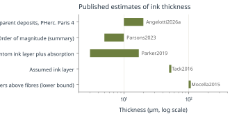
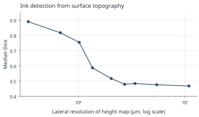

# Inks and Writing {#ch-inks}

> **Chapter summary.** Herculaneum scribes wrote with a reed pen in a carbon-based ink that is chemically almost identical to carbonized papyrus, which is why the ink is so hard to see in X-ray CT. Some Herculaneum ink contains lead, at tens of micrograms per square centimeter. Published estimates of ink thickness range from a few micrometers to more than 100 µm. This chapter sets out what is measured, what is disputed and why it matters for ink detection.

## Composition

### Carbon ink

Herculaneum ink is generally treated as a carbon black (lamp black) of almost pure carbon [Parsons2023]. Ancient recipes name soot and gum as the ingredients of writing ink; Thompson's handbook collects the passages, including Pliny's remarks on soot-based ink in *Natural History* 35 [Thompson1906]. No binder has been identified in Herculaneum ink in the sources consulted for this book. Tack and colleagues cite earlier work that found lipids in eight of nine black powders from Pompeii [Tack2016].

Iron gall ink, made from oak galls and iron salts, became widespread in late antiquity and the Middle Ages, but before 2016 metal-containing inks were thought to begin only around the fourth or fifth century CE, and iron gall ink around 420 CE [Brun2016] [WP-IronGall].

### Lead in the ink

In 2016 two studies reported lead in the writing of Herculaneum fragments held in Paris:

- **Brun and colleagues** found lead in the ink of fragments and argued it was present in the ink rather than being contamination [Brun2016].
- **Tack and colleagues** quantified it at 16 ± 5 µg/cm2 in a smaller fragment and 84 ± 5 µg/cm2 in a larger one [Tack2016]. Lead, phosphorus and chlorine were distributed together at the microscale; aluminum matched at the macroscale but not the microscale; copper did not match, which argues against a bronze inkpot as the source. The lead L3-edge spectrum resembled lead(II) acetate. They put forward two hypotheses: a pigment, or a drier such as litharge (lead oxide); lead acetate could also form later from lead oxide reacting with acetic acid given off by wooden cabinets [Tack2016].

An Egyptian comparison: Christiansen and colleagues found lead in most red inks and some black inks from the Tebtunis temple library, as phosphates, sulfates, chlorides and carboxylates, with no typical lead pigments; they propose a drier [Christiansen2020]. Earlier XRF of 38 Herculaneum fragments found phosphorus correlated with ink in 5, iron in 3, copper in 3 and lead in 2 [Parsons2023]. Seales and Delattre found calcium in ink and trace lead and strontium by PIXE [Parsons2023].

**Interpretation.** Lead at 16 to 84 µg/cm2 corresponds to a pure lead film only about 14 to 74 nm thick (dividing by the density of lead, 11.34 g/cm3). The lead is dispersed in the ink, so its effect on X-ray absorption is a weak areal change, not a resolvable layer. Lead-rich ink can still make some scrolls unusually legible in CT. The Vesuvius Challenge reported in February 2025 that in PHerc. 172 (Scroll 5), "unlike most Herculaneum scrolls scanned to date, the ink in this scroll is evidently more dense, appearing sometimes by eye in the scan" [VC-Scroll5News]. What makes it denser has not been established; a metal component is one hypothesis.

The K absorption edge of lead lies at 88.0045 keV. Just below the edge the mass attenuation coefficient is 1.910 cm2/g; just above it, 7.683 cm2/g [NIST-Pb]. Scanning just above and just below the edge, a technique known as K-edge subtraction, could in principle map lead. This book has found no published K-edge study of a closed Herculaneum roll.

> **Photograph (not stored in git; see the caption for source and license):** A reed pen (calamus) cut from a dried reed, shown on a white background.
*Figure 5.1. A reed pen (calamus), the writing tool of Greek and Roman scribes. Modern example. Photo: Enrique Íñiguez Rodríguez (Qoan), via Wikimedia Commons. License: CC BY-SA 4.0. <https://commons.wikimedia.org/wiki/File:Reed_pen_DSC_8590.jpg>*

## How thick is the ink?

Published estimates disagree by more than an order of magnitude:

| Claim | Value | Basis | Source |
|---|---|---|---|
| Letters rise above the fibers | "at least one hundred microns" | phase-contrast tomography of rolled papyri | [Mocella2015] |
| Ink layer assumed for a calculation | 50 µm, "may be thinner" | assumption | [Tack2016] |
| Ink layer on a fresh papyrus phantom | 3 to 5 µm, plus 4 to 12 µm of absorption into the substrate (3 to 17 µm total) | SEM cross-sections | [Parker2019] |
| Herculaneum ink thickness "on the order of" | 5 to 10 µm | summary | [Parsons2023] |
| Apparent ink deposits in PHerc. Paris 4 | about 10 to 20 µm | 2.4 µm phase-retrieved CT | [Angelotti2026a] |

**Interpretation.** The 100 µm figure is an outlier against direct SEM of a phantom and against 2.4 µm CT. Apparent thickness in CT includes blur from the point spread function and phase retrieval; the calculated resolution of the 2.4 µm configuration is 2.72 µm [Angelotti2026a], so an apparent 10 to 20 µm deposit may contain a thinner physical layer. No direct measurement of physical ink thickness on a carbonized Herculaneum roll has been published.

*Figure 5.2. Published estimates of ink thickness (ranges shown as bars; log scale). Chart by the editors. Data: data/ink_thickness.csv, sources as in the table above. License: CC BY 4.0 (this book).*

## Relief, texture and "crackle"

Ink is detectable in CT less because of its density than because of its shape and texture:

- **Morphological contrast.** Parker and colleagues showed that ink changes the shape of the surface: on inked papyrus the rounded cells between fiber ridges are hidden and the ridges stay visible but muted. In a 300 µm region "a dozen or more morphological features" distinguish inked from uninked surface [Parker2019].
- **Topography.** Angelotti and colleagues measured fragment surfaces by confocal profilometry and found that the topographic ink signal is surface roughness plus deformation from pen pressure; inked regions are smoother. The height map is dominated by inclination, curvature and the "lattice of fibers" [Angelotti2026b].
- **Crackle.** In 2023, contestants saw a texture "like cracked mud, raised slightly above" the papyrus surface in segmented regions of Scroll 1. This "crackle" was the first ink signal identified directly in scroll CT, and it guided the first hand labels ([Chapter 10](10-2023.md#ch-2023)) [VC-Tutorial5] [VC-FirstLetters].
- **Penetration.** On the phantom, carbon ink soaked 4 to 12 µm into the substrate [Parker2019]; Mocella and colleagues report that ink sat on top of the fibers [Mocella2015]. Pliny notes that polished sheets absorb less [Pliny-NH13, 13.81]. A polished, less absorbent surface would keep ink as a surface film, consistent with crackle and with surface-associated deposits at 2.4 µm.

### Resolution and topography

Angelotti and colleagues trained ink detectors on fragment topography at a series of resolutions [Angelotti2026b]. Median Dice scores:

| Resolution (µm) | 0.34 | 0.68 | 1.02 | 1.36 | 2.04 | 2.72 | 3.40 | 5.44 | 10.88 |
|---|---|---|---|---|---|---|---|---|---|
| Median Dice | 0.890 | 0.817 | 0.754 | 0.586 | 0.516 | 0.478 | 0.483 | 0.475 | 0.467 |

Only 1.02 µm or finer exceeds Dice 0.70; at about 2 µm and coarser the results cannot be told apart. A model trained at 0.34 µm and applied to degraded data falls to about zero by 3.40 µm [Angelotti2026b]. Topography alone therefore stops being informative at the voxel sizes of most scroll scans, and Angelotti and colleagues describe ink detection in Scroll 1 at 2.4 µm as a "mixed-signal regime rather than reading topography alone" [Angelotti2026a].

*Figure 5.3. Ink detection from surface topography: median Dice versus resolution (log scale). Chart by the editors from Angelotti, Nicolardi, Henderson and Seales (2026). Data: data/topography_dice.csv. License: CC BY 4.0 (this book).*

## Why carbon ink is hard to see

Bringing these facts together [VC-Tutorial5] [Angelotti2026a] [Mocella2015] [Tack2016]:

1. Carbon ink and carbonized papyrus have almost the same density, so absorption contrast is very low.
2. Most contrast comes from phase effects at edges and surfaces, but the papyrus fibers themselves produce a strong phase signal that hides parts of letters.
3. Fibers crossing the text in both directions interfere with reading.
4. The ink layer is thin, often only a few voxels at 2.4 µm and below one voxel at 7.91 µm.
5. Ink properties vary between scrolls: some contain lead, some show crackle, and some show neither. The Vesuvius Challenge's 2025 plan notes that ink-detection models trained on the two most readable scrolls "do not appear to generalize to the entire collection", and that the signal in those scrolls appears to correspond either to large morphological cracks or to brighter spots indicating metals [VC-MasterPlan].

## Pen and hand

Greek and Roman scribes wrote on papyrus with a reed pen (Greek *kalamos*, Latin *calamus*). Pliny writes "Chartisque serviunt calami" (reeds serve for paper), and Martial names reeds from Memphis [Thompson1906]. Egyptian scribes used rush brushes [Scora1991].

Text runs in columns along the horizontal fibers of the recto [Bukreeva2016]. Lines read left to right. Columns often lean left deliberately, by up to about 5 degrees (Maas's law) [Romano2023] [Ceccarelli2025]. Body letters are about 3 to 4 mm high [Mocella2015] [Ceccarelli2025]. The letters are Greek capitals, written without word division and with few accents or punctuation marks ([Chapter 6](06-greek.md#ch-greek)).

## Key facts

| Item | Value | Source |
|---|---|---|
| Ink type | carbon based (soot and gum in ancient recipes) | [Parsons2023] [Thompson1906] |
| Lead in some Herculaneum ink | 16 ± 5 and 84 ± 5 µg/cm2 | [Tack2016] |
| Lead K edge | 88.0045 keV | [NIST-Pb] |
| Ink layer on phantom | 3 to 5 µm (plus 4 to 12 µm absorbed) | [Parker2019] |
| Apparent ink at 2.4 µm CT | 10 to 20 µm | [Angelotti2026a] |
| Topography Dice at 2.72 µm | 0.478 | [Angelotti2026b] |
| Fragment benchmark (EduceLab) | Dice 0.48; character recall 0.42 | [Parsons2023] |
