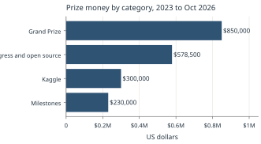
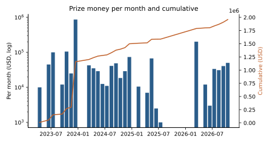
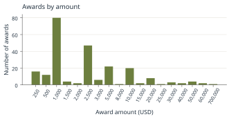

# The Prize Ledger {#ch-ledger}

> **Chapter summary.** The public winners list records 233 individual awards totaling **$1,958,500** in 34 rounds from April 2023 to October 2026. The 2023 Grand Prize ($850,000 including runners-up) accounts for 43 percent of the money; 202 progress and open-source awards account for $578,500. This chapter tabulates the rounds, years, categories and award sizes, and explains how the ledger was compiled. The full award-by-award ledger is in Appendix B.

## How the ledger was compiled

The ledger was parsed from the challenge's winners page (scrollprize.org/winners, retrieved 15 October 2026), which lists each award with an amount, a title, the recipients and usually a link [VC-Winners]. Three August 2026 awards without links were added by hand from the same page: $1,000 to Domenico Russo, $1,000 to Mihajlo Nestorović and $250 to Armando Gaona de Stefani. The parsed August total then matched the $31,000 stated for that round. Each award is dated by the month of the round heading on the winners page, which is usually the month of the work, not of the announcement. For example, the 2023 Grand Prize is dated December 2023 though announced on 5 February 2024, and the First Automated Segmentation awards are dated December 2024 though announced in January 2025 [VC-GrandPrize] [VC-FASP].

Limitations:

- Prizes that were announced but **never awarded** are not in the ledger: the 2024 Grand Prize ($200,000), the 2024 first-letters prizes for Scrolls 2 to 4, the Read an Entire Scroll Prize and the Unwrapping at Scale Prize [VC-FASP] [VC-MultipleScrolls].
- **Confidential** prizes, such as the 10 x $250 private prizes of April 2023 and the 5 x $200 Private Progress Pics Prize of December 2023, are not published as winners and are excluded [VC-PrivatePrizes2023] [VC-ProgressPics].
- Team awards are recorded once per team, not divided among members.
- Amounts are nominal US dollars, not adjusted for inflation.

Data: data/prize_awards.csv (one row per award) and data/prize_rounds.csv (one row per round).

## By year

| Year | Awards | Total |
|---|---|---|
| 2023 | 54 | $1,159,000 |
| 2024 | 92 | $340,500 |
| 2025 | 16 | $88,000 |
| 2026 | 71 | $371,000 |

*Table 14.1. Awards by year of round. Source: [VC-Winners].*

## By category

| Category | Awards | Total | Share |
|---|---|---|---|
| Grand Prize (2023 winner and three runners-up) | 4 | $850,000 | 43.4% |
| Progress and open-source prizes | 202 | $578,500 | 29.5% |
| Kaggle competitions (ink 2023, surface 2026) | 20 | $300,000 | 15.3% |
| Milestones (first letters, first ink, first title, autosegmentation) | 7 | $230,000 | 11.7% |

*Table 14.2. Awards by category. Shares are of $1,958,500. Source: [VC-Winners].*

*Figure 14.1. Prize money by category, April 2023 to October 2026. Chart by the editors. Data: data/prize_awards.csv from [VC-Winners]. License: CC BY 4.0 (this book).*

## By round

| Round month | Round | Total |
|---|---|---|
| 2023-04 | Open Source | $10,000 |
| 2023-06 | Segmentation Tooling | $45,000 |
| 2023-07 | Kaggle Ink Detection | $100,000 |
| 2023-09 | Ink Detection Followup | $12,000 |
| 2023-10 | First Letters & Ink | $60,000 |
| 2023-10 | Segmentation Tooling 2 | $45,000 |
| 2023-11 | Open Source | $25,000 |
| 2023-12 | Grand Prize 2023 | $850,000 |
| 2023-12 | Open Source | $12,000 |
| 2024-03 | Open Source | $42,500 |
| 2024-04 | Open Source | $35,000 |
| 2024-05 | Open Source | $29,000 |
| 2024-06 | Open Source | $12,500 |
| 2024-07 | Open Source | $11,000 |
| 2024-08 | Open Source | $41,000 |
| 2024-09 | Open Source | $48,500 |
| 2024-10 | Open Source | $18,500 |
| 2024-11 | Open Source | $29,000 |
| 2024-12 | First Automated Segmentation | $60,000 |
| 2024-12 | Open Source | $13,500 |
| 2025-02 | Open Source | $10,500 |
| 2025-04 | Open Source | $7,000 |
| 2025-05 | Open Source | $7,000 |
| 2025-05 | First Title Prize | $60,000 |
| 2025-06 | Open Source | $2,500 |
| 2025-07 | Open Source | $1,000 |
| 2026-03 | Kaggle Surface Detection | $200,000 |
| 2026-03 | Open Source | $1,000 |
| 2026-05 | Progress Prizes | $12,000 |
| 2026-06 | Progress Prizes | $3,000 |
| 2026-07 | Progress Prizes | $33,500 |
| 2026-08 | Progress Prizes | $31,000 |
| 2026-09 | Progress Prizes | $40,500 |
| 2026-10 | First Letters: PHerc. 343 | $50,000 |

*Table 14.3. Every round in the winners list. Source: [VC-Winners].*

*Figure 14.2. Prize money per round (bars, log scale) and cumulative total (line). Chart by the editors. Data: data/prize_rounds.csv from [VC-Winners]. License: CC BY 4.0 (this book).*

## Award sizes

| Amount | Number of awards |
|---|---|
| $250 | 16 |
| $500 | 12 |
| $1,000 | 80 |
| $1,500 | 4 |
| $2,000 | 2 |
| $2,500 | 47 |
| $3,000 | 6 |
| $5,000 | 22 |
| $8,000 | 1 |
| $10,000 | 20 |
| $15,000 | 2 |
| $20,000 | 8 |
| $25,000 | 1 |
| $30,000 | 3 |
| $40,000 | 2 |
| $50,000 | 4 |
| $60,000 | 2 |
| $700,000 | 1 |

*Table 14.4. Distribution of award sizes. The most common award is $1,000 (80 awards), followed by $2,500 (47). Source: [VC-Winners].*

*Figure 14.3. Number of awards at each amount. Chart by the editors. Data: data/prize_awards.csv. License: CC BY 4.0 (this book).*

## Frequent contributors

The table counts award entries that name a contributor. It measures how often a person's work was recognized, not money received, since team prizes are not divided.

| Contributor | Award entries naming them |
|---|---|
| Yao Hsiao | 16 |
| James Darby | 16 |
| Sean Johnson | 12 |
| Hendrik Schilling | 12 |
| William (Will) Stevens | 10 |
| Chuck (Khartes) | 9 |
| Santiago Pelufo | 8 |
| Johannes Rudolph | 8 |
| Forrest McDonald | 8 |
| Youssef Nader | 6 |
| Luke Farritor | 5 |
| Julian Schilliger | 4 |
| Philip Allgaier | 4 |
| Giorgio Angelotti | 4 |
| Ben Kyles | 4 |

*Table 14.5. Contributors named in the most award entries (simple name matching on the winners list; spelling variants may be missed). Source: [VC-Winners].*

## Patterns

Read from the tables above:

1. **One large prize, many small ones.** A single award of $700,000 is 36 percent of all money; 161 of 233 awards are $2,500 or less.
2. **Three phases.** Large competitive prizes in 2023 ($1.16 million); steady monthly progress prizes in 2024 ($340,500); a quieter 2025 with a $60,000 title prize and few progress awards ($88,000) while an in-house research team was built [VC-Hiring2025]; and a 2026 revival with the $200,000 Kaggle surface competition, a guaranteed $20,000 monthly best-submission prize from July and the $50,000 PHerc. 343 first-letters prize ($371,000 to mid October).
3. **Tool builders recur.** Contributors to segmentation and viewing tools (Khartes, Volume Cartographer and VC3D, the Segment Browser, ScrollFiesta) appear repeatedly across years.
4. **Open prize money outstanding.** The open pool at 15 October 2026 is $2,140,000 [VC-Prizes], more than everything awarded to date.
