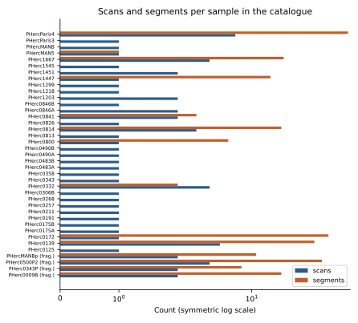

# Inventory of Scrolls and Fragments {#ch-inventory}

> **Chapter summary.** The open-data catalog (retrieved 15 October 2026) lists 45 samples: 35 scrolls and 10 fragments. This chapter tabulates every sample with data, its aliases, scans, voxel sizes, energies and facilities, then gives a short profile of each sample that has a documented history or result. Counts of segments are those published in the catalog, not totals of all segments ever made.

## How to read the names

- **PHerc.** numbers are inventory numbers of the Naples collection (Officina dei Papiri Ercolanesi, Biblioteca Nazionale di Napoli) [WP-HercPapyri]. Letters after the number (A, B) distinguish separately cataloged pieces of one roll; **P** marks a fragment piece scanned separately (for example PHerc. 343P beside the rolled PHerc. 343) [VC-Catalog].
- **PHerc. Paris 1 to 4** are rolls held by the Institut de France; **PHerc. MAN** items are in the Museo Archeologico Nazionale di Napoli (photographs in the catalog come from a "museum-photos" folder) [VC-Catalog]. *This expansion of MAN is the conventional one and is not stated in the catalog itself (unverified against a primary source).*
- **Cr** (cornice, frame) and **Fr** (fragment) identify mounted fragments, for example PHerc. 1667 Cr 1 Fr 3 [VC-Catalog].
- **Scroll 1 to 5** and **Fragment 1 to 6** are the challenge's older numbering. The mapping, from the catalog's legacy data paths, is [VC-Catalog]:

| Alias | Sample | Holding institution |
|---|---|---|
| Scroll 1 | PHerc. Paris 4 | Institut de France |
| Scroll 2 | PHerc. Paris 3 | Institut de France |
| Scroll 3 | PHerc. 332 | Biblioteca Nazionale di Napoli |
| Scroll 4 | PHerc. 1667 | Biblioteca Nazionale di Napoli |
| Scroll 5 | PHerc. 172 | Bodleian Libraries, Oxford |
| Fragment 1 | PHerc. Paris 2 Fr 47 | Institut de France |
| Fragment 2 | PHerc. Paris 2 Fr 143 | Institut de France |
| Fragment 3 | PHerc. Paris 1 Fr 34 | Institut de France |
| Fragment 4 | PHerc. Paris 1 Fr 39 | Institut de France |
| Fragment 5 | PHerc. 1667 Cr 1 Fr 3 | Biblioteca Nazionale di Napoli |
| Fragment 6 | PHerc. 51 Cr 4 Fr 8 | Biblioteca Nazionale di Napoli |

The Institut de France holding of Fragments 1 to 4 is inferred from their "Paris" names and is not stated in their catalog entries.

## Scrolls

| Sample | Alias | Type | Scans | Volumes | Segments | Voxel (µm) | Energy (keV) | Scan months | Facility |
|---|---|---|---|---|---|---|---|---|---|
| PHerc. 125 |  | scroll | 1 | 1 | 0 | 9.362 | 113 | 2025-07 | ESRF BM18 |
| PHerc. 139 |  | scroll | 5 | 10 | 39 | 1.129, 2.399, 2.403, 9.362 | 59, 77, 78, 113 | 2025-07, 2025-12 | ESRF BM18 |
| PHerc. 172 | Scroll 5 | scroll | 1 | 2 | 53 | 7.91 | 53 | 2024-10 | DLS |
| PHerc. 175A |  | scroll | 1 | 1 | 0 | 8.64 | 116 | 2025-05 | ESRF BM18 |
| PHerc. 175B |  | scroll | 1 | 1 | 0 | 8.64 | 116 | 2025-05 | ESRF BM18 |
| PHerc. 191 |  | scroll | 1 | 1 | 0 | 9.362 | 113 | 2025-07 | ESRF BM18 |
| PHerc. 211 |  | scroll | 1 | 1 | 0 | 9.362 | 113 | 2025-07 | ESRF BM18 |
| PHerc. 257 |  | scroll | 1 | 1 | 0 | 9.362 | 113 | 2025-07 | ESRF BM18 |
| PHerc. 268 |  | scroll | 1 | 1 | 0 | 8.64 | 116 | 2025-05 | ESRF BM18 |
| PHerc. 306B |  | scroll | 1 | 1 | 0 | 8.64 | 116 | 2025-05 | ESRF BM18 |
| PHerc. 332 | Scroll 3 | scroll | 4 | 4 | 2 | 2.399, 3.24, 7.91 | 53, 70, 78 | 2023-10, 2023-11, 2023-12, 2025-12 | DLS, ESRF BM18 |
| PHerc. 343 |  | scroll | 1 | 1 | 0 | 8.64 | 116 | 2025-05 | ESRF BM18 |
| PHerc. 358 |  | scroll | 1 | 1 | 0 | 9.362 | 113 | 2025-07 | ESRF BM18 |
| PHerc. 483A |  | scroll | 1 | 1 | 0 | 8.64 | 116 | 2025-05 | ESRF BM18 |
| PHerc. 483B |  | scroll | 1 | 1 | 0 | 8.64 | 116 | 2025-05 | ESRF BM18 |
| PHerc. 490A |  | scroll | 1 | 1 | 0 | 8.64 | 116 | 2025-05 | ESRF BM18 |
| PHerc. 490B |  | scroll | 1 | 1 | 0 | 8.64 | 116 | 2025-05 | ESRF BM18 |
| PHerc. 800 |  | scroll | 1 | 1 | 6 | 8.64 | 116 | 2025-05 | ESRF BM18 |
| PHerc. 813 |  | scroll | 1 | 1 | 0 | 9.362 | 113 | 2025-07 | ESRF BM18 |
| PHerc. 814 |  | scroll | 3 | 3 | 19 | 1.129, 2.399, 9.362 | 59, 78, 113 | 2025-07, 2025-12 | ESRF BM18 |
| PHerc. 826 |  | scroll | 1 | 1 | 0 | 9.362 | 113 | 2025-07 | ESRF BM18 |
| PHerc. 841 |  | scroll | 2 | 2 | 3 | 2.403, 9.366 | 77, 113 | 2025-07 | ESRF BM18 |
| PHerc. 846A |  | scroll | 2 | 2 | 0 | 2.403, 9.362 | 77, 113 | 2025-07 | ESRF BM18 |
| PHerc. 846B |  | scroll | 1 | 1 | 0 | 9.362 | 113 | 2025-07 | ESRF BM18 |
| PHerc. 1203 |  | scroll | 2 | 2 | 0 | 2.403, 9.362 | 77, 113 | 2025-07 | ESRF BM18 |
| PHerc. 1218 |  | scroll | 1 | 1 | 0 | 8.64 | 116 | 2025-05 | ESRF BM18 |
| PHerc. 1299 |  | scroll | 1 | 1 | 0 | 2.399 | 78 | 2025-12 | ESRF BM18 |
| PHerc. 1447 |  | scroll | 1 | 1 | 15 | 8.64 | 116 | 2025-05 | ESRF BM18 |
| PHerc. 1451 |  | scroll | 2 | 2 | 0 | 2.399, 8.64 | 78, 116 | 2025-05, 2025-12 | ESRF BM18 |
| PHerc. 1545 |  | scroll | 1 | 1 | 0 | 9.362 | 113 | 2025-07 | ESRF BM18 |
| PHerc. 1667 | Scroll 4 | scroll | 4 | 4 | 20 | 1.129, 2.399, 3.24, 7.91 | 53, 59, 78, 88 | 2023-11, 2025-12 | DLS, ESRF BM18 |
| PHerc. . MAN 5 |  | scroll | 1 | 1 | 1 | 2.399 | 78 | 2025-12 | ESRF BM18 |
| PHerc. . MAN B |  | scroll | 1 | 1 | 0 | 2.399 | 78 | 2025-12 | ESRF BM18 |
| PHerc. . Paris 3 | Scroll 2 | scroll | 1 | 1 | 0 | 2.4 | 78 | 2026-03 | ESRF BM18 |
| PHerc. . Paris 4 | Scroll 1 | scroll | 7 | 7 | 81 | 1.129, 2.4, 7.91, 45.532 | 54, 74, 78, 110, 137 | 2023-02, 2026-03 | DLS, ESRF BM18 |

*Table 15.1. Every scroll in the open-data catalog. Source: [VC-Catalog]; data file data/scroll_inventory.csv. "Facility" DLS is Diamond Light Source; BM18 and ID11 are ESRF beamlines.*

## Fragments

| Sample | Alias | Type | Scans | Volumes | Segments | Voxel (µm) | Energy (keV) | Scan months | Facility |
|---|---|---|---|---|---|---|---|---|---|
| PHerc. 9B |  | fragment | 2 | 3 | 19 | 2.401, 8.64 | 77, 116 | 2025-05, 2025-07 | ESRF BM18 |
| PHerc. 343P |  | fragment | 2 | 2 | 8 | 2.215, 8.64 | 111, 116 | 2025-05 | ESRF BM18 |
| PHerc. 500P2 |  | fragment | 4 | 4 | 46 | 0.55, 2.215, 9.362 | 65.35, 111, 113 | 2025-05, 2025-07 | ESRF BM18, ESRF ID11 |
| PHerc. 1667 Cr 1 Fr 3 | Fragment 5 | fragment | 0 | 0 | 0 | legacy only |  |  |  |
| PHerc. 51 Cr 4 Fr 8 | Fragment 6 | fragment | 0 | 0 | 0 | legacy only |  |  |  |
| PHerc. . MAN Bp |  | fragment | 2 | 2 | 11 | 1.129, 2.399 | 59, 78 | 2025-12 | ESRF BM18 |
| PHerc. . Paris 1 Fr 34 | Fragment 3 | fragment | 0 | 0 | 0 | legacy only |  |  |  |
| PHerc. . Paris 1 Fr 39 | Fragment 4 | fragment | 0 | 0 | 0 | legacy only |  |  |  |
| PHerc. . Paris 2 Fr 143 | Fragment 2 | fragment | 0 | 0 | 0 | legacy only |  |  |  |
| PHerc. . Paris 2 Fr 47 | Fragment 1 | fragment | 0 | 0 | 0 | legacy only |  |  |  |

*Table 15.2. Every fragment in the open-data catalog. "Legacy only" means the catalog entry has photographs and a legacy data path on the older data server but no scans in the new catalog. Source: [VC-Catalog].*

*Figure 15.1. Scans and published segments per sample in the open-data catalog. Chart by the editors from [VC-Catalog] (data/scroll_inventory.csv). License: CC BY 4.0 (this book).*

## Profiles

### PHerc. Paris 4 (Scroll 1)

- **Holder:** Institut de France [VC-Catalog].
- **Scans:** Diamond at 7.91 µm (catalog date February 2023, in two halves 1A and 1B) [VC-NewData2024]; a 45.532 µm overview; ESRF BM18 at 2.4 µm and 1.129 µm in March 2026 [VC-Catalog]. Parsons et al. date the original Diamond scan to 2019 [Parsons2023]; the catalog's date may be a processing date.
- **Results:** first word (ΠΟΡΦΥΡΑϹ, October 2023) [VC-FirstLetters]; 2023 Grand Prize, about 5 percent of the scroll, Epicurean text on pleasure [VC-GrandPrize]; ink directly visible in the 2.4 µm data and matching the 2023 reading "one-to-one" [VC-FirstScroll]; about 140 columns unwrapped in June 2026 [VC-GP2027].
- **Open:** its title; a $50,000 prize is open [VC-Prizes]. The prizes page notes that "the expected title region has shown no detectable ink so far" and that "the top rows are physically missing" [VC-Prizes].
- **Segments in catalog:** 81, the most of any sample.

### PHerc. Paris 3 (Scroll 2)

- **Holder:** Institut de France.
- **Scans:** Diamond 7.91 µm in two halves (2A and 2B) [VC-NewData2024]; ESRF BM18 2.4 µm (March 2026) [VC-Catalog]. The original Diamond scan does not appear in the new catalog.
- **Results:** no letters reported in the sources consulted; first-letters prizes for Scroll 2 went unclaimed in 2024 [VC-FASP].

### PHerc. 332 (Scroll 3)

- **Holder:** Biblioteca Nazionale di Napoli.
- **Description:** "a smaller scroll known as a *midollo* (marrow), a remnant from physical unwrapping of the larger original. Its small size enabled scanning at extremely high resolution (3.24um)" [VC-Catalog].
- **Scans:** Diamond 7.91 and 3.24 µm at 53 and 70 keV (October to December 2023) [VC-NewScans2023]; ESRF BM18 2.4 µm (December 2025) [VC-Catalog].
- **Results:** no letters reported in the sources consulted.

### PHerc. 1667 (Scroll 4)

- **Holder:** Biblioteca Nazionale di Napoli; "similar in size to PHerc. 332" [VC-Catalog].
- **History:** attempts at manual opening in the nineteenth century, 1969 and the 1980s left the inner core, about 8 cm of an original 19 to 24 cm height [VC-FirstScroll]. A detached piece, PHerc. 1667 Cr 1 Fr 3 (Fragment 5), "was partially opened in 1987 via the Oslo method" [VC-Catalog].
- **Scans:** Diamond 7.91 and 3.24 µm at 53 and 88 keV (November 2023); ESRF BM18 2.4 µm at 78 keV and 1.129 µm (December 2025) [VC-Catalog] [VC-Scroll4Letters].
- **Results:** letters after the 2.4 µm rescan (December 2025) [VC-Scroll4Letters]; read in full, a Stoic ethical treatise naming Aristocreon (June 2026) [VC-FirstScroll] [Angelotti2026a].

### PHerc. 172 (Scroll 5)

- **Holder:** Bodleian Libraries, Oxford; "similar in size to PHerc. Paris 4" [VC-Catalog]. Given in 1802 or 1803 by Ferdinand IV to the future George IV [VC-Scroll5].
- **Scans:** Diamond 7.91 µm, 53 keV, in two halves merged into one volume (catalog date October 2024) [VC-Scroll5] [VC-Catalog].
- **Results:** dense ink visible directly in the CT [VC-Scroll5]; title *Philodemus, On Vices, Book 1(?)* [VC-FirstTitle]; a final column quoting Theophrastus [VC-Column172]; about 70 percent unwrapped (7 m by 14 cm) [VC-PHerc172Seventy].

### PHerc. 139

- **Scans:** ESRF BM18 at 9.362 µm, 2.4 µm and 1.129 µm (July and December 2025), five scans and ten volumes [VC-Catalog].
- **Results:** strong ink signal with the generalist model [VC-MultipleScrolls]; title and author, Philodemus, *On Gods*, Book 8 [VC-FirstScroll]. Training on PHerc. 139 alone nearly doubled validation Dice on PHerc. 1667 in an autoresearch experiment [VC-WeAreCooking].

### PHerc. 343 and PHerc. 343P

- **PHerc. 343P** is a fragment with exposed ink that "broke free decades ago during mechanical unwrapping attempts"; ML recovered strokes at 2.2 µm [VC-SummerHaze].
- **PHerc. 343** (the rolled remainder) was scanned at 8.64 µm, 116 keV on BM18 in May 2025 [VC-Catalog]; its first letters, πᾶν τὸ γινόμε[νον, won a $50,000 prize in October 2026 [VC-PHerc343]. The scroll is "about 14cm long overall" [VC-PHerc343].

### PHerc. 500P2 and PHerc. 9B

Fragments with exposed ink used as ground truth for the generalist ink model [VC-SummerHaze] [VC-MultipleScrolls]. PHerc. 500P2 carries the highest-resolution scan in the catalog (0.55 µm, ID11), which revealed fiber lumens [VC-CompressedRegions]. Hidden layers in PHerc. 9B were detected by the model [VC-MultipleScrolls].

### PHerc. 814, 841, 1447 and 826

- **PHerc. 814:** faint model-predicted letterforms (October 2025) [VC-MultipleScrolls]; scanned at 9.362, 2.4 and 1.129 µm [VC-Catalog].
- **PHerc. 841:** "some Greek letters are visible" despite warped work-in-progress renders [VC-MultipleScrolls].
- **PHerc. 1447:** ink found (by October 2026) [VC-PHerc343]; it is one of the 13 Grand Prize volumes [VC-Prizes].
- **PHerc. 826:** a $1,000 progress prize in August 2026 for "First Letters on PHerc. 0826" [VC-Winners]; it remains on the First Letters eligible list [VC-Prizes].

### Eligible sets for the open prizes

| Set | Volumes |
|---|---|
| 2027 Grand Prize (13) | PHerc. 125, 191, 211, 257, 268, 358, 800, 813, 826, 1203, 1218, 1447, 1545 |
| First Letters (21) | PHerc. 125, 175A, 175B, 191, 211, 257, 268, 306B, 358, 483A, 483B, 490A, 490B, 800, 813, 826, 846A, 846B, 1203, 1218, 1545 |

Source: [VC-Prizes], which lists each with a specific volume identifier.

## How many scrolls remain

The master plan speaks of "all the remaining 300 scrolls in the collection" for Stage Three [VC-MasterPlan], and the April 2025 scanning post speaks of "all 300 known scrolls" [VC-ScanningAtScale]. [Chapter 2](#ch-villa) explains why the numbers of papyri in the collection (around 1,800 inventory numbers) and of intact rolls differ.
