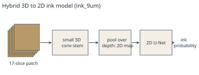

# Ink Detection {#ch-ink}

> **Chapter summary.** Ink detection is "signal recovery, not reading": a model looks at a small patch of a surface volume and predicts, per pixel, the probability of ink. Labels began with fragments photographed in infrared, grew through crackle annotation and the 2023 TimeSformer models, and now come from conservative iterative pseudo-labeling. In 2026 the main families are scroll-specific 2.4 µm models, cross-scroll hybrid 3D to 2D models at about 9 µm (ink_9um), community models such as reader-v2 and Hecate, and native 3D ink segmentation. Small windows, held-out validation and papyrological review are the safeguards against hallucination.

## The problem

"The carbon ink and the carbonized papyrus have almost the same density, so in an X-ray scan the ink is nearly invisible to the naked eye." On a detached fragment, letters are faint in color photographs, "crisp and legible" at 1000 nm infrared, and nearly gone in CT [VC-InkTutorial]. The remaining signal varies: in PHerc. Paris 4 ink "often shows up as a crackle, a texture like cracked mud, raised slightly above the papyrus"; elsewhere "the signal is more subtle and heterogeneous" [VC-InkTutorial]. The master plan noted in 2025 that the signal amplified in the first two readable scrolls "corresponds either to large morphological cracks or to brighter spots under X-ray, indicating a higher concentration of metals", and that models trained on those cues did not perform well on other scrolls [VC-MasterPlan]. [Chapter 5](#ch-inks) covers the physics and chemistry.

Two tasks are distinguished [VC-OpenProblems2026]:

- **ink detection:** "decide whether ink is present in a region";
- **ink segmentation:** "locate the ink precisely, ideally in 3D".

## How a model is trained

"We train the model by picking a pixel in a binary label image, sampling a subvolume around the same coordinates from the surface volume, and backpropagating the known label" [VC-InkTutorial]. The data layout of a training segment [VC-InkTutorial]:

| File | Content |
|---|---|
| x.tif, y.tif, z.tif, meta.json | tifxyz surface geometry |
| `<segment>.zarr` | surface volume |
| `<segment>_inklabels.zarr` / `.tif` | binary ink labels |
| `<segment>_supervision_mask.zarr` / `.tif` | where labels are trusted; only these pixels contribute to the loss |
| `<segment>_validation_mask.zarr` (optional) | held-out region for metrics |

The tutorial's 2.5D configuration uses `mode: "flat"`, a `vesuvius_unet` with max projection over depth, patches of 64 x 256 x 256, 20,000 iterations at learning rate 0.01 in fp16, and takes "about an hour and a half on a single H100" [VC-InkTutorial]. Inference slides overlapping windows (50 percent overlap, Hann blending) and writes a grayscale TIFF; a full segment takes "on the order of an hour on a single GPU" [VC-InkTutorial].

## Lineage of models

| Year | Model or method | Key facts | Source |
|---|---|---|---|
| 2019 to 2023 | EduceLab ink-id | ML on fragment CT with infrared labels (Stephen Parsons) | [VC-FirstLetters] [Parsons2023] |
| 2023 | Kaggle ink-detection winners | ten open solutions on fragments; resolution gap to scrolls noted | [VC-Winners] [VC-InkFollowupWinners] |
| 2023 | crackle-trained models | Casey Handmer's crackle; Luke Farritor's iterative labeling | [VC-FirstLetters] |
| 2023 | domain transfer | Youssef Nader: unsupervised pretraining on scroll data, fine-tuning Kaggle models | [VC-FirstLetters] |
| 2023 to 2024 | Grand Prize ensemble | three architectures, strongest images from a **TimeSformer** model (64 x 64 window) | [VC-GrandPrize] |
| 2024 | 3D ink detection | Ryan Chesler, $20,000 progress prize | [VC-Winners] |
| 2025 | generalist "ink hound" | curriculum from exposed fragments to hidden layers to closed scrolls | [VC-MultipleScrolls] |
| 2026 | PHerc. 1667 iteration 0 to 5 | ResNet3D-50 backbone from Kinetics-700 weights, 2D U-Net decoder; six checkpoints with growing pseudo-label coverage | [VC-OpenProblems2026] |
| 2026 | ink_canonical_2um | "the current ink detection model, which works on 2.4 µm data" | [VC-OpenProblems2026] |
| 2026 | ink_9um | hybrid 3D stem plus 2D U-Net, trained on aligned labels from PHerc. 139, 1667, Paris 4 and 814 at about 9 µm; seeds 42 and 43; seven checkpoints each | [VC-InkTutorial] |
| 2026 | 3D ink, ink_3d_dino_guided | native volumetric ink for PHerc. 172 "on-par with the 2.5D" state of the art; DINO-guided 3D ink segmentation for PHerc. Paris 4 | [VC-WeAreCooking] [VC-OpenProblems2026] |
| 2026 | Hecate | ink model by Giorgio Angelotti; community speed-ups (single pass, about 35 percent faster) | [VC-PHerc343] [VC-Winners] |
| 2026 | reader-v2 | Domenico Russo: "an ink model distilled onto native 9.6 µm volumes, now seeing wide use in the community" | [VC-Winners] |
| 2026 | dense_native | Erwin Nieuwlaar's fine-tune on PHerc. 139 | [VC-PHerc343] |

**TimeSformer** is a video transformer with divided space-time attention [Bertasius2021]; applied to surface volumes, the depth axis takes the place of time. It produced the strongest Grand Prize images [VC-GrandPrize]. The ResNet3D choice is explained by the challenge: "A video clip and a CT volume are both fundamentally 3D data ... so a 3D-convolutional network pretrained on one transfers surprisingly well to the other" [VC-OpenProblems2026] [Hara2018] [Carreira2019].

*Figure 21.1. Schematic of the hybrid 3D to 2D ink model used for ink_9um. Diagram by the editors from the description in [VC-InkTutorial]. License: CC BY 4.0 (this book).*

## Fragments as ground truth

Fragments exist because early unrolling attempts broke scrolls ([Chapter 3](#ch-unrolling)); their exposed ink can be photographed in infrared and CT-scanned, which gives a training pair: "input: CT data around the papyrus surface; label: visible ink from the photograph" [VC-OpenProblems2026]. The limitation is that "fragment labels are 2D: the photograph tells us where ink appears on the exposed surface, but not exactly where the ink signal sits in depth" [VC-OpenProblems2026]. The 2025 generalist model trained on PHerc. 500P2, 343P and 9B, registered with infrared images [VC-MultipleScrolls] [VC-Scroll4Letters].

## Iterative pseudo-labeling

The loop [VC-OpenProblems2026] [VC-InkTutorial]:

1. train on fragments (or an existing model);
2. run on a sealed scroll;
3. identify plausible traces;
4. label conservatively, painting clearly visible strokes and extending the supervision mask over strokes and clean background;
5. fine-tune and run again;
6. repeat.

On PHerc. 1667 six models (iterations 0 to 5) were trained with growing label coverage; predictions on a held-out validation region "grow steadily cleaner and more legible" [VC-OpenProblems2026]. But "it is not guaranteed to work everywhere. In some scrolls, predictions improve and then plateau. In others, current models show little or no convincing ink" [VC-OpenProblems2026].

## Cross-scroll models at 9 µm

The ink_9um models exist for "finding ink in scrolls nobody has read yet, where there are no labels to train on" [VC-InkTutorial]. Practical notes from the tutorial:

- Training labels: 24 segments on pooled 2.4 µm renders and 5 on native 9.362 µm renders, in the *ink_9um* dataset [VC-InkTutorial].
- With label smoothing 0.5 "the training targets are 0.25 for background and 0.75 for ink", so outputs occupy a compressed range; rescale as (p - 0.25) / 0.5 for display [VC-InkTutorial].
- "Run both seeds and a few different steps", and both directions [VC-InkTutorial].

Community work in 2026 benchmarked "all 14 released 9 µm ink checkpoints" and retrained from dense teacher labels (Domenico Russo), tested checkpoint averaging (Armando Gaona de Stefani) and ensembling (Alex Clark), fixed an ink-training leakage bug (Miika Kestilä), and filtered pseudo-labels by DINO similarity (ProbeGuide, Sebastien Chicoineau) [VC-Winners]. The PHerc. 343 first letters came from the average of four such models, none trained on PHerc. 343 [VC-PHerc343].

## Native 3D ink

Two native modes exist in the training code: `full_3d`, and `full_3d_single_wrap`, which adds a channel marking the segment's own wrap "so the model isn't confused where neighboring wraps pass through the same crop", the mode "to prefer" [VC-InkTutorial]. In high-resolution PHerc. Paris 4 scans "ink-bearing deposits become visible enough to support direct volumetric segmentation" [VC-OpenProblems2026]. A self-distillation trainer produces four classes (background, vertical fiber, horizontal or angular fiber, ink) from raw CT with no ground-truth labels, using frozen fiber and ink teachers, watershed splitting and PCA orientation [VC-OpenProblems2026]. The March 2026 post anticipated that "3D ink detection will, at some point, become the baseline" [VC-WeAreCooking].

## Resolution

"We have evidence that working on 1.1 µm data yields cleaner results than 2.4 µm data. But scanning at high resolution is impractical" [VC-OpenProblems2026]. The example given: at 1.1 µm "]οὐδὲ γὰρ ]τὰ μέλλοντα τελεῖϲθαι πρ[" is legible where at 2.4 µm only "τὰ μέλλοντα" is [VC-OpenProblems2026]. The Scroll 4 rescan at 2.4 µm turned "zero evidence of letters" into readable text [VC-Scroll4Letters]. A topography study found median Dice falling from 0.89 at 0.34 µm to about 0.47 at 10.88 µm ([Chapter 5](#ch-inks)) [Angelotti2026b].

## Guarding against hallucination

The safeguards, as stated by the challenge:

- **Small windows.** "The model only sees small local patches, smaller than a full letter, so it cannot learn to 'draw' plausible letterforms" [VC-InkTutorial]. The 2024 rules "strongly discourage" windows larger than 0.5 x 0.5 mm, 64 x 64 pixels at 8 µm [VC-GPSubmissions2024]; the 2027 rules say "the larger your model's window size, the easier it is for it to invent plausible letterforms instead of recovering real ink" and require demonstrating real text, for example on held-out regions [VC-Prizes].
- **Not OCR.** "It is not given Greek words, transcriptions, dictionaries, or language-model targets" [VC-OpenProblems2026].
- **Conservative labels and held-out validation** [VC-InkTutorial].
- **No overlap** between training and prediction regions, fixed and reported seeds, public datasets and experiment tracking [VC-Prizes].
- **Convergence** of independent methods on the same text [VC-GrandPrize].
- **Papyrological review.** "Machine output is never treated as a substitute for reading" [VC-InkTutorial].

## Diagnosing failure

When a model finds nothing, "the right conclusion here is neither 'the scan failed' nor 'the model failed'." Possible causes: the scan may not capture the signal; the surface may be misplaced; labels may not match the true ink location; the architecture may miss the right features; ink may differ across scrolls; or the signal may be "below the current pipeline's ability to use it". Hence "better diagnostics matter just as much as better models" [VC-OpenProblems2026].
