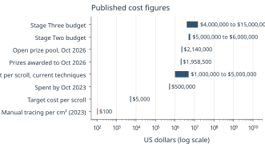
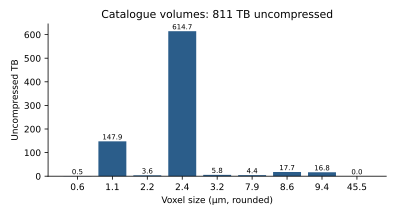

# Compute, Storage and Costs {#ch-compute}

> **Chapter summary.** The economics of reading a scroll are dominated by human time for unwrapping, then by data volume. In 2023 manual segmentation cost "more than $100 per square centimeter"; in 2025 the master plan put a whole scroll at $1 to 5 million with current techniques and set a target of $5,000 or less. The public catalog's volumes total about 811 TB uncompressed. Training the tutorial ink model takes about an hour and a half on one H100. This chapter collects the published numbers and the arithmetic that follows from them.

## The cost of unwrapping

| Quantity | Value | Source |
|---|---|---|
| Manual segmentation, 2023 | "more than $100 per square centimeter in manual labor" | [VC-GrandPrize] |
| Implied cost for all scrolls at that rate | "hundreds of millions or maybe even billions of dollars" | [VC-GrandPrize] |
| Whole scroll with current techniques (July 2025) | "$1-5 million" | [VC-MasterPlan] |
| Target | "$5000 or below. It might even be possible to fully automate it" | [VC-MasterPlan] |
| Stage Two budget | $5 to 6 million, partly funded (Musk Foundation $2,084,000) | [VC-MasterPlan] |
| Stage Three budget | $4 to 8 million with an efficient beamline protocol; $15 million or more otherwise | [VC-MasterPlan] |
| Spent by October 2023 | "about $500,000 in prizes and operational costs"; about $1.8 million raised in total by then | [VC-RaceIsOn] |
| Prizes awarded to 15 October 2026 | $1,958,500 | [VC-Winners], Chapter 14 |

**Arithmetic.** Scrolls are "10cm-20cm wide and up to 15 meters long" [VC-MasterPlan]. A roll 15 m by 20 cm has 30,000 cm2 of surface; at $100 per cm2 manual tracing that is $3 million, consistent with the master plan's $1 to 5 million range. The $5,000 target is about $0.17 per cm2 for the same roll, a reduction of roughly 600 times. *These two figures are the editors' arithmetic from the quoted numbers, not published estimates.*

*Figure 25.1. Published cost figures for unwrapping and for the program (log scale). Chart by the editors. Data: data/compute_costs.csv from [VC-GrandPrize], [VC-MasterPlan], [VC-RaceIsOn], [VC-Winners] and [VC-Prizes]. License: CC BY 4.0 (this book).*

## Human time limits in prize rules

| Prize | Human input allowed | Compute allowed | Source |
|---|---|---|---|
| First Automated Segmentation (2024) | "Maximum 4 hours of human input" | "48 hours of compute (in any order)" | [VC-Prizes2024] |
| 2027 Grand Prize | "up to 8 documented hours of human annotation / input are tolerated"; the pipeline "should be fully automated" | "Unlimited time, compute, and manual effort may be spent creating generic ML datasets to train ML models" | [VC-Prizes] |

## Data volume

Volumes are 8-bit (uint8) in the catalog, so uncompressed bytes equal voxels [VC-Catalog]. The 70 catalog volumes with listed shapes total about **811 TB** uncompressed. By voxel size:

| Voxel size (µm, rounded) | Uncompressed total (TB) |
|---|---|
| about 2.4 | 614.7 |
| about 1.1 | 147.9 |
| 8.6 | 17.7 |
| 9.4 | 16.8 |
| 3.24 | 5.8 |
| 7.91 | 4.4 |
| 2.2 | 3.6 |
| 0.55 | 0.5 |

Largest samples: PHerc. 139 (180 TB across its volumes), PHerc. Paris 4 (153 TB), PHerc. Paris 3 (123 TB), PHerc. 814 (64 TB) [VC-Catalog]. Stored volumes are compressed and chunked, so on-disk sizes are smaller; *compressed sizes were not measured for this book*.

*Figure 25.2. Uncompressed size of catalog volumes by voxel size. Chart by the editors. Data: data/catalog_volumes.csv from [VC-Catalog]. License: CC BY 4.0 (this book).*

The voxel-scaling rule ([Chapter 7](#ch-xray)) explains the concentration: halving the voxel size multiplies voxels by eight. The August 2025 post on the compressed regions noted that the reconstructed high-resolution volume "for the same region is about 64 times larger than a scan captured at a 2 µm pixel size, and 4,096 times larger than one captured at 8 µm" [VC-CompressedRegions]. The ratios imply a voxel size near 0.5 µm (editors' arithmetic).

Dataset sizes quoted by the challenge:

| Dataset | Size | Source |
|---|---|---|
| Tutorial ink segment (one PHerc. Paris 4 segment, from a Hugging Face bucket) | about 25 GB | [VC-InkTutorial] |
| Full ink-labels dataset | "hundreds of GB" | [VC-InkTutorial] |
| Rendered w035 surface volume (28 slices at 9.362 µm) | about 900 MB | [VC-InkTutorial] |
| spiral-input for PHerc. Paris 4 | "~49.6 GB total" on the datasets page; the spiral tutorial labels the download "Spiral Datasets (~90 GB)" | [VC-Datasets] [VC-SpiralTutorial] |
| 2023 Grand Prize banner volume (zarr) | 77 GB | [VC-Datasets] |
| 2023 Grand Prize banner TIFF stack | 389.9 GB | [VC-Datasets] |

## Hosting

The dataset is "hosted for free on the AWS Open Data Program for 2 years" from March 2026 [VC-WeAreCooking], in the bucket s3://vesuvius-challenge-open-data/ [VC-Data]. VC3D streams chunks and caches them locally (default `~/.VC3D/remote_cache`), "so only the parts of the scroll your segment touches ever get downloaded" [VC-InkTutorial]. The open-problems document asks that contributions be "cloud-native from the beginning": read chunks directly, run tiled inference, write inspectable outputs, preserve coordinate metadata, and "avoid unnecessary full-volume copies" [VC-OpenProblems2026].

## GPU time

| Task | Time | Hardware | Source |
|---|---|---|---|
| Train the tutorial ink model (the "full 20,000-iteration run" with the tutorial config) | "about an hour and a half" | "a single H100" | [VC-InkTutorial] |
| Inference on a full segment | "on the order of an hour" | one GPU | [VC-InkTutorial] |
| Render the w035 surface volume, streaming from S3 | "about five minutes", writing "a ~900 MB Zarr" | (not stated) | [VC-InkTutorial] |
| Autoresearch agents | four agents "working 24/7" | team cluster | [VC-WeAreCooking] |
| Spiral fit | requires an NVIDIA GPU; the tutorial pins torch below 2.13 because later versions "will require _significantly_ more vram" | | [VC-SpiralTutorial] |

Community work has lowered the bar: spiral fitting on consumer GPUs and on Windows, Apple MPS and CPU; portable GPU kernels for ScrollFiesta on AMD; a single-pass Hecate with "a ~35% speedup"; renderer memory reductions [VC-Winners] [VC-CommunityProjects] [Recent-2026-10-15].

## Scanning throughput

On BM18, "tetra-, hexa-, and octa-helical acquisitions" allow scanning "a large scroll at 9.2 µm pixel size in under two hours", more than halving earlier scan times; "more than thirty scrolls have been scanned under varied setups" (July 2025) [VC-MasterPlan]. Twenty scrolls were scanned in one April 2025 week at Diamond [VC-ScanningAtScale]. The master plan expects scanning and reading the remaining 300 scrolls to take "2-3 years", depending on "the maximum speed of scanning with a protocol that also maximizes ink signal" [VC-MasterPlan]. Beam-time prices are not published in the sources consulted.

## Practical guidance for contributors

Drawn from the tutorials:

1. Start with one segment (about 25 GB) before syncing a whole scroll [VC-InkTutorial].
2. Stream volumes from the public S3 bucket, which "is read anonymously, no AWS account needed", instead of downloading whole volumes [VC-InkTutorial].
3. "If you run out of GPU memory, reduce `batch_size` to 1, or reduce the `patch_size` to `[64, 128, 128]`" [VC-InkTutorial].
4. The tutorial's first-letters workflow uses the ~9 µm `ink_9um` models [VC-InkTutorial]. Data at 9.4 µm is smaller than 2.4 µm data by about (2.4/9.4)^3, roughly 1/60 (editors' arithmetic).
