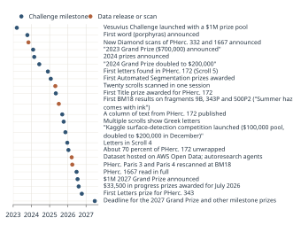

# Timeline {#ch-timeline}

> **Chapter summary.** A single chronology from the eruption to the 2027 prize deadline, compiled from the chapters of this book. Each row cites its source; the machine-readable version is data/timeline.csv. Dates of Substack-announced events are the dates of the announcing post unless the chapter gives another date.

*Figure 29.1. Challenge-era milestones, 2023 to 2027. Chart by the editors. Data: data/timeline.csv. License: CC BY 4.0 (this book).*

## Antiquity

| Date | Event | Source |
|---|---|---|
| c. 110 BCE | Philodemus born at Gadara (approximate) | [WP-Philodemus] |
| 79 CE | Eruption of Vesuvius buries Herculaneum and the Villa of the Papyri | [WP-Eruption79] |

## Excavation and early unrolling

| Date | Event | Source |
|---|---|---|
| 1709 | Herculaneum rediscovered by a well dig | [WP-Herculaneum] |
| 1738 | Systematic tunneling begins under Charles of Bourbon | [WP-Herculaneum] |
| 1750 | Villa of the Papyri found | [WP-Villa] |
| 1752 to 1754 | Papyri recovered from four find spots in the Villa | [WP-HercPapyri] |
| 1756 | Piaggio's unrolling machine | [WP-Piaggio] |
| 1802 | Six rolls given to Napoleon; later at the Institut de France | [WP-HercPapyri] |
| 1802 to 1806 | Hayter unrolls about 200 papyri | [WP-HercPapyri] |
| 1816 | Paris attempt destroys a roll | [WP-HercPapyri] |
| 1819 to 1820 | Davy's chemical attempts | [WP-HercPapyri] |
| 1858 | Tesoro letterario di Ercolano published | Commons file description |

## Scholarship and imaging before the challenge

| Date | Event | Source |
|---|---|---|
| 1969 | CISPE founded by Marcello Gigante | [WP-HercPapyri] |

## Excavation and early unrolling

| Date | Event | Source |
|---|---|---|
| 1986 | Villa of the Papyri reached again | [WP-Villa] |

## Scholarship and imaging before the challenge

| Date | Event | Source |
|---|---|---|
| 1999 to 2011 | BYU infrared imaging of 1,600 papyri | [WP-HercPapyri] |
| 2009 | Lab micro-CT of PHerc. Paris 4 and another roll; no ink visible | [Parsons2023] |
| 2013 | Volume Cartographer begun by Seth Parker | [VC-NewScans2023] |
| 2015 | Phase-contrast tomography letters (Mocella et al.) | [Mocella2015] |
| 2016 | En-Gedi scroll reading published; lead found in Herculaneum ink | [Brun2016] |
| 2019 | Diamond I12 scans of Scrolls 1 and 2 and fragments; ML ink detection on fragments | [Parsons2023] |

## The challenge

| Date | Event | Source |
|---|---|---|
| 15 Mar 2023 | Vesuvius Challenge launched with a $1M prize pool | [VC-GrandPrize] |
| 12 Oct 2023 | First word (porphyras) announced | [VC-FirstLetters] |
| 3 Nov 2023 | New Diamond scans of PHerc. 332 and 1667 announced | [VC-NewScans2023] |
| 5 Feb 2024 | 2023 Grand Prize ($700,000) announced | [VC-GrandPrize] |
| 27 Feb 2024 | 2024 prizes announced | [VC-NewPrizes2024] |
| 7 Jun 2024 | 2024 Grand Prize doubled to $200,000 | [VC-GP2024Doubled] |
| 27 Nov 2024 | First letters found in PHerc. 172 (Scroll 5) | [VC-Scroll5] |
| 24 Jan 2025 | First Automated Segmentation prizes awarded | [VC-FASP] |
| 25 Apr 2025 | Twenty scrolls scanned in one session | [VC-ScanningAtScale] |
| 5 May 2025 | First Title prize awarded for PHerc. 172 | [VC-FirstTitle] |
| 4 Jul 2025 | First BM18 results on fragments 9B, 343P and 500P2 ("Summer haze comes with ink") | [VC-SummerHaze] |
| 11 Sep 2025 | A column of text from PHerc. 172 published | [VC-Column172] |
| 9 Oct 2025 | Multiple scrolls show Greek letters | [VC-MultipleScrolls] |
| 13 Nov 2025 | Kaggle surface-detection competition launched ($100,000 pool, doubled to $200,000 in December) | [VC-KaggleSurface] |
| 21 Dec 2025 | Letters in Scroll 4 | [VC-Scroll4Letters] |
| 13 Jan 2026 | About 70 percent of PHerc. 172 unwrapped | [VC-PHerc172Seventy] |
| 19 Mar 2026 | Dataset hosted on AWS Open Data; autoresearch agents | [VC-WeAreCooking] |
| Mar 2026 | PHerc. Paris 3 and Paris 4 rescanned at BM18 | [VC-Catalog] |
| 25 Jun 2026 | PHerc. 1667 read in full | [Angelotti2026a] |
| 15 Jul 2026 | $1M 2027 Grand Prize announced | [VC-GP2027] |
| 6 Aug 2026 | $33,500 in progress prizes awarded for July 2026 | [VC-July2026] |
| 8 Oct 2026 | First Letters prize for PHerc. 343 | [VC-PHerc343] |
| 25 Jun 2027 | Deadline for the 2027 Grand Prize and other milestone prizes | [VC-Prizes] |

*Dates before the challenge are as given in the cited secondary sources; Chapters 1 to 3 discuss disagreements, such as the day of the eruption.*
