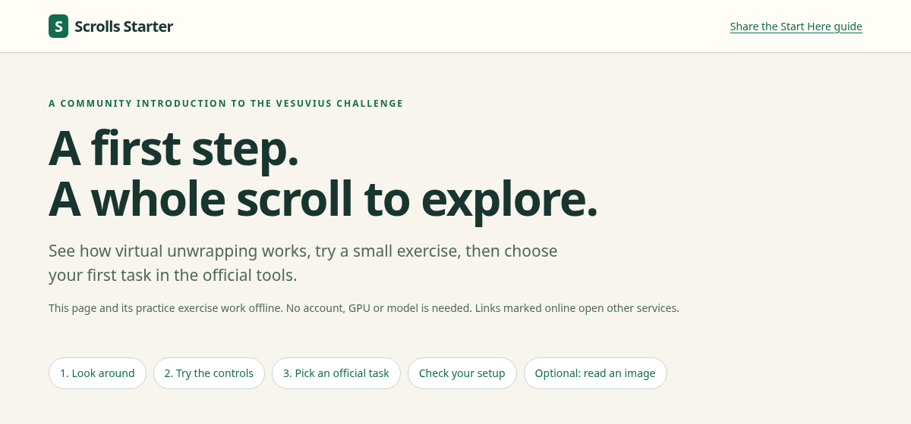
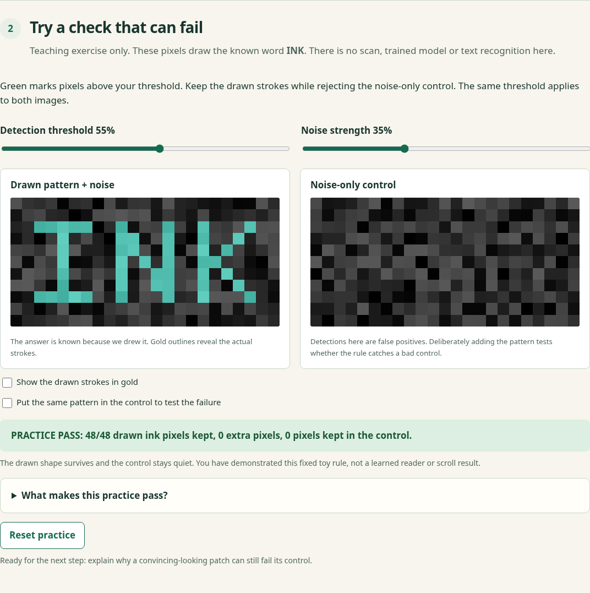
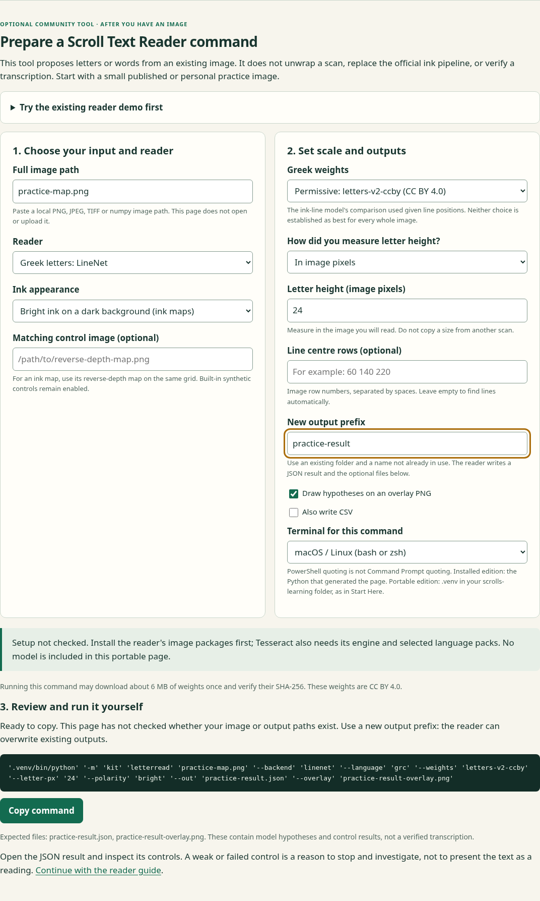

# What is Scrolls Workbench? A picture guide

**Scrolls Workbench is an installable collection of tools for working with the Vesuvius Challenge.** It helps you practice, check images, suggest text from an existing image, and plan or record experiments. The Python package is named `scrolls-workbench`; its commands use `python -m kit`.

There is no single Workbench window containing every tool. **Scrolls Starter is the beginner front door:** a small browser page that explains the choices and helps you prepare commands. This guide shows what you will actually see.

Open a screenshot at full size to read its controls.

| Name | What you use it for | How you open it |
| --- | --- | --- |
| **Scrolls Workbench** | The installed toolbox: Starter, Scroll Text Reader, scoring and recordkeeping commands | Install the Python package; run the command for the tool you need |
| **Scrolls Starter** | Learn the workflow, try a small exercise, check setup and prepare a reader command | Open the portable HTML, or run the installed Starter |
| **Scroll Text Reader** | Suggest letters or words from an existing 2D image | A Workbench command, with optional image packages and model files |
| **AutoPipeline** | Coordinate official tracing, rendering and ink-detection tools | A separate package, with its own commands and optional monitor |
| **Unroll / Scroll Lens** | Explore published scrolls / compare models on small scan cubes | Separate websites linked from Starter |

## 1. Open Starter first

Download **[Scrolls-Starter.html](https://github.com/ChaseHendrick/Scrolls/releases/download/workbench-v0.4.1/Scrolls-Starter.html)** and double-click the downloaded file. This first step needs a browser, with no Python, GPU or account. The page and its exercise work offline; links to other services need Internet.

*The actual portable Starter from Workbench 0.4.0. Its links help you choose your next activity.*

For the installed toolbox, use the [macOS, Linux or Windows installation steps](start-here.md#2-try-scrolls-starter-on-your-computer). They install the released wheel, a Python package file. You do not need to clone the repository. The installed Starter can check your local packages; the portable page explicitly leaves setup **not checked**.

## 2. Try one small check

In Starter, select **2. Try the controls**. The left picture contains the drawn word **INK** with noise. The right contains only noise. Move the threshold and watch which pixels survive. Then check **Put the same pattern in the control to test the failure**: the result should change to **PRACTICE FAIL**.

*This is a teaching exercise with a known answer. No scroll, trained model or text recognition is involved.*

Your first success is understanding why a convincing-looking pattern still needs a control. This exercise runs entirely in the page and costs no compute credits.

## 3. Use a Workbench tool when you have a reason

For example, **Scroll Text Reader** takes a 2D image and proposes text. Starter's optional reader form prepares the command; you review it and run it yourself after [installing the reader requirements and trying its demo](start-here.md#4-optional-suggest-text-from-an-existing-image).

*Example form inputs only: no image was opened and this command was not run. Use your own file, a new output name and a letter height measured in that image.*

The Greek LineNet model proposes Greek letters. Optional local Tesseract OCR uses language packs you install separately. A run writes a JSON result and, when requested, an overlay image or CSV. Those are hypotheses to check, not verified transcriptions. The first Greek-model run can download weights; the [reader guide](letter-reader.md) explains inputs, controls and outputs.

**Ink detection and text recognition are different steps:**

`CT scan -> traced sheet -> surface volume -> ink prediction -> possible letters -> expert reading`

Scroll Text Reader works near the end of that chain. The official ink tools produce the ink prediction from a surface volume.

## 4. Move into the official workflow

Use [Start Here's first official tasks](start-here.md#3-move-to-one-small-official-task) to choose a bounded data-notebook example, follow one sheet in VC3D, or try an ink-detection example. You can use those tools directly. Unroll and Scroll Lens remain optional ways to explore along the way.

When you want to coordinate several stages, try [AutoPipeline's small synthetic demo](start-here.md#5-optional-practice-pipeline-automation):

*An existing capture of AutoPipeline's synthetic demo, using stand-in VC3D tools and a stand-in ink model. The timing is for that demo, not a real scroll. This is AutoPipeline's monitor, not a universal Workbench interface.*

Install AutoPipeline in its **own virtual environment**: both packages contain a Python module named `kit`. Real runs also need the official tools, data storage and an appropriate compute budget. Follow the [requirements and cost checks](start-here.md#before-a-larger-run) before scaling up.

**Next:** keep [Start Here](start-here.md) open for the exact installation steps and first tasks. The [tool index](tools/README.md) is the reference when you need a particular command.

### About these screenshots

The first three images were captured on 17 October 2026 from the published Workbench 0.4.0 portable HTML, SHA-256 `9597fd15559028bb0d9762ec5c4d3d8625b6508a97ebdb59231b6f7f779f7f25`. Chromium rendered the unchanged release HTML offline; the capture loaded it directly because this environment blocks local file navigation. There were no network requests or browser script errors. The reader form uses example filenames only. The AutoPipeline image is the repository's existing [synthetic-demo capture](autopipeline/README.md#12-live-monitor). All images show our own interfaces and synthetic examples, with no private scan or research output.
