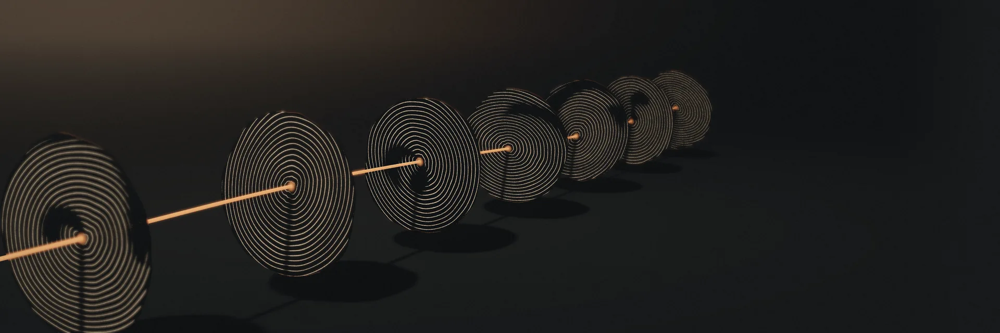
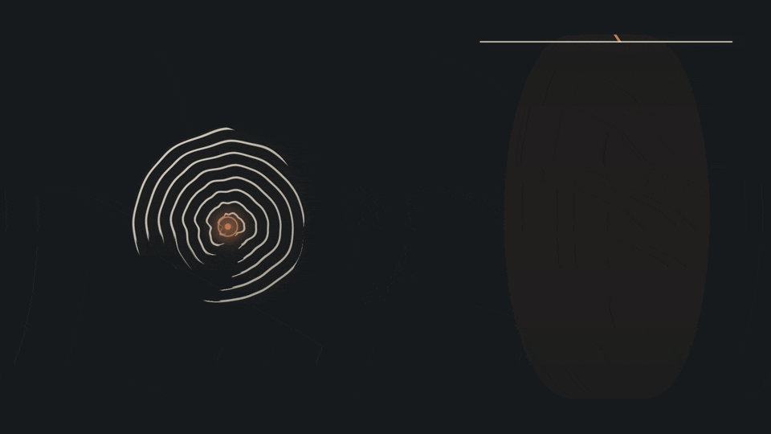

# Scroll centre finder (umbilicus)



*Concept illustration: synthetic cross-sections, cap to base, with a copper thread through each winding center. No scan data.*

This finds the winding centre (the umbilicus) of a Herculaneum scroll in X-ray CT and writes it in the same format as the published umbilicus files: one control point per height, `x`, `y`, `z` in level-0 voxels of the scan. Tools that trace and orient the papyrus sheets use such a line. Many scrolls have none, and two people placing the same centre by hand often disagree by a few millimetres (below), so an automatic answer with a measured error is useful.

It is model output, not a measurement. Check a line on CT slices before you rely on it.



*Concept illustration: what the finder looks for, a winding center that drifts from cap to base. Formulas only, no scan and no model run ([MP4](../../docs/assets/umbilicus/umbilicus-center-sweep.mp4)).*

## What it does

1. **Slices.** Every 8th plane of pyramid level 3 (8x downsampled) of the scroll's scan in the [open-data bucket](https://scrollprize.org/data), so one slice every 64 level-0 voxels (about 0.55 to 0.60 mm). Read with HTTP range requests, about 0.8 to 2.4 MB per slice.
2. **First stage.** A small U-Net (3.3 million parameters) looks at three neighbouring slices squeezed into a 256 pixel square around the scroll (about 0.3 mm per pixel; 0.26 to 0.43 mm on the 13 published scrolls) and puts a heatmap peak on the centre. Eight flips and rotations are averaged.
3. **Zoom stage.** A second U-Net of the same shape looks at a 176 pixel window of the full level-3 slice (69 to 75 um per pixel, 12 to 13 mm across) around the first answer and moves it onto the centre, twice.
4. **Smoothing.** A running median and a Savitzky-Golay filter along the scroll's height.
5. **End trims.** Two rules drop heights where a centre has nothing to sit on. The mount and cap trim keeps the longest unbroken run of slices with at least 30 % of the scroll's median papyrus area and at least 3 mm inside the first and last slices that show papyrus. The end-point rule then looks at the centre itself: from each end inward it drops points until 2 mm of consecutive slices have papyrus within 4 mm of the centre in at least three quarters of 32 directions. It only trims from the ends; nothing between the first and last such run is removed. If no such run exists, the line gets no points.

## Quick start

```sh
pip install numpy scipy requests torch
U=https://github.com/ChaseHendrick/Scrolls/releases/download/umbilicus-v1
mkdir -p work/umbilicus/weights
for f in umbilicus-first-all.pt umbilicus-zoom-all.pt; do curl -fL -o work/umbilicus/weights/$f $U/$f; done
(cd work/umbilicus/weights && shasum -a 256 -c) <<'EOF'
c9b50aae2876e00f50b7ade5cf9a6facc84fb0f8ad9667dddf5565e5f06ae854  umbilicus-first-all.pt
0a06fe2e108fbb5f252455f93862336ec4013a535eb922676ae8f846406fb4bb  umbilicus-zoom-all.pt
EOF
python scripts/umbilicus/predict.py PHerc0125 \
    --first work/umbilicus/weights/umbilicus-first-all.pt --zoom work/umbilicus/weights/umbilicus-zoom-all.pt \
    --data work/umbilicus/slices --out work/umbilicus/out
```

This writes `work/umbilicus/out/PHerc0125_umbilicus.json` and `PHerc0125_predict.json` (every slice's centre, which slices were kept and why, and the end-point support). `work/` is ignored by git, so the weights and slices stay out of it. The first run reads about 0.25 to 0.65 GB of slices from the bucket into `--data` (0.24 to 0.62 GB on the 13 published scrolls). On 4 CPU cores the smallest published scan, PHerc1203, took about 13 minutes, 7 of them reading its slices (our run, with one first-stage and one zoom model of the released size). Give several `--first` or `--zoom` files to take the median of several models; `--volume` picks a scan when a scroll has more than one (a slice file already in `--data` must come from that scan, or by default from the default scan, and must hold some CT; otherwise `predict.py` stops and asks you to remove it); `--device cuda` runs it on an NVIDIA GPU (`mps` is untested); it also runs on a CPU. The held-out scores below were computed on NVIDIA GPUs under bfloat16 autocast; on a CPU the networks run in float32, so answers can differ slightly from what the scoring saw (Interpretation).

It works on a scroll that has a 1.2 m (about 9 um) scan in the open-data bucket, stored as raw 128^3 uint8 chunks; the default scan is that one. The models were trained on 8.64 and 9.362 um scans only, so other voxel sizes are untested (Interpretation); `predict.py` refuses a `--volume` outside 8 to 10 um before reading it, and any slice file outside that range. The released models trained on all 13 published scrolls, so on those scrolls the answer is not a test; the held-out numbers below come from models that never saw the scroll they were scored on.

## Weights

Release [`umbilicus-v1`](https://github.com/ChaseHendrick/Scrolls/releases/tag/umbilicus-v1) of this repository holds the 14 files below and a `SHA256SUMS` of them; each downloads from `https://github.com/ChaseHendrick/Scrolls/releases/download/umbilicus-v1/<file>`. They are PyTorch state dicts (float32 weights). Inside each file the archive folder keeps the file's name in the training run (`alls0`, `refine_all`, `fold0s0`, ...), the names the commands under "Reproduce" write.

| File | What | SHA-256 | Bytes |
| --- | --- | --- | ---: |
| `umbilicus-first-all.pt` | first stage, trained on all 13 published scrolls (`alls0.pt` in a run) | `c9b50aae2876e00f50b7ade5cf9a6facc84fb0f8ad9667dddf5565e5f06ae854` | 13,342,891 |
| `umbilicus-zoom-all.pt` | zoom stage, trained on all 13 (`refine_all.pt` in a run) | `0a06fe2e108fbb5f252455f93862336ec4013a535eb922676ae8f846406fb4bb` | 13,349,699 |
| `umbilicus-first-fold0s0.pt` | first stage without group 1, seed 0 | `fe143f783b7a18be048b5a1a66a291c5055acb3163839810684f495fb8644ea4` | 13,348,827 |
| `umbilicus-first-fold0s1.pt` | first stage without group 1, seed 1 | `2d9ea4a8bd25d6a8f105bd580b48d61bcb28c94fef69557f42fd28cae069c677` | 13,348,827 |
| `umbilicus-first-fold1s0.pt` | first stage without group 2, seed 0 | `9f48a7d47c14a2520ddc9d53d33cc127089484c2266670660145810fe10f0134` | 13,348,827 |
| `umbilicus-first-fold1s1.pt` | first stage without group 2, seed 1 | `351a683eb53a5773be469dbe8c6db411ca98fe5fd10d06c94f8565f689f95129` | 13,348,827 |
| `umbilicus-first-fold2s0.pt` | first stage without group 3, seed 0 | `7ddd179508ed9982b45eb59998f027d4e192ac299ece0d884f8b0a6cd7379299` | 13,348,827 |
| `umbilicus-first-fold2s1.pt` | first stage without group 3, seed 1 | `f7b60c6af3fca19b4f518932c25dc2990cd77637765ae341a1962286ef9391df` | 13,348,827 |
| `umbilicus-first-fold3s0.pt` | first stage without group 4, seed 0 | `4325d729582a556299684437366caa47a00e27cbb423cba769fdf536ade15aa1` | 13,348,827 |
| `umbilicus-first-fold3s1.pt` | first stage without group 4, seed 1 | `bb433ec36a56ee0ba3a6c7746ac3b8960c5b44c13c431237b8fea61b01c4bbb5` | 13,348,827 |
| `umbilicus-zoom-fold0.pt` | zoom stage without group 1 | `f33153471b0a00d18f6ea205496393fc81e7ea4c7f9093396c299c5fbd76cdef` | 13,349,939 |
| `umbilicus-zoom-fold1.pt` | zoom stage without group 2 | `f47e525d04064b0f27b888425cdd900a426baa08b879ac1aa4bafcccc1dcfe13` | 13,349,939 |
| `umbilicus-zoom-fold2.pt` | zoom stage without group 3 | `421d39b11db1fe98f6ab19af1496f11661904bd950ce38b262a1e63ca46c25e3` | 13,349,939 |
| `umbilicus-zoom-fold3.pt` | zoom stage without group 4 | `4c5c819c8e36c365427329253c23eecd224b60784af97729ccc7b1ad153a6d32` | 13,349,939 |

The two `-all` files are the ones `predict.py` needs; the 12 fold files reproduce the held-out scores (group k is `FOLDS[k - 1]` in `pipeline.py`).

## Held-out results

How the score works. The 13 published centre lines used here are all on 1.2 m scans (8.64 or 9.362 um). Their scrolls were split into four groups by scroll on 13 October 2026, before the two training runs below: group 1 {PHerc0125, 0268, 1203}, group 2 {0211, 0800, 0191, 1545}, group 3 {0826, 1218, 0257} and group 4 {1447, 0358, 0813}. Our record first shows the groups in the same entry as a CPU prototype of the first stage that had already been scored with group 1 held out, so it cannot show which came first (Interpretation; see "Not an untouched test set"). Each group was scored by models trained on the other 9 or 10 scrolls only (two first-stage seeds averaged, then one zoom model). The score is the distance in the slice plane between the smoothed line and the published line, at every slice inside the published line's height range, 3,414 slices in all. The control is the centroid of the papyrus in each slice, smoothed the same way.

Pooled over the 3,414 held-out slices (Model output):

| | Median | 90th percentile | Within 1 mm | Within 2 mm |
| --- | ---: | ---: | ---: | ---: |
| Papyrus centroid (control) | 3.98 mm | 9.97 mm | 7 % | 25 % |
| First stage alone | 1.20 mm | 4.00 mm | 43 % | 72 % |
| First stage, then zoom stage | 0.73 mm | 3.37 mm | 60 % | 80 % |

Per scroll, median distance in mm (Model output):

| Scroll | Centroid | First stage | Both stages |
| --- | ---: | ---: | ---: |
| PHerc0125 | 2.36 | 1.37 | 0.46 |
| PHerc0211 | 2.84 | 0.99 | 0.86 |
| PHerc0826 | 3.25 | 1.50 | 1.29 |
| PHerc0191 | 6.45 | 2.04 | 1.35 |
| PHerc0257 | 3.41 | 1.24 | 0.65 |
| PHerc0268 | 14.66 | 4.04 | 3.48 |
| PHerc0358 | 5.79 | 0.82 | 0.25 |
| PHerc0800 | 6.93 | 1.56 | 1.43 |
| PHerc0813 | 7.00 | 1.31 | 0.82 |
| PHerc1203 | 4.64 | 0.51 | 0.39 |
| PHerc1218 | 1.80 | 0.69 | 0.37 |
| PHerc1447 | 2.74 | 1.07 | 0.45 |
| PHerc1545 | 3.03 | 1.38 | 1.34 |

The tables come from the `result.json` files that `pipeline.py collect` and `refine.py chain-collect` wrote for the two training runs of 13 October 2026. Those run records are not published here; the commands under "Reproduce" rebuild them. The pooled and per-scroll numbers of both network rows are also in [`heldout-endrule.json`](../../docs/evidence/2026-10-14-umbilicus/heldout-endrule.json), with the SHA-256 of the 14 weight files. The centroid control's numbers, with the rest of the table, are also in [`docs/results.json`](../../docs/results.json) under `umbilicus_checks`.

The first stage beats the centroid on 13 of 13 scrolls; adding the zoom stage is not worse on 13 of 13. The median of the per-scroll medians is 1.31 mm for the first stage and 0.82 mm for both stages (Model output).

The readout rules were written down on 13 October 2026, before each run was launched: the first stage works if its pooled held-out median is at most 2.0 mm and it beats the centroid on at least 10 of 13 scrolls; the zoom stage is adopted if its pooled median is at least 0.1 mm lower than the first stage's and it is not worse on at least 9 of 13 scrolls. Both passed. The run plan that holds the rules is not published, so the timing cannot be checked from here (our record).

### With the end trims

The tables above score every slice inside each published line's height range and stay the main score, because there the finder does not choose which slices count. A line from `predict.py` keeps fewer: on these held-out answers both end trims together keep 3,243 of the 3,414 scored slices, with a median of 0.69 mm for both stages. The same held-out answers scored over all slices, over the slices the mount and cap trim keeps, and over the slices both trims keep (`endcheck.py score`, 14 October 2026, Model output):

| Arm | Slices scored | Slices | Median | 90th percentile | Within 1 mm | Within 2 mm |
| --- | --- | ---: | ---: | ---: | ---: | ---: |
| Both stages | all | 3,414 | 0.730 mm | 3.371 mm | 60.3 % | 79.6 % |
| Both stages | mount and cap trim | 3,373 | 0.717 mm | 3.206 mm | 61.0 % | 80.4 % |
| Both stages | both trims (close to what `predict.py` keeps; see below) | 3,243 | 0.686 mm | 2.970 mm | 62.4 % | 81.8 % |
| First stage alone | all | 3,414 | 1.197 mm | 3.997 mm | 43.1 % | 71.9 % |
| First stage alone | mount and cap trim | 3,373 | 1.177 mm | 3.877 mm | 43.7 % | 72.7 % |
| First stage alone | both trims | 3,242 | 1.146 mm | 3.638 mm | 44.5 % | 73.8 % |

The all-slices rows equal the tables above (0.730 and 1.197 mm over 3,414 slices), which checks that the right answers were scored. The end-point rule looks at each arm's own centres, so the two arms keep slightly different slices. `endcheck.py score` read the slices from the bucket here (no `--data`), so its mount and cap trim used level-5 planes, a stand-in for the level-3 papyrus area `predict.py` uses; the end-point rule read level-3 windows, as `predict.py` does.

The slices the end-point rule drops were mostly worse than the rest. It dropped scored slices on 10 scrolls (none on PHerc0125, 0211 and 0826). On 9 of the 10, in both arms, the dropped slices' median error was above that scroll's median over all its scored slices; the exception is PHerc0191 (Model output):

| Scroll | Both stages: dropped | their median | scroll median | First stage: dropped | their median | scroll median |
| --- | ---: | ---: | ---: | ---: | ---: | ---: |
| PHerc0191 | 10 | 0.76 | 1.35 | 10 | 0.56 | 2.04 |
| PHerc0257 | 17 | 2.76 | 0.65 | 17 | 2.90 | 1.24 |
| PHerc0268 | 9 | 4.90 | 3.48 | 8 | 4.83 | 4.04 |
| PHerc0358 | 9 | 1.28 | 0.25 | 10 | 1.25 | 0.82 |
| PHerc0800 | 21 | 4.94 | 1.43 | 21 | 5.49 | 1.56 |
| PHerc0813 | 15 | 3.72 | 0.82 | 14 | 5.05 | 1.31 |
| PHerc1203 | 12 | 1.37 | 0.39 | 12 | 1.13 | 0.51 |
| PHerc1218 | 10 | 0.74 | 0.37 | 11 | 1.76 | 0.69 |
| PHerc1447 | 15 | 2.05 | 0.45 | 15 | 1.74 | 1.07 |
| PHerc1545 | 12 | 4.52 | 1.34 | 13 | 4.70 | 1.38 |

Medians in mm. Numbers: [`heldout-endrule.json`](../../docs/evidence/2026-10-14-umbilicus/heldout-endrule.json).

### Read these numbers with care

- **One annotator per scroll** (Interpretation). The score is the distance to one person's line. Ten of the 13 lines are Alexey Drobkov's, so the network may have learned that annotator's way of placing a centre. People disagree by more than this error. TAUIL-Abd-Elilah's six hand-drawn lines (PHerc0191, 0257, 0358, 0800, 0813, 1203) sit a median 1.76 to 4.81 mm from an earlier version of Drobkov's lines (commit `57e09a3d`), at most 18.31 mm, and that repository now marks its PHerc1203 line as withdrawn from recommended use ([umbilicus-cross-validation](https://github.com/TAUIL-Abd-Elilah/umbilicus-cross-validation), read 14 October 2026, Community report). Drobkov's own lines moved a median 0.3 to 3.0 mm on those six scrolls between that version and the one used here, at most 17 mm (our measurement of the two published versions at the heights both cover, one every 64 voxels). Drobkov's and Iyán Dopico's PHerc1218 lines differ by 2.00 mm in the median and up to 7.20 mm, and Drobkov's README says his own line is the one that is off over z 7500 to 9500 and recommends Dopico's there ([herculaneum-umbilici](https://github.com/AlexeyDrobkovStrikesBack/herculaneum-umbilici) README at `de7642ac`, Community report). The score here uses Drobkov's line at every height. An error under the people's disagreement does not show the network is more accurate than a person (Interpretation).
- **Slice-to-slice jitter in the labels.** Each published point sits a median 0.15 to 0.74 mm from the straight line through its two neighbours, a per-point scatter of about 0.12 to 0.6 mm (our measurement of the 13 published lines). That scatter is a floor on any score (Interpretation).
- **Two winding centres.** On PHerc0268 two winding centres run side by side at 13 annotated heights, and on PHerc0800 three centres share six heights (Drobkov's README and `multicentre/` at `de7642ac`, Community report). A single line cannot be right there (Interpretation); PHerc0268 is the worst scroll (Model output).
- **Not an untouched test set** (Interpretation). The settings of both stages and of the mount and cap trim were chosen while looking at some of the same 13 scrolls (CPU prototypes on groups 1 and 2). The cross-validation keeps every scroll out of its own models' training, but the design saw them.
- **At the ends, some published points sit where the end-point rule finds little papyrus round the centre.** Applied to the published lines themselves, the rule would drop 131 of the 3,414 scored slices (3.8 %), all on Drobkov's ten lines; on PHerc0125, 0211 and 0826 it drops none (our measurement of the published lines with the rule, in [the calibration file](../../docs/evidence/2026-10-14-umbilicus/calibrate.json)). The main score includes them.
- **No head-to-head on the same slices.** [villa #1823](https://github.com/ScrollPrize/villa/pull/1823) (merged 21 September 2026), which added villa's `vc_gen_umbilicus`, reports per-scroll medians of the merged method for these 13 scrolls in its description: 1.44 to 7.11 mm from manual reference lines, worst on PHerc0813 (Community report). [villa #1736](https://github.com/ScrollPrize/villa/pull/1736), closed without merging, reports a pooled 2.29 mm over 204 points on PHerc0125, 0211 and 0826 (Community report). Their slices, reference versions and scoring differ from ours, and we have not run either method on our slices, so the numbers are not directly comparable (Interpretation). This repository's AutoPipeline (see the main README's "Released tools") takes its umbilicus from the catalog's file or estimates one with villa's `vc_gen_umbilicus`, and its umbilicus stage also accepts a file in the published format, such as the one `predict.py` writes; the two finders have not been compared or run together (Interpretation).
- **Agreement between models is not accuracy** (Interpretation). `spread_mm_median` in a written file says how much the models agree, nothing more.

## The end-point rule and how it was fixed

The mount and cap trim looks at the papyrus area of the whole slice, so near a broken or hollow end it can keep heights where the scroll still has papyrus somewhere but none round the centre. The end-point rule casts 32 rays from the centre in the level-3 slice and counts the share that meet papyrus (CT at or above Otsu's air and papyrus level, taken over the windows the rule reads) within the radius. Each ray starts at the centre, so a centre that sits on papyrus, or within about one level-3 pixel of it, counts as supported in every direction.

Fixed from the 13 published scrolls only, at their published centres (`python scripts/umbilicus/endcheck.py calibrate`, about 0.6 to 0.7 GB of range reads; result in [`docs/evidence/2026-10-14-umbilicus/calibrate.json`](../../docs/evidence/2026-10-14-umbilicus/calibrate.json)). Calibration computes the mount and cap trim from level-5 planes, a stand-in for the level-3 area the pipeline uses. Chunks the bucket does not hold read as 0 (air), as in the slice files; the calibration file counts those chunk reads per scroll (`missing_chunks`).

- The bar (three quarters of directions) and the run (2 mm of consecutive slices) were set by meaning.
- The radius is the smallest of 2, 3, 4 and 5 mm at which at most 0.5 % of published centres in the middle 80 % of each published line fall under the bar: 5.7 % at 2 mm (157 of 2,732 slices), 1.2 % at 3 mm (32), 0.18 % at 4 mm (5, 3 of them on PHerc0268), 0.11 % at 5 mm (3). So 4 mm.
- At the published centres it drops 155 of the 3,461 points the mount and cap trim keeps, 84 at the low ends and 71 at the high ends. On PHerc0125, 0211 and 0826 it drops only points outside the published range.
- Moving the centre by a smooth random offset of median 0.73 or 1.2 mm, a stand-in for the network's error, it drops 140 or 129 points. A bar of 0.5 drops 116; 0.9 drops 167 but puts 46 middle slices under the bar.

All of these are our measurement of the published lines. The radius figures come from `endcheck.py calibrate` and `endcheck.py calibrate --radius 2`, `--radius 3` and `--radius 5` with this code (14 October 2026); the 4 mm figures and the counts of 155, 84, 71 and 5 of 2,732 are in the calibration file. The offsets and the other bars came from one-off scripts that are not part of this release, whose papyrus level was taken over slightly different crops (their 4 mm case drops 154 points, not 155); they are not in the released evidence.

How the rule changes the held-out scores is under "With the end trims" above. `python scripts/umbilicus/endcheck.py score RUN_DIR` measures it from a run's held-out answers, one stage per folder (it refuses a folder that holds both `fold*.json` and `refine_*.json`); its `pooled.all` must first reproduce the held-out table.

## Reproduce the held-out results

Training needs a GPU. Each first-stage job trained for about 2.7 to 4.2 minutes (162 to 253 s) on a B300 and each zoom job for about 1 minute (46 to 76 s) on an L40S (our run records). Both stopped at their epoch count, not their 300 s time cap; on a slower card raise `--time-s` so the same epochs finish.

```sh
D=work/umbilicus/slices; F=work/umbilicus/first; Z=work/umbilicus/zoom
python scripts/umbilicus/slices.py extract --out $D                       # the 13 published scrolls, at most 5.0 GB of range reads
for j in fold0s0 fold0s1 fold1s0 fold1s1 fold2s0 fold2s1 fold3s0 fold3s1 alls0; do
  python scripts/umbilicus/pipeline.py job $j --data $D --out $F --size 256 --width 32 --epochs 60 --time-s 300 --batch 32 --device cuda
done
python scripts/umbilicus/pipeline.py collect --data $D --out $F             # F/result.json: first stage and centroid
for n in fold0 fold1 fold2 fold3 all; do
  python scripts/umbilicus/refine.py chain $n --data $D --base $F --out $Z --epochs 30 --width 32 --time-s 300 --device cuda
done
python scripts/umbilicus/refine.py chain-collect --data $D --out $Z         # Z/result.json: first stage against both stages
python scripts/umbilicus/endcheck.py score $F --out $F/endcheck.json             # end trims, first stage
python scripts/umbilicus/endcheck.py score $Z --out $Z/endcheck.json             # end trims, both stages
python -m unittest tests.test_umbilicus                                     # unit tests, synthetic data, CPU
```

Training is not bit-for-bit repeatable on GPUs; expect small differences from the table (Interpretation). The jobs save `<job>.pt` beside their records: `alls0.pt`, `fold<k>s<seed>.pt`, `refine_all.pt` and `refine_fold<k>.pt` are the released files under their public names above. The two `endcheck.py score` lines read the slices from the bucket, without `--data`, as the end-trim table above was made; with `--data` the mount and cap trim uses the level-3 slices instead and its counts can differ slightly. `refine.py cv`, a CPU check of the zoom stage from offset published centres, saves `refine_cv_fold<k>.pt`, so it never overwrites them.

`slices.UNLABELLED` is an optional list of scrolls without a published centre line. When it names scrolls, the training jobs also predict them, and `collect` and `chain-collect` write their files to `umbilicus/` in the run folder. `predict.py` is the simpler way to get a line for such a scroll.

## Files

| File | What |
| --- | --- |
| `slices.py` | Published centre lines (pinned sources), slice extraction by range requests (`slices.py extract`, `extract_ranged`), the smoothing along z; `extract` is the whole-chunk reader the training slices came from and needs numcodecs |
| `centrenet.py` | First-stage network, training, prediction, coordinate frames |
| `refine.py` | Zoom stage: training, cross-validation, chaining onto first-stage answers |
| `pipeline.py` | Folds, training jobs, scoring, the mount and cap trim, the end-point rule, the file format |
| `predict.py` | Centre line for a scroll from trained weights |
| `endcheck.py` | Calibrate the end-point rule on published scrolls, score it on held-out answers, apply it to written files |
| `ctcheck.py` | Draw centre lines on CT slices for a person to check; also needs matplotlib (`pip install matplotlib`, which brings Pillow) |

## Licences, credits and citation

- Code: Apache-2.0, like the rest of this repository.
- Weights: CC BY-NC 4.0.
- The CT the weights learned from is released under CC BY-NC 4.0. The code licence does not cover the weights. Anyone can retrain them from the public data with the Apache-2.0 code (see "Reproduce").
- CT scans and the three published umbilicus files for PHerc0125, PHerc0211 and PHerc0826: Vesuvius Challenge open data, "CC-BY-NC 4.0 (unless otherwise noted for specific assets)" ([scrollprize.org/data](https://scrollprize.org/data), read 14 October 2026, Sourced fact). They are read from the bucket, not copied here. Drobkov's README attributes these three lines to sean (Community report).
- The 13 scans used here were made in 2025 (the dates in their volume names), so they belong to the newer scans released directly by Vesuvius Challenge, which the data page asks you to cite as: Giorgio Angelotti, Stephen Parsons, Sean Johnson, Elian Rafael Dal Prà, Johannes Rudolph, Paul Tafforeau, Alessandro Mirone, Paul Henderson, Hendrik Schilling, Forrest McDonald, David Josey, Youssef Nader, C. Seth Parker, W. Brent Seales. *Vesuvius Challenge - CT Scans of Herculaneum Papyri*. Vesuvius Challenge. ([How to Cite](https://scrollprize.org/data#how-to-cite), read 14 October 2026, Sourced fact.)
- Ten centre lines: Alexey Drobkov, [herculaneum-umbilici](https://github.com/AlexeyDrobkovStrikesBack/herculaneum-umbilici) at commit `de7642ac9b38266e95192489e22fb13b7e2d13b6`, MIT licence (Sourced fact). They are downloaded at that commit, not copied here.
- Thanks to TAUIL-Abd-Elilah and Iyán Dopico, whose independent lines put a number on how much people disagree.
